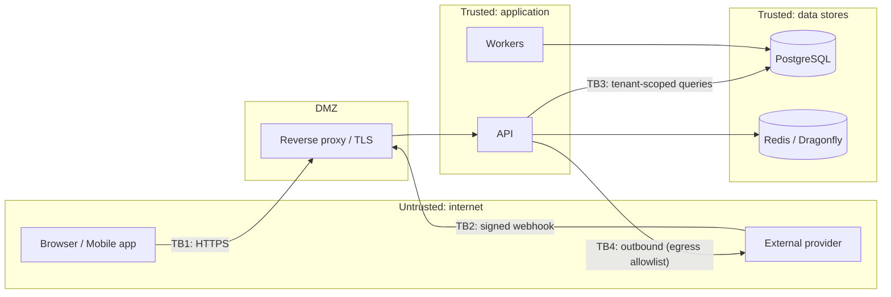

# Threat Model: [Feature / System]

> **Path**: `docs/architecture/threat-models/<feature>.md`
> **Status**: Draft | Reviewed | Accepted | Needs update
> **Author**: [appsec-engineer / person] · **Reviewer**: security-lead
> **Date**: [YYYY-MM-DD] · **Next review**: [date or trigger — spec change, new boundary, new provider, incident]
> **Feature spec**: [`design/specs/<feature>.md`] · **Research note**: [`docs/research/<feature>.md`] · **ADRs**: [...]
> **Required because**: [authentication · authorization model · billing · licensing · file upload · webhooks · PII export/delete · admin/impersonation · new external integration]
> **Standards**: OWASP ASVS [version/level — L2 default, L3 for auth, billing, licensing] · OWASP MASVS [version, mobile only] · OWASP API Security Top 10 [2023]

<!-- Method: STRIDE per trust boundary + abuse cases for business-flow abuse (security-baseline.md).
     IDs for ASVS/MASVS requirements are looked up in the official documents at mapping time — never recalled from memory. -->

## 1. Scope

- **In scope**: [components, data flows, deployments (hosted / self-hosted), clients]
- **Out of scope**: [and why — e.g. payment provider's internals; card data never touches our servers]
- **Assumptions**: [e.g. TLS terminates at the proxy; the secret store is trusted; tenant model = shared schema with RLS]
- **Actors**: [anonymous, authenticated user per role, tenant admin, operator/support, self-hosted operator, external provider, attacker with network access, malicious tenant]

## 2. Assets

| ID | Asset | Classification (public / internal / confidential / PII / secret) | Owner (context) | Impact if compromised (C / I / A) |
|----|-------|-----------------------------------------------------------------|-----------------|-----------------------------------|
| A1 | [Tenant data] | | | |
| A2 | [Credentials / tokens / API keys] | | | |
| A3 | [Payment state / entitlements] | | | |
| A4 | [Licence signing key] | | | |

## 3. Trust Boundaries & Data Flow

| ID | Boundary | Crosses | Authenticated by | Data crossing |
|----|----------|---------|------------------|---------------|
| TB1 | Client <-> API | Internet -> app | [session / token] | [...] |
| TB2 | Provider -> webhook endpoint | Internet -> app | [signature + timestamp] | [...] |
| TB3 | App <-> data store | App -> data | [service credential + tenant scoping/RLS] | [...] |
| TB4 | App -> provider/outbound | App -> Internet | [API key from secret store] | [...] |

## 4. STRIDE Analysis per Boundary

<!-- One table per boundary. N/A needs a reason. Likelihood/Impact: L / M / H. Every High residual needs a named acceptor in section 7. -->

### TB1 — [Client <-> API]

| ID | STRIDE | Threat | Asset | Likelihood | Impact | Mitigation ID(s) |
|----|--------|--------|-------|-----------|--------|------------------|
| T1.1 | **S**poofing | [Stolen / forged token used as another user] | A2 | | | M1 |
| T1.2 | **T**ampering | [Mass assignment, parameter tampering of tenant_id / price / role] | A1 | | | M2 |
| T1.3 | **R**epudiation | [Admin action without audit trail] | A1 | | | M3 |
| T1.4 | **I**nformation disclosure | [IDOR / cross-tenant read; verbose errors; enumeration] | A1 | | | M4 |
| T1.5 | **D**enial of service | [Unbounded query, large body, expensive endpoint, no rate limit] | availability | | | M5 |
| T1.6 | **E**levation of privilege | [Role bypass, missing object-level authorization] | A1 | | | M4 |

### TB2 — [Provider -> webhook]

| ID | STRIDE | Threat | Asset | Likelihood | Impact | Mitigation ID(s) |
|----|--------|--------|-------|-----------|--------|------------------|
| T2.1 | Spoofing | [Forged webhook] | A3 | | | |
| T2.2 | Tampering / Replay | [Replayed or reordered event] | A3 | | | |

### TB3 / TB4 — [data store / outbound]

| ID | STRIDE | Threat | Asset | Likelihood | Impact | Mitigation ID(s) |
|----|--------|--------|-------|-----------|--------|------------------|
| T3.1 | Information disclosure | [Query missing tenant scope] | A1 | | | |
| T4.1 | Tampering / SSRF | [User-supplied URL reaches internal ranges / metadata service] | A2 | | | |

## 5. Abuse Cases (business-flow abuse)

<!-- Legitimate features used for illegitimate ends. Trial abuse, coupon stacking, seat inflation, quota evasion, referral fraud, enumeration of tenants/emails, scraping, licence sharing, export exfiltration. -->

| ID | Abuse case | Actor | Goal | Detection | Mitigation ID(s) |
|----|-----------|-------|------|-----------|------------------|
| AB1 | [Repeated trials with fresh emails] | | free usage | | |
| AB2 | [Downgrade/upgrade cycling to avoid charges] | | | | |
| AB3 | [Invitation spam to third parties] | | | | |

## 6. Mitigations -> Stories & Tests

<!-- Every mitigation links to a story and to the test that proves it. A mitigation with no test is a wish. -->

| ID | Mitigation | Addresses | ASVS / MASVS ref | Story | Test (negative) | Status |
|----|-----------|-----------|------------------|-------|-----------------|--------|
| M1 | [Short-lived access tokens, rotating refresh with reuse detection] | T1.1 | [ASVS id] | [STORY-ID] | [test name / path] | Planned / Done |
| M2 | [Explicit request DTOs; server derives tenant_id and price] | T1.2 | | | | |
| M3 | [Append-only per-tenant audit log for security events] | T1.3 | | | | |
| M4 | [Object-level authz in the use case; tenant-scoped repository + RLS; cross-tenant -> 404] | T1.4, T1.6, T3.1 | | | | |
| M5 | [Rate limits per tenant/actor/route; body size limits; pagination caps; timeouts] | T1.5 | | | | |
| M6 | [Verify signature + timestamp; dedupe by event ID; async processing] | T2.1, T2.2 | | | | |
| M7 | [Egress allowlist client blocks private/link-local/metadata ranges] | T4.1 | | | | |

## 7. Residual Risk — Accepted by Name

<!-- Anything not fully mitigated is accepted explicitly by a named person with a review date. "Accepted" without a name does not count. -->

| Risk (threat/abuse ID) | Residual level | Why accepted / compensating control | Accepted by (name, role) | Date | Review by |
|------------------------|----------------|-------------------------------------|--------------------------|------|-----------|
| | | | | | |

## 8. ASVS / MASVS Mapping

<!-- Requirement IDs looked up in the official ASVS 5.0 / MASVS 2.1 documents. Status: Met (evidence) / Partially met / Not applicable (reason) / Gap (story). -->

| Chapter / area | Requirement ID | Requirement (short) | Status | Evidence (test / config / doc) |
|----------------|----------------|--------------------|--------|-------------------------------|
| [Authentication] | | | | |
| [Access control] | | | | |
| [Validation / encoding] | | | | |
| [Cryptography / secrets] | | | | |
| [Logging / error handling] | | | | |
| [API / web service] | | | | |
| [Mobile storage / network (MASVS)] | | | | |

## 9. Verification Plan

- Negative tests: authz bypass, cross-tenant access, injection, replay, rate limit, mass assignment
- Dependency/image scans on the changed components; secrets scan
- `/security-audit` scope: [...]
- Re-review triggers: [new boundary, provider change, role model change, incident]

## 10. Revision History

| Date | Author | Change |
|------|--------|--------|
| [Date] | | Initial |
