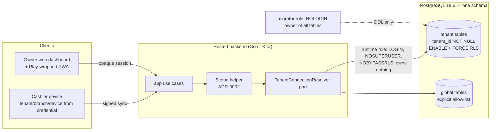

# ADR-0001: Tenancy model — shared-schema RLS with a per-tenant-database exit, and the tenant unit

## Status

Proposed

> **Who may move this to `Accepted`: the user, or `cto` on the user's explicit
> confirmation. No other agent, and no skill on its own.**
> Why this is stated here: stories referencing a `Proposed` ADR are set `Blocked`,
> and epics require `Accepted`, so the field needs a named owner. `cto` is the
> role `coordination-rules.md` escalates technical conflicts to, and an ADR is
> that decision made durable.
>
> This does **not** relax the rule that `Status: Accepted` is never set without
> explicit user confirmation — it narrows *which agent* may set it once that
> confirmation exists. An agent that believes an ADR is ready says so and
> escalates; it does not edit this field.

## Date

2026-10-17

## Last Verified

2026-10-17

## Decision Makers

The founder (user) decided the options on 2026-10-17 (`docs/research/tenant-isolation.md` § 5). Drafted by `/architecture-decision`. Stack-lead validation: NOT ASSESSED — no stack layer configured (`stack.data` and `stack.backend` are unset). CTO-ADR: skipped — lean mode. Acceptance: the user.

## Summary

Kodeebo's hosted backend must keep each owner organisation's data, devices and staff apart on one PostgreSQL 18.6 cluster that serves local-first cashier devices, the owner web dashboard and the same dashboard wrapped for Google Play. Decision: one shared schema with `ENABLE` + `FORCE` row-level security on every tenant table and non-bypass runtime roles, reached only through a tenant-to-connection resolver so one tenant can later move to its own database without changing callers; the tenant unit is tenant (owner organisation) → branch (venue) → device (cashier PC).

## Stack Compatibility

| Field | Value |
|-------|-------|
| **Stack layer(s)** | Data (PostgreSQL); Go backend or Ktor backend (track undecided, `/setup-stack`) |
| **Domain** | Tenancy |
| **Layer** | Foundation |
| **Knowledge Risk** | HIGH — PostgreSQL 18.6 and its row-security fixes post-date training; every behaviour relied on was executed at 18.6 (research note part 1, tier E) |
| **References Consulted** | `docs/stack-reference/postgres/VERSION.md`, `best-practices.md` § 1, `breaking-changes.md`, `deprecated-apis.md`; `docs/research/tenant-isolation.md` (parts 1, 4, 5, 6); `docs/research/licensing.md` Part 1 |
| **Pinned versions relied on** | `postgres:18.6` (`pins.yaml` `postgres.image`) |
| **Post-Cutoff APIs Used** | PostgreSQL 18 row security as fixed in 18.6 (CVE-2026-14666, row-security caching after role changes — research F124): 18.6 is the floor for server and client tools |
| **Verification Required** | Catalogue tests C1–C5/C8 fail on a planted defect and pass on the real schema (F111, F617); runtime-role negative tests DB-01…DB-10 (part 6 § 3.10); a resolver test that routes every tenant query through the port |

Critical ADR: yes — tenancy model (Foundation; `workflow: standard` critical list).

## ADR Dependencies

| Field | Value |
|-------|-------|
| **Depends On** | None (first ADR) |
| **Enables** | ADR-0002 (tenant context), ADR-0003 (branch scope and session); the operator cross-tenant access ADR (next to write); device credential and enrolment; server sync state and restore; key custody and re-registration; retention, deletion and export; sync limits; licensing (device mode) |
| **Blocks** | Every epic that stores tenant data (none written yet); `/setup-stack` setting `tenancy.model` |
| **Ordering Note** | Accept before `/setup-stack` writes `tenancy.model: shared-schema-rls`. The operator cross-tenant access ADR must be written and accepted before any support or admin tooling is built (Kodelix does the guided installs and support). |

## Context

### Problem Statement

Kodeebo is a hosted multi-tenant point of sale for PlayStation lounges and cafés. Every tenant's sales, staff data and device commands land in one hosted backend; the cashier device syncs commands into a server inbox keyed `(tenant_id, device_id, command_id)`, and the owner sees everything through the owner web dashboard, which is also the owner "Android app" — the same dashboard as a PWA published on Google Play inside a wrapper (`docs/research/desktop-client-adr-followups.md` § 5, OQ6; founder input pending spikes S32/S33). The tenancy model decides the schema, the roles, the migration path, backup and restore, export and deletion, and every isolation test. Every later backend ADR and the first backend story wait on it; not deciding blocks `/setup-stack`.

### Current State

No production code exists. The sync and desktop spikes run outside this decision. The research note executed the PostgreSQL behaviours at 18.6 (parts 1, 3, 4, 6) and recorded the founder's decisions of 2026-10-17 (§ 5).

### Constraints

- Hosted multi-tenant only; self-hosted is not offered (brief decision log, 2026-10-16). One PostgreSQL 18.6 cluster.
- Three venues today at an anchor of 10,000 EGP/year each; growth unknown (research F126). Per-tenant fixed cost matters.
- Local-first devices: a server restore must be reconcilable with device-held sequences (sync note SC-19; research F127, F330).
- PDPL (Law 151/2020) staff data in Tier 1; ETA tax records kept ≥ 5 years on the hosted server only (eta-note D5).
- Backend track (Go or Ktor) undecided; the model must work for both (ADR-0002).
- Small team: one schema and one migration target to operate.

### Requirements

- A runtime query can never read or write another tenant's rows, even when the application forgets a filter (ASVS 5.0.0 8.4.1, 8.3.1).
- A missing tenant context fails closed: 0 rows on read, an error on write (F103, F207, F618).
- Existence of another tenant's data cannot be probed through unique-key or foreign-key errors (F105, F106, F619).
- One tenant can later be moved to its own database without changing callers.
- Per-tenant export and deletion remain possible (handled by the retention ADR; this model must not prevent them, F117, F530).

Research note: `docs/research/tenant-isolation.md` (Draft; verdict BLOCKED for implementation on open questions that belong to other ADRs — the user ruled on 2026-10-17 that none of them blocks this ADR).

## Decision

**1. Model: `shared-schema-rls`.** One database, one application schema. Every table that holds tenant data carries `tenant_id uuid NOT NULL`, has `ENABLE` and `FORCE ROW LEVEL SECURITY`, and a permissive policy `tenant_id = NULLIF(current_setting('app.tenant_id', true), '')::uuid` for each command (the `NULLIF` is required: a local setting reads back as an empty string after its transaction, F110). How the setting is set is ADR-0002; branch scope on top of it is ADR-0003.

**2. Exit to database-per-tenant (Option D) stays open.** Every access to tenant data goes through a `TenantConnectionResolver` port. Today it returns the shared pool for every tenant. Moving a tenant to its own database is an adapter change plus a data move, never a caller change. The move happens only on a trigger: a signed customer or regulatory requirement for physical isolation, own keys or data location; a measured noisy-neighbour impact; or single-tenant restore or erasure demand that row-level work cannot meet (research part 1 § 5 "conditions that reopen").

**3. Tenant unit: tenant → branch → device.** Tenant = the owner organisation; branch = one venue; device = one cashier PC. Keys are composite down the hierarchy: `branches (tenant_id, id)`, `devices (tenant_id, branch_id, id)`. The owner web dashboard and its Play-wrapped form are clients of the tenant, not devices. Seats, per-device pricing and device binding are licensing decisions: see `docs/research/licensing.md` Part 1 and the founder rules in `docs/research/tenant-isolation.md` § 5; this ADR does not restate them.

### Architecture



Trust boundary: the database enforces the tenant predicate for the runtime role; the application cannot widen it except through the scope helper (ADR-0002).

### Key Interfaces

```text
TenantId            value type: parsed UUID; constructed only from an authenticated server-side source
                    (session lookup or device credential), never from a request body, query or header.

TenantConnectionResolver (port, app layer)
  resolve(tenant: TenantId) -> TenantDataSource
    // Today: the shared pool for every tenant.
    // Failure: unknown or suspended tenant -> typed error, no fallback pool.

Global (non-tenant) tables: an explicit allow-list kept next to the migrations;
the catalogue test fails on any table without tenant_id that is not on it.
```

No HTTP contract is created here; `contracts/` does not exist yet.

### Implementation Guidelines

- **Must:** every tenant table has `tenant_id NOT NULL`, `ENABLE` + `FORCE ROW LEVEL SECURITY` and at least one permissive policy per command, created in the same migration as the table (an enabled table with no policy is default-deny, `postgres/best-practices.md` § 1 item 8).
- **Must:** every unique index and primary key on a tenant table leads with `tenant_id`; every foreign key between tenant tables is composite with `tenant_id` and references a `UNIQUE (tenant_id, id)` (F105, F106).
- **Must:** every view over tenant tables is created `WITH (security_invoker = true)` (F107, F108, F621).
- **Must never:** expose a materialized view over tenant data to a runtime role; rollups are ordinary tables with `tenant_id`, `ENABLE` + `FORCE` and the same policies (F423).
- **Must:** roles are `migrator` (NOLOGIN, owns every table, runs DDL only) and LOGIN runtime roles that are `NOSUPERUSER`, `NOBYPASSRLS`, own no table and hold DML grants only (F103, F104).
- **Must never:** give any runtime role, job role or support role `BYPASSRLS` or superuser. This agrees with `docs/stack-reference/postgres/best-practices.md` line 11, where an `admin_batch` (`BYPASSRLS`) role is optional and exists only if an ADR accepts it; this ADR accepts none. How Kodelix operators read across tenants for guided installs and support is the next ADR to write; until it is accepted, no support or admin tooling is built.
- **Must:** CI runs the catalogue queries (C1 ENABLE+FORCE, C2 policies, C3 tables without `tenant_id` against the allow-list, C4 roles, C5 owners, C8 views) on every migration and fails the build on a finding (F111, F617; tests DB-01…DB-06, DB-10).
- **Must:** RLS tests connect as the real runtime role, never as a superuser or owner (a superuser passes vacuously).
- **Must:** server and client PostgreSQL tools are 18.6 or later (F124).
- **Must:** `app` code reaches tenant data only through `TenantConnectionResolver`; `domain` imports nothing from the database layer (clean architecture).

## Alternatives Considered

### Alternative 1: Schema-per-tenant (Option B)

- **Description**: one database, one schema per tenant, routing by `search_path` or qualified names, optionally a role per tenant.
- **Pros**: cheap logical export and restore of one tenant (`pg_dump -n` 0.35 s, `pg_restore` 0.25 s, F122).
- **Cons**: about 1 MB and 150 catalogue relations per tenant for 30 empty tables (F121); migrations fan out N times and a partial failure leaves tenants on different versions (F120, F122); depends on `search_path` handling behind a pooler that PgBouncer only began tracking by default in 1.26.0 and still lists bugs for (F114).
- **Cost / Risk / Performance / Operability**: medium build; isolation rests on routing and grants rather than a database predicate; catalogue grows with N × tables (planner effects unmeasured, S14); a small team runs N migrations per release. Hosted only, so no customer-bundle effect.
- **Estimated Effort**: higher than the chosen option (routing, provisioning, fan-out migrations).
- **Rejection Reason**: for three venues at 10,000 EGP/year it pays the fan-out and catalogue growth of per-tenant databases without their structural boundary, and no customer has asked for schema isolation.

### Alternative 2: Database-per-tenant (Option C)

- **Description**: one cluster, one database per tenant created from a template; the application resolves tenant → database.
- **Pros**: strongest boundary inside one cluster; easiest delete (`DROP DATABASE`) and single-tenant logical restore.
- **Cons**: about 8.4 MB per empty tenant (841 MB for 100, F121); a pool per database and role against a default of about 100 connections (F113, F123); a 100-database migration took 10.66 s and grows linearly (F122); PITR is still cluster-wide (F118).
- **Cost / Risk / Performance / Operability**: highest fixed cost per tenant; risk moves to routing and connection exhaustion; N+1 estates to provision, migrate and monitor.
- **Estimated Effort**: much higher (provisioning, routing, per-tenant pools, fan-out).
- **Rejection Reason**: linear cost and operations for three venues with no isolation requirement; kept reachable through the resolver port (Decision 2) for the tenant that needs it.

### Alternative 3: Hybrid from day one (Option D now)

- **Description**: build both the shared path and the dedicated-database path now.
- **Pros**: ready for an enterprise tenant.
- **Cons**: two code paths, the dedicated one rarely exercised; the resolver becomes a live routing component on day one.
- **Cost / Risk / Performance / Operability**: double the test matrix and migrations before any tenant needs it.
- **Rejection Reason**: the exit hatch, not the starting point; the port keeps it one adapter away.

### Alternative 4 (tenant unit): tenant = venue

- **Description**: each venue is its own tenant; an owner with two venues holds two tenants.
- **Pros**: one tenant = one ETA issuer per venue in the simplest case.
- **Cons**: an owner's cross-venue reports, staff moving between branches and stock transfers (brief I1) would cross tenants, which this model forbids by construction.
- **Rejection Reason**: the founder fixed tenant = owner organisation (2026-10-17); branch scope inside a tenant is ADR-0003.

## Consequences

### Positive

- One schema, one migration target, one pool set, one backup stream; tenant count does not change the operating model.
- Isolation is enforced by the database for the runtime role and proven by catalogue and negative tests in CI.
- A tenant can move to its own database later without caller changes.

### Negative

- Largest blast radius: one table without the policy, one view owned by a bypass-capable role or one single-column FK exposes every tenant at once (F106, F108, F621). The CI catalogue test and schema rules are the mitigation, not the structure.
- Restoring one tenant alone is row-level work after a side restore; PITR is cluster-wide (F118).
- Noisy neighbours share the cluster (limits are a separate ADR).
- Kodelix support cannot read across tenants until the operator-access ADR exists.

### Neutral

- Tenant export uses per-table `COPY ... TO` as the runtime role with the tenant context set (F530); the format is the retention ADR's.

## Risks

| Risk | Probability | Impact | Mitigation |
|------|------------|--------|-----------|
| A new table ships without `FORCE` or a policy | Medium | High (cross-tenant leak) | Catalogue test C1/C2 fails the build (DB-01, DB-10) |
| Unique key or FK leaks existence across tenants | Medium | Medium | Tenant-leading keys and composite FKs; C5 check (DB-06) |
| A view or rollup bypasses RLS | Low | High | `security_invoker` rule; no runtime-readable matviews; C8 check (DB-04) |
| Support needs cross-tenant access and someone adds a BYPASSRLS role | Medium | High | Forbidden here; operator-access ADR is next; C4 role check (DB-02) |
| Growth makes the shared cluster a noisy-neighbour problem | Low (3 venues) | Medium | Limits ADR; resolver port exit to a dedicated database |
| PostgreSQL row-security engine bug | Low | High | Pin 18.6 or later (CVE-2026-14666 fixed); re-validate on every pin change |

## Cross-Cutting Impact

| Concern | Impact |
|---------|--------|
| **Security / tenancy** | New tenant boundary in the database; ASVS 5.0.0 8.4.1, 8.3.1, 8.2.2, 13.2.2; threat model `docs/architecture/threat-models/tenant-isolation.md` required (not yet written) |
| **Observability** | Log `db_role_misconfigured` from a startup self-check of role attributes; CI catalogue failures are build output; `db.tenant_tx` span (ADR-0002) |
| **Caching** | No cache decision here; any cache key carries the tenant (caching standard) |
| **Self-hosted** | None — hosted only |
| **Cost** | About 0 MB fixed per tenant beyond rows (F121); one cluster; no per-tenant pool |

## Performance Implications

| Metric | Before | Expected After | Budget (`perf-budgets.md`) |
|--------|--------|---------------|--------|
| Latency p95 (affected endpoints) | n/a (no code) | one policy predicate per query; tenant-leading indexes | budget not yet set (`perf-budgets.md` absent) |
| DB queries per request | n/a | +0 here (+1 scope statement, ADR-0002) | budget not yet set |
| Memory (service RSS) | n/a | no per-tenant pool | budget not yet set |
| Storage growth | n/a | rows only; no per-tenant catalogue | budget not yet set |
| Network / payload | n/a | unchanged | budget not yet set |

## Migration Plan

Greenfield: no existing data.

1. The first migration creates `migrator` and the runtime roles, revokes `CREATE` on `public` and global `EXECUTE` defaults, and adds the catalogue test to CI before any tenant table exists.
2. Every later migration that adds a tenant table adds `ENABLE` + `FORCE` + policies in the same transaction; production migrations are forward-only.
3. Moving one tenant to its own database (only on a trigger, Decision 2): provision the database from the same migrations, copy that tenant's rows as the runtime role with its context set, switch the resolver entry, verify, then delete the rows from the shared database. A runbook is written when the first trigger occurs.

**Rollback plan**: before the first production tenant, this ADR can be superseded without data work. After that, moving to schema- or database-per-tenant is the per-tenant move above, repeated.

## Validation Criteria

- [ ] The catalogue test fails on each planted defect (table without FORCE, without policy, view without `security_invoker`, BYPASSRLS runtime role, non-tenant-leading unique key) and passes on the real schema.
- [ ] As the runtime role with tenant A's context: reads of tenant B return 0 rows; writes carrying tenant B's id fail; with no context, 0 rows and writes fail (DB-07, DB-08).
- [ ] No runtime, job or support role has `BYPASSRLS`, superuser or table ownership (DB-02, DB-03).
- [ ] Every tenant-data access in `app` goes through `TenantConnectionResolver` (architecture test once the backend track is chosen).
- [ ] Performance: checked against `perf-budgets.md` once it exists; not checked until then.

## Spec Requirements Addressed

Foundational — no spec requirement (no feature specs exist yet). Enables: every bounded context that stores tenant data (selling, sessions, stock, staff, activity log, reports, sync inbox), the owner dashboard and its Play-wrapped form, device enrolment, export and deletion.

## Related

- Research: `docs/research/tenant-isolation.md` (part 1 F101–F129; § 4.2; § 5 founder decisions 2026-10-17); `docs/research/licensing.md` Part 1 (seats, per-device pricing, device binding); `docs/research/desktop-client-adr-followups.md` § 5 (owner app = web dashboard as a Play-wrapped PWA).
- ADR-0002 (tenant context helper) and ADR-0003 (branch scope and session) depend on this ADR.
- Next ADR to write: operator cross-tenant access for Kodelix guided installs and support (research § 9.1 item 11; ASVS 8.4.2).
- Separate ADRs, flagged in the research: device credential (D2-B on S31/S32), server sync state and restore (D5-C on S33), key custody and re-registration (B4/B3 on S41/S43), retention and deletion, sync limits.
- Threat model: `docs/architecture/threat-models/tenant-isolation.md` (to be written, `/threat-model`).
- `project.yaml` `tenancy.model` is set by `/setup-stack` after acceptance, not by this ADR.
