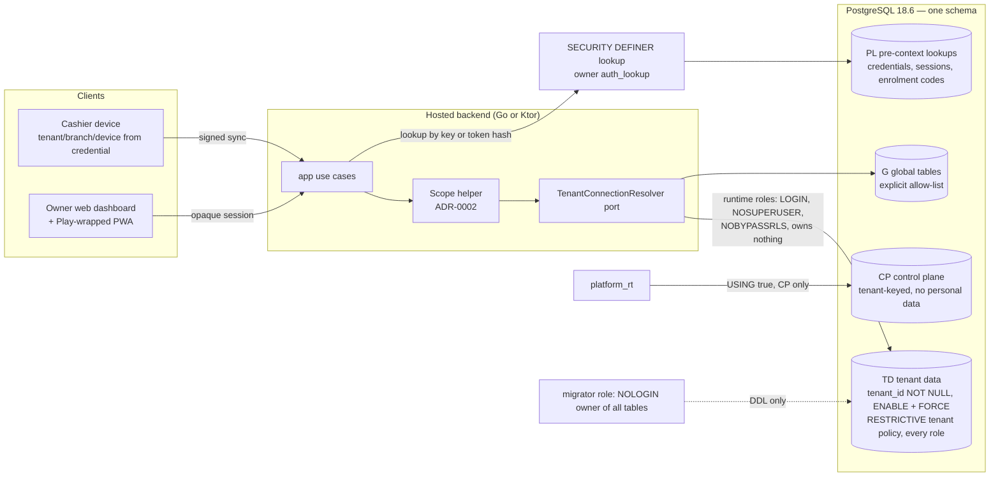

# ADR-0001: Tenancy model — shared-schema RLS with a per-tenant-database exit, and the tenant unit

## Status

Proposed

> **Who may move this to `Accepted`: the user, or `cto` on the user's explicit
> confirmation. No other agent, and no skill on its own.**
> Why this is stated here: stories referencing a `Proposed` ADR are set `Blocked`,
> and epics require `Accepted`, so the field needs a named owner. `cto` is the
> role `coordination-rules.md` escalates technical conflicts to, and an ADR is
> that decision made durable.
>
> This does **not** relax the rule that `Status: Accepted` is never set without
> explicit user confirmation — it narrows *which agent* may set it once that
> confirmation exists. An agent that believes an ADR is ready says so and
> escalates; it does not edit this field.

## Date

2026-10-17

## Last Verified

2026-10-18

## Decision Makers

The founder (user) decided the options on 2026-10-17 (`docs/research/tenant-isolation.md` § 5). Drafted by `/architecture-decision`. **Revised 2026-10-18 at the user's instruction after an independent `/architecture-review` (verdict FAIL, text fixes only):** B1 — the tenant predicate is now a RESTRICTIVE policy for every role, with one permissive policy per role (the user chose the stack reference's option); B2 — table classes and one role inventory added. **2026-10-18, founder decision (ADR-0004 § 7a):** the CP class allows derived counts without money, names, items or contents; usage counts added as a CP example. **Second review (2026-10-18, FAIL, text fixes), applied at the user's instruction:** PL writes and sign-in lookup (§ 1c), `deploy_rt`, data migrations as `job_rt`, tenant list via `platform_rt`, M27/M38 as a future amendment. **Third review (2026-10-18):** deploy option A (privileged migrations as the bootstrap superuser); licensing revoke split; `EnrolmentCodeLookup` listed. Stack-lead validation: NOT ASSESSED — no stack layer configured (`stack.data` and `stack.backend` are unset). CTO-ADR: skipped — lean mode. Acceptance: the user.

## Summary

Kodeebo's hosted backend must keep each owner organisation's data, devices and staff apart on one PostgreSQL 18.6 cluster that serves local-first cashier devices, the owner web dashboard and the same dashboard wrapped for Google Play. Decision: one shared schema with `ENABLE` + `FORCE` row-level security, where the tenant predicate is a restrictive policy that binds every role and each role gets its own permissive policy; four table classes and one closed role inventory, none with `BYPASSRLS`; all access through a tenant-to-connection resolver so one tenant can later move to its own database without changing callers; the tenant unit is tenant (owner organisation) → branch (venue) → device (cashier PC).

## Stack Compatibility

| Field | Value |
|-------|-------|
| **Stack layer(s)** | Data (PostgreSQL); Go backend or Ktor backend (track undecided, `/setup-stack`) |
| **Domain** | Tenancy |
| **Layer** | Foundation |
| **Knowledge Risk** | HIGH — PostgreSQL 18.6 and its row-security fixes post-date training; every behaviour relied on was executed at 18.6 (research note part 1, tier E) |
| **References Consulted** | `docs/stack-reference/postgres/VERSION.md`, `best-practices.md` § 1, `breaking-changes.md`, `deprecated-apis.md`; `docs/research/tenant-isolation.md` (parts 1, 4, 5, 6); `docs/research/licensing.md` Part 1 |
| **Pinned versions relied on** | `postgres:18.6` (`pins.yaml` `postgres.image`) |
| **Post-Cutoff APIs Used** | PostgreSQL 18 row security as fixed in 18.6 (CVE-2026-14666, row-security caching after role changes — research F124): 18.6 is the floor for server and client tools |
| **Verification Required** | Catalogue tests C1–C5/C8 fail on a planted defect and pass on the real schema (F111, F617); runtime-role negative tests DB-01…DB-10 (part 6 § 3.10); a resolver test that routes every tenant query through the port. **The restrictive-tenant + permissive-per-role shape was not executed in the research** (its semantics are sourced, F408, tier 2; the spikes used a permissive tenant policy): DB-07/DB-08 and a planted "permissive policy for a new role" test run on this shape with the first tenant-table migration, before any tenant data is stored |

Critical ADR: yes — tenancy model (Foundation; `workflow: standard` critical list).

## ADR Dependencies

| Field | Value |
|-------|-------|
| **Depends On** | None (first ADR) |
| **Enables** | ADR-0002 (tenant context), ADR-0003 (branch scope and session), ADR-0004 (operator access); device credential and enrolment; server sync state and restore; key custody and re-registration; retention, deletion and export; sync limits; licensing (device mode) |
| **Blocks** | Every epic that stores tenant data (none written yet); `/setup-stack` setting `tenancy.model` |
| **Ordering Note** | Accept before `/setup-stack` writes `tenancy.model: shared-schema-rls`. ADR-0004 (operator access) must be accepted before any support or admin tooling is built (Kodelix does the guided installs and support). |

## Context

### Problem Statement

Kodeebo is a hosted multi-tenant point of sale for PlayStation lounges and cafés. Every tenant's sales, staff data and device commands land in one hosted backend; the cashier device syncs commands into a server inbox keyed `(tenant_id, device_id, command_id)`, and the owner sees everything through the owner web dashboard, which is also the owner "Android app" — the same dashboard as a PWA published on Google Play inside a wrapper (`docs/research/desktop-client-adr-followups.md` § 5, OQ6; founder input pending spikes S32/S33). The tenancy model decides the schema, the roles, the migration path, backup and restore, export and deletion, and every isolation test. Every later backend ADR and the first backend story wait on it; not deciding blocks `/setup-stack`.

### Current State

No production code exists. The sync and desktop spikes run outside this decision. The research note executed the PostgreSQL behaviours at 18.6 (parts 1, 3, 4, 6) and recorded the founder's decisions of 2026-10-17 (§ 5).

### Constraints

- Hosted multi-tenant only; self-hosted is not offered (brief decision log, 2026-10-16). One PostgreSQL 18.6 cluster.
- Three venues today at an anchor of 10,000 EGP/year each; growth unknown (research F126). Per-tenant fixed cost matters.
- Local-first devices: a server restore must be reconcilable with device-held sequences (sync note SC-19; research F127, F330).
- PDPL (Law 151/2020) staff data in Tier 1; ETA tax records kept ≥ 5 years on the hosted server only (eta-note D5).
- Backend track (Go or Ktor) undecided; the model must work for both (ADR-0002).
- Small team: one schema and one migration target to operate.

### Requirements

- A runtime query can never read or write another tenant's rows, even when the application forgets a filter (ASVS 5.0.0 8.4.1, 8.3.1).
- A missing tenant context fails closed: 0 rows on read, an error on write (F103, F207, F618).
- Existence of another tenant's data cannot be probed through unique-key or foreign-key errors (F105, F106, F619).
- One tenant can later be moved to its own database without changing callers.
- Per-tenant export and deletion remain possible (handled by the retention ADR; this model must not prevent them, F117, F530).

Research note: `docs/research/tenant-isolation.md` (Draft; verdict BLOCKED for implementation on open questions that belong to other ADRs — the user ruled on 2026-10-17 that none of them blocks this ADR).

## Decision

**1. Model: `shared-schema-rls`, tenant predicate restrictive for every role.** One database, one application schema. Every tenant-keyed table (classes TD, CP and PL below) carries `tenant_id uuid NOT NULL` and has `ENABLE` and `FORCE ROW LEVEL SECURITY`. The tenant predicate is a **RESTRICTIVE** policy for all commands:

```sql
CREATE POLICY tenant_isolation ON <table> AS RESTRICTIVE FOR ALL
  USING      (tenant_id = NULLIF(current_setting('app.tenant_id', true), '')::uuid)
  WITH CHECK (tenant_id = NULLIF(current_setting('app.tenant_id', true), '')::uuid);
```

On TD tables it has no `TO` clause, so it binds every role, including roles added later. What each role may do is a separate **permissive** policy written `TO <that role>` for the commands it needs; a permissive policy without `TO` is forbidden. PostgreSQL ORs permissive policies and ANDs restrictive ones (F408), so no permissive policy — a later "sharing" policy, ADR-0004's support policy, a mistake — can reach past the tenant. This follows `docs/stack-reference/postgres/best-practices.md` § 1 ("put the hard tenant predicate in a RESTRICTIVE policy"); the first draft of this ADR used a permissive tenant policy, which applied to every role and let any later role read any tenant by setting the context (review B1). The `NULLIF` is required: a local setting reads back as an empty string after its transaction (F110). How the setting is set is ADR-0002; branch scope on top of it is ADR-0003.

**1a. Table classes.** Every table is in exactly one class, recorded next to the migrations; the catalogue test checks each class's rules.

| Class | What it holds | Examples | RLS rules |
|---|---|---|---|
| **TD — tenant data** | Anything about a tenant's business, people, devices or licences: sales, stock, staff, attendance, sync inbox and events, review queue, reports, the support access journal (ADR-0004; `support_grants` is PL), **and the licensing tables** `seats`, `seat_licences`, `devices`, `seat_moves`, `approvals`, `lease_log` (licensing threat model M35) | `orders`, `staff`, `staff_branches`, `inbox`, `seats`, `lease_log` | `tenant_isolation` restrictive with no `TO` (every role); permissive policies only `TO` named roles; no `USING (true)` / `WITH CHECK (true)` policy |
| **CP — tenant-keyed control plane** | Platform state about a tenant that holds no personal data and no sales, tax or licensing records. Counts derived from tenant data are allowed when they carry no money amounts, names, items, bill contents or free text (founder, 2026-10-18; ADR-0004 § 7a) | tenant status and suspension, plan assignment and plan-limit values, restore watermark (ti F328), usage counts per tenant and business day (`tenant_usage_daily`, written by `job_rt` in that tenant's scope) | `tenant_isolation` restrictive written `TO` every inventory role except `platform_rt`; `platform_rt` has the only permissive `USING (true)` policy, on CP tables only |
| **G — global** | No tenant meaning, no `tenant_id` | plan catalogue, tax-rate tables, feature-flag definitions | No RLS; on the global allow-list; runtime roles read only |
| **PL — pre-context lookup** | Tenant-keyed rows that must be found or changed **before** a tenant context exists, by a secret or an opaque handle | `login_identities` (sign-in identifier → user, tenant), `sessions` (by token hash, ADR-0003), `enrolment_codes` (by code hash), `device_credentials` (by key id, ti F325), `support_grants` (by grant id, ADR-0004) | `tenant_isolation` restrictive written `TO` every inventory role except `auth_lookup`. **Access across tenants, reads and writes, happens only through the `SECURITY DEFINER` functions of § 1c**, owned by `auth_lookup` (NOLOGIN, permissive all-rows policies on PL tables only), with a pinned `search_path` and `EXECUTE` granted per function to the roles named there. A role may also have an ordinary permissive policy on a PL table **inside its tenant context**, bound by the restrictive predicate, where an ADR names it (ADR-0004: the owner lists, inserts and revokes grants as `app_rt`; `support_rt` and `support_fn` read their operator's grants). M35's `ENABLE` + `FORCE` on `device_credentials` and `enrolment_codes` holds |

**1b. Role inventory (closed).** These are the only database roles. A new role needs an ADR amendment; the catalogue test fails on any role not listed.

| Role | Login | Purpose | Tables | Defined by |
|---|---|---|---|---|
| `migrator` | NOLOGIN | Owns every table and type; runs **DDL only**. It has no permissive policy, so under `FORCE` it reads and writes no tenant rows | all (owner) | this ADR |
| `deploy_rt` | LOGIN | The deploy pipeline's login; **runs every migration that is not marked privileged**; a member of `migrator` with the `SET` option (it runs `SET ROLE migrator` for DDL); credential in the CI secret store. Not the bootstrap superuser, so deploys do not page | none directly | this ADR |
| bootstrap superuser | local only | Cluster administration, extensions, upgrades, restore, **and the rare privileged migrations**: those that create or alter roles, or create, replace or re-own a function owned by `auth_lookup`, `support_fn` or `audit_writer` (PostgreSQL requires being able to `SET ROLE` to the new owner). Run by the founder with the credential from Bitwarden; each such migration is marked *privileged* in the migration list; its login pages, as expected. Never an application login | — | this ADR; custody ADR-0004 |
| `app_rt` | LOGIN | Owner dashboard API (web and Play-wrapped) | TD, CP (own tenant), G | this ADR; ADR-0003 |
| `device_rt` | LOGIN | Sync endpoint for cashier devices; least-privilege grants as in ti F328 (the credential ADR may merge it into `app_rt`; until then it is separate) | TD (device grants), CP (own watermark), G | this ADR; credential ADR |
| `job_rt` | LOGIN | Background jobs (export, retention, limits, provisioning, usage counts, backfills): one transaction per tenant through the ADR-0002 helper (Job kind). **Tenant list:** the scheduler reads tenant ids and status from the CP table `tenant_status` as `platform_rt` (ids only), then runs each tenant's work as `job_rt`; `job_rt` itself never lists tenants | TD, CP (own tenant per transaction), G | this ADR |
| licensing service roles | LOGIN | Issuer and lease service; work per tenant with the context set, on the licensing TD tables only | TD (licensing tables) | licensing ADR (names and grants) |
| `platform_rt` | LOGIN | Control plane: tenant status, suspension, plan, watermark across tenants | CP only (`USING (true)`), G | this ADR; ADR-0004 § 7 |
| `auth_lookup` | NOLOGIN | Owns the PL access functions (§ 1c) | PL only | this ADR |
| `support_rt` | LOGIN | Kodelix support reads behind the owner grant gate | TD (SELECT, grant-gated) | ADR-0004 |
| `support_fn` | NOLOGIN | Owns the support verbs | TD (grant-gated per verb) | ADR-0004 |
| `audit_writer` | NOLOGIN | Owns the support journal append functions | TD (journal INSERT only) | ADR-0004 |
| `backup_rt` | LOGIN | Physical backup; `REPLICATION` only | none (physical copy) | ADR-0004 |

Every LOGIN role other than the bootstrap superuser is `NOSUPERUSER`, `NOBYPASSRLS`, owns nothing and holds only the grants its purpose needs; no role in the list has `BYPASSRLS`.

**Data migrations (backfills) run as `job_rt` through the ADR-0002 helper (Job kind), one tenant per transaction**, with the grants that migration needs. A backfill that changes 0 rows on a tenant that has rows of that table fails the migration.

**1c. PL access functions.** These are the only way to read or write a PL table before a tenant context exists. Each does one action, runs in the caller's transaction, and touches one key or one tenant. A function marked "owner" also requires `app.tenant_id` to equal the row's tenant and `app.branch_all = 'on'`, which is set only for a verified owner (ADR-0003).

| Table | Function (port) | Before or inside context | `EXECUTE` by | Action |
|---|---|---|---|---|
| `login_identities` | `LoginLookup.find(identifier)` | before | `app_rt` | user, tenant, status and password verifier for one normalised identifier; the app verifies the password (Argon2id) |
| | `Logins.create / disable(user, …)` | inside, owner | `app_rt` | owner adds or disables a staff login |
| | `Logins.changeOwnVerifier(tokenHash, verifier)` | before | `app_rt` | the signed-in user changes their own password, bound to their session token hash; **the application re-verifies the current password first** |
| `sessions` | `SessionLookup.find(tokenHash)` | before | `app_rt` | session, user, tenant, status |
| | `Sessions.create(user, tenant, tokenHash, expiresAt)` | before | `app_rt` | after the app has verified sign-in (new token per sign-in, ASVS 7.2.4) |
| | `Sessions.end(tokenHash)` | before | `app_rt` | logout |
| | `Sessions.endAllForUser(user)` | inside, owner | `app_rt` | owner disables a user or changes their role |
| | `Sessions.endAllForTenant(tenant)` | before | `platform_rt` | tenant suspension |
| `enrolment_codes` | `EnrolmentCodeLookup.find(codeHash)` | before | `device_rt` | tenant, branch, seat and state for one code hash, without consuming it (lets the device show which venue it will join) |
| | `Enrolment.createCode(branch, codeHash, expiresAt)` | inside, owner | `app_rt` | only while a free seat exists (founder rule, licensing ADR) |
| | `Enrolment.redeem(codeHash, devicePublicKey)` | before | `device_rt` | single use; consumes the code and creates the device credential in the same transaction |
| `device_credentials` | `DeviceCredentialLookup.find(keyId)` | before | `device_rt` | tenant, branch, device, status, credential state |
| | `Devices.rotateCredential(keyId, newPublicKey)` | before | `device_rt` | called on an authenticated device request |
| | `Devices.revokeCredential(device)` | inside, owner | `app_rt` | owner revokes or retires |
| | `Devices.revokeCredentialForLicensing(device, reason)` | inside, tenant match only | licensing service roles | the licensing service revokes or retires; requires `app.tenant_id` to equal the row's tenant (these roles never get `app.branch_all`) |
| `support_grants` | `SupportGrantLookup.find(grantId, operatorId)`, `SupportGrantLookup.listByOperator(operatorId)` | before | `support_rt` | ADR-0004; returns grant fields, never tenant data |

`Sessions.create` trusts the application to have verified the sign-in: password verification is an application control (ASVS V6), and this function only records the result.

**Recorded for the tenant-isolation threat model (founder, 2026-10-18):** `Sessions.create` and `LoginLookup.find` run before any tenant context and trust the application's sign-in check, so an application compromise could mint a session for any tenant. Mitigations to assess there: an audit event per session created, an owner alert on sign-in from a new device, and rate limits on sign-in.

**2. Exit to database-per-tenant (Option D) stays open.** Every access to tenant data goes through a `TenantConnectionResolver` port. Today it returns the shared pool for every tenant. Moving a tenant to its own database is an adapter change plus a data move, never a caller change. The move happens only on a trigger: a signed customer or regulatory requirement for physical isolation, own keys or data location; a measured noisy-neighbour impact; or single-tenant restore or erasure demand that row-level work cannot meet (research part 1 § 5 "conditions that reopen").

**3. Tenant unit: tenant → branch → device.** Tenant = the owner organisation; branch = one venue; device = one cashier PC. Keys are composite down the hierarchy: `branches (tenant_id, id)`, `devices (tenant_id, branch_id, id)`. The owner web dashboard and its Play-wrapped form are clients of the tenant, not devices. Seats, per-device pricing and device binding are licensing decisions: see `docs/research/licensing.md` Part 1 and the founder rules in `docs/research/tenant-isolation.md` § 5; this ADR does not restate them.

### Architecture



Trust boundary: the database enforces the tenant predicate for every role through the restrictive policy; a role's permissive policy only narrows what it may do inside the tenant; the application cannot widen the tenant except through the scope helper (ADR-0002).

### Key Interfaces

```text
TenantId            value type: parsed UUID; constructed only from an authenticated server-side source
                    (session lookup or device credential), never from a request body, query or header.

TenantConnectionResolver (port, app layer)
  resolve(tenant: TenantId) -> TenantDataSource
    // Today: the shared pool for every tenant.
    // Failure: unknown or suspended tenant -> typed error, no fallback pool.

Table classes (TD, CP, G, PL): one list kept next to the migrations, one entry per table;
the catalogue test fails on any table without a class, on a G table not on the global
allow-list, and on any table whose policies break its class's rules.

Pre-context lookups (PL, app-layer ports backed by SECURITY DEFINER functions owned by auth_lookup):
  DeviceCredentialLookup.find(keyId) -> {tenant, branch, device, status, credentialState} | NotFound
  SessionLookup.find(tokenHash)      -> {session, user, tenant, status} | NotFound   // ADR-0003
  EnrolmentCodeLookup.find(codeHash) -> {tenant, branch, seat, state} | NotFound
  // Identity only, one key, no tenant data rows; everything after runs through the ADR-0002 helper.
  // Full list of PL read and write functions, with EXECUTE roles: Decision § 1c.
```

No HTTP contract is created here; `contracts/` does not exist yet.

### Implementation Guidelines

- **Must:** every table has a class (TD, CP, G, PL) recorded in the same migration that creates it.
- **Must:** every TD, CP and PL table has `tenant_id NOT NULL`, `ENABLE` + `FORCE ROW LEVEL SECURITY`, the restrictive `tenant_isolation` policy (no `TO` on TD; on CP and PL `TO` every inventory role except the class's one cross-tenant role) and, per role that uses it, a permissive policy `TO` that role for each command it needs, all created in the same migration as the table. With only restrictive policies a role sees nothing (default-deny, F408), so a role without its own permissive policy is locked out, not let in.
- **Must never:** write a permissive policy without a `TO` role list on a TD, CP or PL table, or carry the tenant predicate only in a permissive policy.
- **Must never:** use `USING (true)` or `WITH CHECK (true)` on a TD table; on CP tables only for `platform_rt`, on PL tables only for `auth_lookup`.
- **Must:** pre-context lookups (PL) run only through the `SECURITY DEFINER` functions owned by `auth_lookup`, with a pinned `search_path` ending in `pg_temp` and `EXECUTE` revoked from `PUBLIC` in the creating migration; they return identity for one key and nothing else (F325).
- **Must:** every unique index and primary key on a tenant table leads with `tenant_id`; every foreign key between tenant tables is composite with `tenant_id` and references a `UNIQUE (tenant_id, id)` (F105, F106).
- **Must:** every view over tenant tables is created `WITH (security_invoker = true)` (F107, F108, F621).
- **Must never:** expose a materialized view over tenant data to a runtime role; rollups are ordinary tables with `tenant_id`, `ENABLE` + `FORCE` and the same policies (F423).
- **Must:** the database roles are exactly the inventory in Decision 1b: `migrator` (NOLOGIN, owns every table, runs DDL only), the bootstrap superuser (cluster administration only) and LOGIN or NOLOGIN roles that are `NOSUPERUSER`, `NOBYPASSRLS`, own no table and hold only the grants their purpose needs (F103, F104).
- **Must never:** give any runtime role, job role or support role `BYPASSRLS` or superuser. This agrees with `docs/stack-reference/postgres/best-practices.md` line 11, where an `admin_batch` (`BYPASSRLS`) role is optional and exists only if an ADR accepts it; this ADR accepts none. How Kodelix operators reach tenant data for guided installs and support is ADR-0004; until it is accepted, no support or admin tooling is built.
- **Must:** CI runs the catalogue queries on every migration and fails the build on a finding (F111, F617; tests DB-01…DB-06, DB-10): **C1** ENABLE + FORCE on every TD, CP and PL table; **C2, per role**: every TD, CP and PL table has the restrictive `tenant_isolation` policy with the exact predicate and the role coverage of its class; every permissive policy names roles (none applies to `PUBLIC`); every role in the inventory that has a grant on a table has a permissive policy there for exactly the commands granted; no `USING (true)` / `WITH CHECK (true)` outside the CP and PL class roles; **C3** every table has a class and G tables are on the allow-list; no role other than `auth_lookup` has an all-rows policy on a PL table; **C4** roles equal the inventory, attributes as listed (no `BYPASSRLS`, superuser only for the bootstrap role, `REPLICATION` only for `backup_rt`), `deploy_rt` a member of `migrator` only, no membership in `pg_read_all_data`, `pg_write_all_data` or the server-file roles; **C5** `migrator` owns every table, `SECURITY DEFINER` functions are owned only by `auth_lookup`, `support_fn` or `audit_writer`, each with a pinned `search_path` and no `PUBLIC` `EXECUTE`; every `auth_lookup` function is on the § 1c list with `EXECUTE` only for the roles named there; a migration that creates or alters a role, or creates, replaces or re-owns a function of `auth_lookup`, `support_fn` or `audit_writer`, is marked privileged, and CI fails an unmarked one; **C8** views are `security_invoker`.
- **Must:** RLS tests connect as the real runtime role, never as a superuser or owner (a superuser passes vacuously).
- **Must:** server and client PostgreSQL tools are 18.6 or later (F124).
- **Must:** `app` code reaches tenant data only through `TenantConnectionResolver`; `domain` imports nothing from the database layer (clean architecture).

## Alternatives Considered

### Alternative 1: Schema-per-tenant (Option B)

- **Description**: one database, one schema per tenant, routing by `search_path` or qualified names, optionally a role per tenant.
- **Pros**: cheap logical export and restore of one tenant (`pg_dump -n` 0.35 s, `pg_restore` 0.25 s, F122).
- **Cons**: about 1 MB and 150 catalogue relations per tenant for 30 empty tables (F121); migrations fan out N times and a partial failure leaves tenants on different versions (F120, F122); depends on `search_path` handling behind a pooler that PgBouncer only began tracking by default in 1.26.0 and still lists bugs for (F114).
- **Cost / Risk / Performance / Operability**: medium build; isolation rests on routing and grants rather than a database predicate; catalogue grows with N × tables (planner effects unmeasured, S14); a small team runs N migrations per release. Hosted only, so no customer-bundle effect.
- **Estimated Effort**: higher than the chosen option (routing, provisioning, fan-out migrations).
- **Rejection Reason**: for three venues at 10,000 EGP/year it pays the fan-out and catalogue growth of per-tenant databases without their structural boundary, and no customer has asked for schema isolation.

### Alternative 2: Database-per-tenant (Option C)

- **Description**: one cluster, one database per tenant created from a template; the application resolves tenant → database.
- **Pros**: strongest boundary inside one cluster; easiest delete (`DROP DATABASE`) and single-tenant logical restore.
- **Cons**: about 8.4 MB per empty tenant (841 MB for 100, F121); a pool per database and role against a default of about 100 connections (F113, F123); a 100-database migration took 10.66 s and grows linearly (F122); PITR is still cluster-wide (F118).
- **Cost / Risk / Performance / Operability**: highest fixed cost per tenant; risk moves to routing and connection exhaustion; N+1 estates to provision, migrate and monitor.
- **Estimated Effort**: much higher (provisioning, routing, per-tenant pools, fan-out).
- **Rejection Reason**: linear cost and operations for three venues with no isolation requirement; kept reachable through the resolver port (Decision 2) for the tenant that needs it.

### Alternative 3: Hybrid from day one (Option D now)

- **Description**: build both the shared path and the dedicated-database path now.
- **Pros**: ready for an enterprise tenant.
- **Cons**: two code paths, the dedicated one rarely exercised; the resolver becomes a live routing component on day one.
- **Cost / Risk / Performance / Operability**: double the test matrix and migrations before any tenant needs it.
- **Rejection Reason**: the exit hatch, not the starting point; the port keeps it one adapter away.

### Alternative 4 (tenant unit): tenant = venue

- **Description**: each venue is its own tenant; an owner with two venues holds two tenants.
- **Pros**: one tenant = one ETA issuer per venue in the simplest case.
- **Cons**: an owner's cross-venue reports, staff moving between branches and stock transfers (brief I1) would cross tenants, which this model forbids by construction.
- **Rejection Reason**: the founder fixed tenant = owner organisation (2026-10-17); branch scope inside a tenant is ADR-0003.

## Consequences

### Positive

- One schema, one migration target, one pool set, one backup stream; tenant count does not change the operating model.
- Isolation is enforced by the database for every role (restrictive tenant predicate) and proven by catalogue and negative tests in CI.
- A tenant can move to its own database later without caller changes.

### Negative

- Largest blast radius: one table without the policy, one view owned by a bypass-capable role or one single-column FK exposes every tenant at once (F106, F108, F621). The CI catalogue test and schema rules are the mitigation, not the structure.
- Restoring one tenant alone is row-level work after a side restore; PITR is cluster-wide (F118).
- Noisy neighbours share the cluster (limits are a separate ADR).
- Kodelix support reaches tenant data only through ADR-0004's owner grant.
- Every role needs its own permissive policy on every table it uses, and the class list and role inventory must be kept current: more policy text per table, checked by C2/C3/C4.

### Neutral

- Tenant export uses per-table `COPY ... TO` as the runtime role with the tenant context set (F530); the format is the retention ADR's.

## Risks

| Risk | Probability | Impact | Mitigation |
|------|------------|--------|-----------|
| A new table ships without `FORCE` or a policy | Medium | High (cross-tenant leak) | Catalogue test C1/C2 fails the build (DB-01, DB-10) |
| Unique key or FK leaks existence across tenants | Medium | Medium | Tenant-leading keys and composite FKs; C5 check (DB-06) |
| A view or rollup bypasses RLS | Low | High | `security_invoker` rule; no runtime-readable matviews; C8 check (DB-04) |
| Support needs cross-tenant access and someone adds a BYPASSRLS role | Medium | High | Forbidden here; ADR-0004 gives the grant-gated path; C4 role check (DB-02) |
| A later permissive policy (sharing, support, a mistake) widens past the tenant | Medium | High | Tenant predicate is restrictive for every role (Decision 1); C2 per role |
| A pre-context lookup function leaks more than identity, or is executable by any role | Low | High | Owned by `auth_lookup`, one key per call, no `PUBLIC` `EXECUTE`; C5 |
| A table is created without a class, or a new role without an inventory entry | Medium | Medium | C3 and C4 fail the build |
| Growth makes the shared cluster a noisy-neighbour problem | Low (3 venues) | Medium | Limits ADR; resolver port exit to a dedicated database |
| PostgreSQL row-security engine bug | Low | High | Pin 18.6 or later (CVE-2026-14666 fixed); re-validate on every pin change |

## Cross-Cutting Impact

| Concern | Impact |
|---------|--------|
| **Security / tenancy** | New tenant boundary in the database; ASVS 5.0.0 8.4.1, 8.3.1, 8.2.2, 13.2.2; threat model `docs/architecture/threat-models/tenant-isolation.md` required (not yet written) |
| **Observability** | Log `db_role_misconfigured` from a startup self-check of role attributes; CI catalogue failures are build output; `db.tenant_tx` span (ADR-0002) |
| **Caching** | No cache decision here; any cache key carries the tenant (caching standard) |
| **Self-hosted** | None — hosted only |
| **Cost** | About 0 MB fixed per tenant beyond rows (F121); one cluster; no per-tenant pool |

## Performance Implications

| Metric | Before | Expected After | Budget (`perf-budgets.md`) |
|--------|--------|---------------|--------|
| Latency p95 (affected endpoints) | n/a (no code) | one policy predicate per query; tenant-leading indexes | budget not yet set (`perf-budgets.md` absent) |
| DB queries per request | n/a | +0 here (+1 scope statement, ADR-0002) | budget not yet set |
| Memory (service RSS) | n/a | no per-tenant pool | budget not yet set |
| Storage growth | n/a | rows only; no per-tenant catalogue | budget not yet set |
| Network / payload | n/a | unchanged | budget not yet set |

## Migration Plan

Greenfield: no existing data.

1. The first migration creates the roles of the inventory (Decision 1b) that the first stories need, the class list, revokes `CREATE` on `public` and global `EXECUTE` defaults, and adds the catalogue test to CI before any tenant table exists. It is a privileged migration (it creates roles), run by the founder as the bootstrap superuser.
2. Every later migration that adds a tenant table adds `ENABLE` + `FORCE` + policies in the same transaction; production migrations are forward-only.
3. Moving one tenant to its own database (only on a trigger, Decision 2): provision the database from the same migrations, copy that tenant's rows as the runtime role with its context set, switch the resolver entry, verify, then delete the rows from the shared database. A runbook is written when the first trigger occurs.

**Rollback plan**: before the first production tenant, this ADR can be superseded without data work. After that, moving to schema- or database-per-tenant is the per-tenant move above, repeated.

## Validation Criteria

- [ ] The catalogue test fails on each planted defect (table without FORCE, without policy, view without `security_invoker`, BYPASSRLS runtime role, non-tenant-leading unique key) and passes on the real schema.
- [ ] As the runtime role with tenant A's context: reads of tenant B return 0 rows; writes carrying tenant B's id fail; with no context, 0 rows and writes fail (DB-07, DB-08).
- [ ] No runtime, job or support role has `BYPASSRLS`, superuser or table ownership (DB-02, DB-03).
- [ ] A planted permissive policy `USING (true)` for a new role on a TD table still returns only the context tenant's rows (the restrictive predicate holds), and C2 fails on it.
- [ ] A planted permissive policy with no `TO` clause, a table with no class and a role not in the inventory each fail the catalogue test.
- [ ] Each PL lookup returns identity for a known key and 0 rows for an unknown key; a runtime role cannot select the PL table directly (F325).
- [ ] Each § 1c function works for its named roles and fails for every other role (`permission denied`); an "inside, owner" function fails for a manager and for another tenant's row.
- [ ] **The tenant-isolation threat model (`docs/architecture/threat-models/tenant-isolation.md`, `/threat-model tenant-isolation`) blocks the first story that stores tenant data; it does not block acceptance of this ADR (founder, 2026-10-18).**
- [ ] Every tenant-data access in `app` goes through `TenantConnectionResolver` (architecture test once the backend track is chosen).
- [ ] Performance: checked against `perf-budgets.md` once it exists; not checked until then.

## Spec Requirements Addressed

Foundational — no spec requirement (no feature specs exist yet). Enables: every bounded context that stores tenant data (selling, sessions, stock, staff, activity log, reports, sync inbox), the owner dashboard and its Play-wrapped form, device enrolment, export and deletion.

## Related

- Research: `docs/research/tenant-isolation.md` (part 1 F101–F129; § 4.2; § 5 founder decisions 2026-10-17); `docs/research/licensing.md` Part 1 (seats, per-device pricing, device binding); `docs/research/desktop-client-adr-followups.md` § 5 (owner app = web dashboard as a Play-wrapped PWA).
- ADR-0002 (tenant context helper), ADR-0003 (branch scope and session) and ADR-0004 (operator access) depend on this ADR; ADR-0004 adds `support_rt`, `support_fn`, `audit_writer` and `backup_rt` to the inventory above and uses the CP class for its emergency path.
- Licensing threat model M35 (`docs/architecture/threat-models/licensing.md`): the licensing tables are class TD (seats, seat licences, devices, seat moves, approvals, lease log) or PL (device credentials, enrolment codes), all with `ENABLE` + `FORCE`.
- Review: independent `/architecture-review` of ADR-0001–0004 (2026-10-18, FAIL, text fixes B1 and B2) — applied in this revision. Second independent review (2026-10-18, FAIL, text fixes) — applied: PL writes and sign-in lookup (§ 1c), `deploy_rt`, data migrations as `job_rt`, tenant list via `platform_rt`. Third review (2026-10-18) — applied: deploy option A (founder: privileged migrations as the bootstrap superuser, every other migration as `deploy_rt`); licensing revoke split; `EnrolmentCodeLookup` listed.
- **Future amendment, made with the licensing ADR (founder, 2026-10-18):** licensing threat model M38 asks for a single-purpose role per cross-tenant job, and M27 describes a Kodelix-only cross-tenant fingerprint-matching job. Neither fits this ADR's classes or roles yet. The licensing ADR will amend this ADR with the role and the table class for that job. Until then `job_rt` stays per tenant and no job reads across tenants.
- **Account recovery** (forgotten password, OTP) is not in § 1c yet: it comes from the staff auth and roles research and is added to § 1c by that ADR.
- Separate ADRs, flagged in the research: device credential (D2-B on S31/S32), server sync state and restore (D5-C on S33), key custody and re-registration (B4/B3 on S41/S43), retention and deletion, sync limits.
- Threat model: `docs/architecture/threat-models/tenant-isolation.md` (to be written, `/threat-model`).
- `project.yaml` `tenancy.model` is set by `/setup-stack` after acceptance, not by this ADR.
