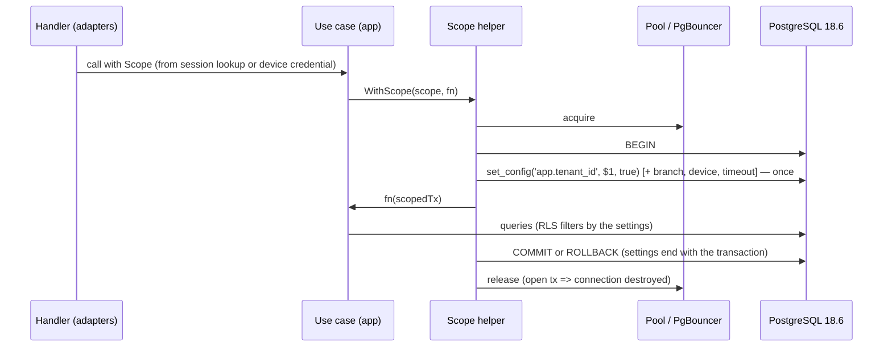

# ADR-0002: Tenant context — one scope helper, set once per transaction (Go and Ktor tracks)

## Status

Proposed

> **Who may move this to `Accepted`: the user, or `cto` on the user's explicit
> confirmation. No other agent, and no skill on its own.**
> Why this is stated here: stories referencing a `Proposed` ADR are set `Blocked`,
> and epics require `Accepted`, so the field needs a named owner. `cto` is the
> role `coordination-rules.md` escalates technical conflicts to, and an ADR is
> that decision made durable.
>
> This does **not** relax the rule that `Status: Accepted` is never set without
> explicit user confirmation — it narrows *which agent* may set it once that
> confirmation exists. An agent that believes an ADR is ready says so and
> escalates; it does not edit this field.

## Date

2026-10-17

## Last Verified

2026-10-17

## Decision Makers

The founder (user) decided on 2026-10-17 (`docs/research/tenant-isolation.md` § 5: G1 / J1, P1). Drafted by `/architecture-decision`. Stack-lead validation: NOT ASSESSED — `stack.backend` is unset, so neither `go-lead` nor `ktor-lead` applies yet; it runs when `/setup-stack` picks the track. CTO-ADR: skipped — lean mode. Acceptance: the user.

## Summary

Row-level security (ADR-0001) is only as good as the transaction-local setting it reads, and a second set, a session-level set or a thread-local tenant leaks across requests behind a pool. Decision: every tenant-scoped database access runs in a transaction opened by one scope helper that sets all scope values with `set_config(..., true)` exactly once, first, from an authenticated server-side source — written for both backend tracks (Go: pgx `BeginTxFunc` helper; Ktor: Exposed `suspendTransaction` helper) because the track is chosen later by `/setup-stack`.

## Stack Compatibility

| Field | Value |
|-------|-------|
| **Stack layer(s)** | Go backend **or** Ktor backend (undecided); Data (PostgreSQL) |
| **Domain** | Tenancy |
| **Layer** | Foundation |
| **Knowledge Risk** | HIGH — pgx 5.11.0, Exposed 1.5.1, HikariCP 7.1.0 and coroutines 1.11.0 behaviours were read from source and executed (research part 2, tier 3/E) |
| **References Consulted** | `docs/stack-reference/go/VERSION.md`, `go/best-practices.md` line 55; `docs/stack-reference/ktor/VERSION.md`, `ktor/best-practices.md` line 55; `docs/stack-reference/postgres/best-practices.md` § 1 (set_config); `docs/research/tenant-isolation.md` part 2 (F201–F243), part 1 (F110, F115), part 4 (F420) |
| **Pinned versions relied on** | `postgres:18.6`; Go 1.27.2, pgx 5.11.0; Kotlin 2.4.21, kotlinx.coroutines 1.11.0, Ktor 3.6.0, Exposed 1.5.1, HikariCP 7.1.0 (`pins.yaml`) |
| **Post-Cutoff APIs Used** | pgx 5.11.0 `pgx.BeginTxFunc` (package-level, takes the pool; F202) and `pgxpool.Config.PrepareConn` (replaces deprecated `BeforeAcquire`; F205); Exposed 1.5.1 `suspendTransaction` (documented path; `newSuspendedTransaction` deprecated; F238) |
| **Verification Required** | Port the part-2 tests to the chosen track: forgotten context fails closed; local context does not survive commit, rollback, panic or cancellation; session-level set leaks (negative control); second set refused by the helper; same tests through PgBouncer if a pooler is adopted |

Critical ADR: yes — part of the tenancy decision (Foundation).

Stack-reference facts this ADR relies on (updated by studio 220bc6f): `docs/stack-reference/go/best-practices.md` line 55 — the package-level `pgx.BeginTxFunc` exists at pgx 5.11.0 and takes the pool (research F202); `docs/stack-reference/ktor/best-practices.md` line 55 — `suspendTransaction` is Exposed 1.5.1's supported entry point for suspend code and `newSuspendedTransaction` is deprecated (research F238).

## ADR Dependencies

| Field | Value |
|-------|-------|
| **Depends On** | ADR-0001 (tenancy model) |
| **Enables** | ADR-0003 (branch scope uses the same helper); device credential and sync write-path ADRs (device scope set by the helper); sync limits ADR (per-plan `statement_timeout` set by the helper) |
| **Blocks** | The first backend story that touches tenant data |
| **Ordering Note** | Accept with or after ADR-0001. `/setup-stack` then keeps only the rule for the chosen track; the other track's rule stays as the record of the alternative. |

## Context

### Problem Statement

The runtime role sees rows only through the `app.tenant_id` setting (ADR-0001). Executed at 18.6 and the pinned drivers: a second `set_config` in one transaction silently switches tenant (F110, F212); a session-level `set_config(..., false)` or plain `SET` is inherited by the next request on the same pooled connection, directly or through PgBouncer (F115, F210, F235c); HikariCP and pgjdbc do not reset settings on return (F234, F236); a bare `ThreadLocal` tenant leaks across reused threads and is wrong after coroutine suspension (F240); a nested Exposed transaction overwrites the outer tenant (F239). The same applies to the branch list (F420). Without one rule, each use case invents its own.

### Current State

No backend code. The backend track (Go or Ktor) is undecided (OQ7, `/setup-stack`).

### Constraints

- Both tracks must be covered until `/setup-stack` decides.
- Pooled connections everywhere; an external transaction-mode pooler may be added later.
- Scope values come from an authenticated source: a session lookup (ADR-0003) or a device credential (credential ADR), never from the request.

### Requirements

- Forgetting the context fails closed (0 rows, write error).
- No scope value outlives its transaction on any path: commit, rollback, panic, cancellation, released-while-open.
- The scope cannot be widened inside a transaction.
- Works unchanged behind PgBouncer in transaction mode.

Research note: `docs/research/tenant-isolation.md` (part 2; § 5).

## Decision

**One scope helper per backend.** All tenant-scoped database work runs inside a transaction opened by a single helper. Its first statements set every scope value with `set_config(name, value, true)` — `app.tenant_id`, and as applicable `app.branch_ids` / `app.branch_all` (ADR-0003), `app.device_id` and `app.branch_id` (device requests), and the per-plan `statement_timeout` (`SET LOCAL`, limits ADR). It sets them **exactly once**: a second call in the same transaction is refused by the helper. Values are parsed (UUID) before binding and come only from the authenticated server-side scope object.

**Go track (G1).** `WithScope(ctx, pool, scope, fn)` built on `pgx.BeginTxFunc`; repositories accept only the transaction type the helper hands out, so code outside it does not compile against tenant repositories. Optional G2 alarm: a `PrepareConn` hook that destroys a connection carrying a non-empty setting or an open transaction and increments a metric — an alarm, not the control.

**Ktor track (J1).** A helper on Exposed `suspendTransaction` whose first statement is a `setScope(scope)` extension running the `set_config` calls; the scope is passed explicitly or as a coroutine context element (`asContextElement`), never as a bare `ThreadLocal` or MDC value; nested tenant transactions are forbidden; no scope statement runs outside an Exposed transaction (HikariCP auto-commit would drop it, F235a). jOOQ (J2) remains an alternative only if its licence for PostgreSQL is confirmed (F241).

**Pooler.** P1: the driver pool only, until a connection limit is shown. If PgBouncer is adopted: version 1.26.1 or later (SCRAM impersonation fix, F114), and either `max_prepared_statements` > 0 or pgx `QueryExecModeExec` / pgjdbc `prepareThreshold=0` (F213, F232). The transaction-local setting itself is safe behind it (F115, F213a).

**One contract for names.** Setting names (`app.tenant_id`, `app.branch_ids`, `app.branch_all`, `app.device_id`, `app.branch_id`) live in one constants module that the helper, the migrations' policies and the tests share.

### Architecture



### Key Interfaces

```text
Scope (app layer value)
  tenant: TenantId
  branches: All | List<BranchId>      // ADR-0003; devices: List of one
  device: DeviceId?                   // device requests only
  planTimeout: Duration?              // limits ADR

Go:    func WithScope[T any](ctx context.Context, src TenantDataSource, s Scope, fn func(ScopedTx) (T, error)) (T, error)
Ktor:  suspend fun <T> withScope(src: TenantDataSource, s: Scope, block: suspend ScopedTransaction.() -> T): T
// ScopedTx / ScopedTransaction: the only handle tenant repositories accept.
// Errors: ScopeAlreadySet (second call), InvalidScope (unparseable id) — no query runs.
```

`TenantDataSource` comes from `TenantConnectionResolver` (ADR-0001).

### Implementation Guidelines

- **Must:** open a transaction per unit of tenant work through the helper; first statements set the scope with `set_config(..., true)` as bound parameters.
- **Must never:** call `set_config(..., false)`, plain `SET`, or set any scope setting outside the helper (F115, F210).
- **Must never:** set the scope twice in one transaction; the helper refuses (F110, F212, F420).
- **Must never:** take tenant, branch or device ids from a request body, query string or header; the scope comes from the session lookup (ADR-0003) or the verified device credential (credential ADR).
- **Must (Go):** repositories accept only `ScopedTx`; acquire with a timeout and export pool saturation (F214).
- **Must (Ktor):** use `suspendTransaction`; carry the scope explicitly or via `asContextElement`; no bare `ThreadLocal`/MDC tenant; no nested tenant transactions (F238–F240).
- **Must:** policies cast with `NULLIF(current_setting(name, true), '')` (F110).
- **Must:** the helper lives in the `app` layer's port and its adapter; `domain` never sees connections or settings.
- **Must (tests):** connect as the runtime role; include a negative control that proves the harness can see a session-level leak.

## Alternatives Considered

### Alternative 1: Session-level context with reset hooks (G3)

- **Description**: `set_config(..., false)` at acquire, reset in `AfterRelease` / `PrepareConn`.
- **Pros**: no per-transaction statement.
- **Cons**: leaks to the next client behind a transaction-mode pooler, where the driver hook cannot see the pooler's server connection (F210).
- **Cost / Risk / Performance / Operability**: low build; high cross-tenant risk; saves nothing measurable; unsafe the day a pooler is added.
- **Rejection Reason**: executed leak at our pins.

### Alternative 2: Bare ThreadLocal or MDC tenant (J4)

- **Description**: carry the tenant in a thread-local read by repositories.
- **Pros**: least code.
- **Cons**: leaked request 1's tenant to request 2 on a reused thread; 399 of 400 coroutines read a wrong value after resuming (F240).
- **Rejection Reason**: executed leak; Ktor is coroutine-based.

### Alternative 3: jOOQ transactions (J2)

- **Description**: `transactionResult { DSL.using(cfg) ... }` with the scope statement first.
- **Pros**: worked in the spike; mature SQL DSL (F242).
- **Cons**: open-source edition's PostgreSQL coverage not sourced (F241); using the outer `DSLContext` bypasses the transaction.
- **Rejection Reason**: not rejected on merit — held as the Ktor alternative until the licence is confirmed.

### Alternative 4: External pooler now (P2)

- **Description**: PgBouncer in transaction mode from the start.
- **Pros**: more client connections per server connection.
- **Cons**: another component to patch (three CVEs in 1.26.1, F114); prepared-statement configuration traps (F213c, F232).
- **Rejection Reason**: no connection limit has been shown for three venues; the rule above already works behind it.

## Consequences

### Positive

- One place sets scope; reviews look for one pattern; tests are shared across use cases.
- Same rule for staff and devices; branch scope (ADR-0003) and plan timeouts plug into it.

### Negative

- One extra round trip per transaction (not measured; S28).
- Every tenant operation must be a transaction, including reads.
- The rule exists twice (Go and Ktor) until `/setup-stack` decides.

### Neutral

- The G2 guard is optional; if enabled it costs one query per acquire.

## Risks

| Risk | Probability | Impact | Mitigation |
|------|------------|--------|-----------|
| A use case bypasses the helper | Medium | Low (fails closed: 0 rows / 42501) | Typed `ScopedTx`; architecture test; fail-closed tests |
| Session-level set slips in | Low | High | Code rule; G2 guard alarm; leak test as negative control |
| Nested Exposed transaction switches tenant | Low | High | Forbidden; test K5 ported |
| PgBouncer added with wrong prepared-statement mode | Low | Medium (errors, not leaks) | Rule above; pooler tests |

## Cross-Cutting Impact

| Concern | Impact |
|---------|--------|
| **Security / tenancy** | ASVS 5.0.0 8.4.1, 8.3.1, 4.1.3 (scope not from client-set headers), 1.2.4 (bound parameters); threat model `tenant-isolation` (to be written) |
| **Observability** | `db.tenant_tx` span with `app.tenant_id`; metrics `tenant_context_missing_total`, `tenant_context_switch_refused_total`, `tenant_context_guard_destroyed_total`, pool wait/saturation; page on any missing or switched scope in production |
| **Caching** | No cache for the scope: it is transaction-local by design |
| **Self-hosted** | None — hosted only |
| **Cost** | Negligible; one statement per transaction |

## Performance Implications

| Metric | Before | Expected After | Budget (`perf-budgets.md`) |
|--------|--------|---------------|--------|
| Latency p95 (affected endpoints) | n/a | +1 round trip per transaction (unmeasured, S28) | budget not yet set |
| DB queries per request | n/a | +1 (scope statement; +1 with the G2 guard) | budget not yet set |
| Memory (service RSS) | n/a | unchanged | budget not yet set |
| Storage growth | n/a | none | budget not yet set |
| Network / payload | n/a | unchanged | budget not yet set |

## Migration Plan

Greenfield.

1. `/setup-stack` picks the track; the first backend story builds the helper and ports the part-2 tests for that track before any tenant repository.
2. If a pooler is adopted later, rerun the pooler tests at the adopted version before switching traffic.

**Rollback plan**: none needed before production; the helper is the only call site to change.

## Validation Criteria

- [ ] Forgotten context: 0 rows on read, SQLSTATE 42501 on write, as the runtime role.
- [ ] After commit, rollback, panic and cancellation the next borrower of the same connection reads no scope.
- [ ] A second scope call in one transaction is refused by the helper (no query runs).
- [ ] Negative control: a session-level set is visible to the next borrower (proves the test can fail).
- [ ] Behind PgBouncer (if adopted): the same four checks pass.
- [ ] Performance: checked against `perf-budgets.md` once it exists; not checked until then.

## Spec Requirements Addressed

Foundational — no spec requirement. Enables: every backend use case that reads or writes tenant data; device sync scope; branch scope; per-plan limits.

## Related

- Depends on ADR-0001. ADR-0003 builds on it.
- Research: `docs/research/tenant-isolation.md` part 2 (F201–F243, evidence `docs/research/evidence/tenant-isolation/part-2/`), part 1 F110/F115, part 4 F420.
- Stack reference: `go/best-practices.md` line 55 and `ktor/best-practices.md` line 55 (studio 220bc6f) carry the pgx and Exposed facts this ADR uses; Exposed 1.6.0 exists and is not adopted.
- Threat model: `docs/architecture/threat-models/tenant-isolation.md` (to be written).
