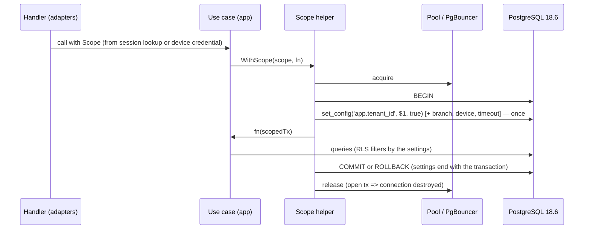

# ADR-0002: Tenant context — one scope helper, set once per transaction (Go and Ktor tracks)

## Status

Accepted

> **Who may move this to `Accepted`: the user, or `cto` on the user's explicit
> confirmation. No other agent, and no skill on its own.**
> Why this is stated here: stories referencing a `Proposed` ADR are set `Blocked`,
> and epics require `Accepted`, so the field needs a named owner. `cto` is the
> role `coordination-rules.md` escalates technical conflicts to, and an ADR is
> that decision made durable.
>
> This does **not** relax the rule that `Status: Accepted` is never set without
> explicit user confirmation — it narrows *which agent* may set it once that
> confirmation exists. An agent that believes an ADR is ready says so and
> escalates; it does not edit this field.

## Date

2026-10-17

## Last Verified

2026-10-18

## Decision Makers

The founder (user) decided on 2026-10-17 (`docs/research/tenant-isolation.md` § 5: G1 / J1, P1). Drafted by `/architecture-decision`. **Revised 2026-10-18 at the user's instruction after an independent `/architecture-review` (FAIL, text fixes):** ADR-0004's extensions are folded in here (Support scope kind, `NoLiveGrant`, `app.operator_id`, the audit record committed before the read, `transaction_timeout`), and devices get both `app.branch_id` and `app.branch_ids`. Also 2026-10-18: a **Job** scope kind for `job_rt` (the closed list of kinds had none; needed by the usage counts of ADR-0004 § 7a and by every background job). **Second review (2026-10-18, FAIL, text fixes), applied at the user's instruction:** grant loaded through `SupportGrantLookup`; principal read = Staff with an empty branch list; PL functions are the only access outside the helper. **Third review (2026-10-18):** that claim narrowed to TD and PL rows (CP, deploy and backup access named); outcome appended as the last statement. **Fourth review (2026-10-18, CONCERNS):** the claim names the § 1c functions; no licensing scope kind until the licensing ADR amends this ADR. Stack-lead validation: NOT ASSESSED — `stack.backend` is unset, so neither `go-lead` nor `ktor-lead` applies yet; it runs when `/setup-stack` picks the track. CTO-ADR: skipped — lean mode. Acceptance: the user — **Accepted by the founder, 2026-10-18.**

## Summary

Row-level security (ADR-0001) is only as good as the transaction-local setting it reads, and a second set, a session-level set or a thread-local tenant leaks across requests behind a pool. Decision: every tenant-scoped database access runs in a transaction opened by one scope helper that sets all scope values with `set_config(..., true)` exactly once, first, from an authenticated server-side source — written for both backend tracks (Go: pgx `BeginTxFunc` helper; Ktor: Exposed `suspendTransaction` helper) because the track is chosen later by `/setup-stack`.

## Stack Compatibility

| Field | Value |
|-------|-------|
| **Stack layer(s)** | Go backend **or** Ktor backend (undecided); Data (PostgreSQL) |
| **Domain** | Tenancy |
| **Layer** | Foundation |
| **Knowledge Risk** | HIGH — pgx 5.11.0, Exposed 1.5.1, HikariCP 7.1.0 and coroutines 1.11.0 behaviours were read from source and executed (research part 2, tier 3/E) |
| **References Consulted** | `docs/stack-reference/go/VERSION.md`, `go/best-practices.md` line 55; `docs/stack-reference/ktor/VERSION.md`, `ktor/best-practices.md` line 55; `docs/stack-reference/postgres/best-practices.md` § 1 (set_config); `docs/research/tenant-isolation.md` part 2 (F201–F243), part 1 (F110, F115), part 4 (F420) |
| **Pinned versions relied on** | `postgres:18.6`; Go 1.27.2, pgx 5.11.0; Kotlin 2.4.21, kotlinx.coroutines 1.11.0, Ktor 3.6.0, Exposed 1.5.1, HikariCP 7.1.0 (`pins.yaml`) |
| **Post-Cutoff APIs Used** | pgx 5.11.0 `pgx.BeginTxFunc` (package-level, takes the pool; F202) and `pgxpool.Config.PrepareConn` (replaces deprecated `BeforeAcquire`; F205); Exposed 1.5.1 `suspendTransaction` (documented path; `newSuspendedTransaction` deprecated; F238) |
| **Verification Required** | Port the part-2 tests to the chosen track: forgotten context fails closed; local context does not survive commit, rollback, panic or cancellation; session-level set leaks (negative control); second set refused by the helper; same tests through PgBouncer if a pooler is adopted. Support kind (research spikes S73, S74, PENDING): the access record survives a client rollback; `NoLiveGrant` before any query; `transaction_timeout` set locally ends a support transaction that runs too long |

Critical ADR: yes — part of the tenancy decision (Foundation).

Stack-reference facts this ADR relies on (updated by studio 220bc6f): `docs/stack-reference/go/best-practices.md` line 55 — the package-level `pgx.BeginTxFunc` exists at pgx 5.11.0 and takes the pool (research F202); `docs/stack-reference/ktor/best-practices.md` line 55 — `suspendTransaction` is Exposed 1.5.1's supported entry point for suspend code and `newSuspendedTransaction` is deprecated (research F238).

## ADR Dependencies

| Field | Value |
|-------|-------|
| **Depends On** | ADR-0001 (tenancy model) |
| **Enables** | ADR-0003 (branch scope uses the same helper); ADR-0004 (support scope kind); device credential and sync write-path ADRs (device scope set by the helper); sync limits ADR (per-plan `statement_timeout` set by the helper) |
| **Blocks** | The first backend story that touches tenant data |
| **Ordering Note** | Accept with or after ADR-0001. `/setup-stack` then keeps only the rule for the chosen track; the other track's rule stays as the record of the alternative. |

## Context

### Problem Statement

The runtime role sees rows only through the `app.tenant_id` setting (ADR-0001). Executed at 18.6 and the pinned drivers: a second `set_config` in one transaction silently switches tenant (F110, F212); a session-level `set_config(..., false)` or plain `SET` is inherited by the next request on the same pooled connection, directly or through PgBouncer (F115, F210, F235c); HikariCP and pgjdbc do not reset settings on return (F234, F236); a bare `ThreadLocal` tenant leaks across reused threads and is wrong after coroutine suspension (F240); a nested Exposed transaction overwrites the outer tenant (F239). The same applies to the branch list (F420). Without one rule, each use case invents its own.

### Current State

No backend code. The backend track (Go or Ktor) is undecided (OQ7, `/setup-stack`).

### Constraints

- Both tracks must be covered until `/setup-stack` decides.
- Pooled connections everywhere; an external transaction-mode pooler may be added later.
- Scope values come from an authenticated source: a session lookup (ADR-0003), a device credential (credential ADR) or a live support grant plus the authenticated operator session (ADR-0004), never from the request. The lookups that find the session, credential or enrolment code run before any scope exists, through ADR-0001's PL access functions (§ 1c). **The § 1c functions (lookups and pre-context writes, ADR-0001) are the only access to tenant rows (TD) and pre-context rows (PL) outside this helper.** Also outside the helper, and never on TD or PL rows: `platform_rt` on CP tables only (tenant list and status, usage counts, emergency control-plane actions; ADR-0001, ADR-0004 § 7), DDL by `deploy_rt` and the privileged migrations by the bootstrap superuser (ADR-0001), and physical backup by `backup_rt` (ADR-0004 § 9).

### Requirements

- Forgetting the context fails closed (0 rows, write error).
- No scope value outlives its transaction on any path: commit, rollback, panic, cancellation, released-while-open.
- The scope cannot be widened inside a transaction.
- Works unchanged behind PgBouncer in transaction mode.

Research note: `docs/research/tenant-isolation.md` (part 2; § 5).

## Decision

**One scope helper per backend.** All tenant-scoped database work runs inside a transaction opened by a single helper. Its first statements set every scope value with `set_config(name, value, true)` — `app.tenant_id`, and as applicable `app.branch_ids` / `app.branch_all` (ADR-0003), `app.device_id` and `app.branch_id` (device requests), `app.operator_id` (support, ADR-0004), the per-plan `statement_timeout` (limits ADR) and, for support, `transaction_timeout`. It sets them **exactly once**: a second call in the same transaction is refused by the helper. Values are parsed (UUID) before binding and come only from the authenticated server-side scope object.

**Four scope kinds.** The scope object is one of:
- **Job** (background jobs as `job_rt`: export, retention, limits, provisioning, usage counts): `{tenant}` from the job's own server-side work list, one tenant per transaction. The helper sets `app.tenant_id` only; no branch setting, because jobs act for the whole tenant and ADR-0003's `branch_scope` does not bind `job_rt`. A job that touches several tenants opens one helper transaction per tenant; it never reads across tenants in one query.
- **Staff** (dashboard, ADR-0003): tenant from the session lookup; `app.branch_ids` from the principal's assigned branches, or `app.branch_all = 'on'` only when the verified role is owner. The **principal read** of ADR-0003 (before the principal's branches are known) uses **Staff with an empty branch list**: `app.branch_ids` is empty, so branch-scoped tables return nothing and only tenant-wide tables (`staff_roles`, `staff_branches`) are read.
- **Device** (sync endpoint): tenant, branch and device from the verified credential. The helper sets **both** `app.branch_id` (the single branch, used by the device tables' `WITH CHECK` on all three ids, research F322) **and** `app.branch_ids` (a one-element list of the same branch, read by ADR-0003's restrictive branch policy), from the one credential value, so the two cannot disagree. It never sets `app.branch_all` for a device.
- **Support** (Kodelix operator console, ADR-0004): `{grantId, operatorId}`. Before any tenant is set, the helper loads the grant through ADR-0001's PL function **`SupportGrantLookup.find(grantId, operatorId)`** (`support_grants` is class PL; owner `auth_lookup`). It refuses with `NoLiveGrant`, before any query on tenant data, unless the grant exists for that operator and is approved, not revoked and not expired. The operator console lists one operator's grants across tenants with `SupportGrantLookup.listByOperator(operatorId)`. The helper then sets `app.tenant_id` and `app.branch_ids` from the grant (an explicit list; never `app.branch_all`), `app.operator_id` from the authenticated operator session, and `transaction_timeout` locally from configuration (`transaction_timeout` exists from PostgreSQL 17, `docs/stack-reference/postgres/best-practices.md` line 53; its effect when set inside the running transaction is checked in S74).

**No scope kind for the licensing service roles yet.** The licensing ADR adds a Licensing kind by amending this ADR, together with the M27/M38 roles (ADR-0001). Until then no licensing service role runs.

**Support kind: audit record committed before the read.** For the Support kind the helper works in two steps: (1) a short transaction, with the tenant context set from the grant, that calls the journal's append function (ADR-0004; owned by `audit_writer`) to write the "access opened" record, and **commits**; (2) the scoped transaction for the read or verb, where scope is set once as above; **its last statement appends the outcome and row count**, so the per-tenant chain lock is held only briefly (ADR-0004 § 5). A record written only inside the reading transaction would vanish on a client rollback (research F717). Each step is one transaction with its scope set exactly once; the rule "one set per transaction" is unchanged.

**Go track (G1).** `WithScope(ctx, pool, scope, fn)` built on `pgx.BeginTxFunc`; repositories accept only the transaction type the helper hands out, so code outside it does not compile against tenant repositories. Optional G2 alarm: a `PrepareConn` hook that destroys a connection carrying a non-empty setting or an open transaction and increments a metric — an alarm, not the control.

**Ktor track (J1).** A helper on Exposed `suspendTransaction` whose first statement is a `setScope(scope)` extension running the `set_config` calls; the scope is passed explicitly or as a coroutine context element (`asContextElement`), never as a bare `ThreadLocal` or MDC value; nested tenant transactions are forbidden; no scope statement runs outside an Exposed transaction (HikariCP auto-commit would drop it, F235a). jOOQ (J2) remains an alternative only if its licence for PostgreSQL is confirmed (F241).

**Pooler.** P1: the driver pool only, until a connection limit is shown. If PgBouncer is adopted: version 1.26.1 or later (SCRAM impersonation fix, F114), and either `max_prepared_statements` > 0 or pgx `QueryExecModeExec` / pgjdbc `prepareThreshold=0` (F213, F232). The transaction-local setting itself is safe behind it (F115, F213a).

**One contract for names.** Setting names (`app.tenant_id`, `app.branch_ids`, `app.branch_all`, `app.device_id`, `app.branch_id`, `app.operator_id`) live in one constants module that the helper, the migrations' policies and the tests share. No other `app.*` setting exists.

### Architecture



### Key Interfaces

```text
Scope (app layer value) = Job | Staff | Device | Support
  Job     { tenant: TenantId }                                          // job_rt; app.tenant_id only, one tenant per transaction
  Staff   { tenant: TenantId, branches: All | List<BranchId> }          // ADR-0003; All only for a verified owner; the empty list is the ADR-0003 principal read
  Device  { tenant: TenantId, branch: BranchId, device: DeviceId }      // sets app.branch_id AND app.branch_ids = [branch]
  Support { grant: SupportGrantId, operator: OperatorId }               // ADR-0004; tenant and branch list come from the live grant
  planTimeout: Duration?                                                // limits ADR (Staff, Device, Job)

Go:    func WithScope[T any](ctx context.Context, src TenantDataSource, s Scope, fn func(ScopedTx) (T, error)) (T, error)
Ktor:  suspend fun <T> withScope(src: TenantDataSource, s: Scope, block: suspend ScopedTransaction.() -> T): T
// ScopedTx / ScopedTransaction: the only handle tenant repositories accept.
// Errors: ScopeAlreadySet (second call), InvalidScope (unparseable id),
//         NoLiveGrant (Support: grant missing, unapproved, revoked or expired) — no query on tenant data runs.
// Support: the "access opened" record is committed in its own transaction before fn runs.
```

`TenantDataSource` comes from `TenantConnectionResolver` (ADR-0001).

### Implementation Guidelines

- **Must:** open a transaction per unit of tenant work through the helper; first statements set the scope with `set_config(..., true)` as bound parameters.
- **Must never:** call `set_config(..., false)`, plain `SET`, or set any scope setting outside the helper (F115, F210).
- **Must never:** set the scope twice in one transaction; the helper refuses (F110, F212, F420).
- **Must never:** take tenant, branch, device or operator ids from a request body, query string or header; the scope comes from the session lookup (ADR-0003), the verified device credential (credential ADR) or the live support grant plus the authenticated operator session (ADR-0004).
- **Must (Device):** set `app.branch_id` and `app.branch_ids` from the same credential value; never `app.branch_all`.
- **Must (Job):** one helper transaction per tenant with `app.tenant_id` only; never a query across tenants.
- **Must (Support):** refuse with `NoLiveGrant` before any tenant query; commit the "access opened" record in its own transaction before the scoped transaction; set `transaction_timeout` locally from configuration; never set `app.branch_all`.
- **Must never:** cache grant liveness or session scope between transactions (ADR-0003, ADR-0004).
- **Must (Go):** repositories accept only `ScopedTx`; acquire with a timeout and export pool saturation (F214).
- **Must (Ktor):** use `suspendTransaction`; carry the scope explicitly or via `asContextElement`; no bare `ThreadLocal`/MDC tenant; no nested tenant transactions (F238–F240).
- **Must:** policies cast with `NULLIF(current_setting(name, true), '')` (F110).
- **Must:** the helper lives in the `app` layer's port and its adapter; `domain` never sees connections or settings.
- **Must (tests):** connect as the runtime role; include a negative control that proves the harness can see a session-level leak.

## Alternatives Considered

### Alternative 1: Session-level context with reset hooks (G3)

- **Description**: `set_config(..., false)` at acquire, reset in `AfterRelease` / `PrepareConn`.
- **Pros**: no per-transaction statement.
- **Cons**: leaks to the next client behind a transaction-mode pooler, where the driver hook cannot see the pooler's server connection (F210).
- **Cost / Risk / Performance / Operability**: low build; high cross-tenant risk; saves nothing measurable; unsafe the day a pooler is added.
- **Rejection Reason**: executed leak at our pins.

### Alternative 2: Bare ThreadLocal or MDC tenant (J4)

- **Description**: carry the tenant in a thread-local read by repositories.
- **Pros**: least code.
- **Cons**: leaked request 1's tenant to request 2 on a reused thread; 399 of 400 coroutines read a wrong value after resuming (F240).
- **Rejection Reason**: executed leak; Ktor is coroutine-based.

### Alternative 3: jOOQ transactions (J2)

- **Description**: `transactionResult { DSL.using(cfg) ... }` with the scope statement first.
- **Pros**: worked in the spike; mature SQL DSL (F242).
- **Cons**: open-source edition's PostgreSQL coverage not sourced (F241); using the outer `DSLContext` bypasses the transaction.
- **Rejection Reason**: not rejected on merit — held as the Ktor alternative until the licence is confirmed.

### Alternative 4: External pooler now (P2)

- **Description**: PgBouncer in transaction mode from the start.
- **Pros**: more client connections per server connection.
- **Cons**: another component to patch (three CVEs in 1.26.1, F114); prepared-statement configuration traps (F213c, F232).
- **Rejection Reason**: no connection limit has been shown for three venues; the rule above already works behind it.

## Consequences

### Positive

- One place sets scope; reviews look for one pattern; tests are shared across use cases.
- Same rule for staff and devices; branch scope (ADR-0003) and plan timeouts plug into it.

### Negative

- One extra round trip per transaction (not measured; S28).
- Every tenant operation must be a transaction, including reads.
- The rule exists twice (Go and Ktor) until `/setup-stack` decides.

### Neutral

- The G2 guard is optional; if enabled it costs one query per acquire.

## Risks

| Risk | Probability | Impact | Mitigation |
|------|------------|--------|-----------|
| A use case bypasses the helper | Medium | Low (fails closed: 0 rows / 42501) | Typed `ScopedTx`; architecture test; fail-closed tests |
| Session-level set slips in | Low | High | Code rule; G2 guard alarm; leak test as negative control |
| Nested Exposed transaction switches tenant | Low | High | Forbidden; test K5 ported |
| PgBouncer added with wrong prepared-statement mode | Low | Medium (errors, not leaks) | Rule above; pooler tests |

## Cross-Cutting Impact

| Concern | Impact |
|---------|--------|
| **Security / tenancy** | ASVS 5.0.0 8.4.1, 8.3.1, 4.1.3 (scope not from client-set headers), 1.2.4 (bound parameters); threat model `tenant-isolation` (to be written) |
| **Observability** | `db.tenant_tx` span with `app.tenant_id`; metrics `tenant_context_missing_total`, `tenant_context_switch_refused_total`, `tenant_context_guard_destroyed_total`, pool wait/saturation; page on any missing or switched scope in production |
| **Caching** | No cache for the scope: it is transaction-local by design |
| **Self-hosted** | None — hosted only |
| **Cost** | Negligible; one statement per transaction |

## Performance Implications

| Metric | Before | Expected After | Budget (`perf-budgets.md`) |
|--------|--------|---------------|--------|
| Latency p95 (affected endpoints) | n/a | +1 round trip per transaction (unmeasured, S28) | budget not yet set |
| DB queries per request | n/a | +1 (scope statement; +1 with the G2 guard) | budget not yet set |
| Memory (service RSS) | n/a | unchanged | budget not yet set |
| Storage growth | n/a | none | budget not yet set |
| Network / payload | n/a | unchanged | budget not yet set |

## Migration Plan

Greenfield.

1. `/setup-stack` picks the track; the first backend story builds the helper and ports the part-2 tests for that track before any tenant repository.
2. If a pooler is adopted later, rerun the pooler tests at the adopted version before switching traffic.

**Rollback plan**: none needed before production; the helper is the only call site to change.

## Validation Criteria

- [ ] Forgotten context: 0 rows on read, SQLSTATE 42501 on write, as the runtime role.
- [ ] After commit, rollback, panic and cancellation the next borrower of the same connection reads no scope.
- [ ] A second scope call in one transaction is refused by the helper (no query runs).
- [ ] Negative control: a session-level set is visible to the next borrower (proves the test can fail).
- [ ] Device scope: a device sees branch-scoped rows of its own branch and 0 rows of a sibling branch; `app.branch_id` and `app.branch_ids` always hold the same branch.
- [ ] Support scope: an expired, revoked or unapproved grant yields `NoLiveGrant` and no tenant query; a support read whose client rolls back still leaves its committed "access opened" record (S73).
- [ ] `SupportGrantLookup.find` with another operator's id returns nothing; a live grant loads without a tenant context.
- [ ] **The tenant-isolation threat model (`docs/architecture/threat-models/tenant-isolation.md`, `/threat-model tenant-isolation`) blocks the first story that stores tenant data; it does not block acceptance of this ADR (founder, 2026-10-18).**
- [ ] Behind PgBouncer (if adopted): the same four checks pass.
- [ ] Performance: checked against `perf-budgets.md` once it exists; not checked until then.

## Spec Requirements Addressed

Foundational — no spec requirement. Enables: every backend use case that reads or writes tenant data; device sync scope; branch scope; per-plan limits.

## Related

- Depends on ADR-0001. ADR-0003 and ADR-0004 build on it; ADR-0004's support kind is specified here, its grant and audit model there.
- Review: independent `/architecture-review` of ADR-0001–0004 (2026-10-18, FAIL, text fixes) — applied in this revision.
- Stack reference: `transaction_timeout` (PostgreSQL 17+) at `postgres/best-practices.md` line 53 and `postgres/deprecated-apis.md` line 13.
- Research: `docs/research/tenant-isolation.md` part 2 (F201–F243, evidence `docs/research/evidence/tenant-isolation/part-2/`), part 1 F110/F115, part 4 F420.
- Stack reference: `go/best-practices.md` line 55 and `ktor/best-practices.md` line 55 (studio 220bc6f) carry the pgx and Exposed facts this ADR uses; Exposed 1.6.0 exists and is not adopted.
- Threat model: `docs/architecture/threat-models/tenant-isolation.md` (to be written).
