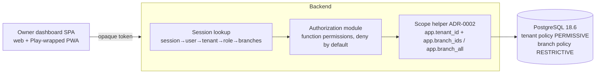

# ADR-0003: Branch scope and session — RLS plus application checks, opaque session token with scope resolved per request

## Status

Proposed

> **Who may move this to `Accepted`: the user, or `cto` on the user's explicit
> confirmation. No other agent, and no skill on its own.**
> Why this is stated here: stories referencing a `Proposed` ADR are set `Blocked`,
> and epics require `Accepted`, so the field needs a named owner. `cto` is the
> role `coordination-rules.md` escalates technical conflicts to, and an ADR is
> that decision made durable.
>
> This does **not** relax the rule that `Status: Accepted` is never set without
> explicit user confirmation — it narrows *which agent* may set it once that
> confirmation exists. An agent that believes an ADR is ready says so and
> escalates; it does not edit this field.

## Date

2026-10-17

## Last Verified

2026-10-17

## Decision Makers

The founder (user) decided on 2026-10-17 (`docs/research/tenant-isolation.md` § 5: B1-B + B2-A). Drafted by `/architecture-decision`. Stack-lead validation: NOT ASSESSED — no stack layer configured (`stack.backend`, `stack.web` unset). CTO-ADR: skipped — lean mode. Acceptance: the user.

## Summary

Inside one tenant (an owner organisation with several venues), a manager assigned to one branch must never see or change another branch's data through the owner web dashboard or its Play-wrapped form, and role or assignment changes must take effect at once. Decision: branch scope is enforced twice — a restrictive RLS policy on a branch list set by the ADR-0002 scope helper, plus application-layer function permissions — and the dashboard session is an opaque reference token whose scope is resolved from the database on every request.

## Stack Compatibility

| Field | Value |
|-------|-------|
| **Stack layer(s)** | Data (PostgreSQL); Go or Ktor backend (undecided); Web (Vite + React SPA) and the same SPA in a Play wrapper |
| **Domain** | Tenancy (with Identity for the session) |
| **Layer** | Foundation |
| **Knowledge Risk** | HIGH — PostgreSQL 18.6 restrictive policies executed (part 4, tier E); ASVS 5.0.0 V7/V9 looked up in the official files |
| **References Consulted** | `docs/stack-reference/postgres/best-practices.md` § 1; `docs/research/tenant-isolation.md` part 4 (F408–F424), part 6 (DA-08, DA-09, DA-12, DA-16); `docs/research/desktop-client-adr-followups.md` § 5 (owner app) |
| **Pinned versions relied on** | `postgres:18.6`; React 19.3.0 / Vite 8.3.4 for the SPA (`pins.yaml`) |
| **Post-Cutoff APIs Used** | None beyond PostgreSQL 18 `CREATE POLICY ... AS RESTRICTIVE` (executed, F417) |
| **Verification Required** | Branch tests at a realistic table size (S42: hoisted lookup; S44: branch setting through the driver and pooler; S45: per-branch unique keys); DA-08, DA-09, DA-12, DA-16 |

Critical ADR: yes — tenancy and session (Foundation).

## ADR Dependencies

| Field | Value |
|-------|-------|
| **Depends On** | ADR-0001 (tenancy model), ADR-0002 (scope helper) |
| **Enables** | Staff, roles and permissions spec; owner dashboard stories; owner Play-wrapped app stories; reports |
| **Blocks** | Any dashboard or reporting story that reads branch-scoped data |
| **Ordering Note** | The role matrix per surface (which functions a manager or cashier may use on the dashboard and the wrapped app; what a manager sees of sibling branches; who may touch two branches) is a founder and `product-manager` decision for the role spec (research § 9.1 item 5). This ADR fixes the mechanism, not the matrix. |

## Context

### Problem Statement

A tenant is an owner organisation with one or more branches (ADR-0001). Owners see every branch; a manager runs one branch; a cashier sells at one branch. The owner uses the web dashboard, also delivered as a PWA inside a Google Play wrapper (`desktop-client-adr-followups.md` § 5, OQ6; founder input pending spikes S32/S33). ASVS 5.0.0 has no requirement that sessions end on a role change (F410), so stale scope in a long-lived token is a design risk, not a compliance gap. Without this decision every list, report and export would carry its own branch filter.

### Current State

No code. Part 4 executed the restrictive-policy pattern at 18.6 (F417–F424).

### Constraints

- Tenant isolation and scope setting follow ADR-0001 and ADR-0002.
- One device per branch in Tier 1; devices use the same policy shape with a one-element branch list from their credential.
- The SPA is static (no Node server in production); the session is verified by the backend only (ASVS 7.2.1).

### Requirements

- A manager of branch A1 gets 0 rows or a refusal for branch A2 on every read, list, report and export route; writes naming A2 fail (DA-08).
- Reassigning or demoting a manager takes effect on the next request without a token refresh (DA-09).
- Logout, user disable and tenant suspension end access on the next request (DA-12).
- After logout, no tenant data remains in the browser or the wrapped app's storage (DA-16, AN-02).

Research note: `docs/research/tenant-isolation.md` (part 4; § 5).

## Decision

**1. Branch scope: RLS plus application checks (B1-B).**
- Every branch-scoped table carries `tenant_id` and `branch_id`, leads indexes with `(tenant_id, branch_id, ...)` and references the branch through a composite foreign key `(tenant_id, branch_id) → branches (tenant_id, id)`. Tenant-wide data (catalogue, staff list) is not branch-scoped.
- On top of the tenant policy (ADR-0001), each branch-scoped table has a **restrictive** policy: `current_setting('app.branch_all', true) = 'on' OR branch_id = ANY(string_to_array(NULLIF(current_setting('app.branch_ids', true), ''), ',')::uuid[])` (F417).
- The ADR-0002 helper sets `app.branch_ids` (or `app.branch_all = 'on'` only for a verified owner role) once, from the server-side scope; a request that names a branch is checked to be inside that set and refused otherwise (F418).
- The application owns function-level permissions (owner / manager / cashier), deny by default, through one authorization module every route calls (API5:2023, F412).
- Reports run as `security_invoker` views or queries under the caller's scope (F422); pre-aggregated rollups are ordinary tables with the same policies, never materialized views (F423).
- Devices: the same policy with a one-element branch list taken from the device credential (credential ADR).

**2. Session: opaque reference token, scope resolved per request (B2-A).**
- The dashboard (web and Play-wrapped) authenticates with an opaque session token: CSPRNG, at least 128 bits (ASVS 7.2.3), stored hashed server-side, new token on every authentication (7.2.4).
- The token carries no tenant, role or branch claim. On every request the backend resolves session → user → tenant → role → assigned branches from the database and builds the scope for the ADR-0002 helper.
- Logout, user disable and tenant suspension invalidate the session row (7.4.1, 7.4.2); role and assignment changes apply on the next request (F421).
- No cache of session scope at Tier 1 (revocation must be immediate, ASVS 8.3.2); if load requires one later: per process, short configurable TTL, key = session id, explicit invalidation on role, assignment, branch change and logout.
- Transport and storage of the token in the browser and the Play wrapper (cookie vs bearer, MASVS storage) are decided with the auth/session spec and the owner-client ADR; they must not change rule 2.

### Architecture



### Key Interfaces

```text
SessionResolver (port, app layer)
  resolve(token: OpaqueToken) -> Principal | Unauthenticated
  Principal: { user, tenant: TenantId, role: Owner|Manager|Cashier, branches: All|List<BranchId> }
  // Reads the database on every call at Tier 1; never trusts client-sent scope.

Authorizer (app layer)
  require(principal, permission, target?: BranchId) -> Allowed | Denied
  // A target branch outside principal.branches is Denied.

Scope (ADR-0002) is built from Principal: branches=All only when role=Owner.
```

### Implementation Guidelines

- **Must:** every branch-scoped table has `branch_id`, the composite FK to `branches`, tenant-and-branch-leading indexes and the restrictive branch policy, created in the same migration.
- **Must never:** set `app.branch_all = 'on'` for a principal whose verified role is not owner.
- **Must never:** use a branch id from a path, query, body or header as scope; it is only a filter that must lie inside the server-derived set (F418).
- **Must:** every route goes through `Authorizer` (API5); a route without a permission check fails review and the generated isolation matrix (research part 6, option A).
- **Must:** reports use `security_invoker` views or scoped queries; **must never** expose a materialized view over branch data to a runtime role (F423).
- **Must:** session tokens are opaque, hashed at rest, rotated on authentication; **must never** put tenant, role or branch claims in the token.
- **Must:** per-branch unique keys (for example daily order numbers, O7) include `branch_id` after `tenant_id` (S45 to confirm).
- **Must (client):** on logout clear all tenant data from DOM, query cache and browser storage, and in the Play wrapper (DA-16, AN-02); the client stores no scope.

## Alternatives Considered

### Alternative 1: Application-layer branch filter only (B1-A)

- **Description**: RLS for tenants only; each query adds `branch_id IN (...)`.
- **Pros**: no per-row policy; simplest reports.
- **Cons**: one forgotten filter exposes a sibling branch; the database cannot catch it (ASVS 8.3.1, 8.2.2).
- **Cost / Risk / Performance / Operability**: lowest build; highest leak risk; cheapest queries; every new query needs review.
- **Rejection Reason**: branch isolation would rest on code review alone, while managers are exactly the staff the product exists to hold accountable.

### Alternative 2: Scope derived in the database (B1-C)

- **Description**: set only `app.staff_id`; the policy looks up `staff_branches`.
- **Pros**: no list handed over by the backend; assignment changes apply next transaction (F421).
- **Cons**: per-row sub-plan, about 2× the list variant in the small test (5.8–6.6 ms vs 3.0–3.5 ms, F424); hoisting untested (S42).
- **Rejection Reason**: kept as the fallback if the backend should not hand lists to the database; slower in the measured shape.

### Alternative 3: Schema or database per branch (B1-D)

- **Rejection Reason**: multiplies ADR-0001's rejected per-tenant costs by branches and breaks owner cross-branch reports.

### Alternative 4: Self-contained signed token with scope claims (B2-B)

- **Description**: a short-lived JWT carrying tenant, role and branch list.
- **Pros**: no per-request scope lookup.
- **Cons**: stale scope until expiry unless a revocation list or cut-off is added (7.4.1); every V9 check must be right (F411); grows with branches.
- **Rejection Reason**: a demoted manager would keep branch access for the token lifetime; B2-A gets immediate effect with one indexed read.

### Alternative 5: Hybrid — signed identity token, scope looked up (B2-C)

- **Rejection Reason**: two mechanisms for the same result as B2-A; the tenant claim is still a credential to protect. Kept as the option if per-request session lookup proves too costly.

## Consequences

### Positive

- A manager cannot read or write another branch even when a route forgets a filter.
- One policy shape for people and devices.
- Role and assignment changes are effective on the next request; logout and disable are immediate.

### Negative

- One extra session lookup per request; no cache at Tier 1.
- The branch predicate stayed a filter, not an index condition, in the small test (F424): a small branch in a large tenant reads the tenant's range. Re-measure at size (S42).
- Every branch-scoped table needs the restrictive policy and a composite key.

### Neutral

- The role matrix per surface is left to the role spec (Ordering Note).

## Risks

| Risk | Probability | Impact | Mitigation |
|------|------------|--------|-----------|
| A code path sets `branch_all` for a non-owner | Low | High | Helper builds it only from a verified owner role; `branch_scope_switch_refused_total`; DA-08 |
| Second `SET LOCAL` widens scope | Low | High | ADR-0002 helper refuses a second call (F420) |
| Branch predicate slow on large tenants | Medium | Medium | S42 at realistic size; B1-C or index change if needed |
| Per-branch unique key leaks sibling existence | Medium | Low | Branch-leading keys; S45 |
| Token or tenant data left on a shared phone or browser | Medium | Medium | Client clearing rules; DA-16, AN-02, AN-03 |

## Cross-Cutting Impact

| Concern | Impact |
|---------|--------|
| **Security / tenancy** | ASVS 5.0.0 8.2.1, 8.2.2, 8.3.1, 8.3.2, 8.4.1, 7.2.1–7.2.4, 7.4.1, 7.4.2, 14.3.1, 14.3.3; API1, API5 (2023); threat model `tenant-isolation` (to be written) with a branch-isolation section |
| **Observability** | `auth.session.resolve` span; metrics `branch_scope_set_total{kind}`, `branch_scope_missing_total`, `branch_scope_switch_refused_total`, `authz_denied_total{layer}`, `session_invalidated_total{reason}`; log `branch_scope.refused`, `staff.assignment_changed` (audit) |
| **Caching** | No cache of session scope at Tier 1 (reason: immediate revocation, ASVS 8.3.2); rollup keys carry tenant and branch |
| **Self-hosted** | None — hosted only |
| **Cost** | One indexed read per request; one policy evaluation per row |

## Performance Implications

| Metric | Before | Expected After | Budget (`perf-budgets.md`) |
|--------|--------|---------------|--------|
| Latency p95 (dashboard lists) | n/a | branch filter 3.0–3.5 ms vs 0.7 ms owner on 15,000 rows, one warm run (F424) | budget not yet set |
| DB queries per request | n/a | +1 session/scope lookup | budget not yet set |
| Memory (service RSS) | n/a | unchanged | budget not yet set |
| Storage growth | n/a | session table | budget not yet set |
| Network / payload | n/a | token size constant | budget not yet set |

## Migration Plan

Greenfield.

1. The staff and branches migration creates `branches`, `staff`, `staff_branches` with composite keys and the policies; the session table follows.
2. Every later branch-scoped table adds the restrictive policy in its own migration; the catalogue test checks it exists (extend C2 to restrictive branch policies).

**Rollback plan**: none needed before production; switching to B1-C changes only the policy expression and the scope values.

## Validation Criteria

- [ ] DA-08: a manager of A1 is refused or sees nothing of A2 on read, list, report, export and write routes; the owner sees both.
- [ ] DA-09: after reassignment A1 → A2, the next request sees A2 only, with no token refresh.
- [ ] DA-12: after logout, user disable or tenant suspension, the same token is refused.
- [ ] DA-16 / AN-02: after logout no tenant data remains in browser storage or the wrapped app.
- [ ] No materialized view over branch data is readable by a runtime role (catalogue check).
- [ ] Performance: checked against `perf-budgets.md` once it exists; not checked until then.

## Spec Requirements Addressed

Foundational — no spec requirement (the staff, roles and permissions spec does not exist yet). Enables: brief item 5 (staff, roles, branch assignment W5), item 9 (owner web dashboard), item 10 (owner app as the Play-wrapped dashboard), reports (W3).

## Related

- Depends on ADR-0001 and ADR-0002.
- Research: `docs/research/tenant-isolation.md` part 4 (F401–F436, evidence `docs/research/evidence/tenant-isolation/part-4/`), part 6 (DA/AN tests), § 9.1 item 5 (role matrix, founder); `docs/research/desktop-client-adr-followups.md` § 5 (owner app).
- Open: role matrix per surface (founder, `product-manager`); token transport and storage (auth/session spec, owner-client ADR, MASVS).
- Threat model: `docs/architecture/threat-models/tenant-isolation.md` (to be written).
