# ADR-0005: Retention, deletion and export — staged closure (DEL-2), segregated tax archive, replayed deletions, EXP-2 export

## Status

Accepted

> **Who may move this to `Accepted`: the user, or `cto` on the user's explicit
> confirmation. No other agent, and no skill on its own.**
> Why this is stated here: stories referencing a `Proposed` ADR are set `Blocked`,
> and epics require `Accepted`, so the field needs a named owner. `cto` is the
> role `coordination-rules.md` escalates technical conflicts to, and an ADR is
> that decision made durable.
>
> This does **not** relax the rule that `Status: Accepted` is never set without
> explicit user confirmation — it narrows *which agent* may set it once that
> confirmation exists. An agent that believes an ADR is ready says so and
> escalates; it does not edit this field.

## Date

2026-10-18

## Last Verified

2026-10-18

## Decision Makers

The founder (user) decided on 2026-10-17 (`docs/research/tenant-isolation.md` § 5: DEL-2 as recommended with DEL-4 de-identification as a step and DEL-3 as the escalation; EXP-2 export; backups expire inside the window and deletions are replayed after any restore; the tax archive kept segregated for its period; key destruction counts as erasure; staff records belong to the owner, who receives the export before deletion) and approved this ADR's outline on 2026-10-18. It also carries the threat model's retention and erasure mitigations (M48, M54–M62). Drafted by `/architecture-decision`. **Revised 2026-10-18 at the user's instruction after an independent `/architecture-review` (FAIL, text fixes):** B1 — closure and erasure act on PL tables only through named ADR-0001 § 1c functions for `job_rt` (dated ADR-0001 amendment); B2 — the support journal is pruned oldest-first by one `audit_writer` function with a recorded chain anchor (dated ADR-0004 amendment). **Founder decisions 2026-10-18:** H1 — leases stop renewing at `closure_requested`; `purge_personal` waits for every device's lease to end and its backlog to drain, at most until the export window ends; a late sale is accepted into the archive, de-identified on arrival. H2 — the owner's login ends at `purge_personal`; archive access afterwards is a Kodelix-run export on the owner's verified request, with one owner contact kept for that; legal hold is an operator flag with a reason, recorded in the deletion journal. H3 — tax-required buyer identifiers stay inside the signed ETA payloads; de-identification covers staff; residual risk accepted (threat model R-6). H4 — Kodelix may start closure after 90 days of suspension, with notices at suspension and at days 30, 60 and 80. M1–M5 and the low items as the reviewer suggested (one staff member's sales de-identified, not deleted; erasure owner-only with step-up; export to the owner first). M6 — S52 accepted as pending, run before the export story. **Retention defaults set by the founder (2026-10-18)** (Decision 6); the feature spec may refine them. **Second review (2026-10-18, FAIL, text fixes), applied at the user's instruction:** founder decisions — the support journal and the deletion journal are separate stores (ADR-0004 § 5 amended; `pruneBefore` never touches a tombstone); cooling-off 15 days by default and longer than the longest lease of any plan (14 days today), CI-checked. Reviewer fixes: `closure_origin` with cancel to origin; `retain_until` only moves later and an active tenant's archive is never purged; de-identification deletes the id-to-name link; retention table class G, changed only by reviewed migration; archive access after `purge_personal` by a one-time code to `archive_contact`; Kodelix-closure notices sent by a `job_rt` job; erasure covers the device copy; personal-data marker; which record goes to which store; legal-hold reason an enum or ticket id. The ADR-0001 and ADR-0004 amendments of 2026-10-18 take effect only when this ADR is Accepted. **Third round (2026-10-18), at the user's instruction after a short re-review (CONCERNS):** G-table writes by `migrator` in a reviewed migration (ADR-0001 amendment); device copies of an erased person handled at next contact, lost device accepted as R-7 (founder); support grants stay possible for origin `active` until `purge_personal` (founder confirmation); compiled 365-day prune floor (ADR-0004); cooling-off checked against the lease cap compiled into the app; `retain_until` held in `archive_retention`; archive code generated by `job_rt`; one definition of "control journal". Stack-lead validation: NOT ASSESSED — `stack.backend` and `stack.data` are unset. CTO-ADR: skipped — lean mode. Acceptance: the user — **Accepted by the founder, 2026-10-18.** With this acceptance the dated 2026-10-18 amendments to ADR-0001 and ADR-0004 take effect. **Amended 2026-10-19 by ADR-0008** (Accepted by the founder 2026-10-19): three retention rows (activity trail 5 years, the new control-journal kinds 1 year, delivered authority snapshots), and D1, D4 and D5 notes, marked inline. **Amended 2026-10-19 by the staff-auth threat model (M53; founder defaults 2026-10-19), in effect:** retention rows for short-lived auth rows, operator data and the breach register; the person-erasure store list; the person extract; table markers; an idle-login prompt; the backup statement; the sub-processor table; marked inline and in a block after Decision 6.

## Summary

A tenant that leaves, a staff member who must be erased and a restore from backup must not leave personal data behind, while the venue's tax records must survive five years after the tax period and an owner must be able to take all their data away in a readable form. Decision: closure is a staged, logged state machine (DEL-2), started by the owner or by Kodelix after a long suspension, that purges personal data once every device has drained, keeps a segregated tax archive (staff de-identified) until its `retain_until`, lets backups expire inside a 30-day window and replays every deletion after a restore; export is per-table CSV with byte-exact signed payloads and a SHA-256 manifest (EXP-2), delivered to the requester; retention periods are configuration in one table with founder defaults; per-tenant crypto-shredding (DEL-3) is a documented escalation, built only on a trigger.

## Stack Compatibility

| Field | Value |
|-------|-------|
| **Stack layer(s)** | Data (PostgreSQL); Go backend **or** Ktor backend (undecided) |
| **Domain** | Data (retention, deletion, export); Tenancy |
| **Layer** | Foundation |
| **Knowledge Risk** | HIGH — PostgreSQL 18.6 `COPY ... TO STDOUT` under RLS and backup behaviour come from research part 5 and part 1 (tier 2 / E); per-tenant `COPY` export not yet executed (S52 PENDING) |
| **References Consulted** | `docs/research/tenant-isolation.md` part 5 (F501–F536; § 4 options DEL-1..4, EXP-1..3; § 5 decision), part 1 (F117, F118), part 3 (D5-C control journal); `docs/architecture/threat-models/tenant-isolation.md` (M11, M48, M54–M62, privacy flows); `docs/research/eta-e-receipt-e-invoice.md` (R1, R3, D5; five-year duty F405, F406; buyer identifier F404); `docs/stack-reference/postgres/best-practices.md` (pg_dump and RLS); `docs/registry/architecture.yaml` |
| **Pinned versions relied on** | `postgres:18.6` (`pins.yaml`) |
| **Post-Cutoff APIs Used** | None beyond PostgreSQL 18 `COPY` under row security as the non-bypass runtime role with the tenant context set (research F530) |
| **Verification Required** | Per-tenant `COPY` export under RLS at realistic size (S52 PENDING — **accepted as pending by the founder, 2026-10-18; it runs before the export story**); a restore drill that replays tombstones (M48); export coverage of every TD table (M47); the de-identification test on the archive (M62); the archive `DELETE` policy refuses before `retain_until` and under legal hold |

Critical ADR: yes — retention and deletion of tenant and personal data in the tenancy family (Foundation).

## ADR Dependencies

| Field | Value |
|-------|-------|
| **Depends On** | ADR-0001 (tenancy model; table classes; § 1c functions as amended 2026-10-18; suspension contract Decision 4), ADR-0002 (Job kind for purges and tenant-wide exports), ADR-0003 (person-started exports under Staff scope), ADR-0004 (support journal; prune as amended 2026-10-18) — all Accepted 2026-10-18 |
| **Enables** | Closure and export stories; staff erasure; the retention table and purge jobs; the restore runbook; the incident runbook's breach clock (operational, research part 5 A.5) |
| **Blocks** | Any story that deletes tenant data, purges, exports or restores; the customer terms' retention text |
| **Ordering Note** | Where the deletion and tombstone journal lives "outside the restorable database" is the storage / server-sync-state ADR's decision (research D5-C, flagged on spike S33). This ADR can be accepted before it; the closure flow and the restore replay cannot ship before it. The step-up mechanism for closure and erasure is the staff-auth ADR's (P7-OQ9). Retention of licensing tables (seats, leases) is the licensing ADR's. Closure from `suspended` widens ADR-0001 Decision 4's owner allowance, done by the ADR-0001 amendment of 2026-10-18. S52 runs before the export story (M6). The "erase person" and "delete staff personal fields" sync commands (Decision 5) are new sync-protocol requirements for the sync ADR. The licensing ADR keeps emergency unlock within the cooling-off rule (Decision 1). Retention defaults are set in Decision 6; the feature spec may refine them before the first production tenant. The ADR-0001 and ADR-0004 amendments of 2026-10-18 take effect only when this ADR is Accepted. |

## Context

### Problem Statement

Research part 5 shows three duties pulling apart: Egyptian PDPL text says erase personal data when the purpose ends and keep anything retained for a legal reason no longer identifiable, with a dated record of erasure (research F507, F508); the venue must keep sales and receipt records five years after the tax period, and the archive lives only on the hosted server (eta-note D5, F405, F406); and PostgreSQL backups and WAL cannot remove one tenant's rows (research F118, F521), so a restore can bring deleted data back. The threat model adds that retention numbers, per-person erasure, export delivery records and the archive's de-identification are undefined (privacy H1, H2, M1–M8). Without this decision every story invents its own deletion.

### Current State

No code. ADR-0001 Decision 4 already says a suspended tenant is never purged before a closure state.

### Constraints

- Hosted only; one shared schema (ADR-0001); purges and tenant-wide exports run as `job_rt`, one tenant per transaction (ADR-0002 Job kind); PL tables are reached only through ADR-0001 § 1c functions.
- Founder decisions (2026-10-17): DEL-2; staff records belong to the owner (Kodelix exports to the owner, then deletes; Labour Law retention is the owner's duty); key destruction counts as erasure; no staff consent screen in the current release. Counsel questions are closed by founder statement (2026-10-18).
- Money facts are never lost (ADR-0001 Decision 4; sync note OQ6): an already-sold upload is always accepted.
- Backup window below the 60-day device retention (sync note OQ29).
- No hard-coded business values: periods are configuration (coding standards).

### Requirements

- An owner can close the tenant; personal data is purged; the tax archive survives until `retain_until`, staff de-identified, then is purged.
- A stolen owner session cannot erase a venue (step-up, cooling-off, notification, cancel).
- One staff member can be erased across every store without deleting a sale.
- A restore from backup never brings back a deleted tenant, an erased person or a revoked device.
- Every erasure and every delivery is recorded with date and time (research F508).
- The owner can export everything in open formats; the export never contains another tenant's rows or credentials.

Research note: `docs/research/tenant-isolation.md` (part 5; § 5). Threat model: `docs/architecture/threat-models/tenant-isolation.md`.

## Decision
**Amendment 2026-10-22 (ADR-0013 notifications) — Proposed; takes effect only when ADR-0013 is Accepted.** Owner of the retention rows below: `data-lead`. The decision text above is not edited.
- **Closure notices and the archive one-time code are email sent through `notify`** (ADR-0013 Decision 7a): notify mail kinds in `job_outbox`, one item per recipient, in the reserved lane; closure notices go to every owner contact, flagged or not.
- **`archive_requests` holds up to `max_attempts` code hashes per (request, item)** instead of "only the code's hash" (Decision 2): each attempt mints its own code in its claim transaction; an earlier code stays valid until a later attempt is accepted; a valid bounce voids the item's codes.
- **Retention:** a notice's retention counts from its terminal state (accepted, all recipients failed, or expired at the M31 bound); `auth_notice_recipients` follows its notice; per-attempt cancel-token and archive-code hash rows are deleted with their request — the exact rows are set by `data-lead` (threat model M38) before S-NT-04; `Closure.purgeLogins` also covers `auth_notices`.


**1. Closure is a staged state machine (DEL-2).** *(Amended 2026-10-19 by ADR-0008 § 7, in effect: D1: `purged` also removes `activity_trail`, which follows the tax archive; at `purge_personal` the tenant's PIN-verifier data key and every verifier row are deleted, and backup copies age out inside the backup window)* *(Amended 2026-10-21 by ADR-0012 — Proposed; takes effect only when ADR-0012 is Accepted: D1: `purged` also removes the tenant's `job_outbox`, `job_schedule` and `job_dedup` rows. The step that reaches `purged` runs as an ADR-0012 job item, so it deletes them in its own `withScope(Job, tenant)` transaction, including its own claimed row, which it already holds locked. Nothing is left behind once that transaction commits: the item's completion record is the dated deletion-journal entry, not a `done` row. ADR-0012's status gate runs no kind for `purged` and the sweep creates no schedule rows for it, so no job row reappears.)* *(Amended 2026-10-21 by ADR-0012's threat-model amendment — Proposed; takes effect only when ADR-0012 is Accepted:*
*- **Personal-data marker:** `other` for `job_outbox`, `job_schedule` and `job_dedup`, so `purge_personal` does not delete in-flight closure items.*
*- **Person erasure (M55)** also deletes every `job_outbox` and `job_dedup` row whose kind-declared person-id field names the erased person, in any status.*
*- **Retention table (Decision 6)** gains `job_done_rows` 7 days, `job_dead_rows` 90 days, `job_dedup_rows` 30 days and a maximum pending age of 90 days, after which a row goes dead as `expired`; closure, purge and person-erasure steps are exempt (founder defaults, 2026-10-21).*
*- **Erasure's own row:** the erasure item deletes its own claimed row, which names the person, and records completion as the deletion-journal tombstone, as for `purged`.*
*- **Cancel race:** closure steps and purges act only through a conditional transition (`UPDATE … WHERE state = :expected`, zero rows means do nothing), owned by this ADR's closure flow and run by the role it assigns; the closure story specifies the function.*
*- **EXP-2** excludes the three tables, listed in the export coverage test; a person's data request returns metadata only for job rows naming them.)* States: `active → [suspended] → closure_requested → export_window → purge_personal → archive_retained(retain_until) → purged`. `suspended` follows ADR-0001 Decision 4 and is optional, not a required step.
- **Who starts it:** (a) the **owner**, with step-up authentication, every owner contact notified (threat model M11); (b) **Kodelix, after the tenant has been suspended for the Kodelix-closure threshold** (Decision 6; default 90 days): `platform_rt` finds the tenant on CP `tenant_status` and moves it to `closure_requested`; the notices to the owner contacts at suspension and at days 30, 60 and 80 of suspension are sent by a `job_rt` job in that tenant's scope, which reads the owner contacts (`platform_rt` reads CP only). The normal steps follow.
- **`closure_origin`** (`active` | `suspended`) is recorded on CP `tenant_status` at `closure_requested`. From either origin: no enrolment and no lease renewal. Origin `active`: normal access continues until `purge_personal`, including support grants: the owner may grant support while exporting (founder confirmation, 2026-10-18); `Closure.revokeGrants` ends every grant at `purge_personal`. Origin `suspended`: the suspension contract (ADR-0001 Decision 4) stays in force through `closure_requested` and `export_window`.
- **Cancel:** the owner, with step-up, can cancel at any point before `purge_personal` starts; **the tenant returns to its `closure_origin`** (for `suspended`, payment is still due).
- **Leases stop renewing at `closure_requested`** (licensing ADR); a device stops new sales when its lease ends, and its backlog is always accepted.
- **Cooling-off** (Decision 6; default 15 days) runs from `closure_requested` to `export_window`. It must stay longer than **the longest lease of any plan** (14 days today, `docs/architecture/licence-model.md`), so every lease has ended before the export window opens; CI checks it against **the lease cap compiled into the app** (14 days, licence model `lease_grace_seconds` device cap; the plan-catalogue key is not decided yet). **The licensing ADR must keep any emergency unlock within this rule:** no device sells past the cooling-off.
- **Export first:** `export_window` gives the owner the EXP-2 export (Decision 4).
- **`purge_personal` waits** until every device's lease has ended and its upload backlog has drained, and until the owner has downloaded the export or the window has ended. A device that never syncs again (lost, broken) holds the purge **at most until the export window ends** (founder, 2026-10-18); anything it sends later goes into the archive under the late-sale rule (Decision 2).
- **`purge_personal` steps** (as `job_rt`, Job kind, one tenant per transaction):
  - delete staff and customer personal data the tax record does not need, through `job_rt` `DELETE` policies on the TD tables marked `personal`. **Personal-data marker:** the schema migration marks every TD table `personal`, `tax` or `other` in a catalogue comment; a CI test fails when a TD table has no marker (like the export coverage test, M47);
  - de-identify staff in the archive by deleting the id-to-name mapping rows (Decision 2);
  - run `Closure.endSessions`, `Closure.purgeLogins` (the owner's login ends here), `Closure.purgeEnrolmentCodes`, `Closure.revokeDevices` and `Closure.revokeGrants` (ADR-0001 § 1c, amendment 2026-10-18);
  - prune the support journal per its retention (ADR-0004 § 5, amendment 2026-10-18).
- **Logged:** every transition writes a dated record to the deletion journal (Decision 3) and gives the owner a **dated deletion record** to pass on to staff (M58).
- **Idempotent and resumable:** each step can be re-run; a crash mid-purge resumes, never restarts from scratch.
- **`purged` removes** the archive and the archive contact (Decision 2), every remaining PL row (`Closure.purgeRemaining`), the tenant's support journal (final anchor kept off-host, ADR-0004) and the tenant's usage counts per their retention. The CP `tenant_status` row stays as `purged`, IDs only; tombstones stay in the deletion journal for their own retention.

**2. The tax archive is segregated; staff are de-identified.** Sales, receipts, ETA payloads and cancelled originals are written to append-only archive tables (class TD) **from the first sale**, not copied at closure, with a per-tenant `retain_until` = five years after the tax period (eta-note R3; the period is a per-venue setting).
- **Protection:** runtime roles have no `UPDATE` or `DELETE` on archive rows. The only delete path is a `job_rt` `DELETE` policy requiring `retain_until < clock_timestamp()` and no legal hold; it is never hard-deleted early.
- **`retain_until` only moves later:** it is held in one row per tenant in a TD table **`archive_retention`**, never on archive rows, so recomputing it updates no archive row; the archive `DELETE` policy reads it. It is written only by a `job_rt` function (end of the last tax period with a sale + five years; recomputed when a late sale arrives); a `BEFORE UPDATE` trigger on `archive_retention` refuses any decrease, and changing a venue's tax period never lowers an existing `retain_until`. **An active tenant's archive is never purged:** the archive purge runs only from `archive_retained`.
- **De-identification covers staff, by deleting the link:** archive rows carry only the opaque staff id from the first sale; names live only in the staff tables. De-identifying deletes the id-to-name mapping rows and never updates an archive row; afterwards staff appear only as an **opaque staff id with no mapping to a name** (M62). eta-note F222's receipt v1.2 field list has no staff field, so the signed payloads hold none (the e-invoice data model was not checked).
- **Buyer identifiers stay in the signed payloads:** an identifier a tax rule requires (eta-note F404: above EGP 150,000) stays inside the byte-exact signed ETA payload, because changing it would break the signature. Residual risk accepted by Kamel Mohamed, founder, 2026-10-18 (rare for cafés; threat model R-6).
- **Late sales:** a sale arriving after `purge_personal` is still accepted: it is inserted into the archive with the opaque staff id, and any name field is dropped on arrival (money facts are never lost).
- **Access after `purge_personal`:** the owner's login no longer exists; the archive is reached only by a **Kodelix-run EXP-2 export on the owner's verified request**. One owner contact is kept in an `archive_contact` row (class TD), deleted at `purged`. Verification: on the request, `platform_rt` opens a CP `archive_requests` row (IDs and status only); a `job_rt` job in that tenant's scope generates the one-time code (CSPRNG), reads `archive_contact`, sends the code to it and writes only the code's hash to that row (`job_rt` writes CP for its own tenant); no operator role sees the code. This path is **not ADR-0004 support access**: no operator reads tenant data, and the export runs as `job_rt`. When the requester returns the code, the verification is recorded in the deletion journal and the export job runs. The file goes **only to the archive contact**, through a single-use link bound to that code that expires with the export-files period; this replaces the session re-check, since no login exists.
- **Legal hold:** a Kodelix operator flag with a reason — **an enum or a ticket id, never free text** — on CP `tenant_status`, written by `platform_rt` and recorded in the deletion journal, blocks the archive purge until released; the release is recorded too.
- The archive is purged when `retain_until` passes and no hold is set, with a dated record.

**3. Backups expire; deletions are replayed.** Backups age out inside the backup window (Decision 6; default 30 days, below the 60-day device retention). Every tenant deletion, person erasure and device revocation writes a **tombstone** to a deletion journal kept **outside the restorable database**; the restore runbook re-applies every tombstone before the restored database serves traffic, and destroys the side-restore instance afterwards (M48). The journal's home is decided by the storage ADR (D5-C); the tombstones outlive the backup window. A **scheduled check** compares the oldest backup's age with the retention-table backup window and alerts when it is exceeded; the backup tool's own expiry is configured to match by the storage ADR. **The deletion journal is a separate store from the support journal** (founder, 2026-10-18; ADR-0004 § 5 amended). Which record goes where:

| Store | Location | Kept | Records |
|---|---|---|---|
| Deletion journal | outside the restorable database | 5 years | tombstones (tenant, person, device); closure transitions and cancels; legal-hold set and release; archive purges; export deliveries; archive-request verifications |
| Support journal | inside the database (ADR-0004 § 5) | 2 years | support grants and accesses |
| Security events | security event log | 1 year | refused step-ups; refused closure or erasure attempts; export rate-cap hits; failed sign-ins (identifier masked) |

**Control journal (one definition, 2026-10-18):** the append-only store outside the restorable database (research D5-C; home set by the storage ADR). It holds the control facts a device cannot resend — enrolment, approval, revocation, rotation, owner review decisions, the licence issuance log (licence model) — and the deletion-journal records in the table above. Deletion-journal records are kept 5 years; other control facts per their own retention. The support journal (ADR-0004 § 5, inside the database) and the security event log are **not** part of it.

**4. Export is EXP-2.** *(Amended 2026-10-19 by ADR-0008 § 7, in effect: D4: the tables `pin_verifiers`, `pin_upload_facts`, `pin_activation_codes` and `tenant_data_keys` hold credentials and are on the export exclusion list (M47 coverage test))* Per-table `COPY (SELECT …) TO STDOUT` as CSV with a header, run as the non-bypass role with the tenant context set (research F530); ETA payloads exported byte-for-byte; a manifest lists each file, row count, SHA-256, export time and schema version; a data dictionary; zipped. Credentials, password verifiers, token hashes and device keys are excluded. A coverage test fails when a TD table is neither exported nor explicitly excluded (M47).
- **Who runs it:** a tenant-wide export is owner-started and runs as `job_rt`; an archive export after `purge_personal` is Kodelix-started on the owner's verified request and runs as `job_rt`; an export a person starts runs as `app_rt` in that person's Staff scope (ADR-0003).
- **Delivery goes to the requester:** the owner for tenant-wide exports; the archive contact for archive exports after `purge_personal` (Decision 2); the person for person-started and "my data" exports. The file has a random key and expires with the export-files period (Decision 6); the requester's status and permission are re-checked when the file is published and again at download (M45); exports are rate-capped per tenant (M11); every delivery writes a dated **delivery record** (M57).

**5. People.**
- **Staff records belong to the owner** (founder): Kodelix exports them to the owner, then deletes; Labour Law retention is the owner's duty.
- **Erase one staff member (M55):** owner-only, with step-up. *(Amended 2026-10-19 by ADR-0008 § 7, in effect: D5: the erasure job also deletes the person's PIN-verifier ciphertext, upload facts and activation codes through `PinVerifiers.erasePerson`; the owner guards of ADR-0008 § 3.5 refuse erasing the last active owner (closure is the route))* *(Amended 2026-10-19 by the staff-auth threat model (M53), in effect: the job also deletes the person's `auth_notices`, lockout reports and unconsumed codes; security events, control-journal rows and `authority_snapshots` keep ids only and are de-identified when the id-to-name link is deleted)* The person's records go to the owner in an export first. Then one idempotent `job_rt` job deletes their personal-data rows (server rows, id-to-name mapping, passcode hash, sync tombstones, export files) and runs `Erasure.erasePersonLogin` (ADR-0001 § 1c); their sales keep the opaque id, so **sales are de-identified by deleting the link, never deleted or updated** (FP-HARD-DELETE-TAX-ARCHIVE). **Device copy:** the job sends an "erase person" sync command to every device of the tenant; each device removes the person's name, passcode hash and other personal fields and keeps sales with the opaque id; the owner's erasure record lists the devices that confirmed. The copy stays on a device until its next contact, when it applies the erase command. A revoked or retired device, or one whose tenant has reached `purge_personal`, deletes staff personal fields at its next contact. **No device deletes them at lease end** (staff must still sign in to close open sessions). A lost device that never syncs keeps them, encrypted at rest in the device store (key-custody ADR): **residual risk R-7, accepted by Kamel Mohamed, founder, 2026-10-18** (threat model). Logs and backups age out; the tombstone is replayed after any restore; a dated record is written.
- **"My data" export (M56):** an owner or manager can export their own login, session timestamps and their view of the support journal; no credentials or token hashes. *(Amended 2026-10-19 by the staff-auth threat model (M53), in effect: a person's extract also lists their activity-trail rows by actor id, their security events, role and branch assignments, second-factor kinds and dates, devices, and PIN-verifier metadata (version, dates, confirmed), never ciphertext or hashes)*
- **Access requests (M59):** a staff member's request is taken in, forwarded to the owner as controller, and answered within six working days (internal timer); the extract covers one person only.

**6. One retention table (M54).** Every period is configuration with a typed default. **Defaults set by the founder (2026-10-18); the feature spec may refine them** before the first production tenant. Each purge job logs every run. **Who changes values:** the retention table is class G (ADR-0001), so runtime roles only read it; values change only through a reviewed migration that `deploy_rt` runs through `SET ROLE migrator`, the one stated exception to `migrator`'s "DDL only" (ADR-0001 § 1b, amendment 2026-10-18); CI checks the invariants; a change takes effect at the next purge without a code change. **Routine retention keeps running for a suspended tenant**; only closure purges wait for a closure state (ADR-0001 Decision 4, amended).

| Category | Default | Rule |
|---|---|---|
| Closure cooling-off | 15 days | longer than the longest lease of any plan (14 days today); CI-checked |
| Export window | 30 days | |
| Generated export files | 7 days, then deleted | |
| Backup window | 30 days | below the 60-day device retention; DEL-3 trigger if it cannot stay below 60 days |
| Ended sessions | 90 days | |
| Support access journal | 2 years | pruned oldest-first with a chain anchor (ADR-0004 § 5) |
| Technical logs | 30 days | no personal data |
| Security events | 1 year | |
| Usage counts | 3 years | |
| Deletion journal and tombstones | 5 years | longer than the backup window |
| Kodelix-started closure | after 90 days of suspension | notices at suspension and days 30, 60, 80 |
| Staff activity trail (`activity_trail`; amendment 2026-10-19, ADR-0008) | 5 years | marked `tax`, follows the tax archive; oldest-first prune with chain anchor; compiled prune floor 5 years |
| Control-journal kinds of ADR-0007 and ADR-0008: password reset, `must_reset`, factor add or remove, recovery-code use, login disable, role and authority changes, console lock-out runs (amendment 2026-10-19) | 1 year | longer than the backup window plus margin; CI-checked |
| Delivered authority snapshots (`authority_snapshots`; amendment 2026-10-19) | longest lease + feed retry window | the retry window comes from the sync ADR; CI checks it against the lease cap |
| Short-lived auth rows: `webauthn_challenges`, `step_up_grants`, `recovery_requests`, `enrolment_assertions` and their receipts, used or expired `pin_activation_codes`, consumed `pin_upload_facts` (amendment 2026-10-19, staff-auth threat model M53) | 30 days after use or expiry | purge job; marker `personal` |
| `auth_notices` (amendment 2026-10-19, M53) | 90 days after sending | |
| PIN lockout reports (amendment 2026-10-19, M53) | 1 year | as security events |
| `operator_sessions` / `operator_step_up` (class OP; amendment 2026-10-19, M53) | 90 days after ending / 30 days | Kodelix's own data |
| Records of a Kodelix operator who has left (amendment 2026-10-19, M53) | 1 year after leaving | credentials removed on the day they leave |
| Breach register (amendment 2026-10-19, M53) | 5 years | the register is required by the PDPL executive regulation Art 5; the 5 years is the founder's default (M53), not a legal number |
| Disabled dashboard login with no activity (amendment 2026-10-19, M53) | owner prompted after 12 months | never deleted automatically: staff records belong to the owner |

Fixed by other rules, not set in this table: the tax archive's `retain_until`, five years after the tax period (eta-note R3; per-venue period); the device keeps 60 days of local records (sync note OQ29); staff access requests are answered within six working days (M59).

**Amendment 2026-10-19 (staff-auth threat model M53; founder defaults 2026-10-19), in effect.** Source: `docs/architecture/threat-models/staff-auth.md` § 5 (privacy findings F1–F12) and § 6.
- **Markers:** every table ADR-0007 and ADR-0008 add carries a marker `personal`, `tax` or `other`, recorded with the migrations: `activity_trail` is `tax`; credential, notice and lockout tables are `personal`; `permission_catalogue` is `other`.
- **Backups and "immediately":** the customer terms and the processing register state that an erased person's data leaves backups only within the backup window (30 days), and that tombstones are replayed after any restore.
- **Sub-processor and location table:** before the first tenant, the hosting region, the email provider, the off-host log, KMS, the control-journal store and the backup repository are each listed with their location and data categories (PDPL Arts 14–16).
- **Breach register:** a secure register of breaches (executive regulation Art 5); the "verifier-key compromise" runbook names the Center and data-subject notice steps.
- **Open reading:** whether till amounts and limits paired with a staff id count as "financial data" under PDPL Art 1 is not settled by the text read; recorded here, not raised as a counsel question.

**7. DEL-3 is the escalation, not the start.** Per-tenant crypto-shredding of personal columns (envelope encryption with a per-tenant key held outside the database; destroying the key erases every copy, including backups) **counts as erasure** (founder). It is built only if (a) backups must be erased faster than the backup window, or (b) the window cannot stay under 60 days. Until then it is documented, not built.

**8. Closed tenant and its devices.** From `purge_personal` on the server answers `tenant_closed` (RFC 9457, its own `type`) to everything except already-sold uploads, which **are always accepted** (into the archive, de-identified on arrival). Leases stopped renewing at `closure_requested`, so devices stop new sales when the lease ends; a device **never wipes its local records automatically** (the venue's own copy) — wiping is an explicit owner action after export. Licensing tables (seats, leases) follow the licensing ADR's retention.

**9. Audit hygiene (M60, M61).** `support_grants.reason` and the access-opened purpose are an enum or a ticket id, never free text; failed-login log lines mask the typed identifier; the off-host log's provider, location and data categories are recorded in the sub-processor list.

### Architecture

```mermaid
stateDiagram-v2
  [*] --> active
  active --> suspended: unpaid (ADR-0001 Decision 4)
  suspended --> active: reinstated
  active --> closure_requested: owner, step-up
  suspended --> closure_requested: owner, step-up; or Kodelix after 90 days suspended
  closure_requested --> active: owner cancels, step-up (origin active)
  closure_requested --> suspended: owner cancels, step-up (origin suspended)
  closure_requested --> export_window: cooling-off ends
  export_window --> active: owner cancels, step-up (origin active)
  export_window --> suspended: owner cancels, step-up (origin suspended)
  export_window --> purge_personal: leases ended and backlogs drained (at most until window ends), and owner downloaded or window ends
  purge_personal --> archive_retained: personal data purged, staff de-identified
  archive_retained --> purged: retain_until passed and no legal hold
  purged --> [*]
  note right of purge_personal
    every transition: dated record in the deletion journal
    (outside the restorable database) + owner deletion record;
    late sales still accepted into the archive
  end note
```



### Key Interfaces

```text
TenantClosure (app layer)
  request(owner principal, stepUpProof) -> ClosureRequested      // owner action, app_rt; notifies every owner contact
  requestBySuspension(tenant) -> ClosureRequested | NotYet       // platform_rt (CP only); after the threshold; notices sent by a job_rt job
  cancel(owner principal, stepUpProof) -> closure_origin         // only before purge_personal starts
  advance(tenant) -> next state | NotYet(reason)                 // job_rt via the Job kind; idempotent; periods from the retention table

LegalHold (platform_rt, CP tenant_status)
  set(tenant, reason) / release(tenant, reason)                  // reason: enum or ticket id; each recorded in the deletion journal

ArchiveRequest (after purge_personal)
  open(tenant) -> RequestId                                      // platform_rt opens the CP row; job_rt generates and sends the code, writes its hash
  verify(requestId, code) -> Verified | Refused                  // recorded in the deletion journal; starts the archive export

DeletionJournal (port; home decided by the storage ADR, outside the restorable database)
  append(Tombstone{kind: tenant | person | device | hold, ids, at, reason})   // IDs only
  replay(sinceBackupTime)                                                     // restore runbook

TenantExport (EXP-2)
  start(scope) -> ExportId        // tenant-wide: owner, job_rt; archive: after ArchiveRequest.verify, job_rt; person-started: that person's Staff scope
  manifest: [{file, rows, sha256}], exportedAt, schemaVersion
  deliver(exportId, requester)    // to the requester only (archive: the archive contact, single-use link bound to the code); re-checks status and permission at publish and download; rate-capped; writes a delivery record

PersonErasure
  erase(owner principal, stepUpProof, staffId) -> ErasureRecord   // export to the owner first; idempotent across every store incl. devices; sales keep the opaque id; lists confirmed devices; dated

RetentionPolicy (configuration, typed defaults)
  periodFor(category) -> Duration           // categories and defaults as in Decision 6; tax archive per venue (retain_until)
```

### Implementation Guidelines

- **Must (jobs):** closure steps, purges, person erasure and tenant-wide and archive exports run as `job_rt` through the ADR-0002 Job kind, one tenant per transaction; each step is idempotent and resumable; PL rows are touched only through the ADR-0001 § 1c functions.
- **Must:** every closure transition, cancel, legal-hold change, erasure, purge, export delivery and archive-request verification writes a dated record (IDs only) to the store Decision 3 names; the deletion journal and the support journal stay separate stores.
- **Must:** `purge_personal` never starts before every device's lease has ended and its backlog has drained (bounded by the export window's end), and before the owner has downloaded the export or the window has ended; never while the tenant is `suspended` (ADR-0001 Decision 4).
- **Must:** an already-sold upload is accepted in every state, including after `purge_personal` (into the archive, staff de-identified on arrival).
- **Must (archive):** archive tables are class TD, written from the first sale, append-only for runtime roles, with `retain_until` per tenant in `archive_retention` (never on archive rows) that only moves later; the only delete path is `job_rt`'s policy requiring `retain_until` passed and no legal hold, run only from `archive_retained`; de-identification deletes the id-to-name link and never updates an archive row; after `purge_personal` no table maps the archive's staff id to a name (M62).
- **Must (restore):** the restore runbook replays every tombstone before the restored database serves traffic; the side instance is destroyed afterwards; drilled (M48); a scheduled check alerts when the oldest backup is older than the backup window.
- **Must (export):** EXP-2 runs as the non-bypass role with the tenant context set; credentials, verifiers, token hashes and device keys excluded; a coverage test covers every TD table; delivered to the requester only.
- **Must (configuration):** every period comes from the retention table (class G, changed only by reviewed migration) with a typed default; no literal in code; CI checks cooling-off > the longest lease of any plan and deletion-journal retention > backup window.
- **Must:** every TD table carries a personal-data marker (`personal`, `tax`, `other`); CI fails on a missing one.
- **Must never:** hard-delete the tax archive or any sale before `retain_until`, outside a legal-hold release — including when erasing one person.
- **Must never:** purge or erase without a dated record.
- **Must never:** export with `pg_dump` for the owner (EXP-1), or run a person's export as `job_rt`.
- **Must never:** wipe a device's local records automatically on closure.
- **Must never:** write free text into `support_grants.reason`, the access-opened purpose or the legal-hold reason, or a typed identifier into a failed-login log line.

## Alternatives Considered

### Alternative 1: Hard delete everything on request (DEL-1)

- **Description**: remove every row of the tenant, archive included, as soon as the owner asks.
- **Pros**: lowest build cost; simplest story.
- **Cons**: destroys the records the venue must keep five years after the tax period, and the archive lives only on our server (eta-note D5, F405).
- **Cost / Risk / Performance / Operability**: low build; high legal and dispute risk for the venue; one-off delete load; irreversible.
- **Rejection Reason**: the venue would be left with no tax copy.

### Alternative 2: Crypto-shredding from day one (DEL-3)

- **Description**: envelope-encrypt personal columns with a per-tenant key held outside the database; deletion destroys the key.
- **Pros**: erases backup and WAL copies at once; key destruction counts as erasure (founder).
- **Cons**: a key hierarchy and key backups whose lifetime must match the data; no SQL filtering or indexing on encrypted columns; a second critical system.
- **Cost / Risk / Performance / Operability**: high build; risk moves to key custody; per-row encrypt/decrypt on staff paths, not measured; another system to run and drill.
- **Rejection Reason**: not needed while the backup window stays under 60 days; kept as the escalation (Decision 7).

### Alternative 3: Anonymise in place, keep every row (DEL-4 alone)

- **Description**: overwrite names and identifiers with tokens, keep all rows.
- **Pros**: low cost; nothing deleted.
- **Cons**: rows still joinable to the venue's staff list stay personal data; backups keep the originals.
- **Cost / Risk / Performance / Operability**: low-medium build; medium risk; no performance effect.
- **Rejection Reason**: useful only as the de-identification step inside DEL-2.

### Alternative 4: `pg_dump` export (EXP-1)

- **Description**: dump the tenant in RLS mode as SQL.
- **Pros**: low cost; good for our own single-tenant restore.
- **Cons**: unreadable for an owner or accountant; a table without RLS is dumped in full (research F117).
- **Cost / Risk / Performance / Operability**: low build; cross-tenant leak risk; whole-dump, not streamed per table.
- **Rejection Reason**: wrong audience and a leak path.

### Alternative 5: Paginated JSON API export (EXP-3)

- **Description**: the dashboard pulls pages.
- **Pros**: fits dashboards.
- **Cons**: inconsistent snapshots across pages; slow for years of data; interacts with request limits.
- **Cost / Risk / Performance / Operability**: medium-high build; consistency risk; many round trips.
- **Rejection Reason**: unsuitable for a closure archive.

## Consequences

### Positive

- Tax duty and erasure duty are both met by design: staff personal data goes, an archive with staff de-identified stays until `retain_until`.
- No money fact is lost: late sales after closure still land in the archive.
- A restore cannot resurrect deleted data; every erasure and delivery has a dated record.
- One retention table makes every period visible and changeable without code.

### Negative

- More moving parts: a state machine with cancel and Kodelix-started closure, an archive written from the first sale, a deletion journal outside the database, a legal-hold flag, a restore runbook that must be drilled.
- Personal data in backups lives until the window ends (30 days by default), not instantly; disclosed to staff through the owner.
- After `purge_personal` the owner has no login; archive access needs a Kodelix export on a request verified by a one-time code to the archive contact.
- A restore can roll the support journal back to the backup point (it lives inside the database); the off-host log and the latest anchor record what was lost (ADR-0004 § 5).
- Tax-required buyer identifiers stay in signed payloads for the archive period (R-6).
- The closure flow cannot ship before the storage ADR places the deletion journal.

### Neutral

- DEL-3 stays documented; switching to it later is additive (encrypt personal columns, keep the state machine).

## Risks

| Risk | Probability | Impact | Mitigation |
|------|------------|--------|-----------|
| A restore brings back a deleted tenant or erased person | Medium | High | Tombstone replay before serving traffic; restore drill (M48) |
| A stolen owner session erases a venue | Medium | High | Step-up, cooling-off longer than the longest lease, every owner contact notified, cancel before `purge_personal` (M11) |
| A sale sold offline arrives after `purge_personal` | Medium | Medium | Always accepted into the archive, staff de-identified on arrival (Decision 2) |
| A lost device holds the purge forever | Low | Medium | Wait bounded by the export window's end; late sales go to the archive |
| Kodelix closes a tenant whose owner missed the notices | Low | High | Notices at suspension and days 30, 60, 80 to every owner contact; cooling-off and cancel still apply |
| The archive is purged during a dispute | Low | High | Legal hold blocks the purge until released; both recorded |
| Buyer identifiers retained in signed payloads | Low | Low | Required for tax; rare for cafés; R-6 accepted by name |
| Purge misses a store (tombstones, exports, mapping to the archive id) | Medium | Medium | Erase-one-person job across every store; archive de-identification test (M55, M62) |
| A new TD table is left out of the export | Medium | Medium | Export coverage test (M47) |
| Retention defaults drift from the founder's values without review | Low | Medium | Defaults in Decision 6; retention table class G, changed only by reviewed migration; CI invariants (M54) |
| `retain_until` lowered to purge records early | Low | High | Only a `job_rt` function writes it; a trigger refuses any decrease; no purge while active |
| An erased person's data survives on a device | Medium | Medium | Erase command applied at the device's next contact; confirmed devices listed; a lost device that never syncs keeps it encrypted (R-7, accepted) (M55) |
| Archive outlives the contract as Kodelix processing | Low | Medium | Counsel item closed by founder statement (2026-10-18); disclosed in the customer terms |
| Backup window drifts above its value | Low | High | Scheduled backup-age check and alert; window in the retention table; DEL-3 trigger (Decision 7) |

## Cross-Cutting Impact

| Concern | Impact |
|---------|--------|
| **Security / tenancy** | ASVS 5.0.0 14.1.2, 14.2.7 (retention and automatic deletion), 14.2.6 (minimum data), 7.5.3 (step-up for closure and erasure), 8.3.3 (export on the originating subject's permissions), 16.3.3 (security events), 16.4.2 (append-only records); API1/API4 for export endpoints. Threat model `docs/architecture/threat-models/tenant-isolation.md` M11, M45, M47, M48, M54–M62; R-6 |
| **Observability** | Spans `tenant.closure.advance`, `tenant.export`, `person.erase`, `retention.purge`; metrics `closure_state_total{state}`, `purge_rows_total{category}`, `export_bytes`, `restore_tombstones_replayed_total`, `backup_oldest_age_seconds`; alert on a closure step stuck past its window, a purge job that did not run, a restore that served traffic before replay, a backup older than the window; IDs only |
| **Caching** | No cache: closure state, legal hold and retention are read per job run |
| **Self-hosted** | None — hosted only |
| **Cost** | Archive storage for five years per tenant (cold, append-only); export storage short-lived (7 days); no new component until DEL-3 |

## Performance Implications

| Metric | Before | Expected After | Budget (`perf-budgets.md`) |
|--------|--------|---------------|--------|
| Latency p95 (affected endpoints) | n/a | none on the counter path; exports run in a low-priority class (threat model M16) | budget not yet set |
| DB queries per request | n/a | none on request paths; jobs only; archive insert alongside each sale | budget not yet set |
| Memory (service RSS) | n/a | export streams per table (COPY TO STDOUT), not buffered | budget not yet set |
| Storage growth | n/a | archive per tenant for five years; deletion journal five years | budget not yet set |
| Network / payload | n/a | export size per tenant, unmeasured (S52) | budget not yet set |

## Migration Plan

Greenfield.

1. The retention table with the founder defaults (Decision 6) and the CI invariants with the first schema migration; the spec may refine values before the first production tenant.
2. The archive tables, `archive_retention` (`retain_until`) and its no-decrease trigger, the `archive_contact` table, CP `archive_requests`, `closure_origin` and the legal-hold flag with the first sales tables; the personal-data marker CI test with the first TD table.
3. The ADR-0001 § 1c closure and erasure functions and the ADR-0004 prune function as privileged migrations with the first closure story.
4. The deletion journal once the storage ADR places it; until then no closure or restore story ships.
5. S52, then export; closure, person erasure and the restore runbook as stories, each with its negative test; the restore drill before the first production tenant.

**Rollback plan**: none needed before production. After production the state machine only moves forward past `purge_personal`; before it, the owner cancels.

## Validation Criteria

- [ ] Closure or erasure without fresh step-up is refused; a purge before cooling-off ends, before leases end and backlogs drain (unless the export window has ended), or before the export is downloaded (or the window ends) is refused; a suspended tenant is never purged.
- [ ] Cancel works before `purge_personal`, returns the tenant to its `closure_origin`, and is refused after it starts; a tenant closing from `suspended` keeps the suspension contract until `purge_personal` (no non-owner sign-in, no enrolment, no new grant).
- [ ] Kodelix closure before the threshold is refused; the four notices are sent and recorded.
- [ ] A lease renewal after `closure_requested` is refused; an already-sold upload after `purge_personal` lands in the archive with staff de-identified.
- [ ] After `purge_personal`: no staff name anywhere except the export already delivered; no table maps the archive's staff id to a name (M62), and no archive row was updated; the owner cannot sign in; an archive export runs only after a recorded one-time-code verification and goes only to the archive contact.
- [ ] The archive cannot be deleted before `retain_until`, under legal hold, or while the tenant is active, by any role; a decrease of `retain_until` is refused; after it passes, the purge job removes the archive and writes a dated record.
- [ ] Restore drill: a deleted tenant, an erased person and a revoked device stay gone after a restore; the side instance is destroyed (M48); the backup-age check alerts on an over-age backup.
- [ ] Export: contains every TD table or an explicit exclusion, no credentials, no other tenant's rows; the manifest hashes match; a person-started export contains only that person's branches; delivery to anyone but the requester is refused; the rate cap holds.
- [ ] Erasing one staff member removes their personal data from every store and from every device that confirms the erase command, keeps their sales with the opaque id and writes a dated record listing confirmed devices; replay after a restore re-erases (M55).
- [ ] A device applies the erase command at its next contact; a revoked or retired device, or one whose tenant reached `purge_personal`, deletes staff personal fields at its next contact; no device deletes them at lease end.
- [ ] Every period is read from the retention table; a reviewed value change takes effect at the next purge without a code change; CI fails when cooling-off ≤ the longest lease of any plan, when deletion-journal retention ≤ the backup window, or when a TD table has no personal-data marker.
- [ ] **The tenant-isolation threat model blocks the first story that stores tenant data; it does not block acceptance of this ADR (founder, 2026-10-18).**
- [ ] Performance: checked against `perf-budgets.md` once it exists; not checked until then.

## Spec Requirements Addressed

Foundational — no spec requirement. Enables: tenant closure, owner export, staff erasure, data-subject requests through the owner, the restore runbook, the customer terms' retention text.

## Related

- Depends on ADR-0001 (table classes; § 1c amendment 2026-10-18; suspension Decision 4), ADR-0002 (Job kind), ADR-0003 (person-scoped exports), ADR-0004 (support journal; prune amendment 2026-10-18).
- Research: `docs/research/tenant-isolation.md` part 5 (F501–F536, § 4 options, § 5 decision A.1–A.6), part 1 (F117, F118), part 3 (D5-C); `docs/research/eta-e-receipt-e-invoice.md` (R1, R3, D5, F404).
- Threat model: `docs/architecture/threat-models/tenant-isolation.md` (M11, M45, M47, M48, M54–M62; R-6; privacy flows).
- Next: the storage / server-sync-state ADR (D5-C journal home, S33); the staff-auth ADR (step-up, P7-OQ9); the licensing ADR (licensing-table retention); the incident runbook's 72-hour breach clock (research part 5 A.5).
