# ADR-0005: Retention, deletion and export — staged closure (DEL-2), segregated tax archive, replayed deletions, EXP-2 export

## Status

Proposed

> **Who may move this to `Accepted`: the user, or `cto` on the user's explicit
> confirmation. No other agent, and no skill on its own.**
> Why this is stated here: stories referencing a `Proposed` ADR are set `Blocked`,
> and epics require `Accepted`, so the field needs a named owner. `cto` is the
> role `coordination-rules.md` escalates technical conflicts to, and an ADR is
> that decision made durable.
>
> This does **not** relax the rule that `Status: Accepted` is never set without
> explicit user confirmation — it narrows *which agent* may set it once that
> confirmation exists. An agent that believes an ADR is ready says so and
> escalates; it does not edit this field.

## Date

2026-10-18

## Last Verified

2026-10-18

## Decision Makers

The founder (user) decided on 2026-10-17 (`docs/research/tenant-isolation.md` § 5: DEL-2 as recommended with DEL-4 de-identification as a step and DEL-3 as the escalation; EXP-2 export; backups expire inside the window and deletions are replayed after any restore; the tax archive kept segregated for its period; key destruction counts as erasure; staff records belong to the owner, who receives the export before deletion) and approved this ADR's outline on 2026-10-18. It also carries the threat model's retention and erasure mitigations (M48, M54–M62). Drafted by `/architecture-decision`. Stack-lead validation: NOT ASSESSED — `stack.backend` and `stack.data` are unset. CTO-ADR: skipped — lean mode. Acceptance: the user.

## Summary

A tenant that leaves, a staff member who must be erased and a restore from backup must not leave personal data behind, while the venue's tax records must survive five years after the tax period and an owner must be able to take all their data away in a readable form. Decision: closure is a staged, owner-only, logged state machine (DEL-2) that purges personal data, keeps a segregated de-identified tax archive until its `retain_until`, lets backups expire inside a window shorter than 60 days and replays every deletion after a restore; export is per-table CSV with byte-exact signed payloads and a SHA-256 manifest (EXP-2); retention periods are configuration in one table; per-tenant crypto-shredding (DEL-3) is a documented escalation, built only on a trigger.

## Stack Compatibility

| Field | Value |
|-------|-------|
| **Stack layer(s)** | Data (PostgreSQL); Go backend **or** Ktor backend (undecided) |
| **Domain** | Data (retention, deletion, export); Tenancy |
| **Layer** | Foundation |
| **Knowledge Risk** | HIGH — PostgreSQL 18.6 `COPY ... TO STDOUT` under RLS and backup behaviour come from research part 5 and part 1 (tier 2 / E); per-tenant `COPY` export not yet executed (S52 PENDING) |
| **References Consulted** | `docs/research/tenant-isolation.md` part 5 (F501–F536; § 4 options DEL-1..4, EXP-1..3; § 5 decision), part 1 (F117, F118), part 3 (D5-C control journal); `docs/architecture/threat-models/tenant-isolation.md` (M48, M54–M62, privacy flows); `docs/research/eta-e-receipt-e-invoice.md` (R1, R3, D5; five-year duty F405, F406); `docs/stack-reference/postgres/best-practices.md` (pg_dump and RLS); `docs/registry/architecture.yaml` |
| **Pinned versions relied on** | `postgres:18.6` (`pins.yaml`) |
| **Post-Cutoff APIs Used** | None beyond PostgreSQL 18 `COPY` under row security as the non-bypass runtime role with the tenant context set (research F530) |
| **Verification Required** | Per-tenant `COPY` export under RLS at realistic size (S52 PENDING); a restore drill that replays tombstones (M48); export coverage of every TD table (M47); the de-identification test on the archive (M62) |

Critical ADR: yes — retention and deletion of tenant and personal data in the tenancy family (Foundation).

## ADR Dependencies

| Field | Value |
|-------|-------|
| **Depends On** | ADR-0001 (tenancy model; table classes; suspension contract Decision 4), ADR-0002 (Job kind for purges and tenant-wide exports), ADR-0003 (person-started exports under Staff scope), ADR-0004 (support journal retention) — all Accepted 2026-10-18 |
| **Enables** | Closure and export stories; staff erasure; the retention table and purge jobs; the restore runbook; the incident runbook's breach clock (operational, research part 5 A.5) |
| **Blocks** | Any story that deletes tenant data, purges, exports or restores; the customer terms' retention text |
| **Ordering Note** | Where the deletion and tombstone journal lives "outside the restorable database" is the storage / server-sync-state ADR's decision (research D5-C, flagged on spike S33). This ADR can be accepted before it; the closure flow and the restore replay cannot ship before it. Retention values stay open in this ADR; they are set in the feature spec (Decision 6) before the first production tenant. |

## Context

### Problem Statement

Research part 5 shows three duties pulling apart: Egyptian PDPL text says erase personal data when the purpose ends and keep anything retained for a legal reason no longer identifiable, with a dated record of erasure (research F507, F508); the venue must keep sales and receipt records five years after the tax period, and the archive lives only on the hosted server (eta-note D5, F405, F406); and PostgreSQL backups and WAL cannot remove one tenant's rows (research F118, F521), so a restore can bring deleted data back. The threat model adds that retention numbers, per-person erasure, export delivery records and the archive's de-identification are undefined (privacy H1, H2, M1–M8). Without this decision every story invents its own deletion.

### Current State

No code. ADR-0001 Decision 4 already says a suspended tenant is never purged before a closure state.

### Constraints

- Hosted only; one shared schema (ADR-0001); purges and tenant-wide exports run as `job_rt`, one tenant per transaction (ADR-0002 Job kind).
- Founder decisions (2026-10-17): DEL-2; staff records belong to the owner (Kodelix exports to the owner, then deletes; Labour Law retention is the owner's duty); key destruction counts as erasure; no staff consent screen in the current release. Counsel questions are closed by founder statement (2026-10-18).
- Backup window shorter than the 60-day device retention (sync note OQ29, provisional).
- No hard-coded business values: periods are configuration (coding standards).

### Requirements

- An owner can close the tenant; personal data is purged; the tax archive survives until `retain_until`, de-identified, then is purged.
- A stolen owner session cannot erase a venue (step-up, cooling-off, notification).
- One staff member can be erased across every store.
- A restore from backup never brings back a deleted tenant, an erased person or a revoked device.
- Every erasure and every delivery to the owner is recorded with date and time (research F508).
- The owner can export everything in open formats; the export never contains another tenant's rows or credentials.

Research note: `docs/research/tenant-isolation.md` (part 5; § 5). Threat model: `docs/architecture/threat-models/tenant-isolation.md`.

## Decision

**1. Closure is a staged state machine (DEL-2).** States: `active → suspended → closure_requested → export_window → purge_personal → archive_retained(retain_until) → purged`. (`suspended` follows ADR-0001 Decision 4 and may return to `active`.)
- **Who:** only the owner requests closure, with step-up authentication; every owner contact is notified; a **cooling-off** period runs before `export_window`, so a stolen session cannot erase a venue (threat model M11).
- **Export first:** `export_window` gives the owner the EXP-2 export (Decision 4); `purge_personal` does not start until the owner has downloaded it or the window ends.
- **`purge_personal`:** deletes staff personal data and customer personal data the tax record does not need; applies DEL-4 de-identification to what the archive keeps (Decision 2); ends all sessions (`Sessions.endAllForTenant`); revokes device credentials and support grants.
- **Logged:** every transition writes a dated record to the deletion journal (Decision 3) and gives the owner a **dated deletion record** to pass on to staff (M58).
- **Idempotent and resumable:** each step can be re-run; a crash mid-purge resumes, never restarts from scratch.
- Runs as `job_rt` through the Job kind, one tenant per transaction (ADR-0002).

**2. The tax archive is segregated and de-identified.** Sales, receipts, ETA payloads and cancelled originals move to append-only archive tables (class TD) with a per-tenant `retain_until` = five years after the tax period (eta-note R3; the period is a per-venue setting). Staff appear only as an **opaque staff id with no mapping to a name** once `purge_personal` has run (M62). The archive is readable only for the owner's export and a legal hold; it is purged when `retain_until` passes, with a dated record. It is never hard-deleted early.

**3. Backups expire; deletions are replayed.** Backups age out inside a backup window shorter than 60 days (value in the retention table). Every tenant deletion, person erasure and device revocation writes a **tombstone** to a deletion journal kept **outside the restorable database**; the restore runbook re-applies every tombstone before the restored database serves traffic, and destroys the side-restore instance afterwards (M48). The journal's home is decided by the storage ADR (D5-C); the tombstones outlive the backup window.

**4. Export is EXP-2.** Per-table `COPY (SELECT …) TO STDOUT` as CSV with a header, run as the non-bypass role with the tenant context set (research F530); ETA payloads exported byte-for-byte; a manifest lists each file, row count, SHA-256, export time and schema version; a data dictionary; zipped. Credentials, password verifiers, token hashes and device keys are excluded. A coverage test fails when a TD table is neither exported nor explicitly excluded (M47).
- **Who runs it:** a tenant-wide export is owner-started and runs as `job_rt`; an export a person starts runs as `app_rt` in that person's Staff scope (ADR-0003).
- **Delivery:** to the authenticated owner only; the file has a random key, a short expiry and a download that re-checks the requester's status and permission (M45); every delivery writes a dated **delivery record** (M57).

**5. People.**
- **Staff records belong to the owner** (founder): Kodelix exports them to the owner, then deletes; Labour Law retention is the owner's duty.
- **Erase one person (M55):** one idempotent job removes a staff member from every store — server rows, passcode hash, sync tombstones, export files — and lets logs and backups age out, with the tombstone replayed after any restore; it writes a dated record.
- **"My data" export (M56):** an owner or manager can export their own login, session timestamps and their view of the support journal; no credentials or token hashes.
- **Access requests (M59):** a staff member's request is taken in, forwarded to the owner as controller, and tracked against an internal six-working-day timer; the extract covers one person only.

**6. One retention table (M54).** Every period is configuration with a typed default. **The values stay open in this ADR and are set in the feature spec** (founder, 2026-10-18), before the first production tenant: ended sessions, the support journal, server and audit logs, usage counts, the deletion journal and tombstones (longer than the backup window), export files, the cooling-off period, the export window, the backup window, and the tax archive's per-venue `retain_until`. Each purge job logs every run. This ADR sets no number except those already decided (tax archive five years after the tax period; backup window under 60 days; device 60 days, provisional).

**7. DEL-3 is the escalation, not the start.** Per-tenant crypto-shredding of personal columns (envelope encryption with a per-tenant key held outside the database; destroying the key erases every copy, including backups) **counts as erasure** (founder). It is built only if (a) backups must be erased faster than the backup window, or (b) the window cannot stay under 60 days. Until then it is documented, not built.

**8. Closed tenant and its devices.** After `purge_personal` the server answers `tenant_closed` (RFC 9457, its own `type`); leases are not renewed, so devices stop new sales when the lease ends; a device **never wipes its local records automatically** (the venue's own copy) — wiping is an explicit owner action after export. Licensing tables (seats, leases) follow the licensing ADR's retention.

### Architecture

```mermaid
stateDiagram-v2
  [*] --> active
  active --> suspended: unpaid (ADR-0001 Decision 4)
  suspended --> active: reinstated
  active --> closure_requested: owner, step-up
  suspended --> closure_requested: owner, step-up
  closure_requested --> export_window: cooling-off ends
  export_window --> purge_personal: owner downloaded or window ends
  purge_personal --> archive_retained: personal data purged, archive de-identified
  archive_retained --> purged: retain_until passed
  purged --> [*]
  note right of purge_personal
    every transition: dated record in the deletion journal
    (outside the restorable database) + owner deletion record
  end note
```



### Key Interfaces

```text
TenantClosure (app layer, job_rt via the Job kind)
  request(owner principal, stepUpProof) -> ClosureRequested      // owner only; notifies every owner contact
  advance(tenant) -> next state | NotYet(reason)                 // idempotent; cooling-off and export window from the retention table

DeletionJournal (port; home decided by the storage ADR, outside the restorable database)
  append(Tombstone{kind: tenant | person | device, ids, at, reason})   // IDs only
  replay(sinceBackupTime)                                              // restore runbook

TenantExport (EXP-2)
  start(scope) -> ExportId        // tenant-wide: owner, job_rt; person-started: that person's Staff scope
  manifest: [{file, rows, sha256}], exportedAt, schemaVersion
  deliver(exportId, principal)    // re-checks status and permission; writes a delivery record

PersonErasure
  erase(tenant, staffId) -> ErasureRecord   // idempotent across every store; dated

RetentionPolicy (configuration, typed defaults)
  periodFor(category) -> Duration           // categories as in Decision 6; tax archive per venue (retain_until)
```

### Implementation Guidelines

- **Must (jobs):** closure steps, purges, person erasure and tenant-wide exports run as `job_rt` through the ADR-0002 Job kind, one tenant per transaction; each step is idempotent and resumable.
- **Must:** every closure transition, erasure, purge and export delivery writes a dated record (IDs only) to the deletion journal or the security journal.
- **Must:** `purge_personal` never starts before the owner has downloaded the export or the export window has ended, and never for a `suspended` tenant (ADR-0001 Decision 4).
- **Must (archive):** archive tables are class TD, append-only for runtime roles, with `retain_until` per tenant; after `purge_personal` no table maps the archive's staff id to a name (M62).
- **Must (restore):** the restore runbook replays every tombstone before the restored database serves traffic; the side instance is destroyed afterwards; drilled (M48).
- **Must (export):** EXP-2 runs as the non-bypass role with the tenant context set; credentials, verifiers, token hashes and device keys excluded; a coverage test covers every TD table.
- **Must (configuration):** every period comes from the retention table with a typed default; no literal in code.
- **Must never:** hard-delete the tax archive before `retain_until`, outside a legal-hold release.
- **Must never:** purge or erase without a dated record.
- **Must never:** export with `pg_dump` for the owner (EXP-1), or run a person's export as `job_rt`.
- **Must never:** wipe a device's local records automatically on closure.

## Alternatives Considered

### Alternative 1: Hard delete everything on request (DEL-1)

- **Description**: remove every row of the tenant, archive included, as soon as the owner asks.
- **Pros**: lowest build cost; simplest story.
- **Cons**: destroys the records the venue must keep five years after the tax period, and the archive lives only on our server (eta-note D5, F405).
- **Cost / Risk / Performance / Operability**: low build; high legal and dispute risk for the venue; one-off delete load; irreversible.
- **Rejection Reason**: the venue would be left with no tax copy.

### Alternative 2: Crypto-shredding from day one (DEL-3)

- **Description**: envelope-encrypt personal columns with a per-tenant key held outside the database; deletion destroys the key.
- **Pros**: erases backup and WAL copies at once; key destruction counts as erasure (founder).
- **Cons**: a key hierarchy and key backups whose lifetime must match the data; no SQL filtering or indexing on encrypted columns; a second critical system.
- **Cost / Risk / Performance / Operability**: high build; risk moves to key custody; per-row encrypt/decrypt on staff paths, not measured; another system to run and drill.
- **Rejection Reason**: not needed while the backup window stays under 60 days; kept as the escalation (Decision 7).

### Alternative 3: Anonymise in place, keep every row (DEL-4 alone)

- **Description**: overwrite names and identifiers with tokens, keep all rows.
- **Pros**: low cost; nothing deleted.
- **Cons**: rows still joinable to the venue's staff list stay personal data; backups keep the originals.
- **Cost / Risk / Performance / Operability**: low-medium build; medium risk; no performance effect.
- **Rejection Reason**: useful only as the de-identification step inside DEL-2.

### Alternative 4: `pg_dump` export (EXP-1)

- **Description**: dump the tenant in RLS mode as SQL.
- **Pros**: low cost; good for our own single-tenant restore.
- **Cons**: unreadable for an owner or accountant; a table without RLS is dumped in full (research F117).
- **Cost / Risk / Performance / Operability**: low build; cross-tenant leak risk; whole-dump, not streamed per table.
- **Rejection Reason**: wrong audience and a leak path.

### Alternative 5: Paginated JSON API export (EXP-3)

- **Description**: the dashboard pulls pages.
- **Pros**: fits dashboards.
- **Cons**: inconsistent snapshots across pages; slow for years of data; interacts with request limits.
- **Cost / Risk / Performance / Operability**: medium-high build; consistency risk; many round trips.
- **Rejection Reason**: unsuitable for a closure archive.

## Consequences

### Positive

- Tax duty and erasure duty are both met by design: personal data goes, a de-identified archive stays until `retain_until`.
- A restore cannot resurrect deleted data; every erasure and delivery has a dated record.
- One retention table makes every period visible and changeable without code.

### Negative

- More moving parts: a state machine, an archive split, a deletion journal outside the database, a restore runbook that must be drilled.
- Personal data in backups lives until the window ends (under 60 days), not instantly; disclosed to staff through the owner.
- The closure flow cannot ship before the storage ADR places the deletion journal.

### Neutral

- DEL-3 stays documented; switching to it later is additive (encrypt personal columns, keep the state machine).

## Risks

| Risk | Probability | Impact | Mitigation |
|------|------------|--------|-----------|
| A restore brings back a deleted tenant or erased person | Medium | High | Tombstone replay before serving traffic; restore drill (M48) |
| A stolen owner session erases a venue | Medium | High | Step-up, cooling-off, every owner contact notified (M11) |
| Purge misses a store (tombstones, exports, mapping to the archive id) | Medium | Medium | Erase-one-person job across every store; archive de-identification test (M55, M62) |
| A new TD table is left out of the export | Medium | Medium | Export coverage test (M47) |
| Retention values never set, data kept forever | Medium | Medium | Retention table with typed defaults; values set in the feature spec before the first production tenant (M54) |
| Archive outlives the contract as Kodelix processing | Low | Medium | Counsel item closed by founder statement (2026-10-18); disclosed in the customer terms |
| Backup window drifts above 60 days | Low | High | Window in the retention table; DEL-3 trigger (Decision 7) |

## Cross-Cutting Impact

| Concern | Impact |
|---------|--------|
| **Security / tenancy** | ASVS 5.0.0 14.1.2, 14.2.7 (retention and automatic deletion), 14.2.6 (minimum data), 7.5.3 (step-up for closure), 8.3.3 (export on the originating subject's permissions), 16.3.3 (security events), 16.4.2 (append-only records); API1/API4 for export endpoints. Threat model `docs/architecture/threat-models/tenant-isolation.md` M11, M45, M47, M48, M54–M62 |
| **Observability** | Spans `tenant.closure.advance`, `tenant.export`, `person.erase`, `retention.purge`; metrics `closure_state_total{state}`, `purge_rows_total{category}`, `export_bytes`, `restore_tombstones_replayed_total`; alert on a closure step stuck past its window, a purge job that did not run, a restore that served traffic before replay; IDs only |
| **Caching** | No cache: closure state and retention are read per job run |
| **Self-hosted** | None — hosted only |
| **Cost** | Archive storage for five years per tenant (cold, append-only); export storage short-lived; no new component until DEL-3 |

## Performance Implications

| Metric | Before | Expected After | Budget (`perf-budgets.md`) |
|--------|--------|---------------|--------|
| Latency p95 (affected endpoints) | n/a | none on the counter path; exports run in a low-priority class (threat model M16) | budget not yet set |
| DB queries per request | n/a | none on request paths; jobs only | budget not yet set |
| Memory (service RSS) | n/a | export streams per table (COPY TO STDOUT), not buffered | budget not yet set |
| Storage growth | n/a | archive per tenant for five years; deletion journal beyond the backup window | budget not yet set |
| Network / payload | n/a | export size per tenant, unmeasured (S52) | budget not yet set |

## Migration Plan

Greenfield.

1. The retention table and its typed defaults with the first schema migration; the values come from the feature spec before the first production tenant.
2. The archive tables and `retain_until` with the first sales tables.
3. The deletion journal once the storage ADR places it; until then no closure or restore story ships.
4. Export, closure, person erasure and the restore runbook as stories, each with its negative test; the restore drill before the first production tenant.

**Rollback plan**: none needed before production. After production the state machine only moves forward; a mistaken closure is stopped during cooling-off or the export window by the owner.

## Validation Criteria

- [ ] Closure without fresh step-up is refused; a purge before cooling-off ends or before the export is downloaded (or the window ends) is refused; a suspended tenant is never purged.
- [ ] After `purge_personal`: no staff name anywhere except the export already delivered; no table maps the archive's staff id to a name (M62).
- [ ] The archive cannot be deleted before `retain_until` by any runtime role; after it, the purge job removes it and writes a dated record.
- [ ] Restore drill: a deleted tenant, an erased person and a revoked device stay gone after a restore; the side instance is destroyed (M48).
- [ ] Export: contains every TD table or an explicit exclusion, no credentials, no other tenant's rows; the manifest hashes match; a person-started export contains only that person's branches.
- [ ] Erasing one staff member removes them from every store and writes a dated record; replay after a restore re-erases (M55).
- [ ] Every period is read from the retention table; changing a value changes the next purge without a deploy.
- [ ] **The tenant-isolation threat model blocks the first story that stores tenant data; it does not block acceptance of this ADR (founder, 2026-10-18).**
- [ ] Performance: checked against `perf-budgets.md` once it exists; not checked until then.

## Spec Requirements Addressed

Foundational — no spec requirement. Enables: tenant closure, owner export, staff erasure, data-subject requests through the owner, the restore runbook, the customer terms' retention text.

## Related

- Depends on ADR-0001 (table classes; suspension Decision 4), ADR-0002 (Job kind), ADR-0003 (person-scoped exports), ADR-0004 (support journal).
- Research: `docs/research/tenant-isolation.md` part 5 (F501–F536, § 4 options, § 5 decision A.1–A.6), part 1 (F117, F118), part 3 (D5-C); `docs/research/eta-e-receipt-e-invoice.md` (R1, R3, D5).
- Threat model: `docs/architecture/threat-models/tenant-isolation.md` (M11, M45, M47, M48, M54–M62; privacy flows).
- Next: the storage / server-sync-state ADR (D5-C journal home, S33); the incident runbook's 72-hour breach clock (research part 5 A.5).
