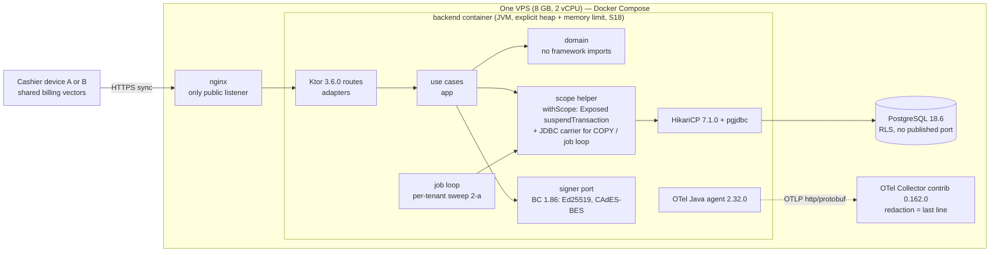

# ADR-0006: Backend track — Ktor/Kotlin with `saas-core-kotlin`

## Status

Proposed

> **Who may move this to `Accepted`: the user, or `cto` on the user's explicit
> confirmation. No other agent, and no skill on its own.**
> Why this is stated here: stories referencing a `Proposed` ADR are set `Blocked`,
> and epics require `Accepted`, so the field needs a named owner. `cto` is the
> role `coordination-rules.md` escalates technical conflicts to, and an ADR is
> that decision made durable.
>
> This does **not** relax the rule that `Status: Accepted` is never set without
> explicit user confirmation — it narrows *which agent* may set it once that
> confirmation exists. An agent that believes an ADR is ready says so and
> escalates; it does not edit this field.

## Date

2026-10-19

## Last Verified

2026-10-19

## Decision Makers

The founder (user) decided on 2026-10-19 (`docs/research/backend-track.md` § 5): the backend track is **Ktor/Kotlin** (`stack.backend: ktor`, `core.track: kotlin`, `saas-core-kotlin`), on the note's recommendation, with the VPS facts that answer Q2 (8 GB RAM, 2 vCPU, 240 GB SSD, 1 Gbps unmetered; builds on the founder's machine through the AI-agent CI, not on the VPS). The founder confirmed that none of the note's open items blocks the decision (§ 5, "COMPLETE WITH GAPS"). Drafted by `cto` at the orchestrator's request; this ADR records the decision, it does not re-open it.
**Stack-lead validation: NOT ASSESSED** — `stack.backend` is unset in `project.yaml` (resolved 2026-10-19: `backend=unset`), so `ktor-lead` has no configured layer to validate against. It runs after `/setup-stack` sets `stack.backend: ktor`, before this ADR is Accepted.
**CTO-ADR:** the author is `cto`, so the gate (`.claude/docs/director-gates/cto-adr.md`, check 10) requires a recorded second review by `principal-engineer` before acceptance. The author's recommendation is in [Related](#related) (not a verdict on its own work). Acceptance: the user.

## Summary

Kodeebo needs one backend language and one shared-core track before any backend code, the core build or `/setup-stack` can start; one developer maintains it alongside a TypeScript web app and a desktop client whose runtime (A Compose Desktop or B Electron) is not decided. Decision: Ktor 3.6.0 on Kotlin 2.4.21 with Exposed 1.5.1 (`suspendTransaction`, ADR-0002 J1), HikariCP 7.1.0 and pgjdbc, built by Gradle with mandatory dependency locking and verification, observed by the OpenTelemetry Java agent 2.32.0, signing ETA documents with Bouncy Castle 1.86 on the backend, running its own outbox with a per-tenant sweep — with the switch-to-Go conditions kept on record.

## Stack Compatibility

| Field | Value |
|-------|-------|
| **Stack layer(s)** | Ktor backend; Data (PostgreSQL access); Deploy (backend image and runtime settings); Core (`saas-core-kotlin`) |
| **Domain** | Core (stack and core track); also Data, Observability, Security (supply chain, crypto), Messaging (jobs/outbox direction) |
| **Layer** | Foundation |
| **Knowledge Risk** | HIGH — Kotlin 2.4.21, Ktor 3.6.0, Exposed 1.5.1, HikariCP 7.1.0, Java agent 2.32.0 and Gradle 9.7.0/9.8.x all post-date training data (`ktor/VERSION.md` "Knowledge gap warning", `opentelemetry/VERSION.md` last section); behaviours below are from the stack reference and executed research (tier 2/3/E) |
| **References Consulted** | `docs/research/backend-track.md` (§ 2–9; F101–F131, F201–F215, F301–F313, F401–F425, F501–F523); `docs/stack-reference/pins.yaml` (2026-10-16); `docs/stack-reference/kotlin/VERSION.md`, `ktor/VERSION.md` (2026-10-11); `ktor/best-practices.md` lines 54–55; `opentelemetry/VERSION.md` (2026-10-11); `tooling/VERSION.md` (2026-10-16) and `tooling/best-practices.md` lines 85–96, 206–209; ADR-0001…0005 (Accepted); `docs/registry/architecture.yaml`; `.claude/rules/deploy.md` line 12; `.claude/docs/security-baseline.md` § Supply chain |
| **Pinned versions relied on** | Kotlin `2.4.21`, kotlinx.coroutines `1.11.0`, Gradle `"9.7"` (**does not resolve**, see Decision 2), JVM toolchain `21` (25 where allowed); Ktor `3.6.0`, Exposed `1.5.1`, HikariCP `7.1.0`; OTel Java agent `2.32.0`, Collector contrib `0.162.0`; osv-scanner `2.6.0`, gitleaks `8.30.1`, Kover `0.9.11`, Konsist `0.18.1`; `postgres:18.6` — all from `pins.yaml`. **Not yet pinned** (Q-pins): pgjdbc `42.7.14` (F211), an SLF4J 2 binding (F211), Bouncy Castle bcprov/bcpkix/bcutil `1.86` (lic- F212, F306) |
| **Post-Cutoff APIs Used** | Exposed 1.5.1 `suspendTransaction` (supported entry point; `newSuspendedTransaction` deprecated; `ktor/best-practices.md` line 55, ti-F238); pgjdbc `PGConnection.getCopyAPI().copyOut(sql, OutputStream)` reached through `unwrap` on the HikariCP proxy (executed, F213; Javadoc F210); Gradle `dependencyLocking { lockAllConfigurations() }`, buildscript classpath locking, `--write-verification-metadata sha256` (F110; `tooling/best-practices.md` lines 207–208); Java agent 2.32.0 auto-instrumentation of Ktor, JDBC, HikariCP, coroutines, Logback MDC (F301); Bouncy Castle 1.86 CMS SignedData with a caller-supplied signed-attribute table (F307) |
| **Verification Required** | S18 (realistic service footprint: Exposed/Hikari pool on PG 18.6 + Java agent + real JSON load) before the first deploy; S23 (Exposed `suspendTransaction` → JDBC `Connection` for `CopyManager`, inside the scope helper) and S22b (eviction after a `COPY` error; JDBC outbox claim and sweep) before the export story; Q-agent (agent defaults for SQL values, URL query and headers, F308) before any "no PII in telemetry" claim; S46 (shared Gradle billing module, A x Ktor) before the billing implementation; S47 (drift test) with it; Q4/S17 (`distZip` reproducibility with lockfiles) and S19 (Gradle 9.8.x with KGP 2.4.21) before the Gradle pin moves to 9.8.x; Q8 (Ktor 3.6.0 minimum JDK) before the JDK choice |

Critical ADR: yes — it fixes the backend stack and the shared-core track, a foundation concern every later ADR, story and core module depends on (`workflow-modes.md`: "when in doubt, treat an ADR as critical"; the research note § 5 calls it critical).

> Knowledge Risk is HIGH: re-validate this ADR whenever a Kotlin, Ktor, Exposed, HikariCP, Gradle, JDK or Java-agent pin in `pins.yaml` changes. Exposed 1.6.0 exists (since 2026-10-16) and is **not** adopted (ti-F230, note § 2).

## ADR Dependencies

| Field | Value |
|-------|-------|
| **Depends On** | ADR-0001 (tenancy, table classes, role inventory, § 1c functions), ADR-0002 (scope helper; the Ktor rule J1 this ADR binds), ADR-0003, ADR-0004, ADR-0005 (EXP-2 export, closure jobs) — all Accepted 2026-10-18 |
| **Enables** | `/setup-stack` setting `stack.backend: ktor` and `core.track: kotlin`; the `saas-core-kotlin` repository and its module ADRs; the jobs/outbox ADR (Q-jobs); the Kotlin lint and architecture-test ADR (Q-lint); the image-scanner and SBOM choice (Q6); every backend story; the billing-sharing decision in the sync ADR (sync- OQ23) |
| **Blocks** | Any backend code, Gradle build, CI pipeline for the backend, backend Dockerfile or Compose service; the first core module |
| **Ordering Note** | (1) Accept this ADR, then `/setup-stack`, then `ktor-lead` validation (recorded as an amendment note here). (2) Before the Gradle wrapper and CI exist: the user applies the pin changes in Decision 2 (Q7, Q-pins) and Q8 picks JDK 21 or 25. (3) Before the first Kotlin story: the Q-lint ADR (`cto`). (4) Before the first image ships: Q6 pins an image scanner and an SBOM generator. (5) Before the first deploy: S18 sizes heap and memory limit. (6) Before the first story that emits telemetry claims "no PII": Q-agent. (7) Before the export story: S23 and S22b (and ADR-0005's S52). (8) The desktop ADR (A or B) decides which combination applies (Decision 9); B can re-open this ADR through the switch condition. (9) Before the billing implementation: S46 if A, S47 in every case. |

## Context

### Problem Statement

Neither `saas-core-go` nor `saas-core-kotlin` exists, `stack.backend` and `core.track` are unset, and ADR-0002 still carries its helper rule twice (G1 for Go, J1 for Ktor). Every backend story, the core build, CI, the image and the observability plan wait on one choice. The research note weighed ten areas for both tracks and the four desktop combinations (note § 4.1, § 4.2). The founder's brief weighs one-developer maintenance and the number of languages most (note § 1). Not deciding keeps the two-track text in every ADR and blocks the first story.

### Current State

No backend code. The sync spike's Go server is a prototype and decides nothing (note § 1). The desktop runtime is undecided (A Compose Desktop on Kotlin/JVM, B Electron on TypeScript). The web SPA is TypeScript in every combination (F517). Hosted only, one VPS, Docker Compose, nginx the only public listener, PostgreSQL 18.6 with no published port, deploys over Tailscale through an AI-agent CI with a fixed deploy script (note § 1).

### Constraints

- **People:** the founder writes almost all code; a second engineer works occasionally; both know Kotlin, neither has stated Go experience (note § 1; F504, F517).
- **Host:** 8 GB RAM, 2 vCPU, 240 GB SSD (founder, 2026-10-19). Builds run on the founder's machine, not on the VPS (note § 5).
- **Distribution:** hosted only, so the customer-bundle licence rules L1–L3 do not apply; L4 (Collector only) and T1 (gitleaks) apply (note § 4). No option is licence-blocked (note § 4).
- **Tenancy:** ADR-0001 shared-schema RLS; ADR-0002 one scope helper, set once per transaction; the Ktor helper is J1 (Exposed `suspendTransaction`, scope explicit or as a coroutine context element, no bare `ThreadLocal`/MDC tenant, no nested tenant transactions).
- **Shared core absent:** product-local adapters behind the port the core module will expose, each recorded in an ADR and scheduled for `/core-extract` (`coordination-rules.md` § Shared core absent).
- **Studio gates:** lockfiles, per-PR OSV-Scanner, container-image scan, CycloneDX SBOM per release, pinned base-image digests (`security-baseline.md` § Supply chain; `.claude/rules/deploy.md` line 12).

### Requirements

- One backend language the team already knows; the fewest languages and toolchains across backend, web and desktop (brief; F517).
- ADR-0002's helper rules, `transaction_timeout`, SECURITY DEFINER calls and streaming `COPY` under RLS work on the chosen driver stack (F213).
- A server-side ETA CAdES-BES signature path exists if signing stays on the backend (eta- D3; C1).
- An OTel span per endpoint and job, RED metrics, pool metrics and JSON logs with `trace_id`, without PII (`observability-standard.md`).
- Device and server compute identical amounts (sync- F325, OQ23).
- Fits the 8 GB VPS beside PostgreSQL, nginx and the Collector (note § 5, § 7).

Research note: `docs/research/backend-track.md` (Status Draft, verdict COMPLETE WITH GAPS; § 5 decision by the founder 2026-10-19).

## Decision

**1. Track and core.** The backend is **Ktor on Kotlin/JVM**: `stack.backend: ktor`, `core.track: kotlin`, shared core `saas-core-kotlin`. Until that core and a module exist (`core.version` unset counts as missing), each capability is a product-local adapter behind the port the core module will expose, recorded in its own ADR and scheduled for `/core-extract`. Server modules follow `backend/src/main/kotlin/<pkg>/<context>/{domain,app,adapters}/` (`directory-structure.md`).

**2. What it binds (versions).**

| Component | Bound to | Source | Open item |
|---|---|---|---|
| Kotlin / coroutines | 2.4.21 / 1.11.0 | `pins.yaml` | — |
| Ktor server | 3.6.0 (exact, no ranges; `ktor/VERSION.md` recommended pin) | `pins.yaml` | Q-506: no published support window, no Ktor 4.0 date (F508, F519) |
| Exposed | 1.5.1 (`exposed-core`, `exposed-jdbc`), J1 `suspendTransaction` | `pins.yaml`, ADR-0002 | 1.6.0 not adopted |
| HikariCP | 7.1.0 (needs SLF4J 2, F211) | `pins.yaml` | SLF4J 2 binding to pin (Q-pins); stable SLF4J 2 version NOT SOURCEABLE here (F211 saw only `2.1.0-alpha1` as Maven "latest") |
| pgjdbc | **to be pinned** — 42.7.14 was the Maven Central latest on 2026-10-18, 0 OSV advisories (F211, F212) | none yet | Q-pins, with a `ktor/` stack-reference row |
| JDK | **21 or 25, left open** | `pins.yaml` `jvm_toolchain: "21"` (25 where allowed); `kotlin/VERSION.md` recommends a JDK 25 LTS toolchain | Q8: Ktor 3.6.0 minimum JDK is NOT SOURCEABLE (`ktor/VERSION.md`; F112 is a bytecode observation only). Also weigh: Oracle JDK 21 updates after Sep 2026 move to the OTN licence (`kotlin/VERSION.md`, via search summary) and the Temurin distribution terms are NOT SOURCEABLE (note § 4) — the JDK *distribution* is chosen with Q8 |
| Gradle wrapper | **`9.7.0`** (the string that resolves; `"9.7"` returns HTTP 404, F108) **or a 9.8.x line** per Q7 | `pins.yaml` says `"9.7"` | Q7 (user, with `platform-lead`). 9.7.0 is inside KGP 2.4.21's fully supported range 7.6.3–9.7.0 (F127, `kotlin/VERSION.md`); 9.8.x is above it and unrun (S19). `cto` recommends 9.7.0 until S19 passes |
| OTel | Java agent 2.32.0 (bundles its own SDK) | `pins.yaml` | Q-agent (F308), Q-card |
| Bouncy Castle | bcprov / bcpkix / bcutil 1.86 (MIT-style licence, lic- F212; repo MIT, F305) | not yet pinned | Q-pins |

**3. Supply-chain controls (mandatory, CI-enforced).** Gradle's locking and verification are opt-in (F110), so on this track they are not optional:
- **Dependency locking** on every project configuration (`dependencyLocking { lockAllConfigurations() }`) **and** the buildscript/plugin classpath, which `lockAllConfigurations()` does not cover (`tooling/best-practices.md` line 207). `gradle.lockfile` (and `buildscript-gradle.lockfile`) committed.
- **Dependency verification metadata** (`gradle/verification-metadata.xml`, SHA-256) committed and run in **strict mode**, which fails on a missing or mismatched checksum (`tooling/best-practices.md` line 208). The exact Gradle settings are confirmed against the pinned Gradle version's docs at setup (the stack reference used "current" docs; the 9.7 URL returned 404, `tooling/best-practices.md` line 219).
- **OSV-Scanner 2.6.0** on the lockfile and verification metadata on every PR, failing CI on findings (`osv-scanner scan source -r .`; F121; `tooling/best-practices.md` lines 96, 209).
- **Base images pinned by digest**, multi-stage, non-root, read-only root filesystem where possible (`.claude/rules/deploy.md` line 12); platform-native QUIC jars for other OSes excluded from the image (F111; exclusion untested).
- **Container-image scanner and CycloneDX SBOM generator: still to be pinned** (Q6, `security-lead` / `platform-lead`); no backend image ships before both run in CI (F131; `security-baseline.md`).
- **Dependency changes are reviewed as diffs** of the lockfile and verification metadata by the founder, never auto-merged by the AI-agent CI (abuse case "typosquatted dependency merged in a one-person review loop", note § 6). gitleaks 8.30.1 (T1) and SHA-pinned third-party CI actions apply as on every track.

**4. Runtime settings.**
- The JVM sizes its heap at 25% of the container limit by default (`MaxRAMPercentage`, F119) and picked the Serial collector in small containers (F115). **The backend container must run with an explicit `-Xmx` or `-XX:MaxRAMPercentage` and a Compose memory limit, both sized from S18 before the first deploy.** Planning figure only: about 512 MB default heap in a 2 GB container, leaving about 6 GB for PostgreSQL, nginx and the Collector (note § 5, § 7); PostgreSQL's own memory is `data-lead`'s.
- The Compose healthcheck `start_period` allows the slower JVM start (probe: 794–1,560 ms to first 200 incl. container start, without DB, config or agent; F116) — set from S18.
- A startup log event states version, effective processor count and memory limit (note § 8).
- **Class-data sharing is optional.** It cut the probe's start to 394–452 ms (F124); if used, the archive is created at build time or on a persistent volume, never in a throwaway layer (F124). `-XX:TieredStopAtLevel=1` is not used until S18 measures its throughput cost.
- Runtime base (Temurin JRE 518 MB image vs jlink 280 MB, F117, F125; distroless not measured) is `platform-lead`'s choice under Decision 3; a jlink image must pin matching OS releases for build and run stages and add modules that reflection or `ServiceLoader` need (agent, JDBC driver) by hand (F125).

**5. Data access.**
- **Use cases** reach tenant data only through ADR-0002's `withScope` on Exposed `suspendTransaction` (J1), with `transaction_timeout` set locally first by the helper (F213 J3a–J3c: `25P04` FATAL, Hikari then hands out clean connections).
- **EXP-2 export and the job loop** use a **small plain-JDBC carrier (1K-b)** until S23 shows a supported route from `suspendTransaction` to the JDBC `Connection` for `CopyManager` (F214 NOT SOURCEABLE). The carrier lives **inside the scope-helper module**, takes the same `Scope`, runs the **same set-once scope routine and constants**, and passes the same helper tests (ADR-0002 K-series); it adds no scope kind and no setting. If `principal-engineer` reads it as a second helper, an ADR-0002 amendment is written before the export story.
- **On any exception from a streaming `COPY`, the connection is closed or evicted, never returned to the pool** (F213: a writer error after about 1 MiB left the next statement failing and a worker hung). The HikariCP API for eviction is confirmed by S22b (NOT SOURCEABLE here). Metric: connections evicted after a `COPY` error (note § 8).
- **S23 and S22b pass before the export story** (with ADR-0005's S52). Raw SQL elsewhere uses Exposed `exec` inside the helper (ti-F238). jOOQ (1K-c) is not used (licence gap, ti-F241).
- Pooler: P1 (driver pool only) per ADR-0002; if PgBouncer is added, pgjdbc `prepareThreshold=0` or `max_prepared_statements` > 0 (ADR-0002).

**6. Jobs and outbox (direction; details in the jobs/outbox ADR).** Own transactional outbox plus a **per-tenant sweep (2-a)**: `platform_rt` lists tenant ids from CP `tenant_status`; one `job_rt` helper transaction per tenant claims work with `FOR UPDATE SKIP LOCKED`; the idempotency (dedup) row is written in the effect's transaction; `traceparent` is stored on work rows (executed on Go, F208; the JDBC claim and sweep are S22b). A CP "pending work" list (2-d) is the step before tenant counts grow. **A library queue (db-scheduler 2-c, F203) or an external broker (2-e) only after a separate ADR that fixes its tables' ADR-0001 class** (Q-jobs); db-scheduler joining the caller's Exposed transaction is unproven (F203, F214). Starting job loops from Ktor lifecycle hooks: NOT SOURCEABLE (F215), settled by the jobs ADR.

**7. Observability (O1).** The OpenTelemetry **Java agent 2.32.0** instruments Ktor, JDBC, HikariCP pool metrics, coroutine context and Logback MDC (F301). Rules: no different SDK version in app code beside the agent (`opentelemetry/VERSION.md`); export over OTLP to the local Collector contrib 0.162.0 (L4); the Collector's `redaction` processor is the last line (beta for traces, alpha for logs and metrics, F309). **"No PII in telemetry" is not claimed until a test shows that SQL parameter values, URL query strings and request headers do not reach the Collector** (agent defaults NOT SOURCEABLE, F308; Q-agent, `observability-engineer`). Agent memory and start cost are measured by S18; many agent artifacts carry `-alpha` and may break between releases (`opentelemetry/VERSION.md`).

**8. Cryptography.**
- **Ed25519** (licences, leases) with the JDK 21 built-in provider or Bouncy Castle 1.86 (lic- F206–F212); the licensing ADR picks one and runs the edge-vector suite on signer and verifier, because the identity-key vector verifies on the JDK and is rejected by Bouncy Castle (lic- F219). Signing is a use case with a purpose tag, never a signing oracle (lic- F222).
- **ETA CAdES-BES on the backend (C1)** with Bouncy Castle **bcpkix 1.86**: detached CMS SignedData, SHA-256, RSA, exactly four signed attributes through a caller-supplied attribute table, verified by OpenSSL (F307). ETA's acceptance is still open (eta- S20, S22) and e-seal key custody is eta- S23; both belong to the ETA ADR.
- Password hashing (Argon2id) through Bouncy Castle or Password4j; **not** `argon2-jvm` (LGPL-3.0, F409).

**9. Billing sharing and the desktop dependency.**
- **In every combination:** billing rules as data where possible, integer arithmetic only (a float64 variant disagreed in 137 of 5,007 vectors, F401), and **one shared vector suite** in `contracts/` or `tools/` that the server and the device both run (S-2 + S-3; note § 5); S47 (a rule changed in one language must fail the vectors) runs with the billing implementation. Locale formatting is explicit (`-u-nu-…`), never runtime defaults (F422).
- **A x Ktor (desktop picks Compose Desktop):** additionally **one Kotlin billing module** consumed by server and desktop as a Gradle dependency (S-1; F518). Not executed: **S46 runs before the billing implementation.** Two languages, two toolchains (F517); Ed25519 signer and verifier in one runtime (note § 4.2); the Kotlin lint gap covers desktop and server.
- **B x Ktor (desktop picks Electron):** S-2 + S-3 only; a Kotlin/JS module for Electron needs the `Long`→`BigInt` flags and an unrun Gradle-inside-pnpm build (F413, F425; S46), so it is not the default. Two languages, two toolchains (F517). **The switch-to-Go condition below becomes live.**
- Whether the server recomputes amounts (S-5) is a product question (Q-recompute), unchanged by this ADR.

**10. HTTP and API edge (notes for the API-style ADR).** `contracts/` stays the source of truth. Ktor 3.6.0 serves and generates OpenAPI docs but has no spec-to-server code generation (F418): routes are hand-written or generated by openapi-generator's server templates (not read, NOT SOURCEABLE) and checked by contract tests. RFC 9457 problem details are a small hand-written StatusPages mapper (F419).

**11. Kotlin lint gap.** No stable ktlint or detekt supports Kotlin 2.4.21 (F130, F416, F520; `tooling/VERSION.md` options a–c). **The lint path is a follow-up `cto` ADR (Q-lint), required before the first Kotlin story.** Until then a lint gate is reported **not run**, never passed. Architecture tests (gate 2) are chosen in the same ADR: Konsist 0.18.1 is built against Kotlin 2.4.21; ArchUnit 1.5.1 has an open Kotlin 2.4.20+ gap (F416).

**12. Switch-to-Go conditions (kept on record; each re-opens this ADR by a superseding ADR).**
- **(a)** The VPS shrinks to **2 GB of memory or less** **and** S18 confirms with a realistic service that the JVM's extra 75–115 MB per process (F114, F118) competes with PostgreSQL, nginx and the Collector. Does not hold today (8 GB).
- **(b)** The desktop ADR picks **B** **and** the founder **wants to learn Go** (Q-503) **and** either **S32 shows a Go CAdES-BES path** verified like F307, **or** ETA turns out not to enforce signatures (eta- S20). Without S32 or that ETA answer, ETA signing would need a second runtime (C3).
- **A x Go is rejected in every case** (Alternative 2).

### Architecture



Trust boundaries: nginx (public), the backend container (holds runtime credentials; M65 container hardening), PostgreSQL on the internal network only, the Collector (telemetry leaves the process here).

### Key Interfaces

```text
// ADR-0002 (unchanged; Ktor form now the only form):
suspend fun <T> withScope(src: TenantDataSource, s: Scope, block: suspend ScopedTransaction.() -> T): T
//   errors: ScopeAlreadySet, InvalidScope, NoLiveGrant

// Inside the scope-helper module only (Decision 5, until S23 passes):
//   JDBC carrier for EXP-2 COPY and the job loop — same Scope, same set-once routine,
//   same constants; on any COPY exception the connection is closed/evicted, not returned.

// Product-local ports, each liftable into saas-core-kotlin unchanged (coordination-rules.md):
//   Signer (purpose-tagged), PasswordHasher, Clock, IdGenerator, Outbox/WorkQueue (jobs ADR)

// Billing (Decision 9): vectors in contracts/ or tools/ — the cross-language contract;
//   one Kotlin module only if the desktop ADR picks A (S46).
```

### Implementation Guidelines

- **Must (all contexts, `adapters`):** Ktor, Exposed, HikariCP, pgjdbc, Bouncy Castle and OTel types stay in `adapters`; `domain` imports none of them; `app` sees only ports (gate 2).
- **Must (`adapters`, data):** tenant data only through `withScope` on `suspendTransaction`; never `newSuspendedTransaction`, never a nested tenant transaction, never a bare `ThreadLocal`/MDC tenant (ADR-0002; FP-THREADLOCAL-TENANT).
- **Must never (`adapters`, data):** return a pooled connection after an exception from `copyOut`; open a raw JDBC transaction outside the scope-helper module.
- **Must (build):** commit `gradle.lockfile`, `buildscript-gradle.lockfile` and `gradle/verification-metadata.xml`; CI runs strict verification and OSV-Scanner on every PR and fails on findings; no version ranges.
- **Must never (build):** auto-merge a dependency, lockfile or verification-metadata change from the AI-agent CI without the founder's review.
- **Must (deploy):** explicit heap flag and Compose memory limit from S18; base images by digest; non-root.
- **Must (observability):** the Java agent is the only OTel SDK in the process; never claim "no PII" before the Collector capture test passes.
- **Must (billing, `domain`):** integer money in piasters; the shared vector suite runs in server CI.
- **Must never (crypto):** expose a sign-these-bytes endpoint; import `argon2-jvm`.
- **Must (jobs):** work rows under the tenant policy (TD); no library queue or broker without its ADR.

## Alternatives Considered

### Alternative 1: Go track (`stack.backend: go`, `saas-core-go`) — B x Go or a Go backend generally

- **Description**: pgx 5.11.0 with `WithScope` on `pgx.BeginTxFunc` (G1), OTel Go SDK + otelhttp + third-party `otelpgx` (O3), Ed25519 from the standard library, a forked or hand-built CMS for ETA.
- **Evidence for Go:** footprint about 9 MB idle / 15 MB loaded vs 89 / 125–131 MB, 9.5 MB vs 518 MB image, 365 ms vs 794–1,560 ms start (F101, F114, F116, F117); builds in seconds and byte-identical for stdlib code (F101, F105, F109); pgx did everything asked, including `COPY` aborts that left the pool usable (F204–F208); `govulncheck` reachability (F121); Go 1 compatibility promise (F505); no lint gap (F520). Parts 1 and 2 recommend Go on their own areas (note § 5).
- **Evidence against Go, for this product:** new to both people in every Go combination (F504, F517); no executed CAdES-BES path — only forks and leads, one candidate archived (F304, F305; S32 pending); PostgreSQL tracing only through pre-1.0 third-party `otelpgx` v0.13.0 (F302, F303, F305) and product-written `trace_id` log correlation (F311); `ctx` passed by hand into goroutines (F310); a point release to track every Go line (Go 1.27.0 had 13 advisories, F514).
- **Cost**: learning a new language for both people; equal infrastructure cost (the footprint gap is about 100 MB per process, small on 8 GB, F118, note § 5).
- **Risk**: ETA signing without a proven library (S32), or a second runtime for it (C3, which contradicts the reason to choose Go).
- **Performance**: better start, memory and build time; build time is on the founder's machine, not the VPS (note § 5).
- **Operability (hosted; no self-hosted edition)**: simpler runtime tuning (`GOMEMLIMIT` must still be set explicitly, F103, F128); one toolchain to patch.
- **Rejection Reason**: on 8 GB the footprint advantage does not bind, and the brief weighs people and language count most; Go adds a language the team lacks and leaves ETA signing unproven. **Kept as the switch target** under Decision 12 (a) and (b).

### Alternative 2: A x Go (Compose Desktop client with a Go backend)

- **Description**: Kotlin on the desktop, Go on the server, TypeScript on the web.
- **Pros**: Go's server footprint and build speed (Alternative 1).
- **Cons**: three languages and three toolchains for one developer (F517); the billing engine would cross a JVM–Go bridge on a preview API (FFM is a preview feature of Java SE 21; executed on Linux only, F412) or be written twice; Kotlin lint gap still present on the desktop (F520); licence signer and verifier in different runtimes (note § 4.2).
- **Cost / Risk / Performance / Operability**: the highest maintenance load of the four combinations; bridge untested on the 4 GB Windows reference PC (S45).
- **Rejection Reason**: **rejected in every case** (note § 5: "A x Go is not recommended in any case").

### Alternative 3: Ktor with jOOQ instead of Exposed (1K-c / ADR-0002 J2)

- **Description**: jOOQ transactions with the scope statement first.
- **Pros**: worked in the tenant-isolation spike (ti-F242).
- **Cons**: open-source edition's PostgreSQL coverage not sourced (ti-F241); outer `DSLContext` bypasses the transaction.
- **Rejection Reason**: licence gap; held as ADR-0002's alternative only if the licence is confirmed.

## Consequences

### Positive

- No new language: the product is Kotlin + TypeScript in either desktop combination (F517).
- The only executed CAdES-BES path is on this track, with a library family already in the licence stack (F306, F307).
- HTTP, SQL, pool metrics, coroutine context and log correlation come from one agent without code (F301).
- In A x Ktor, one Kotlin billing module can serve device and server (pending S46).
- ADR-0002's two-track text collapses to J1 at `/setup-stack`.

### Negative

- About 75–115 MB more resident memory per backend process, a 2–4x slower start and a 518 MB image (F114, F116, F117); heap and memory limit must be set by hand (F115, F119).
- Slower Gradle builds (cold resolution 74 s, build 67 s, warm 7.7 s for a probe, F109) on the founder's machine and in CI.
- Several independent upgrade lines (Kotlin ~quarterly, Ktor minors ~4-monthly with no published support window, Exposed, Gradle, JDK; F506–F509, F519); past breaking migrations in Ktor 3.0 and Exposed 1.0 (F507, F508). A Ktor major upgrade is a code migration of the server skeleton (F508).
- The lint gate cannot run on a stable tool until the Q-lint ADR (F520).
- Two data-access gaps before the export story (S23, S22b) and a hand-written carrier until then.
- No spec-to-server codegen and no RFC 9457 helper in Ktor (F418, F419): small hand-written pieces plus contract tests.

### Neutral

- Jobs/outbox design 2-a, the Collector as the last PII line, S-2 + S-3 billing vectors and the hiring picture are the same on either track (F208, F309, F401, F510–F513).
- Only one core is built; the other costs nothing (F521).

## Risks

| Risk | Probability | Impact | Mitigation |
|------|------------|--------|-----------|
| OOM kill of the only backend container through a mis-sized heap (availability for every tenant) | Medium until S18 | High | Explicit heap + memory limit from S18 before first deploy; memory-near-limit and OOM alerts (note § 8) — owner `performance-engineer` / `platform-lead` |
| Pooled connection reused after a failed `COPY` serves the next tenant's work or hangs a worker | Medium (observed, F213) | High | Close/evict on any `COPY` exception; S22b before the export story; eviction metric — `ktor-lead` |
| Exposed has no supported route to the JDBC `Connection` (S23 fails) | Medium | Medium | Keep the JDBC carrier inside the helper module (Decision 5); ADR-0002 amendment if needed — `ktor-lead` |
| Java agent records SQL values, URLs or headers by default (PII in telemetry) | Unknown (F308) | High | Q-agent capture test before any "no PII" claim; Collector `redaction` last line — `observability-engineer` |
| Malicious or typosquatted dependency merged through the AI-agent CI | Low–Medium | High | Locking + strict verification + OSV-Scanner in CI; founder reviews lockfile diffs; image scan + SBOM after Q6 — `security-lead` |
| No image scanner / SBOM pinned (gate 7 cannot pass for an image) | Certain today | Medium | Q6 before the first image ships — `security-lead` / `platform-lead` |
| Lint gate on alpha or unsupported tools (silent non-run) | Certain today | Medium | Q-lint ADR before the first Kotlin story; report "not run" until then — `cto` |
| Ktor drops fixes for a minor without notice (no published window) | Medium | Medium | Track the latest Ktor minor; re-check Q-506 at each pin change — `researcher` |
| Ktor 3.6.0 needs a JDK newer than chosen, or JDK distribution terms change | Low | Medium | Q8 before the toolchain is fixed; pick the distribution with it — `researcher` / `platform-lead` |
| A x Ktor shared billing module fails in practice (S46) | Low–Medium | Medium | S-2 + S-3 vectors are the baseline in every combination — `researcher` / `qa-lead` |
| Desktop ADR picks B and the founder wants Go | Unknown | High (re-platform) | Decision 12 (b) is explicit; decide before backend code grows; SQL migrations and `contracts/` stay language-neutral — user / `cto` |
| `pins.yaml` `gradle: "9.7"` breaks wrapper or CI generation (404) | Certain if used as is | Low | Pin `9.7.0` or 9.8.x (Q7) before the wrapper exists — user / `platform-lead` |

## Cross-Cutting Impact

| Concern | Impact |
|---------|--------|
| **Security / tenancy** | No new trust boundary; ADR-0002 J1 binds. ASVS 5.0.0 V15 15.1.1, 15.1.2, 15.2.1, 15.2.4, 15.2.5 (F129) for supply chain; V11 11.4.2, 11.5.1, 11.2.1 for hashing, CSPRNG and validated crypto (F420, read via summary — re-read before citing in a story). No threat model required for the track choice itself; its abuse cases feed `docs/architecture/threat-models/tenant-isolation.md` (export, jobs, M65 container hardening), the ETA threat model and the billing threat model (note § 6) |
| **Observability** | O1 Java agent; spans, metrics and log events as listed in note § 8 (incl. `db.tenant_tx`, `export.copy`, `connection.evicted`, JVM heap/GC/threads); startup event with processor count and memory limit; runbooks for OOM, outbox age, missed sweep, Collector down (`sre-lead`, none exist yet) |
| **Caching** | No cache: outbox and job rows (transactional truth), sweep tenant list (ADR-0001 reads status per request), scope (transaction-local) (note § 7). Feature specs decide price/tier config, session lookup, licence key set, ETA token caches |
| **Self-hosted** | None — hosted only (`distribution`). L4 and T1 apply; L1–L3 do not |
| **Cost** | No new infrastructure; about 100 MB more RAM than a Go process on an 8 GB VPS (F118, note § 5); build time on the founder's machine; no vendor lock-in beyond JVM libraries under permissive licences (F409) |

## Performance Implications

| Metric | Before | Expected After | Budget (`perf-budgets.md`) |
|--------|--------|---------------|--------|
| Latency p95 (affected endpoints) | n/a (no code) | Agent overhead per request not measured (S18) | budget not yet set (`perf-budgets.md` absent) |
| DB queries per request | n/a | +0 from this ADR (+1 scope statement, ADR-0002) | budget not yet set |
| Memory (service RSS) | n/a | Probe 89 MB idle, 125–131 MB loaded, without Exposed/Hikari/agent (F114); real figure from S18 | budget not yet set; container limit set from S18 |
| Startup | n/a | Probe 794–1,560 ms incl. container start; 394–452 ms with CDS (F116, F124) | budget not yet set |
| Image size | n/a | 518 MB Temurin JRE / 280 MB jlink (F117, F125) | budget not yet set |
| Export (EXP-2) | n/a | JDBC `copyOut` 14.8 MB in 448 ms on loopback (F213); streaming not established on the JVM | budget not yet set (Q-export) |

The 3 s counter ceiling is a client rule and is not affected by the backend track (note § 7).

## Migration Plan

Greenfield: no backend code or data exists.

1. The user accepts this ADR; `/setup-stack` sets `stack.backend: ktor` and `core.track: kotlin` in `project.yaml`; `ktor-lead` validates this ADR and the result is noted here.
2. The user applies the pin changes (Q7 Gradle `9.7.0` or 9.8.x; Q-pins pgjdbc, SLF4J 2 binding, Bouncy Castle 1.86) with stack-reference rows; Q8 fixes JDK 21 or 25 and the distribution.
3. `platform-lead` creates the Gradle wrapper, locking, strict verification and CI (OSV-Scanner, gitleaks); Q6 adds the image scanner and SBOM before the first image.
4. On the user's approval, ADR-0002 gets a dated note (appended, decision text untouched) that J1 is the only active rule; G1 stays as the record for the switch conditions.
5. S18 before the first deploy; S23/S22b before the export story; Q-agent before the first "no PII" claim; S46/S47 with billing.

**Rollback plan (cost to reverse):** today about zero (no backend code). After stories exist, switching to Go means rewriting backend code and any `saas-core-kotlin` modules — weeks, in proportion to the code written. **No data and no client contract moves** provided schema migrations stay plain SQL files and `contracts/` stays spec-first; that is why both are kept language-neutral. Triggers to revisit: Decision 12 (a) or (b); S23 and S22b both failing; Q-lint finding no workable lint path; Ktor announcing an end of support for 3.x without a migration path.

## Validation Criteria

- [ ] `project.yaml` has `stack.backend: ktor` and `core.track: kotlin`; `bash .claude/scripts/project-coherence.sh` reports the backend manifests against `pins.yaml` (after `/setup-stack`).
- [ ] CI fails on a planted dependency missing from `gradle.lockfile`, on a planted checksum mismatch in verification metadata, and on a planted vulnerable version (OSV-Scanner control like F121).
- [ ] The backend Dockerfile references base images by digest; the image scan and SBOM run in CI (after Q6).
- [ ] The backend container runs with an explicit heap flag and memory limit from S18; a load test at that limit shows no OOM kill.
- [ ] As the runtime role: the JDBC carrier refuses a second scope and an invalid scope (ADR-0002 K-series); a `COPY` with a writer error leaves the next pooled statement working (S22b); `COPY` with no scope returns the header only (F213 J4b).
- [ ] Negative test: a request with SQL parameter values, a URL query string and an `Authorization`-style header produces telemetry at the Collector containing none of them (Q-agent).
- [ ] A Bouncy Castle 1.86 CAdES-BES signature built by the product verifies with OpenSSL (F307 repeated in the product); ETA PreProd acceptance is the ETA ADR's criterion.
- [ ] The shared billing vectors pass on the server; a rule changed on one side fails them (S47).
- [ ] Gate 2: an architecture test (tool per Q-lint) fails on a planted framework import in `domain`.
- [ ] Performance: checked against `perf-budgets.md` once it exists; not checked until then.

## Spec Requirements Addressed

Foundational — no spec requirement (no feature specs exist yet; `design/specs/` absent). Enables: every backend bounded context (selling sync inbox, sessions, stock, staff, reports, licensing, ETA submission, closure and export jobs), the `saas-core-kotlin` modules, and device–server billing parity (sync- OQ23).

## Related

- Research: `docs/research/backend-track.md` (§ 4 options, § 5 decision and switch conditions, § 6 security, § 7 performance, § 8 observability, § 9 open questions and proposed pin changes); `docs/research/tenant-isolation.md` (ti-F230, F238–F242); `docs/research/licensing.md` (lic- F206–F222); `docs/research/eta-e-receipt-e-invoice.md` (eta- D3, S20, S22, S23); `docs/research/local-first-sync.md` (sync- F325, OQ23); `docs/research/desktop-client-technology.md` (desk- F413, F423, F428).
- Depends on ADR-0001…0005 (Accepted). Narrows ADR-0002 to J1 once `/setup-stack` runs; does not supersede it.
- Follow-up ADRs this one requires: jobs/outbox (Q-jobs); Kotlin lint and architecture tests (Q-lint); desktop runtime (Q-desk); API style (Decision 10); ETA (Q-eta); licensing signer choice (Decision 8); one ADR per product-local adapter until `saas-core-kotlin` has the module.
- Threat models: `docs/architecture/threat-models/tenant-isolation.md` (M65), `docs/architecture/threat-models/licensing.md`.
- **CTO sign-off recommendation (author's, not a gate verdict):** the decision is sound for an 8 GB hosted VPS and a Kotlin-speaking team, and no finding makes it unsafe. Recommend acceptance once (1) `principal-engineer` records the second review, including a reading of the Decision 5 JDBC carrier against ADR-0002's single-helper rule, and (2) `ktor-lead` validation runs after `/setup-stack`. Items due "before the backend ADR" in the note that remain open — Q-agent and Q-506 — are carried as gated items (Decision 7, Risks), not as blockers to acceptance.
