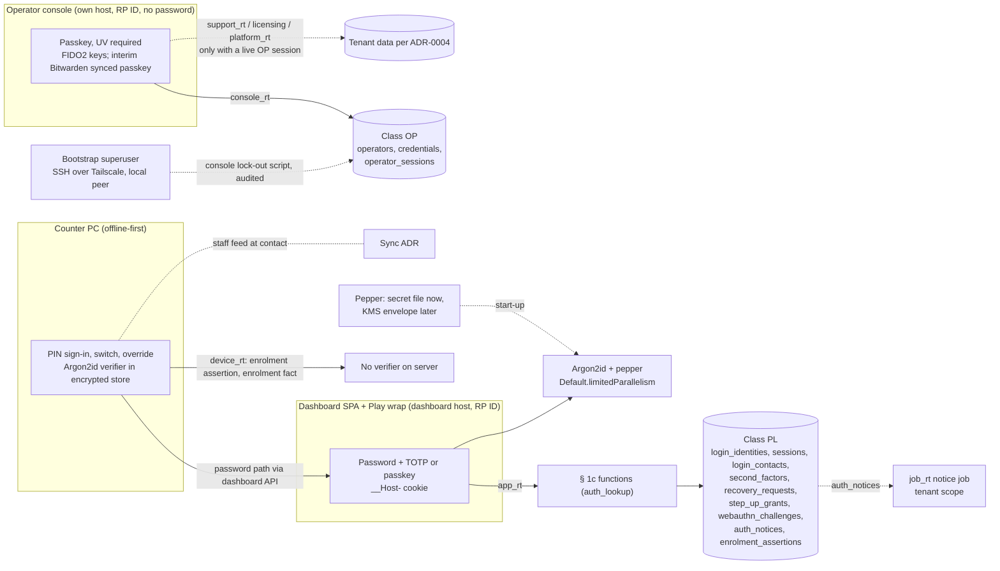

# ADR-0007: Staff authentication — three realms, Argon2id with a server pepper, 2FA for owner and privileged dashboard roles, passkeys, device-local PINs on the counter

## Status

Accepted

> **Who may move this to `Accepted`: the user, or `cto` on the user's explicit
> confirmation. No other agent, and no skill on its own.**
> Why this is stated here: stories referencing a `Proposed` ADR are set `Blocked`,
> and epics require `Accepted`, so the field needs a named owner. `cto` is the
> role `coordination-rules.md` escalates technical conflicts to, and an ADR is
> that decision made durable.
>
> This does **not** relax the rule that `Status: Accepted` is never set without
> explicit user confirmation — it narrows *which agent* may set it once that
> confirmation exists. An agent that believes an ADR is ready says so and
> escalates; it does not edit this field.

## Date

2026-10-19

## Last Verified

2026-10-19

## Decision Makers

The founder (Kamel Mohamed, user) decided every area on 2026-10-19 (`docs/research/staff-auth-and-roles.md` § 5.0), confirmed the ADR assumptions and four design choices (PIN verifier device-only; a separate operator realm; second factors and recovery in class PL behind new § 1c functions; the pepper as Argon2id's secret input), and added the password and PIN storage input, the sponsored counter enrolment path and the KMS envelope consequence. Drafted by `/architecture-decision`.

**Revised 2026-10-19 after an independent `/architecture-review` in a fresh session** (`docs/architecture/architecture-review-2026-10-19-adr-0007.md`: FAIL, text fixes only; B1–B2, H1–H6, M1–M11, L1–L8), at the founder's instruction. The founder's answers in that round:
- owner notices go through a job outbox;
- the counter's password path goes through the dashboard sign-in API;
- someone else may start a lost-factor reset, after a delay;
- 2FA is mandatory for privileged roles, on dashboard logins only;
- the approver lockout stays at 10 failures, as a deviation accepted by name;
- the 13.3.3 deviation is accepted by name;
- the open questions and the missing threat model do not block acceptance;
- throttle state is held in memory;
- console accounts have no password;
- the console may use an interim synced passkey, as a deviation accepted by name, until hardware keys are bought;
- the console lock-out path is a privileged script.

**Re-check 2026-10-19 (same reviewer, CONCERNS):** B1–L8 resolved. New items R1–R8 were applied at the founder's instruction:
- R1: first-factor enrolment needs no step-up.
- R2: the lock-out script is added as a bootstrap-superuser purpose.
- R3: retention and the restore scope for the new control-journal kinds.
- R4: the database checks the reset handle's factor mark.
- R5: the role-inventory registry entry is revised.
- R6: the interim passkey's UV is verified.
- R7: until the ADR-0003 amendment, 2FA covers the owner and the manager role.
- R8: a research-note addendum.

Stack-lead validation: **NOT ASSESSED — no stack layer configured** (`stack.backend`, `stack.web` unset in `project.yaml` until `/setup-stack`; ADR-0006 chose Ktor). CTO-ADR: **skipped — lean mode**. **Accepted by the founder (Kamel Mohamed), 2026-10-19**; the ADR-0001 amendment it carries (class OP, role `console_rt`, the bootstrap superuser's console lock-out purpose, the § 1c rows) is in effect from that date.

## Summary

Kodeebo has three sign-in surfaces — the Kodelix operator console, the owner's web dashboard (also Play-wrapped) and the cashier app on an often-offline Windows counter — and nothing yet decides how people prove who they are on them, how credentials are stored, how a sensitive action is re-confirmed or how a lost credential is recovered. Decision: three separate realms; server passwords hashed with Argon2id plus a server pepper; second factors mandatory for the owner and for dashboard logins whose role holds a privileged permission, a passkey with user verification for the operator; email recovery that checks the second factor before the password changes and no SMS; and on the counter a per-device enrolment (by password through the dashboard API, or sponsored by a person holding the permission) to an alphanumeric PIN whose Argon2id verifier never leaves the device's encrypted store.

## Stack Compatibility

| Field | Value |
|-------|-------|
| **Stack layer(s)** | Ktor backend (ADR-0006); Data (PostgreSQL); Web (Vite + React SPA, also in the Play wrap); desktop cashier client (runtime undecided: Compose Desktop or Electron) |
| **Domain** | Identity (with Security and Tenancy) |
| **Layer** | Foundation |
| **Knowledge Risk** | HIGH — Ktor 3.6.0, WebAuthn Level 3 (Recommendation 25 Aug 2026), Node 24 `crypto.argon2` and Electron 44.8.0 are past the model's training data; every fact used is from the research note or `docs/stack-reference/` |
| **References Consulted** | `docs/research/staff-auth-and-roles.md` (F101–F127, F201–F236, F301–F325, § 5.0); `docs/stack-reference/ktor/{VERSION,breaking-changes,deprecated-apis,best-practices}.md`; `docs/stack-reference/kotlin/best-practices.md` (dispatchers); `docs/stack-reference/vite-react/best-practices.md` § 2 (token storage); `docs/stack-reference/postgres/best-practices.md` § 1; `docs/registry/architecture.yaml`; ADR-0001–0006; `docs/research/evidence/staff-auth-and-roles-part-2/owasp/Password_Storage_Cheat_Sheet.md` (peppering) and `bc-src/Argon2Parameters-r1rv86.java` (`withSecret`); ASVS 5.0.0 chapter copies in `docs/research/evidence/tenant-isolation/part-6/src/` (IDs in Cross-Cutting Impact) |
| **Pinned versions relied on** | Ktor 3.6.0, Kotlin 2.4.21, Exposed 1.5.1, HikariCP 7.1.0, `postgres:18.6`, React 19.3.0 / Vite 8.3.4 (`pins.yaml`). Not yet pinned (pin with the first auth story): Bouncy Castle `bcprov-jdk18on` 1.86, WebAuthn library (WebAuthn4j 0.29.1.RELEASE or a stable Yubico 2.x), `@simplewebauthn/browser` 14.0.0; device side per the desktop ADR (Bouncy Castle 1.86 or Password4j 1.8.4; or Node 24.22.0 `crypto.argon2` inside Electron 44.8.0) |
| **Post-Cutoff APIs Used** | Ktor 3.6.0 nullable auth principals (breaking-changes row 3.6.0) — this ADR uses Ktor `Authentication` only as the place the opaque-token resolver plugs in, never the experimental typed DSL (`@ExperimentalKtorApi`) and never Ktor's cookie-payload `Sessions` storage; WebAuthn L3 `getClientCapabilities()`/`conditionalGet` (F116); Bouncy Castle 1.86 `Argon2Parameters.Builder.withSecret` (read in source); Node 24 `crypto.argon2` (F224) if the runtime is Electron |
| **Verification Required** | S13 Argon2id parameters and concurrency on the 8 GB / 2 vCPU VPS; S22/S23 PIN hash cost on the 4 GB Windows VM (routed to the sync spike phase 4 or the next desktop round through the VM claim); S11 passkeys in the Play wrap on a real device; S25 lockout across kill, power loss, restore and clock change; S27 enrolment, reset and override timed against the 3 s counter ceiling; before the console story, register and assert the interim Bitwarden passkey on the console origin with `userVerification: required` on the founder's Linux machine and record the flags (UV, BE, BS) — if UV is not 1, the FIDO2 keys are bought before the console ships (NOT SOURCEABLE today); the WebAuthn library at its pinned version passes the L3 ceremony tests in Validation Criteria |

Critical ADR: yes — identity and authentication (Foundation).

## ADR Dependencies

| Field | Value |
|-------|-------|
| **Depends On** | ADR-0001 (tenancy model; **amended by this ADR**: new § 1c rows, class OP, role `console_rt`), ADR-0002 (scope helper), ADR-0003 (session and principal), ADR-0004 (operator access; step-up P7-OQ9), ADR-0005 (step-up for closure and erasure; device erasure; security-events store; control journal), ADR-0006 (Ktor track; Argon2 library rule) — all Accepted. **Not yet written, each owning a named part:** the **ADR-0003 amendment** (custom roles: permission names, the strict-subset rule, the authority snapshot used by §§ 4, 7 and 8; it also decides research § 5.0 E and F, including the activity-trail retention row in ADR-0005); the **storage / server-sync-state ADR** (D5-C: home of the control journal and the restore replay, § 3 Restore); the **sync ADR** (staff feed, enrolment facts); the **desktop-runtime ADR** (hash library, DPAPI route, where device checks run); the **key-custody ADR** (device store key acting as the PIN pepper; the server pepper's KMS move, alongside the licensing issuing keys); the **device-credential ADR** (TPM NV authorisation); the **licensing ADR** (console licence actions); the **owner-client ADR** (TWA or WebView for the Play wrap, which governs cookie and passkey behaviour there; S11); the **domain layout** (Q-domains, `cto`: the RP IDs of § 1); the email-provider integration |
| **Enables** | `/threat-model staff-auth` and the tenant-isolation and licensing updates; the staff, roles and permissions spec; the auth/session spec |
| **Blocks** | Every dashboard sign-in, recovery, profile and 2FA story; the operator console sign-in story; every counter sign-in, enrolment, switching and override story |
| **Ordering Note** | Research Q-adr3 placed the ADR-0003 amendment before this ADR. The founder accepted writing this ADR first: until the amendment is Accepted, every permission check in §§ 4, 7 and 8 reads **"owner only"**. The § 1c, class and role-inventory changes are applied to ADR-0001 as a dated amendment when this ADR is Accepted, never before. |

## Context

### Problem Statement

ADR-0001 § 1c says account recovery "is added by the staff-auth ADR", and ADR-0004 and ADR-0005 rest closure, erasure and support grants on an owner step-up that no ADR defines (P7-OQ9). The licensing threat model needs the operator console behind a passkey and step-up (TB3, M15), and tenant-isolation M36 lists console actions that need step-up. The counter must let several people work on one shared Windows PC for days without the server, sign people in quickly, let a manager approve a sensitive action, and reset a forgotten PIN without OTP. Until this is decided no staff story can start, and every one of those ADRs keeps an open hole at its most sensitive action.

### Current State

No code. The database already has the PL pattern (`login_identities`, `sessions` through `auth_lookup` functions, ADR-0001 § 1c), an opaque per-request session (ADR-0003) and the support grant gate (ADR-0004). The research note merged three parts (82 findings) and the founder decided every area on 2026-10-19.

### Constraints

- Hosted only (no self-hosted bundle). Production VPS 8 GB RAM, 2 vCPU, shared with PostgreSQL (ADR-0006); a single backend instance.
- No paid identity service; no budget yet for hardware security keys. The founder works on Linux. Email and SMS providers are a later integration; **SMS is not offered** (ASVS L3 for the auth module, 6.6.1, F127).
- ASVS 5.0.0 Level 3 for the auth module, Level 2 elsewhere (`security-baseline.md`, F127).
- Counter: offline up to the lease (7 days base, 14 maximum; F234, F307); no counter action over 3 s worst case on a 4 GB PC; the lease clock (monotonic plus persisted high-water mark) is the only trusted clock (F217); a cashier is never a Windows administrator (sync OQ27 condition, F216).
- A money fact made at the counter is never rejected; it is recorded and flagged (sync OQ6, F221).
- Argon2 through Bouncy Castle or Password4j, never argon2-jvm (FP-ARGON2-JVM).
- No business value hard-coded: lengths, lifetimes, delays and counts come from configuration with typed defaults (`coding-standards.md`); standards give ceilings and floors only (§ 10).
- PDPL: staff personal data in Tier 1; erasure per ADR-0005 Decision 5.

### Requirements

- Owner and other dashboard users sign in with username or email plus password; the owner, and every dashboard login whose role holds a privileged permission, always passes a second factor; passkeys work wherever WebAuthn is present.
- A highly sensitive action needs a fresh second factor bound to that action (ASVS 7.5.3).
- Forgotten password by email never bypasses an enrolled second factor (ASVS 6.4.3); no secret questions (6.4.2); responses do not reveal accounts (6.3.8).
- The operator console accepts only a passkey with user verification (device-bound once hardware keys exist).
- A cashier can be enrolled on a counter without owning an email or a dashboard password.
- A PIN sign-in and a user switch finish within the 3 s ceiling on the 4 GB PC.
- A disabled person, a role change or an erasure reaches each device at its next contact; until then actions are recorded and flagged.
- A server restore never revives a credential or session that had been ended, removed or used.

Research note: `docs/research/staff-auth-and-roles.md` (Status Draft, verdict COMPLETE WITH GAPS; founder decisions § 5.0).

## Decision

### 1. Three realms

| Realm | Who | Host and RP ID | Credentials | Sessions |
|---|---|---|---|---|
| **Operator console** | Kodelix operators (the founder today) | its own host; WebAuthn RP ID = that exact host, never a parent domain (F114); no Related Origin Requests list is published for it (F116) | passkey with user verification; **no password** | `operator_sessions` (class OP) |
| **Tenant dashboard** | owner and staff with a dashboard login (web and Play wrap) | the dashboard host; RP ID = the dashboard host | password + TOTP or passkey; recovery codes | `sessions` (class PL, ADR-0003) |
| **Counter** | anyone enrolled on that device | none (local) | alphanumeric PIN, device-local | device-local, no server session |

A credential from one realm never satisfies another. The host names are fixed by the domain layout (Q-domains, `cto`), which must give the console a host that is not a sibling under the dashboard's RP ID.

### 2. Server credential storage (dashboard passwords; console and dashboard recovery codes)

- **Hash:** Argon2id (Bouncy Castle 1.86 on the Ktor track; Password4j 1.8.4 the alternative; argon2-jvm forbidden), with a **per-user random 128-bit salt from a CSPRNG**, stored as a **PHC string**. Parameters at or above the OWASP floor m=19456 KiB, t=2, p=1 (F211, F212), set from S13 on the production VPS; they live in configuration and are written into each PHC string, so a later raise re-hashes at the next sign-in.
- **Concurrency cap:** Argon2id is CPU- and memory-bound, so it runs on `Dispatchers.Default.limitedParallelism(n, "argon2")` (`kotlin/best-practices.md`: Default for CPU work), size from S13, so concurrent or hostile sign-ins cannot exhaust the VPS's memory. Sign-in for an unknown identifier runs one dummy verification so that timing does not reveal accounts (ASVS 6.3.8, F222).
- **Pepper (founder, 2026-10-19):** a server-wide secret kept **outside the database**, applied as **Argon2id's own secret input** (RFC 9106 secret value K; Bouncy Castle `Argon2Parameters.Builder.withSecret`). Each hash row stores a **`pepper_key_id`** next to the PHC string.
  - **Today:** the pepper lives in the encrypted server secret file, beside the other server secrets.
  - **At the first paying customer:** it moves to **AWS KMS as an envelope** — KMS wraps the pepper; the backend decrypts it **once at start-up** and holds it in memory. **KMS never computes the hash** and is not called per sign-in. This is the same move as the licensing issuing keys (key-custody ADR). Using the pepper in process memory is the ASVS 13.3.3 (L3) deviation accepted below.
  - **Rotation:** a new pepper gets a new key id and is used for every new hash; a user's hash is **re-hashed with the current pepper at their next successful sign-in** (`Logins.rehash`); an old pepper is **kept until no row uses its key id**. A retired pepper also has a **deadline** (configuration; default set in the auth spec): at the deadline, rows still on that key id are marked `must_reset` and their verifier is cleared, and that person signs in again through the forgotten-password path, or an owner-issued temporary password if they have no email. A gauge `password_rows{pepper_key_id}` shows progress. Rotation intervals are configuration (ASVS 13.3.4).
  - **Compromise:** rotation alone is not enough (OWASP: a pepper cannot be changed without the user's password). Every row on the compromised key id is set `must_reset` at once, with the same sign-in paths as at the deadline.
- **TOTP secrets** must be readable to verify, so they are encrypted (AEAD) with a server key from the same secret store and KMS envelope, with its own key id; that key is rotated without users by the *inside, job* function `SecondFactors.reencrypt(oldKeyId, newKeyId)` (compare-and-set), interval in configuration.
- **Recovery codes** are stored as **salted Argon2id PHC strings, one per code** (ASVS 6.5.2: under 112 bits). The app fetches the user's code hashes (`SecondFactors.recoveryCodesFor`) and verifies them; consumption is compare-and-set by code id.
- **Reset secret:** a link token of at least 128 bits from a CSPRNG (ASVS 11.5.1), stored as SHA-256 (allowed at ≥ 112 bits, 6.5.2). No short typed reset code is offered. If one is added later, it is stored as an HMAC under a server key, bound to its request (6.6.2) and attempt-limited (6.6.3).
- **Crypto inventory (ASVS 11.1.1, 11.1.2):** pepper; TOTP key-encryption key; throttle-HMAC key (§ 3); session-token hash (SHA-256, ADR-0003); reset-token hash (SHA-256); recovery-code hashes (Argon2id); WebAuthn credential public keys. Each has an owner, a location and a rotation rule in the key-management policy the auth spec writes.
- **Password policy:** at least 15 characters for an account with no second factor, at least 8 once a second factor is enrolled (removing the last factor requires a password that meets 15 first); at least 64 accepted; no composition rules; no rotation; checked against a common and breached-password blocklist **and a context-specific word list** (product name, venue name, the user's own name and username) (ASVS 6.1.2, 6.2.1–6.2.12, F101, F105); verified exactly as received (ASVS 6.2.8) until the password spec settles NFC normalisation (Q-norm).
- **Verification stays in the application.** The pepper makes a database-only leak uncrackable; it does not change tenant-isolation R-3 for an application compromise (M32).

### 3. Dashboard sign-in, second factors and sessions

- **Sign-in:** `LoginLookup.find(identifier)` (username or email) → Argon2id verify in the app → if the account has a second factor, it must be passed before `Sessions.create`. Failures are throttled, not locked: a growing delay per identifier and per client address, with NIST's 100-consecutive-failure ceiling as the hard limit (F106, F207).
- **Throttle and rate-limit state** (sign-in delays, recovery send limits per account and destination, unbound sign-in challenges) is kept **in the memory of the single backend instance**, keyed by an HMAC of the identifier or address under the throttle key (crypto inventory). It is lost on restart, which is accepted; it moves to a shared store when a second instance is added (ADR amendment). This is the cache decision for this state (gate 5).
- **Who must have a second factor (dashboard logins only):** the **owner**, and **every dashboard login whose role holds a staff-management, approval or export permission** (founder 2026-10-19; matches the baseline's "MFA … enforced for admins"). **Until the ADR-0003 amendment names those permissions, the rule covers the owner and every dashboard login with the manager role** (founder 2026-10-19). Such a person without a factor is sent to enrolment at their next sign-in and can reach nothing else. The guided install enrols the owner's factor and **hands the owner single-use recovery codes**. Other dashboard staff may enrol; without a factor they are the recorded ASVS 6.3.3 deviation and cannot run any step-up action. **A person who exists only on the counter** (sponsored enrolment, no dashboard login) has no dashboard account and is not affected by this rule; they approve counter overrides with their PIN (§ 7).
- **TOTP:** RFC 6238, 30-second step, HMAC-SHA-1 (F118), digits from configuration; a code is accepted once (the last accepted step is stored and a repeat is refused); the previous step is accepted for clock drift — a recorded deviation from ASVS 6.5.5's 30-second lifetime.
- **Passkeys:** WebAuthn Level 3. A passkey assertion with user verification **required** counts as both factors; an assertion without UV is refused. A sign-in that starts from a passkey finds the credential by id (`SecondFactors.findByCredentialId`). The dashboard offers passkeys where `getClientCapabilities()` shows support; in the Play wrap passkeys are not promised until S11 runs, and a WebView wrap needs an explicit "Use a passkey" button (no conditional UI, F111, F116). The server checks the challenge (at least 16 bytes, single use), RP ID, origin, UV flag and signature counter, and records BE/BS (F115). **Challenges:** a sign-in challenge issued before any user is known is held in process memory (single use, short life, as the throttle state); a registration or step-up challenge is bound to the session and stored through `Challenges.create/consume` (PL). **Counter regression:** if both stored and new counters are non-zero and the new one does not increase, the assertion is refused on the console and accepted with a security event on the dashboard (synced passkeys report 0).
- **Recovery codes:** a set (count from configuration) of single-use codes with at least 64 bits each (NIST § 4.2, F209), stored per § 2; using one notifies every owner contact; a new set replaces the old. A recovery code may replace the second factor at sign-in; it never satisfies step-up (§ 4).
- **Sessions:** the ADR-0003 opaque token, delivered as a **`__Host-` cookie, `Secure`, `HttpOnly`, `SameSite=Strict`, `Path=/`** (vite-react best practices § 2); the SPA never reads it; state-changing requests also require an `Origin` match and a custom request header as CSRF defence (SameSite is defence in depth only). This settles ADR-0003 Decision 2's transport item **for browsers**; storage in the Play wrap is left to S11 and the owner-client ADR (MASVS). Lifetimes from configuration, defaults: **dashboard 24 h absolute and 1 h idle** (NIST AAL2 ceilings, F107); a longer owner session is a signed ASVS 7.1.1 deviation. `sessions` gains `aal`, `absolute_expires_at`, `idle_expires_at`; `Sessions.touch` refreshes the idle timestamp at most once per configured interval. No concurrent-session limit; users list and end their own sessions (`Sessions.listOwn`, `endOwn`, `endOthers`; ASVS 7.1.2, 7.5.2). A new token is issued at every authentication, including step-up (7.2.4); a password or factor change ends every other session of that user (`endOthers`, 7.4.3); a role change ends all the user's sessions (ADR-0003).
- **Factor and contact changes:** full re-authentication (password and an enrolled factor) before changing email, password, second factors or recovery codes (ASVS 7.5.1); every owner contact is notified (6.3.7). A recovery email address must be verified (`Contacts.startVerify` / `confirm`) before recovery uses it; a newly changed address is usable for recovery only after a configured delay, and the previous address is notified (F119: do not rely on recently added recovery data). Removing the **last** second factor of an owner is refused, except through the lost-factor reset in § 5; removing the last factor of another account takes effect after a configured delay (`SecondFactors.applyPendingRemovals`, job), with notifications and a cancel link (`SecondFactors.cancelRemoval`) (A4-c).
- **Owner and security notices:** notices "to every owner contact" (recovery, factor or contact change, recovery-code use, new-device sign-in) start in pre-context functions, which write a row to the PL table `auth_notices`; a `job_rt` job in that tenant's scope claims it (`AuthNotices.claim`, inside, job), reads the owner contacts from tenant data and sends. Same pattern as the closure notices (ADR-0001 Decision 4); owner contacts stay tenant data (founder 2026-10-19).
- **Restore (review H1).** After any server restore (ADR-0005 Decision 4), the restore runbook, as a privileged step, ends every session and deletes every step-up grant, challenge and recovery request, so everyone signs in again. Every credential or authority change is also written to the **control journal** (ADR-0005 Decision 3): password reset, `must_reset`, factor add or remove, recovery-code use, login disable, role change, device revoke. After a restore, the changes newer than the restore point are replayed from it (storage / server-sync-state ADR); a replayed password reset marks the login `must_reset`. A factor added after the restore point cannot be replayed (the journal holds ids, never secrets): the person re-enrols and is notified. The restore step also ends every operator session and deletes `operator_step_up` rows and unconsumed `enrolment_assertions`. These record kinds join ADR-0005 Decision 3's control-journal kinds. **Minimum (founder, 2026-10-19):** they are kept at least as long as the backup window (30 days today, ADR-0005 Decision 6) plus a configured margin, so a restore can always replay them. The minimum is CI-checked against the backup window, like the deletion journal. The exact ADR-0005 retention row is set by the storage ADR. If no storage ADR exists by the ADR-0003 amendment run, that run sets the row instead.

### 4. Step-up for highly sensitive actions

- `StepUp.issue` is called only after a **fresh** TOTP code or a UV passkey assertion: fresh = the TOTP step or the WebAuthn challenge was created after the step-up request, and the WebAuthn challenge carries the action and target. A recovery code never satisfies step-up. The step-up **rotates the session token** (ASVS 7.2.4); the grant is bound to the new token hash, the action and the target, single use, valid for a configured short time (no source gives a number: configuration with a default set in the auth spec, Q-stepup). The action's use case consumes it **in its own transaction** (`StepUp.consume`); a missing, used, expired or mismatched grant refuses the action and writes a security event.
- **Dashboard actions** (owner only until the ADR-0003 amendment names the permissions): tenant closure request and cancel; erase a person; approve or revoke a support grant; create, edit or delete a role, change a person's roles or branches; add or remove a second factor or recovery contact; regenerate recovery codes; tenant export; enrol or revoke a device; tenant security settings (PIN floors included); issue a temporary password; disable or re-enable a login; require a PIN reset; start another person's factor reset (§ 5).
- **Console actions:** suspend or reinstate a tenant; `Sessions.endAllForTenant`; `SupportGrants.revokeAllForTenant`; plan or limit change; start a Kodelix closure (ADR-0005); request a support grant; issue, approve, move, suspend or revoke a seat or licence; any operator action the licensing ADR lists (tenant-isolation M36, licensing M15).
- **Exception — enrolling with no usable factor.** Enrolling a factor when the person has **no usable factor** needs no step-up. This covers:
  - a first enrolment, including at the guided install;
  - enrolment after a lost-factor reset (§ 5);
  - enrolment after a sign-in with a recovery code.

  It is allowed only from the enrolment-only session state, after a full sign-in (password, plus the recovery code where one was used). Every contact of that person, and every owner contact, is notified (ASVS 6.3.7). Removing a factor, and adding a further factor once one exists, still need step-up.
- A dashboard user without a second factor cannot perform a step-up action. **The 2FA rule for privileged roles applies to dashboard logins only:** a person who exists only on the counter (sponsored enrolment, no dashboard login) is not required to have a second factor, and approves counter overrides with their own PIN (§ 7), which is the counter's further authentication (ASVS 7.5.3).

### 5. Recovery (dashboard)

- **Forgotten password, email only.** Uniform response and timing whether or not the account exists (ASVS 6.3.8); a single-use link token (§ 2) to the login's **verified** email address, valid at most 10 minutes (6.5.5), built from the configured base URL, never the `Host` header; the reset page sends `Referrer-Policy: no-referrer` (F119). `Recovery.create` silently does nothing for a disabled login, and for a non-owner of a suspended tenant (ADR-0001 Decision 4); the response stays uniform. **Redeeming the link opens a reset step that first requires the enrolled second factor** (TOTP, a UV passkey, or one recovery code). **Only after it passes is the new password set.** `Recovery.redeem` returns `{user, resetHandle}`; after the app verifies the factor it calls `Recovery.markFactorPassed(resetHandle)`, and `Logins.resetVerifier` refuses a handle that is not marked, unless the account has no factor. The database therefore enforces the order as well as the application. An account with no second factor sets it after the email link alone (AAL1, F109). Setting the password consumes the reset handle, ends every session of the user and voids outstanding recovery requests and step-up grants in the same transaction (`Logins.resetVerifier`); every contact is notified. Sends are rate-limited per account and per destination (§ 3).
- **No SMS** on any recovery or sign-in path (ASVS 6.6.1 at L3; founder 2026-10-19).
- **Staff without an email:** a person holding the reset permission (owner only until the ADR-0003 amendment) issues a **random, single-use, expiring temporary password** that must be changed at first use; the administrator never chooses or sees the user's lasting password (ASVS 6.4.1, 6.4.6). Step-up required.
- **Lost factor, another person helps (founder, 2026-10-19).** A co-owner (for an owner) or the owner (for staff), with step-up, may start a factor reset for that person (`SecondFactors.startReset`). After the configured delay, with notices to that person's contacts and a cancel link, the person's factors are removed and they must enrol a new one at their next sign-in. This is the only exception to "the last factor of an owner is refused". The helper vouches for the person's identity (the owner for staff, a co-owner for an owner); this is the product's reading of ASVS 6.4.4's identity proofing at the level of enrolment (there was no formal proofing at enrolment either).
- **Sole owner who loses every factor (B2-a):** recovery codes from the guided install or a second enrolled factor. Kodelix has **no** path that sets, sees or removes an owner credential (ASVS 6.4.6; no break-glass, ADR-0004; FP-OWNER-IMPERSONATION). A sole owner with no codes and no factor cannot be recovered; the tenant's data stays, and closure by Kodelix follows ADR-0005 rules only after suspension. This consequence is stated to the owner at the guided install.
- **Disable:** `Logins.disable` also voids the user's recovery requests and step-up grants (ASVS 7.4.2).

### 6. Operator realm

- Operator identities, passkey credentials, sessions and step-up grants live in **class OP** tables: no `tenant_id`, no RLS, no tenant data, reachable only by the new LOGIN role **`console_rt`** (`NOSUPERUSER`, `NOBYPASSRLS`, owns nothing, grants on OP tables only, none on TD, CP or PL). The catalogue check adds: OP tables have grants to `console_rt` only, and `console_rt` has grants on OP only.
- **The console process holds other logins too:** `console_rt`; `support_rt` (grant-gated tenant reads, ADR-0004); the licensing service logins (licensing TD of any tenant, ADR-0004 § 7); and `platform_rt` (CP only: suspension, plans). "No tenant data" is true of `console_rt`, not of the console process. Every call on those other logins requires a live OP session, and step-up where § 4 lists it.
- **Sign-in:** a passkey with user verification required, RP ID = the console host; **console accounts have no password**. Target: **two device-bound FIDO2 security keys** (BE flag 0); synced passkeys are refused once they exist (NIST bars syncable authenticators at AAL3, F108, F115). Sessions ≤ 12 h absolute and ≤ 15 min idle (NIST AAL3 ceilings, F107; configuration may only shorten). The console session cookie follows § 3 (`__Host-`, `Secure`, `HttpOnly`, `SameSite=Strict`). Step-up per § 4.
- **Interim synced passkey (founder, 2026-10-19).** The founder has no hardware key and no budget for one yet, and works on Linux. **Until two FIDO2 keys are bought (review at the first paying customer), the console accepts one synced passkey held in the founder's Bitwarden (Bitwarden 2FA on), UV required.** This is a **named ASVS 6.3.3 L3 / NIST AAL3 deviation, accepted by Kamel Mohamed, founder, 2026-10-19**. The console recovery codes are stored **separately from that passkey: offline, not in the same Bitwarden vault item**. When the keys arrive, both are registered, the synced passkey is removed, and BE=1 is refused from then on.
- **Console lock-out path (founder, 2026-10-19).** If every console credential is lost, the founder restores operator access with a **privileged script**. The script runs as the bootstrap superuser: the founder connects to the database host over SSH through Tailscale, then logs in locally with peer authentication (ADR-0001 § 1b "local only"; custody ADR-0004 § 9). It ends every operator session, removes the lost credentials and issues a single-use registration link for a new passkey. Each run is **audited**: a control-journal entry and the off-host log line (ADR-0004 § 5), and a security event. The steps are in the runbook "console lock-out". This is the only operator-credential action outside the console, and it never touches tenant credentials. It is **a new purpose of the bootstrap superuser**: the ADR-0001 § 1b row gains it by the amendment in Migration Plan 1 (OP tables only). It is not a support path, so ADR-0004 § 9 is unchanged.
- **If the interim passkey cannot assert UV** on the founder's machine (Verification Required), the FIDO2 keys are bought before the console ships; the console never relaxes UV.
- **Operator id:** `app.operator_id` for the support scope is taken from the resolved operator session, never from a request (FP-OPERATOR-ID-FROM-REQUEST). This is an application control only: the database still trusts the setting, so **ADR-0004 § 10's weak spot and threat-model M37 remain open**. Before a second operator gets console access, operator identity moves into the database (a per-operator login or a verified signed claim) by an ADR-0004 amendment.

### 7. Counter: enrolment, PIN, lockout, switching, override

- **Enrolment is per device**, and needs the device online. Two paths:
  - **Password path:** a person with a dashboard login signs in on that device. The counter calls the **dashboard sign-in API** (`app_rt`) with username, password and, if the account has one, a TOTP code or one recovery code (a passkey cannot be used on the counter: it has no RP ID; a person whose only factor is a passkey enrols by the sponsored path). On success the API returns a **single-use enrolment assertion bound to the device credential** (`Enrolment.issueAssertion`), never a session; the device presents it over its own channel (`device_rt`, `Enrolment.consumeAssertion`); the person then sets their PIN on the device. `device_rt` gets no password lookup (founder 2026-10-19).
  - **Sponsored path (founder, 2026-10-19):** a person holding the enrol permission, signed in on that device, with the device online so the server confirms the sponsor's current status and authority (Device scope), picks the person from the branch's staff list. The device generates a **random one-time temporary PIN**, shows it once, and the person **must change it at first use**. It expires after a configured time on the **lease clock** (monotonic plus the persisted high-water mark, F217), so a reboot does not extend it. **A cashier needs no email and no dashboard password.**
  - **Who may sponsor (review H3):** the sponsor holds the permission the ADR-0003 amendment names (`staff.enrol_device`), is assigned to that branch, and the target's permission set is a **strict subset** of the sponsor's (the owner role is above every role). **Until the ADR-0003 amendment is Accepted, only the owner may sponsor, reset a PIN or approve an override.**
  - Either path records an **enrolment fact** on the server (person, device, path, sponsor if any, time) — never the PIN or its verifier.
- **Verifier (founder, 2026-10-19):** Argon2id with a **per-user random salt**, starting at **m=64 MiB, t=3, p=1** and fitted on the 4 GB PC by S22/S23 within the 3 s ceiling, off the UI thread; **PBKDF2-SHA256 600,000 iterations** is the fallback if S22 shows Argon2id's memory is unaffordable. The verifier lives **only inside the encrypted device store**; the store key (DPAPI, or a TPM-bound key where present; key-custody ADR) **plays the pepper's role**, so no separate device pepper exists. Cost parameters are device configuration; any value arriving from outside is clamped to the device's own ceiling before hashing (F232).
- **Stated plainly:** a short PIN is protected **mainly by the store encryption, the lockout and the TPM where one exists; the hash is the last line**. A thief who opens the store can search a 6-character PIN offline (F215).
- **PIN policy:** letters and digits, case-sensitive, up to 64; minimum length is an **owner-visible setting with floors of 6** for a person whose role holds no approval or staff-management permission and **8** for anyone else; an owner may raise, never lower below the floors. Common and context PINs (name, username, repeats, sequences) are refused at set time. **When a person's floor rises** (a role gains such a permission, or the owner raises the setting), the device requires a new PIN at their next sign-in.
- **Lockout:** a per-person consecutive-failure counter in the store: a growing delay from the 5th failure, the person locked at the 10th (NIST § 3.2.10 ceiling, F208; configuration may only lower these), delays counted on the lease clock, never on the wall clock (F217). **PIN failures in the override dialog count toward the approver's counter.** A device-wide slow-down after repeated failures across people (threshold in configuration), never a refusal of the whole counter. On a PC with a TPM, the counter is anchored in a TPM NV counter once its authorisation is settled (device-credential ADR). A locked person is unlocked by a PIN reset (§ 8) or by re-enrolment.
- **Approver lockout, accepted by name (founder, 2026-10-19):** locking at the 10th failure lets a co-worker lock a manager or the owner on that device while offline, by typing wrong PINs in the override dialog. This is a **recorded deviation from ASVS 6.1.1** (prevent malicious lockout), **accepted by Kamel Mohamed, founder, 2026-10-19**. There is a security event at the 5th failure, and the runbook "owner or manager locked out offline" covers it.
- **Residual risk, accepted by name:** on a PC **without a TPM**, restoring an older copy of the store resets the lockout counter while offline; it is detected only at the next contact (F216). **Accepted by Kamel Mohamed, founder, 2026-10-19; review 2027-04-18 or at the first hire or the first paying customer, whichever comes first.**
- **Switching:** all people use one standard Windows account; the app switches users. Idle lock on the lease clock (timeout from configuration, Q-idle); every switch writes a handover record; an open bill stays its opener's (rule for a locked or disabled opener: Q-handover).
- **Manager override (authentication part):** the approver selects themselves and enters **their own** PIN on the same device; the check is local; the elevation covers **exactly one action**, then reverts; the record carries both ids. The approver must differ from the requester and must be enrolled on that device. Whether the approver holds the authority and the limit is decided from the device's authority snapshot (ADR-0003 amendment); until then only the owner approves.
- **Device-local session:** not an ASVS 7.2 server session; recorded deviation from 7.2.1 (F203). It ends at switch, idle lock, explicit sign-out and shift close.

### 8. Counter: lifecycle while offline

- The device keeps each enrolled person's record (status, roles reference, branches, `staff_version`) and honours it **until the next contact, bounded by the lease** (F230, F234). At contact the staff feed (sync ADR) delivers disable, role and branch changes, erasure and "PIN reset required" by `staff_version`. Only people enrolled on a device have a verifier there, which closes research Q-verifiers.
- An action by a person disabled **after the device's last contact** is **recorded and flagged, never refused** (sync OQ6); the flag reason names the change. Once the device has applied the disable from the feed, that person's PIN sign-in is refused (ASVS 8.3.2 alert half; "revert" replaced by owner review — recorded deviation, F204, F309).
- **Local suspend:** a person on the device may suspend another only under the strict-subset rule (§ 7); the suspension takes effect at once and is a synced fact; a strict-superset person on the device or the server lifts it, and the lift is a synced fact.
- **Device revoke** for a lost device (ADR-0001 `Devices.revokeCredential`; residual R-7, ADR-0005).
- **PIN reset without OTP:** on the counter, a person meeting the strict-subset rule and holding the reset permission (`staff.reset_pin`; owner only until the ADR-0003 amendment) issues a random single-use temporary PIN (must be changed at first use, short life on the lease clock); from the dashboard, a "reset required" command (step-up) removes the verifier at the next contact and the person re-enrols by either path. Nobody but the person types the new lasting PIN (ASVS 6.4.6).
- **Erasure:** the "erase person" command (TR-DEVICE-ERASURE) also deletes the person's PIN verifier and lockout row.
- **Lease ended (Restricted):** enrolled people can still sign in to close and pay open sessions (licence model); who may run an override or End Day then is Q-restricted.

### 9. Security events

Successful and refused sign-ins and step-ups (session created, AAL, factor kind; identifier masked on refusals), partially successful sign-ins (password right, factor wrong; ASVS 6.3.5), recovery requests and completions, factor and contact changes, lost-factor resets, new-device sign-ins (owner alert, M31), console sign-ins and lock-out script runs, PIN lockouts (and the 5th-failure event), resets, enrolments and local suspends go to the ADR-0005 security-events store (1 year) (ASVS 16.3.1). Ids and enums only; no passwords, PINs, codes, secrets, assertions, full IPs, phone numbers or emails (ADR-0005 Decision 9; ASVS 16.2.5).

### 10. Numbers are configuration

Every number in §§ 2–8 is configuration with a typed default. Figures taken from standards or the founder are compiled ceilings or floors that configuration cannot cross:
- console sessions ≤ 12 h / ≤ 15 min (NIST AAL3);
- dashboard sessions ≤ 24 h / ≤ 1 h unless a signed 7.1.1 deviation (NIST AAL2);
- PIN delay from ≤ 5 failures and lock at ≤ 10 (NIST § 3.2.10);
- reset link ≤ 10 min (ASVS 6.5.5);
- PIN floors 6 and 8 (founder);
- password minimum 15, or 8 with a factor, and maximum ≥ 64;
- recovery codes ≥ 64 bits; reset tokens ≥ 128 bits;
- challenges ≥ 16 bytes;
- Argon2id parameters ≥ the OWASP floor.

Temporary-password and temporary-PIN lifetimes, step-up grant lifetime, recovery-address change delay, factor-removal delay, pepper deadline and the device-wide slow-down threshold are set in the auth spec (Q-idle, Q-stepup).

### Architecture



Trust boundaries: console ↔ backend (licensing TB3); dashboard ↔ backend; the pre-context functions ↔ PL tables; counter store ↔ Windows user; device ↔ backend (device credential); database host ↔ the founder's privileged session.

### Key Interfaces

```text
Ports (app layer; adapters in parentheses)
  PasswordHasher.hash(secret) -> PhcString + pepperKeyId        (Bouncy Castle Argon2id)
  PasswordHasher.verify(secret, PhcString, pepperKeyId) -> Ok | Bad | Ok(needsRehash)
  PepperProvider.current() -> (keyId, bytes); byId(keyId)        (secret file; later KMS envelope, decrypted at start-up)
  SecondFactorVerifier.totp(user, code) / passkey(assertion)    (RFC 6238 over JDK HMAC; WebAuthn library)
  RecoveryMailer.send(verifiedAddress, link)                    (email provider, later integration)
  Throttle.check/record(keyHmac)                                (in-process, single instance)
  Clock, IdGenerator, Csprng                                    (injected; tests deterministic)

ADR-0001 § 1c additions (SECURITY DEFINER, owner auth_lookup, pinned search_path, EXECUTE only for the role named)
  sessions          Sessions.create(user, tenant, tokenHash, aal, absoluteExpiresAt, idleExpiresAt)   before, app_rt (replaces the ADR-0001 signature)
                    Sessions.touch(tokenHash, idleExpiresAt) (no-op inside the configured interval)   before, app_rt
                    Sessions.rotate(oldTokenHash, newTokenHash)                                       before, app_rt (step-up, 7.2.4)
                    Sessions.listOwn(tokenHash) -> [sessionId, createdAt, aal, lastSeenAt]            before, app_rt
                    Sessions.endOwn(tokenHash, sessionId) / endOthers(tokenHash)                      before, app_rt, bound to the caller's session
  login_contacts    Contacts.startVerify(tokenHash, addressHash, codeHash) / confirm(tokenHash, codeHash)  before, app_rt (verified recovery address per login; new PL table)
  recovery_requests Recovery.create(identifier, tokenHash, expiresAt) -> verifiedAddress?            before, app_rt; no-op for a disabled login or a non-owner of a suspended tenant;
                                                                                                    reads the address from login_contacts, never TD; writes an auth_notices row
                    Recovery.redeem(tokenHash) -> {user, resetHandle} | Expired | NotFound (single use)  before, app_rt
                    Recovery.markFactorPassed(resetHandle)                                            before, app_rt (after the app verified the second factor)
  login_identities  Logins.resetVerifier(resetHandle, verifier, pepperKeyId)                         before, app_rt; refuses a handle not marked factor-passed (unless the account
                                                                                                    has no factor); consumes the handle, ends every session of the user, voids
                                                                                                    outstanding recovery requests and step-up grants, in the same transaction
                    Logins.rehash(user, oldPhc, newPhc, pepperKeyId) (compare-and-set)                before, app_rt
                    Logins.issueTemporary(user, verifier, expiresAt)                                  inside, owner (until the ADR-0003 amendment names the permission)
                    Logins.markMustReset(pepperKeyId)                                                 inside, job (job_rt): deadline or compromise of a pepper
                    Logins.disable(user, …) also voids recovery requests and step-up grants           (extends the ADR-0001 row)
  second_factors    SecondFactors.forLogin(user) -> {totpCiphertext?, passkeys[], hasRecoveryCodes}  before, app_rt (after the password verified)
                    SecondFactors.findByCredentialId(credentialId) -> {user, tenant, publicKey, signCount, be}  before, app_rt
                    SecondFactors.recoveryCodesFor(user) -> [codeId, phc]                              before, app_rt
                    SecondFactors.consumeRecoveryCode(user, codeId) (compare-and-set)                  before, app_rt
                    SecondFactors.acceptTotpStep(user, step) -> Ok | Replay                            before, app_rt
                    SecondFactors.updatePasskeyCounter(credentialId, count, bs)                        before, app_rt
                    SecondFactors.enrol / remove(tokenHash, factor…)                                   before, app_rt, bound to the session (as changeOwnVerifier)
                    SecondFactors.startReset(targetUser) (lost-factor reset, step-up)                  inside, owner
                    SecondFactors.applyPendingRemovals()                                               inside, job (job_rt)
                    SecondFactors.cancelRemoval(cancelHandle)                                          before, app_rt
                    SecondFactors.reencrypt(oldKeyId, newKeyId) (compare-and-set)                      inside, job (job_rt)
  webauthn_challenges Challenges.create(purpose, tokenHash, challengeHash, action?, target?, expiresAt) / consume(...)  before, app_rt (single use; purpose = register | step-up;
                                                                                                    unbound sign-in challenges stay in process memory)
  step_up_grants    StepUp.issue(tokenHash, action, target, expiresAt)                                 before, app_rt (after Sessions.rotate)
                    StepUp.consume(tokenHash, action, target) -> Ok | Refused                           inside, tenant match, app_rt
  auth_notices      written by the before-functions above; AuthNotices.claim(batch)                  inside, job (job_rt): the notice job reads owner contacts in tenant scope
  enrolment_assertions Enrolment.issueAssertion(user, deviceKeyId, assertionHash, expiresAt)         before, app_rt (after a full sign-in check, no session created)
                    Enrolment.consumeAssertion(assertionHash, deviceKeyId) -> user | Refused (single use)  before, device_rt
  extended          Erasure.erasePersonLogin(user): also login_contacts, second_factors, recovery_requests, step_up_grants, enrolment_assertions
                    Closure.endSessions(): also step_up_grants, webauthn_challenges
                    Closure.purgeLogins(): also login_contacts, second_factors, recovery_requests, enrolment_assertions

Class OP (console_rt only)
  operators, operator_credentials (credentialId, publicKey, signCount, be, bs), operator_sessions, operator_step_up, operator_recovery_codes

Counter (device app layer)
  PinVerifier.set(person, pin) / verify(person, pin) -> Ok | Bad | Delayed(until lease-clock t) | Locked
  Enrolment.byPassword(assertion) / bySponsor(sponsor, person) -> TemporaryPin
  Override.approve(requester, approver, pin, action) -> OneShotApproval | Refused
  EnrolmentFact {person, device, path, sponsor?, at}   // synced; never a PIN or verifier
```

No HTTP contract is fixed here; the auth endpoints go to `contracts/` with the auth/session spec.

### Implementation Guidelines

- **Must (domain, identity context):** password, PIN, lockout and session-lifetime rules are pure domain policies taking a `Clock` and configuration; the compiled ceilings and floors of § 10 are domain constants; no framework, database or HTTP imports.
- **Must (app):** sign-in, step-up, recovery, enrolment and override are use cases constructible with fakes; every external call (email, KMS at start-up) has a timeout and a retry policy where idempotent.
- **Must (adapters):** Argon2id through Bouncy Castle 1.86 (or Password4j) on `Dispatchers.Default.limitedParallelism(n, "argon2")`; **must never** import argon2-jvm or hash without the cap.
- **Must:** every stored password hash carries `pepper_key_id`; **must never** store the pepper, the TOTP key-encryption key or the KMS-unwrapped pepper in the database, logs, a URL or a client bundle; **must never** call KMS per sign-in.
- **Must:** a hash verified with an old pepper or old parameters is re-hashed in the same sign-in through `Logins.rehash` (compare-and-set).
- **Must:** second-factor, contact, recovery, challenge, notice, step-up and enrolment-assertion tables are class PL, reached only through the § 1c functions above; **must never** give `app_rt` or `device_rt` a direct grant on them.
- **Must:** the reset step checks the enrolled second factor **before** the new password is accepted.
- **Must:** the session cookie is `__Host-`, `Secure`, `HttpOnly`, `SameSite=Strict`; **must never** put the token or any credential in `localStorage` or `sessionStorage`.
- **Must:** a step-up rotates the session token and its grant is consumed inside the action's transaction; **must never** accept a grant for a different action, target or session, or a recovery code as step-up.
- **Must never:** send a reset or sign-in code by SMS; build a reset link from the request's `Host` header; tell the caller whether an account exists.
- **Must never (operator):** let `console_rt` read TD, CP or PL tables; call `support_rt`, the licensing logins or `platform_rt` without a live OP session; accept a passkey without UV, or a dashboard-RP passkey, on the console; accept a synced (BE=1) passkey once the FIDO2 keys are registered; take `operator_id` from a request.
- **Must (device):** the PIN verifier never leaves the encrypted store and is never synced; enrolment facts carry no secret; lockout delays and temporary-PIN expiry use the lease clock; the hash runs off the UI thread.
- **Must never (device):** let a sponsor choose the person's lasting PIN; accept an override approved by the requester; refuse a money fact because its actor was disabled after the last contact; give `device_rt` any password or second-factor lookup.

## Alternatives Considered

### Alternative 1: Looser — 2FA optional for everyone, SMS recovery (research option B)

- **Description**: password-only owners allowed; SMS OTP reset to a verified number as a named L3 deviation; longer owner sessions.
- **Pros**: easier onboarding; SMS reaches owners who rarely read email.
- **Cons**: the owner alone can close, erase and grant support (ADR-0004, ADR-0005), so a phished owner password is the whole tenant; SMS is restricted by NIST and unavailable at ASVS L3 (F108, F127); Egypt needs registered alphanumeric sender IDs (~3 weeks) and Orange denylists generic OTP senders (F120).
- **Cost / Risk / Performance / Operability**: lower build; highest takeover risk; same performance; a paid SMS provider and sender registration to run. Hosted only.
- **Rejection Reason**: the founder chose the stricter set on 2026-10-19; for a POS whose owner holds every destructive power, a password-only owner is not acceptable.

### Alternative 2: A self-hosted identity server

- **Description**: run a separate identity product for the dashboard and console, with the backend as a relying party.
- **Pros**: ready-made MFA, recovery and admin screens.
- **Cons**: not researched (no finding covers one); a second stateful system with its own database on an 8 GB VPS shared with PostgreSQL; it still could not do the offline counter, which is most of this ADR; tenant isolation would span two systems.
- **Cost / Risk / Performance / Operability**: lower build for the dashboard only; supply-chain and upgrade risk; extra memory; one more thing to back up and patch for a one-founder team.
- **Rejection Reason**: it solves the easy third of the problem and doubles what the founder must run; the dashboard flows are small enough to own.

### Alternative 3: Server-held PIN verifier synced to every device

- **Description**: the PIN is set once, its verifier stored on the server and pushed to every device of the person's branches.
- **Pros**: enrol once, approve on any device; dashboard PIN reset is immediate.
- **Cons**: a database or backup leak exposes every short PIN to offline search (F215); contradicts the founder's input that the verifier lives only in the encrypted store.
- **Cost / Risk / Performance / Operability**: similar build; higher breach impact across all venues; no difference at the counter; one more secret class in backups.
- **Rejection Reason**: Tier 1 has one device per branch, so per-device enrolment costs little, and keeping PINs off the server removes a cross-venue breach.

### Alternative 4: Kodelix as an internal tenant for operators

- **Description**: operators are users of a "Kodelix" tenant in `login_identities`.
- **Pros**: no new table class or role.
- **Cons**: an operator session becomes a tenant session that passes through the same scope helper as owners; the console's passkey rules (AAL3 lifetimes, device-bound keys) would be exceptions inside the dashboard code; a dashboard bug could reach the operator realm.
- **Cost / Risk / Performance / Operability**: lower schema cost; higher blast radius; same performance; the licensing ADR would still need a separate console boundary.
- **Rejection Reason**: the operator is the most powerful identity in the system; it gets its own realm and role so a dashboard defect cannot reach it.

### Alternative 5: Second factors as tenant data behind a pre-authentication scope

- **Description**: store factors in TD and open a tenant scope from `LoginLookup`'s result before the session exists.
- **Pros**: ordinary RLS tables.
- **Cons**: needs a new ADR-0002 scope kind that runs for an unauthenticated caller — exactly the kind of scope ADR-0002 forbids building from request input.
- **Rejection Reason**: the PL class and § 1c functions already exist for this case; adding rows is cheaper and keeps the pre-context surface in one audited place.

### Alternative 6: HMAC pre-hash pepper

- **Description**: Argon2id(HMAC-SHA-256(pepper, password)) as in the OWASP cheat sheet.
- **Pros**: works with any Argon2 library.
- **Cons**: two primitives to compose and test; no gain when the pinned library supports Argon2id's own secret input.
- **Rejection Reason**: Bouncy Castle 1.86 has `withSecret`; one primitive is simpler to review. If the desktop or a future library lacks it, the pre-hash is the fallback.

### Alternative 7: Counter password check through `device_rt` functions

- **Description**: add `LoginLookup.findForEnrolment` and `SecondFactors.verifyForEnrolment` executable by `device_rt`.
- **Cons**: a second role that reads password verifiers and second-factor material; two sign-in implementations to keep equal.
- **Rejection Reason**: the founder chose one password-checking path (the dashboard API) and a single-use enrolment assertion bound to the device credential.

## Consequences

### Positive

- Every sensitive action in ADR-0004 and ADR-0005, and the console actions of M36, has a defined step-up; ADR-0001 § 1c gets its recovery functions.
- A database or backup leak exposes no PIN verifier and no password hash that can be searched without the pepper.
- Cashiers need no email; a permitted person can enrol them on the spot.
- `console_rt` cannot reach tenant tables and a dashboard defect cannot mint an operator session; operator-id spoofing between operators stays open until ADR-0004 § 10.
- A server restore does not revive ended sessions, removed factors or used codes.

### Negative

- A sole owner who loses every factor and every recovery code cannot be recovered by Kodelix (no break-glass).
- A person enrols on each device separately; an approver can approve only where enrolled.
- A compromised or retired pepper forces a password reset for every account still on its key id.
- A dashboard "reset PIN" takes effect only at the device's next contact.
- The class OP, role `console_rt` and the new § 1c rows are an ADR-0001 amendment and privileged migrations (new functions owned by `auth_lookup`, a new role).
- Throttle state is lost on a restart and must move before a second backend instance.
- **Deviations, recorded:**
  - TOTP drift tolerance (ASVS 6.5.5).
  - The device-local session (7.2.1).
  - Offline authority: 8.3.2's "revert" replaced by review.
- **Deviations, accepted by name by Kamel Mohamed, founder, 2026-10-19:**
  - **6.3.3 (L2):** dashboard staff accounts whose role holds no staff-management, approval or export permission may have no second factor; they cannot run any step-up action. A person who exists only on the counter has no dashboard login, so is outside this row, and approves overrides with their PIN.
  - **6.3.3 (L3) / NIST AAL3:** the console accepts a synced passkey in the founder's Bitwarden until two FIDO2 keys are bought; review at the first paying customer.
  - **13.3.3 (L3):** the pepper and the TOTP key are used in process memory after one KMS decrypt at start-up; review with the KMS step at the first paying customer.
  - **6.1.1:** an approver can be locked on an offline counter by override-dialog failures; security event at the 5th failure; runbook.
  - **Residual:** a store restore resets the PIN lockout on a PC without a TPM; review 2027-04-18, or at the first hire or the first paying customer.
- **Open, owned by security-lead (Q-l3):** if ASVS L3 covers the dashboard sign-in, an owner on TOTP only is a 6.3.3 L3 deviation; the passkey is the conforming path.

### Neutral

- Role and permission names are the ADR-0003 amendment's; this ADR checks "owner only" until then.
- Email provider, WebAuthn library and domain names are chosen later (Q-providers, Q-libs, Q-domains).

## Risks

| Risk | Probability | Impact | Mitigation |
|------|------------|--------|-----------|
| Hostile sign-ins exhaust VPS memory through Argon2id | Medium | High | Bounded dispatcher, per-identifier and per-address delay, dummy verify; S13 sets the cap |
| Pepper file leaks with a database dump | Low | High | Pepper outside the database; KMS envelope at the first paying customer; `must_reset` for its key id |
| Founder's Bitwarden is compromised while the console uses a synced passkey | Low | High | Bitwarden 2FA on; console recovery codes stored offline apart; FIDO2 keys at the first paying customer; console sign-in alert |
| Every console credential lost | Low | High | Audited privileged script as bootstrap superuser over Tailscale; runbook "console lock-out" |
| Passkeys fail in the Play wrap | Medium | Medium | Password + TOTP works everywhere; passkeys not promised until S11 |
| Server restore revives credentials | Medium | High | Restore runbook ends sessions and grants; control-journal replay (§ 3) |
| Mailbox holder locks the owner out by repeated resets | Medium | High | Second factor checked before the password changes (§ 5) |
| Restore of an older store resets PIN lockout on a no-TPM PC | Medium | Medium | Accepted by name (founder 2026-10-19, review 2027-04-18 / first hire / first paying customer); detection at next contact; cashier never Windows admin |
| A co-worker locks the manager or owner on an offline counter | Medium | Medium | Accepted 6.1.1 deviation; security event at the 5th failure; runbook "owner or manager locked out offline" |
| PIN hash too slow on the 4 GB PC | Medium | High | S22/S23; PBKDF2-600k fallback; off the UI thread |
| A disabled person keeps selling offline | Medium | Medium | Bounded by the lease; local suspend; flagged at contact |
| Owner phished for password + TOTP in real time | Low | High | Passkeys offered; step-up per action; new-device alert to every owner contact |
| Social engineering of Kodelix to recover an owner | Medium | High | Kodelix has no credential path at all (§ 5) |
| A co-owner abuses the lost-factor reset | Low | High | Step-up, delay, notices to the person's contacts and a cancel link |
| Email reset link hijacked through a forged `Host` | Low | High | Base URL from configuration; validation test |
| Sponsor enrols a fake person or a person into the wrong branch | Low | Medium | Strict-subset rule, same branch, online check, enrolment fact visible to the owner |
| Throttle state lost on restart | Medium | Low | Accepted; delays rebuild; moves to a shared store with a second instance |

## Cross-Cutting Impact

| Concern | Impact |
|---------|--------|
| **Security / tenancy** | New trust boundaries (console realm, counter store, the founder's privileged session). ASVS 5.0.0 V6 (6.1.1 deviation, 6.1.2, 6.1.3, 6.2.1–6.2.12, 6.3.1, 6.3.2 (no default or shared accounts: the guided install creates the owner), 6.3.3 (L2 and L3 deviations), 6.3.4, 6.3.5–6.3.8, 6.4.1–6.4.4, 6.4.6, 6.5.1–6.5.8, 6.6.1, 6.7.2), V7 (7.1.1, 7.1.2, 7.2.1 deviation on device, 7.2.3, 7.2.4, 7.3.1, 7.3.2, 7.4.1–7.4.3, 7.4.5, 7.5.1–7.5.3, 7.6.2), V8 (8.3.1, 8.3.2 L3 alert-and-review deviation, 8.4.2 L3 for the console), V11 (11.1.1, 11.1.2 crypto inventory; 11.5.1), V13 (13.3.1 secrets in a secret store: the encrypted secret file now, KMS later; 13.3.3 deviation; 13.3.4 rotation in configuration), V16 (16.2.1, 16.2.5, 16.3.1, 16.3.2, 16.3.3); NIST SP 800-63B-4 §§ 2, 3.1.1.2, 3.2.2, 3.2.10, 4.2, 4.6. Threat model: new `docs/architecture/threat-models/staff-auth.md`; rows in `tenant-isolation.md` (M31 new-device alert, M35 for the new pre-context functions, M36 console step-up, M37 still open) and `licensing.md` (TB3, M15) |
| **Observability** | Spans `auth.signin`, `auth.second_factor.verify`, `auth.passkey.register/assert`, `auth.stepup.issue/consume`, `auth.password.change`, `auth.recovery.request/redeem`, `auth.session.resolve`, `auth.notice.send`, `console.signin`; device `staff.signin.pin`, `staff.enrol`, `staff.switch`, `staff.override`, `staff.pin.reset`. Metrics `signin_attempt_total{surface,outcome}`, `stepup_total{action,outcome}`, `recovery_total{stage,outcome}`, `argon2_verify_duration_seconds`, `argon2_inflight`, `password_rows{pepper_key_id}`, `pepper_rehash_total{from_key}`, `staff_pin_verify_seconds`, `staff_lockout_total{scope}`. Alerts: credential-stuffing rate; any owner recovery or lost-factor reset; console sign-in outside the founder's pattern; any console lock-out script run; repeated counter lockouts. Runbooks: owner recovery, pepper rotation, pepper compromise, restore credential reset, console lock-out, owner or manager locked out offline, device lost |
| **Caching** | No cache for sessions, step-up grants, bound WebAuthn challenges, recovery codes or TOTP steps — each must be single-use or revocable at once (ASVS 7.4.1, 8.3.2). Throttle and rate-limit state and unbound sign-in challenges: in-process store of the single instance, keyed by HMAC, lost on restart (accepted), moved to a shared store with a second instance. The device staff record is a feed replica keyed by `staff_version`, bounded by the lease |
| **Self-hosted** | None — hosted only |
| **Cost** | No paid identity service; email provider cost later; two FIDO2 keys at the first paying customer; AWS KMS from the first paying customer (one decrypt per start-up); Argon2id memory per concurrent sign-in |

## Performance Implications

| Metric | Before | Expected After | Budget (`perf-budgets.md`) |
|--------|--------|---------------|--------|
| Sign-in latency p95 | n/a | one Argon2id verify (S13) + ≤ 3 § 1c calls; not measured | budget not yet set |
| DB queries per request | ADR-0003: +1 `SessionLookup.find`, +1 principal read | unchanged; `Sessions.touch` writes at most once per configured interval | budget not yet set |
| Memory (service RSS) | n/a | Argon2id memory × the dispatcher cap (S13); in-process throttle state | budget not yet set |
| Counter PIN verify | n/a | Linux proxy 0.086 s at 64 MiB t=3 (F214); 4 GB Windows PC not measured (S22/S23) against the 3 s ceiling | 3 s worst case (founder ceiling); `perf-budgets.md` absent |
| Storage growth | n/a | factor, contact, recovery, challenge, notice and step-up rows per user; security events (1 year) | budget not yet set |

## Migration Plan

Greenfield.

1. On acceptance, a dated amendment to ADR-0001: class OP, role `console_rt`, the § 1c rows above (including the new `Sessions.create` signature), and **one new purpose on the bootstrap superuser row of § 1b: the audited console lock-out script (§ 6), on OP tables only, never tenant credentials**; catalogue checks extended (OP tables granted to `console_rt` only and `console_rt` granted on OP only; new PL tables follow C1–C5).
2. The staff and auth migration adds `login_contacts`, `second_factors`, `recovery_requests`, `step_up_grants`, `webauthn_challenges`, `auth_notices`, `enrolment_assertions` (PL) and the `sessions` and `login_identities` columns (`aal`, expiries, `pepper_key_id`, `must_reset`); the new `auth_lookup` functions are **privileged migrations** run by the founder (ADR-0001 § 1b).
3. The console migration adds the OP tables and `console_rt` (privileged: creates a role); the founder registers the interim Bitwarden passkey and stores the console recovery codes offline.
4. Pepper: generate, store in the encrypted secret file with key id 1; at the first paying customer, wrap it in KMS and switch the provider adapter (no data change).
5. Runbooks written before the first production tenant: restore credential reset, console lock-out, pepper rotation and compromise, owner recovery, owner or manager locked out offline.
6. Device: the cashier app ships the enrolment, PIN and lockout modules with the parameters S22/S23 set.

**Rollback plan**: none needed before production. After production, a pepper or parameter change rolls forward through re-hash at sign-in; a factor type can be disabled by configuration without data loss.

## Validation Criteria

- [ ] A password verified with an old `pepper_key_id` is re-hashed with the current one in the same sign-in; at a retired pepper's deadline, a row still on it cannot sign in with its old password and is `must_reset`.
- [ ] With the pepper removed from the process, every verification fails (the pepper is really used).
- [ ] An owner, or a dashboard login whose role holds a staff-management, approval or export permission (the manager role until the ADR-0003 amendment), without a second factor cannot reach any dashboard page except enrolment; a counter-only person is never asked for one and can approve an override with their PIN.
- [ ] An owner with no factor can enrol one at first sign-in without step-up; after a recovery-code sign-in the owner can enrol a new factor but cannot run any other step-up action; every contact is notified.
- [ ] `Logins.resetVerifier` refuses a reset handle not marked factor-passed for an account that has a factor.
- [ ] After a restore, operator sessions and unconsumed enrolment assertions from before it are refused.
- [ ] A TOTP code accepted once is refused the second time; a code two steps old is refused.
- [ ] A passkey assertion without UV is refused; a dashboard passkey cannot sign in to the console; after the FIDO2 keys are registered, a BE=1 credential is refused on the console.
- [ ] A step-up rotates the session token; a step-up grant for action A or target T is refused for action B or target U, after use, after expiry, and in another session; a recovery code cannot satisfy step-up.
- [ ] Forgotten-password responses and timing are the same for existing and unknown accounts; a redeemed email link without the second factor cannot change the password of an account that has one; a reset link built under a forged `Host` header still points at the configured base URL.
- [ ] After a restore to a point before a factor removal and a recovery-code use, the removed factor is not accepted and the used code is refused; every session from before the restore is refused.
- [ ] No SMS code path exists (code search and route list).
- [ ] `app_rt` and `device_rt` cannot select any of the new PL tables; `console_rt` cannot select any TD, CP or PL table; no other role can select an OP table.
- [ ] A console lock-out script run leaves a control-journal entry, an off-host log line and a security event.
- [ ] Counter: a cashier enrolled by sponsor with no email signs in; the temporary PIN is refused after first use or expiry, including after a reboot inside its lifetime; until the ADR-0003 amendment, a non-owner cannot sponsor; afterwards, a sponsor cannot enrol someone whose permissions are not a strict subset of theirs.
- [ ] Counter: a password-path enrolment assertion is single use and refused from another device credential.
- [ ] Counter: the 10th consecutive wrong PIN (override dialog included) locks the person; the delay survives a restart and a clock set back (S25); no PIN or verifier appears in any synced fact or log.
- [ ] Counter: an override approved by the requester is refused; an approval covers exactly one action.
- [ ] Counter: a sale made offline by a person disabled on the server after the device's last contact is accepted and flagged; once the device has applied the disable from the staff feed, that person's PIN sign-in is refused.
- [ ] Performance: S13 (VPS) and S22/S23 (4 GB PC) recorded; PIN verify within the 3 s ceiling; `perf-budgets.md` checked once it exists.
- [ ] **The staff-auth threat model (`/threat-model staff-auth`) exists before the first auth story starts; it does not block acceptance of this ADR (founder, 2026-10-19).**

## Spec Requirements Addressed

Foundational — no spec requirement (the staff, roles and permissions spec and the auth/session spec do not exist yet). Enables: brief item 5 (staff, roles, branch assignment W5), item 8 (passcode sign-in on the device W8), item 9 (owner web dashboard), item 10 (owner app as the Play-wrapped dashboard), the operator console (licensing), and the step-up that ADR-0004 (P7-OQ9) and ADR-0005 (closure, erasure) rely on.

## Related

- Depends on ADR-0001 (amended by this ADR on acceptance), ADR-0002, ADR-0003 (custom-role amendment follows), ADR-0004 (§ 10 stays open), ADR-0005, ADR-0006.
- Research: `docs/research/staff-auth-and-roles.md` § 5.0 (founder decisions), findings F101–F127, F201–F236, F301–F325; evidence `docs/research/evidence/staff-auth-and-roles-part-{1,2,3}/`.
- Review: `docs/architecture/architecture-review-2026-10-19-adr-0007.md` (independent, FAIL, text fixes) — applied in this revision.
- Threat models: `docs/architecture/threat-models/staff-auth.md` (to be written; blocks the first auth story, not acceptance), `tenant-isolation.md`, `licensing.md`.
- **Founder ruling (2026-10-19):** Q-l3, Q-domains, Q-reread (re-read NIST SP 800-63B-4 §§ 3.2.10 and 4.2 before a story cites F208/F209 numbers) and Q-adr3 do not block acceptance; each is resolved before the first auth story. Q-verifiers is closed: only people enrolled on a device have a verifier there.
- Open (owner): Q-stepup window (security-lead), Q-norm (security-lead), Q-idle and temporary lifetimes (user, security-lead), Q-handover (user, product-manager), Q-restricted (user, licensing-specialist), Q-domains (cto), Q-libs (backend lead), Q-providers (integrations-engineer), Q-l3 scope (security-lead).
- Spikes: S11, S13, S22/S23 (routed through the VM claim), S25, S27.
