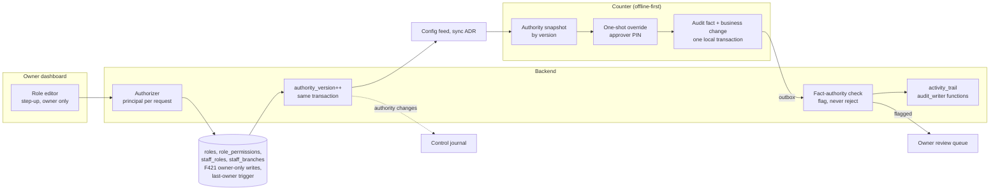

# ADR-0008: Roles, permissions and the activity trail — custom roles from a permission catalogue, immutable owner role, one-shot overrides on an offline counter, a hash-chained trail

## Status

Proposed

> **Who may move this to `Accepted`: the user, or `cto` on the user's explicit
> confirmation. No other agent, and no skill on its own.**
> Why this is stated here: stories referencing a `Proposed` ADR are set `Blocked`,
> and epics require `Accepted`, so the field needs a named owner. `cto` is the
> role `coordination-rules.md` escalates technical conflicts to, and an ADR is
> that decision made durable.
>
> This does **not** relax the rule that `Status: Accepted` is never set without
> explicit user confirmation — it narrows *which agent* may set it once that
> confirmation exists. An agent that believes an ADR is ready says so and
> escalates; it does not edit this field.

## Date

2026-10-19

## Last Verified

2026-10-19

## Decision Makers

The founder (Kamel Mohamed, user) decided areas E and F on 2026-10-19 (`docs/research/staff-auth-and-roles.md` § 5.0: P1 + O1 + S1, S2 off by default, B1 with the control-journal copy, immutable owner role, at least one owner). In this run the founder also chose:
- the form: a new ADR carrying dated amendments to ADR-0003, ADR-0005 and ADR-0007;
- the activity trail is kept 5 years;
- ADR-0007's control-journal kinds are kept 1 year;
- the privileged-key set that makes 2FA mandatory;
- Tier-2 keys are reserved;
- `staff.manage` stays out of the manager template;
- the X / Z split and the `day.end` rules (closes Q-z);
- the central PIN verifier, which amends ADR-0007: all central, approvers included; per-tenant data keys under a master key; a person-level lock at contact; the 13.3.1 and 13.3.3 deviations accepted by name; a PIN may not equal or be contained in the password (research part 4, § 5.5).

**Revised 2026-10-19 after an independent `/architecture-review` in a fresh session** (`docs/architecture/architecture-review-2026-10-19-adr-0008.md`: FAIL, text fixes only; B1–B2, H1–H3, M1–M12, L1–L8), at the founder's instruction. The founder's answers in that round:
- B1: a counter-minted PIN stays on that counter until a server-checked fact confirms it;
- M5: at closure the tenant key is deleted and backup copies age out inside the backup window;
- M7: the widened lockout is accepted by name;
- M9: the PIN-in-password residual is accepted by name;
- M10: allowed decisions on privileged keys are logged; residuals F421, F422, R-7 widened and 16.4.3 partial are accepted by name, reviewed at the KMS move or the first multi-counter venue;
- M3: no override in Restricted mode until Q-restricted is decided;
- L7: the threat model blocks the first story, not acceptance.

The founder also added the dashboard-issued temporary PIN for remote onboarding (§ 10 item 11).

**Re-check 2026-10-19 (same reviewer, FAIL by one sentence):** 23 of 25 findings were resolved. The new items R1–R5 and L-R6 to L-R11 were applied with the founder's answers:
- R1: a pending verifier is confirmed only by a new password-path PIN or the owner's checked dashboard confirmation;
- R2: a narrow read of the owner role for `auth_lookup`;
- R3: who writes which upload fact;
- R4: other counters keep the old PIN while a new one is pending;
- R5: activation codes also serve as a remote reset, under the owner-only key `staff.activation_code`;
- L-R6: the code lifetime has a compiled ceiling of 72 hours.

Drafted by `/architecture-decision`. Stack-lead validation: **NOT ASSESSED — no stack layer configured**. CTO-ADR: **skipped — lean mode**. Acceptance: the user.

## Summary

Inside a tenant, the owner defines custom roles and the counter must enforce them for days without the server. Today ADR-0003 knows only a fixed `Owner|Manager|Cashier` enum, and no ADR says how a manager approves a cashier's action offline or how the staff activity trail is kept. Decision: a code-defined permission catalogue with limits; roles as tenant rows (owner role immutable, templates editable); an authority snapshot in the versioned config feed so the offline counter checks a one-shot approval; a hash-chained activity trail kept 5 years; and dated amendments to ADR-0003 (principal and role tables), ADR-0005 (retention rows) and ADR-0007 (PIN verifiers become central and synced to the person's branches).

## Stack Compatibility

| Field | Value |
|-------|-------|
| **Stack layer(s)** | Data (PostgreSQL); Ktor backend (ADR-0006); Web (Vite + React SPA); desktop cashier client (runtime undecided) |
| **Domain** | Identity (authorization) with Tenancy and Security |
| **Layer** | Foundation |
| **Knowledge Risk** | HIGH — PostgreSQL 18.6 deferred constraint triggers and advisory locks are relied on from executed tests (F320–F322), not from the manual (F325) |
| **References Consulted** | `docs/research/staff-auth-and-roles.md` (F301–F325, § 5.0; § 5.4 addendum: part 3 § 5.1–5.7, recovered verbatim 2026-10-19), part 4 (central PIN, F401–); `docs/stack-reference/postgres/best-practices.md` § 1; ADR-0001–0007; `docs/registry/architecture.yaml` |
| **Pinned versions relied on** | `postgres:18.6`; Ktor 3.6.0; Exposed 1.5.1 (`pins.yaml`) |
| **Post-Cutoff APIs Used** | None beyond PostgreSQL 18 `CREATE CONSTRAINT TRIGGER … DEFERRABLE INITIALLY DEFERRED` and `pg_advisory_xact_lock` (executed, F321) |
| **Verification Required** | Re-run S31 on the real schema (last-owner race closed); read the PG 18 manual pages for constraint triggers and `pg_advisory_xact_lock` before the migration story (F325); authority-snapshot size and apply time on the 4 GB PC; the chain verification job against a planted mismatch; **PostgreSQL 18: AFTER triggers, deferred constraint triggers included, run as the role active when the event was queued** (`stack-reference/postgres/breaking-changes.md` line 14), so the last-owner trigger is tested as `app_rt` and `job_rt` under FORCE RLS |

Critical ADR: yes — authorization and tenancy (Foundation).

## ADR Dependencies

| Field | Value |
|-------|-------|
| **Depends On** | ADR-0001, ADR-0002, ADR-0003 (**amended by this ADR**), ADR-0004 (journal pattern, `audit_writer`), ADR-0005 (**amended**: retention rows; control journal), ADR-0006, ADR-0007 (**amended**: central PIN verifier) — all Accepted. **Not yet written, each owning a named part:** the sync ADR (delivery of the authority snapshot and staff feed, chain-head acknowledgement per batch, Q-chain); the storage / server-sync-state ADR (home of the control journal); the desktop-runtime ADR (process that runs the device checks and the audit write); the key-custody ADR (the verifier master key and per-tenant data keys, their KMS move with the pepper);
- the **device-credential ADR**: what a device credential proves (§ 10 items 3 and 8 rest on it) and the TPM anchoring of the per-device counter;
- the **licensing ADR**: `device.enrol` and `device.revoke` stay owner-only until it settles them, and it owns Q-restricted (§ 4.6);
- the **sync ADR's retry window**, which sets the `authority_snapshots` retention row (§ 7);
- the **storage ADR**: the activity-trail restore gap (§ 6). |
| **Enables** | The staff, roles and permissions spec; owner dashboard role screens; every counter story with an approval; `/threat-model staff-auth`; ADR-0007's permission-named checks (they stop reading "owner only" when this ADR is Accepted) |
| **Blocks** | Every story that checks a permission, edits a role, approves an override, or reads the activity trail |
| **Ordering Note** | The founder accepted ADR-0007 first; this ADR fills the permission names ADR-0007 left as "owner only". Its ADR-0007 amendment replaces the device-only PIN verifier; the dated amendment text goes into ADR-0007 on acceptance of this ADR, never before. |

## Context

### Problem Statement

The founder decided (2026-10-19) that roles are custom: the owner creates roles and picks their permissions; owner, manager and cashier ship as editable templates; roles are scoped to branches by staff assignment (ADR-0003). ADR-0003 types `Principal.role` as a fixed enum and guards role writes with an owner-only policy (F303). The counter must decide approvals for days offline (lease 7–14 days), and a money fact made at the counter is never rejected (sync OQ6). The staff activity trail (brief P6) has no store and no retention row (F305). ADR-0007 left enrolment, reset and override permissions as "owner only" until this ADR. And the founder revised ADR-0007's PIN design: a person enrols once and the PIN works on every counter of their branches.

### Current State

ADR-0003 (Accepted) holds `staff_roles (tenant_id, staff_id, role)` and `staff_branches`, the F421 guard and the per-request principal read. ADR-0007 (Accepted) holds sign-in, step-up and the counter PIN, with the verifier device-only. No code.

### Constraints

- Every rule in ADR-0003 about per-request principal reads, no scope cache, no scope claims in the token and the F421 database guard holds.
- The counter is not a security boundary (the PC belongs to the venue, F306); its checks prevent honest mistakes and produce evidence; the server's flags are the detective control.
- Money facts are never rejected (OQ6); only forged or unbound commands are refused.
- ADR-0005 Decision 9: audit reasons are enum or ids, never free text; no PII in telemetry.
- Numbers (limits) are tenant data set at install; no numeric default is sourced, so none is proposed (part 3 § 5.2).

### Requirements

- The owner creates, edits and deletes roles from the catalogue; owner-only keys never enter a custom role.
- At least one active owner always remains, even under concurrent changes.
- A cashier above their limit gets a manager's one-shot approval on an offline counter; the approval is attributable, single-use and checked again on the server.
- A role change applies on the next server request and at the device's next sync.
- The activity trail is append-only, tamper-evident for synced history, branch-scoped for readers, kept 5 years.
- A person enrols their PIN once and can sign in on every counter of their assigned branches.

Research note: `docs/research/staff-auth-and-roles.md` (Status Draft, COMPLETE WITH GAPS; § 5.0; part 4 for the central PIN).

## Decision

### 1. Permission catalogue (P1)

Permissions are **keys defined in code**, mirrored in a class-G table `permission_catalogue (key, limit_kinds, approvable, owner_only, privileged, tier)` written only by a reviewed migration (ADR-0001 § 1b). A limit is a number carried by the role; **an absent limit means no authority** (deny), except in the owner role. "Approvable" means another person may approve it through the one-shot override; the matching approval key is `approve.<action>`. Keys from research part 3 § 5.1, with the founder's changes of 2026-10-19:

| Key | Allows | Limit | Approvable | Checked on | Tier |
|---|---|---|---|---|---|
| `session.run` | start, end, move station, change price tier | — | no | device, server | 1 |
| `sale.make` | quick sale, open tab, add items, take payment | — | no | device, server | 1 |
| `session.cancel` (S4) | cancel a running session | — | yes | device, server | 1 |
| `bill.void` (O6) | void a bill or line, reason required | — | yes | device, server | 1 |
| `bill.discount` (G10) | manual discount or surcharge, reason required | max percent, max amount per bill | yes | device, server | 1 |
| `bill.open_item` (N1) | free name and price, reason required | max unit price (never above the owner's tenant ceiling) | yes | device, server | 1 |
| `shift.open_close` (W1) | open and close own shift with cash count | — | no | device, server | 1 |
| `shift.close_other` | close a shift someone else opened | — | yes | device, server | 1 |
| `drawer.open_no_sale` (D1) | open the drawer without a sale | — | yes | device, server | 1 |
| `cash.paid_out` (W2) | paid-out against a reason | max amount | yes | device, server | 1 |
| **`report.x`** (W3) | print the X report (running totals; closes nothing) | — | no | device, server | 1 |
| **`report.z`** (W3) | print the Z report (closes the period) | — | **yes (`approve.report_z`)** | device, server | 1 |
| **`day.end`** (W4) | End Day | — | **yes (`approve.day_end`)** | device, server | 1 |
| `attendance.clock` / `attendance.view_all` (W6) | own clock in/out / everyone's | — | no | device, server | 1 |
| `staff.view` / `staff.view_personal` | list staff / see phone and contact fields (field-level, ASVS 8.2.3); attendance records sit under `attendance.view_all` | — | no | server | 1 |
| `staff.manage` | create, disable, enable staff; issue a temporary password (ADR-0007 § 5); no roles, no branches; strict-subset rule (§ 3.3) | — | no | server | 1 |
| `staff.enrol_device` | sponsor a counter enrolment (ADR-0007 § 7) | — | no | device (online check), server | 1 |
| `staff.reset_pin` | issue a counter temporary PIN or require a PIN reset (ADR-0007 § 8); strict-subset rule (§ 3.3) | — | no | device, server | 1 |
| `staff.suspend_local` | suspend a person on the counter (ADR-0007 § 8) | — | no | device, server | 1 |
| `report.view`, `activity_log.view` (P6) | dashboard reports and trail, branch-scoped | branches by assignment | no | server | 1 |
| `report.export` | download reports or data files, branch-scoped | — | no | server | 1 |
| `config.edit`, `catalogue.edit`, `stock.adjust`, `stock.transfer` | configuration, catalogue, stock | — | no | server | 1 |
| `review.decide` | decide a flagged item in the review queue | — | no | server | 1 |
| `approve.<action>` | approve another person's request for each approvable action | same limit kind as the action; an approver limit is never below the do-limit in the same role | n/a | device, server | 1 |
| `bill.price_override`, `payment.refund` (O5), `session.backdate` (S7) | **reserved** (founder 2026-10-19): in the catalogue, off in every template, used by no Tier-1 screen | as research | yes | — | 2 |
| **Owner-only** (cannot be stored in a custom role) | `roles.manage`, `staff.assign` (roles and branches), `staff.erase` (ADR-0005), `support.grant` (ADR-0004), `export.tenant`, `device.enrol` / `device.revoke` (owner-only until the licensing ADR settles them), `staff.activation_code` (issue a dashboard temporary PIN, § 10 item 11), tenant settings (backdate window, offline-age cap, ceilings, PIN floors) | — | no | server, database | 1 |

**`day.end` is refused while any bill, session or shift is open, for every role including the owner, and that refusal is not approvable** (sync OQ8). An approval only covers who may run End Day, never an open item.

**Privileged keys (2FA, founder 2026-10-19).** A dashboard login whose roles hold any of these keys must have a second factor (ADR-0007 § 3): any `staff.*` key, `approve.*`, `review.decide`, `config.edit`, `catalogue.edit`, `activity_log.view`, `report.export`, and every owner-only key. The flag is `permission_catalogue.privileged`; a new key declares it. This replaces ADR-0007's interim "owner and manager role" rule when this ADR is Accepted. Counter-only people are unaffected (ADR-0007 § 4).

### 2. Roles and templates

- **Tables (TD, tenant-wide, not branch-scoped):** `roles (tenant_id, id, label, is_owner, template_origin, created_at)`, `role_permissions (tenant_id, role_id, key, limit_amount, limit_percent, limit_minutes)` with composite FKs and a FK from `key` to `permission_catalogue`; `staff_roles (tenant_id, staff_id, role_id)` replaces ADR-0003's `role` column (amendment § 9). A person may hold several roles: their permissions are the union, and each limit is the largest a held role grants.
- **Owner role:** exactly one per tenant, `is_owner = true`, written by the tenant-provisioning job; its permission set is **the whole catalogue, including keys added later**, evaluated from `is_owner`, so it has no `role_permissions` rows. A `BEFORE UPDATE OR DELETE` trigger refuses any change except the label (F322), and except the closure purge (§ 3.5). **Exactly one** is enforced by a partial unique index on `roles (tenant_id) WHERE is_owner`; `app_rt` has no INSERT or UPDATE privilege on `is_owner`. Holding the owner role is what sets `app.branch_all = 'on'` (ADR-0003).
- **Templates** are copied into each tenant at provisioning and carry `template_origin`; after that they are the tenant's rows, editable by the owner (step-up, ADR-0007 § 4). Limits are unset in the templates and set at the on-site install; unset = no authority.

| Permission group | Owner | Manager | Cashier |
|---|---|---|---|
| `session.run`, `sale.make`, `shift.open_close`, `attendance.clock`, **`report.x`** | yes | yes | yes |
| **`report.z`** | yes | yes | **no — approvable (`approve.report_z`)** |
| **`day.end`** | yes | yes | **no — approvable (`approve.day_end`)** |
| `session.cancel`, `bill.void`, `drawer.open_no_sale`, `cash.paid_out`, `shift.close_other` | yes | yes (paid-out under a limit set at install) | no; may request an approval |
| `bill.discount`, `bill.open_item` | yes, unlimited | yes, limit set at install | limit set at install, may be 0; above it, request an approval |
| `approve.*` (incl. `approve.report_z`, `approve.day_end`) | all | all, each under a limit set at install | none |
| `staff.enrol_device`, `staff.reset_pin`, `staff.suspend_local` | yes | yes (strict-subset rule, § 3) | no |
| `staff.view`, `attendance.view_all`, `report.view`, `activity_log.view`, `report.export`, `stock.*` | yes, all branches | yes, assigned branches | no |
| `staff.manage`, `staff.view_personal`, `config.edit`, `catalogue.edit`, `review.decide` | yes | **no** (founder 2026-10-19; the owner may add them to a custom role) | no |
| owner-only keys | yes | — | — |
| reserved Tier-2 keys | yes | off | off |

**One-person shift (founder 2026-10-19; closes Q-z).** A cashier template prints X only. When a cashier works alone and a Z report or End Day is due, a manager or owner approves it through the one-shot override on that counter (§ 4). For venues where cashiers routinely close alone (a night shift), the owner adds `report.z` and `day.end` to a custom role, for example "night-shift cashier", per tenant. `day.end` stays refused while anything is open, whoever runs it.

### 3. Escalation and protection rules

1. **Only an owner writes** `roles`, `role_permissions`, `staff_roles`, `staff_branches`: ADR-0003's F421 policy (`app.branch_all = 'on'`) is extended to `roles` and `role_permissions`. Every such write is a step-up action (ADR-0007 § 4).
2. **Owner-only keys cannot be stored in a custom role:** a check at role save and a database constraint (trigger against `permission_catalogue.owner_only`).
3. **Strict-subset rule (active).** Where a non-owner acts on another person, the target's permission set (keys and limits) must be a strict subset of the actor's, and the target must be assigned to a branch the actor holds. This covers:
   - `staff.manage`: disable, enable, temporary password;
   - `staff.reset_pin`: counter temporary PIN, require a PIN reset;
   - `staff.enrol_device`;
   - `staff.suspend_local`.

   **An owner is never the target of a non-owner**; the owner role is above every role. The rule is checked in the `Authorizer`. `Logins.issueTemporary` and `Logins.disable` also check it in their § 1c function: the target is not an owner unless `app.branch_all = 'on'`. The same rule governs any future decision that lets a non-owner assign roles; the assigner may then never edit a role they hold (F313: argued from the threat, no tier 1–3 source).
4. **No self-approval:** approver ≠ requester, checked on the device and again on the server.
5. **At least one active owner remains.**
   - **An active owner** holds the owner role, has staff status active and has an enabled dashboard login.
   - **The guard runs on every path that can end one:**
     - a `staff_roles` delete or update, FK cascades included;
     - a staff status update or delete;
     - the § 1c functions `Logins.disable` and `Erasure.erasePersonLogin`, which take the same lock and refuse the last active owner. This ADR amends their ADR-0001 § 1c rows.

     On the tables the guard is a `CONSTRAINT TRIGGER … DEFERRABLE INITIALLY DEFERRED` that counts active owners after taking the lock (F320, F321). So two owners each disabling the other leaves one.
   - **Reads across the class line (founder, 2026-10-19; amends ADR-0001):**
     - **The § 1c functions:** `auth_lookup` may SELECT `staff_roles` and `roles.is_owner` inside the tenant context, for the owner checks of `Logins.disable`, `Logins.issueTemporary` and `Erasure.erasePersonLogin` only. This is the one stated exception to "`auth_lookup` never reads TD tables".
     - **The TD trigger:** it learns a login's enabled state through `Logins.statusOf`, which gains EXECUTE for `job_rt`, so the count holds on the closure and erasure paths too.
     - **Lock order:** `Logins.disable` and `Erasure.erasePersonLogin` take the last-owner lock after any trail append in the same transaction, keeping the order journal, trail, last-owner.
   - **The lock** is `pg_advisory_xact_lock(<last-owner class id>, <tenant key>)`, the two-key, transaction-level form (PgBouncer transaction pooling, F325). Its class id is registered beside ADR-0004's journal append lock and the trail's append lock (§ 6). A transaction taking more than one takes them in this order: journal, trail, last-owner.
   - **The trigger function runs as the queuing role** (PostgreSQL 18). It counts the tenant's rows under the tenant context, and is tested as `app_rt` and as `job_rt` with FORCE RLS.
   - **Closure exception (ADR-0005).** The guard and the owner-role trigger let a delete through only when the current role is `job_rt` **and** the context tenant's CP `tenant_status` is `purge_personal` or later (ADR-0005 Decision 1). Every other path is refused, `job_rt` on an active tenant included.
   - The provisioning job writes the first owner. Erasing the last owner is refused; closure is the route.
6. **Role change effects.** Server: effective on the next request (no cache, ADR-0003); every holder's sessions end (`Sessions.endAllForUser`). Device: effective at the next sync (§ 5); a bill open when authority is removed may be finished and paid; the next gated action is checked against the current snapshot.
7. Editing a role others hold, adding a key or raising a limit writes an audit record with the key and limit diff and a control-journal entry (§ 6).

### 4. One-shot override (O1)

1. A person without enough authority attempts an approvable action, or exceeds a limit; the counter shows "needs approval".
2. The approver selects themselves from the branch's staff list and enters **their own** PIN (ADR-0007 § 7; failures count toward their lockout).
3. The device checks from its authority snapshot: the approver is active, assigned to this branch, holds `approve.<action>`, the amount is within the approver's limit, and the approver is not the requester.
4. On success the action proceeds **once**. The device records it in the same local transaction as the action, ids only: `override_id`, requester id, approver id, action enum, subject ids, amount and limit used, reason id (owner's reason list, P5), `authority_version`, device sequence, device claim time plus monotonic reading, outcome. Refused and locked attempts are recorded too.
5. **Server judgement at sync.** The server judges the fact against authority **at the version the device held**, and against **authority in force at the fact's claimed time** (lease clock). It **flags, never rejects** (OQ6):
   - `approver_authority_changed`, set only when a change the device had not received took effect before the claimed time (an approval made before a later demotion is not flagged);
   - `approver_missing`, `limit_exceeded`, `self_approval`, `branch_not_assigned`, `staff_unknown`, `config_version_stale`;
   - `config_version_unknown`: the fact names a version the server never delivered to that device. Flagged facts go to the owner's review queue; only forged or unbound commands are refused.
6. **Exposure bound:** the snapshot is at most as old as the last sync, and a device that has not reached the server for the lease cannot start new sales (F307). **S2:** an owner setting `override_offline_max_age` (default off), measured on the lease clock (ADR-0007 § 7) and never the Windows clock, refuses overrides on a snapshot older than the set age. **In Restricted mode (lease ended), no override runs until Q-restricted is decided** (founder 2026-10-19; due before the override story); once it is, every override there is flagged `config_version_stale`.
7. ASVS 8.3.2: the alert half is met; "revert" is replaced by owner review because a sale made is never altered — recorded deviation (F309; ADR-0007 already lists it).
8. **Fallback O4:** if a device cannot run the protocol (no approver's verifier is on that device), the action is refused and the approver runs it under their own sign-in.

### 5. Authority snapshot (S1) and enforcement

- **`authority_version`** is a per-tenant counter incremented in the same transaction as any change to `roles`, `role_permissions`, `staff_roles`, `staff_branches`, staff status, tenant ceilings, PIN floors, or a person lock or unlock.
- **Snapshot per branch:** the active staff of the branch with their status, role ids, effective permissions and limits, person locks and `staff_version` — **never verifiers**. Delivered as an immutable versioned snapshot in the config feed (sync ADR); each device fact carries the `authority_version` it used.
- **Verifiers travel in the staff feed** (§ 10 item 6), keyed by `(person, verifier_version)`, with removals as tombstones. Neither feed's server history stores a verifier.
- **Which snapshot judges a fact:** the snapshot of the fact's branch with the greatest version ≤ its `authority_version` that the server delivered to that device. A version never delivered to that device is flagged `config_version_unknown`, never rejected.
- **History for judgement:** the server keeps the snapshots it delivered (`authority_snapshots (tenant_id, branch_id, version, payload_hash, payload, created_at)`, TD, ids only, no verifiers) for at least the longest lease plus the feed's retry window — the same window as the feed's tombstones (F220) — so § 4 step 5 can judge against the held version.
- **Server (trusted layer, ASVS 8.3.1):** `Authorizer.require(principal, permission, target?, amount?)`, deny by default (8.2.1); RLS tenant and `branch_scope` policies for data (8.2.2, ADR-0003); field-level rules hide personal staff fields without `staff.view_personal` (8.2.3), and **no API returns a verifier or its ciphertext**: only the staff feed carries it; device facts pass the fact-authority check of § 4 step 5.
- **Device:** reads the signed-in person's permissions from the snapshot to show or hide actions, enforces limits, runs the approver check, writes the audit record in the same transaction. Under runtime B the check runs in the Electron main process behind a narrow bridge (desktop ADR; Electron process model NOT SOURCEABLE here, research § 5.7).

### 6. Activity trail (B1)

- **Store:** `activity_trail` (TD, branch-scoped where the event has a branch; restrictive `branch_scope` per ADR-0003), append-only. Device events arrive as audit facts in the sync outbox, in the same local transaction as the business change; server events are written in the business transaction. Appends go through `SECURITY DEFINER` functions owned by `audit_writer` (ADR-0004 pattern): `ActivityTrail.appendServer`, `ActivityTrail.acceptDeviceBatch`, `ActivityTrail.verifyChains`, `ActivityTrail.pruneBefore` (oldest first, writes a chain anchor). No role may `UPDATE` it.
- **Append lock:** `appendServer` takes the per-tenant trail append lock, `pg_advisory_xact_lock(<trail class id>, <tenant key>)`, so two concurrent appends cannot fork the chain. Lock order is as in § 3.5.
- **Logging authorization decisions (ASVS 16.3.2 L3, founder 2026-10-19):** every server `Authorizer` decision on a privileged key is logged, allowed or denied. Other allowed decisions are not logged, a recorded deviation.
- **Events:** sign-in success and wrong PIN, lockout; override requested, granted, denied; void, discount, open item, session cancel, paid-out, drawer opened with no sale (and reserved actions when enabled); shift open/close with count and difference; Z report; End Day and its refusals (naming open items by id); permission denied on a gated action (server: also a security event, ASVS 16.3.2); role create/edit/delete, assignment change, staff create/disable/enable/erase, owner changes; config edits (prices, limits, reason lists, backdate window); review-queue decisions. Support access stays in the support journal (ADR-0004).
- **Record:** audit id, tenant, branch, device id, actor staff id, action enum, outcome, UTC claim and receipt times (ASVS 16.2.1, 16.2.2), source sequence, previous hash, hash, plus the event's ids, amounts and reason id. **Ids and enums only**; erasing a person deletes the id-to-name link and leaves the trail intact (ADR-0005 Decision 5).
- **Tamper evidence:** a hash chain per device for device facts and per tenant for server events; the server stores the chain head it acknowledged at each sync batch (sync ADR, Q-chain); a scheduled job verifies chains and heads and anchors the latest head in the off-host log. Synced history is protected; the unsynced tail is not (F323; same blind spot as sync OQ27).
- **Readers:** the owner reads all; a role with `activity_log.view` reads its assigned branches; **tenant-level events (no branch: role, staff, config) are readable by the owner only**, because `branch_scope` hides them; cashier templates read none; Kodelix only under an owner grant (ADR-0004).
- **Also in the control journal:** authority changes (roles, permissions, assignments, owner changes, staff disable and erase) and review decisions, so a server restore cannot revive a revoked authority (research § 6; ADR-0007 § 3 Restore).
- **Retention (founder 2026-10-19):** the activity trail is kept **5 years**, the same as the tax archive, so a void or discount can always be explained beside the sale it changed.
  - **Prune guards:** `ActivityTrail.pruneBefore(cutoff)`, EXECUTE by `job_rt` only, refuses a cutoff later than `clock_timestamp()` minus the trail period read from the retention table, and refuses a period below a compiled floor of 5 years (the ADR-0004 support-journal pattern).
  - **At closure:** `activity_trail` is marked `tax` (ids only) and follows the tax archive. It is kept through `archive_retained`, deleted with the archive at `purged`, and pruned by `pruneBefore` while the tenant is active.
- **Restore gap:** a server restore loses trail rows and acknowledged chain heads newer than the backup, while devices have already dropped those facts from their outboxes. The storage / sync ADR decides whether the restore replays the trail, or records the gap and resets the acknowledged heads. Only authority changes are already safe in the control journal.

### 7. Retention rows (dated amendment to ADR-0005)

Effective when this ADR is Accepted, ADR-0005's retention table gains two rows (configuration with typed defaults; changed only by a reviewed migration, ADR-0005):

| Store | Period | Rule |
|---|---|---|
| Staff activity trail (`activity_trail`) | **5 years** | oldest-first prune with chain anchor |
| Control-journal kinds added by ADR-0007 (password reset, `must_reset`, factor add or remove, recovery-code use, login disable, role change, console lock-out runs) and by this ADR (authority changes) | **1 year** | must exceed the backup window plus margin (ADR-0007 § 3); CI fails if it does not |
| Delivered authority snapshots (`authority_snapshots`) | the longest lease plus the feed retry window | set from the sync ADR; CI checks it against the lease cap |

The storage / server-sync-state ADR still homes the control journal; it may move the store, not shorten these periods.

**ADR-0005 D1, D4 and D5 (same amendment):**
- D1: `purged` also removes `activity_trail` (it follows the tax archive, § 6).
- The verifier, upload-fact, activation-code and tenant-key tables (§ 10) are on the **export exclusion list**: they hold credentials (M47 coverage test).
- The person-erasure job deletes the person's server ciphertext, upload facts and activation codes through `PinVerifiers.erasePerson` (§ 10). `purge_personal` deletes the tenant's data key and every verifier row; backup copies age out inside the backup window (founder 2026-10-19).

### 8. Interfaces with ADR-0007

When this ADR is Accepted, ADR-0007's "owner only until the ADR-0003 amendment" checks read these keys: sponsoring `staff.enrol_device`, resetting `staff.reset_pin`, local suspend `staff.suspend_local`, issuing a temporary password `staff.manage`, requiring a PIN reset `staff.reset_pin`, approving overrides `approve.<action>`, and the privileged-key set for 2FA (§ 1). Step-up actions keep ADR-0007's list.

### 9. Dated amendment to ADR-0003

Effective when this ADR is Accepted (ADR-0003's decision text stays; a dated block is added):
- `staff_roles (tenant_id, staff_id, role_id)` with a composite FK to `roles`; `roles` and `role_permissions` are new tenant-wide TD tables; the F421 `app_rt` write guard covers all four tables (`roles`, `role_permissions`, `staff_roles`, `staff_branches`).
- `Principal = { user, tenant, roles: Set<RoleId>, isOwner, permissions: Map<Key, Limits>, branches: All | List<BranchId> }`, read per request as before (one principal read now joins `roles` and `role_permissions`; no cache). `branches = All` exactly when `isOwner`.
- `Authorizer.require(principal, permission, target?: BranchId, amount?: Money|Percent|Minutes) -> Allowed | Denied`.
- ADR-0003's "role matrix per surface is left to the role spec" is answered by § 1–2 here; screens per surface stay in the role spec.

### 10. Dated amendment to ADR-0007 — central PIN verifier (founder, 2026-10-19)

Effective when this ADR is Accepted. It replaces ADR-0007 § 7's "the verifier lives only inside the encrypted device store" and reverses the rejection of its Alternative 3. ADR-0007's decision text stays; a dated block is added. Research: `docs/research/staff-auth-and-roles.md` § 3.5 (F401–F423) and § 5.5.

**Why (founder):** the product family (restaurant, retail) will have several counters per branch and rotating staff. All seven POS vendors checked set the employee credential centrally, valid on the terminals of the person's store or locations: Dynamics 365, Simphony and Toast in official pages; Lightspeed, Shopify and Clover as leads; Square by inference (F418). Only Dynamics documents offline sign-in, from a synced local database (F408, F409). No vendor documents how a PIN is stored (F420). The vendor evidence supports the shape; the security case rests on the conditions below.

1. **Enrol once.** A PIN is set once and is valid on every device of the person's assigned branches. Both enrolment paths stay (password path through the dashboard API; sponsored path with a one-time temporary PIN).
   - **On the password path, the device refuses a PIN equal to the password just entered, or contained in it.** The comparison happens in memory only, and the password is never stored or sent, so a PIN cracked from a stolen store does not open the dashboard (founder, 2026-10-19). **Residual, accepted by name:** the check runs only when a PIN is set on the password path. A later dashboard password change can make the password contain the PIN, and a sponsored PIN for a person with a dashboard login is never compared; the server cannot compare, since it never sees the PIN. The dashboard password page tells the person not to reuse their counter PIN.
2. **The device computes the verifier.** Argon2id, per-user random salt, PHC string, with parameters fitted to the **weakest supported PC** (S40 = S22/S23; PBKDF2-SHA256 600,000 fallback). The device uploads it over the device channel (`device_rt`). The server never sees the PIN.
3. **Upload only against a single-use fact, and delivery scoped by provenance (F423a; founder 2026-10-19, review B1 option a).**
   - Every upload names its fact: `{kind ∈ password_assertion | dashboard_reset | activation_code | sponsor | counter_reset | self_change, factId}` and the `verifier_version` it replaces.
   - **The server authenticates three kinds itself:** the password-path enrolment assertion; a dashboard-issued "reset required" followed by a password-path enrolment; and the dashboard-issued activation code (item 11). A verifier accepted on one of these is **confirmed**.
   - **A sponsored enrolment, a counter temporary-PIN reset, a self-change and a parameter rehash are minted by the device** and are no stronger than its credential. A verifier accepted from one is **unconfirmed**: the staff feed delivers it **only to the device that minted it**, until it is confirmed. **A pending verifier is confirmed only by:**
     - (i) **the person setting a PIN on the password path**: a new `password_assertion` upload, which replaces the pending verifier; or
     - (ii) **the owner's confirmation in the dashboard** (step-up). The page shows the person, the device, the fact kind and the time, and the owner confirms only after checking with the person.

     **A password-path sign-in that sets no PIN confirms nothing** (re-check R1: a sign-in proves who the person is, not that the pending verifier holds their PIN).
   - **For a person whose roles hold a privileged key (§ 1), only a confirmed verifier is ever delivered beyond the minting device.** So whoever controls one counter cannot plant a PIN for a manager or co-owner on the other counters.
   - **Single use in the database:** each accepted upload consumes its fact (compare-and-set) and bumps a per-person `verifier_version`. An upload is accepted only if the version it replaces is current. Any other upload is refused, including one carrying only a valid device credential.
   - A device whose upload is refused keeps its local verifier for that person only until the next feed delivery replaces it. A PIN changed offline is valid only on that device until its upload is accepted.
   - A person changing their own PIN on a counter first enters the current PIN; that is a `self_change` fact (ASVS 6.2.3 analogue).
   - Nobody but the person chooses the lasting PIN (ASVS 6.4.6). A temporary PIN never leaves the device that issued it; only the lasting PIN's verifier is uploaded.
4. **The server never verifies a PIN** and never compares a presented hash. It stores and forwards the verifier, which removes a pass-the-hash target. **The one stated exception** is the dashboard-issued activation code of item 11: a one-time code, never a lasting PIN.
5. **Encrypted at rest, per-tenant keys (A-k2).**
   - The verifier is stored AEAD-encrypted (authenticated encryption, unique nonce per encryption) under a **per-tenant data key**, with tenant id and person id bound as associated data (ASVS 11.3.3, 11.3.4).
   - Each per-tenant data key is wrapped by a **master key held outside the database**: the encrypted server secret file now, an AWS KMS envelope at the first paying customer. The KMS envelope is decrypted once at start-up and held in memory, and KMS never decrypts verifiers one by one.
   - A `verifier_key_id` sits beside each row, and per-tenant wrapped keys sit in a small key table.
   - Rotation re-wraps or re-encrypts without any PIN. At `purge_personal` (ADR-0005) the tenant's data key and every verifier row are deleted. Deleting the key removes access in the live database only; backup copies age out inside the backup window, like every other personal row (founder 2026-10-19).
   - A database-only leak (an injection, or a backup) yields ciphertext only.
   - The master key is never in the database, a backup, a log or the repository; unwrapped data keys never leave process memory.
   - The verifier master key and the per-tenant data keys are crypto-inventory rows (ASVS 11.1.1, 11.1.2), with rotation intervals in configuration (13.3.4).
   - **No server cache of decrypted verifiers.** Unwrapped data keys are held in process memory only for the lifetime of a feed build.
6. **Delivery and removal.**
   - The **staff feed** (sync ADR) delivers a person's **confirmed** verifier, keyed by `(person, verifier_version)`, only to active, lease-valid devices of the person's assigned branches. An unconfirmed verifier goes only to its minting device (item 3). The authority snapshot (§ 5) never carries verifiers.
   - The owner holds `branches = All`, so the owner's confirmed verifier goes to every device of the tenant.
   - **While a new verifier is pending (founder, 2026-10-19):** other devices keep the person's last confirmed verifier until the new one is confirmed, and the counter tells the person "new PIN valid on this counter until confirmed". To retire an old PIN everywhere (for example after a leak), the owner issues a dashboard "reset required". So a forged `self_change` cannot wipe a manager's PIN fleet-wide.
   - It removes the verifier, by a tombstone, on disable, branch transfer, erasure, a dashboard "reset required", and a raised PIN floor (ADR-0007 § 7).
   - Erasure also deletes the server ciphertext. Backups lose it inside the backup window (30 days, ADR-0005 Decision 6), and the tombstone replay re-deletes it after a restore. A lost device that never syncs keeps it encrypted (residual R-7, ADR-0005).
   - The `authority_snapshots` history of § 5 never holds verifiers.
7. **Parameters.** A verifier's cost parameters are inside its PHC string, so a received verifier cannot be clamped. Instead, **a device refuses to install a received verifier whose parameters lie outside its own floor or ceiling**. It reports `feed.param.clamped` and refuses that person's PIN sign-in until a new PIN is set. The server refuses such an upload too (F232, F423c). A parameter upgrade happens only when the person next types the PIN on a device (F403). That rehash is uploaded as a `self_change` and follows item 3.
8. **Lockout (founder, 2026-10-19).**
   - Lockout stays per device: delay from the 5th failure, lock at ≤ 10, configurable lower.
   - **Failures are reported at contact and summed per person.** They are counted across devices since the last reported success; a successful PIN sign-in reported at contact clears the sum. Past a threshold (configuration, compiled ceiling 10, NIST § 3.2.10), the person is locked on every device of their branches through the feed until a PIN reset, and a security event is written.
   - **An owner's person lock** is cleared by a dashboard "reset required" followed by a password-path enrolment.
   - **Widened malicious lockout, accepted by name:** the person lock lets failures typed on one or more counters lock an approver, or the owner, on every counter. This is a deviation from ASVS 6.1.1, accepted by Kamel Mohamed, founder, 2026-10-19. The runbook "owner or manager locked out offline" is extended to cover it.
   - Lockout reports are minted by the device, so a compromised counter can lock anyone or suppress its own reports (threat-model input).
   - The remaining guess budget across several offline devices is a **named deviation** from NIST SP 800-63B-4 § 3.2.10's 10-consecutive ceiling and from ASVS 6.1.1 and 6.3.1 as documented. It is accepted by Kamel Mohamed, founder, 2026-10-19.
9. **Stated plainly:**
   - A stolen device store now holds the verifiers of every person assigned to that branch, approvers included, not only those who used that PC (F421).
   - A compromise of the database **and** a key, or of the running server, exposes every affected verifier at once. **Rotating the key is then no remedy: every affected person must set a new PIN** (F422; runbook "verifier-key compromise").
   - The PIN's protection is the store encryption, the lockout, the TPM where present, and the 8-character floor for approvers; the hash is the last line.
10. **Deviations accepted by name (Kamel Mohamed, founder, 2026-10-19):**
    - ASVS 13.3.1 (L3 hardware-backed secret store) and 13.3.3 (L3 isolated cryptographic module) for the verifier master key **and** for ADR-0007's pepper, while they sit in the encrypted secret file. Review at the KMS move.
    - The aggregate lockout budget and the widened 6.1.1 lockout (item 8).
    - **Residuals:**
      - F421: a stolen counter store holds the branch's verifiers, approvers and, where the owner is assigned, the owner's included;
      - F422: a database and key compromise exposes every affected verifier, and the remedy is a PIN reset for all;
      - ADR-0005 R-7, widened to every branch person's verifier on a lost device;
      - ASVS 16.4.3 partial: the trail stays in the primary database, while authority changes and chain heads go off-host;
      - the PIN-in-password residual of item 1.

      **Review at the KMS move (first paying customer) or at the first multi-counter venue, whichever comes first.**

11. **Dashboard-issued temporary PIN for remote onboarding (founder, 2026-10-19).** A new cashier can start when neither the owner nor a manager is at the counter.
    - **Who:** only a person whose roles hold **no privileged key, as defined in § 1** (`permission_catalogue.privileged`); never an approver. Checked when the code is issued **and again when it is used**, because roles can change in between.
    - **Issued by** the owner from the dashboard, under the owner-only key `staff.activation_code` (§ 1), with step-up (ADR-0007 § 4). The person must be assigned to at least one branch.
    - **For a person who already has a PIN** (founder, 2026-10-19), a redeemed code replaces their verifier fleet-wide. This is an owner-started remote reset; ASVS 6.4.6 holds, because the person sets the new PIN.
    - **The code:**
      - the server generates it with a CSPRNG and shows it once to the owner;
      - its length comes from configuration, with a compiled floor of 8 characters from an unambiguous alphanumeric alphabet;
      - the server stores only its verifier, a salted Argon2id PHC string (ASVS 6.5.2: under 112 bits);
      - it is single use and expires after a configured time (default 24 h, compiled ceiling 72 h; founder, 2026-10-19);
      - issuing a new code for the same person voids the old one.
    - **First use:**
      - the counter must be **online**: it sends `(person, code)` over the device channel, and the device must be lease-valid and serve one of the person's branches;
      - **the server checks the code.** This is the one stated exception to "the server never verifies a PIN" (item 4): it is a one-time activation code, never a lasting PIN;
      - wrong attempts are counted per code, and the code is voided after a configured number (compiled ceiling 10);
      - success consumes the code (compare-and-set) and returns a single-use `activation_code` fact bound to that device credential.
    - **Before any other action**, the person sets their own PIN on that counter (floors as ADR-0007 § 7; never the code itself). Its verifier is uploaded against the activation fact. **That fact is server-checked, so it counts as the confirmation of item 3, and the new verifier travels fleet-wide at once**, with no separate owner confirmation.
    - **Records:** a trail entry and an owner notice (ADR-0007 § 3 notice job) on issue, on use, on expiry and on voiding.
    - **ASVS:**
      - 6.4.1: system-generated, random, expiring, single use, never the lasting secret;
      - 6.4.6: the owner starts it but never chooses or sees the person's lasting PIN;
      - the default lifetime of 24 h is longer than a "short period" would usually read; it is a founder setting, and configuration may shorten it.
    - **Threat-model inputs:**
      - the code intercepted between owner and cashier (a chat message, a photo), bounded by single use, expiry, the online check and the owner notice;
      - online guessing, bounded by the per-code attempt limit and server throttling;
      - a stolen owner session issuing codes, bounded by step-up and the notice;
      - a code used on a counter of the wrong branch, refused;
      - a person given an approver role between issue and use, refused at use;
      - the counter on which a code is redeemed substituting its own verifier for the person's. The result is confirmed and fleet-wide, but only for a non-privileged person, and it shows when the person's PIN fails on another counter.

**ADR-0007 text this amends** (each passage is read as amended from acceptance of this ADR):
- the Summary: "a per-device enrolment … whose Argon2id verifier never leaves the device's encrypted store";
- the § 1 realm table, Counter row: "anyone enrolled on that device", "alphanumeric PIN, device-local";
- § 7, first bullet: "Enrolment is per device";
- § 7 "Verifier";
- § 7 Manager override: the approver "must be enrolled on that device" now reads "must have a verifier on that device";
- the Must (device) rule that the verifier never leaves the store;
- § 8 "Only people enrolled on a device have a verifier there" and its closing of Q-verifiers: Q-verifiers is now decided as above;
- Key Interfaces: `EnrolmentFact … // synced; never a PIN or verifier`, and the diagram node "No verifier on server": the verifier upload is now a synced fact;
- Alternative 3's rejection;
- Consequences, Positive: "no PIN verifier … exposed by a database or backup leak", now ciphertext only;
- Consequences, Negative: "A person enrols on each device separately; an approver can approve only where enrolled";
- the Cross-Cutting row that treats 13.3.1 as met for the pepper: now a deviation accepted by name (item 10);
- the Validation line "no PIN or verifier appears in any synced fact or log": except the verifier upload;
- § 7 "Two paths": it gains the activation path (item 11);
- § 4 dashboard step-up actions: they gain "issue an activation code".

ADR-0007's enrolment fact stays: one per person per enrolment, naming the device it was made on. So do its sponsored path, PIN floors, temporary PINs and lease-clock rules. A temporary PIN never leaves the device that issued it; only the lasting PIN's verifier is uploaded.

### Architecture



### Key Interfaces

```text
Principal { user, tenant, roles: Set<RoleId>, isOwner, permissions: Map<PermissionKey, Limits>, branches: All | List<BranchId> }
Limits    { amount?: Money, percent?: Percent, minutes?: Int }      // absent = no authority (except isOwner)

Authorizer.require(principal, key, target?: BranchId, amount?) -> Allowed | Denied           (server, deny by default)
Roles (app layer, owner only, step-up): create(label, grants) / update(roleId, grants) / delete(roleId) / assign(staff, roleIds, branches)
  -> errors OwnerOnlyKey, OwnerRoleImmutable, LastOwner, StepUpRequired
PermissionCatalogue (G table + code enum): key, limitKinds, approvable, ownerOnly, privileged, tier

AuthoritySnapshot { tenant, branch, version, staff: [ { staffId, staffVersion, status, roleIds, permissions, limits, personLocked } ] }   // never verifiers
StaffFeedVerifier { person, verifierVersion, phc, confirmed } | Tombstone { person, verifierVersion, cause }   // staff feed only (§ 10.6)
PinVerifiers (server, app layer): accept(personId, phc, fact: { kind ∈ password_assertion | dashboard_reset | activation_code | sponsor | counter_reset | self_change, factId }, baseVersion)
  -> VerifierVersion(confirmed | unconfirmed) | Refused(no_fact | fact_used | stale_version | params_out_of_range)
  // AEAD under the per-tenant data key; AAD = tenant || person || verifierVersion; never verified server-side; never returned by any API
PinVerifiers.confirm(personId, verifierVersion, by: owner_dashboard)   // a new password_assertion upload replaces, never confirms, a pending verifier
PinVerifiers.erasePerson(personId)
PinActivation.issue(personId) -> code shown once (owner, step-up; refused if the person holds a privileged key)
PinActivation.redeem(personId, code, deviceCredential) -> activationFactId | Refused(expired | used | voided | privileged | wrong_branch)   // online only
LockoutReport { personId, deviceId, failures, successes, lastAt } -> PersonLock when the per-person sum since the last success passes the threshold (compiled ceiling 10)
OverrideFact { overrideId, requester, approver, action, subjectIds, amount?, limitUsed?, reasonId, authorityVersion, deviceSeq, claimedAt, monotonic, outcome }
FactAuthority.judge(fact) -> Ok | Flag(reason ∈ { approver_authority_changed, approver_missing, limit_exceeded, self_approval, branch_not_assigned, staff_unknown, config_version_stale, config_version_unknown })

ActivityTrail (SECURITY DEFINER, owner audit_writer): appendServer(event) / acceptDeviceBatch(deviceId, entries, claimedHead) -> ackHead
  / verifyChains() / pruneBefore(cutoff) (oldest first, anchor)
```

No HTTP contract is fixed here; role and trail endpoints go to `contracts/` with the role spec.

### Implementation Guidelines

- **Must (domain, identity context):** the catalogue, limit evaluation, strict-subset comparison and override rules are pure domain code; the catalogue enum is the single source the G table mirrors.
- **Must (app):** every route calls `Authorizer.require` (ADR-0003); a permission check never reads a client-sent role or limit.
- **Must (adapters, data):** `roles`, `role_permissions`, `staff_roles`, `staff_branches` carry the F421 owner-only write policy; the owner-role trigger, the owner-only-key trigger and the last-owner deferred constraint trigger with `pg_advisory_xact_lock` are created in the same migration.
- **Must:** `authority_version` is incremented in the same transaction as any change it covers; a change without an increment fails a test.
- **Must:** every device fact that used authority carries `authority_version`; the server judges and flags, **never rejects** a money fact for authority.
- **Must never:** store an owner-only key in a custom role; edit the owner role beyond its label; let anyone approve their own request; treat an absent limit as unlimited outside the owner role.
- **Must never:** write the activity trail except through the `audit_writer` functions; put typed text, names or contact data in a trail record.
- **Must (device):** the permission check, approver check and audit write run in the process that owns the encrypted store, in one local transaction with the business change (desktop ADR).
- **Must (data):** `pin_verifiers`, `pin_upload_facts`, `pin_activation_codes` and `tenant_data_keys` are class TD. `device_rt` writes `pin_verifiers` only through a trigger that requires and consumes a matching unconsumed `pin_upload_facts` row, so single use holds in the database. **The trigger takes `confirmed` from the consumed fact's kind, never from the request.** `app_rt` has no SELECT on `pin_verifiers` or `tenant_data_keys`.
- **Must (data): who writes which upload fact (re-check R3):**
  - an `activation_code` fact is written only by `PinActivation.redeem`, in the transaction that consumes the code;
  - a `dashboard_reset` fact is written only by `app_rt`, with step-up;
  - a `password_assertion` fact is written by the sync endpoint in the same transaction in which `Enrolment.consumeAssertion` returns. This is an **application check**, stated as such: a PL function cannot write TD;
  - `device_rt` may insert only the device-minted kinds (`sponsor`, `counter_reset`, `self_change`);
  - `app_rt` gets INSERT on `pin_activation_codes` and on `pin_upload_facts` (kind `dashboard_reset` only), and UPDATE of `pin_verifiers.confirmed` through `PinVerifiers.confirm` only.
- **Must never:** deliver an unconfirmed verifier beyond its minting device for a person holding a privileged key; let the server verify a lasting PIN; return a verifier or its ciphertext from any API.

## Alternatives Considered

### Alternative 1: Fixed three-level hierarchy (P2)

- **Description**: keep `Owner|Manager|Cashier` with fixed permission sets; owner sets only limits.
- **Pros**: simplest model; ADR-0003 unchanged.
- **Cons**: contradicts the founder's decision for custom roles; a night-shift cashier who may print Z needs a new code release.
- **Cost / Risk / Performance / Operability**: lowest build; product-fit risk; same performance; every venue variation becomes a support ticket.
- **Rejection Reason**: the founder decided custom roles on 2026-10-19.

### Alternative 2: External policy engine (P3)

- **Description**: express permissions as policies in an embedded policy engine on server and device.
- **Pros**: expressive.
- **Cons**: two evaluators (JVM server, device runtime A or B) must agree; not researched; another dependency on a 4 GB counter.
- **Cost / Risk / Performance / Operability**: high build; supply-chain and parity risk; unmeasured; a policy language the founder must operate.
- **Rejection Reason**: the catalogue with limits covers every Tier-1 rule with one shape evaluated the same way on both sides.

### Alternative 3: Elevated session instead of one-shot approval (O2)

- **Description**: the manager's PIN opens a few minutes of elevated authority on the counter.
- **Cons**: actions inside the window are not attributable to an approval; a cashier keeps the elevated counter.
- **Rejection Reason**: one approval per action is the only shape that leaves one attributable record each (ASVS 2.3.5, 7.5.3).

### Alternative 4: Remote approval only (O3)

- **Description**: the manager approves from a phone or the dashboard.
- **Rejection Reason**: fails offline, which is the counter's normal state for days.

### Alternative 5: Separate device audit journal (B2) or everything in the control journal (B3)

- **B2**: a second journal and transport beside the sync outbox — duplicates the outbox. **B3**: the whole trail in the control journal — over-retains, and moves the owner's read out of RLS.
- **Rejection Reason**: B1 reuses the outbox and keeps the owner's read under RLS; only authority changes go to the control journal.

### Alternative 6: Keep ADR-0007's device-only PIN verifier (part 4 option B)

- **Description**: each person enrols on every counter; no server verifier.
- **Pros**: smallest exposure — a stolen PC holds only its own enrolled people; the server holds no verifier.
- **Cons**: re-enrolment on every counter, for every rotating staff member, in restaurant and retail products with several counters per branch; a reset on one counter does not reach another.
- **Rejection Reason**: the founder's product-family requirement (2026-10-19); kept as the fallback if the exposure proves unacceptable.

### Alternative 7: Approvers enrol per device (part 4 option C)

- **Rejection Reason**: the founder chose one rule for everyone (2026-10-19); approvers are protected by the 8-character floor and the person lock instead. A role change would otherwise become a credential event.

### Alternative 8: Server verifies the PIN online (part 4 option D)

- **Rejection Reason**: fails offline, which the counter must survive for the lease (F228 shows Dynamics' online sign-in has the same limit).

### Alternative 9: Activity trail kept 2 years

- **Rejection Reason**: the founder chose 5 years so the trail matches the tax archive it explains.

## Consequences

### Positive

- Owners shape roles to their venue without a release; the counter enforces them offline with attributable approvals.
- A tenant cannot lock itself out of role management (immutable owner role, at least one owner).
- Every void, discount, override and authority change leaves a tamper-evident record for 5 years.

### Negative

- One more join in the per-request principal read; an authority snapshot per branch to build and ship on every change.
- Server must keep delivered snapshots for the lease-plus-retry window to judge facts.
- An offline counter enforces authority up to the last sync; a revoked manager can still approve until then, flagged afterwards.
- The unsynced tail of the device trail can be erased by a Windows administrator (F323, OQ27).
- Strict-subset and last-owner rules rest on design argument and executed tests, not a cited standard (F313).

### Neutral

- Screens per surface stay in the role spec.

## Risks

| Risk | Probability | Impact | Mitigation |
|------|------------|--------|-----------|
| Two owners demote each other to zero | Low | High | Deferred constraint trigger with per-tenant transaction lock (F321); re-run S31 on the real schema |
| An owner-only key slips into a custom role | Low | High | Save-time check and database trigger against the catalogue |
| A revoked manager approves offline | Medium | Medium | Flag `approver_authority_changed`; S2 setting; lease bound |
| Cashier plus accomplice approver | Medium | Medium | Approver limits; owner review queue; trail per action |
| A role edit silently widens many people's authority | Medium | Medium | Step-up; diff in the trail and control journal; holders' sessions end |
| Snapshot too large or slow on the 4 GB PC | Low | Medium | Per-branch snapshot; measure in S27 |
| Personal data enters the trail through reasons | Low | Medium | Reason ids only (ADR-0005 Decision 9) |
| Stolen device store yields the branch's verifiers, approvers included (F421) | Medium | High | Store encryption (DPAPI, TPM), 8 floor for approvers, lockout, person lock at contact, device revoke; residual named |
| Database and key compromise exposes every affected verifier (F422) | Low | High | Per-tenant data keys, master key outside the DB (KMS at first paying customer), no server-side use; runbook: PIN reset for every affected person |
| Forged verifier upload from a compromised counter sets an attacker's PIN (F423a) | Medium | High | Device-minted verifiers stay on the minting device until a server-checked fact confirms them; privileged people never get an unconfirmed verifier beyond it; single-use facts and `verifier_version` compare-and-set; alert on rejected uploads |
| A co-worker locks a manager or the owner on every counter (person lock) | Medium | Medium | Accepted 6.1.1 deviation; security event; owner unlock via dashboard reset; runbook |
| Activation code intercepted between owner and cashier | Medium | Medium | Single use, expiry, online server check, no privileged people, owner notice on use |
| Closure purge blocked by the owner guards | — | — | Closure exception for `job_rt` in a purge state (§ 3.5) |
| Guesses spread over several offline counters (F423b) | Medium | Medium | Per-device lock ≤ 10, person lock summed at contact; named deviation |
| Fleet-minimum hash is weaker than a per-PC fit (F423c) | Medium | Medium | S40 sets parameters; clamps on both sides; 6/8 floors |

## Cross-Cutting Impact

| Concern | Impact |
|---------|--------|
| **Security / tenancy** | ASVS 5.0.0 V8 (8.1.1, 8.1.2, 8.2.1–8.2.3, 8.3.1, 8.3.2 L3 alert-and-review deviation, 8.3.3), V2 (2.3.1, 2.3.2 limits, 2.3.5 multi-user approval), V7 (7.5.3), V16 (16.2.1, 16.2.2, 16.2.5, 16.3.2, 16.3.3, 16.4.2, 16.4.3), V14 (14.2.7 retention); IDs from research F309–F311 (official CSV). V11 (11.1.1, 11.1.2, 11.2.2, 11.3.2–11.3.4, 11.4.2), V13 (13.3.1, 13.3.3 deviations accepted by name; 13.3.2, 13.3.4), V14 (14.1.1, 14.2.6) for § 10 (F404–F406); 6.4.1 and 6.4.6 for the activation code (§ 10 item 11); **16.3.2 L3**: allowed decisions on privileged keys are logged, and other allowed decisions are a recorded deviation; **16.4.3 partial**: a residual accepted by name. Threat model: `staff-auth` (to be written) — inputs listed under Related |
| **Observability** | Spans `auth.authorize`, `role.update`, `auth.last_owner_guard`, `auth.override` (server judgement), `audit.append`, `audit.chain.verify`, `authority.snapshot.build`; metrics `authz_denied_total{layer,permission}`, `override_total{action,outcome}`, `override_flagged_total{reason}`, `role_change_total{op}`, `last_owner_guard_refused_total`, `audit_chain_verify_failures_total`, `audit_device_head_mismatch_total`, `authority_snapshot_age_seconds`; alert and runbook: `audit.chain.mismatch` (page). **Central PIN (§ 10; research part 4 § 8):**
- spans `staff.verifier.upload`, `staff.verifier.confirm`, `staff.feed.build`, `staff.verifier.decrypt`, `staff.key.rotate` / `rewrap`, `staff.pin.activation.issue` / `redeem`;
- metrics `staff_verifier_upload_total{outcome}`, `staff_verifier_upload_rejected_total{reason}`, `staff_verifier_unconfirmed_total`, `staff_verifier_removed_total{cause}`, `staff_verifier_decrypt_failures_total`, `key_custody_unavailable_total`, `staff_lockout_reported_total{scope}`, `staff_person_lock_total`, `feed_param_clamped_total{side}`, `pin_activation_total{outcome}`;
- alerts: a rejected-upload spike; unexpected decrypt volume; key custody unavailable; rewrap behind its deadline; activation codes failing repeatedly;
- runbooks: verifier-key compromise (fleet-wide PIN reset), key rotation, erasure with backups, device lost, owner or manager locked out offline.

IDs, enums and counts only; no PIN, code, verifier, salt, key or wrapped key in any signal. |
| **Caching** | No cache of the principal, of server-side authority, or of decrypted verifiers (ADR-0003; ASVS 8.3.2; `caching-standard.md`). The device snapshot is a feed replica keyed by `authority_version`, replaced by the feed, maximum age the lease (S2 may lower it) |
| **Self-hosted** | None — hosted only |
| **Cost** | One join per request; snapshot storage for the lease-plus-retry window; trail rows for 5 years |

## Performance Implications

| Metric | Before | Expected After | Budget (`perf-budgets.md`) |
|--------|--------|---------------|--------|
| Principal read per request | ADR-0003: one short transaction | + join through `roles` → `role_permissions`; not measured | budget not yet set |
| Counter gated action | n/a | snapshot lookup in memory + one PIN verify for an approval (ADR-0007) | 3 s ceiling (founder); `perf-budgets.md` absent |
| Snapshot build | n/a | per branch on each authority change; not measured | budget not yet set |
| Storage growth | n/a | trail rows × 5 years; snapshots for the retry window | budget not yet set |

## Migration Plan

Greenfield.

1. On acceptance: dated amendments to ADR-0003 (§ 9), ADR-0005 (§ 7: retention rows, D4 export exclusion, D5 erasure) and ADR-0007 (§ 10).
   **ADR-0001 amendment (same date):**
   - § 1a classes: `roles`, `role_permissions`, `activity_trail` (marked `tax`), `authority_snapshots`, `pin_verifiers`, `pin_upload_facts`, `pin_activation_codes` and `tenant_data_keys` are TD; `permission_catalogue` is G.
   - § 1b rows:
     - `migrator` also writes `permission_catalogue` in a reviewed migration;
     - `audit_writer` owns the `ActivityTrail` functions (created by a privileged migration);
     - `device_rt` gains: verifier upload (through the fact-consuming trigger), `PinActivation.redeem`, `LockoutReport`, `ActivityTrail.acceptDeviceBatch`;
     - `job_rt` gains: `ActivityTrail.verifyChains`, `ActivityTrail.pruneBefore`, key rotation and rewrap;
     - `app_rt` and `job_rt` get EXECUTE on `ActivityTrail.appendServer`.
   - § 1c: `Logins.disable` and `Erasure.erasePersonLogin` take the last-owner lock and refuse the last active owner (§ 3.5); `Logins.issueTemporary` and `Logins.disable` refuse an owner target unless `app.branch_all = 'on'` (§ 3.3); `Logins.statusOf` gains EXECUTE for `job_rt`.
   - § 1a / § 1c: `auth_lookup` may SELECT `staff_roles` and `roles.is_owner` inside the tenant context, for those owner checks only. This is the one stated exception to "`auth_lookup` never reads TD tables".
   - § 1b grants for § 10: as listed under Must (data), who writes which upload fact.
   - **Owner-only tenant settings** (PIN floors, ceilings, backdate window, `override_offline_max_age`) live in a tenant-settings table under the same F421 owner-only write guard.
2. The staff migration creates `roles`, `role_permissions`, `staff_roles` (with `role_id`), `staff_branches`, the triggers and the F421 policies; the G table `permission_catalogue` is written by a reviewed migration.
3. Provisioning writes the owner role, the two editable templates and the first owner in one transaction.
4. `activity_trail` and its `audit_writer` functions; the chain verification job.

**Rollback plan**: none needed before production.

## Validation Criteria

- [ ] Two concurrent sessions each removing a different owner leave exactly one owner (S31 on the real schema); removing the last owner fails.
- [ ] Two owners each disabling the other's login leaves one; erasing the last owner is refused; inserting a second `is_owner` role fails; the trigger is tested as `app_rt` and as `job_rt`.
- [ ] `purge_personal` completes on a tenant with one owner; the same delete as `job_rt` on an active tenant is refused.
- [ ] A custom role holding `staff.manage` cannot disable an owner, or a person whose permissions are not a strict subset of its own.
- [ ] Editing the owner role's permissions or deleting it fails; editing its label succeeds.
- [ ] Saving a custom role with an owner-only key fails in the app and in the database.
- [ ] As a manager, any write to `roles`, `role_permissions`, `staff_roles` or `staff_branches` fails in the database (F421).
- [ ] A role change is visible on the next request and ends every holder's sessions; a change without an `authority_version` increment fails a test.
- [ ] Counter: a cashier template cannot print Z or run End Day alone; with a manager's one-shot approval it can, once; End Day is refused while a bill, session or shift is open, for every role, with or without approval.
- [ ] Counter: a self-approval is refused on the device; a forged one is flagged `self_approval` on the server.
- [ ] A money fact approved by a manager whose authority was revoked before the claimed time, in a change the device had not received, is accepted and flagged `approver_authority_changed`; an approval made before a later demotion is not flagged.
- [ ] In Restricted mode no override runs until Q-restricted is decided.
- [ ] A trail entry edited after sync is detected by the chain check and the acknowledged head; a cashier-template user reads no trail; a manager reads only assigned branches.
- [ ] No trail record or log carries a name, phone, email or typed reason.
- [ ] A dashboard login whose role holds a privileged key cannot reach any page but enrolment without a second factor.
- [ ] Central PIN: a person enrolled once signs in on a second counter of the same branch after its next sync, and not on a counter of an unassigned branch.
- [ ] A verifier upload without a single-use fact is refused, even with a valid device credential; a replayed upload with an old `verifier_version` is refused.
- [ ] A password-path sign-in that sets no PIN leaves a pending verifier unconfirmed; a new password-path PIN replaces it.
- [ ] While a counter-minted verifier is pending, other devices still accept the last confirmed PIN; a dashboard "reset required" retires it everywhere.
- [ ] An activation code redeemed for a person who already has a PIN replaces their verifier on every device of their branches; the code lifetime cannot be configured above 72 hours.
- [ ] A sponsor or self-change upload minted by device D for a manager is not delivered to any other device until it is confirmed; a cashier's unconfirmed verifier reaches other devices only after a new password-path PIN or the owner's dashboard confirmation.
- [ ] Activation code: refused for a person holding a privileged key, at issue and at use; refused offline, after first use, after expiry, after a newer code, and after the attempt limit; on success the person must set a PIN before anything else, and that verifier reaches every device of their branches without a separate confirmation; issue and use write a trail entry and an owner notice.
- [ ] On the password path, a PIN equal to the password just entered, or contained in it, is refused; no log, store or network capture of the enrolment contains the password.
- [ ] With the database alone (no key), no verifier can be read; ciphertext moved to another person's or tenant's row fails AEAD verification.
- [ ] Disable, transfer, erasure and reset-required remove the verifier from every assigned device at its next contact; erasure removes the server ciphertext.
- [ ] Failures reported from two devices that pass the per-person threshold lock the person on every device after the feed delivers it.
- [ ] A received verifier whose parameters lie outside the device's floor or ceiling is not installed and that person's PIN sign-in is refused until a new PIN is set; such an upload is refused by the server.
- [ ] A successful PIN sign-in reported at contact clears the person's failure sum; the per-person threshold cannot be configured above 10.
- [ ] **The staff-auth threat model (`/threat-model staff-auth`) exists before the first story that checks a permission; it does not block acceptance of this ADR (founder, 2026-10-19).**

## Spec Requirements Addressed

Foundational — no spec requirement (the staff, roles and permissions spec does not exist yet). Enables: brief items 5 (staff, roles, branch assignment W5), 1–4 (session cancel S4, open item N1, discount G10, void O6, paid-outs W2, X/Z W3, End Day W4), P5 (reason lists), P6 (activity log).

## Related

- Amends ADR-0003 (§ 9), ADR-0005 (§ 7), ADR-0007 (§ 10), ADR-0001 (Migration Plan 1); depends on ADR-0004's journal pattern.
- Review: `docs/architecture/architecture-review-2026-10-19-adr-0008.md` (independent, FAIL, text fixes) — applied in this revision.
- Research: `docs/research/staff-auth-and-roles.md` § 5.0 and F301–F325; part 3's § 5.1–5.7 text is in the note's § 5.4 addendum (recovered verbatim 2026-10-19 from the session record after the part file was deleted at merge) and is carried in §§ 1–6 here; part 4 (central PIN).
- Founder decisions closed here (2026-10-19): Q-verifiers and part 4's Q-approvers (all central), Q-tenant-key (per-tenant), Q-lockout-agg (person lock at contact, named deviation), Q-key-now (13.3.1/13.3.3 accepted by name), Q-erasure-backup (backups age out after `purge_personal` deletes the key), Q-owner-role (immutable), Q-tier (reserved), Q-manager-staff (owner-only), Q-z (X/Z split, override, custom role), Q-trail (5 years; control-journal copy), Q-limits (unset until install).
- Open: Q-upload-auth (now narrowed by § 10 item 3: device-channel replay protection; cto, appsec-engineer; before the sync ADR), Q-params (S40), Q-crypto-ref (researcher, cto), Q-chain (sync ADR), Q-handover (user, product-manager), Q-restricted (user, licensing-specialist; due before the override story).
- Threat model: `docs/architecture/threat-models/staff-auth.md` (to be written). **Inputs from this ADR:**
  - **Roles:** role editing and silent widening of authority; owner-only keys; the last-owner race; self-approval; an accomplice approver; a revoked approver offline (`approver_authority_changed`); trail tampering on the unsynced tail (F323); reasons leaking personal data.
  - **Central PIN, from part 4 F421–F423 and research § 5.5 abuse cases 1–11:**
    - the stolen store holds the branch's verifiers;
    - a database and key compromise needs a fleet-wide PIN reset;
    - a forged upload;
    - feed injection of verifiers or parameters;
    - a guess budget across devices;
    - stale verifiers on devices that have not made contact;
    - erasure in backups and on lost devices;
    - verifiers, salts or PINs in logs;
    - a PIN equal to the dashboard password, and the residual when the password changes later;
    - a compromised counter minting sponsor, reset or self-change uploads (bounded to that counter until confirmed, § 10 item 3);
    - forged or suppressed lockout reports;
    - erasure and closure: key deletion versus backup copies;
    - the activation code (§ 10 item 11): interception, online guessing, a stolen owner session, the wrong branch, a role change between issue and use.
  - **The deviations and residuals named here:** 13.3.1 and 13.3.3 (L3) for the key store; the aggregate and widened lockout (6.1.1); 8.3.2 alert-and-review; 16.3.2 L3 allowed decisions; 16.4.3 partial; F421, F422, R-7 widened; PIN-in-password.
