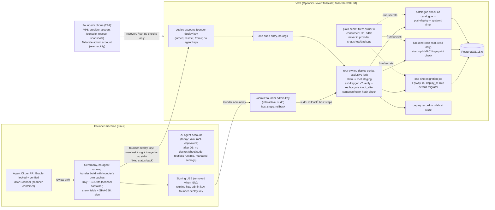

# ADR-0009: Deploy and build tooling — the deploy agent never sees a secret

## Status

Accepted

> **Who may move this to `Accepted`: the user, or `cto` on the user's explicit
> confirmation. No other agent, and no skill on its own.**
> Why this is stated here: stories referencing a `Proposed` ADR are set `Blocked`,
> and epics require `Accepted`, so the field needs a named owner. `cto` is the
> role `coordination-rules.md` escalates technical conflicts to, and an ADR is
> that decision made durable.
>
> This does **not** relax the rule that `Status: Accepted` is never set without
> explicit user confirmation — it narrows *which agent* may set it once that
> confirmation exists. An agent that believes an ADR is ready says so and
> escalates; it does not edit this field.

**Acceptance blockers.** The one blocker named at authoring — the VPS's OpenSSH — is **closed on evidence**: spike S40v, run by the founder on the VPS on 2026-10-20, found OpenSSH 9.6p1 (Ubuntu `3ubuntu13.20`) with `ssh-keygen` from `openssh-client`, and `-Y verify` with a namespaced `allowed_signers` file accepted a valid signature and refused a tampered manifest, a wrong namespace, an unknown signer and an expired `valid-before` entry (research F421). The independent review of 2026-10-20 (`review-2026-10-20-adr-0009.md`, FAIL) named two further blockers, B1 (the founder's admin route) and B2 (image provenance); the founder decided both on 2026-10-20 (Decision 2, Decision 3). Its re-check of r2 (FAIL) named R1 (agent-written build code running beside the keys), R2 (provider-account route) and R3 (caches filled before the move); the founder decided all three on 2026-10-20 and this revision (r3) carries them with R4–R11. The re-check of r3 passed (PASS, 0 BLOCKER · 0 MAJOR · 4 MINOR, S1–S4 applied before acceptance). **Accepted by the founder, Kamel Mohamed, on 2026-10-20**, with the dated amendment notes on ADR-0001 § 1b, ADR-0007 § 2 and ADR-0008 item 10 in the same commit. Items the founder deferred with triggers are listed in the Ordering Note.

## Date

2026-10-20

## Last Verified

2026-10-20

## Decision Makers

- Kamel Mohamed, founder (user) — decided every area on 2026-10-20 (`docs/research/build-and-ops-tooling.md` § 5, D1–D6), and in this ADR's sessions: the signing-key path (FIDO2 end state; a TPM key only as an optional interim step after the agent-account move and spike S47, recorded as weaker); the amendment route for ADR-0001; and, after the independent review, B1 (OpenSSH admin route with keys on the USB, Tailscale SSH off for the VPS), B2 (the founder builds the release image in the ceremony), M3 (plain 0400 secret files now, KMS later, excluded from provider snapshots and backups) and M6 (open items deferred with triggers), plus the Claude Code account facts (§ 5); and, in the same fix round, **T2: the founder deploys in the release ceremony and the AI agent has no access to the VPS** (chosen over keeping the agent's forced-command key, T1, and a VPS pull model, T3, after a written comparison; Alternatives 1–2), with the ceremony-script rule (the AI writes the scripts; the founder reviews every change as a git diff before first use; the ceremony runs only the reviewed copy on the signing USB, whose SHA-256 the founder records off-machine); and, after the re-check of r2, R1 (split ceremony: the USB is absent while build code runs, Gradle in a throwaway container, hash and clean-session re-check before signing), R2 (the VPS provider account and the Tailscale admin account listed as founder routes, held on the phone with 2FA, never the workstation browser) and R3 (caches filled only after the account move; no release ceremony before it), plus the founder's confirmed host state (root login disabled, password authentication off, SSH keys over Tailscale only, 2FA on the provider and Tailscale accounts).
- Drafted by `/architecture-decision` in the research session; revised after the independent review (`docs/architecture/review-2026-10-20-adr-0009.md`, FAIL, 2 BLOCKER · 6 MAJOR · 12 MINOR). `researcher` (five parts) supplied the evidence.
- Stack validation: **NOT ASSESSED** — `project.yaml` sets no `stack.backend` or `deploy.target` yet (`/setup-stack` has not run), so no stack lead was resolved for the Deploy layer.
- CTO-ADR: **skipped — Lean mode.** CTO-STACK-RISK: **skipped — Lean mode.** A skipped gate is not a passed gate. The design choices this revision makes for the review's `cto`/`infra-engineer`/`postgres-specialist` items (M1, M2, M4, M5) were approved by the founder in the same pass and are to be checked in the re-review.

## Summary

Kodeebo deploys to one VPS through an AI agent running on the founder's machine, so the deploy path must keep every secret out of the agent's reach, and the backend needs pinned tools for migrations, image scanning and the SBOM before its first image ships (ADR-0006 Q6). This ADR turns tenant-isolation residual R-4 into a rule — the deploy agent never sees a secret — that holds on the VPS by construction: the founder builds, scans, signs and sends every release himself in a release ceremony run from reviewed scripts on the signing USB, the AI agent holds no VPS credential at all, and the VPS accepts a release only through the founder's forced-command deploy key, one sudo entry and one root-owned no-argument script that verifies the signed manifest with `ssh-keygen -Y verify` and a replay gate; it pins Flyway Community as a library for migrations and Trivy (in a locked-down container) plus OSV-Scanner and the CycloneDX Gradle plugin for scanning and SBOMs, and states that until the agent moves to its own unprivileged account the rule is procedural on the founder's machine.

## Stack Compatibility

| Field | Value |
|-------|-------|
| **Stack layer(s)** | Deploy; Data (PostgreSQL migrations); Ktor backend (migration job, start-up check) |
| **Domain** | Deploy; Security; Data |
| **Layer** | Foundation |
| **Knowledge Risk** | HIGH — Docker Engine 29.9 / Compose 5.6, PostgreSQL 18.6, Flyway 13.10.3, Trivy 0.76.0, OpenSSH 9.6p1/10.6p1 and Claude Code's managed settings are past what the model reliably knows; every fact used here was fetched or executed for the research note |
| **References Consulted** | `docs/research/build-and-ops-tooling.md` (parts 1–5, F101–F531, evidence `docs/research/evidence/build-and-ops-tooling/`); `docs/stack-reference/docker-compose/{VERSION,best-practices,breaking-changes}.md` (Last verified 2026-10-11); `docs/stack-reference/postgres/VERSION.md` (2026-10-11); `docs/stack-reference/tooling/VERSION.md` (2026-10-16); `docs/stack-reference/pins.yaml`; `.claude/rules/deploy.md`, `.claude/rules/migrations.md`; `.claude/docs/security-baseline.md`; `docs/registry/architecture.yaml`; `docs/architecture/review-2026-10-20-adr-0009.md` |
| **Pinned versions relied on** | Docker Engine 29.9.0, Compose 5.6.0 (`pins.yaml` docker-compose.*; founder machine observed 29.9.1); `postgres:18.6`; Kotlin 2.4.21, Gradle "9.7" (resolvable 9.7.0, bt-F108), JVM toolchain 21; osv_scanner 2.6.0; gitleaks 8.30.1. **Proposed, not yet in `pins.yaml`** (no stack-reference layer exists for them; the user applies the pins after a `docs/stack-reference/` section is written): Flyway Community 13.10.3 (`flyway-core`, `flyway-database-postgresql`), pgjdbc 42.7.14, Trivy 0.76.0 (tarball SHA-256 `e24b1c51293c1b15e4ba8d45bbc7891ba053f90278ec2698f3562c993e145fe7`), CycloneDX Gradle plugin 3.5.1. Observed, not pinned: OpenSSH 9.6p1 on the VPS (F421), 10.6p1 on the founder machine (F401). Not pinned: nginx, sudo, Tailscale, Claude Code |
| **Post-Cutoff APIs Used** | Flyway `flyway.postgresql.transactional.lock` (F107, F119); PostgreSQL `ALTER ROLE … SET role` as a per-role default (F519, observed; documented only in general terms, F521); Trivy flags `--pkg-types os --scanners vuln --skip-db-update --skip-java-db-update --offline-scan --cache-backend memory --download-db-only` (F505, F526–F528); Compose `file:` secrets keep host owner and mode (F312); `ssh-keygen -Y sign/verify` with `namespaces=`/`valid-before` (F403, F410, F421); Claude Code managed settings at `/etc/claude-code/managed-settings.json` with an `env` key, and the telemetry variables (F313, F422–F424) |
| **Verification Required** | (1) S52 re-run on every Flyway or pgjdbc bump; S57 (privileged procedure through Flyway). (2) S23: CycloneDX plugin 3.5.1 on Gradle 9.7.0. (3) The real Ktor image and nginx under the hardening baseline (S31 used a stand-in JVM). (4) S33 on the VPS's sudo and OpenSSH: forced command with `restrict`, the stdin channel, the lock, `nologin`, a *future* `valid-before` accepted, the confirmed sshd state (root login disabled, password authentication off), the tailnet ACL. (5) S45 before FIDO2 keys are relied on; S47 before any TPM key. (6) S46 (ceremony script) and S48 (clean-session check) before the first signature. (7) S58: `catalogue_rt` needs no grant beyond default catalogue access. (8) Docker Engine on the VPS against the October 2026 `moby/moby` advisories (first-deploy checklist, Decision 6) |

> If Knowledge Risk is MEDIUM or HIGH, re-validate this ADR whenever a pin in
> `pins.yaml` changes. Mark it "Superseded" and write a new ADR if it no longer holds.

Critical ADR: yes — deployment topology and the custody of every production secret; Foundation layer.

## ADR Dependencies

| Field | Value |
|-------|-------|
| **Depends On** | ADR-0001 (Accepted; role inventory, privileged migrations; **amended by this ADR on acceptance**: § 1b `deploy_rt` credential location and role default, new role `catalogue_rt`), ADR-0004 (Accepted; bootstrap superuser custody, § 9), ADR-0005 (Accepted; 30-day backup window, Decision 6 — used by the gate-state restore rule, Decision 2), ADR-0006 (Accepted; Ktor track, heap rule; this ADR closes its Q6), ADR-0007 and ADR-0008 (Accepted; the server keys, their escrow and the KMS move; **amended on acceptance**: the at-rest form of the server secret file, Decision 3a) |
| **Enables** | The first deploy story; the migration-job story; the CI scan and SBOM story; the secrets-provisioning and start-up fingerprint story; the agent-account-move task; the first-deploy checklist; the release-ceremony runbook (`docs/runbooks/release-ceremony.md`), the admin-key, key-rotation, lost-USB, gate-state and privileged-migration runbooks; the threat-model amendments (Migration Plan step 3) |
| **Blocks** | Any production deploy; the first backend image shipping (ADR-0006 Ordering Note 4); the first migration story |
| **Ordering Note** | (1) Before acceptance: the re-check of this revision. (2) On acceptance, in the same commit: dated amendment notes on ADR-0001 § 1b, ADR-0007 § 2 and ADR-0008 item 10; the registry entries set to Accepted. (3) **Deferred by the founder (2026-10-20), with triggers:** (a) licences of OpenSSH, OSV-Scanner, pgjdbc and the CycloneDX Gradle plugin — a short `/research` fetch **before the first image ships**; (b) Claude Code account — recorded in § 5 (consumer Pro plan; the founder checks "Help improve Claude"); (c) image provenance — decided (Decision 3, step 2); (d) S46 and S48 — **before the first signature**. (4) Before the first image: the user applies the proposed pins with their stack-reference sections; S23 passes. (5) Before the first deploy: the agent-account move (Decision 5), and no release ceremony before it (Decision 4c); the founder's admin and deploy keys on the USB and Tailscale SSH off for the VPS (Decision 2); the first-deploy checklist including Decision 6; the signing USB and gate state initialised; the ceremony scripts reviewed by the founder as a git diff, copied to the USB, their SHA-256 recorded off-machine, and `docs/runbooks/release-ceremony.md` written; S33, S57 and S58 pass; the threat-model amendments. (6) At the first paying customer: two FIDO2 keys (after S45) and the ADR-0007 KMS move. |

## Context

### Problem Statement

Deploys run from the founder's machine over Tailscale through an AI agent (Claude Code) in CI. The agent reads repository, log and tool text that third parties can influence, so a prompt-injected agent is a realistic actor (SA T10.1–T10.8, TI T7.2, T7.11). Until now the only rule was residual R-4 in the tenant-isolation threat model: the agent never sees the deploy credential or any secret. A residual is an accepted risk, not a design. The research found it cannot hold by configuration alone: a fixed script stops the agent from *typing* a secret-reading command, but not from *shipping code* that then runs with the secret mounted (part 3 § 5 item 1); on today's machine the agent runs as the founder's own account, which is in the `docker` and `wheel` groups and is therefore root-equivalent (F402, F310); and the independent review showed two further routes around the VPS controls — the founder's own interactive admin login, held in the same account (B1), and an image the agent builds being the thing the founder signs (B2).

In parallel, ADR-0006 left Q6 open (no image scanner or SBOM generator pinned; no backend image ships before both run in CI), and no migration tool is chosen although ADR-0001 fixes a precise role model for migrations. Not deciding blocks the first image, the first migration and every deploy.

### Current State

- Nothing is deployed. One VPS (8 GB RAM, 2 vCPU, 240 GB SSD) runs Docker and nginx; PostgreSQL 18 runs on the same host, unpublished, reachable only over Tailscale; SSH over Tailscale only (TI A13, M49). The VPS runs OpenSSH 9.6p1 (F421).
- ADR-0001 § 1b: `migrator` NOLOGIN owns every object; `deploy_rt` LOGIN, member of `migrator` with SET, runs every non-privileged migration; privileged migrations stop the pipeline and run as the bootstrap superuser, by the founder, on the database host (local `peer` login, ADR-0004 § 9). ADR-0001 says the `deploy_rt` credential is "in the CI secret store". Its role inventory is closed.
- ADR-0007/0008 and SA M26: the pepper, verifier master key, TOTP key and throttle-HMAC key live in "the encrypted server secret file", "root-owned 0400" as a Docker secret now, an AWS KMS envelope at the first paying customer; offline escrow on an encrypted USB apart from Bitwarden; the backend refuses to start when a key's fingerprint differs from an off-host record. `security-baseline.md` asks for at-rest encryption of secrets.
- Spike S30 showed that a Compose `file:` secret keeps the host file's owner and mode inside the container: a non-root backend cannot read a root-owned 0400 file (F311, F312). SA M26 and TI M65 (non-root backend) cannot both hold as written.
- The founder reaches the VPS for administration over SSH through Tailscale from the same account the agent runs in (TI A13, M49; F402).
- The founder uses Claude Code on a consumer **Claude Pro** plan (founder, 2026-10-20). Three telemetry switches are set at user scope today (Decision 5).
- `pins.yaml` pins gitleaks 8.30.1 and osv_scanner 2.6.0, and nothing for migrations, image scanning or signing. `docs/ROADMAP.md` does not exist; L1–L4 and T1 are read from `pins.yaml` comments and `.claude/rules/deploy.md` (they concern the self-hosted bundle; this product is hosted only).

### Constraints

- Technical: Ktor/Kotlin on JVM 21, Gradle with dependency locking and verification (ADR-0006); PostgreSQL 18.6; Docker Engine 29.9 / Compose 5.6; the ADR-0001 role model and its privileged-migration rule.
- Operational: hosted only; one solo founder-operator, a second Kotlin engineer works rarely; the agent runs on the founder's workstation; the sync spike is running phase 4 on a VM under the founder's account and must not be disrupted.
- Budget: zero tooling budget, free and open-source tools only (founder rule).
- Bandwidth: the founder's bandwidth is limited and paid; downloads over 100 MB need approval; recurring downloads need a stated cadence.
- Legal: counsel questions closed by the founder (2026-10-18); tool and data licences are stated as found.

### Requirements

- The agent never reads, receives or causes to be printed any secret: database credentials, the server keys, the signing key, the founder's admin and deploy keys.
- Only reviewed, committed migrations run in production; privileged migrations never run in the pipeline.
- Every shipped image is built by the founder, scanned and given a CycloneDX SBOM before it ships; scanning never runs on the VPS.
- A release the founder did not build and sign cannot be deployed, including a replay of an old signed release.
- A deploy is zero-downtime (start new, health, switch, stop old) and the previous application can be restored; schema changes are forward-only.
- The backend refuses to start with a substituted key and never leaks a key or a usable oracle.
- Every deploy action is attributed and recorded off-host (with T2 every deploy is the founder's: the founder deploy key is the only deploy entry).
- Non-functional: no new load on the VPS beyond the application; recurring scanner downloads bounded and stated.

Research note: `docs/research/build-and-ops-tooling.md` (Status Draft, verdict COMPLETE WITH GAPS; decisions D1–D6 in § 5; F421–F424 added after the review).

## Decision

> **Amendment 2026-10-20 (threat-model amendment review, `threat-models/review-2026-10-20-adr-0009-amendment.md`, finding 3) — founder decision (Kamel Mohamed) 2026-10-20; in effect.** **No admin-key host step runs before the agent-account move.** The Migration Plan order becomes 1, 2, 3, 4, **7** (agent-account move), **5** (VPS host set-up over the admin key), **6** (bootstrap roles script, S57, S58), 8, 9. Before the move, then, none of the signing, deploy or admin keys is used on the founder machine, and no server key exists to escrow. Every host-step session after the move starts with the clean-session check (S48 passes before the first one). The step texts and the decision text are not edited otherwise.
>
> **Amendment 2026-10-20 (same review, findings 1 and 2) — approved by the founder (Kamel Mohamed) 2026-10-20 as proposed; in effect.** Containment of the ceremony build (§ 3 step 2, Decision 4c step 2):
> - **A dedicated build account** (not the founder's, not the agent's) runs the ceremony build and the scanners on a **rootless Docker** runtime. The founder account's rootful daemon is not used in the ceremony, and an escape from a build container lands as that unprivileged account, not root. The Gradle and Docker caches belong to this account, never to the agent, and are filled only after the move. Spike **S59** checks that an image built and saved under rootless Docker loads on the VPS's Docker with the digest the manifest names.
> - **The Gradle container gets the scanner flags** (non-root `--user`, `--cap-drop ALL`, `no-new-privileges`, read-only root, bounded `/tmp` tmpfs, default seccomp, pids, memory and CPU limits).
> - **Step 2 splits in two.** (2a) **Fetch**, network on: Gradle resolves and downloads dependencies under strict verification into the dependency cache, and only `caches/modules-2` persists; base images are pulled by digest from the official repository, and the founder checks the shown tag→digest. (2b) **Build**, `--network none`: Gradle runs `--offline` with the dependency cache mounted read-only, a fresh `GRADLE_USER_HOME` on tmpfs (so no `init.d` and no user `gradle.properties`), no `--init-script`, and the build cache and configuration cache off. The image build also runs with `--network none` from the pinned base; the Dockerfile copies the built artifacts and installs no packages.
> - **Whether Gradle re-verifies cached artifacts** against `verification-metadata.xml` on every offline build is NOT SOURCEABLE today. S59 plants a modified JAR in the cache, and the build must fail. If it does not, the dependency cache is fresh per release instead, and the per-release download is measured.
> - **A reboot before step 4 is required** (no longer optional). It ends every process steps 2–3 started, so the clean-session check only has to find persistence. The check covers the build account too (processes, user units, timers, lingering, cron, autostart) and lists system units and timers. A reboot does not undo an escape that reached root and persisted; that is why the build runs rootless, and why the founder machine's container engine passes the same Decision 6 advisory check as the VPS.
> - New validation criteria: the build container runs non-root with no capabilities; step 2b has no network; a ceremony build ignores an init script planted in the cache; a JAR changed in the cache fails the build (S59); step 2 refuses to start while the USB block device is present.

### 1. The rule (turns TI R-4 into an ADR rule)

**The deploy agent never sees a secret.** No secret value — database credentials, the server keys of ADR-0007/0008, the manifest signing key, the founder's admin and deploy keys — is ever present in anything the agent can read: its environment, its files, its tool output, its transcript, the repository or a CI log. **Anything the agent reads goes to Anthropic.** Claude Code sends "all user prompts and model outputs" for inference, and the conversation it sends includes code (F422). So the working rule is that every repository file, log line or tool output the agent reads leaves the machine.

**On the VPS the rule holds by construction: the AI agent has no access to the VPS at all** (founder, 2026-10-20, option T2). The VPS holds no agent key, no agent account and no agent sudo entry. The founder builds, scans, signs and sends every release himself in the release ceremony (Decision 3), so the agent never touches a release, a deploy entry or a host file. There is nothing on the VPS for the agent to read and no path for it to send anything there, **provided the two founder-held accounts outside SSH — the VPS provider account and the Tailscale admin account — are held as in Decision 2**, because each is a route to the VPS that bypasses `authorized_keys` (review R2).

**On the founder's machine, until the agent moves to its own account (Decision 5), the rule is procedural.** The agent today runs as the founder's account, which is in `docker` and `wheel` and is therefore root-equivalent (F402, F310): nothing on that machine is out of its reach except a key that is not plugged in. What keeps the founder's keys out of its reach is custody and procedure: the keys live only on the signing USB, the ceremony runs with no agent session running, the ceremony runs only reviewed scripts from the USB whose hash the founder checks against a value recorded off-machine, and **agent-written build code never runs while the USB is present** (Decision 4c). After the move the account boundary makes the founder-machine side hard as well. The VPS side does not depend on the move, provided the provider and Tailscale admin accounts are never used from the workstation (Decision 2). **No release ceremony runs before the move** (Decision 4c), so the founder's build caches are never written while the agent shares the founder's account (review R3).

**What remains trusted after all of this is the founder's own review** of each commit — in particular build files (Gradle scripts and plugins, `verification-metadata.xml`, the Dockerfile) and dependency updates — because the ceremony runs that agent-written build code, isolated from the keys but as the founder's build (review R1).

**The agent's remaining roles are writing code and scripts and running CI for review.** It writes the ceremony scripts too, which is why every script change is reviewed by the founder as a git diff and only the reviewed copy on the USB is ever run (Decision 4c).

### 2. Host enforcement on the VPS

- **Two keys, both the founder's, no agent key.** The VPS's `authorized_keys` holds exactly:
  - **the founder deploy key**, `command="<wrapper>",restrict,from="<the founder machine's tailnet address>"` (F309), on a dedicated VPS account (`deploy`) with no other login. `restrict` removes port, agent and X11 forwarding, PTY and `~/.ssh/rc`. The wrapper **ignores `SSH_ORIGINAL_COMMAND`** and runs the deploy script only. `from=` cannot tell OS accounts on the founder machine apart, so it narrows the source host, not the person; key custody is what keeps the agent out;
  - **the founder admin key**, an interactive login on a named VPS admin account (`kadmin`, the founder's only interactive account, a member of the sudo group: in effect root) for founder-run host steps, including `rollback`.
  Both are **held like the signing key** (Decision 4c): passphrase-encrypted on the signing USB now, FIDO2 `ed25519-sk` with touch at the first paying customer, **never loaded in an ssh-agent while an agent session runs**, used only inside the release ceremony or a founder host-step session. **Every host-step session starts with the same clean-session check as the ceremony, run from the USB** (S48; review R7). **The VPS has no key, account, sudo entry or file that belongs to the agent** (founder, 2026-10-20, T2).
- **Founder-held routes outside SSH (review R2; founder, 2026-10-20).** Two accounts reach the VPS without `authorized_keys` and are listed as founder routes:
  - **the VPS provider account** (control panel: console, rescue boot, password reset, snapshots — root on the VPS; which of these the provider offers is NOT SOURCEABLE here and is checked at host set-up). It is the **lost-USB recovery route** and is used only for recovery and for host set-up checks (for example that snapshots and backups exclude the secret files, Decision 3a);
  - **the Tailscale admin account** (the account used to sign in to Tailscale: tailnet membership, device approval, ACLs). It gives **network reachability only**: Tailscale SSH is off and an SSH key is still required, but a change there can add devices or widen the ACL.
  Custody of both: **2FA enabled, with the second factor on the founder's phone; used only from the phone, never logged in from the workstation browser** (the machine the agent runs on); their credentials in the Bitwarden app on the phone, never the workstation browser extension.
- **Founder state confirmed 2026-10-20:** on the VPS, root login is disabled, password authentication is off, and SSH keys are accepted over Tailscale only; 2FA is enabled on the VPS provider account and on the account used to sign in to Tailscale. (Founder statement; the sshd settings are re-checked in S33.)
- **Why the deploy entry stays a forced command although only the founder uses it:** the fixed script with its checks is the only way a release reaches the running system, so a mistake or a compromised founder machine still cannot push an unsigned, replayed or unreviewed release; host steps that need more go through the admin key, deliberately and rarely.
- **Admin transport: OpenSSH over the tailnet only. The Tailscale SSH feature is off for the VPS** (founder, 2026-10-20): it does not go through `authorized_keys`, so `restrict` and `from=` would not apply (review B1). A tailnet ACL limits the VPS's SSH port to the founder machine (requirement; ACL syntax NOT SOURCEABLE in the research, to be checked in S33).
- **One sudo entry.** The wrapper runs exactly one `sudo` command: one root-owned deploy script, with `NOPASSWD` and the empty-argument form `""` so no argument is accepted, `env_reset` on, `secure_path` set, no `ALL`, no `SETENV`, no wildcard (F307, F308). The script and every directory on its path are root-owned and not writable by the `deploy` account. The `deploy` account has no shell beyond the forced command (whether sshd runs a forced command through the account's login shell — which decides whether `nologin` can be the shell — is verified in S33), is not in the `docker` group and has no read access to any secret file.
- **Input channel: a bounded stream on stdin.** The forced command accepts no arguments; the ceremony sends the release on stdin as one fixed-format, length-prefixed stream of exactly three parts — `manifest`, `manifest.sig`, `image.tar` — with a size cap per part. The root script reads the stream itself into a fresh root-owned staging directory (regular files it creates, so no symlinks), refuses anything over a cap or out of format, and then works only on that copy: it verifies, hashes and `docker load`s the staged files, so nothing agent-written is read in place. No archive is extracted as root. The script holds an exclusive lock for the whole run; a second invocation is refused (`busy`).
- **The deploy script is updated only by the founder, on the host, over the admin key.** So are `allowed_signers`, the gate state, the secret files, the **Compose file and the nginx configuration**. The pipeline never writes any of them; otherwise the agent could rewrite its own boundary or remount a secret into another service (review M2). The manifest carries `compose_sha256` and `nginx_conf_sha256`; the script refuses a release whose values differ from the host files (`config_mismatch`), so a founder edit and a release cannot drift apart silently. **The image reaches the Compose file through a variable:** the Compose file names the backend image as `${KODEEBO_IMAGE}`, and the deploy script sets that variable from the verified manifest's `image_digest` for the run (not a secret), so a release needs no Compose edit and the Compose hash stays stable across releases (review R6).
- **A founder-signed release manifest gates everything.** Before any other step the script verifies the staged manifest with `ssh-keygen -Y verify -n kodeebo-release-manifest-v1 -I founder-signing@kodeebo -f /etc/kodeebo/allowed_signers -s manifest.sig` (F403, F410; on the VPS's own OpenSSH, F421), and parses fields **only from the verified copy**. `-Y check-novalidate` never decides: it accepted an unauthorised signer in S40 (F410).
- **Replay gate.** The manifest carries `release=<N>`, `previous_manifest_sha256=<hex>` and `not_after=<UTC timestamp>`; the script accepts only `N = last_release + 1`, a previous hash equal to the SHA-256 of the last accepted manifest, and a `not_after` in the future; it refuses duplicate or malformed fields (F411). **The new state is written only when the run ends `ok`**, by rename, so a refused or failed run does not use up release N. The state files are root-owned, initialised by the founder and backed up off-host; a missing state refuses the deploy (`state_missing`), never re-accepts release 1. **After any restore of the VPS or of the gate state** (including an ADR-0005 restore inside its 30-day window), the founder re-initialises the state from the highest release in the off-host deploy record before the next deploy, so already-signed later manifests cannot be replayed. `not_after` is set by the ceremony from a configured validity (default in the ceremony configuration, not hardcoded) and relies on the VPS clock.
- **The deploy entry returns only one closed status vocabulary and an exit code** (Key Interfaces), never raw `docker`, `psql` or application output: the ceremony shows the founder that word, and nothing from the VPS flows back into any file or log the agent reads (tenant text can steer an agent, SA T10.3; whatever the agent reads goes to Anthropic, F422).

### 3. Release flow (in order)

1. **CI on the founder's machine (agent):** Gradle build and tests under locking and verification for every PR; OSV-Scanner 2.6.0 on `gradle.lockfile` per PR (Decision 4b). The agent's CI output is for review; it never becomes the release artifact.
2. **The founder builds and signs the release in the ceremony** (founder, 2026-10-20; Decision 4c), with no agent session running, in the split order of Decision 4c (the USB is absent while any build code runs): from the reviewed commit, the founder builds the application in a throwaway container and the image with the founder account's Docker, using **the founder account's own Gradle and Docker caches, never the agent's** (Gradle strict verification, base images pinned by digest); exports the image with `docker save`; runs the Trivy scan and image SBOM in the scanner container and the CycloneDX Gradle plugin for the application SBOM; records the image digest and SBOM hashes; then, with the USB re-inserted, signs the manifest. **Keeping separate caches costs a one-time dependency download into the founder's caches** (Gradle dependencies and base images), made **only after the agent-account move**; its size is **not yet measured** and is recorded here when first measured (PENDING — measure at the first post-move ceremony build). The manifest holds: `release`, `previous_manifest_sha256`, `not_after`, the reviewed `git_commit`, `image_digest`, `image_tarball_sha256`, the ordered `migrations`, the expected `key_fingerprint.<label>` values (step 6), `compose_sha256`, `nginx_conf_sha256`, `sbom_app_sha256`, `sbom_image_sha256` and a `scan` summary (tool version, DB manifest digest, counts by severity).
3. **The founder sends the release in the same ceremony** (founder, 2026-10-20, T2): the ceremony script streams the three parts on the founder deploy key's stdin over Tailscale (Decision 2) and shows the returned status word. The agent never builds, transfers or deploys a release and holds no VPS credential.
4. **The root script verifies** signature, replay gate and `not_after`, checks `compose_sha256`/`nginx_conf_sha256` against the host files, checks the staged tarball's SHA-256 against the manifest, `docker load`s the staged copy and checks the loaded image digest. No registry and no registry credential exist on the VPS.
5. **Migrations** (Decision 4a) run as a one-shot container before the new version starts. The script first lists pending versions; if any pending version is on the committed privileged list, it stops with `privileged_migration_pending` and the founder runs the privileged procedure (Decision 4a). A pending migration id that is not in the signed manifest stops the deploy with `unreviewed_migration`.
6. **Start new beside old.** The new backend starts with its secret files mounted (Decision 3a). The script writes the expected fingerprints from the verified manifest to **one file per release**, `/etc/kodeebo/releases/<N>/expected-fingerprints` (root-owned, mode 0444), mounted read-only into that release's backend only; the old version keeps reading its own release's file, and a rollback mounts the previous release's file (review R5). It is written only by the deploy script from a verified manifest, never an environment value and never agent-writable. At start-up the backend computes `HMAC-SHA-256(key, fixed label)` per key — the label a fixed ASCII string per key and purpose including the key id — and compares a truncated value with the expected one. It logs only the key label and `ok|mismatch|missing`, never the computed value, and exits non-zero on any mismatch; `restart: on-failure` with a bounded count. The HMAC is a design preference over a bare hash (domain separation); it rests on the product's own reasoning, not on an OWASP pattern (F323).
7. **Health gate, switch, stop old** (`.claude/rules/deploy.md`). A health failure before the switch rolls back automatically (nothing was switched).
8. **Post-deploy catalogue check** (TI M50) run by the root script as **`catalogue_rt`** (Decision 4a); its result is written by the script itself; a failure is `catalogue_check_failed` and alerts. The **scheduled** M50 check runs from a root-owned systemd timer on the VPS as the same role.
9. **Deploy record** (deploy id, actor, timestamps, previous and new digests, compose and nginx hashes, manifest hash and signature result, migration ids, check results, final status) is appended to an off-host store the VPS cannot rewrite; the location follows the storage ADR (TI M51). Only then is the gate state written. **If the append fails after the switch**, release N is live but the gate still says N−1: the run ends `record_failed` (in the closed vocabulary), and the founder recovers by re-sending the same signed manifest N once the off-host store is reachable — the script sees the running digest already equal to `image_digest`, appends the record and writes the gate state, without a second switch (review R9). If the store stays down until manifest N's `not_after` has passed, the re-send ends `manifest_expired`; the founder then signs, in a ceremony sign step, a fresh manifest N with the same fields and a new `not_after`, still chained to N−1 (review S2).

**Rollback.** A second no-argument script (`rollback`) re-activates the recorded previous release; it is reached **only from the founder admin login** (`sudo` on the admin account), never through the deploy key, whose wrapper runs the deploy script only (review R4). Automatic only for a health failure before the switch (inside the deploy run); after the switch the founder decides and runs it. Rollback restores the previous **application**, never the schema: every release's migrations must be expand-only so the previous version still runs (`.claude/rules/migrations.md`). Across a key rotation the old key stays accepted for the rotation's re-wrap window (ADR-0007), so a rollback inside that window passes the fingerprint check; outside it, rollback needs a new signed manifest.

### 3a. Secrets on the VPS

- **Every secret is a plain host file outside the repository, owned by the UID of the one container that consumes it, mode 0400**, mounted as a Compose `file:` secret at `/run/secrets/<name>` (F311, F312). This **amends SA M26** ("root-owned 0400"), which a non-root container cannot read.
- **At-rest form (founder, 2026-10-20): plain files now; at-rest encryption comes only from the AWS KMS envelope at the first paying customer** (ADR-0007). Encrypting the file on the host would need its decryption key on the same host and adds nothing against root on the VPS (research part 3 § 5 item 3). **This amends ADR-0007 § 2 and ADR-0008 item 10**, which say "the encrypted server secret file": on acceptance, dated amendment notes record the plain-file form until the KMS move, and the ASVS 13.3.1 deviation those ADRs accept is restated for a plain file until then. It is a recorded deviation from `security-baseline.md`'s at-rest encryption line until the KMS move. Whether the VPS disk or volume is encrypted is NOT SOURCEABLE in the repository and is not claimed.
- **The secret files are excluded from any VPS-provider snapshot or backup** (founder, 2026-10-20): provider-level disk snapshots and provider backups are off for the VPS, or the secret files live on a volume the provider never snapshots; ADR-0005's backups (`backup_rt`, physical PostgreSQL) never include them. Recovery of the keys is the offline escrow USB, never a backup. Which snapshot options the provider offers is NOT SOURCEABLE here and is checked in the host set-up.
- The server keys of ADR-0007/0008 are owned by the backend's UID. The `deploy_rt` credential is owned by the migration job's UID; the `catalogue_rt` credential by the check container's UID. **The backend, the migration job and the check container run under three distinct Compose `user:` UIDs** although two share the backend image (review m6). The root deploy script mounts each credential only into its one container. No credential passes through the agent, an environment variable, a log or a CI transcript. **This amends ADR-0001 § 1b** ("credential in the CI secret store") — applied as a dated amendment note on ADR-0001 when this ADR is accepted.
- **Never** an env file or `environment:` value for a secret: `docker inspect` and `/proc/<pid>/environ` print environment values (F312); OWASP says environment variables may land in logs or dumps (F323).
- Escrow and rotation stay as in ADR-0007/0008 and SA M26: offline encrypted escrow USB apart from Bitwarden; the KMS envelope at the first paying customer. A rotation is a signed manifest that carries the new expected fingerprint (old and new accepted during the re-wrap window, key id as in ADR-0007).

### 3b. Container hardening baseline

Every service: non-root `user:`, `read_only: true`, a bounded `/tmp` tmpfs (`noexec,nosuid,nodev`), `cap_drop: [ALL]`, `security_opt: [no-new-privileges:true]`, the default seccomp profile kept, `mem_limit`, `cpus`, `pids_limit`, `healthcheck`, `restart`, `init`, explicit networks; only nginx publishes ports (F302, F318, F319). Heap sizing follows ADR-0006: an explicit `-Xmx` or `MaxRAMPercentage` from S18 and a Compose memory limit (registry FP-JVM-DEFAULT-HEAP-R2); S31's "about half the limit" is one 256 MB observation, not a rule (F319). Heap and core dumps off for the backend (SA M26). Spike S31 showed a JVM runs under these flags with only a `/tmp` tmpfs; JFR to `/tmp` needs that tmpfs (F319). The real Ktor app and nginx are re-run under the same flags in their own stories. Rootless Docker or userns-remap **on the VPS** are not adopted now (costs NOT SOURCEABLE, F318, F310).

### 4a. Migrations (D1)

- **Flyway Community 13.10.3 as a library** (`flyway-core` + `flyway-database-postgresql`, pgjdbc 42.7.14) called from a small `main()` in the backend build, run as a one-shot container from the backend image (+4.76 MB of jars, F116; the Flyway CLI would be 324–386 MB, F101). File names follow Flyway's convention `V<n>__<verb>_<object>.sql` (`.claude/rules/migrations.md` "or the tool's convention per ADR"). Development "down" files are `U<n>__<verb>_<object>.sql` beside each V file, run only by a development script — Flyway Community does not execute them (F105) and `migration-lint.sh` expects them (F125); S16 must show that inert U files do not break `validate` in Community, else the dev "down" moves to a separate directory.
- **Role setup B4:** `ALTER ROLE deploy_rt SET role = 'migrator'` in the founder-run bootstrap roles script, beside ADR-0001's `GRANT migrator TO deploy_rt WITH INHERIT FALSE, SET TRUE` (F519). It needs no Flyway or driver setting, survives the removal of the deprecated `initSql` (F515), and if lost the job fails with SQLSTATE 42501 instead of running as the wrong role (F517). It is a role change, so it is privileged (registry forbidden pattern: a role-altering migration run as `deploy_rt`).
- **The bootstrap roles script runs outside Flyway** (review M5): the founder runs it once as the bootstrap superuser through the local `peer` login inside the PostgreSQL container (ADR-0004 § 9). It creates the ADR-0001 roles, `catalogue_rt`, and the `deploy_rt` role default. The **first `deploy_rt` run then creates the Flyway history table as `migrator`**, so C5 ("`migrator` owns every table") holds from the start.
- **Privileged versions are applied by one named procedure** that writes the history row with a matching checksum (review M5): the founder runs the migration job as the bootstrap superuser through the PostgreSQL container's socket with `target=<that version>`, so Flyway records the version (`installed_by` = the superuser, F121) and the next `deploy_rt` run reports it up to date. Inside a privileged migration, every non-role object ends owned by `migrator` or by its C5 definer owner (explicit `OWNER TO`); C5 checks it after the run. The socket-sharing mechanics are verified in **spike S57** (an extension of S52) before the first privileged migration; until S57 passes no privileged version is written.
- **Privileged list:** a committed file `privileged-migrations.txt` beside the migrations, one version per line; CI fails when a migration creates or alters a role, or creates, replaces or re-owns a function of **any role C5 allows as a definer owner (today `auth_lookup`, `support_fn`, `audit_writer`, `pin_writer`)**, and its version is not on the list (review m1; ADR-0001 amendment 2026-10-20).
- **`catalogue_rt`** (new role, amends ADR-0001's inventory on acceptance; review M4): LOGIN, NOSUPERUSER, NOBYPASSRLS, owns nothing, no table grants, reading only the system catalogue views the C1–C8 queries need; it runs the post-deploy and the scheduled M50 catalogue checks. `deploy_rt` cannot do it, because B4 makes every `deploy_rt` session `migrator`, the owner of every table (F519). **Spike S58** confirms that the C1–C8 queries need no grant beyond default catalogue access before the first deploy.
- Conditions: `flyway.postgresql.transactional.lock=false` always, with a CI test applying a `CREATE INDEX CONCURRENTLY` migration (the default lock self-deadlocks, F119); exact pins under Gradle locking and verification; **S52 becomes a CI test** re-run on every Flyway or pgjdbc bump (history table owned by `migrator`, `installed_by = migrator`, a privileged `CREATE ROLE` fails 42501 and rolls back; F515–F519), because both B3 and B4 rest on observed, undocumented Flyway behaviour (F516); `validate` runs before `migrate` and a checksum mismatch stops the deploy (`checksum_mismatch`, F120); `repair` is a founder-only action; the job logs `session_user`, `current_user` and the run identity (`installed_by` shows `migrator`, F117).

### 4b. Scanning and SBOM (D2)

- **Lockfile per PR:** OSV-Scanner 2.6.0 on `gradle.lockfile`. It also runs only in the locked-down scanner container type, as its own step: input the lockfile, read-only; network on for that step only, because its vulnerability lookup needs it; no home, SSH, Bitwarden, Tailscale or Docker socket (review m9).
- **Image:** **Trivy 0.76.0, scope OS packages only** (`--pkg-types os`); the application's JARs are covered by OSV-Scanner and the Gradle plugin. Install from the release tarball checked against the release checksums file by SHA-256 (F503); never `curl | sh`, never a Docker Hub tag, never `trivy-action`. The sigstore bundle is not verified (cosign out of scope, founder 2026-10-20).
- **Scanner condition (founder, 2026-10-20).** Scanners run **on the founder's machine only, inside a locked-down container** with **no access to the home directory, SSH keys, Bitwarden, Tailscale or the Docker socket**; their **input is read-only** (the image tarball, the lockfile or an SBOM); they have **network only in the step that needs it** (the trivy-db update; the OSV-Scanner lookup) and the Trivy scan step has none. **Reason: the 2026-03-19 Trivy release compromise** (GHSA-69fq-xp46-6x23; F207, F208), in which mutable tags and installers ran attacker code with everything the CI could reach. Tested configuration (F505, F526–F528), exact commands:
  - flags for every step: `--pull=never --rm --read-only --cap-drop ALL --security-opt no-new-privileges --user 65534:65534` with pids, memory and CPU limits, a bounded `/tmp` tmpfs (`rw,noexec,nosuid,nodev`), `HOME=/tmp`, the Trivy binary mounted read-only;
  - update step (network on, nothing else changed; cache mounted read-write): `trivy image --download-db-only --db-repository ghcr.io/aquasecurity/trivy-db:2 --skip-version-check --disable-telemetry`;
  - scan step (`--network none`; DB cache mounted read-only at `/cache`, `TRIVY_CACHE_DIR=/cache`; tarball read-only): `trivy image --input <tar> --cache-backend memory --pkg-types os --scanners vuln --skip-db-update --skip-java-db-update --offline-scan --skip-version-check --disable-telemetry`.
- **Database:** trivy-db only (`ghcr.io/aquasecurity/trivy-db:2`; the Java DB is not needed under OS-only scope, F528). **Refreshed once per release, never more than once a day.** 135,378,999 bytes per refresh (F526); at the assumed up to 4 releases a month about **541.5 MB a month**, worst case 4.06 GB a month at the daily cap; no incremental update exists (F531). The scan record keeps the DB manifest digest; `--db-repository` never points at a mirror we do not operate (F212). The first default source in 0.76.0 is a Google-run mirror (F505), so the update step names `ghcr.io/aquasecurity/trivy-db:2` explicitly.
- **Image-scan cadence:** the image is scanned **per release**, in the ceremony, because the shipped image is built only there (Decision 3, step 2). This is a recorded deviation from `security-baseline.md`'s per-PR container image scan; per-PR coverage is the lockfile scan.
- **Data licence — named, accepted gap.** The scanner and the Aqua repositories are Apache-2.0/MIT (F501, F509); GitHub Advisory data is CC-BY 4.0 (F524); Canonical's Ubuntu data is CC BY-SA 4.0 (F530). Aqua states no licence for the built database and the Ubuntu CVE Tracker repository carries none. **The founder accepted this for internal use only** (2026-10-20): the database is used on the founder's machine to scan Kodeebo's own images and is **never redistributed**. Any redistribution, hosting of scan results for others, or a scan service reopens it.
- **SBOMs per release:** the CycloneDX Gradle plugin 3.5.1 for the application (`runtimeClasspath`; S23 must pass on Gradle 9.7.0) and Trivy's CycloneDX image SBOM; both stored with the release, keyed by image digest and release number, hashes in the manifest. The two differ in spec version (1.7 Trivy, 1.6 plugin default, F507, F216) until one is aligned.
- **Gate:** CI fails on findings at or above a configured severity, with a reviewed ignore file; a scan that could not run is `not_run`, never a pass. OSV GO-2026-4919 is in the ignore file as a documented false positive for 0.76.0 (open-ended OSV range, F529).
- **Nothing scans on the VPS.** The VPS checks digests and the signed manifest only.

### 4c. Manifest signing custody (D4)

- **Now: its own encrypted USB**, separate from the server-key escrow USB and from Bitwarden. It also holds the founder admin and deploy keys (Decision 2). Runbook rules (founder, 2026-10-20): the key files are **encrypted with a passphrase the founder types by hand**; the ceremony (build, scan, sign) happens with **no AI agent session running** — checked, not assumed (processes, user units, timers, cron and autostart entries for the agent's and the founder's accounts; prefer a reboot or a text-console login; S48); the **USB is removed right after**. The ceremony script and the allowed public-key fingerprint live on the USB and run by absolute path with a clean environment; the ceremony **prints every manifest field and its SHA-256** before signing, because neither an ssh-agent confirmation nor a hardware touch shows the content (F404, F414). Never pass the passphrase as an argument or paste it. S46 (ceremony script) and S48 run **before the first signature**.
- **Ceremony order: agent-written code never runs while the USB is present** (review R1; founder, 2026-10-20). (1) **Prepare:** clean-session check; USB in; check the scripts' hash against the founder's off-machine value; copy the scripts to a root-owned, read-only location; **USB out**. (2) **Build and scan, USB absent:** Gradle in a throwaway container with only the source checkout and the founder's dedicated caches mounted (no home, no USB, no Docker socket; network on during this build step only, with no proxy or allowlist: nothing secret is reachable from the container, which sees only the checkout and the caches; review S1), then the image build with the founder account's Docker, `docker save`, the scanner container and the SBOMs. (3) **Record** the image digest and the SBOM hashes. (4) **Sign and send:** clean-session check again; USB in; **re-check the scripts' hash immediately before display and signing**; display every field and its SHA-256; sign; send; **USB out**. **No release ceremony runs before the agent-account move** (review R3), so the founder's caches and base images are populated only after it.
- **Ceremony scripts and runbook (founder, 2026-10-20).** The ceremony — clean-session checks, build, scan, SBOMs, manifest, signature, send — runs from scripts plus a runbook, `docs/runbooks/release-ceremony.md`, that gives every command, what it does, the expected output and what to do on failure. **The AI writes the scripts, so any change to a ceremony script is reviewed by the founder as a git diff before first use.** The ceremony runs **only the reviewed copy kept on the signing USB, never the copy in the agent-writable repository**. When the founder approves a diff and copies the scripts to the USB, he records their SHA-256 **off-machine — on paper or in the Bitwarden app on his phone, never in the Bitwarden browser extension on the workstation, since that is the machine the agent runs on**. The first step of every ceremony, itself on the USB, computes the hash of the USB copy and compares it with the value the founder types in; a mismatch stops the ceremony. The repository keeps the scripts and their review history, never the trusted hash.
- **Planned end state: two FIDO2 security keys (`ed25519-sk`), touch plus PIN (`verify-required`)**, for the signing, admin and founder deploy keys, triggered at the first paying customer, the same trigger as the KMS move. The key cannot be copied off the device and needs a physical touch per signature, so a root-equivalent agent cannot sign silently (F403, F404). **S45 (sk-key signing and `-Y verify`, including whether the verifier honours the presence flag) must pass first.** The ceremony display is still required: the device signs a hash only (F404).
- **Optional interim only: a TPM-backed signing key plus an offline backup key**, and only **after the agent-account move** and only **if spike S47 shows `ssh-keygen -Y sign` works with it**. It has **no documented presence check** (F418): any process that can reach the TPM agent can sign, so it is weaker than FIDO2; it dies with the board, hence the offline backup key.
- Rotation: add the new key's `allowed_signers` line (a founder-run host step over the admin key), deploy once, remove the old line; `valid-before` bounds a retiring key (F403, F410, F421; that a *future* `valid-before` is accepted on the VPS's 9.6p1 is not yet tested and is part of S33, review R9). Loss: enrol a new key through the provider account's console (the recovery route, Decision 2), never from the workstation browser.

### 5. The agent's account and Claude Code (D5)

- The agent moves to a **dedicated OS account with no `docker`, `wheel` or `sudo` membership**, as **its own task before the first deploy — not now**: the sync spike is running phase 4 on the VM under the founder's account and must not be disrupted. Conditions: the account gets a **rootless container runtime (rootless Docker or Podman) for Testcontainers and spikes, never the `docker` group**; **VM access for the sync spike goes through a non-root path**, to be designed in that task. Until the move, Decision 1's rule is procedural on this machine.
- **Claude Code account (founder, 2026-10-20): a consumer Claude Pro plan** — not Team, Enterprise or API. Anthropic retains consumer data for 30 days when "Help improve Claude" (model improvement) is off and 5 years when it is on (F422); **the founder checks that setting himself**. Local transcripts are kept in plaintext under `~/.claude/projects/` for 30 days by default (`cleanupPeriodDays`, F422).
- **Telemetry and reporting controls, from the official docs (F423):** `DISABLE_TELEMETRY` (usage metrics), `DISABLE_ERROR_REPORTING` (error reports, on by default for Pro and Max sign-ins from v2.1.198), `DISABLE_FEEDBACK_COMMAND` (`/feedback`, which with `/bug` and `/share` sends conversation history including code and is kept 5 years), `CLAUDE_CODE_DISABLE_NONESSENTIAL_TRAFFIC` (all non-essential traffic, including session surveys and the transcript-share follow-up) and `CLAUDE_CODE_DISABLE_FEEDBACK_SURVEY` (session surveys). **All five are turned off for the agent account.** Today three (`DISABLE_TELEMETRY`, `DISABLE_ERROR_REPORTING`, `CLAUDE_CODE_DISABLE_NONESSENTIAL_TRAFFIC`) are set at user scope in the founder account's `~/.claude/settings.json`, which the agent can edit, so they are **off but not enforced**; `DISABLE_FEEDBACK_COMMAND` is not set. **At the account move, all five go into the root-owned managed settings file `/etc/claude-code/managed-settings.json`** (`env` key), which no user, project or `--settings` value overrides (F424). The file must be root-owned **but readable by the agent account** (for example 0644): if the OS denies the read, sessions start without that policy (F424). The WebFetch hostname safety check is not covered by these variables and sends only hostnames (F423).
- The agent's Claude Code configuration is a soft layer delivered in the same managed settings: sandbox on, `allowUnsandboxedCommands: false`, `sandbox.failIfUnavailable: true`, `denyRead` and deny rules for secret paths (F313–F316); a Bash deny rule "isn't a security boundary" (F314).

### 6. Docker Engine advisories (D6)

Whether the VPS Docker Engine includes the fixes for the October 2026 `moby/moby` advisories (GHSA-7cfq-22r6-qp73 and the rest of F324) **does not block this ADR**; it is a **must-pass item in the first-deploy checklist**.

### Architecture



Trust boundaries: agent ↔ VPS does not exist — the agent holds no VPS credential (T2); founder ↔ VPS is the founder deploy key (forced command, stdin channel, signature) and the admin key, both held on the USB, plus the provider and Tailscale admin accounts, held on the phone with 2FA and never used from the workstation; ceremony scripts ↔ ceremony is the founder's git-diff review plus the USB copy's hash checked against an off-machine value, twice per ceremony; build code ↔ keys is the USB's absence while any build code runs and the throwaway build container; agent ↔ secrets is file ownership on the VPS and, on the founder machine, the unplugged USB (hard) and the account move (Decision 5; soft until then); build ↔ release is the ceremony build with the founder's own caches, filled only after the move.

### Key Interfaces

```text
Founder deploy entry (VPS): founder deploy key only; no arguments; stdin = one length-prefixed stream of exactly three parts
                            (manifest, manifest.sig, image.tar), per-part size caps
                            output: one status word + exit code
Agent entry:                none — the VPS holds no agent key, account or sudo entry (T2)
Rollback:                   founder admin login only (sudo rollback script, no arguments); re-activates the recorded previous release
Status vocabulary (closed; used by the wrapper, the registry and deploy_refused_total{reason}):
  ok, busy, args_present, input_format, input_too_large, state_missing,
  unsigned, bad_signature, namespace_mismatch, signer_unknown_or_expired,
  field_syntax, not_next_release, chain_mismatch, manifest_expired,
  config_mismatch, tarball_hash_mismatch, image_digest_mismatch,
  unreviewed_migration, privileged_migration_pending, checksum_mismatch, migration_failed,
  fingerprint_mismatch, health_failed, catalogue_check_failed, record_failed, rolled_back
Manifest (signed bytes, namespace kodeebo-release-manifest-v1), one field per line, each exactly once:
  release=<N>
  previous_manifest_sha256=<hex>
  not_after=<YYYY-MM-DDTHH:MM:SSZ>
  git_commit=<sha>
  image_digest=sha256:<hex>
  image_tarball_sha256=<hex>
  migrations=<id>,<id>,...
  key_fingerprint.<key_label>=<truncated HMAC hex>      (one line per server key)
  compose_sha256=<hex>   nginx_conf_sha256=<hex>
  sbom_app_sha256=<hex>  sbom_image_sha256=<hex>
  scan=trivy-0.76.0 db=<manifest digest> critical=<n> high=<n> medium=<n> low=<n>
allowed_signers (VPS, root-owned): founder-signing@kodeebo namespaces="kodeebo-release-manifest-v1" [valid-before="..."] <keytype> <key>
Gate state (VPS, root-owned, written by rename only on ok): last_release, last_manifest_sha256
Expected fingerprints (VPS): /etc/kodeebo/releases/<N>/expected-fingerprints, one per release, root-owned 0444,
                written only by the deploy script from a verified manifest, mounted read-only into that release's backend
Compose image reference: ${KODEEBO_IMAGE}, set by the deploy script from the verified image_digest (not a secret)
Founder routes outside SSH: VPS provider account (console, rescue, snapshots; recovery only) and Tailscale admin account
                (network reachability only); 2FA on the phone; never used from the workstation browser
Migration job:  one-shot container from the backend image, its own UID; secret /run/secrets/deploy_rt
                (owner = job UID, 0400); exit 0 ok | non-zero with a status word
Privileged procedure: migration job run by the founder as the bootstrap superuser through the
                PostgreSQL container's socket with target=<version> (S57)
Catalogue check: container as catalogue_rt, its own UID; secret /run/secrets/catalogue_rt; C1–C8; exit 0 | catalogue_check_failed
Start-up check (backend): FingerprintCheck.verify(expected: Map<KeyLabel, Hex>) -> Ok | Mismatch(label) | Missing(label)
                logs label + result only; exit non-zero on anything but Ok
Scanner steps (founder machine): see Decision 4b for the exact tested commands
Claude Code policy (founder machine, after the move): /etc/claude-code/managed-settings.json, root-owned, readable (0644),
                env: DISABLE_TELEMETRY=1, DISABLE_ERROR_REPORTING=1, DISABLE_FEEDBACK_COMMAND=1,
                     CLAUDE_CODE_DISABLE_NONESSENTIAL_TRAFFIC=1, CLAUDE_CODE_DISABLE_FEEDBACK_SURVEY=1
```

No HTTP contract in `contracts/` changes.

### Implementation Guidelines

Deploy (`deploy/hosted/`, host set-up runbook):
- The deploy script **must** read the release only from stdin into a fresh root-owned staging directory, hold an exclusive lock for the whole run, verify the signature, the replay gate and `not_after` before any other action, parse fields only from the verified copy, and write the gate state only on `ok`.
- The deploy script **must never** accept an argument, read `SSH_ORIGINAL_COMMAND`, read a client-sent file in place, extract an archive as root, call `-Y check-novalidate` to decide, or return raw tool output.
- The deploy and rollback scripts, the wrapper, `allowed_signers`, the gate state, the secret files, the Compose file and the nginx configuration **must** be root-owned, on root-owned paths, and changed only by a founder-run step over the admin key. The per-release expected-fingerprints files **must** be root-owned and written only by the deploy script from a verified manifest.
- The VPS provider account and the Tailscale admin account **must never** be signed in from the workstation; they are used only from the founder's phone, with 2FA.
- The VPS **must never** hold an SSH key, account, sudo entry or file that belongs to the AI agent. The `deploy` account **must never** be in the `docker` group, hold sudo beyond the one entry, have an interactive shell or read a secret file. The Tailscale SSH feature **must** be off for the VPS.
- The ceremony **must** run only the reviewed scripts from the signing USB after their hash matches the founder's off-machine value; it **must never** run a script from the repository.
- The founder admin and deploy keys **must never** be loaded in an ssh-agent while an agent session runs.
- Secrets **must** be Compose `file:` secrets owned by the consuming container's UID, mode 0400, on separate UIDs per consumer; **must never** be environment values, image layers, build args, repository files, log lines, or in a provider snapshot or backup.
- Every service **must** follow the hardening baseline (3b); databases **must never** publish host ports.
- Scripts **must never** run `docker compose down -v` or prune volumes (`.claude/rules/deploy.md`).

Migrations (`backend` migration module, `adapters` layer; SQL under the migrations directory):
- The migration job **must** run as `deploy_rt` with the role default set by the bootstrap roles script; it **must never** set the role through a Flyway callback or `initSql`.
- It **must** set `flyway.postgresql.transactional.lock=false`, run `validate` before `migrate`, stop on a pending privileged version, and log `session_user`, `current_user` and the run identity.
- A migration that creates or alters a role, or creates, replaces or re-owns a function of any C5 definer owner (today `auth_lookup`, `support_fn`, `audit_writer`, `pin_writer`), **must** be on `privileged-migrations.txt` and **must never** run in the pipeline (ADR-0001 § 1b); it is applied only by the privileged procedure.

Backend (`app` start-up composition root; `adapters` for key loading):
- The backend **must** run the fingerprint check before serving, reading expected values only from the read-only expected-fingerprints file, and exit non-zero on mismatch or missing; it **must never** log a key, a computed fingerprint or a comparison result beyond `ok|mismatch|missing`.
- The domain layer **must never** import key-loading or file-system code (`clean-architecture.md`).

Build, CI and scanning (founder machine, `tools/ci/`):
- The shipped image **must** be built by the founder in the ceremony from the reviewed commit, with the founder account's own Gradle and Docker caches, filled only after the agent-account move; it **must never** be an artifact the agent built.
- Build code (Gradle, plugins, tests, the Dockerfile) **must never** run while the signing USB is inserted or mounted; Gradle runs in a throwaway container with only the checkout and the founder's caches; the scripts' hash **must** be re-checked immediately before signing.
- Scanners **must** run only in the locked-down container (4b); the Trivy scan step **must** have no network; inputs **must** be mounted read-only.
- CI **must** map a scan that did not run to `not_run`, never pass; the agent **must** read only structured scan fields (IDs, severities, purls, counts), never advisory free text.
- The trivy-db refresh **must** run at most once per release and never more than once a day.

## Alternatives Considered

### Alternative 1: The AI agent transfers the signed release on its own forced-command key (T1)

- **Description**: the founder builds and signs in the ceremony as chosen, but the agent sends the three parts to the VPS on its own forced-command SSH key (`restrict`, `from=`, stdin, one sudo entry) from a dedicated `deploy-agent` account; the founder keeps separate deploy and admin keys. This was the first revision of this ADR.
- **Pros**: the agent can deliver a release the founder signed earlier without the founder being at the keyboard for the transfer.
- **Cons**: one more live credential, account and sudo entry, and the root script's input parser and staging become attack surface for a prompt-injected agent; agent and founder must be told apart by key custody because `from=` cannot separate OS accounts on one machine (F309); R-4 then rests on the VPS refusing what the agent sends rather than on the agent having no route. Since B2 the founder is present for build, scan and sign anyway, so the agent's transfer automates nothing.
- **Cost / Risk / Performance / Operability**: zero money; a standing agent foothold on the VPS; the same transfer time; more to set up, audit and attribute.
- **Estimated Effort**: more than T2 (an extra account, key and wrapper path).
- **Rejection Reason**: with the founder already running the ceremony for every release (B2), the agent key adds a credential and an attack surface and buys no automation; T2 makes R-4 hold on the VPS by construction (founder, 2026-10-20).

### Alternative 2: Pull model — the VPS fetches and verifies the signed release itself (T3)

- **Description**: a root-owned job on the VPS periodically fetches the manifest, signature and image from a source, verifies them with the same checks, and deploys (research option 1D).
- **Pros**: no inbound SSH deploy entry at all; the VPS decides when to look.
- **Cons**: the VPS needs a source it can read: either a registry or object store (a new credential on the host, the registry route rejected in Alternative 7) or a VPS→founder-machine connection over the tailnet (a new inbound path into the workstation the agent runs on); whoever publishes to the source writes input the VPS reads; scheduling adds delay; not executed or designed in the research.
- **Cost / Risk / Performance / Operability**: zero money for a tailnet pull, money for a hosted store; a new credential or a new path into the founder machine; deploy delayed to the next pull; more moving parts (pull job, source, credential, schedule).
- **Estimated Effort**: more than T2.
- **Rejection Reason**: it solves a problem T2 does not have — with the founder present in the ceremony a direct send needs no new credential and no new path into the workstation (founder, 2026-10-20).

### Alternative 3: Liquibase Community 5.0.4 for migrations

- **Description**: changelog-based migrations; Liquibase 5.x Community.
- **Pros**: mature, broad database support.
- **Cons**: 5.x is under FSL-1.1-ALv2, which the vendor itself calls source-available, not open source (F110); 5.x ships without drivers (F111); role, transaction and dollar-quote behaviour not assessed (F123); XML/YAML changelogs bypass `migration-lint.sh` (F125).
- **Cost / Risk / Performance / Operability**: free to run; licence risk against the founder's open-source-only rule; not measured; a changelog layer on top of SQL for a solo operator.
- **Estimated Effort**: higher than Flyway (changelog format, untested role model).
- **Rejection Reason**: fails the founder's open-source-only rule for the maintained line; 4.x is open source but has had no release since 5.0.

### Alternative 4: In-house versioned-SQL runner

- **Description**: Kotlin + JDBC runner applying `NNNN_name.up.sql` in order, with a checksum, a `-- privileged` header and its own advisory lock on a separate session.
- **Pros**: passes `migration-lint.sh` unchanged; records the real login; full control of the privileged stop (F125).
- **Cons**: every locking, ordering and failure-state bug is ours (F119 shows how easy the lock trap is).
- **Cost / Risk / Performance / Operability**: est. 1.5–3 days plus maintenance; correctness risk on a solo developer and a rarely present second engineer; fast; nothing external to patch except pgjdbc.
- **Estimated Effort**: 1.5–3 days more than Flyway, then ongoing.
- **Rejection Reason**: S52 found a role setup for Flyway that holds on evidence (B4), so the runner stays the named fallback if a Flyway bump breaks B4.

### Alternative 5: dbmate for migrations

- **Description**: dbmate v2.37.0 (Go binary), plain SQL with `-- migrate:up`/`-- migrate:down` in one file.
- **Pros**: off-the-shelf, small, plain SQL.
- **Cons**: keeps only the version, no checksum, so an edited applied migration goes unnoticed; no documented way to set a role; `migration-lint.sh` mis-parses its layout and would flag its down section (F124, F125); a second toolchain beside the JVM build.
- **Cost / Risk / Performance / Operability**: free; tamper and role risk; fast; a separate image to scan and patch.
- **Estimated Effort**: similar to Flyway, plus lint changes.
- **Rejection Reason**: no checksum and no role support for ADR-0001's model.

### Alternative 6: Grype + Syft, OSV-Scanner alone, or Trivy with JAR scanning (A1)

- **Description**: Syft for SBOMs and Grype for scanning; or OSV-Scanner's `scan image`; or Trivy with the Java DB so it also scans JARs.
- **Pros**: Grype + Syft has the cleaner advisory record in the lists searched (F210); OSV-Scanner is already pinned; A1 puts all scanning in one tool.
- **Cons**: Grype + Syft is two tools and two upgrade streams, its Gradle lockfile support is unsourced and it was never executed here (F218); OSV-Scanner was not shown to cover the Temurin image's OS packages or to produce a full SBOM (F220); A1 needs the 986 MB Java DB (F508), and JAR scanning cannot be switched off without it (F506).
- **Cost / Risk / Performance / Operability**: free; unknown DB sizes and data licences (Grype); 986 MB per refresh (A1); not measured; more to maintain for one operator.
- **Estimated Effort**: similar install effort; more evidence or bandwidth needed before use.
- **Rejection Reason**: Trivy was executed end to end under the founder's container rule (F526–F528); the alternatives were not, and the application's JARs are already covered by OSV-Scanner and the Gradle plugin at no extra download.

### Alternative 7: Registry pull with keyless cosign, digest-only integrity, or minisign as verifier

- **Description**: the VPS pulls from a registry by digest, verified with keyless cosign; or no signature, digest only; or minisign instead of `ssh-keygen` as the verifier.
- **Pros**: standard supply-chain tooling; less ceremony; minisign is small (0.27 MB) and offline by design (F406, F409).
- **Cons**: a registry credential becomes a new secret on the host; keyless needs an online identity provider; cosign is 141 MB with 2026 verification advisories including a high-severity bypass (F408); a digest proves sameness, not origin (F321); minisign adds a binary to the VPS, has no hardware-key path and its last release is 21 months old (F406, F409).
- **Cost / Risk / Performance / Operability**: free; a new host credential, no independent check, or one more binary; negligible; against the offline founder machine and "no registry credential".
- **Estimated Effort**: similar.
- **Rejection Reason**: only a signature the agent cannot make keeps the agent from shipping code that receives the secrets (part 3 § 5 item 1); `ssh-keygen` is already on the VPS and passed S40v there (F421), and it is the same tool for a file key now and a FIDO2 key later. minisign stays the fallback if the VPS ever loses `ssh-keygen`.

### Alternative 8: A systemd path unit instead of the forced command

- **Description**: a root-owned `.path` + `.service` on the VPS; the sender only touches a trigger file in an inbox (research option 1C).
- **Pros**: no sudo entry.
- **Cons**: the trigger file and the inbox are sender-writable input to root; feedback to the sender is an indirect status file; systemd credential and sandbox directives were NOT SOURCEABLE (F322).
- **Cost / Risk / Performance / Operability**: zero; a sender-written inbox read in place; none; one more moving part.
- **Estimated Effort**: similar.
- **Rejection Reason**: the forced command with a stdin stream into root-owned staging gives the sender no file it can change after the check, and a direct status word.

### Alternative 9: Secrets as env files, root-owned 0400 files, or encrypted at rest on the host

- **Description**: secrets in an env file or `environment:`; Compose `file:` secrets kept root-owned 0400 (SA M26 as written); or files encrypted with sops/age or systemd-creds and decrypted on the host (research option 2B).
- **Pros**: simple; matches SA M26's wording; encryption at rest matches the baseline's wording.
- **Cons**: env values are printed by `docker inspect` and `/proc/<pid>/environ` (F312); a root-owned 0400 file is unreadable by a non-root container (F312); host-side encryption needs its decryption key on the same host, so it adds nothing against root on the VPS, and the tools were NOT SOURCEABLE (F322).
- **Cost / Risk / Performance / Operability**: zero money; disclosure, a backend that must run as root, or a new tool with no gain; none; one more tool to pin for 2B.
- **Estimated Effort**: none to small.
- **Rejection Reason**: executed evidence shows the first two fail the requirements; for 2B the founder chose plain files now with encryption from the KMS envelope at the first paying customer.

### Alternative 10: TPM-bound signing key now, or the agent staying in the founder's account

- **Description**: a TPM key through ssh-tpm-agent as the custody now; or keep the agent in `kiko` permanently.
- **Pros**: zero cost; no account work.
- **Cons**: the TPM key has no documented presence check and no documented `-Y sign` path (F418), so any process reaching it can sign; keeping `kiko` leaves the agent root-equivalent (F402).
- **Cost / Risk / Performance / Operability**: zero money; the rule would stay procedural indefinitely; none; no change.
- **Estimated Effort**: less now.
- **Rejection Reason**: against a root-equivalent agent a TPM key without a presence check is soft (F418, F402), and staying in `kiko` keeps every same-machine control soft; TPM survives only as an optional interim step after the account move and S47.

## Consequences

### Positive

- R-4 holds on the VPS by construction: the agent has no key, account or sudo entry there. The VPS also refuses any release the founder did not build and sign, any replay or expired manifest, any argument, any drift in Compose or nginx, and any unreviewed or privileged migration.
- The founder's own admin path is part of the design, with its keys held like the signing key.
- No registry, no registry credential and no new paid service.
- ADR-0006 Q6 closes: a scanner and SBOM generator are chosen and executed.
- The migration role model of ADR-0001 is preserved and tested (S52 as a CI test), with a stated path for privileged versions.
- Scanner compromise is contained by construction, not by trust in the vendor.

### Negative

- A manual ceremony per release — build, scan and sign — with the founder present for every deploy; its duration is not measured.
- A one-time dependency download into the founder's own caches (size to be measured at the first ceremony build), and duplicate cache disk on the founder machine.
- Until the account move, the rule is procedural on the founder's machine.
- Two observed-not-documented behaviours are load-bearing (Flyway restoring the captured role; `role` as a per-role default), held only by CI tests.
- About 541.5 MB a month of database downloads at 4 releases (4.06 GB worst case).
- Plain secret files on the VPS until the KMS move, a recorded deviation from the baseline.
- The image is scanned per release, not per PR (recorded deviation).
- The two SBOMs differ in CycloneDX spec version until aligned.
- The founder accepts an unlicensed-by-Aqua database for internal use, a named gap.

### Neutral

- The signing, admin and founder deploy keys move from USB to FIDO2 at the first paying customer, together with the KMS move.
- The database credential moves from "CI secret store" (ADR-0001 wording) to a host file; a new read-only role `catalogue_rt` joins the inventory.

## Risks

| Risk | Probability | Impact | Mitigation |
|------|------------|--------|-----------|
| A prompt-injected agent with root on the founder machine (before the account move) plants code that captures the USB passphrase or swaps what the ceremony shows | Low–Medium | High | Clean-session check, ceremony from the USB by absolute path, reboot or console login (S48); account move before first deploy; FIDO2 later — founder |
| The agent poisons a cache the ceremony build uses | Low | High | The founder account's own Gradle and Docker caches, never the agent's, filled only after the account move; no release ceremony before it; Gradle strict verification; base images by digest — founder |
| Agent-written build code (a Gradle plugin, a test, `verification-metadata.xml`, the Dockerfile) acts during the ceremony | Low–Medium | High | The USB is absent while build code runs; Gradle in a throwaway container without home, USB or socket; hash re-check and clean-session check before signing; remaining trust named: the founder's review of build files and dependency updates — founder |
| The provider or Tailscale admin account is used from the workstation, giving the agent a route around `authorized_keys` | Low | High | Both used only from the phone with 2FA; credentials in the Bitwarden phone app only — founder |
| The founder signs a release whose commit was not actually reviewed | Low | High | The ceremony prints `git_commit` and every field; the founder builds from that commit himself — founder |
| A Flyway or pgjdbc bump changes the role behaviour | Medium | Medium — job fails 42501 (fail-safe) | S52 as CI test on every bump; in-house runner fallback — backend lead |
| The privileged procedure cannot reach the PostgreSQL socket as designed | Medium | Medium — privileged versions blocked | S57 before the first privileged migration — `postgres-specialist` |
| A new Trivy release or database mirror is compromised | Low–Medium | Medium | Locked-down container, SHA-256 pinned tarball, explicit `--db-repository ghcr.io/...`, no secrets in reach — founder |
| Gate state lost, reset or restored to an older value re-opens releases | Low | High | `state_missing` refuses; re-initialise from the off-host deploy record after any restore; `not_after` bounds a signed manifest's life — `infra-engineer` |
| Signing USB lost or stolen | Low | High (admin and deploy keys too) | Passphrase-encrypted files; enrol new keys through the provider account's console from the phone (the recovery route, Decision 2); separate from escrow — founder |
| A provider snapshot captures the secret files | Low | High | Provider snapshots and backups off for the VPS or the secrets on an excluded volume, checked at host set-up — founder |
| Docker Engine on the VPS lacks the October 2026 fixes | Unknown | High | First-deploy must-pass item (Decision 6) — `appsec-engineer` |
| Health-gated switch runs two JVMs plus PostgreSQL on 8 GB | Medium | Medium | Explicit heap and memory limits per ADR-0006 S18 — `performance-engineer` |
| Database data licence challenged | Low | Low (internal use only) | Never redistribute; reopen on any redistribution — founder |
| "Help improve Claude" turned on, extending retention of anything the agent read to 5 years | Low | Medium | Founder checks the setting; nothing secret ever enters the agent's context (Decision 1) — founder |

## Cross-Cutting Impact

| Concern | Impact |
|---------|--------|
| **Security / tenancy** | New trust boundaries: agent ↔ VPS removed (the agent holds no VPS credential, T2), founder ↔ VPS (deploy key: forced command, stdin channel, signature; admin key; both on the USB; provider and Tailscale admin accounts on the phone with 2FA), ceremony scripts ↔ ceremony (git-diff review, USB copy hash against an off-machine value, checked twice), build code ↔ keys (USB absent while build code runs), agent ↔ secrets (file ownership; USB absence; account move), build ↔ release (ceremony build). ASVS 5.0.0: V13 13.1.4, 13.2.1, 13.2.2, 13.3.1, 13.3.2, 13.3.3 (accepted deviation, ADR-0007/0008), 13.3.4, 13.4.2, 13.4.6 (F317); V11 11.1.1, 11.1.2, 11.2.2 (F419); V15 15.1.1, 15.1.2, 15.2.1, 15.2.4, 15.2.5 (bt-F129). `deploy_rt` and `catalogue_rt` stay static credentials: a known gap against 13.2.1 (SA M28). Threat models `docs/architecture/threat-models/tenant-isolation.md` and `staff-auth.md` need the amendments of Migration Plan step 3. Cross-tenant effect: the post-deploy and scheduled catalogue checks stay (M50), now as `catalogue_rt`. |
| **Observability** | Spans `deploy` (`read_input`, `verify_manifest`, `load_image`, `migrate`, `fingerprint_check`, `health_gate`, `switch`, `catalogue_check`, `rollback`), `ci.scan`, `migrate.run`; metrics `deploy_total{result}`, `deploy_refused_total{reason}` over the closed vocabulary, `manifest_verify_total{result,reason}`, `migration_runs_total{outcome}`, `scan_runs_total{tool,result}`, `scan_db_age_seconds`, `startup_fingerprint_result_total{key_label,result}`; events without secrets or tenant text. Alerts with runbooks: fingerprint mismatch, catalogue check failed or skipped, refused deploy, migration failed, scan `not_run` or DB too old, trust-anchor change outside a rotation, `busy` deploys. How a host shell script exports spans is open. |
| **Caching** | No cache: deploy, migration and verification read authoritative state; the trivy-db cache on the founder machine is a read-through cache refreshed once per release (at most daily), keyed by DB manifest digest, deleted on a Trivy upgrade; the founder's Gradle and Docker caches are build caches the agent never writes. |
| **Self-hosted** | None — hosted only. L1–L4 do not apply. A self-hosted bundle would need its own signing and upgrade design (`.claude/rules/deploy.md`). |
| **Cost** | No money now. About 541.5 MB a month of DB downloads at 4 releases (4.06 GB worst case); a one-time dependency download into the founder's caches (to be measured); FIDO2 keys at the first paying customer (price not sourced); founder time per release. |

## Performance Implications

| Metric | Before | Expected After | Budget (`perf-budgets.md`) |
|--------|--------|---------------|--------|
| Latency p95 (affected endpoints) | n/a | unchanged — nothing on the request path | counter budgets unaffected |
| DB queries per request | n/a | unchanged | n/a |
| Memory (service RSS) | n/a | during the switch: two backend JVMs plus PostgreSQL and nginx on 8 GB; heap and memory limits per ADR-0006 (explicit `-Xmx` or `MaxRAMPercentage` from S18) | budget not yet set (ADR-0006 S18) |
| Storage growth | n/a | release tarballs and layers kept for rollback; SBOMs per release (~0.3–0.5 MB each, F507, F527) | budget not yet set |
| Network / payload | n/a | trivy-db 135.38 MB per refresh, ≈ 541.5 MB a month at 4 releases; one-time founder-cache download (not measured) | founder rule: ≤ 1 refresh per release, ≤ 1 a day |
| Deploy time | n/a | migrations 7–21 ms each for trivial ones (F116–F121); scan 1.0–1.2 s, DB update 42.3 s (F526, F527); JVM start 0.8–1.6 s for a bare Ktor app (bt-F116); ceremony build not measured | budget not yet set |

## Migration Plan

No system exists yet; this is the first deploy design.

1. **Before acceptance:** the reviewing session re-checks this revision.
2. **On acceptance (one commit):** Status `Accepted`; dated amendment notes on ADR-0001 § 1b (credential location, role default, `catalogue_rt`), ADR-0007 § 2 and ADR-0008 item 10 (plain secret file until the KMS move, the 13.3.1 deviation restated) without editing their decision text; the registry entries set to Accepted; the user applies the proposed pins with their stack-reference sections.
3. **Threat-model amendments** (`/threat-model`): SA M26 (owner = consumer UID; at-rest form; the "off-host record" is now the signed manifest), SA M28 (agent account; managed settings), SA T6.4 (now has a control), SA T10.4 (the stolen CI token: no agent VPS credential exists any more), TI A13 and M49 (admin route: OpenSSH over the tailnet, keys on the USB, Tailscale SSH off; the provider and Tailscale admin accounts as founder routes held on the phone with 2FA; root login disabled and password authentication off), a new ceremony build boundary (agent-written build code, USB absent), TI M50 (`catalogue_rt`), TI M63, TI M64 (agent account status, the procedural caveat), TI R-4 (now an ADR rule; residual narrowed to the founder machine until the move).
4. **Founder machine:** ceremony scripts written by the AI, reviewed by the founder as a git diff, copied to the USB with their SHA-256 recorded on paper or in the Bitwarden phone app (build with the founder's own caches, scanner container, SBOMs, signing, send); `docs/runbooks/release-ceremony.md`; S23, S46 and S48 pass. The founder's caches are **not** filled here: the one-time cache download is made and measured at the first ceremony **after** step 7 (the account move), and no release ceremony runs before it.
5. **VPS host set-up (founder-run over the admin key):** Tailscale SSH off and the tailnet ACL; the `deploy` account, wrapper, sudo entry, deploy and rollback scripts (no agent key or account), `allowed_signers`, gate state; Compose and nginx files root-owned; secret files with their owners and UIDs; provider snapshots and backups excluded for the secret files; hardening baseline; S33 on the VPS's sudo and OpenSSH.
6. **Bootstrap roles script** run by the founder outside Flyway: the ADR-0001 roles, `catalogue_rt`, and `ALTER ROLE deploy_rt SET role = 'migrator'`; S57 and S58 pass.
7. **Agent-account move** (Decision 5) after the sync spike's phase 4: rootless runtime, non-root VM path, the five Claude Code variables and the soft-layer settings in `/etc/claude-code/managed-settings.json`.
8. **Licence fetch** for OpenSSH, OSV-Scanner, pgjdbc and the CycloneDX plugin before the first image ships (Ordering Note 3a).
9. **First-deploy checklist** including Decision 6 and the validation criteria below; then the first deploy.

**Rollback plan**: before the first deploy nothing runs, so the decision can be revised by a superseding ADR. After it, application rollback uses the `rollback` script from the founder admin login; schema changes are forward-only and fixed by a new migration; a broken verifier or gate is fixed by a founder-run host step, never by the pipeline.

## Validation Criteria

- [ ] With the agent session's environment, **no SSH login to the VPS succeeds at all** (no key reachable; Tailscale SSH off); the VPS's `authorized_keys` holds exactly the founder deploy and admin keys (T2).
- [ ] An injected instruction asking the agent to print a secret, the environment or a key file finds no secret to print and no route to the VPS (SA M28 test).
- [ ] The deploy entry invoked with arguments refuses (`args_present`); the deploy key gets no shell and no PTY.
- [ ] A ceremony started with a USB script whose hash differs from the founder's off-machine value stops before any build or signature; a script changed in the repository but not reviewed and copied is never run.
- [ ] A manifest with one changed byte, a wrong namespace, an unknown or expired signer, a replayed earlier release, a skipped release, a forked previous hash or a past `not_after` is refused with the matching status (F410, F411, F421 cases), and nothing is loaded.
- [ ] A malformed or oversized input stream is refused; an image tarball changed after the check is never loaded (the staged copy is loaded); a second concurrent deploy is refused `busy`.
- [ ] A host Compose or nginx file that differs from the manifest's hash refuses the release (`config_mismatch`).
- [ ] A refused or failed run does not advance the gate state; after a restore the state is re-initialised from the off-host record before the next deploy.
- [ ] A pending privileged migration stops the deploy with `privileged_migration_pending`; a migration id not in the signed manifest stops it with `unreviewed_migration`; a migration that creates a role or a `pin_writer` function but is not on `privileged-migrations.txt` fails CI.
- [ ] The migration job creates the history table and objects owned by `migrator`, logs `session_user=deploy_rt current_user=migrator`, and a `CREATE ROLE` migration fails 42501 and rolls back (S52 in CI).
- [ ] A privileged version applied by the privileged procedure is "up to date" for the next `deploy_rt` run and C5 still passes (S57).
- [ ] `catalogue_rt` runs C1–C8 and cannot read or write any tenant row (S58).
- [ ] A `CREATE INDEX CONCURRENTLY` migration completes under `transactional.lock=false` (CI test).
- [ ] The non-root backend reads its secret files; the `deploy` account, nginx, the migration job and the check container cannot read the backend's files; no secret appears in `docker inspect` or `/proc/<pid>/environ`; no secret file is in a provider snapshot or backup.
- [ ] A substituted key file makes the backend exit non-zero with `fingerprint_mismatch` for that label, the old version keeps running, and no computed value is logged.
- [ ] The shipped image's digest equals the digest the founder built in the ceremony; the agent's CI never produces the released tarball.
- [ ] No USB mount is visible to the build step (the Gradle container and the image build run with the USB removed); the scripts' hash is re-checked, and the clean-session check re-run, before display and signing.
- [ ] The founder's Gradle and Docker caches and base images were first populated after the agent-account move (dated record), and the one-time download size is recorded.
- [ ] The VPS provider account and the Tailscale admin account have 2FA on and no saved session in any workstation browser profile; sshd has root login disabled and password authentication off (S33).
- [ ] A rollback runs only from the admin login and mounts the previous release's expected-fingerprints file; the old backend restarted during a deploy still reads its own release's file.
- [ ] An off-host record append that fails after the switch ends `record_failed`; re-sending the same manifest records it and advances the gate without a second switch.
- [ ] The Trivy scan step has no network (an outbound attempt fails), scanner inputs are read-only, and no home, SSH, Bitwarden, Tailscale path or Docker socket is mounted; a scan that cannot run reads `not_run`.
- [ ] Each release stores two CycloneDX SBOMs whose hashes match the manifest; the gate fails at the configured severity.
- [ ] trivy-db is fetched at most once per release and never twice in a day (scan records).
- [ ] After the account move: the agent account is not in `docker`, `wheel` or `sudo`; Testcontainers runs on the rootless runtime; `/status` shows the managed source and the five variables in force.
- [ ] First-deploy checklist: the VPS Docker Engine is confirmed against the October 2026 `moby/moby` advisories (Decision 6).
- [ ] The post-deploy and scheduled catalogue checks run, and a planted policy drop in staging alerts (TI M50).

## Spec Requirements Addressed

Foundational — no spec requirement. Enables: every backend story that ships an image or a migration; the deploy, migration-job, CI-scan/SBOM, secrets-provisioning and start-up-check stories; the agent-account-move task; the first-deploy checklist; the signing, admin-key, rotation, lost-key, gate-state and privileged-migration runbooks.

## Related

- Research: `docs/research/build-and-ops-tooling.md` (parts 1–5; decisions D1–D6 in § 5; F421–F424 added after the review; evidence `docs/research/evidence/build-and-ops-tooling/`).
- Review: `docs/architecture/review-2026-10-20-adr-0009.md` (independent, FAIL, 2026-10-20; r2 answered B1, B2, M1–M6, m1–m12; its re-check of r2, FAIL, named R1–R11, which this revision r3 answers).
- Depends on: ADR-0001 (amended on acceptance: § 1b), ADR-0004 (§ 9), ADR-0005 (Decision 6), ADR-0006 (closes Q6; heap rule), ADR-0007 (amended on acceptance: § 2), ADR-0008 (amended on acceptance: item 10).
- Threat models: `docs/architecture/threat-models/tenant-isolation.md` (A13, R-4, M49, M50, M51, M63–M65), `docs/architecture/threat-models/staff-auth.md` (M26, M28, T6.4, T10.x) — amendments pending (Migration Plan step 3).
- Rules: `.claude/rules/deploy.md`, `.claude/rules/migrations.md`; `.claude/docs/security-baseline.md` (recorded deviations: at-rest encryption until the KMS move; image scan per release).
- Runbooks to write after acceptance: `docs/runbooks/release-ceremony.md` (clean-session check, script hash check, build, scan, SBOMs, sign, send — every command, what it does, expected output, what to do on failure), founder admin key and deploy key, key rotation, lost USB or token, gate-state initialisation, backup and post-restore re-initialisation, privileged migration procedure (`docs/runbooks/`).
- Gates: stack validation NOT ASSESSED (no stack layer configured); CTO-ADR and CTO-STACK-RISK skipped (Lean mode); spec sync NOT ASSESSED (foundational, no specs referenced). Independent `/architecture-review` run 2026-10-20 (FAIL); re-check of this revision pending.
