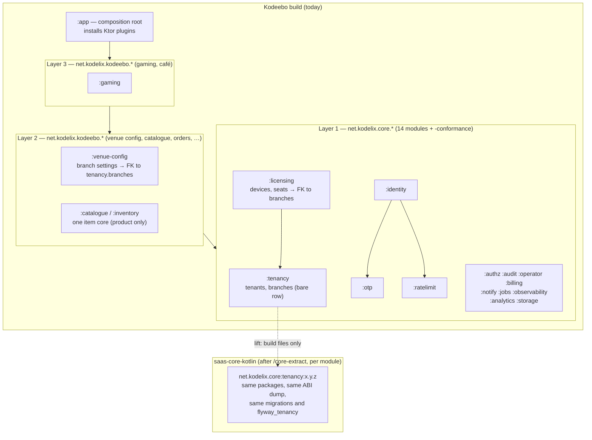

# ADR-0010: Core-extraction policy — twelve Layer 1 capabilities built product-local as fourteen core-shaped modules

## Status

Proposed

> **Who may move this to `Accepted`: the user, or `cto` on the user's explicit
> confirmation. No other agent, and no skill on its own.**
> Why this is stated here: stories referencing a `Proposed` ADR are set `Blocked`,
> and epics require `Accepted`, so the field needs a named owner. `cto` is the
> role `coordination-rules.md` escalates technical conflicts to, and an ADR is
> that decision made durable.
>
> This does **not** relax the rule that `Status: Accepted` is never set without
> explicit user confirmation — it narrows *which agent* may set it once that
> confirmation exists. An agent that believes an ADR is ready says so and
> escalates; it does not edit this field.

**Acceptance blockers.**
1. **Closed 2026-10-21:** the CTO-ADR gate ran (verdict CONCERNS, 2 blockers, 9 minor); this revision (r2) applies all eleven findings with the founder's decisions on the three that changed substance (see Decision Makers).
2. **Closed 2026-10-21:** the CTO re-check of r2 (CONCERNS: all eleven findings resolved; one new contradiction — "never create a role in a migration" against ADR-0001 § 1b's privileged migrations) is fixed in r3 by the founder's choice: later roles arrive by privileged migration (Decision 4). The `principal-engineer` second review of that fix (2026-10-21): CONCERNS with three text fixes (the validation line on role migrations; where the `tenancy:<version>` privileged entry lives after a lift; script and migration must not drift — attributes applied unconditionally plus a two-database CI comparison), all applied verbatim in r3; the reviewer stated APPROVE once applied.
3. **Open:** ADR-0011 is written; then the independent review below; ADR-0010, ADR-0011 and ADR-0012 are accepted together after it (Ordering Note 1).

**Order (founder, 2026-10-21):** written as Proposed → CTO-ADR (done, r2) → CTO re-check (done, r3) → ADR-0011 written → **one independent `/architecture-review` in a fresh session over ADR-0001–ADR-0012** (not a separate review of this ADR) → founder's acceptance of ADR-0010, ADR-0011 and ADR-0012. The dated amendments to ADR-0006 and ADR-0009 (Decision 9) take effect only when this ADR is Accepted.

## Date

2026-10-21

## Last Verified

2026-10-21

## Decision Makers

The founder (user) decided on 2026-10-20, in the `/map-domains` and `/architecture-decision` sessions: Layer 1 is built product-local behind core-shaped ports with one umbrella ADR (alternative A; core-first ruled out); the umbrella amends ADR-0006 Decision 1 by a dated note; a **category exception** for the authorization mechanism, operator console and support access, jobs and outbox, and product analytics; the **extraction trigger** "stable and needed" (Decision 7). The founder decided D1 (package root `net.kodelix`), D3 (liftability B1), D4 (Flyway M1) and D5 (publication P1) on 2026-10-20 (`docs/research/module-structure-and-core-boundary.md` § 5). On 2026-10-21, after the stack-lead review, the founder decided: the bare branch row moves into the tenancy module (Decision 3); ADR-0001's role inventory is part of the core contract (Decision 4); each Layer 1 module's conformance suite is a separate `<module>-conformance` Gradle module (Decision 6). Drafted by `/architecture-decision` in the main session.

- **Stack-lead validation (`ktor-lead`, 2026-10-21): CONCERNS.** One blocker — the draft's "no foreign key from Layer 1 to Layer 2" rule contradicted TR-TENANT-UNIT and TR-BRANCH-SCOPE-R4, because devices and seats (licensing) need a composite foreign key to `branches` (Venue Configuration, Layer 2) — resolved by the founder's Decision 3. Its other notes are carried in Decisions 2, 5, 6 and 9 and in § Risks: the JVM module name follows `group` in Kotlin 2.4 (`kotlin/breaking-changes.md` line 24); the ABI dump is named after the Gradle project; Exposed `Table` objects stay `internal`; a Ktor plugin type puts `ktor-server-core` in a core module's ABI; testFixtures behaviour is NOT SOURCEABLE in the research; modules with no SQL fail the "resolves at least one migration" guard; ADR-0006's Related line and further ADR-0009 entries need the amendment too; Layer 1 SQL names ADR-0001's roles.
- **CTO-ADR (2026-10-21): CONCERNS** — required before acceptance by the founder; run as if `--review full` for this gate only, because this ADR is Critical (`review_mode` is lean). Findings: **B1** the role model did not lift, because ADR-0001's roles are created by the founder's bootstrap roles script outside Flyway (ADR-0009) and the draft's role list was incomplete; **B2** cross-module retention, erasure and export (ADR-0005) had no mechanism once Layer 1 may not import Layer 2/3; minor: ADR-0012 already aligned (commit `3054f1a`), TR-BRANCH-SCOPE-R2 superseded by R4, the "core repository created" route overlapped the rejected "stable only" trigger, Gradle stamped ahead of the pins, the ADR-0006 note pointed at the unwritten ADR-0011, no cost to reverse, migration runs undercounted, registry entries to amend, exception vocabulary not `/core-extract`'s. **Founder decisions on r2 (2026-10-21):** the core part of the bootstrap roles script ships with `tenancy` (Decision 4); the retention participant port is named now (Decision 11); creating `saas-core-kotlin` needs its own recorded founder decision (Decision 7). All eleven findings are applied in r2.
- **Spec sync: NOT ASSESSED** — foundational; no written spec is named (`design/specs/` holds only the domain map).

## Summary

Kodeebo must build the twelve Layer 1 capabilities of `design/specs/domain-map.md` (tenancy, identity with otp and ratelimit, authorization, audit, operator access, licensing, plans and subscription, notifications, jobs, observability, analytics, storage) before `saas-core-kotlin` exists, without a rewrite of their callers when they later move into it. Decision: fourteen core-shaped Gradle modules under `net.kodelix.core.<module>` (otp and ratelimit split out of identity), each with strict explicit API, a committed ABI dump, its own Flyway location and history table, a separate conformance module and publishable coordinates; one umbrella ADR replaces "one ADR per capability"; `/core-extract` runs per module when it is both stable and needed.

## Stack Compatibility

| Field | Value |
|-------|-------|
| **Stack layer(s)** | Ktor backend (Gradle build, Kotlin source layout); Data (Flyway migration layout, cross-module foreign keys, role grants); Core (`saas-core-kotlin`) |
| **Domain** | Core; also Data, Deploy (migration job), Security (supply chain, role model) |
| **Layer** | Foundation |
| **Knowledge Risk** | HIGH — Kotlin 2.4.21, KGP built-in `abiValidation()` (experimental, its DSL changed once without deprecation, F101, F102) and Flyway 13.10.3 per-module history tables (supported by executed evidence only, F322) post-date training data; the Gradle version is ADR-0011's (research D7) |
| **References Consulted** | `docs/research/module-structure-and-core-boundary.md` § 2, § 3 (F101–F129, F301–F337, F501–F527), § 5 (D1–D9), § 9, § 10; `docs/stack-reference/pins.yaml`; `docs/stack-reference/kotlin/VERSION.md`, `kotlin/breaking-changes.md` (lines 24, 33), `kotlin/deprecated-apis.md`; `docs/stack-reference/tooling/VERSION.md`, `tooling/best-practices.md` (locking, verification); ADR-0001…ADR-0009 (Accepted); ADR-0012 (Proposed); `docs/registry/architecture.yaml` (TR-TENANT-UNIT, TR-BRANCH-SCOPE-R4, IC-MIGRATION-JOB, IC-RELEASE-MANIFEST, IC-DEPLOY-ENTRY, TECH-MIGRATION-FLYWAY); `design/specs/domain-map.md` (§ Overview, § Architecture Principles P-ONCE, P-CORE, P-VERTICAL, § Bounded Contexts rows 1–13); `.claude/docs/coordination-rules.md` § Shared core absent; `.claude/skills/core-extract/SKILL.md` and `references/1-inputs-and-evidence.md` (category route) |
| **Pinned versions relied on** | Kotlin `2.4.21`; Gradle **per ADR-0011** (no decision here depends on the Gradle version; research D7 chose 9.8.2, `pins.yaml` still says `"9.7"` and `kotlin/VERSION.md` lists 9.8.1 as current — the § 10 pin change and `/research refresh` belong to ADR-0011); Flyway Community `13.10.3` and pgjdbc `42.7.14` (ADR-0009; proposed pins, not yet in `pins.yaml`, and no stack-reference layer exists for either — research § 9); Konsist `0.18.1`, ArchUnit `1.5.1` (architecture tests, ADR-0011) |
| **Post-Cutoff APIs Used** | KGP `kotlin { explicitApi() }` (strict, F112) and `abiValidation { }` with `@OptIn(ExperimentalAbiValidation::class)`, tasks `checkKotlinAbi` / `updateKotlinAbi`, 2.4 DSL with no `legacyDump {}` (F101, F113, F523; `kotlin/breaking-changes.md` line 33); Kotlin 2.4 JVM module name `{group}:{project_name}` (`kotlin/breaking-changes.md` line 24); Flyway `table`, `locations`, `baselineOnMigrate`, `baselineVersion`, `failOnMissingLocations`, `ignoreMigrationPatterns` (F305–F321, F332); Gradle `maven-publish`, `includeBuild` substitution, repository `content { includeGroup(...) }` (F325–F331) |
| **Verification Required** | S13/S30 (several Flyway history tables in one schema) re-run on every Flyway bump (F322); S31 (lift by coordinates, zero Kotlin source diff) re-run on the first real lift; the private repository for published modules chosen and run (§ 9 of the note); published-artifact checks not yet run (PGP, a transitive dependency missing from the consumer's verification file, republish-under-same-version policy, `.module` consumption, `versionMapping`); the kotlinx binary-compatibility-validator fallback on 2.4.21 (S16) before it is needed; the catalogue checks C1–C8 do not flag the per-module history tables (Decision 5) |

Critical ADR: yes — it fixes the boundary between the product and the shared core, and the package, Gradle group, migration identity and role names every Layer 1 table and caller carries from the first line; a change later rewrites callers and migrations.

> Knowledge Risk is HIGH: re-validate this ADR whenever the Kotlin, Gradle or Flyway pin changes, and on the re-check triggers in the research note § 9 (Kotlin's compatibility table listing Gradle 9.8; every Flyway bump).

## ADR Dependencies

| Field | Value |
|-------|-------|
| **Depends On** | ADR-0001 (table classes, role inventory, TR-TENANT-UNIT), ADR-0002 (scope helper in tenancy), ADR-0003 (branch scope; TR-BRANCH-SCOPE-R4), ADR-0004 (operator access), ADR-0005 (retention, export, storage), ADR-0006 (backend track; amended here), ADR-0007 (staff auth), ADR-0008 (roles and permissions), ADR-0009 (migration job; amended here) — all Accepted. **ADR-0011** (module structure and architecture tests; not yet written) for the Gradle version and the architecture tests that enforce Decision 2 |
| **Enables** | ADR-0011 (module layout builds on Decisions 1–6); ADR-0012 (module and package of the runner and `WorkQueue` port); every Layer 1 design ADR still to come (licensing, subscription billing, notifications, storage, observability plan, analytics taxonomy); `/core-extract` per module; `/design-spec tenant-foundation` (the bare branch row, Decision 3) |
| **Blocks** | The first Layer 1 story and its first migration file; the migration job implementation (Decision 5); `branches-settings` spec wording on branch ownership |
| **Ordering Note** | (1) **Accepted together with ADR-0011 and ADR-0012, after the one independent review over ADR-0001–ADR-0012**; neither ADR's code starts before both are Accepted. (2) The § 10 pin changes are applied before the wrapper exists (ADR-0011). (3) The domain-map edit for Decision 3 landed with this ADR (commit `8dcc630`). (4) On acceptance: the dated notes on ADR-0006 and ADR-0009 (Decision 9), and the registry entries IC-MIGRATION-JOB, IC-RELEASE-MANIFEST, IC-DEPLOY-ENTRY and TECH-MIGRATION-FLYWAY amended to `<module>:<version>` migration ids (old entries marked superseded, new ones added). (5) ADR-0012 § 12 already defers to this ADR's trigger (commit `3054f1a`). |

## Context

### Problem Statement

The founder defined Layer 1 on 2026-10-19 as the capabilities any Kodelix SaaS needs, to be built inside Kodeebo and moved later into `saas-core-kotlin` — never core-first (P-CORE). Neither the core nor any module exists (`core.version` unset). Without one rule, each capability would choose its own package, migration history, dependency direction and role names, and the later move would rewrite callers and migrations, the exact cost `coordination-rules.md` § Shared core absent forbids ("never ship a divergent interface"). ADR-0006 Decision 1 asks for one ADR per product-local capability; for twelve capabilities that is twelve ADRs repeating the same locality reasoning.

### Current State

No backend code. ADR-0001 to ADR-0009 are Accepted and fix the tenancy model, scope helper, branch scope, operator access, retention, backend track, staff auth, roles and the deploy and migration job. The research note (Draft, 2026-10-20) ran five parts of executed probes: a six-module Gradle build, a lift of two modules into a separate core build by coordinates (S31, ABI dumps byte-identical, no Kotlin source change), per-module Flyway history tables in one schema (S13, S30), and Gradle 9.8.2 with Kotlin 2.4.21. The domain map (third pass, 2026-10-21) lists the twelve Layer 1 contexts (rows 1–12), gives `branches` to Venue Configuration (row 13, Layer 2), and records the one catalogue and item core as Layer 2.

### Constraints

- **People:** one developer writes almost all code; the build must stay light (domain map § Overview).
- **Never core-first** (P-CORE); a product never edits core in place (`directory-structure.md`).
- **Shared core absent** (`coordination-rules.md`): product-local adapter behind the same port the core will expose, recorded in an ADR, scheduled for `/core-extract`.
- **`/core-extract` evidence rule:** two products with an opened artifact each, or a core-module category (identity, observability, otp, notify, storage, billing, licensing, tenancy, audit, ratelimit); four Layer 1 capabilities are not in that list.
- **Tenancy:** ADR-0001 table classes and login/definer roles; TR-TENANT-UNIT (branch keyed `(tenant_id, id)`, device keyed `(tenant_id, branch_id, id)`); TR-BRANCH-SCOPE-R4 (branch-scoped tables carry a composite FK to `branches`).
- **Migration job and roles:** ADR-0009 (Flyway 13.10.3 as a library, one-shot job, `deploy_rt` with role default `migrator`, privileged list, signed manifest); ADR-0001's roles are created by the founder-run bootstrap roles script outside Flyway (ADR-0009, role setup B4 and M5).
- **Retention:** ADR-0005 closure, purge, person erasure and export act on every tenant table, Layer 1 and product alike.
- **Distribution:** hosted only; customer-bundle licence rules L1–L3 do not bind.

### Requirements

- A Layer 1 module moves into `saas-core-kotlin` with **no change to Kotlin source** in the module or its callers — only build files and regenerated lock and verification files (research D3, F327).
- Its migrations apply unchanged after the move: same location, same history table, same checksums (D4).
- Platform and verticals never leak into Layer 1 (P-VERTICAL; dependency direction checked on every PR, ADR-0011).
- One rule for when each module moves, measurable from the repository.
- A conformance suite exists per module, because `/core-extract` requires it.

Research note: `docs/research/module-structure-and-core-boundary.md` (Status Draft; § 5 decisions D1, D3, D4, D5 by the founder 2026-10-20).

## Decision

**1. Scope: twelve capabilities, fourteen modules.** The twelve Layer 1 capabilities are built in this product as **fourteen** core-shaped Gradle modules; identity's two sub-capabilities otp and ratelimit are their own modules because each is its own core category, so the unit of a lift is the unit of the core:

| # | Capability (domain-map row) | Module | Package root | Design ADR(s) | `/core-extract` evidence route | Sensitive (threat model) |
|---|---|---|---|---|---|---|
| 1 | Tenancy & Tenant Lifecycle (1) | `tenancy` | `net.kodelix.core.tenancy` | ADR-0001, ADR-0002, ADR-0003, ADR-0005 | CATEGORY (studio list) | yes — `tenant-isolation.md` |
| 2 | Identity & Authentication (2) | `identity` | `net.kodelix.core.identity` | ADR-0007 | CATEGORY | yes — `staff-auth.md` |
| 3 | (2, sub-capability) | `otp` | `net.kodelix.core.otp` | ADR-0007 | CATEGORY | yes — `staff-auth.md` |
| 4 | (2, sub-capability) | `ratelimit` | `net.kodelix.core.ratelimit` | ADR-0007 | CATEGORY | yes — `staff-auth.md` |
| 5 | Roles & Permissions (3) — mechanism only | `authz` | `net.kodelix.core.authz` | ADR-0008 | **founder exception** (Decision 8; owner: the founder; review: the `saas-core-kotlin` repository decision) | yes — `staff-auth.md` |
| 6 | Audit & Activity Trail (4) | `audit` | `net.kodelix.core.audit` | ADR-0004, ADR-0008 | CATEGORY | yes — `staff-auth.md` |
| 7 | Operator Console & Support Access (5) | `operator` | `net.kodelix.core.operator` | ADR-0004 | **founder exception** (owner: the founder; review: the `saas-core-kotlin` repository decision) | yes — `staff-auth.md`, `tenant-isolation.md` |
| 8 | Licensing & Device Seats (6) | `licensing` | `net.kodelix.core.licensing` | licensing ADR (pending) | CATEGORY | yes — `licensing.md` |
| 9 | Plans, Entitlements & Subscription (7) | `billing` | `net.kodelix.core.billing` | subscription-billing ADR (pending) | CATEGORY | yes — external-integrations model (pending) |
| 10 | Notifications (8) | `notify` | `net.kodelix.core.notify` | notifications ADR (pending) | CATEGORY | yes (contact data) — per its ADR |
| 11 | Jobs & Outbox (9) | `jobs` | `net.kodelix.core.jobs` | ADR-0012 (Proposed) | **founder exception** (owner: the founder; review: the `saas-core-kotlin` repository decision) | yes (tenant sweep) — `tenant-isolation.md` |
| 12 | Observability (10) | `observability` | `net.kodelix.core.observability` | ADR-0006 Decision 7; observability plan (pending) | CATEGORY | no PII by rule — per its plan |
| 13 | Product Analytics (11) | `analytics` | `net.kodelix.core.analytics` | event taxonomy (pending) | **founder exception** (owner: the founder; review: the `saas-core-kotlin` repository decision) | per its taxonomy (consent) |
| 14 | Storage & Backup (12) | `storage` | `net.kodelix.core.storage` | ADR-0005; storage ADR (pending) | CATEGORY | yes — `tenant-isolation.md` |

- **authz** holds the mechanism (roles, grants, the deny-by-default `Authorizer`, limits). The **permission catalogue** (which keys Kodeebo has) is product code (domain-map row 3).
- **observability** adopts open source, no fork (domain-map row 10): its module holds configuration and the one thin Ktor plugin of P-PLUMB; the OpenTelemetry Java agent stays the only SDK (ADR-0006 Decision 7).
- **Everything in Layers 2 and 3 is product code** under `net.kodelix.kodeebo.<context>`, including the one catalogue and item core (domain map § Recorded Feature Rules, founder 2026-10-20): it is shared by every Kodeebo vertical, not by every Kodelix product, so it is never a core candidate under this ADR. Moving a Layer 2 module into the core needs a new founder decision and `/core-extract` with EVIDENCED (two products).

**2. Liftability contract (D1, D3).** Each of the fourteen modules, from its first line:
- **Package** `net.kodelix.core.<module>`; **Gradle `group = "net.kodelix.core"`** and **project name = module name**. Kotlin 2.4 derives the JVM module name from `{group}:{project_name}` (`kotlin/breaking-changes.md` line 24), which also names `internal` members in bytecode, and `includeBuild` substitution matches on `group:name` (F325, F330); fixing both now means a lift renames nothing. Layer 1 and Layer 2 project names never repeat.
- **Dependencies:** other Layer 1 modules and third-party libraries only (F111); never a Layer 2 or Layer 3 module. `implementation` by default, `api` only for types in the module's public API (F106).
- **Strict `explicitApi()`** (F112) and a **committed ABI dump** `api/<module>.api`, checked by the built-in `abiValidation()` (`@OptIn(ExperimentalAbiValidation::class)`, 2.4 DSL, no `legacyDump {}`) with `checkKotlinAbi` on every PR (F113, F523), configured once in the convention plugin so a DSL change is one edit (F101). Fallback if the built-in validation breaks: the kotlinx binary-compatibility-validator plugin (F104; S16 before use).
- **Public API names no Kodeebo concept** (station, bill, cashier, counter, venue, shift, End Day). Product-specific values enter through ports and configuration, never through Layer 1 types.
- **Exposed `Table` objects are `internal`.** Across modules, rows are referenced by id value; the foreign key is in SQL. An Exposed `reference()` to another module's table is forbidden: it would put that table in the public ABI.
- **Ktor plugins** are exposed by a core module, never installed by it; only `Application.module` (the composition root) installs them. A module that exposes a plugin type has `ktor-server-core` as an `api` dependency, so the Ktor version is part of its ABI and of its POM's compile scope (F327).
- **OpenTelemetry instrumentation scope** = the module's package root (research § 8).
- **A lift changes build files and regenerated lock and verification files, never Kotlin source** (F327, F328, F523).
- **Dependency direction inside identity:** identity may depend on otp and ratelimit; otp and ratelimit never depend on identity. otp rows carry an opaque subject id, not a foreign key to identity's tables, so no cycle forms.

**3. The bare branch row lives in tenancy (founder, 2026-10-21).** ADR-0001 defines a branch as a tenant unit keyed `(tenant_id, id)` (TR-TENANT-UNIT), and Layer 1 tables are branch-scoped: devices and seats (licensing) and support grants (operator) carry `branch_id` with a composite foreign key to `branches` (TR-BRANCH-SCOPE-R4). So the bare row **`branches (tenant_id, id, status)`** and its lifecycle belong to the **tenancy** module. **Venue Configuration** (Layer 2) keeps everything else about a branch — name, logo, phone numbers, opening hours, settings, limits, reasons — in its own tables keyed by `(tenant_id, branch_id)` with a foreign key to tenancy's `branches`. "Branch" is the core's generic word for a tenant unit; the core contract carries no venue meaning. The domain map's Venue Configuration paragraph, context rows 1 and 13 and the ownership table are edited with this ADR.

**4. ADR-0001's role model is part of the core contract (founder, 2026-10-21).** Layer 1 migrations grant to and write policies for the roles of **ADR-0001 § 1b as amended** (the closed inventory: login roles, definer owners, `migrator`, `deploy_rt`, `catalogue_rt` and the rest, with their attributes — no `BYPASSRLS` — and the table classes TD, CP, PL, G), by name. Those roles are created by the founder-run **bootstrap roles script, outside Flyway** (ADR-0009, role setup B4 and M5), so the script travels with the contract:
- The bootstrap roles script is split into a **core part**, which creates the roles and role defaults Layer 1 SQL needs, and a **product part** for roles only Kodeebo needs. The core part ships with the `tenancy` module (`tenancy/src/main/resources/bootstrap/net/kodelix/core/tenancy/roles.sql`), carries a version number, and moves with `tenancy` on a lift; the product part stays in the product. Both create the **initial** roles: each is run once on a new database by the bootstrap superuser through the local `peer` login, as ADR-0009 says; nothing in how they run changes.
- Any product that uses `saas-core-kotlin` runs the core part before its first migration, so Layer 1 SQL lifts unchanged with the same checksums.
- **A role added later** — core or product — needs an **ADR-0001 amendment** (the inventory is closed) and reaches every database, new or running, through a **privileged migration** (ADR-0001 § 1b, ADR-0009 § 4a; founder, 2026-10-21): marked in `privileged-migrations.txt` as `<module>:<version>` and applied by the founder as the bootstrap superuser. A core role's privileged migration lives in the `tenancy` module's migration location and lifts with it, and its `tenancy:<version>` entry stays on the product's `privileged-migrations.txt` after a lift; a product-only role's lives in a product module. The same change is folded into the matching part of the bootstrap roles script (new version), so a fresh database gets the role from the script and the privileged migration then skips only the `CREATE ROLE` (it checks `pg_roles` first) and applies the role's attributes, memberships and defaults unconditionally (`ALTER ROLE` and `GRANT` are idempotent); a CI test bootstraps one database from the current script and one from the previous script version, applies all migrations to both, and requires identical `pg_roles`, `pg_auth_members` and `pg_db_role_setting`. A non-privileged migration never creates or alters a role.
- Flyway placeholders for role names are not used (their checksum effect is NOT SOURCEABLE).

**5. Migrations (D4).** Each module owns `src/main/resources/db/migration/net/kodelix/core/<module>/` (product contexts `.../net/kodelix/kodeebo/<context>/`) from its first migration. Its Flyway location is `classpath:` plus that leaf path, unchanged after a lift (F310, F321, F332); parent-directory locations are forbidden (F308).
- **Files** `V0001__<verb>_<object>.sql`: one plain 4-digit version per module from 0001 (V1 and V0001 are the same version, F305), never reused or renumbered. This fits ADR-0009's `V<n>__<verb>_<object>.sql`.
- **History table** `flyway_<module>` per module (F307, F309, F332), created by the `deploy_rt` run as `migrator` like ADR-0009's single table.
- **The one-shot migration job** holds an explicit list of the modules **that have migrations** — Layer 1 and product contexts alike, about 25 (research § 7) — in Gradle dependency order (a module with no SQL — today likely observability and ratelimit — is not listed, because the "resolves at least one migration" guard would fail it). Per module it runs, stopping at the first failure: `failOnMissingLocations=true`; `baselineOnMigrate=true` with `baselineVersion=0` pinned in code (left at 1 it silently skips V0001, F317); the "resolves at least one migration" guard; `validate` with `ignoreMigrationPatterns=*:pending` (F320); then `migrate` (F319, F332). `repair` stays a person-only action (F311).
- **Cross-module foreign keys follow the Gradle dependency direction only:** Layer 2 or 3 → Layer 1; Layer 1 → a Layer 1 module it depends on. Never Layer 1 → Layer 2 or 3. Decision 3 makes this hold for every branch-scoped Layer 1 table.
- **CI tests** cover: a second module in a non-empty schema, a missing location, a drifted duplicate, wrong order, and a module listed with no migration.

**6. Conformance suites (founder, 2026-10-21).** Each Layer 1 module has a separate Gradle module **`<module>-conformance`** (package `net.kodelix.core.<module>.conformance`, same group) from the module's first story: the tests any adapter of the module's ports must pass, run in the product against the product's adapters and, after a lift, in the core. It is an ordinary project with its own lock file, ABI dump and publication, behaviour the research executed (F113, F115, F327). Gradle test fixtures are not used for this (their explicit-API, ABI, `internal`-visibility and publication behaviour is NOT SOURCEABLE in the research).

**7. Extraction trigger, per module — both conditions (founder, 2026-10-20).**
- **Stable:** all of — the committed ABI dump `api/<module>.api` has **no diff across two consecutive production releases after the Tier 1 release**; the module's `<module>-conformance` suite passes; and, if the module is sensitive (Decision 1 table), its threat model has been reviewed since the module's last ABI or migration change.
- **Needed:** a second Kodelix product starts (its repository exists under `~/saas-products/` with a spec or brief that needs the module), **or** the `saas-core-kotlin` repository is created. Creating that repository is **its own founder decision, recorded with its reason** in the decision log (founder, 2026-10-21), so the second route cannot start a one-consumer core by default — the "stable only" trigger rejected in Alternative 4(a).
- Then `/core-extract <module>` runs for that module alone; modules are never extracted as a forced batch. Extraction follows module dependency order (a module moves only after the Layer 1 modules it depends on, or with them). This trigger governs every Layer 1 module; capability ADRs cite it (ADR-0012 § 12 does since commit `3054f1a`).

**8. Category exception (founder, 2026-10-20).** The authorization mechanism (`authz`), operator console and support access (`operator`), jobs and outbox (`jobs`) and product analytics (`analytics`) are not in `/core-extract`'s core-module categories. The founder's 2026-10-19 definition of Layer 1 — capabilities any Kodelix SaaS needs — is the recorded reason. For these four, `/core-extract`'s evidence verdict is **`NOT EVIDENCED`**, passed by the **user exception** the skill provides: recorded in each module's `production/core/proposals/<module>/evidence.md` with the founder's words, the risk (a core module with one consumer is a core module nobody has proven general), the **owner: the founder**, and the **review date: when the founder takes the `saas-core-kotlin` repository decision** (the recorded decision Decision 7 requires; founder, 2026-10-21), and repeated as a Consequence below. The core repository's module list adds the four categories when it is created; from then on they take the `CATEGORY` route.

**9. One umbrella ADR; amendments to ADR-0006 and ADR-0009.** This ADR records, for all twelve capabilities, what is local, why, and the extraction trigger — the content `coordination-rules.md` § Shared core absent asks of "an ADR". Each capability still gets its own **design** ADR where its design is architectural (the table in Decision 1); those ADRs cite this one for locality and trigger and do not repeat them. Dated notes, added when this ADR is Accepted:
- **ADR-0006 Decision 1** ("each capability is a product-local adapter … recorded in its own ADR") and its **Related** line ("one ADR per product-local adapter"): "Amended 2026-10-21 by ADR-0010: locality and the extraction trigger of every Layer 1 capability are recorded once in ADR-0010; capability ADRs record design only." (The source-tree layout of Decision 1 is ADR-0011's to amend.)
- **ADR-0009, the migration job (IC-MIGRATION-JOB), the privileged procedure (§ 4a), the release manifest (IC-RELEASE-MANIFEST) and the deploy record (IC-DEPLOY-ENTRY):** "Amended 2026-10-21 by ADR-0010: one Flyway run and one history table `flyway_<module>` per module, in the order of ADR-0010 Decision 5; every migration id in `privileged-migrations.txt`, the signed manifest and the deploy record's `migrations=` field is `<module>:<version>`; the privileged procedure's `target=` takes `<module>:<version>`; S52 asserts every `flyway_<module>` table is owned by `migrator`; the CI role-change scan covers migrations and the core part of the bootstrap roles script shipped inside a core jar after a lift, not only the source tree; `baselineOnMigrate=true` with `baselineVersion=0` is allowed under the guards of ADR-0010 Decision 5."

**10. Publication on a lift (D5).** A lifted module (and its `-conformance` module) is published with `maven-publish` under group `net.kodelix.core` with a fixed version to a file or private repository (choice open, below) and consumed by coordinates through a repository restricted with `content { includeGroup("net.kodelix.core") }`; a developer working on both uses `includeBuild` with unchanged notation (F325, F327, F330). Locking and strict verification stay in the consumer (F329, F330). After a lift or a core bump: lock with verification off for that one run, write the verification metadata, then a strict build, reviewed as a diff (F328). Once published, the product pins `core.version` and never edits the module in place.

**11. Cross-module retention, erasure and export (founder, 2026-10-21).** ADR-0005's closure, purge, person erasure and export are orchestrated in Layer 1 (`tenancy` for the tenant, `identity` for a person) but must reach product tables, which Layer 1 may not import (Decision 2). So Layer 1 defines a **participant port**, and every module that holds tenant or personal data implements it:
- `tenancy` defines `TenantDataParticipant` with the ADR-0005 steps for one tenant — export its tables (EXP-2), purge personal data, delete — and `identity` defines the per-person form (de-identify, delete personal fields, extract). The step list and signatures are ADR-0005's and are written in `/design-spec tenant-foundation`, not here.
- Layer 2 and Layer 3 modules (and Layer 1 modules other than the orchestrator) implement the port; **only `:app` registers them** with the orchestrator, so no Layer 1 module names a product module.
- The orchestrator runs participants in **reverse dependency order** — children before parents — because cross-module foreign keys point from Layer 2/3 to Layer 1 (Decision 5); exports run in dependency order.
- Each participant's coverage is tested: the ADR-0005 export-coverage check (every TD table, M47) and the erasure test fail when a module with tenant tables registers no participant.

### Architecture



Dependency arrows point inward only; Layer 1 never imports Layer 2 or 3, and no foreign key points from Layer 1 to Layer 2 or 3.

### Key Interfaces

```text
// Coordinates and names (fixed from the first line; unchanged by a lift)
group    = "net.kodelix.core"            // Layer 1 modules and their -conformance modules
project  = <module>                      // tenancy, identity, otp, ratelimit, authz, audit, operator,
                                         // licensing, billing, notify, jobs, observability, analytics, storage
package  = net.kodelix.core.<module>     // product contexts: net.kodelix.kodeebo.<context>
abi dump = <module>/api/<module>.api     // checkKotlinAbi on every PR
migrations = src/main/resources/db/migration/net/kodelix/core/<module>/V0001__<verb>_<object>.sql
history  = flyway_<module>
migration id (manifest, privileged list, deploy record) = <module>:<version>

// Ports: defined in each module's app layer, specified by its design ADR.
// Already named: withScope / Scope (ADR-0002, tenancy); Authorizer (ADR-0008, authz);
// Signer, PasswordHasher, Clock, IdGenerator (ADR-0006); WorkQueue / Outbox (ADR-0012, jobs).
// Contracts for anything exposed over the network stay in contracts/.
```

### Implementation Guidelines

- **Must (every Layer 1 module, build):** `group = "net.kodelix.core"`, project name = module name, package `net.kodelix.core.<module>`, strict `explicitApi()`, `abiValidation()` with a committed `api/<module>.api`, all from the convention plugin; lock files committed (ADR-0011).
- **Must never (every Layer 1 module, build):** depend on a Layer 2 or Layer 3 module; set a different group or package root; change the package of a type to move it between modules.
- **Must (every Layer 1 module, `domain`/`app`):** public API free of Kodeebo concepts; product values through ports and configuration.
- **Must (every Layer 1 module, `adapters`, data):** Exposed `Table` objects `internal`; cross-module references by id value with the foreign key in SQL.
- **Must never (`adapters`, data):** an Exposed `reference()` to another module's table; a foreign key from a Layer 1 table to a Layer 2 or 3 table.
- **Must (`adapters`, Ktor):** a core module exposes plugins; only `:app`'s `Application.module` installs them; no plugin adds a second OpenTelemetry SDK (ADR-0006 Decision 7).
- **Must (migrations, every module):** own leaf location, own `flyway_<module>`, 4-digit versions never reused; listed in the job in dependency order only if it has migrations.
- **Must (migrations, Layer 1):** grant only to roles of ADR-0001 § 1b as amended.
- **Must never (migrations):** create or alter a role in a non-privileged migration; a role is created by the bootstrap roles script (initial) or a privileged migration (later), each after an ADR-0001 amendment.
- **Must never (migrations):** a parent-directory location; editing an applied migration; `repair` by an agent.
- **Must (tests):** a `<module>-conformance` module from the module's first story, run in CI against the product's adapters.
- **Must (tenancy):** the bare `branches (tenant_id, id, status)` row and its lifecycle live in `tenancy`; Venue Configuration keys its branch tables by `(tenant_id, branch_id)` with a foreign key to it.
- **Must (`identity`):** identity → otp and identity → ratelimit only; otp keyed by an opaque subject id.
- **Must (extraction):** `/core-extract` only when Decision 7's two conditions hold for that module; never edit a lifted module in place.
- **Must (roles):** the core part of the bootstrap roles script lives in `tenancy` and changes only with an ADR-0001 amendment; a product-only role goes in the product part.
- **Must (every module with tenant or personal data, `adapters`):** implement the retention participant port (Decision 11); `:app` registers it.
- **Must never (Layer 1, retention):** call a product module's tables or classes directly from a closure, erasure or export orchestrator.

## Alternatives Considered

### Alternative 1: Core-first — create `saas-core-kotlin` now and build Layer 1 there (research B2)

- **Description**: Start the core repository first, build each Layer 1 module there, and consume it from Kodeebo by coordinates from the first story.
- **Cost**: Two repositories, two release flows and a publish-and-bump cycle for every Layer 1 change while the ports are still moving; for one developer, roughly doubles the work per Layer 1 story.
- **Risk**: Ports designed before any product used them; every early design mistake becomes a core release and a product bump.
- **Performance**: None at runtime; slower build-edit loop (publish, re-lock 16–22 s per change, research § 7).
- **Operability**: A private repository and credentials from day one (open question § 9); hosted only, so no customer-bundle effect.
- **Rejection Reason**: The founder ruled it out (P-CORE, 2026-10-19): Kodeebo is the only product, and stability comes from production use, which a core-first module cannot have.

### Alternative 2: Plain product code, refactor into a core later (research B3)

- **Description**: Build Layer 1 as ordinary product packages (`net.kodelix.kodeebo.tenancy`, shared migration history) and rename, re-package and split migrations when a second product appears.
- **Cost**: Lowest now (no ABI dumps, no per-module history tables); high at extraction: every caller's imports change, migration histories must be split by hand on live databases.
- **Risk**: The lift touches every caller and the production migration history at once — the divergent-interface failure `coordination-rules.md` forbids; leaks of Kodeebo concepts into Layer 1 go unchecked until then.
- **Performance**: None.
- **Operability**: A one-time, risky migration of history tables in production.
- **Rejection Reason**: Breaks the "liftable without changing callers" requirement; research S31 showed the core-shaped module lifts with zero source diff, so the extra cost now is small and known.

### Alternative 3: One ADR per Layer 1 capability (ADR-0006 Decision 1 as written)

- **Description**: Twelve (or fourteen) ADRs, each recording locality, liftability rules and its own extraction trigger.
- **Cost**: Twelve ADRs repeating the same reasoning, each reviewed separately.
- **Risk**: Drift — capability ADRs choose different triggers or package rules (ADR-0012 § 12 first stated its own trigger; since side-session commit `3054f1a` it defers to this ADR's Decision 7).
- **Performance**: None.
- **Operability**: More documents to keep consistent on every Kotlin, Gradle or Flyway pin change.
- **Rejection Reason**: The founder chose one umbrella ADR (2026-10-20); capability ADRs keep their design content and cite this one.

### Alternative 4: Other extraction triggers — "stable only" or "fixed milestone"

- **Description**: (a) extract when the port is stable, even with no second product; (b) extract all Layer 1 modules together after the Tier 1 release.
- **Cost**: (a) a core repository and release flow maintained with one consumer; (b) a large batch move while Tier 1 is still settling.
- **Risk**: (a) core overhead with no reuse to pay for it; (b) unstable ports frozen into a core, many modules moved at once.
- **Performance**: None.
- **Operability**: (b) one big migration of build, repositories and verification metadata.
- **Rejection Reason**: The founder chose "stable and needed" (2026-10-20): stability is measured from the ABI dump, need from a second consumer or the core repository's existence.

## Consequences

### Positive

- A Layer 1 module lifts with build-file changes only, proven by S31 (no Kotlin source diff, byte-identical ABI dumps).
- Migrations survive the lift unchanged (same location, history table and checksums).
- Layer boundaries are compile-time facts (Gradle graph) plus ABI diffs in review, not conventions.
- One document answers locality and trigger for every Layer 1 capability.
- The branch decision makes every branch-scoped Layer 1 table respect the dependency direction.

### Negative

- Fourteen modules plus fourteen conformance modules: about 28 more Gradle projects, each with a lock file and an ABI dump; a dependency change re-locks every module above it (F116).
- About 25 Flyway runs per deploy instead of one (one per module with migrations, Layer 1 and product; tens of milliseconds each; total not measured).
- The core contract carries ADR-0001's role model and the core part of the bootstrap roles script: a future product with a different role model cannot use the Layer 1 SQL unchanged, and runs the core part before its first migration.
- **Exception consequence (Decision 8):** `authz`, `operator`, `jobs` and `analytics` may become core modules with one consumer — modules nobody has proven general. Owner: the founder; review date: when the founder takes the `saas-core-kotlin` repository decision (Decision 7; founder, 2026-10-21).
- Every module with tenant or personal data carries a retention participant (Decision 11).
- **Cost to reverse:** before the first migration, near zero (text and build files). After it, merging or splitting `flyway_<module>` history tables on a live database means a hand-written migration of history rows and a privileged repair — weeks of careful work — and re-packaging changes every caller.
- ABI validation is experimental; a DSL break costs a convention-plugin edit (F101).
- The domain map and the `branches-settings` spec must describe branch ownership as split between tenancy (row) and Venue Configuration (attributes).

### Neutral

- Layer 2 and Layer 3 follow the same package and migration layout under `net.kodelix.kodeebo`, without ABI dumps unless ADR-0011 decides otherwise.
- ADR-0011 decides the remaining module layout (one module per context, architecture tests, Gradle pin).

## Risks

| Risk | Probability | Impact | Mitigation |
|------|------------|--------|-----------|
| Per-module history tables rest on executed evidence only (F322); a Flyway release changes the behaviour | LOW | HIGH | Re-run S13/S30 on every Flyway bump (research § 9 trigger b); the in-house runner is ADR-0009's named fallback |
| KGP built-in `abiValidation()` changes or breaks (experimental, F101, F102) | MEDIUM | MEDIUM | One convention-plugin edit; kotlinx validator fallback after S16 |
| Catalogue checks C1–C8 flag the ~14 per-module history tables (no RLS) | MEDIUM | LOW | Classify `flyway_*` tables as the existing history table is classified; verify before the second module's first migration |
| A module with no migrations is listed in the job and fails the guard | MEDIUM | LOW | The job list names only modules with migrations; CI test "listed with no migration" |
| A Kodeebo concept leaks into a Layer 1 public API | MEDIUM | MEDIUM | ABI dump diff reviewed on every PR; architecture tests (ADR-0011); `/core-extract` strip list |
| A Ktor plugin type in a core module ties the core's ABI to the Ktor version | MEDIUM | LOW | Recorded; a Ktor bump becomes a core release when the module is lifted |
| A capability ADR states its own trigger | LOW | LOW | Decision 7 governs; ADR-0012 already cites it |
| The core part of the bootstrap roles script drifts from ADR-0001 § 1b | MEDIUM | HIGH | The script changes only with an ADR-0001 amendment; the catalogue test fails on any role not listed (ADR-0001); owner `cto`, review 2026-11-04 |
| A module with tenant or personal data registers no retention participant, so closure or erasure leaves rows behind | MEDIUM | HIGH | Coverage tests (Decision 11, ADR-0005 M47); owner `data-lead` with `multitenancy-specialist`, at `/design-spec tenant-foundation` |
| A founder-exception module (authz, operator, jobs, analytics) is not general enough for a second product | MEDIUM | MEDIUM | Port strip test in `/core-extract`; owner the founder, reviewed at the `saas-core-kotlin` repository decision (Decision 8) |
| Locking all configurations fails offline on `kotlin-klib-commonizer-embeddable` (F521) | MEDIUM | LOW | Re-lock with the note's command set (D2), online, reviewed as a diff |
| Private repository for published modules not chosen | — | MEDIUM | Open question below, before the first lift |

## Cross-Cutting Impact

| Concern | Impact |
|---------|--------|
| **Security / tenancy** | Role model fixed as core contract (no `BYPASSRLS`, ADR-0001); every branch-scoped Layer 1 table keeps its composite FK (TR-BRANCH-SCOPE-R4); ASVS 5.0.0 V15 supply-chain controls apply to publication (research § 6: 15.1.2 inventory, 15.2.4 intended repository — content filtering and strict verification); threat models listed per module in Decision 1 |
| **Retention** | ADR-0005 closure, purge, erasure and export reach every module through the participant port (Decision 11), deleting children before parents; coverage tested (M47) |
| **Observability** | Instrumentation scope = package root, unchanged by a lift; migration job span `migration.run` with a child per module (research § 8) |
| **Caching** | None — build and migration layout only (gate 5 reason: no application data cached) |
| **Self-hosted** | None — hosted only |
| **Cost** | None at runtime; CI time grows with ~28 projects (no budget set; research S46) |

## Performance Implications

No runtime change: modules are compile-time structure inside one Ktor process, so every budget in `docs/architecture/perf-budgets.md` (including the counter 3 s ceiling) is untouched. Deploy: about 25 Flyway runs per migration job (one per module with migrations), tens of milliseconds each; total not measured (research § 7). Build: probe numbers only (cold 28.8 s, warm 0.77–1.79 s on six modules); no product-scale number exists.

## Migration Plan

No code or migration exists yet, so nothing is migrated now. Order: (1) accept this ADR with ADR-0011 and apply the § 10 pin changes; (2) add the dated notes to ADR-0006 and ADR-0009 and amend the registry entries (Ordering Note 4); (3) split the bootstrap roles script into its core part (in `tenancy`) and product part, unchanged in content; (4) the migration job is built per Decision 5 before the first migration; (5) the first Layer 1 story creates `:tenancy` and `:tenancy-conformance` with the bare `branches` row and the participant port of Decision 11. Production migrations stay forward-only (ADR-0009). A lift itself migrates no data: the history tables, locations and checksums are unchanged, so rollback of a lift is reverting the build-file change.

## Validation Criteria

- [ ] A lift rehearsal of the first real Layer 1 module into a scratch core build (S31 re-run) produces **no Kotlin source diff** and byte-identical `api/<module>.api`, and the product's migration job reports "no pending" against the same database afterwards.
- [ ] **Negative:** a Layer 1 module that imports a Layer 2 class fails the build (Gradle graph) and the architecture tests (ADR-0011).
- [ ] **Negative:** a migration placed in a parent-directory location, a missing location, a module listed with no migration, and a duplicate version each stop the migration job with its named reason.
- [ ] **Negative:** a public declaration added to a Layer 1 module without updating `api/<module>.api` fails `checkKotlinAbi` in CI.
- [ ] **Negative:** a migration that creates or alters a role but is not on `privileged-migrations.txt`, or a Layer 1 migration that grants to a role outside ADR-0001's inventory, fails CI (role-change scan, ADR-0009 § 4a).
- [ ] Every `flyway_<module>` table is owned by `migrator` (S52 extended).
- [ ] Each Layer 1 module has a `<module>-conformance` module that runs in CI and fails when an adapter breaks a port rule.
- [ ] **Negative:** a test tenant closed through `tenancy` leaves no row in any Layer 2 or Layer 3 table, and a module with tenant tables but no registered participant fails the coverage test.
- [ ] A fresh database bootstrapped with only the core part of the roles script applies every Layer 1 migration without a missing-role error.

## Spec Requirements Addressed

Foundational — no spec requirement. Enables: every Layer 1 spec (`tenant-foundation` first, then `tenant-provisioning`, `dashboard-sign-in`, `counter-pin`, `roles-permissions`, `activity-trail`, `operator-console`, `support-access`, `device-seats-enrolment`, `offline-lease`, `subscription-billing`, `jobs-outbox`, `telemetry-pipeline` and the rest of domain-map rows 1–12) and `branches-settings` (branch attributes keyed to tenancy's bare row).

## Open Questions

| Question | Blocks | Owner | Due |
|----------|--------|-------|-----|
| Private repository for published core modules (file share or hosted), cost, who holds credentials | Decision 10 | `cto`, user | before the first lift |
| Published-artifact checks: PGP signatures, a transitive dependency missing from the consumer's verification file, republish-under-same-version policy, `.module` consumption, `versionMapping` | Decision 10 | `researcher`, `cto` | before the first lift |
| How the catalogue checks C1–C8 classify the per-module `flyway_*` tables | Decision 5 | `postgres-specialist`, `security-lead` | before the second module's first migration |
| Whether the bare `branches` row needs more than `(tenant_id, id, status)` in the core (for example a time zone, which money and time rules need) | Decision 3 | `domain-architect`, `multitenancy-specialist` | `/design-spec tenant-foundation` |

## Related

- **Amends (dated notes on acceptance):** ADR-0006 Decision 1 and Related; ADR-0009 migration job (IC-MIGRATION-JOB), § 4a, IC-RELEASE-MANIFEST, IC-DEPLOY-ENTRY, TECH-MIGRATION-FLYWAY.
- **Depends on:** ADR-0001, ADR-0002, ADR-0003, ADR-0004, ADR-0005, ADR-0007, ADR-0008 (Accepted); ADR-0011 (not yet written).
- **Coordinates with:** ADR-0012 (jobs and outbox; § 12 cites Decision 7 since `3054f1a`).
- **Research note:** `docs/research/module-structure-and-core-boundary.md` (D1, D3, D4, D5).
- **Domain map:** `design/specs/domain-map.md` (Layer 1 rows 1–12; Venue Configuration row 13; P-CORE).
- **Threat models:** `docs/architecture/threat-models/tenant-isolation.md`, `staff-auth.md`, `licensing.md`.
- **Skills:** `/core-extract` (evidence route per Decision 1 and 8), `/core-use`.
- **Code paths:** none yet; module layout per ADR-0011.
