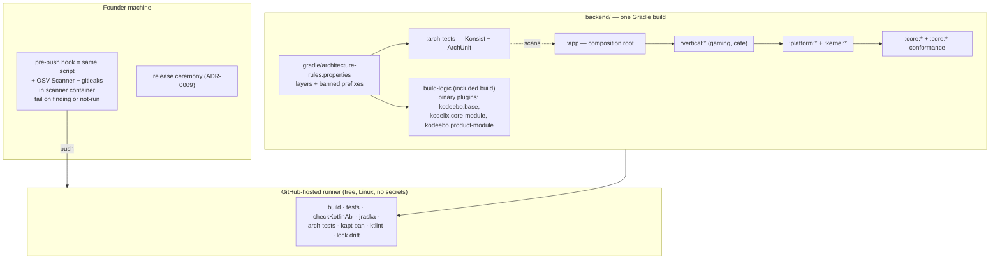

# ADR-0011: Module structure, architecture tests, lint, Gradle pin and PR checks

## Status

Proposed

> **Who may move this to `Accepted`: the user, or `cto` on the user's explicit
> confirmation. No other agent, and no skill on its own.**
> Why this is stated here: stories referencing a `Proposed` ADR are set `Blocked`,
> and epics require `Accepted`, so the field needs a named owner. `cto` is the
> role `coordination-rules.md` escalates technical conflicts to, and an ADR is
> that decision made durable.
>
> This does **not** relax the rule that `Status: Accepted` is never set without
> explicit user confirmation — it narrows *which agent* may set it once that
> confirmation exists. An agent that believes an ADR is ready says so and
> escalates; it does not edit this field.

**Acceptance blockers.**
1. **Closed 2026-10-21:** the CTO-ADR gate ran (CONCERNS: 4 blockers, 5 minor); all nine findings are applied in this revision (r2; see Decision Makers).
2. **Open:** spike S47 — jraska `assertModuleGraph` with no rule configured, with an empty graph, and with the conformance and `:arch-tests` leaf modules (research § 9: due before this ADR is accepted). Owner `researcher`.
3. **Open:** licences not re-verified by the research — ktlint, detekt, the kotlinx binary-compatibility-validator, Gradle, jraska, Konsist, ArchUnit — fetched and recorded (research § 9). Owner `infra-engineer`, `security-lead`.
4. **Open:** `observability-engineer` signs off Decision 6 (OpenTelemetry API in `app`), which amends ADR-0006's Implementation Guidelines.
5. **Open:** the user applies the pin changes of research § 10 (`gradle: "9.8.2"` — `.claude/scripts/project-coherence.sh` parses up to four numeric parts, so the patch form is accepted) and `/research refresh` updates `kotlin/VERSION.md` (it still lists 9.8.1 as current) and `tooling/VERSION.md`; and ADR-0006's S17 (`distZip` reproducibility with lock files, required "before the Gradle pin moves to 9.8.x") runs.
6. **Open:** the OpenTelemetry API bridging question of Decision 6 is answered by `/research` (or the API stays on the agent's SDK line, 1.66.0); a `java_api` pin key is proposed for the user.

**Order (founder, 2026-10-21):** written as Proposed → CTO-ADR (as if `--review full` for that gate) → **one independent `/architecture-review` in a fresh session over ADR-0001–ADR-0012** → founder's acceptance of ADR-0010, ADR-0011 and ADR-0012 together. Spike S60 (Decision 2) runs before the first module is created, not before acceptance.


**Amendment 2026-10-24 (ADR-0015 backend code conventions, Decision 10) — Proposed; takes effect only when ADR-0015 is Accepted.** The text below is not edited.
- Wherever this ADR says "the fifteen Layer 1 modules" (Context and the module table), read **sixteen**: `:core:foundation` is added by the ADR-0010 amendment of the same date, with no `-conformance` module.
- Konsist in `:arch-tests` gains ADR-0015's rules: the closed list of `:core:foundation`; Ktor DI imports only in `:app`; a snake_case `@SerialName` on every DTO property; the catch-site, `runCatching` and `receiveNullable` bans; and the size limits (function at most 40 lines, file at most 300), blocking — or the build-logic check of ADR-0015 Decision 10 if Konsist 0.18.1 cannot count lines.

## Date

2026-10-21

## Last Verified

2026-10-21

## Decision Makers

The founder (user) decided D2 (module structure A1 with A-i and A-iii(1)), D6 (architecture and lint enforcement), D7 (Gradle 9.8.2) and D8 (CI runner) on 2026-10-20 (`docs/research/module-structure-and-core-boundary.md` § 5). On 2026-10-21, in this run, the founder confirmed the assumptions (string project paths, ports in `<context>.app.port`, one rule-data file) and decided: PR checks split between GitHub-hosted runners and the pre-push hook, amending ADR-0009 (Decision 8); the shared kernels are product modules that Layer 1 reaches only through a port (Decision 1); `app` may use the OpenTelemetry API, never the SDK (Decision 6); `build-logic` as binary plugins without `kotlin-dsl` (E2), with the E1 mitigations as the fallback only if spike S60 fails (Decision 2); the advisory's cache path confirmed from its fix commit and written here; the scanners run from the pre-push hook automatically, the founder acting only on a failure (Decision 8); `kapt` banned everywhere, KSP only through a research note and an ADR (Decision 5). Drafted by `/architecture-decision` in the main session.

- **Stack-lead validation (`ktor-lead`, 2026-10-21): CONCERNS, 5 blockers, all addressed in this text:** the re-lock command did not resolve test, lint and arch-test classpaths and the default lock mode does not fail on a configuration with no lock state (Decision 3); `kotlin-dsl` puts Kotlin Gradle plugin 2.4.10 on the `build-logic` classpath, inside GHSA-r937-wjx7-w2jp (Decision 2); jraska unproven for leaf and test-only modules (Decision 4, acceptance blocker 2); the CI amendment targets and gaps (gitleaks, permissions, no image or artifact, owner) (Decision 8); OpenTelemetry in `app` contradicts ADR-0006 line 215 (Decision 6, acceptance blocker 4). Its minor notes are carried in Decisions 1–8 and § Risks.
- **CTO-ADR (2026-10-21): CONCERNS** — run as if `--review full` for this gate only (Critical ADR; `review_mode` lean). Blockers: (1) R1 was given to jraska, which sees project-module edges only and cannot see a JDK client or a misplaced external library (F219); (2) "no Kotlin 2.4.10 on any classpath" is false — Gradle 9.8 embeds Kotlin 2.4.10 for scripts and its own runtime (`kotlin/VERSION.md` line 18); (3) the OpenTelemetry API was pinned to 1.67.0 while agent 2.32.0 targets SDK 1.66.0 (`opentelemetry/VERSION.md` line 14); (4) no threat model linked for the new CI trust boundary and the hook bypass. Minor: research § 5 still describes the old decisions; the hook's scope contradicted itself; no retention row; the bypass mitigation relied on a rule only; FP-UNLOCKED-GRADLE-BUILD-R2 missing from the registry list. All nine applied in r2.
- **Spec sync: NOT ASSESSED** — foundational; no written spec is named.

## Summary

Kodeebo's backend needs, before its first Kotlin story, a Gradle module layout for the 32 logical contexts of `design/specs/domain-map.md` and checks that enforce P-ONCE, P-CLEAN, P-CORE and P-VERTICAL on every PR (ADR-0006 Q-lint, Decision 11, Q7). Decision: one Gradle module per backend context under `backend/`, built by binary convention plugins with strict locking and verification; Gradle module graph, jraska, Konsist and ArchUnit all blocking, ktlint 2.0.0-ALPHA-4 blocking, detekt advisory, `kapt` banned; Gradle 9.8.2; PR checks on free GitHub-hosted Linux runners plus the scanners in the pre-push hook on the founder's machine.

## Stack Compatibility

| Field | Value |
|-------|-------|
| **Stack layer(s)** | Ktor backend (Gradle build, source layout, lint); Deploy (PR checks, CI); Core (`saas-core-kotlin` module shape, with ADR-0010) |
| **Domain** | Core; also Security (supply chain), Observability (OpenTelemetry API rule) |
| **Layer** | Foundation |
| **Knowledge Risk** | HIGH — Kotlin 2.4.21, Gradle 9.8.2 (outside KGP 2.4.21's documented 7.6.3–9.7.0 range, F505, F514), Konsist 0.18.1 (pre-1.0), ArchUnit 1.5.1 (open Kotlin 2.4.20+ `when`-`is` gap, F211), jraska 2.9.1, ktlint 2.0.0-ALPHA-4 (pre-release, F402) and detekt 2.0.0-alpha.6 all post-date training data |
| **References Consulted** | `docs/research/module-structure-and-core-boundary.md` § 2, § 3 (F101–F129, F201–F222, F401–F419, F501–F527), § 5 (D2, D6, D7, D8), § 9, § 10; `docs/stack-reference/pins.yaml`; `kotlin/VERSION.md`, `kotlin/breaking-changes.md` (lines 20, 24, 33), `kotlin/deprecated-apis.md`; `tooling/VERSION.md`, `tooling/best-practices.md` (locking, verification); `opentelemetry/VERSION.md`; ADR-0006 (Decisions 2, 3, 7, 11; Implementation Guidelines), ADR-0009 (§ 3 step 1, § 4b, diagram, Key Interfaces), ADR-0010 (Proposed, r3), ADR-0012 (Proposed); `docs/registry/architecture.yaml` (FP-UNLOCKED-GRADLE-BUILD-R2, IC-SCANNER-CONTAINER, FP-SCANNER-UNCONFINED, FP-AGENT-VPS-ACCESS, FP-SECRET-IN-ENV, IC-CORE-MODULE-IDENTITY, FP-LAYER1-DEPENDS-ON-PRODUCT); `.claude/docs/clean-architecture.md`; `.claude/docs/security-baseline.md`; GHSA-r937-wjx7-w2jp (GitHub advisory API, fetched 2026-10-21) and its fix commit `JetBrains/kotlin@bf51df6` (fetched 2026-10-21) |
| **Pinned versions relied on** | Kotlin `2.4.21`; Gradle **9.8.2** (`distributionSha256Sum` `21bd5da2de49b642904077f38c0efdc7778e92b3ed0889392dca61b97e389607`; `pins.yaml` still `"9.7"` — acceptance blocker 5); Konsist `0.18.1`, ArchUnit `1.5.1` (`pins.yaml`); jraska `com.jraska.module.graph.assertion` `2.9.1` and ktlint `io.github.ktlint.core` `2.0.0-ALPHA-4` (proposed pins, research § 10); detekt `2.0.0-alpha.6` (not pinned until S42); OpenTelemetry API on the Java agent's SDK line, **`1.66.0`** (agent `2.32.0` targets SDK 1.66.0, `opentelemetry/VERSION.md` line 14; `pins.yaml` has `java_sdk: "1.67.0"` for SDK-without-agent use and no API key — a `java_api: "1.66.0"` key is proposed); OSV-Scanner `2.6.0`, gitleaks `8.30.1` (`pins.yaml`) |
| **Post-Cutoff APIs Used** | Gradle `dependencyLocking { lockAllConfigurations(); lockMode = LockMode.STRICT }`, buildscript locking, `--write-locks`, strict `verification-metadata.xml` (F108, F115, F119); `providers.fileContents(...)` as a configuration input; included build `build-logic` with `java-gradle-plugin`; KGP `explicitApi()` and `abiValidation { }` (via ADR-0010); jraska `moduleGraphAssert { allowed / restricted / maxHeight }` and `assertModuleGraph` (F205, F219); Konsist `Konsist.scopeFromProject()` / scope assertions (F207); ArchUnit `ArchRuleDefinition` with `failOnEmptyShould` default (F409) |
| **Verification Required** | **S60** (before the first module; Decision 2): `build-logic` as binary plugins built with Kotlin Gradle plugin 2.4.21 on Gradle 9.8.2 — no `kotlin-gradle-plugin` below 2.4.20 in any lock or verification file; the plugins load and run on Gradle's embedded Kotlin 2.4.10 runtime, with the `apiVersion` / `languageVersion` limit for plugins sourced through `/research` first (not covered by the stack reference today); no `kapt` task anywhere; `build-logic` reads `gradle/libs.versions.toml`, an edit to `gradle/architecture-rules.properties` invalidates the configuration cache, jraska over a graph with conformance and leaf modules, STRICT locking with the resolve task; downloads listed with sizes and approved first. **S47** (acceptance blocker 2). **S42** detekt (first backend story). ADR-0006 **S17** (acceptance blocker 5). Konsist input tracking (S29) with the first `:arch-tests` module. The ktlint compiler override re-run on every Kotlin bump (F411, F413). Testcontainers on GitHub-hosted runners (NOT SOURCEABLE: runner Docker version, Docker Hub pull limits for `postgres:18.6`, a Testcontainers pin) with the first integration test |

Critical ADR: yes — it fixes the build structure, the enforcement of the architecture principles and the supply-chain gates every backend story runs through from its first line, and it answers ADR-0006's "required before the first Kotlin story" (Q-lint).

> Knowledge Risk is HIGH: re-validate this ADR whenever the Kotlin, Gradle, Konsist, ArchUnit, jraska, ktlint or detekt pin changes, and on the research note's § 9 re-check trigger (a) (Kotlin's compatibility table listing Gradle 9.8).

## ADR Dependencies

| Field | Value |
|-------|-------|
| **Depends On** | ADR-0006 (backend track; Q-lint, Decision 11, Q7 answered here; amended here), ADR-0009 (PR checks; amended here) — Accepted. ADR-0010 (Proposed, r3) — the Layer 1 module shape this layout builds; accepted together |
| **Enables** | The first backend story (Gradle wrapper, `build-logic`, `:app`, the first context module); the first `:arch-tests` module; ADR-0012's module placement (`:core:jobs`); every story's gate 2 (clean architecture) evidence |
| **Blocks** | Any Gradle build file, wrapper, workflow file or Kotlin source in `backend/` |
| **Ordering Note** | (1) Accepted together with ADR-0010 and ADR-0012, after the one independent review over ADR-0001–ADR-0012. (2) Acceptance blockers 2–5 close before acceptance. (3) S60 runs before the first module is created; if it fails, the E1 fallback of Decision 2 applies and is recorded as a dated note here. (4) On acceptance: the dated notes on ADR-0006 and ADR-0009 (Decision 9); the registry entries named in Decision 9. |

## Context

### Problem Statement

ADR-0006 left three items for "a follow-up `cto` ADR, required before the first Kotlin story": the Kotlin lint path (no stable ktlint or detekt supports Kotlin 2.4.21), the architecture-test tool (gate 2), and the Gradle wrapper version (Q7; `pins.yaml` `"9.7"` does not resolve). The domain map adds that P-ONCE, P-CLEAN, P-CORE and P-VERTICAL are enforced by architecture tests, and leaves the mapping of 32 logical contexts to Gradle modules to this ADR. ADR-0010 fixes the shape of the fifteen Layer 1 modules but not the rest of the build. Without this decision the first story would invent the layout, and a lint or architecture gate would be reported "not run" indefinitely.

### Current State

No backend code. The research note ran five parts of executed probes (2026-10-20): a six-module build and a lift by coordinates (part 1, part 3), the four architecture rules R1–R4 with one deliberate violation each across Konsist, ArchUnit, the Gradle graph and jraska (part 2, part 4), ktlint and detekt on Kotlin 2.4.21 (part 4), and Gradle 9.8.2 with every earlier probe re-run (part 5). The founder's decisions D2, D6, D7 and D8 are recorded in its § 5. ADR-0009 (Accepted) places PR CI on the founder's machine through the agent (§ 3 step 1).

### Constraints

- **People:** one developer; the build stays light; the founder reviews every dependency, lock-file and verification-metadata change (FP-UNLOCKED-GRADLE-BUILD-R2).
- **Supply chain:** committed locks (project and buildscript), strict verification, no version ranges (ADR-0006 Decision 3); scanners only in the locked-down scanner container on the founder's machine, never from a GitHub Action (IC-SCANNER-CONTAINER, FP-SCANNER-UNCONFINED); no release built by the agent's CI (FP-AGENT-VPS-ACCESS); no secret in a CI transcript (FP-SECRET-IN-ENV).
- **Liftability:** ADR-0010 Decisions 2, 5, 6 (group, project name, explicit API, ABI dump, migration layout, conformance modules).
- **Cost:** CI on GitHub's free plan only, spending limit $0 (D8).
- **Distribution:** hosted only; every tool here is build- or CI-time, so the customer-bundle licence rules do not apply.

### Requirements

- An undeclared cross-module dependency fails compilation; a forbidden import fails a test, at every layer and in every module, on every PR.
- A check that did not run is never reported as passed.
- A lint gate that parses Kotlin 2.4.21 source.
- A Gradle version that is not inside an open high advisory and that every probe passed on.
- PR checks that cost nothing and hold no secret.

Research note: `docs/research/module-structure-and-core-boundary.md` (Status Draft; § 5 decisions D2, D6, D7, D8 by the founder 2026-10-20).

## Decision

**1. Modules (D2, founder 2026-10-20; kernels and naming, founder 2026-10-21).** The Gradle root is `backend/` (`directory-structure.md`). One Gradle module per bounded context that has backend code, **created with the context's first story**, never in advance:

| Path | Directory | What | Group / package |
|---|---|---|---|
| `:core:<module>` | `backend/core/<module>` | the fifteen Layer 1 modules (ADR-0010 Decision 1; egress added 2026-10-21) | `net.kodelix.core` / `net.kodelix.core.<module>` |
| `:core:<module>-conformance` | `backend/core/<module>-conformance` | each Layer 1 module's conformance suite (ADR-0010 Decision 6) | `net.kodelix.core` / `net.kodelix.core.<module>.conformance` |
| `:platform:<context>` | `backend/platform/<context>` | Layer 2 backend contexts: `venue-config`, `sync`, `catalogue`, `orders`, `payments`, `tax-receipts`, `money-ledger`, `shifts`, `staff`, `inventory`, `customers`, `reports`, `fleet-health`, `integrations` | `net.kodelix.kodeebo` / `net.kodelix.kodeebo.<context>` |
| `:kernel:<name>` | `backend/kernel/<name>` | the shared kernels `money-time-rules`, `localization-kernel` and the `vertical-module-contract` (Layer 2) | `net.kodelix.kodeebo` / `net.kodelix.kodeebo.kernel.<name>` |
| `:vertical:<name>` | `backend/vertical/<name>` | Layer 3: `gaming`, `cafe` | `net.kodelix.kodeebo` / `net.kodelix.kodeebo.<name>` |
| `:app` | `backend/app` | the one composition root: `Application.module`, plugin installation, port wiring, participant registration (ADR-0010 Decision 11) | `net.kodelix.kodeebo` / `net.kodelix.kodeebo.app` |
| `:arch-tests` | `backend/arch-tests` | Konsist and ArchUnit rules (Decision 4) | `net.kodelix.kodeebo` / `net.kodelix.kodeebo.archtests` |

- **No module** for Counter Shell and Client Surfaces (client code, placed by the desktop ADR and `stack.web`), nor for the Later placeholders (Restaurant, Retail).
- `domain`, `app` and `adapters` are **packages** inside each module, not modules; ports live in `<root>.<context>.app.port` (so "app sees only ports" is an exact package rule).
- **Kernels (founder, 2026-10-21):** kernels are product modules used by Layer 2 and Layer 3. A Layer 1 module never imports a kernel; what a Layer 1 module needs from one (for example the lease time rules `offline-lease` needs in `licensing`) reaches it through a Layer 1 port that `:app` wires to the kernel.
- **Project paths are strings** (`project(":core:tenancy")`); type-safe project accessors are incubating behind a feature flag (F110) and are not used. Project names are unique across the build (ADR-0010 Decision 2).
- `implementation` by default; `api` only for types that appear in a module's public API (F106, F111). No `by rootProject.extra`, no process started at configuration time.
- **One version catalog** `backend/gradle/libs.versions.toml` holds every version, Kotlin 2.4.21 included; `build-logic` reads the same file through its own settings (S60 confirms; an included build does not share the catalog by default, F325).

**2. Build logic: binary convention plugins, no `kotlin-dsl` (founder, 2026-10-21).** One included build `backend/build-logic`, written as **binary plugins** with `kotlin("jvm")` 2.4.21 and `java-gradle-plugin` — not precompiled script plugins through `kotlin-dsl`. `kotlin-dsl` 6.7.6 (the one Gradle 9.8.2 ships) depends on Kotlin Gradle plugin and stdlib **2.4.10** (F519), which (a) adds a second Kotlin toolchain to locks and verification and (b) sits inside **GHSA-r937-wjx7-w2jp / CVE-2026-53914** (medium, CWE-502, vulnerable `< 2.4.20-Beta1`). E2 keeps any Kotlin Gradle plugin below 2.4.20 out of every lock and verification file, so OSV has nothing to flag and no ignore entry is needed. Gradle 9.8 itself still embeds Kotlin 2.4.10 to compile `.gradle.kts` scripts and runs plugins on that runtime (`kotlin/VERSION.md` line 18); that is Gradle's own distribution, not a resolved dependency, and S60 checks that 2.4.21-built plugins run on it.
- **Plugins:** `kodeebo.base` (Kotlin JVM, toolchain, locking, ktlint task, `allWarningsAsErrors`, rule-file input), `kodelix.core-module` (adds group `net.kodelix.core`, strict `explicitApi()`, `abiValidation()` — ADR-0010 Decision 2; applied to `:core:*`), `kodeebo.product-module` (adds group `net.kodelix.kodeebo`; applied to every other module).
- **Spike S60 runs before the first module is created** (Verification Required), with its downloads listed with sizes and approved first.
- **What the advisory covers (confirmed 2026-10-21).** The advisory text says "unsafe deserialization in the build cache metadata". Its fix commit, `JetBrains/kotlin@bf51df6` ("KAPT: Deserialize only a handful of classes from KAPT incremental cache", KT-86604), changes only `plugins/kapt/kapt-base/.../incremental/cache.kt`. So the deserialized data is **KAPT's incremental annotation-processing cache** (under the module's `build/` directory), **not Gradle's build cache**. Turning Gradle's build cache off does **not** by itself close that path: the path exists only where the `kapt` plugin runs on Kotlin Gradle plugin below 2.4.20. What closes it is never applying `kapt` there (Decision 5 bans it everywhere); turning the build cache off additionally stops a poisoned cached task output from being restored (inference, not sourced).
- **Fallback, only if S60 fails:** keep `kotlin-dsl` (E1, research D2); Gradle build cache off everywhere (`org.gradle.caching=false`, no remote cache, CI never restores a build-cache directory); `kapt` never applied in `build-logic` (and banned everywhere by Decision 5); a named accepted risk owned by the founder, reviewed when Gradle ships a `kotlin-dsl` on Kotlin Gradle plugin ≥ 2.4.20; an OSV ignore entry for GHSA-r937-wjx7-w2jp on `buildscript-gradle.lockfile` only, carrying that reason. Recorded here as a dated note if it happens.

**3. Locking and verification (D2, A-iii(1); stack-lead fix).** Dependency locking for project **and** buildscript configurations in every module and in `build-logic`, all lock files committed with their default names (OSV discovers them by name), **`lockMode = LockMode.STRICT`** (the default mode does not fail on a configuration with no lock state, F108), and one strict `backend/gradle/verification-metadata.xml` (F115, F119, F522).
- **Re-lock** through one convention task, `resolveForLocks`, that resolves every named configuration — compile and runtime classpaths, `testCompileClasspath`, `testRuntimeClasspath`, the ktlint and arch-test classpaths — run with `--write-locks` (the research command `assemble testClasses updateKotlinAbi --write-locks` was proven only on a probe without tests or lint, F115, F116).
- **Drift check in CI:** `resolveForLocks --write-locks` must leave an empty `git diff`.
- **Review aid:** a script prints the unique coordinate changes across all lock files for the founder's review (a Layer 1 bump re-locks every dependent, F116, so ~50 near-identical lock-file diffs are expected).
- After a lift or a core bump, ADR-0010 Decision 10's one-run-unverified-then-strict sequence applies.

**4. Architecture enforcement, on every PR (D6).**
- **Gradle module graph** (an undeclared edge is a compile error) **plus jraska `assertModuleGraph` 2.9.1**, blocking, for edges between project modules only (jraska reads the project graph and cannot see an external library or a JDK client, F219): **R3** Layer 1 (`:core:*`) depends on nothing outside `:core:*`; **R4** Layer 2 (`:platform:*`, `:kernel:*`) never depends on Layer 3 (`:vertical:*`); **R5** no Layer 1 module depends on a kernel; only `:app` and `:arch-tests` may depend on everything (F219, F410).
- **R1** — a third-party client (mail, push, HTTP clients including `java.net.http`, crypto, JDBC) only in its owning context — is a **Konsist + ArchUnit rule** over the `banned.*` prefixes of the rule file, plus a build check that compares each module's declared external coordinates with the owning-context list in the same file.
- **Konsist 0.18.1 and ArchUnit 1.5.1, both blocking**, in `:arch-tests` (F407–F409). **Blind spots and the covering rule:** ArchUnit misses a reference whose only bytecode form is a `when (x) { is T -> }` branch (Kotlin 2.4.20+, ArchUnit #1699; F211, F407); Konsist's import tier misses a fully-qualified use with no import (F212). Every ArchUnit rule has a Konsist twin in two tiers (imports and file text) over the same banned prefixes, plus the Gradle wall for cross-module edges. **R2** (`domain` imports no infrastructure; `app` sees only ports and its own context's `domain`) runs in both Konsist and ArchUnit (F407 shows ArchUnit catches it too).
- **Did-not-run guards:** a minimum file and class count per rule; every Konsist rule asserts a non-empty subject (an empty Konsist list passes silently; ArchUnit fails on an empty subject by default, F409, F415); JUnit XML per rule with the count of executed rules, failing when fewer ran than expected; Gradle `NO-SOURCE` and `SKIPPED` reported as "not run".
- **Rule data in one file:** `backend/gradle/architecture-rules.properties` holds layer membership (project path → layer) and banned prefixes. The convention plugin reads it through `providers.fileContents(...)` (a configuration input; S60 confirms an edit invalidates the configuration cache) to configure jraska; `:arch-tests` receives its path through a `systemProperty` with `inputs.file(...)` (no relative `../` paths, F524) and reads it with `java.util.Properties`. **Completeness check:** every included project belongs to exactly one layer, or the build fails, so a new module cannot escape R3–R5. The core build, once created, carries its own Layer 1 rule file (ADR-0010).
- **jraska guard and fallback:** a JUnit test asserts that jraska's graph nodes equal the membership file. If S47 shows jraska passing on an empty graph or with no rule, or if the single-maintainer plugin stalls (fork 2.11.0, ProjectGuard, S27), the fallback is a short custom task over `project.configurations` dependencies driven by the same file.
- Konsist and `JavaExec` tasks declare their scanned sources as task inputs, so an UP-TO-DATE skip cannot hide a change (S29).

**5. Banned in every module and in `build-logic`.**
- **`kapt` (founder, 2026-10-21).** A build check fails if any project has a `kapt` task or applies `org.jetbrains.kotlin.kapt`. If a library ever needs code generation, it uses **KSP**, added only through a research note and an ADR (the dependency-injection choice is the likely first case).
- Third-party clients outside their owning context (R1); a second OpenTelemetry SDK, `KtorServerTelemetry` or any library-instrumentation artifact (P-PLUMB; ADR-0006 Decision 7); the forbidden patterns of ADR-0010 (FP-LAYER1-DEPENDS-ON-PRODUCT, FP-FK-LAYER1-TO-PRODUCT, FP-EXPOSED-CROSS-MODULE-REFERENCE, FP-ROLE-IN-MIGRATION-R2), each with an arch-test or build-check twin where it can be expressed in code.

**6. OpenTelemetry API in `app`, never the SDK (founder, 2026-10-21).** A context's `app` layer may use `io.opentelemetry.api` (`opentelemetry-api` on the agent's SDK line, **1.66.0** — agent 2.32.0 targets SDK 1.66.0, `opentelemetry/VERSION.md` line 14, and that file warns against mixing versions with the agent) for spans and attributes; `domain` never; `adapters` as before. The SDK, `@WithSpan` (the instrumentation-annotations artifact) and every library-instrumentation artifact are banned everywhere; the Java agent stays the only SDK (ADR-0006 Decision 7). How the agent bridges the application's API (and whether a newer API than the agent's line works) is NOT SOURCEABLE in `docs/stack-reference/opentelemetry/`: `/research` answers it before acceptance (acceptance blocker 6), and until then the API stays at 1.66.0; the first story that emits a span shows it in the Collector. CTO-STACK-RISK candidate. This amends ADR-0006's guideline "OTel types stay in `adapters`; `app` sees only ports" (Decision 9) and needs `observability-engineer`'s sign-off (acceptance blocker 4). It matches `clean-architecture.md` line 32.

**7. Lint (D6).**
- **ktlint `io.github.ktlint.core` 2.0.0-ALPHA-4, blocking**, run by a `JavaExec` task in `kodeebo.base` with `kotlin-compiler-embeddable` forced to 2.4.21, pinned and dependency-verified, with a file-count guard (ktlint exits 0 when no file matches, F414). It is the only route that parses Kotlin 2.4.21 source (F411–F413); the forced compiler passed on one syntax file (F413), so the task is re-run on every Kotlin bump. **Exit trigger:** ktlint 2.0.0 stable **and** a wrapper plugin that runs it (ktlint-gradle, or kotlinter with issue #562 closed) both exist — switch and drop the override.
- **detekt 2.0.0-alpha.6, advisory:** a non-blocking CI job, never in `check`, added only after spike S42 (about 85 MB) in the first backend story. **Blocking trigger** (F418): a stable `dev.detekt:detekt-cli` on Maven Central with no pre-release qualifier **and** detekt's compatibility page naming the pinned Kotlin line.
- **Compiler:** `allWarningsAsErrors = true` in every module.
- **KTLC-391** (Kotlin 2.4 default annotation use-site target `param` and `property`, `kotlin/breaking-changes.md` line 20; ADR-0006 guideline): no `-Xannotation-default-target` flag; DTO and validation annotations on constructor properties state their use-site target explicitly, checked by a behavioural DTO test (serialise, validate, assert) because Konsist's use-site support is NOT SOURCEABLE.

**8. Gradle 9.8.2 and the JDK (D7; answers ADR-0006 Q7).** The wrapper carries `distributionUrl` for 9.8.2 and `distributionSha256Sum` `21bd5da2de49b642904077f38c0efdc7778e92b3ed0889392dca61b97e389607`. Gradle 9.8.2 is **outside KGP 2.4.21's documented 7.6.3–9.7.0 range, verified by S54/S59** (part 5: every probe passed, results identical to 9.7.0, no deprecation or unsupported-version warning; F520–F525). 9.7.0 was left because of three high advisories with no OSS fix (GHSA-j5m7-59rp-24f5, GHSA-xwqc-3h47-hg64, GHSA-mvvg-497x-hmj8; research D7 table). CI runs with `--warning-mode all` and reports the deprecation-warning count. JVM toolchain auto-provisioning is off (`org.gradle.java.installations.auto-download=false`): the JDK comes from the host locally and from a SHA-pinned setup action in CI; which JDK (21 or 25, and the distribution) stays ADR-0006 Q8.

**8a. PR checks: split between GitHub-hosted runners and the pre-push hook (D8, founder 2026-10-20; split and scanner automation, founder 2026-10-21).**
- **GitHub-hosted runners** — free plan, no payment method, spending limit $0 (CI stops when free minutes run out and is never billed), Linux only, on `pull_request` and pushes to `main`, path filters (`backend/**`, `contracts/**`, Gradle files, `.github/workflows/**`; a docs-only change runs nothing), superseded runs cancelled. They run: the build under strict verification, unit and Testcontainers tests, `checkKotlinAbi`, the architecture tests (Decision 4), the build checks (Decision 5), ktlint, and the lock drift check (Decision 3).
- **Workflow rules:** `permissions: contents: read`; never `pull_request_target`; no secrets of any kind; every third-party action pinned by commit SHA; **no image build, no artifact upload, no registry credential, no push back to the repository**; Gradle build cache off (`org.gradle.caching=false`) and only the dependency cache stored, keyed on the lock files and the verification metadata. `.github/workflows/` is owned by `platform-lead`; a change to it is reviewed by the founder like a lock-file change.
- **The pre-push hook** on the founder's machine always runs **the same script as CI, in full** (Testcontainers included; push time equals CI time, no number yet) and, in the locked-down scanner container (IC-SCANNER-CONTAINER; network only in the step that needs it), **OSV-Scanner 2.6.0** on every lock file and **gitleaks 8.30.1** on the pushed commits. It writes a result file per pushed commit (`.git/scan-results/<sha>.txt`, never committed) and **fails the push if either scanner finds something or did not run** — "not run" is never a pass. The founder acts only when it fails; there is no manual step on every PR (founder, 2026-10-21). When the free CI minutes run out, the hook's run is the only one until the minutes reset.
- **Bypass:** the Claude Code push hook `.claude/hooks/validate-push.sh` (lines 160–162) scans the pushed commits for secrets on every agent push, even with `--no-verify`, so gitleaks coverage survives a bypass; **OSV does not** — a bypassed push is not dependency-scanned until the next hooked push scans the full lock files. Proposed to the founder: a permission deny rule for `git push --no-verify` (a settings change the founder makes), and a required status check once branch protection on the private repository is confirmed (Open Questions). The residual is named in the threat-model amendment below.
- **Releases** stay in the release ceremony (IC-RELEASE-CEREMONY-R2); nothing the GitHub runners or the hook produce becomes a release artifact (FP-AGENT-VPS-ACCESS).
- **Revisit** when Windows builds for the counter start (D8).

**9. Amendments (dated notes, added when this ADR is Accepted).**
- **ADR-0006** — Decision 2 (Gradle wrapper), Decision 3 (CI wording), Decision 11 and the Implementation Guidelines line "Ktor, Exposed, HikariCP, pgjdbc, Bouncy Castle and OTel types stay in `adapters` … `app` sees only ports", plus the CI mentions at lines 29, 62, 118, 219 and 325: "Amended 2026-10-21 by ADR-0011: Gradle 9.8.2 (Q7); the lint path and architecture tests (Q-lint, Decision 11) are ADR-0011 Decisions 4, 5, 7; `app` may use the OpenTelemetry API, never the SDK (ADR-0011 Decision 6); PR checks per ADR-0011 Decision 8a; the module layout of Decision 1 is ADR-0011 Decision 1."
- **ADR-0009** — § 3 step 1 ("CI on the founder's machine (agent)"), § 4b (OSV-Scanner per PR), the diagram node "Agent CI per PR" and the Key Interfaces CI lines: "Amended 2026-10-21 by ADR-0011 Decision 8a: build, tests and checks run on GitHub-hosted runners (free plan, no secrets, no artifacts); OSV-Scanner and gitleaks run in the scanner container from the founder machine's pre-push hook on every push, failing the push on a finding or on not-run; the release ceremony is unchanged."
- **Registry, on acceptance:** TECH-SCAN-SBOM ("OSV-Scanner 2.6.0 on gradle.lockfile per PR") and FP-UNLOCKED-GRADLE-BUILD-R2 ("auto-merged by the AI-agent CI") superseded with the GitHub-runner and pre-push wording; new entries for the module layout, the rule-data file, the CI workflow rules, the `kapt` ban and the OpenTelemetry-in-`app` rule (proposed at write time, below).

### Architecture



### Key Interfaces

```text
backend/settings.gradle.kts         includeBuild("build-logic"); include(":app", ":arch-tests", ":core:<m>", ...)
backend/gradle/libs.versions.toml   every version (Kotlin 2.4.21, Konsist 0.18.1, ArchUnit 1.5.1, jraska 2.9.1, ktlint 2.0.0-ALPHA-4, ...)
backend/gradle/architecture-rules.properties
    layer.<project-path> = core | conformance | platform | kernel | vertical | app | archtests
    banned.<rule-id>     = <comma-separated package prefixes>
backend/gradle/verification-metadata.xml   strict
<every module>/gradle.lockfile, buildscript-gradle.lockfile   STRICT lock mode
backend/gradle/wrapper/gradle-wrapper.properties   9.8.2 + distributionSha256Sum
Tasks:  resolveForLocks (all named configurations), ktlintCheck (JavaExec), checkKotlinAbi (core),
        assertModuleGraph (jraska), :arch-tests:test, checkNoKapt
.github/workflows/backend.yml       owner platform-lead; permissions: contents: read
.git/hooks/pre-push (installed from tools/ci/pre-push)   same script as CI + OSV-Scanner + gitleaks
```

### Implementation Guidelines

- **Must (build, every module):** apply exactly one of `kodelix.core-module` (`:core:*`) or `kodeebo.product-module` (all others); versions only from `libs.versions.toml`; STRICT locking; lock files committed.
- **Must never (build):** apply `kotlin-dsl` in `build-logic` (unless the S60 fallback is recorded); apply `kapt` anywhere; use version ranges, `by rootProject.extra`, or toolchain auto-download.
- **Must (structure):** a module is created with its context's first story at the path of Decision 1, and added to `architecture-rules.properties` in the same change; ports in `<root>.<context>.app.port`.
- **Must never (structure):** a Layer 1 module depending on a kernel, Layer 2 or Layer 3; a Layer 2 module depending on Layer 3; a dependency on `:app`.
- **Must (`domain`, every context):** no import of Ktor, Exposed, JDBC, HikariCP, kotlinx.serialization annotations of transport DTOs, OpenTelemetry or any third-party client.
- **Must (`app`, every context):** depend only on its own `domain`, its ports and `io.opentelemetry.api`.
- **Must (`:arch-tests`):** every rule has a non-empty-subject assertion and a minimum count; every ArchUnit rule has a Konsist twin in both tiers.
- **Must (CI):** `contents: read`, SHA-pinned actions, no secrets, no artifacts, no image, build cache off.
- **Must never (CI):** `pull_request_target`; a scanner run from a GitHub Action; a release artifact from the runner.
- **Must (pre-push):** OSV-Scanner and gitleaks in the scanner container on every push; a finding or a not-run fails the push.
- **Must never (git):** push with `--no-verify` or otherwise bypass the pre-push hook.

## Alternatives Considered

### Alternative 1: A2 hybrid modules with Konsist only (research part 1 and part 2's first recommendation)

- **Description**: One module per Layer 1 capability and per vertical, Layer 2 contexts grouped into fewer modules; Konsist as the only architecture-test tool.
- **Cost**: Fewer projects (about 25 instead of about 50) and lock files; one test tool.
- **Risk**: Grouped Layer 2 contexts lose the compile-time wall between them (only tests guard it); Konsist alone misses fully-qualified uses with no import unless its text tier is complete (F212), and has no bytecode layer.
- **Performance**: Slightly faster configuration; no runtime effect.
- **Operability**: Fewer lock-file diffs per dependency change.
- **Rejection Reason**: The founder chose the strongest compile-time boundary per context (A1) and a bytecode layer beside Konsist (D6, 2026-10-20).

### Alternative 2: A3 three layer modules with detekt `ForbiddenImport`

- **Description**: One module per layer (Layer 1, 2, 3), boundaries inside each enforced by detekt's forbidden-import rule.
- **Cost**: Lowest build cost.
- **Risk**: No module to lift (ADR-0010 needs one per Layer 1 module); detekt cannot express R1–R4 (F221) and is unproven on Kotlin 2.4.21 (F417).
- **Performance**: None.
- **Operability**: Large modules rebuild on every change.
- **Rejection Reason**: Breaks ADR-0010's liftability and cannot express the rules.

### Alternative 3: Keep PR CI on the founder's machine only (ADR-0009 as written)

- **Description**: All PR checks run on the founder's machine through the agent; no GitHub Actions.
- **Cost**: No CI minutes; the founder's machine runs every build.
- **Risk**: No independent clean-environment build; checks depend on one machine's state.
- **Performance**: None.
- **Operability**: Ties PR checks to the founder's machine being on.
- **Rejection Reason**: The founder chose GitHub-hosted runners (D8) and the split (2026-10-21); the scanners stay on the founder's machine because ADR-0009 forbids them in a GitHub Action.

### Alternative 4: Keep `kotlin-dsl` (E1) as the target

- **Description**: Precompiled script plugins through `kotlin-dsl` 6.7.6, as the research ran.
- **Cost**: The proven path (S10–S12, S54); no spike.
- **Risk**: Kotlin Gradle plugin 2.4.10 on the `build-logic` classpath inside GHSA-r937-wjx7-w2jp; OSV flags it and the scanner gate fails without an ignore entry; a second Kotlin toolchain in locks. Under E1 the `kapt` ban (Decision 5) already closes the advisory's attack path (the KAPT incremental cache), so E2's remaining gains are a clean OSV result, one toolchain and about 104.6 MB per Gradle user home.
- **Performance**: About 104.6 MB more per Gradle user home (F519).
- **Operability**: An accepted risk to review on every Gradle bump.
- **Rejection Reason**: The founder chose E2 as the target (2026-10-21); E1 stays the fallback if S60 fails.

## Consequences

### Positive

- An undeclared cross-context dependency is a compile error; forbidden imports fail three independent layers (Gradle wall, Konsist, ArchUnit), covering each other's blind spots.
- A check that did not run fails instead of passing silently.
- ktlint parses Kotlin 2.4.21 today; the lint gate is no longer "not run".
- No Kotlin Gradle plugin below 2.4.20 in any lock or verification file (E2), and Gradle outside the three open 9.7.0 advisories.
- PR checks cost nothing, hold no secret, and the scanners run automatically on every push.

### Negative

- About 50 Gradle projects with lock files; a Layer 1 dependency change re-locks every dependent (F116).
- Four architecture tools to maintain; Konsist is pre-1.0 and ships per Kotlin line (F204), so every Kotlin bump waits for a Konsist release or runs with the Konsist rules reported "not run" until the founder waives it.
- ktlint runs a pre-release with a forced compiler; detekt is advisory only.
- Gradle 9.8.2 is outside KGP's documented range until Kotlin states support.
- E2 is unproven until S60 runs.
- A push that bypasses the hook skips the scanners (rule: never `--no-verify`; residual risk below).

### Neutral

- Layer 2 and Layer 3 modules carry no ABI dump; only `:core:*` does (ADR-0010).
- The detekt job and its blocking switch wait for S42 and a stable release.

## Risks

| Risk | Probability | Impact | Mitigation |
|------|------------|--------|-----------|
| S60 fails (binary plugins on 2.4.21 or catalog sharing do not work) | LOW | MEDIUM | E1 fallback with the mitigations of Decision 2, recorded as a dated note |
| jraska passes on an empty graph or no rule (F415) | MEDIUM | HIGH | S47 before acceptance; node-equality guard; custom-task fallback |
| Konsist lags a Kotlin bump (pre-1.0, F204) | MEDIUM | MEDIUM | ArchUnit and the Gradle wall keep running; Konsist rules "not run" until a release or a founder waiver |
| ktlint's forced compiler breaks on new syntax (F411, F413) | MEDIUM | MEDIUM | Re-run on every Kotlin bump; exit trigger |
| Free CI minutes run out (limits NOT SOURCEABLE) | MEDIUM | LOW | Path filters; cancel superseded runs; the pre-push hook carries the checks |
| Testcontainers on hosted runners (Docker version, Docker Hub pull limits NOT SOURCEABLE) | MEDIUM | MEDIUM | Verified with the first integration test; pull through the dependency cache if limits bite |
| A push bypasses the pre-push hook (`--no-verify`, a web edit, a prompt-injected agent — ADR-0009 line 75), so OSV does not run for it | LOW | HIGH | gitleaks still runs on agent pushes through `validate-push.sh`; proposed deny rule for `git push --no-verify`; the next hooked push scans every lock file; named residual in the threat-model amendment; owner `security-lead`, review 2026-11-21 |
| ~50 near-identical lock-file diffs hide a malicious coordinate | LOW | HIGH | The unique-coordinate summary script; strict verification; founder review |
| Local Testcontainers after the agent-account move needs a rootless runtime (ADR-0009) | MEDIUM | LOW | Set up with the move |
| The OpenTelemetry API does not bind to the agent as expected, or drifts from the agent's line (NOT SOURCEABLE) | MEDIUM | MEDIUM | API pinned to the agent's line (1.66.0); `/research` before acceptance; Collector check in the first span story; owner `observability-engineer`, review 2026-11-21 |
| Binary plugins built with KGP 2.4.21 do not run on Gradle 9.8.2's embedded 2.4.10 runtime | MEDIUM | MEDIUM | S60 before the first module; E1 fallback; owner `principal-engineer`, review at S60 |

## Cross-Cutting Impact

| Concern | Impact |
|---------|--------|
| **Security / tenancy** | Supply chain: STRICT locks, strict verification, scanners on every push, no secrets or artifacts in CI, SHA-pinned actions, `kapt` banned; ASVS 5.0.0 V15 15.1.2 (inventory) and 15.2.4 (intended repository) per research § 6 (IDs re-checked by `security-lead` before citation, research § 9). Tenancy: unchanged; the arch tests enforce ADR-0010's forbidden patterns. **Threat models:** the CI path is modelled in `threat-models/staff-auth.md` (T10.x) and `threat-models/tenant-isolation.md` (A13, R-4) (ADR-0009 lines 513, 562); this ADR adds a trust boundary (GitHub-hosted runner with a restored dependency cache) and replaces "OSV per PR" with the pre-push hook — a `/threat-model` amendment of both models is a Migration Plan step, with the hook bypass as a named residual signed off by `security-lead` |
| **Retention** | No tenant or personal data in the build, CI or scan results. `.git/scan-results/` files stay local until deleted with the clone; GitHub Actions log retention on the free plan is NOT SOURCEABLE (checked in the first CI story) |
| **Observability** | `app` may use the OpenTelemetry API; the agent stays the only SDK; CI signals per research § 8 (rule counts, not-run, deprecation count, Gradle version and SHA-256) |
| **Caching** | Gradle build cache off in CI (and in the E1 fallback, everywhere); dependency cache only. Gate 5: build structure only, no application data cached |
| **Self-hosted** | None — hosted only |
| **Cost** | $0 CI by spending limit; founder-machine time for the pre-push scanners |

## Performance Implications

No runtime change: modules are compile-time structure inside one Ktor process; every budget in `docs/architecture/perf-budgets.md` is untouched. Build: probe numbers only — the architecture and lint stack took 8.2 s warm and 14.5 s cold-local on 22 files (F416), 9.3 s and 10.0 s on Gradle 9.8.2 (F524); no product-scale number exists (S26, S46). No CI time budget is set until a product-scale run.

## Migration Plan

No build exists, so nothing is migrated. Order: (1) close acceptance blockers 2–5; (2) accept with ADR-0010 and ADR-0012 after the independent review; (3) add the dated notes to ADR-0006 and ADR-0009 and the registry changes; (3a) `security-lead` amends `staff-auth.md` and `tenant-isolation.md` for the runner and cache boundary and the hook bypass, **before the first workflow file runs**; (4) run S60 (downloads approved first); (5) the first backend story creates the wrapper, `build-logic`, `:app`, `:arch-tests`, the first context module, the workflow and the pre-push hook. Rollback of a layout choice before the first migration is cheap (build files); after it, ADR-0010's cost to reverse applies.

## Validation Criteria

- [ ] **Negative:** a planted dependency from a `:core:*` module to `:platform:*`, from `:platform:*` to `:vertical:*`, and from `:core:*` to `:kernel:*` each fail the build (Gradle wall and jraska).
- [ ] **Negative (R1):** a mail or HTTP client library declared in a module that does not own it, and a `java.net.http` use outside its owning context, each fail (build check; Konsist and ArchUnit).
- [ ] **Negative:** a planted framework import in `domain`, a `when (x) { is T -> }` reference to a banned type, and a fully-qualified banned use without import each fail `:arch-tests` (F407, F408, F410).
- [ ] **Negative:** an empty rule scope, an emptied Konsist subject, a ktlint glob matching no file, and a project missing from `architecture-rules.properties` each fail instead of passing.
- [ ] **Negative:** applying `kapt` to any project fails `checkNoKapt`.
- [ ] **Negative:** an added dependency without `--write-locks` fails the build (STRICT); `resolveForLocks --write-locks` on a clean tree leaves an empty diff.
- [ ] **Negative:** a push with a lock file carrying a known-vulnerable coordinate, or with a planted test secret, is refused by the pre-push hook; a push where the scanner container cannot start is refused as not-run.
- [ ] S60 shows no `kotlin-gradle-plugin` below 2.4.20 in any lock or verification file, and the binary plugins run on Gradle 9.8.2's embedded runtime.
- [ ] The workflow file has `permissions: contents: read`, no secrets, SHA-pinned actions and no upload or image step (reviewed).

## Spec Requirements Addressed

Foundational — no spec requirement. Enables: every backend story's gate 2 (clean architecture) and supply-chain evidence; ADR-0006 Q-lint, Decision 11 and Q7.

## Open Questions

| Question | Blocks | Owner | Due |
|----------|--------|-------|-----|
| Free-plan minutes, cache size and branch-protection availability for a private repository | CI design detail | `infra-engineer` | first CI story |
| Testcontainers pin and `postgres:18.6` pulls on hosted runners | the first integration test in CI | `test-automation-engineer` | first integration test |
| Whether `--no-daemon` removes the daemon channels of the Gradle advisories (research § 9) | using it as a mitigation | `security-lead` | before any such claim |
| CI time ceiling after a product-scale run (S26, S46) | a CI budget | `performance-engineer`, `platform-lead` | after the first modules |

## Related

- **Answers:** ADR-0006 Q-lint, Decision 11, Q7.
- **Amends (dated notes on acceptance):** ADR-0006 Decisions 2, 3, 11, Implementation Guidelines and CI mentions; ADR-0009 § 3 step 1, § 4b, diagram, Key Interfaces; registry TECH-SCAN-SBOM and FP-UNLOCKED-GRADLE-BUILD-R2.
- **Threat models (amended per Migration Plan 3a):** `docs/architecture/threat-models/staff-auth.md`, `docs/architecture/threat-models/tenant-isolation.md`.
- **Depends on / accepted with:** ADR-0010 (core-extraction policy), ADR-0012 (jobs and outbox).
- **Research note:** `docs/research/module-structure-and-core-boundary.md` (D2, D6, D7, D8; § 9 kotlin-stdlib 2.4.10 question closed by Decision 2).
- **Advisory:** GHSA-r937-wjx7-w2jp / CVE-2026-53914; fix `JetBrains/kotlin@bf51df6` (KT-86604).
- **Code paths:** none yet; `backend/` per Decision 1.
