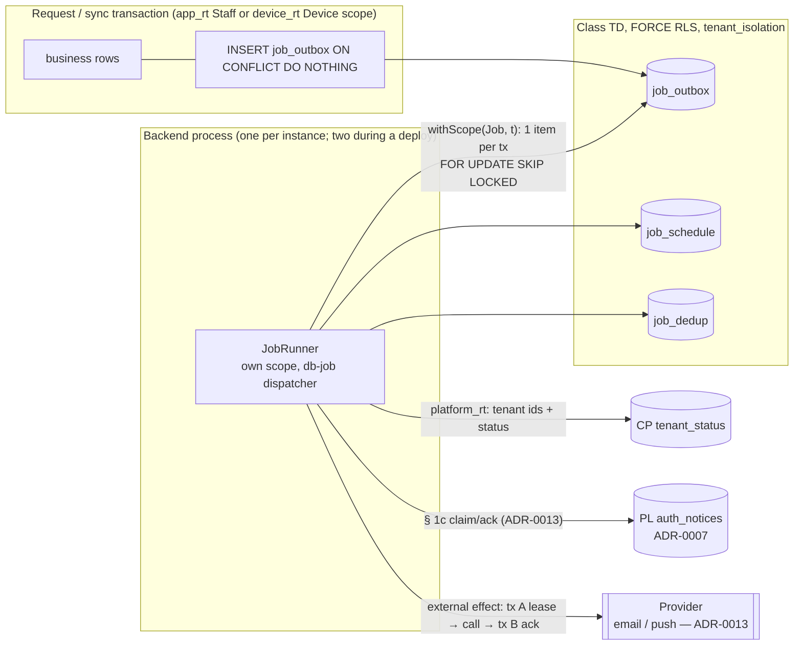

# ADR-0012: Jobs and transactional outbox — PostgreSQL work list, per-tenant sweep, no broker

## Status

Proposed

> **Who may move this to `Accepted`: the user, or `cto` on the user's explicit
> confirmation. No other agent, and no skill on its own.**
> Why this is stated here: stories referencing a `Proposed` ADR are set `Blocked`,
> and epics require `Accepted`, so the field needs a named owner. `cto` is the
> role `coordination-rules.md` escalates technical conflicts to, and an ADR is
> that decision made durable.
>
> This does **not** relax the rule that `Status: Accepted` is never set without
> explicit user confirmation — it narrows *which agent* may set it once that
> confirmation exists. An agent that believes an ADR is ready says so and
> escalates; it does not edit this field.

**Acceptance blockers.**
1. **Closed 2026-10-21:** S31c passed (research F342–F347). With `transaction_timeout` at 1,500 ms and 2,500 ms, under a 3,000 ms runner stop and without `client_connection_check_interval`, the server ended the blocking statement, the runner join finished in time and the rows were free at the next sample. The 6,000 ms control kept them locked about 2.4 s after JVM exit. The body ran once in every case. Decision 7 needs no revision; its worst-case reading is added to rule 1. Not covered: F346, F349.
2. **Closed 2026-10-21:** the founder confirmed the retention defaults in Decision 4 (done rows 7 days, dead rows 90 days).
3. **Closed 2026-10-21:** the CTO-ADR gate passed on re-check (**APPROVE**). The first run returned CONCERNS; this revision resolved its six required items and its minor items (see Decision Makers).
4. **Closed 2026-10-21:** the Draft extension of `docs/architecture/threat-models/tenant-isolation.md` boundary TB6 exists (`/threat-model tenant-isolation --update`). It adds T3.13–T3.18, T5.15–T5.18, T6.15–T6.30, AB27–AB37, M69–M87 and R-11–R-14, and covers all nine cases. Its verdict for this extension is COMPLETE WITH GAPS: R-11–R-13 are deferred to named owners, and M77 and M83 wait on decisions. The design changes it required are amended into this ADR on the same day (Decision Makers, "Threat-model amendment").
5. **Joint acceptance (ADR-0010 Ordering Note 1, founder 2026-10-21):** ADR-0010, ADR-0011 and ADR-0012 are accepted together, after one independent `/architecture-review` in a fresh session over ADR-0001–ADR-0012. ADR-0011 is written and Proposed.
6. **Open:** a short CTO re-check of the threat-model amendment delta (founder, 2026-10-21).

**Order (founder, 2026-10-21):** written as Proposed → S31c (done) → CTO-ADR (CONCERNS, revised) → CTO re-check (APPROVE) → the TB6 threat-model extension → the joint independent review with ADR-0010 and ADR-0011 → founder's acceptance. Nothing else blocks acceptance; the remaining open items have owners and do not change the decision.

## Date

2026-10-21

## Last Verified

2026-10-21

## Decision Makers

- Kamel Mohamed, founder (user). Decided on 2026-10-20/21 from `docs/research/jobs-and-outbox.md` § 5: `stack.messaging: none` with the three revisit triggers; work list W1 now and W2 on a measured trigger; lease split by effect. In this ADR's session: recurring-job rows are created by the sweep itself; the external-effect contract is fixed here and the `auth_notices` function signatures are left to ADR-0013.
- Drafted by `/architecture-decision`; `researcher` (three parallel parts) supplied the evidence.
- Stack validation, 2026-10-21, routed by `principal-engineer`:
  - `ktor-lead`: **MINOR NOTES**. No deprecated or changed API is used. The draft was corrected on the stop budgets running in sequence, the `runBlocking` bridge and the start gate, cancellation handling, the explicit `Database`, pool and dispatcher sizing, and the single `options` string.
  - `data-lead`: **3 BLOCKING items, all fixed in this draft.** C9 now lists only claimed tables, a grant matrix matches the policies, and the gauges are computed per tenant. Its minor notes were also applied: `idle_in_transaction_session_timeout`, churn and autovacuum, EXPLAIN of the claim branches, prune batching and the idempotency window, purged tenants, lock order, a read-first schedule pass, UUIDv7.
  - Exposed deprecations other than `newSuspendedTransaction` are NOT SOURCEABLE (the stack reference has no Exposed table).
- **CTO-ADR: pending — required before acceptance** (founder, 2026-10-21). This ADR is Critical and amends ADR-0001's catalogue list (C9), so the gate runs as if `--review full` for this gate only, even though `review_mode` is lean. It runs after S31c. **First run, 2026-10-21: CONCERNS.** Six required items:
  1. Exports were missing from the suspended list.
  2. A recurring job that keeps failing raised no alert.
  3. Retry bookkeeping could overwrite another runner's result.
  4. The `purged` claim on ADR-0005 was not stated in ADR-0005.
  5. No threat model was linked.
  6. The C9 amendment was incomplete.
  It also listed 11 minor items. The founder chose **Revise flagged items**; all of them are applied in this revision, with amendment notes in ADR-0001, ADR-0005 and ADR-0009, and `security-lead` decided the threat-model placement. One minor item, ADR-0010's line about this ADR's trigger, was already fixed by the map session (`1ac6d3d`). **Re-check, 2026-10-21 (commit `cfb006e`): APPROVE.** All six required items and the minor items are resolved, and no new contradiction was found in ADR-0001, ADR-0005, ADR-0009 or the registry. The two wording slips it flagged are fixed: the ADR-0001 C9 line now states that a missing grant fails loudly (42501, F112) and C9 catches it in CI, and the registry's IC-OUTBOX-SWEEP-R2 status points to R4. Still open, outside this gate: blockers 4 and 5.
- **Threat-model amendment, 2026-10-21 (founder: "Amend ADR-0012 now").** The TB6 extension of `threat-models/tenant-isolation.md` found design gaps, which are amended here:
  - Producer rows are fixed by the database (M70).
  - Per-kind producer authorisation, a producer stamp and run-time re-authorisation (M71, the confused deputy).
  - A lease token per claim guarding both branches of transaction B, on database time (M84; R-14 closed).
  - An enforced status gate with a re-read inside the transaction (M86).
  - Typed payloads and idempotency keys (M82, M73).
  - From the privacy review:
    - `job_dedup` rows kept 30 days and pending rows dead after 90 days (founder defaults);
    - the `other` marker, with person erasure reaching job rows;
    - the dead-row purpose;
    - the EXP-2 exclusion;
    - the log field allow-list.
  - ADR-0011 is now cited (Proposed, `:core:jobs`).
  - Founder decisions in the same session: the requeue path is deferred to `security-lead` with M83's constraints; R-11 (M77, crash-loop guard) is deferred to `ktor-lead` + `cto`; R-13 (a hard per-tenant ceiling) is deferred to the founder.
  - **CTO re-check of this delta (2026-10-21, commit `0b4dbbe`): CONCERNS**, with three text items. The founder chose Revise; all three are applied:
    1. Erasure deletes its own claimed row, with a tombstone as its record, and is exempt from the 90-day expiry.
    2. Steps that a cancel can race act only through a conditional transition owned by the closure flow (founder's choice); there is no `FOR SHARE` and no CP grant.
    3. An explicit `priority` column and index.
  - The re-check found the rest coherent with ADR-0001/0002/0003/0005/0008 and the registry. The deferred R-11, R-12 and R-13 do not block, provided R-11 is decided before the first export or backfill story. **Final look at the three fixes: pending** (blocker 6).
- **CTO-STACK-RISK: skipped — founder decision, 2026-10-21, not a lean-mode default.** This ADR relies on two behaviours beyond `docs/stack-reference/`: Exposed 1.5.1's default retry of a failed `suspendTransaction` block, and the Ktor 3.6.0 stop sequence. Both are covered by executed spikes on exactly those behaviours (research F326, F329–F340), and the one combination not yet run, S31c (F341), is already acceptance blocker 1. A skipped gate is not a passed gate.

## Summary

Kodeebo's hosted backend needs one way to run background work for every tenant. That covers retention, closure steps, exports, usage counts, owner and suspension notices, activity-trail jobs and backfills, and it must work under ADR-0001's FORCE RLS without a broker on a single 2-vCPU VPS. Decision: an own transactional outbox and per-tenant schedule rows in class TD, swept per tenant by an in-process `JobRunner`. Each tenant gets one `job_rt` transaction through the ADR-0002 helper, with claims made by `FOR UPDATE SKIP LOCKED` through the Exposed DSL, retries and a dead state kept in the row, and no message broker (`stack.messaging: none`). Three founder-named triggers, each tied to an observable signal, reopen the broker question.

## Stack Compatibility

| Field | Value |
|-------|-------|
| **Stack layer(s)** | Ktor backend (job runner, Exposed transactions, lifecycle); Data (PostgreSQL work tables, RLS policies, connection settings) |
| **Domain** | Messaging; Data; Tenancy |
| **Layer** | Foundation |
| **Knowledge Risk** | HIGH — Ktor 3.6.0, Exposed 1.5.1, HikariCP 7.1.0, kotlinx.coroutines 1.11.0 and PostgreSQL 18.6 are past what the model reliably knows; every behaviour used here was fetched or executed in `docs/research/jobs-and-outbox.md` |
| **References Consulted** | `docs/research/jobs-and-outbox.md` (F101–F124, F201–F224, F301–F349; evidence `docs/research/evidence/jobs-and-outbox/`); `docs/research/backend-track.md` (bt-F201–F215); `docs/stack-reference/ktor/{VERSION,best-practices,deprecated-apis,breaking-changes}.md`, `docs/stack-reference/kotlin/deprecated-apis.md`, `docs/stack-reference/postgres/{VERSION,best-practices}.md` (all Last verified 2026-10-11); `docs/registry/architecture.yaml`; `.claude/docs/standing-decisions.md` |
| **Pinned versions relied on** | `postgres:18.6`; Ktor 3.6.0; Exposed 1.5.1; HikariCP 7.1.0; Kotlin 2.4.21; kotlinx.coroutines 1.11.0; JVM toolchain 21 (`pins.yaml`); pgjdbc 42.7.14 (not yet pinned; pin proposed, research part 3 § 10) |
| **Post-Cutoff APIs Used** | Exposed `Query.forUpdate(ForUpdateOption.PostgreSQL.ForUpdate(MODE.SKIP_LOCKED))` (F321, F323); `DatabaseConfig { defaultMaxAttempts }` and `JdbcTransaction.maxAttempts` (F335–F337); `suspendTransaction` (stack reference, best-practices line 55); Ktor `ApplicationStarted`, `ApplicationStopping`, `ApplicationStopped` and the engine's `shutdownTimeout` (F313, F329–F334); `Dispatchers.IO.limitedParallelism(n, name)` (kotlin deprecated-apis line 25); PostgreSQL `transaction_timeout` (best-practices line 53) and `client_connection_check_interval` (F312) |
| **Verification Required** | (1) ~~S31c (F341)~~ **done 2026-10-21, passed (F342–F347)**: with the helper's `transaction_timeout` below the runner stop timeout, a stop during a blocking statement ended inside the stop window and freed the rows without `client_connection_check_interval`. Still open from it: the cancellation-branch test (F346) and the F349 cases, in the Ktor-side integration tests. (2) A two-instance run on the real backend image: two runners sweeping one database at once produce no duplicate effect and claim each row once (research part 2 S23). (3) The real Gradle build resolves `kotlin-stdlib` 2.4.21, not Exposed's declared 2.3.21 (F320). (4) Idle sweep duration on the JVM at the expected tenant count, against the budget this ADR proposes (Decision 10). (5) Re-run S31/S31b on every Exposed, HikariCP, pgjdbc or Ktor bump. (6) Owner `platform-lead`, before the first job story: ADR-0009 sets no stop grace period, so the backend container's Compose stop grace period is set to exceed the sum of the engine's grace and timeout, the runner stop timeout and `shutdownTimeout` (Decision 7, rule 2). (7) A churn test on `job_outbox` (`n_dead_tup` under realistic enqueue, claim and prune) sets its autovacuum parameters. (8) EXPLAIN of both claim branches with the kind filter (Decision 2). (9) Whether `ON CONFLICT DO NOTHING` needs the table-level SELECT privilege, proved by the enqueue integration test with the Decision 2 grants. |

> If Knowledge Risk is MEDIUM or HIGH, re-validate this ADR whenever a pin in
> `pins.yaml` changes. Mark it "Superseded" and write a new ADR if it no longer holds.

Critical ADR: yes — messaging and background processing for every context; Foundation layer.

## ADR Dependencies

| Field | Value |
|-------|-------|
| **Depends On** | ADR-0001 (table classes, role inventory, suspension contract), ADR-0002 (scope helper, Job kind, J1), ADR-0005 (retention, closure and export jobs), ADR-0006 (Ktor track, Decision 5/5a pools and dispatchers, Decision 6 jobs direction), ADR-0007 (`auth_notices`, M31 notice gating), ADR-0008 (two-key advisory-lock scheme and lock order; trail jobs), ADR-0009 (deploy overlap, `catalogue_rt` checks) — all Accepted |
| **Enables** | ADR-0013 (notifications: provider adapters as external-effect job kinds, the `auth_notices` claim/ack functions); every story with a background job (ADR-0005 closure steps, retention purges, exports; ADR-0001 usage counts and suspension notices; ADR-0007 owner notices; ADR-0008 trail verification and pruning; backfills); `project.yaml` `stack.messaging: none` |
| **Blocks** | Any job, outbox or scheduler code (registry FP-QUEUE-WITHOUT-ADR-R2); the first work-table migration. Per ADR-0010 Ordering Note 1, no Layer 1 code (this ADR's included) starts before ADR-0010 and ADR-0011 are also Accepted. |
| **Ordering Note** | Coordinates with ADR-0010 (core-extraction policy; Proposed, written by the map session) and ADR-0011 (module structure; Proposed, written by the map session; it places the runner and the `WorkQueue` port in `:core:jobs`). This ADR fixes the behaviour and the port, not the module path. |

## Context

### Problem Statement

Accepted ADRs already depend on background work that has no runner:
- ADR-0005: closure steps, retention purges, exports.
- ADR-0001 / ADR-0004: usage counts and the suspension notices at days 30, 60 and 80.
- ADR-0007: owner notices through `auth_notices`.
- ADR-0008: trail chain verification and pruning.
- ADR-0001: backfills as `job_rt`.

The registry forbids adopting a queue library or a broker until an ADR fixes the ADR-0001 class of its tables (FP-QUEUE-WITHOUT-ADR-R2), and `project.yaml` leaves `stack.messaging` empty. Without this decision, no story with a job can start. Each would otherwise invent its own loop, retry and lease rules under FORCE RLS, where a single policy mistake silently stops the work (F112).

### Current State

No backend code exists. ADR-0006 Decision 6 gives the direction (own outbox, a per-tenant sweep driven by `platform_rt`'s tenant list, `FOR UPDATE SKIP LOCKED` claims, the dedup row in the effect's transaction, `traceparent` on work rows). It also leaves three questions to this ADR: the work-list tables and their class, how the loop starts and stops in Ktor (bt-F215), and whether the claim works through Exposed (bt-F214). The research note now answers all three with executed evidence.

### Constraints

- **Tenancy (ADR-0001, ADR-0002):**
  - Every tenant table is FORCE RLS, with a restrictive tenant policy plus one permissive policy per role.
  - `job_rt` works on exactly one tenant per transaction through the scope helper and never lists tenants.
  - `platform_rt` alone reads CP across tenants.
  - Class G is written only by reviewed migrations.
  - No role has BYPASSRLS.
- **Stack:**
  - Ktor 3.6.0, Exposed 1.5.1 `suspendTransaction` only (not the deprecated `newSuspendedTransaction`).
  - One HikariCP pool per LOGIN role, with blocking JDBC on `Dispatchers.IO.limitedParallelism(n, name)` (ADR-0006 § 5a).
  - PostgreSQL 18.6 with no pooler (ADR-0002 P1).
- **Operations:** one VPS (8 GB RAM, 2 vCPU) shared with PostgreSQL, nginx and the Collector; one developer; deploys overlap two backend processes (ADR-0009, F220).
- **Distribution:** hosted only. L1–L4 (`.claude/docs/standing-decisions.md`) do not bind; nothing chosen here would block a later customer bundle.
- **Standards:** no hardcoded business values; every repeatable write is idempotent; no PII in payloads or telemetry; every job emits a span, RED metrics and structured logs.

### Requirements

- At-least-once execution of every enqueued item and every due recurring job. Effects are idempotent by key, so a re-run changes nothing.
- No job can read or write another tenant's rows; a job that runs without a scope sees nothing.
- Safe with two backend instances at once, from the first release.
- A stopped or killed process never leaves work stuck beyond a stated bound.
- A broken policy, a poison item or a stalled loop is detected by an alert, never discovered by its absence.
- Tenant status gates which job kinds run (suspension and closure contracts).

Research note: `docs/research/jobs-and-outbox.md` (Status Draft, COMPLETE WITH GAPS; the founder agreed the gaps do not block, 2026-10-21).

## Decision

**1. No message broker: `stack.messaging: none`.** Background work and the outbox live in PostgreSQL and run in the backend process. LISTEN/NOTIFY is not used. Every broker assessed (NATS JetStream, RabbitMQ, Kafka, Valkey/Redis Streams) delivers at least once at best, so a broker would remove none of the outbox's duties (F224). `project.yaml` gets `stack.messaging: none` once this ADR is Accepted. The question reopens only on a trigger in Decision 11.

**2. Work tables, all class TD** (ADR-0001 § 1a), each with `tenant_id uuid NOT NULL`, `ENABLE` + `FORCE ROW LEVEL SECURITY`, the restrictive `tenant_isolation` policy with no `TO`, and these permissive policies (per F124, a role needs every policy its statement touches):

| Table | Purpose | Permissive policies (role: commands) |
|---|---|---|
| `job_outbox` | One row per enqueued work item | `app_rt`, `device_rt`, `job_rt`: INSERT, plus SELECT (required by `ON CONFLICT DO NOTHING` with an arbiter, F124); `job_rt`: UPDATE, DELETE (prune) |
| `job_schedule` | One row per (tenant, recurring kind) | `job_rt`: SELECT, INSERT, UPDATE, DELETE (kind retired) |
| `job_dedup` | Effect-side idempotency record for handlers that declare a dedup key | `job_rt`: SELECT, INSERT, DELETE (prune) |

Table grants match the policies exactly, as ADR-0001 check C2 requires (a grant with no policy for that command, or a policy with no grant, fails the build):

| Table | `app_rt` | `device_rt` | `job_rt` |
|---|---|---|---|
| `job_outbox` | SELECT, INSERT | SELECT, INSERT | SELECT, INSERT, UPDATE, DELETE |
| `job_schedule` | — | — | SELECT, INSERT, UPDATE, DELETE |
| `job_dedup` | — | — | SELECT, INSERT, DELETE |

- The SELECT grant for `app_rt` and `device_rt` on `job_outbox` exists only for `ON CONFLICT DO NOTHING`. Whether PostgreSQL needs the table-level SELECT privilege for that statement was not sourced (F124 covers policies only), so the grant is given explicitly and the integration test proves the enqueue.
- No other role gets a grant on these tables.
- **Producer rows are fixed by the database** (threat model M70, T3.14):
  - The `app_rt` and `device_rt` INSERT `WITH CHECK` on `job_outbox` requires `status = 'pending'`, `attempts = 0`, NULL lease, done and error columns, and `run_at` within the kind's window. Column-level INSERT privileges are the alternative; `data-lead` chooses one and confirms C2 still holds.
  - A trigger makes `tenant_id`, `kind`, `payload`, `idempotency_key` and the producer stamp immutable for every role.
  - The runner takes `effect` and `max_attempts` from the compiled kind registry, never from the row.
- **Producer authorisation** (M71, T3.15 confused deputy, T6.20):
  - Every kind declares the producer scope kinds it accepts: Staff-owner, Staff-any, Device or Job.
  - The `WorkQueue` adapter refuses any other producer, and stamps `producer_kind` and `producer_subject` from the scoped transaction, never from the `WorkItem`. For `device_rt`, the `WITH CHECK` also requires `producer_subject = current_setting('app.device_id')`.
  - Enforcing the allow-list in the database through a G table of kinds is optional; `data-lead` decides it on cost.
  - Handlers of person-started or branch-limited kinds re-check the producer's status and permission at run time (as ADR-0003's export rule does) and re-load payload ids under RLS. A failed re-check ends the item as `Dead(reauth_refused)` with a security event.

- `job_outbox` columns:
  - `id` (a UUIDv7 from the injected `IdGenerator`, postgres best-practices line 51), `kind`, `effect` (`db` | `external`), `idempotency_key`.
  - `payload jsonb`: ids and enums only, with a size cap from config.
  - `status` (`pending` | `running` | `done` | `dead`; `running` is used only by `external` items), `run_at`, `attempts`, `max_attempts`.
  - `lease_until`, `lease_token` (a fresh UUIDv7 per claim, M84), `lease_owner` (the `instanceId`, for metrics only), `producer_kind`, `producer_subject`, `last_error_class` (an enum, never message text), `traceparent`, `created_at`, `done_at`.
  - Unique `(tenant_id, kind, idempotency_key)`.
  - `priority` (smallint, set by the `WorkQueue` adapter from the kind registry and bounded by the producer `WITH CHECK`; M85): security notices and closure or erasure steps rank above bulk kinds, and the claim orders by (`priority`, `run_at`).
  - Partial indexes `(tenant_id, priority, run_at) WHERE status = 'pending'` and `(tenant_id, lease_until) WHERE status = 'running'`, plus `(tenant_id, done_at) WHERE status IN ('done', 'dead')` for the prune.
  - Before the first release, EXPLAIN both claim branches (pending and expired lease) with the kind filter; `kind` joins the indexes if rows of kinds a tenant's status does not allow are re-scanned on every pass. F116 measured only the pending branch.
  - Per-table autovacuum settings for `job_outbox` are set from a churn test (`n_dead_tup` under a realistic enqueue, claim and prune rate). F116 measured static rows only, and the stack reference has no autovacuum guidance.
- `job_schedule` columns: `kind`, `next_run_at`, `last_run_at`, `last_outcome`, `runs`, `consecutive_failures`, `last_error_class`; primary key `(tenant_id, kind)`. Each kind's interval comes from config, not from a column. A recurring row has no `dead` state (Decision 4).
- Every table is recorded in the class list in its own migration, and owned by `migrator`.
- **New catalogue check C9 (CI and the scheduled `catalogue_rt` run; amends ADR-0001's checks C1–C6 and C8, of which there is no C7, and ADR-0009's "C1–C8" wording, by dated amendment notes in both ADRs):** every table listed as **claimed** in the class list (today `job_outbox` and `job_schedule`, the tables read with `FOR UPDATE`) must carry `job_rt` permissive SELECT **and** UPDATE policies. Without the UPDATE policy a claim returns 0 rows and no error, so the queue goes dark silently (F112). Without the SELECT policy the claim also sees nothing, and the per-tenant metrics read nothing, so the metric canary cannot catch it; C9 covers both. `job_dedup` is never claimed and is not in C9's list. C9 is proved by a planted claimed table that lacks each policy in turn. **How C9 relates to C2:** C2 already fails a role that has a grant without a matching policy, which covers F112's case of an UPDATE grant with no UPDATE policy. C9 is the per-table declared-intent check: a table marked claimed must have both policies, even if someone dropped the grant and the policy together. The `claimed` marker is kept by hand, so an integration test fails when the job adapter claims a table that is not marked. ADR-0001 § 1a lists the three tables as TD, and its class-list format gains the marker (ADR-0001 amendment 2026-10-21). S58 is re-run so that `catalogue_rt` provably needs no new grant (ADR-0009 amendment 2026-10-21).
- No other role gets a policy on these tables. `platform_rt` never reads them. No class G, CP or PL work table is created by this ADR.

**3. The sweep: per tenant, one item per transaction.** Each pass of the `JobRunner`:
1. Reads tenant ids and status from CP `tenant_status` as `platform_rt`, on its own pool, with no cache (ADR-0001 reads status per request).
2. Visits tenants in a rotating order and does the following for each, up to `batchPerTenant` items per pass (config):
   - (a) In one `withScope(Job, tenant)` transaction, reads the tenant's `job_schedule` kinds first and inserts only the missing ones for the recurring kinds this tenant's status allows (`INSERT … ON CONFLICT DO NOTHING`, from the compiled kind registry). A quiet pass therefore writes nothing, and a new kind needs no backfill. The same transaction reads the tenant's pending count, oldest pending age and dead count for the metrics (Decision 9).
   - (b) Repeatedly opens one `withScope(Job, tenant)` transaction that claims **one** item: a due `job_schedule` row, or a due `job_outbox` row (`pending` with `run_at <= now`, or `running` with `lease_until < now`) of an allowed kind. The claim uses the Exposed DSL `forUpdate(ForUpdateOption.PostgreSQL.ForUpdate(MODE.SKIP_LOCKED))` with `limit(1)` (F323). Raw `exec` is not needed for the claim.
   - (c) Runs that item under Decision 5, then commits.

Rules that follow from this design:
- **One item per transaction** isolates failures. A failing item rolls back only itself, its retry bookkeeping is written in a fresh transaction, and no nested transaction or savepoint is used (registry FP-NEW-SUSPENDED-TRANSACTION).
- **No singleton and no new advisory lock.** Two runners (the deploy overlap, F220, or a second instance) sweep the same database safely: every claim is a row lock and is skipped by the other runner (F305, F323). A recurring run is advanced in the same transaction as its effect (F118). Session-level advisory locks are forbidden in job code (F103, F119). A job kind that needs serialisation within a tenant uses the existing two-key, transaction-level scheme of ADR-0008 (TR-OWNER-ROLE-R3), with its own class id registered there. **Lock order inside a job transaction:** the claim's row lock first, then any ADR-0008 advisory locks in their order (journal, trail, last-owner, then job class ids), then the inserts that enqueue follow-up work.
- **Tenant status gates kinds.** Every job kind declares the tenant statuses it runs in, and the sweep filters claims by them. The gate is enforced, not just declared (threat model M86, T6.28):
  - A registry unit test fails when a kind's `runsWhen` is not a subset of its class default, or when any kind runs for `purged`.
  - **State-sensitive kinds that a closure cancel can race** (closure steps, purges) act only through a **conditional transition** owned by the closure flow (founder, 2026-10-21; CTO delta re-check item 2). The transition is `UPDATE … WHERE state = :expected`, run by the role ADR-0005 assigns, through its existing closure path. Zero rows means the step does nothing and logs `NotYet`. No `FOR SHARE` is used, and `job_rt` gets no grant on CP `tenant_status`, so ADR-0001's CP matrix is unchanged; the ADR-0005 closure story specifies the function. A plain re-read of `tenant_status` is allowed only for kinds where a stale status is harmless (for example, an export the owner can repeat).

  The defaults come from Accepted contracts (TR-SUSPENSION-CONTRACT-R3, TR-CLOSURE-STATES-R4):
  - **suspended:** usage counts, routine retention, suspension and auth notices, trail verification, and the **owner's tenant-wide export** (the suspended dashboard keeps export and payment, TR-SUSPENSION-CONTRACT-R3 and ADR-0001 Decision 4; the export runs as `job_rt` per ADR-0005 Decision 5), with job pruning. No closure purge.
  - **closure states:** their ADR-0005 step plus the kinds that contract keeps. **`archive_retained`** lists them explicitly: the archive export (after `ArchiveRequest.verify`), the archive purge when `retain_until` passes with no legal hold, and job pruning.
  - **purged:** nothing. The step that reaches `purged` deletes the tenant's `job_*` rows, its own claimed row included, inside its own transaction; its record is the deletion-journal entry (ADR-0005 Decision 1, amendment 2026-10-21). No job row reappears, because no kind runs for `purged` and the sweep creates no schedule rows for it.
  - A kind's feature spec may narrow this list, never widen it.

**4. Enqueue, retry, dead items and retention.**
- **Enqueue** is an insert into `job_outbox` inside the business transaction that causes it: `app_rt` in a Staff scope, `device_rt` in a Device scope, or `job_rt` for a job that chains another. It uses `ON CONFLICT (tenant_id, kind, idempotency_key) DO NOTHING`, so repeating it is harmless.
  - The payload holds ids and enums only, never personal data or free text, and stays under the configured size cap. This is **enforced by type** (founder, 2026-10-21; threat model T6.24, M82):
    - `JobPayload` is a sealed domain type whose properties may only be typed id value classes, enums, bounded integers and instants.
    - An architecture test covers every subtype, a CHECK enforces the size cap, and `/code-review` carries the checklist item "payload and key hold ids only".
    - Owner: `ktor-lead`, story S-TI-76, delivered with the first job story.
  - The **idempotency key is a typed value built from domain ids and versions** by one builder per kind, never from a request field or a personal value, and never a hash of one (privacy F1, M73). Suppression-sensitive kinds (security notices, erasure) are enqueued only by their owning use case.
  - `traceparent` is stored only if it matches the W3C format. The consumer starts its own trace with a **span link** to the stored context, never a parent taken from a producer-controlled string.
- **Retry:** on failure, a fresh transaction sets `attempts + 1`, a `last_error_class`, and `run_at = now + min(cap, base · 2^(attempts−1)) · jitter`. **The update is guarded:** the fresh transaction first re-claims the row with `FOR UPDATE SKIP LOCKED WHERE id = :id AND status = :seenStatus AND attempts = :seenAttempts` (for a schedule row: `AND next_run_at = :seenNextRunAt`). If it gets no row, another runner has claimed or finished the item since the failed transaction released its lock, and the bookkeeping is dropped, never written over that runner's result. A two-runner test on the failure path proves this. The jitter comes from an injected random source in [0.5, 1.0]. At `max_attempts` the row becomes `dead`. `base`, `cap` and `max_attempts` are per-kind config with typed defaults; the spike's 30 s / 3600 s / 4 are placeholders (F117).
- **Recurring rows that fail** do not go dead, because the kind must keep running. The same guarded transaction sets `consecutive_failures + 1`, `last_error_class`, and `next_run_at = now + min(interval, backoff)` with the same formula, so a failing kind retries sooner than its interval but never more often than the backoff allows. A success resets `consecutive_failures` to 0. An alert fires when `consecutive_failures` reaches a per-kind threshold (config) or the row is overdue (Decision 9).
- **Dead items** keep their row and payload, raise an alert (Decision 9) and are never retried automatically. This ADR provides no requeue path; one is decided with `security-lead` before the first job kind ships.
- **Retention** (ADR-0005 G retention table, added by a reviewed migration):
  - `job_done_rows`: default **7 days** (founder, 2026-10-21).
  - `job_dead_rows`: default **90 days**, the same as `auth_notices` after sending (founder, 2026-10-21). Purpose: failure investigation and, once the requeue path is decided (threat model R-12), replay. The period is revisited with that decision.
  - `job_dedup_rows`: default **30 days** (founder, 2026-10-21; privacy F2). That is longer than the done window and the external lease and retry window, and equal to the backup window.
  - **Maximum pending age:** a pending row older than **90 days** (founder, 2026-10-21; privacy F3; a per-kind typed default) goes `dead` with error class `expired` and raises the dead alert. **Closure steps, purges and person-erasure steps are exempt** (CTO delta re-check item 1): they must never end dead by age while no requeue path exists (R-12).
  - **Personal-data marker (ADR-0005):** `other` for all three tables, so `purge_personal` does not delete in-flight closure items. **Person erasure (ADR-0005 M55) reaches them:** in the same `job_rt` transaction that deletes the person mapping, it deletes every `job_outbox` and `job_dedup` row whose kind-declared person-id field names the erased person, in any status. That includes **the erasure item's own claimed row**, which names the person and which it already holds locked; its completion record is the deletion-journal tombstone, not a `done` row, as for `purged`. A `db` row locked by a handler waits at most one `transaction_timeout`; an `external` row already leased may still complete its provider call, after which its transaction B updates 0 rows.
  - **Export:** EXP-2 excludes the three tables (operational state, ids only), as listed in the export coverage test. A person's data request returns metadata only (kind, status, timestamps, error class) for rows naming that person.
  - Pruning is itself a recurring kind (`job_rt`, per tenant), deleting in batches through the `done_at` index.
  - The done-row period is also the **idempotency window**: once a done row is pruned, an enqueue with the same key runs again. Causes whose key can recur after that window use `job_dedup` or a natural key that cannot repeat.
  - Both are typed defaults in the retention table, changed only by a reviewed migration (TR-RETENTION-DEFAULTS-R5); acceptance blocker 2 is closed.
- **Per-tenant backlog:** the sweep's per-tenant batch keeps the other tenants served. The pending count per tenant is a gauge with an alert threshold; enqueue is never refused because of it.

**5. Lease split by effect (founder, 2026-10-20).** Each handler declares its effect class.
- **`db` effects** (the effect touches only this database):
  - Claim, effect and `status = 'done'` (or the advanced `job_schedule` row) commit in **one** transaction. The open transaction is the lease.
  - A killed or stopped worker's transaction aborts and the row becomes claimable again (F311, F333, F340). The outbox row itself is the dedup record (F306, F324).
- **`external` effects** (an email, a push or any provider call):
  1. Transaction A claims the row and sets `status = 'running'`, `lease_until = now() + leaseDuration` (database time, M84), a fresh `lease_token`, `lease_owner = instanceId` and `attempts + 1`, then commits.
  2. The provider is called **outside any transaction**, with the item id as the provider's idempotency key, under a timeout, a retry policy and a circuit breaker.
  3. Transaction B marks the row `done`, but only `WHERE status = 'running' AND lease_token = :token` (the token of this claim). On failure, B sets it back to `pending` with backoff, or `dead`, under the **same guard**. A claim per process could not tell two coroutines apart, so the token is per claim (threat model T6.26, M84).
  4. An expired lease makes the row claimable by any runner. Because the item id is the provider key, a duplicate call is absorbed by the provider.
  - `leaseDuration` (config) must exceed the provider timeout plus the retry budget.
  - "Done" means **the provider accepted the message**, which is the event ADR-0007's M31 notice gating needs.
- **`auth_notices`** (class PL, ADR-0007) follows the external-effect contract. Its claim and acknowledge functions are amended into ADR-0001 § 1c by **ADR-0013** once the provider is chosen; until then, no notice kind ships. Today the § 1c list has only `AuthNotices.claim(batch)`. This ADR's rule is one item per transaction (Decision 3), so ADR-0013 either claims one notice per call or states why a batch is safe under the external-effect contract (each notice leased and acknowledged on its own).
- **`job_dedup`** is written in the effect's transaction only by handlers whose effect can be reached by more than one item (fan-out), or whose cause can recur after the idempotency window. Others rely on the outbox row.
- **Cancellation (coroutines):**
  - A `CancellationException` is always rethrown and never classified as a `Retry` or `Dead` outcome.
  - The retry bookkeeping and the external effect's transaction B run in `withContext(NonCancellable)`, so a stop cannot cut them in half.
  - After a stop, an `external` row stays `running` until its lease expires, and is then claimable again.
  - Each of these has a test.

**6. Exposed and connection rules for job work.**
- The `job_rt` and `platform_rt` `Database` objects are created with `DatabaseConfig { defaultMaxAttempts = 1 }`. For `platform_rt` this also applies to its per-request tenant-status reads (ADR-0001): this ADR **refines ADR-0006 § 5a** for that pool. With Exposed's default (3), a failed block runs again: a `transaction_timeout` stretched from 500 ms to 1.6 s and ran the body three times (F326, F336). With 1, it ran once and failed in 505 ms (F337). Every job transaction also asserts `maxAttempts == 1` at runtime.
- **The helper always passes the role's `Database` explicitly** to `suspendTransaction`. There are five `Database` objects, one per LOGIN role (ADR-0006 § 5a), and which one is the default when none is passed was not sourced. An integration test asserts `current_user` equals the intended role for each kind of transaction.
- **Handlers never open their own transaction.** A `db` handler uses the `ScopedTransaction` it is given. A nested block shares the outer transaction (ktor best-practices line 55), so retry bookkeeping opens only after the failed block has exited.
- **Connection settings:**
  - The `job_rt` and `platform_rt` pools set `client_connection_check_interval` (config; typed default 1 s, the value used in F339) through the pgjdbc `options` data-source property. A statement still running when the JVM goes away then ends within about a second, and its rows are freed (F311, F338, F339).
  - The `job_rt` pool also sets `idle_in_transaction_session_timeout` (config, typed default) in the same `options` string, not by `ALTER ROLE`, so no privileged migration is needed (ADR-0001 § 1b, ADR-0009). It bounds a `db` handler that suspends inside its transaction (F113 left this untested; postgres best-practices line 53).
  - `options` is a single string, and a second assignment overwrites the first, so it is built in **one place** from all the `-c` settings a pool needs.
  - The evidence is Linux and loopback only (F339).
- **Pools and dispatchers:**
  - The `job_rt` pool runs blocking work on its own `Dispatchers.IO.limitedParallelism(n, "db-job")`, with `n` no larger than the pool.
  - The sweep's tenant-list read shares the `platform_rt` pool and the `"db-platform"` dispatcher with the per-request status reads (ADR-0001), so it is one short query per pass.
  - Runner concurrency: one sweep loop per process, with items run one at a time per tenant and up to `jobParallelism` tenants at once (config, at most `n`).
  - `transaction_timeout` ends the session and Hikari evicts the connection (F308, F326), so a high timeout rate shows up as pool churn. That rate is a metric.
  - Pool sizes, `maxLifetime` and leak detection come from S18. The stack reference has no sourced values for them (ktor best-practices line 56).

**7. Timeout ordering.**
- Every kind has a transaction budget, which the helper sets first as `transaction_timeout` (ADR-0002, F308).
- **Rule 1:** `transaction_timeout` (per kind) < `JobRunner` stop timeout. Coroutine cancellation does not interrupt a JDBC statement (F338), so the server, not the runner, has to end an item that is still running when the stop arrives. `transaction_timeout` counts from the start of the transaction, so the worst case from the stop signal to the server ending the statement is the kind's full timeout (a stop just after the claim). That full value must fit under the runner stop timeout. Executed in S31c: 1,500 ms and 2,500 ms passed under 3,000 ms, and the 6,000 ms control failed as predicted (F342–F344).
- **Rule 2:** Ktor's stop phases run **one after another, not nested** (F313, F332, F338):
  1. `engine.stop(gracePeriod, timeout)`;
  2. the `ApplicationStopping` handlers (the runner's stop, bounded by its own timeout);
  3. `disposeAndJoin` under `withTimeout(shutdownTimeout)`, set explicitly (default 5000 ms, F334);
  4. `ApplicationStopped`.

  The sum of the engine's grace and timeout, the runner stop timeout and `shutdownTimeout` must stay **below the container's stop grace period** in Compose (ADR-0009). Otherwise the process is killed before `ApplicationStopped` closes the pools. That Compose value was not checked here (Verification Required).
- Without these two rules, the process exits with work in flight and its rows stay locked until the statement ends.
- **Long kinds**, whose budget exceeds the stop timeout (tenant exports, for example), are restartable by construction. On stop they are abandoned, the server rolls them back when the connection drops (Decision 6), and they run again at the next start.
- S31c (F342–F347) confirmed the ordering on 2026-10-21.

**8. Lifecycle in Ktor 3.6.0.**
- One `JobRunner` per process, with its own `CoroutineScope(SupervisorJob() + jobDispatcher)`:
  - Started from an `ApplicationStarted` handler.
  - Stopped from an `ApplicationStopping` handler with `stop(timeout)` (cancel, then join under our own `withTimeoutOrNull`). It logs the drain time and whether the stop timed out. The handler is not a suspend function, so it bridges to `stop` with `runBlocking`, as the spike did (S31.kt); the runner's own timeout bounds that block.
  - `start()` is gated by config (`jobs.enabled`, typed default on in the deployed backend), so `testApplication` route tests never start a runner. Whether `testApplication` raises `ApplicationStarted` was not sourced, so the gate does not rely on it.
- The Hikari pools are closed in an `ApplicationStopped` handler. Closing them in `ApplicationStopping` closes connections that are still in use and breaks the rollback (F331).
- Never use `ApplicationStopPreparing`: its order was observed (F329) but its meaning is undocumented (F315). Never call `@InternalAPI` `disposeAndJoin`, and never launch the loop on the `Application` scope.
- The runner lives in the backend process and image. A separate worker container is a revisit item (Decision 11), not a default.
- Each process start generates an `instanceId`, used for leases and as a metric label.

**9. Observability (required spans, metrics and alerts).**
- **Sampling:** the Java agent instruments every JDBC call, so idle tenant visits produce spans that grow with tenants × passes. Each `job.sweep` pass is a trace root sampled at a configured ratio (typed default; `observability-engineer` sets it). `job.run` starts its own trace with a span link and is always recorded, so the spans of idle visits appear only in sampled sweep traces.
- **Spans:** `job.sweep` per pass; `job.tenant` per tenant visit; `job.run` per item (kind, attempt, effect, outcome; a link to the stored `traceparent`); `outbox.enqueue` inside the business span; `job.deliver` for the provider call of an external item.
- **Metrics:**
  - `jobs_claimed_total{kind}`, `jobs_completed_total{kind,outcome}`, `jobs_retried_total{kind}`, `jobs_dead_total{kind}`, `job_duration_seconds{kind}`.
  - `job_pending{kind}` and `job_oldest_pending_age_seconds{kind}` (the dark-queue canary); `job_schedule_overdue_seconds{kind}` (the largest `now − next_run_at` among due schedule rows of allowed kinds) and `job_schedule_consecutive_failures{kind}` (the largest value), both read in Decision 3a.
  - `sweep_duration_seconds`, `sweep_tenants_visited`, `sweep_last_success_timestamp`.
  - `job_claims_total{instance_id}`, transaction attempts per job block (above 1 is a bug), 25P04 terminations, pool in-use / idle / wait for both pools, and runner drain time with its timed-out flag.
  - A tenant id is never a metric label.
  - **How the gauges are computed:** no role may read `job_*` across tenants (`platform_rt` has no policy on them, and `job_rt` sees one tenant per transaction). So `job_pending`, `job_oldest_pending_age_seconds` and the dead counts are read **per tenant inside the sweep's scoped transaction** (Decision 3a) and aggregated in the process for each pass. A global query would be filtered silently to 0 rows. The canary depends on the sweep visiting the tenant and on the SELECT policy existing; C9 covers the policy, and the missed-sweep alert covers the visit.
- **Logs:**
  - Structured, carrying `trace_id`, with ids and enums only and no payloads: `job.claimed`, `job.succeeded`, `job.failed`, `job.dead`, `sweep.completed`, `sweep.missed`, `job.loop.started`, `job.loop.stopping`, `job.loop.stopped`.
  - Hikari's "marked as broken" and Exposed's rollback-failed WARNs are never the only record of a failure.
  - **Field allow-list** (privacy F8; threat model M87): job logs and spans carry only the tenant id, job id, kind, trace id, attempt, outcome and error class, enforced by a test. Exposed and Hikari failures are logged through a wrapper that drops SQL text and parameter values. Further events: `job.bookkeeping.dropped`, `job.requeued` and `job.discarded` (actor id), and a dated daily dead-count summary per kind kept beyond the 90-day prune.
- **Alerts:**
  - Any increase in dead items.
  - The oldest pending age above a per-kind threshold.
  - A recurring kind overdue beyond a per-kind threshold, or its consecutive failures at the threshold (Decision 4).
  - No successful sweep within N intervals.
  - Two `instance_id`s claiming within one window outside a deploy.
- **Runbooks:** outbox backlog, dead items, stuck rows after a kill (`sre-lead`).

**10. Budgets.**
- `perf-budgets.md` has no row for jobs. This ADR proposes these for `performance-engineer` to set:
  - sweep pass duration;
  - oldest pending age per kind class;
  - per-item run time per kind;
  - job and platform pool use;
  - the enqueue cost on the close-bill path (one insert in the business transaction, unmeasured).
- Until they are set, performance is "not checked", never "met".

**11. Revisit triggers (founder, 2026-10-20).** Any of these reopens Decision 1 and, where named, Decision 8:

| Trigger | Signal that fires it | What is reconsidered first |
|---|---|---|
| A second backend instance kept running (not only the deploy overlap) | A second replica in the Compose file; two `instance_id`s claiming in one window outside a deploy; measured claim or poll load on the primary above its budget | A separate worker container (Decision 8); LISTEN/NOTIFY as a wake-up hint on a dedicated, non-pooled connection (polling stays the floor, F120). A broker only if consumers outside the backend need the stream |
| Many integrations | Distinct outbound destinations growing; oldest pending age rising while workers are idle (one slow endpoint blocking the rest); per-destination retry or dead share | Per-destination delivery rows fanned out from the outbox, signed and sent through the allowlisting egress client, after a webhooks threat model. Then a broker (re-research NATS JetStream, then RabbitMQ, then Kafka once sourced) or CDC (Debezium; needs a replication role ADR-0001 does not list) |
| Advanced search | A search requirement PostgreSQL full-text search or `pg_trgm` fails on real data (Arabic included); search p95 or index cost above budget | An external engine fed idempotently from the outbox, with a rebuild path; licences recorded first (Meilisearch MIT + BUSL parts, Typesense GPL-3.0, OpenSearch Apache-2.0, Elasticsearch AGPL/SSPL/ELv2) |

The thresholds are set by `performance-engineer` with the budgets in Decision 10.

**12. Shared core.** `saas-core-kotlin` has no jobs module yet, so this is a **product-local adapter behind the port** that the core module will expose (ADR-0006 lists `Outbox/WorkQueue`; `coordination-rules.md` § Shared core absent). Extraction per ADR-0010's trigger (Decision 7). `jobs` is outside `/core-extract`'s core-module categories and is a core module only by ADR-0010 Decision 8's founder exception. It is scheduled with `/core-extract`. The ports below must not change when the code moves.

### Architecture



The tenant boundary is the transaction: every `job_rt` statement runs inside one `withScope(Job, tenant)` transaction, and a statement with no scope sees 0 rows (F304, F322). The only cross-tenant read is `platform_rt` on CP. The trust boundary to providers is the external-effect path, which carries only ids and the provider's idempotency key.

### Key Interfaces

Ports, app layer (product-local now, lifted unchanged into the `saas-core-kotlin` jobs module):

```kotlin
/** Enqueues work inside the caller's scoped transaction; a repeated key is a no-op. Never opens a transaction. */
interface WorkQueue {
    suspend fun enqueue(tx: ScopedTransaction, item: WorkItem)
}

data class WorkItem(
    val kind: JobKind,
    val idempotencyKey: IdempotencyKey,  // typed, built from domain ids by the kind's builder; unique per (tenant, kind)
    val payload: JobPayload,              // sealed type: typed ids, enums, bounded integers, instants only; size-capped
    val runAt: Instant? = null,           // null = now (from the injected Clock)
    val traceparent: String? = null,      // stored only if W3C-valid
)

enum class EffectClass { DB, EXTERNAL }

/** One handler per kind. DB handlers run inside the claim transaction; EXTERNAL handlers run outside it. */
interface JobHandler {
    val kind: JobKind
    val effect: EffectClass
    val runsWhen: Set<TenantStatus>       // narrowing of the Decision 3 defaults only; checked by a registry test
    val producers: Set<ProducerScope>     // Staff-owner, Staff-any, Device, Job; the WorkQueue adapter refuses others
    val personRefs: Set<PayloadField>     // payload fields that may name a person; person erasure deletes rows by them
    suspend fun run(ctx: JobContext, item: ClaimedItem): JobOutcome
}

sealed interface JobOutcome {
    data object Done : JobOutcome
    data class Retry(val errorClass: JobErrorClass) : JobOutcome
    data class Dead(val errorClass: JobErrorClass) : JobOutcome
}

/** Started from ApplicationStarted, stopped from ApplicationStopping; pools close in ApplicationStopped. */
interface JobRunner {
    fun start()
    suspend fun stop(timeout: Duration): StopResult   // drained | timedOut, with drain time
}
```

`ScopedTransaction` is the handle the ADR-0002 helper gives a caller inside `withScope`. `Clock`, `IdGenerator` and the jitter source are injected (coding standard). No HTTP surface is added, so nothing goes to `contracts/`.

### Implementation Guidelines

- **domain** must never import Exposed, Ktor, HikariCP or JDBC. `JobKind`, `JobPayload`, `JobOutcome`, `EffectClass` and the retry arithmetic (backoff, dead threshold) are pure domain code with unit tests.
- **app** holds `WorkQueue`, `JobHandler`, `JobRunner` and the sweep orchestration. It reaches the database only through ports. Handlers for other contexts live in those contexts' `app` layers and register with the runner.
- **adapters** implement the ports on Exposed through the ADR-0002 helper:
  - Must use `suspendTransaction`, never the deprecated `newSuspendedTransaction`.
  - Must use the Exposed DSL claim (`forUpdate(...SKIP_LOCKED)`, `limit(1)`).
  - Must create the job and platform `Database` objects with `defaultMaxAttempts = 1`.
  - Must set `client_connection_check_interval` on the `job_rt` and `platform_rt` pools.
  - Must never open a raw JDBC connection (registry FP-RAW-JDBC-OUTSIDE-HELPER).
- **Must never:**
  - poll `job_*` tables without a tenant scope;
  - grant `platform_rt` any policy on them;
  - use a session-level advisory lock;
  - use LISTEN/NOTIFY;
  - put personal data or free text in a payload, a log or a metric label;
  - call a provider inside a database transaction;
  - close a pool before the runner has stopped;
  - adopt a queue library or a broker without a new ADR (FP-QUEUE-WITHOUT-ADR-R2 stays).
- **Tests:**
  - Unit tests for the retry arithmetic and the kind/status gate.
  - Testcontainers integration tests on `postgres:18.6` for each S31 case (X1–X9), with the S31b attempt-count and blocking-statement cases kept as regression tests.
  - A two-runner test: no duplicate effect, each row claimed once.
  - C9 with a planted table.
  - A cross-tenant negative test: an enqueue for another tenant is refused, and a claim without scope returns 0 rows.

## Alternatives Considered

### Alternative 1: A JVM queue library (db-scheduler 16.12.0, JobRunr 9.0.2, Quartz 2.5.2 JDBC store)

- **Description**: the library owns its tables (db-scheduler: one `scheduled_tasks` table, F109; Quartz: the fixed `QRTZ_*` schema, F110; JobRunr: four tables and a view, F107) and polls them globally.
- **Pros**: retry, heartbeat and recurring schedules come built in, so there is less of our own code (about 100–200 lines of SQL and Kotlin saved, an estimate).
- **Cons**:
  - The tables have no `tenant_id`, so they fit no ADR-0001 class. A global poll needs a role that lists every tenant's work, which contradicts "`job_rt` never lists tenants" and FP-QUEUE-WITHOUT-ADR-R2. An ADR-0001 amendment (a new class or role) would come first.
  - db-scheduler has no dead state (F106), and its transactional enqueue through an Exposed transaction is unproven (bt-F203, bt-F214).
  - JobRunr 9.0.2 was published the day the research ran, and is LGPL-3.0-or-later or commercial (F122).
- **Cost / Risk / Performance / Operability**: one dependency and its own pool and role; work rows sit outside RLS; not measured; library-owned DDL has to be run by `migrator`. In a customer bundle, JobRunr's licence would need review.
- **Estimated Effort**: less code, plus an ADR-0001 amendment and an isolation design we would still own.
- **Rejection Reason**: Kodeebo's isolation rests on every tenant row being under the restrictive policy and touched one tenant per transaction. A library table breaks that, and the code it saves is small next to the isolation work it adds.

### Alternative 2: A message broker now (NATS JetStream 2.15.1, RabbitMQ 4.4.0, Kafka, Valkey 9.1.2 / Redis 8.2 Streams)

- **Description**: a relay publishes outbox rows to a broker, and consumers in the backend handle them.
- **Pros**: replay and fan-out to many independent consumers; a broker is the natural fit once the many-integrations trigger fires.
- **Cons**:
  - All four deliver at least once at best (F205–F207), so the outbox, the claim loop, attempt state and consumer idempotency all stay (F224). The broker only replaces the last hop.
  - RabbitMQ's vendor minimum is 4 cores and 4 GiB per node, above the 2-vCPU host (F212).
  - Streams can lose acknowledged writes on failover (F207) and would need their own durable `noeviction` instance (F221).
  - NATS's runtime footprint and all of Kafka's docs were not sourceable (F205, F218).
- **Cost / Risk / Performance / Operability**: one more service to patch, back up and monitor on the 8 GB host, which already runs two JVMs during a deploy (F220); a second failure domain; not measured. Licences are all permissive or source-available with a choice, so nothing is licence-blocked for hosted use.
- **Estimated Effort**: higher. Every outbox duty stays, and a relay and a service are added on top.
- **Rejection Reason**: it adds infrastructure and failure modes for one developer and removes no outbox duty. It returns as a candidate only through a Decision 11 trigger.

### Alternative 3: A global poll by a role that sees every tenant

- **Description**: `job_rt` with `BYPASSRLS` or a `USING (true)` policy polls all `job_outbox` rows in one query.
- **Pros**: the cheapest idle cost (one query instead of one per tenant).
- **Cons**: rejected by ADR-0001 (no BYPASSRLS; `job_rt` never lists tenants). A bug in the poller would read every tenant's rows, which ASVS 5.0.0 8.4.1 forbids (F316).
- **Rejection Reason**: it removes the property that a job without a scope sees nothing (F304, F322).

### Alternative 4: A lease column for every job (no in-transaction lease)

- **Description**: every item is claimed with a committed lease, then run in a separate transaction, then acknowledged.
- **Pros**: one model, and locks are short everywhere.
- **Cons**: a reaper, lease expiry and idempotent effects for every database-only job. Those jobs are most of the job kinds (retention, closure steps, usage counts, trail jobs, backfills) and gain nothing from it.
- **Rejection Reason**: more machinery and more states for no benefit on `db` effects (founder chose the split, 2026-10-20).

### Alternative 5: Loop on the `Application` scope, or a separate worker container now

- **Description**: (a) `launch` the loop in the module and rely on Ktor's dispose and join; (b) run the runner in its own container from the same image.
- **Pros**: (a) is the least code; (b) isolates job load from request latency, and a web restart doesn't interrupt jobs.
- **Cons**:
  - (a) leaves drain time and timeout expiry to Ktor internals: an `@InternalAPI` join bounded by `shutdownTimeout`, which logs an ERROR and still raises `ApplicationStopped` on expiry (F314, F332). We cannot measure or alert on the drain.
  - (b) adds a deploy unit and health checks for one developer, and nothing requires it yet.
- **Rejection Reason**: Decision 8's own-scope runner gives an observable, testable stop and moves unchanged into (b) when trigger 1 fires.

### Alternative 6: LISTEN/NOTIFY wake-up now

- **Description**: the enqueue transaction sends `NOTIFY`, and a dedicated listener triggers an early pass.
- **Pros**: enqueue-to-start latency drops from the poll interval to milliseconds.
- **Cons**: a signal sent while nobody listens is lost, so polling stays anyway (F120). It needs a never-pooled connection. A long listener transaction stalls the 8 GB notification queue, and a full queue fails the writer's commit (F105, F214).
- **Rejection Reason**: no job kind has a latency requirement below a poll interval today. It is reconsidered with trigger 1.

## Consequences

### Positive

- One job model for every context. A new job kind is a handler plus a registry entry, with no new table, role or policy.
- Isolation by construction: no scope means no rows, an enqueue for another tenant is refused, and C9 catches the silent dark queue.
- Safe with two runners from the first release, with no leader election.
- No new service, image or upgrade stream on the VPS. Work rows share the database's backup, PITR and ADR-0005 closure purge.
- Executed evidence covers the claim, the sweep, rollback on failure and cancellation, kill-recovery and the stop order on the pinned versions (F322–F340).

### Negative

- We own the runner: retry, lease, prune, metrics and its tests. The research estimates about 200 lines of SQL and Kotlin for the core loop, not measured.
- The idle sweep visits every tenant on every pass, so its cost grows with the tenant count until W2 (the CP pending-work hint) is adopted on the measured trigger.
- One item per transaction costs a transaction per item. That is acceptable at the shape the ADRs describe (mostly periodic per-tenant work); it becomes a budget question only at high enqueue rates.
- A `db` item that kills the whole process is not counted as an attempt, because its claim rolled back. The oldest-pending-age alert catches it, not the attempt limit.
- Dead items have no requeue path until one is decided with `security-lead`.
- Recommended beyond this ADR: `app_rt` and `device_rt` request transactions also inherit Exposed's 3-attempt default. Whether to set 1 there too is for the ADR-0002 helper's owner; this ADR binds only the job and platform pools.

### Neutral

- `stack.messaging` becomes `none` in `project.yaml` on acceptance.
- IC-OUTBOX-SWEEP-R2's "raw SQL via Exposed exec" for the claim is refined: the DSL suffices (F323), and `exec` stays allowed elsewhere inside the helper.
- The ADR-0005 G retention table gains two rows (`job_done_rows`, `job_dead_rows`).

## Risks

| Risk | Probability | Impact | Mitigation |
|------|------------|--------|-----------|
| A work table ships without `job_rt`'s UPDATE policy, so the queue goes silently dark (F112) | Medium | High (closure, retention or notices stop unseen) | C9 catalogue check in CI and on the `catalogue_rt` timer; the oldest-pending-age alert |
| Exposed's default retry re-runs a job body (F326) | Medium if missed | High (duplicate effects, stretched timeouts) | `defaultMaxAttempts = 1` on both pools; a runtime assert; S31b kept as a regression test |
| A blocking statement outlives the stop window and keeps rows locked (F338) | Medium | Medium (work delayed until the statement ends) | Decision 7 ordering, confirmed by S31c (F342–F344); `client_connection_check_interval` |
| A half-open connection (host loss, network partition) holds row locks | Low | Medium | `transaction_timeout` per kind; keepalive settings — open question for `sre-lead` and `infra-engineer` |
| Idle sweep cost grows past its budget as tenants grow | Medium (over time) | Medium | Measured budget (Decision 10); adopt W2 with an insert-if-absent hint and a periodic full sweep (F115) |
| An external effect repeats after a lease expires | Medium | Low–Medium (a duplicate email or push) | The item id as the provider idempotency key; `leaseDuration` above provider timeout plus retry budget |
| A recurring kind fails on every run and nobody notices | Medium | High (retention or closure silently stops) | `consecutive_failures` with backoff; overdue and failure-count alerts (Decisions 4 and 9); owner `sre-lead`, reviewed at the first job story |
| Retry bookkeeping overwrites another runner's result | Medium | Medium | The guarded re-claim on `id`, status and attempts seen (Decision 4); two-runner failure-path test; owner `ktor-lead`, reviewed at the first job story |
| Owner exports blocked during suspension | High if shipped as first drafted | High | Tenant-wide export added to the suspended list (Decision 3); validation criterion below |
| Exposed declares kotlin-stdlib 2.3.21 against the pinned 2.4.21 (F320) | Low | Low | Verification Required (3) in the real Gradle build |
| A behaviour beyond the stack reference changes on a bump (Exposed retry, Ktor stop order) | Medium on bumps | High | Verification Required (5): re-run S31 and S31b on each bump; Knowledge Risk HIGH |

## Cross-Cutting Impact

| Concern | Impact |
|---------|--------|
| **Security / tenancy** | No new role, class or trust boundary in the database. Three TD tables under FORCE RLS; C9 added. ASVS 5.0.0 8.4.1 (L2), 8.3.1 (L1), 8.2.2 (L1) looked up (F316); V13 and V16 IDs NOT SOURCEABLE. The provider path (external effects) is a new outbound boundary carrying ids only; its threat model goes with ADR-0013. Threat models (security-lead, 2026-10-21): the job path extends `threat-models/tenant-isolation.md` boundary TB6 (Draft before acceptance, blocker 4); the notice job stays in `threat-models/staff-auth.md` TB7 (T7.4, M32). |
| **Observability** | New spans, metrics, logs and alerts as Decision 9; three runbooks (`sre-lead`) |
| **Caching** | No cache. The claim must read committed state, and the tenant list comes from CP per pass (ADR-0001: status is read per request with no cache). |
| **Self-hosted** | Not in scope (hosted only). Nothing chosen here needs an extra service, so a later customer bundle would run it unchanged. |
| **Cost** | No new infrastructure. Database load: one claim transaction per item, plus one short transaction per tenant per pass for schedule rows. |

## Performance Implications

| Metric | Before | Expected After | Budget (`perf-budgets.md`) |
|--------|--------|---------------|--------|
| Close-bill request latency (enqueue inside the business transaction) | n/a (no code) | one extra insert; unmeasured | close bill p95 ≤ 500 ms, max ≤ 3 s (line 18); enqueue cost not yet measured |
| DB queries per request that enqueues | n/a | +1 insert per enqueued item | budget not yet set |
| Claim on one tenant | n/a | 0.037 ms, 9 buffers on 300,000 done rows with the partial index (F116; loopback, single run) | budget not yet set (Decision 10) |
| Idle sweep | n/a | 12 ms for 3 tenants on the JVM (F327); Go figure 24–25 ms for 203 tenants (bt-F208); JVM at scale unmeasured | budget not yet set (Decision 10) |
| Memory (service RSS) | n/a | the runner shares the backend JVM; pool sizes from S18 | budget not yet set (ADR-0006 S18) |
| Storage growth | n/a | done rows kept 7 days and dead rows 90 days (founder defaults, 2026-10-21) | budget not yet set |

## Migration Plan

1. **First work-table migration** (not privileged; run by `deploy_rt`): creates `job_outbox`, `job_schedule` and `job_dedup` with RLS, policies, indexes and their class-list entries. CI's catalogue test gains C9 with its planted-table tests, and the class list gains a "claimed" marker for `job_outbox` and `job_schedule`. ADR-0001 records C9, the three TD tables and the marker in dated amendment blocks (2026-10-21) that take effect when this ADR is Accepted; ADR-0005 (`purged` removes `job_*` rows) and ADR-0009 (`catalogue_rt` runs C1–C6, C8 and C9; stop grace period owner) carry the same kind of note. Their decision text is not edited. Forward-only in production; reversible (a `U` file) in development, per ADR-0009.
2. **Retention rows:** a reviewed migration adds `job_done_rows`, `job_dead_rows`, `job_dedup_rows` and the maximum pending age to the G retention table, through `SET ROLE migrator` (ADR-0001 § 1b exception), with the founder's defaults (7, 90 and 30 days, and 90 days, 2026-10-21). The ADR-0005 amendment note records these rows, the `other` marker, person erasure reaching job rows, and the EXP-2 exclusion.
3. **Runner:** the `JobRunner` and adapters ship with the first job story, together with Testcontainers suites X1–X9, S31b, the two-runner test and the cross-tenant negative tests.
4. **Config:** `project.yaml` `stack.messaging: none`. The pgjdbc pin `ktor.pgjdbc: 42.7.14` is applied by the user with its stack-reference row.
5. **Registry:** IC-OUTBOX-SWEEP-R2 is superseded by this ADR's contract, and FP-QUEUE-WITHOUT-ADR-R2 is kept.

**Rollback plan**:
- No production data exists yet, so before the first release the decision can be reversed by a new ADR. Estimated cost: hours (documents and one migration file).
- After release, the work tables are expand-only. A move to a library or a broker (Decision 11) would run both paths side by side, draining the outbox before the old runner is removed. No work row is ever migrated out of RLS. Estimated cost after release: one to three weeks for one developer (a new ADR, the relay or library adapter, a dual-run period and the drain). This is an estimate, not a measurement.

## Validation Criteria

- [ ] A claim as `job_rt` with no scope returns 0 rows; with scope A it returns only tenant A's rows (Testcontainers, X1).
- [ ] An enqueue under scope A for tenant B is refused by the restrictive policy (negative test).
- [ ] C9 fails the build on a planted claimed table that lacks `job_rt`'s UPDATE policy, and again on one that lacks its SELECT policy.
- [ ] Each job transaction runs as the intended role (`current_user` assertion) on the `Database` the helper passed.
- [ ] A suspended tenant's owner-started tenant-wide export runs; a closure purge for that tenant does not.
- [ ] A recurring kind that fails on every run backs off, raises the overdue alert and the consecutive-failure alert, and recovers its counter after one success.
- [ ] Two runners on the failure path: when the second runner claims the item between the failed transaction and the bookkeeping, the bookkeeping is dropped and the second runner's result stands.
- [ ] The job adapter cannot claim a table that is not marked `claimed` (integration test against the class list).
- [ ] Producer rows: an `app_rt` INSERT with `status = 'done'`, attempts above 0, a lease set, or `run_at` beyond the kind's window is refused; an UPDATE of `payload`, `kind` or the producer stamp is refused for every role (M70).
- [ ] Confused deputy: a branch-limited Staff scope or a device enqueuing a tenant-wide kind is refused; an actor disabled after enqueue ends the item as `Dead(reauth_refused)` with no effect (M71).
- [ ] Two claims of the same expired external item in one process: only the latest claim's transaction B applies, on both the done and the failure branch (M84).
- [ ] A kind declaring `purged`, or a purge declaring `suspended`, fails the registry test; a closure cancelled between the pass read and the claim makes the purge step's conditional transition update 0 rows, so it does nothing (M86).
- [ ] A closure cancel that commits **during** a purge step (after the step starts, before it acts) leaves the step's conditional transition with 0 rows: nothing is purged and `NotYet` is logged.
- [ ] A person-erasure item older than the maximum pending age is still claimed and runs (exempt); after it runs, its own row is gone and the deletion journal holds its tombstone.
- [ ] Claim order: with bulk items pending, a higher-priority item is claimed first.
- [ ] A `JobPayload` subtype with a `String` field, or a key built from a non-id, fails the build; after a person is erased, no `job_*` row names them (M82).
- [ ] A pending row older than its maximum age goes `dead` as `expired`; `job_dedup` rows are pruned after 30 days.
- [ ] A stop during retry bookkeeping or transaction B leaves the row consistent (`NonCancellable`), and a `CancellationException` is never recorded as an attempt.
- [ ] With `defaultMaxAttempts = 1`, a block that hits `transaction_timeout` runs exactly once (S31b case a2, kept as a regression test).
- [ ] Two runners on one database: every row is claimed once and no effect is duplicated (Verification Required 2).
- [ ] Stop during a blocking statement: rows are free within the stop window (S31c) or within about 1 s of exit with `client_connection_check_interval` (F339).
- [ ] An external item whose provider call succeeds but whose ack transaction fails is delivered again with the same provider idempotency key, and is marked done once.
- [ ] Every alert in Decision 9 fires in a test: a dead item, the oldest pending age, a missed sweep.
- [ ] Idle sweep duration at the expected tenant count meets the budget `performance-engineer` sets (Decision 10).

## Spec Requirements Addressed

Foundational — no spec requirement. Enables:
- Closure steps, retention purges and exports (ADR-0005; TR-CLOSURE-STATES-R4, TR-RETENTION-DEFAULTS-R5, IC-TENANT-EXPORT-R3).
- Usage counts and suspension notices (TR-USAGE-COUNTS, TR-SUSPENSION-CONTRACT-R3).
- Owner and security notices through `auth_notices` (ADR-0007, with ADR-0013).
- Activity-trail verification and pruning (IC-ACTIVITY-TRAIL-R2).
- Support-journal pruning (TR-SUPPORT-JOURNAL-PRUNE-R3).
- Backfills as `job_rt` (FP-DATA-MIGRATION-AS-OWNER).
- Every future feature spec with background work.

## Related

- Depends on: ADR-0001, ADR-0002, ADR-0005, ADR-0006 (refines its Decision 6 and IC-OUTBOX-SWEEP-R2), ADR-0007, ADR-0008, ADR-0009.
- Enables: ADR-0013 (notifications provider; amends ADR-0001 § 1c for `auth_notices`).
- Coordinates with: ADR-0010 (core-extraction policy; Proposed, map session; Decision 12 defers to its extraction trigger) and ADR-0011 (module structure; not yet written, map session).
- Research note: `docs/research/jobs-and-outbox.md` (F101–F124, F201–F224, F301–F349); evidence `docs/research/evidence/jobs-and-outbox/`. Earlier evidence: `docs/research/backend-track.md` bt-F201–F215.
- Threat models (security-lead, 2026-10-21, option C):
  - `docs/architecture/threat-models/tenant-isolation.md`, boundary TB6 (scheduler and jobs ↔ database), is extended for the work tables, C9, enqueue by `app_rt`/`device_rt`, dead items and requeue. **Written 2026-10-21 as a Draft** (blocker 4 closed): T3.13–T3.18, T5.15–T5.18, T6.15–T6.30, AB27–AB37, M69–M87, R-11–R-14; stories S-TI-68 to S-TI-78 (all `NEW:`).
  - `docs/architecture/threat-models/staff-auth.md` TB7 (T7.4, M32) already covers the notice job.
  - The provider and external-effect boundary goes to the ADR-0013 notifications model, which must exist before the first `external` kind ships.
  - An outbound-webhooks model is required before trigger 2.
  - Already mitigated in TI: a forgotten scope returns 0 rows (T6.9 / M26); `job_rt` cross-tenant writes (T6.3 / M46); `platform_rt` list misuse (T6.11 / M19, M46).
  - **To be added to TI:**
    1. A cross-tenant enqueue or `job_dedup` write by `app_rt` or `device_rt` (M46 tests only `job_rt`).
    2. The dark queue from a missing UPDATE or SELECT policy (C9).
    3. A poison item until it goes dead.
    4. Replay after a crash, absorbed by dedup.
    5. Exposed's automatic retry re-running an effect.
    6. One tenant flooding the queue (enqueue is never refused).
    7. A session-level advisory lock leaking through the pool.
    8. A producer-controlled `traceparent`.
    9. An operator requeueing dead items as a privileged action.
  - Before the first job story, each mitigation has a story and a negative test, and the requeue path is decided.
- Runbooks (to write, `sre-lead`): outbox backlog, dead items, stuck rows after a kill.
- Code paths: none yet. The module is `:core:jobs` per ADR-0011 (Proposed).
