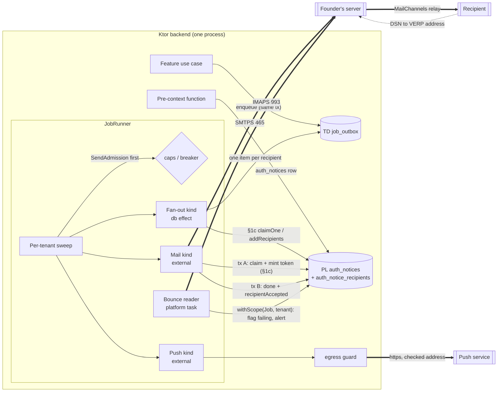

# ADR-0013: Notifications — email through the founder's SMTPS server, Web Push first, content-free approval nudges, one outbound-request guard

## Status

Proposed

> **Who may move this to `Accepted`: the user, or `cto` on the user's explicit
> confirmation. No other agent, and no skill on its own.**
> Why this is stated here: stories referencing a `Proposed` ADR are set `Blocked`,
> and epics require `Accepted`, so the field needs a named owner. `cto` is the
> role `coordination-rules.md` escalates technical conflicts to, and an ADR is
> that decision made durable.
>
> This does **not** relax the rule that `Status: Accepted` is never set without
> explicit user confirmation — it narrows *which agent* may set it once that
> confirmation exists. An agent that believes an ADR is ready says so and
> escalates; it does not edit this field.

**Acceptance blockers.**
1. **Threat model:** `docs/architecture/threat-models/notifications.md` (new, founder 2026-10-21) exists as a Draft: the SMTP/IMAP and push boundaries, the egress guard (SSRF), the bounce reader (forged bounces), the approval nudge, link tokens minted by the send job, and secret custody. It links staff-auth TB7 and tenant-isolation TB6 instead of repeating them. ADR-0012 already requires this model before the first `external` job kind ships.
2. **S13 passes** (founder, 2026-10-21): Angus Mail 2.0.5 against a local throwaway SMTP sink on JDK 21 — the timeouts and the watchdog close abort a blocked read; an I/O failure after the end-of-data dot surfaces as the ambiguous class; a custom Message-ID and a VERP envelope sender are kept; a `552` and a refused AUTH are classified as Decision 3 says; implicit TLS with server identity check refuses a wrong certificate.
3. **CTO-ADR gate**, run as `--review full` for this gate only although `review_mode` is lean (founder, 2026-10-21: Critical, amends ADR-0001). CTO-STACK-RISK is **skipped**, with the reason recorded: S13 is the executed spike on exactly the unsourced library behaviour and is already an acceptance blocker.
4. **Dependencies Accepted:** ADR-0010, ADR-0011 and ADR-0012 (all Proposed today) are Accepted first.

**Order (founder, 2026-10-21):** written as Proposed → notifications threat model → S13 → CTO-ADR → founder's acceptance after ADR-0010/0011/0012.

## Date

2026-10-21

## Last Verified

2026-10-21

## Decision Makers

- Kamel Mohamed, founder (user). Decided on 2026-10-21 from `docs/research/notifications-provider.md` § 5: Angus Mail 2.0.5; done = the 250 reply to the end of DATA with a retry when the reply is lost (a duplicate email is accepted); one email per claim; the automatic IMAP bounce reader in the first email story; caps for the domain's reputation (global 300/hour, per tenant 30/hour, paced evenly, alert at 80 %, delayed never dropped); Web Push first with the maintained library's crypto and our guarded request, FCM only if OQ6 lands on Capacitor or native; the content-free approval nudge, approval in the signed-in dashboard, never on a counter path; one outbound-request guard in the core; measurable email move triggers only. In this ADR's session: held items checked before the claim; the guard as a new core module `egress`; a failing flag on each address store; push rules now and the subscription schema later; link tokens minted by the send job; fan-out to one item per recipient; the bounce reader as a periodic runner task; the gates as for ADR-0012.
- Drafted by `/architecture-decision`; `researcher` (two parallel parts) supplied the evidence; the founder supplied the mail-server facts (note F129–F136).
- Stack validation: `ktor-lead`, 2026-10-21 — **NO BLOCKING ISSUES**; eight minor notes incorporated (JobHandler hooks for transactions A and B; two-argument `limitedParallelism`, the watchdog off the send dispatcher, `close()` in `finally`, `NonCancellable` restated; the deploy-stop duplicate cost; IMAP timeouts and the status gate for the bounce task; token returned when the claim finds nothing, injected clock; any I/O failure after DATA as ambiguous; earlier links valid until a later attempt is accepted; BouncyCastle registration and the library's HTTP client banned; the egress resolver facts and S24 scope).
- CTO-ADR: pending (blocker 3). CTO-STACK-RISK: skipped — reason in blocker 3.

## Summary

The Notifications context (core module `notify`) had no way to send anything, so no auth notice could ship and ADR-0012's external-effect contract had no provider. This ADR sends email with Angus Mail through the founder's SMTPS server (250 = accepted, at-least-once, VERP bounces read back over IMAP, paced reputation caps), sends Web Push first through a new core `egress` guard, keeps push for approvals a content-free nudge, and amends ADR-0001 § 1c (auth-notice fan-out, acceptance per recipient, link tokens minted by the send job), ADR-0007 (`Recovery.create` no longer takes the token hash) and ADR-0012 (admission before the claim, a platform periodic task).

## Stack Compatibility

| Field | Value |
|-------|-------|
| **Stack layer(s)** | Ktor backend (primary); Web (the owner dashboard's service worker for Web Push — `stack.web` is unset, so the web side is NOT ASSESSED here and is fixed by the push story) |
| **Domain** | Messaging (with Security and Identity) |
| **Layer** | Foundation |
| **Knowledge Risk** | HIGH — Ktor 3.6.0 is past the authoring model's training data (`docs/stack-reference/ktor/VERSION.md`); Angus Mail and the Web Push library have **no stack reference** (NOT SOURCEABLE beyond the research note) |
| **References Consulted** | `docs/stack-reference/ktor/VERSION.md`, `breaking-changes.md`, `deprecated-apis.md`; `docs/stack-reference/pins.yaml`; `docs/research/notifications-provider.md` (F101–F136, F201–F220); `docs/research/jobs-and-outbox.md`; ADR-0001, ADR-0005, ADR-0007, ADR-0009, ADR-0010, ADR-0011, ADR-0012 |
| **Pinned versions relied on** | Ktor 3.6.0, Kotlin 2.4.21, kotlinx-coroutines 1.11.0, Exposed 1.5.1, HikariCP 7.1.0, JVM toolchain 21 (`pins.yaml`). **Proposed, not yet pinned** (the user edits `pins.yaml` when the first story starts): `org.eclipse.angus:angus-mail` 2.0.5; `nl.martijndwars:web-push` 5.1.2 with BouncyCastle `bcprov-jdk18on` 1.86 |
| **Post-Cutoff APIs Used** | The Ktor 3.6.0 HTTP client: the custom DNS resolver of the OkHttp and Apache5 engines (added in 3.5.0, `ktor/breaking-changes.md`) for the `egress` check; timeouts, redirects and response caps are NOT SOURCEABLE in the stack reference and are proven by S24. kotlinx-coroutines 1.11.0 two-argument `limitedParallelism(n, name)` and `withContext(NonCancellable)` (`kotlin/deprecated-apis.md`, `kotlin/best-practices.md`) |
| **Verification Required** | S13 (blocker 2); **S14** — is a replaced or edited secret file visible inside a running container through the `file:` mount (rotation runbook); **S22** — the web-push library's encryption and VAPID signing usable without its own HTTP client, and reproducing the RFC 8291 test vector; **S23** — kill the runner between a push call and transaction B, one notification shown per notice id; **S24** — the Ktor 3.6.0 client connects to the checked address with TLS verified for the original host name, follows no redirect, and refuses a host that re-resolves to a private address |

Critical ADR: yes — it amends ADR-0001 § 1c and ADR-0012, changes an ADR-0007 interface, carries every auth and security notice (M31 gating), and adds a trust boundary (outbound to user-influenced URLs).

## ADR Dependencies

| Field | Value |
|-------|-------|
| **Depends On** | ADR-0001 (table classes, § 1c; **amended here**), ADR-0002 (scope helper, Job kind), ADR-0005 (retention rows, erasure, closure), ADR-0006 (Ktor track, dispatchers), ADR-0007 (auth notices, M31 gating, recovery; **interface amended here**), ADR-0008 (roles; owner contacts), ADR-0009 (secret files, Decision 3a) — all Accepted. ADR-0010 (core-shaped modules; this ADR adds a module, see Ordering Note), ADR-0011 (module structure and architecture tests), ADR-0012 (jobs and outbox; **amended here**) — Proposed, must be Accepted before this one |
| **Enables** | The first email story (owner alerts, domain-map row 22; recovery and security notices, ADR-0007); the remote-approval spec (row 10); the push-notifications spec (row 23); outbound webhooks (D4, row 28) and any remote image fetch through `egress`; the ADR-0012 provider boundary (its "no `external` kind before the notifications model" rule) |
| **Blocks** | Every story that sends a notice (ADR-0007: no notice kind ships before this ADR's § 1c functions); owner-alerts (row 22); push-notifications (row 23); remote-approval (row 10); outbound webhooks (row 28) |
| **Ordering Note** | (1) The new core module `egress` is a fifteenth Layer 1 module: ADR-0010 Decision 1's table and the domain map need a row for it. Those files belong to the map session; this ADR does not edit them (row text handed to the founder, 2026-10-21). (2) The ADR-0012 amendments (Decision 9 below) are effective when **both** ADR-0012 and this ADR are Accepted. (3) The § 1c and ADR-0007 amendments are effective when this ADR is Accepted. |

## Context

### Problem Statement

Kodeebo must send owner alerts, recovery links and security notices by email now (MVP), and push nudges for owner alerts and remote approval later (Beta). ADR-0007 decided **what** notices exist and gated security-relevant changes on "the email provider has accepted every notice they require" (M31), but left the sending (`RecoveryMailer.send`) as a later integration and gave ADR-0001 § 1c only `AuthNotices.claim(batch)`. ADR-0012 fixed the external-effect contract and handed the provider, the `auth_notices` claim/ack functions and the provider boundary to this ADR. Until this is decided, no notice kind ships, so recovery, factor changes and enrolment notices cannot be built.

### Current State

- No mail or push client exists; `notify` is a planned core-shaped module (ADR-0010 Decision 1, row 10).
- `auth_notices` is a PL table written by pre-context functions; the only § 1c function is `AuthNotices.claim(batch)` (inside, job). Retention: 90 days after sending (ADR-0005).
- ADR-0012 (Proposed): one item per transaction, external effects leased in transaction A and guarded by a per-claim token in transaction B, at-least-once (text correction 2026-10-21, `IC-EXTERNAL-EFFECT-R3`).

### Constraints

- **Hosted only.** No customer bundle; L1–L4 do not apply (`.claude/docs/standing-decisions.md`).
- **The founder's mail server** (note F129–F136): SMTP `fr-s1.serverpanel.com:465` and IMAP `:993`, implicit TLS, certificate covers that host name, verification on; username = the full mailbox address; one dedicated `no-reply@kodelix.net` mailbox for sending and bounces; outbound relayed through MailChannels with Domain Lockdown; SPF, DKIM (`d=kodelix.net`) and DMARC (`p=quarantine`) pass; DMARC aggregate reports go to Cloudflare DMARC Management; **500 outbound emails per hour, shared** by every mailbox on the account. Host, ports and username are configuration.
- **No SMS** (ADR-0007). **Secrets** only as 0400 files owned by the consuming container's UID (ADR-0009 Decision 3a, FP-SECRET-IN-ENV).
- **Tenancy:** `job_rt` sees one tenant per transaction; `auth_lookup` functions never read TD tables (ADR-0001, ADR-0007).
- **Counter:** no counter action over 3 s worst case (`perf-budgets.md`); nothing here may sit on a counter path.
- **Legal:** no legal research (founder 2026-10-21); the open legal points are "For counsel" lines in the research note § 9, owner founder (lawyer).

### Requirements

- Per-recipient "accepted" facts that ADR-0007 M31 gating can read without touching tenant data.
- One recipient per email item; at-least-once delivery with the duplicate cost stated; no raw link token at rest.
- A broken job cannot flood the founder's server: caps under the shared 500/hour limit, paced, alerting, never dropping mail.
- Bounces mark an address failing and alert the owner; a sender-setup bounce never marks a recipient.
- Every request to a user-influenced URL goes through one guard (SSRF, DNS rebinding).
- Payloads, logs, spans and push bodies carry ids and enums only.

Research note: `docs/research/notifications-provider.md` (Status Draft, verdict COMPLETE WITH GAPS: S13, S14, S22, S23 pending; F127/F220 items open).

## Decision

**1. Module and ports.** `notify` (`net.kodelix.core.notify`, ADR-0010) owns every mail and push client. Its app-layer ports: `MailSender`, `PushSender`, `BounceSource`, `NoticeTemplates` (Arabic and English), `SendAdmission`. A new core module **`egress`** (`net.kodelix.core.egress`) owns the one outbound-request guard (Decision 8). Features never call a mail or push library; they enqueue a notify job kind (ADR-0012) or write an `auth_notices` row (ADR-0007).

**2. Email transport.** Angus Mail 2.0.5 behind `MailSender`, protocol `smtps` (implicit TLS on 465, F129): server identity check on, no trust wildcard, fixed EHLO name, `sendpartial` false, **one recipient per message**. Typed config defaults, never code: connect timeout 5 s, read timeout 20 s, write timeout 20 s, whole-send deadline 60 s enforced by a watchdog that closes the transport (a blocking socket call ignores coroutine cancellation, jobs note F338); no in-call retry. `leaseDuration` for mail kinds 120 s (exceeds the deadline, ADR-0012 Decision 5). The send runs on its own bounded dispatcher, `Dispatchers.IO.limitedParallelism(n, "notify-mail")` with the two-argument form (the one-argument form is hidden, `kotlin/deprecated-apis.md`), default n = 2 per instance (config); the IMAP reader gets its own (`"notify-imap"`, n = 1). The watchdog never runs on the send dispatcher (with both permits blocked it would never run). A deadline expiry maps to an outcome by stage (Decision 3); an outer cancellation is always rethrown, never classified (ADR-0012 Decision 5); `Transport.close()` runs in a `finally` (Angus holds one write-timeout thread per connection, F122); transaction B and the retry bookkeeping run in `withContext(NonCancellable)` (ADR-0012). **Stated cost:** a 250 that arrives after the runner has started stopping is discarded with the cancelled coroutine, so the row is re-sent after its lease expires — a send in flight at a deploy stop can produce a duplicate email. The message is built once per item (same bytes, Date and Message-ID on every attempt, F107); the envelope sender is the VERP address of Decision 4. The password is read at start from a 0400 secret file `/run/secrets/<notify-mail>` owned by the backend UID; start-up fails if it is missing, empty, wrongly owned or not 0400. The username, host and ports are config.

**3. "Accepted" and classification** (by reply code and stage, never by the library's recipient lists, note F123):

| Stage / reply | Class | Outcome |
|---|---|---|
| 250 to the end-of-data dot | accepted | transaction B `done`; for an auth notice, `AuthNotices.recipientAccepted` in the same transaction B |
| connect, TLS handshake, greeting or EHLO failure or timeout; 421; any 4yz | transient | `Retry` with ADR-0012 backoff (attempt counted) |
| I/O failure or timeout after DATA began (Angus gives no marker of whether the dot was sent, F123; S13 may narrow this) | ambiguous | `Retry` with the same item id and Message-ID; a duplicate email is accepted (F112) |
| AUTH refused, MAIL FROM refused, certificate or TLS failure | sender configuration fault | `Retry`, **open the mail breaker**, alert the operator; later items are held by admission (Decision 5) |
| 5yz to RCPT | rejected | `Dead(recipient_rejected)`; the address is marked failing (Decision 6); for an auth notice `recipientFailed`, and the notice completes on its remaining recipients (Decision 7) |
| 5yz to DATA or to the dot | rejected | `Dead(message_rejected)`; never resent without review |

Per-kind `max_attempts` and backoff come from each notice's useful life (the 10-minute recovery link, the M31 bound): owner `security-lead`, set in the kind registry before the first mail story.

**4. Bounces (first email story).** Every message's envelope sender is the VERP address `no-reply+<tenant>.<item>@kodelix.net`, opaque ids only (plus-addressing works, F133). A **periodic platform task of the JobRunner** (not a job row; interval in config) reads the no-reply mailbox over IMAP with implicit TLS on 993 using the **same** secret file, outside any transaction. Its connect and read timeouts are explicit config (the `imaps` property names are NOT SOURCEABLE, F129, and S13 covers them) and are bounded so a blocked read ends inside the runner's stop timeout (ADR-0012 Decision 7 bounds only database statements); the store is closed in a `finally`. It applies the ADR-0012 tenant status gate per tenant (nothing for `purged`; closure states as the kind's `runsWhen` declares). For each message it:
- parses the RFC 3464 report and takes tenant and item from the VERP address the bounce was delivered to;
- opens `withScope(Job, tenant)` and acts only when that tenant holds a mail item with that id sent within a configured window; anything else (unknown tenant or item, no report, a report for an item of another tenant) is ignored and counted;
- a **`5.7.1` relay refusal (MailChannels Domain Lockdown, F131)** is a sender configuration fault: alert the operator and open the mail breaker; it never marks a recipient;
- a permanent failure for the recipient marks that address **failing** (Decision 6) and enqueues an owner alert keyed by the bounce's Message-ID (so a repeat or a second instance is a no-op);
- stores nothing from the bounce except the classification and ids (the report can hold addresses and headers); deletes the processed message from the mailbox.
Bounces are a signal, not proof (F105): a failing address is never deleted, only flagged.

**5. Admission before the claim (caps, pacing, breakers).** `SendAdmission` is asked by the sweep **before** it claims an item of a mail or push kind: is there a token in the global bucket and in this tenant's bucket, and is the destination's breaker closed? If not, the sweep claims nothing of those kinds for that tenant in this pass — no claim, so **no attempt is spent**, and the item is **delayed, never dropped**. Defaults (founder, 2026-10-21; typed config defaults, never code; a provider change is a config change only): **global 300 emails/hour per backend** (the host's 500/hour is shared with the human mailboxes, F136), **30/hour per tenant**, tokens refilled **evenly** (cap / 3600 per second); bucket capacity (burst) is config, default set by `security-lead` with the founder before the first mail story. An alert fires at **80 %** of either cap over a rolling hour. A token is reserved before the claim and **returned** if the claim finds no due item, so an empty pass spends nothing; buckets use the injected `Clock` (testable, no real time). The Ktor RateLimit plugin is not used (it limits inbound requests; its storage is NOT SOURCEABLE, `ktor/best-practices.md`). Buckets are in-process per instance; during an ADR-0009 deploy overlap two instances may each spend the global rate for the overlap's minutes (accepted: well under 500/hour for an overlap of minutes). Held items stay subject to ADR-0012's pending expiry and its oldest-pending-age alert.

**6. Failing flag on each address store.** Each store that holds an address gets `delivery_state` (`ok` | `failing`) and `delivery_state_since`. Tenant-data owner contacts are updated under `withScope(Job, tenant)`; the login's verified address in `login_contacts` (PL) by the new § 1c function `Contacts.markFailing(contactId)`. No address, and no hash of one, is stored anywhere else. A later successful send resets the flag to `ok`. The owner sees failing addresses in the dashboard (spec).

**7. Auth notices: fan-out, acceptance per recipient, minted link tokens** (amends ADR-0001 § 1c and ADR-0007, effective when this ADR is Accepted).
- **Fan-out (a database-only job kind, one transaction in tenant scope):** `AuthNotices.claimOne()` locks one pending notice (`FOR UPDATE SKIP LOCKED`); the handler reads the recipients — owner contacts from tenant data, or the login's verified address reference for a recovery notice — and calls `AuthNotices.addRecipients(noticeId, recipients)`, which writes one row per recipient into the new PL table `auth_notice_recipients` and marks the notice `fanned_out`; the handler inserts one `job_outbox` mail item per recipient, key (notice id, recipient id). Commit.
- **Send (an `external` mail kind, one recipient):** transaction A claims the item (ADR-0012) and, for a link-bearing notice, **mints the link token**: it generates the token in memory and stores only its hash and expiry through `Recovery.addToken(requestId, tokenHash, expiresAt)` or `SecondFactors.addCancelToken(removalId, tokenHash, expiresAt)`. The provider call follows; the raw token exists only in memory and in the email; each link's lifetime counts from its minting. **Earlier links stay valid until a later attempt is accepted** (ktor-lead review): an ambiguous attempt may have delivered its email, and if the retry then went dead the person would hold only a dead link. Transaction B of the accepted attempt calls `Recovery.confirmToken(requestId, tokenHash)` / `SecondFactors.confirmCancelToken(removalId, tokenHash)`, which voids every other hash of that request. Outstanding hashes per request are bounded by the kind's `max_attempts`; each is single-use and expires at its own time. So the newest accepted email is the one that works, and the page message below stays true. For a `login_contacts` recipient the handler reads the address with `Contacts.addressFor(contactId)` (inside, job).
- **The expired-or-replaced page (founder, 2026-10-21):** the reset and cancel pages answer an expired, used or replaced token with one message: the link has expired or was replaced, use the most recent email. A duplicate send replaces the earlier link, so the newest email is always the one that works.
- **Recipient states** (`auth_notice_recipients.state`): `pending` → `accepted` (transaction B of a sent item, `AuthNotices.recipientAccepted`, idempotent: sets `accepted_at` once) or `failed` (`AuthNotices.recipientFailed(noticeId, recipientId, reason)`: the item went dead, or the address was already flagged failing at fan-out, or a permanent bounce arrived before acceptance). At fan-out, a recipient whose address is flagged failing is written `failed(address_failing)` and **not sent**; the flag clears when the owner changes or re-verifies that address.
- **A failing recipient never blocks a notice forever (founder, 2026-10-21).** Each `failed` recipient raises an alert to the owner (dashboard) and to the operator, naming the **contact** (its id and display label from the contact store); logs, spans and alerts carry the contact id, never the address.
- **What M31 reads — exactly.** `AuthNotices.isAccepted(noticeId)` (inside, `auth_lookup`, read by the gate of `IC-NOTICE-GATED-FACTOR-CHANGE`) is true **iff no recipient of the notice is `pending` and at least one is `accepted`**. So: every remaining recipient accepted and the others failed → accepted, and the gated change's delay counts from the last acceptance; **every recipient failed → not accepted**, the gated change stays paused and, at ADR-0007's configured bound, the operator is alerted (the existing M31 rule) — nobody was told, so the change never applies silently. A bounce arriving **after** a recipient was accepted flags the address and alerts, but does not reopen a notice that already counted as accepted (acceptance is the provider's, as ADR-0007 defines it).
- `Recovery.create(identifier, expiresAt)` no longer takes `tokenHash` (ADR-0007 interface change); the request writes the recovery request and its notice only, so the response time stays uniform (ASVS 6.3.8) and the request sends nothing. `RecoveryMailer.send` is replaced by the notify mail kind.

**8. One outbound-request guard (`egress`, P-ONCE, founder 2026-10-21).** Every adapter that calls a URL a user, tenant or client can influence — Web Push now, outbound webhooks (D4) and remote image fetch later — must use `egress`. The guard: https only; resolves the host and refuses private, loopback, link-local, unique-local and cloud-metadata ranges for **every** resolved address; **connects to the address it checked**, with TLS verified for the original host name (DNS rebinding); follows no redirect; applies a timeout, a response-size cap and a circuit breaker per destination host; and accepts an optional host allowlist per caller (Web Push: the push-service hosts). It has a registry entry and negative tests. **Ktor client facts:** the stack reference records only that Ktor 3.5.0 added custom DNS resolvers for the OkHttp and Apache5 engines (`ktor/breaking-changes.md`), which points to a resolver-level check with one of those engines; connecting to the checked address while verifying TLS for the original host name, timeout and redirect configuration, a response-size cap and re-resolution on connection reuse are NOT SOURCEABLE and are what S24 proves. The guard never rewrites the URL to the IP (that breaks SNI and host-name verification). Defence in depth: a VPS egress firewall for the containers (owner `platform-lead`). The founder's SMTP and IMAP hosts are configuration, not user-influenced, and are reached directly.

**9. ADR-0012 amendments** (effective when ADR-0012 and this ADR are both Accepted). (a) The sweep consults `SendAdmission` before claiming mail or push kinds (Decision 5); `IC-OUTBOX-SWEEP-R6` is superseded by an R7. (b) The JobRunner hosts **platform periodic tasks** beside the sweep: a task reads an outside source and then works one tenant per `withScope(Job, tenant)` transaction; it holds no row and no lock, so it must be idempotent (the bounce reader is the first). (c) Transaction A of an `external` kind may call the § 1c functions its kind declares (the link-token mint), and transaction B may call the ones it declares (`recipientAccepted`, `confirmToken`). (d) **`JobHandler` gains two hooks** (ADR-0012 Key Interfaces has only `run(ctx, item)`): `inClaim(tx, item) -> ClaimContext` runs inside transaction A and returns in-memory context (the raw token) to the provider call, and `onAccepted(tx, item, ClaimContext)` runs inside transaction B; neither may call a provider.

**10. Push (Beta; rules now, schema later).** One `PushSender` port, two adapters chosen by the subscription's kind. The **Web Push adapter is built first**: the maintained web-push library does the RFC 8291 encryption and the RFC 8292 VAPID signature; the request goes through `egress` with the push-host allowlist. The library registers BouncyCastle as a global JCE provider: the adapter registers it once at start, explicitly, and the library's own HTTP client is excluded from the dependency graph and banned by the Decision 8 architecture test (S22 confirms the split; if the library cannot be split, the next step is a research pass for another maintained library — crypto written in-house needs the founder's explicit sign-off). The **FCM adapter is built only if OQ6 lands on Capacitor or native**. Accepted = Web Push `201`, FCM 2xx. Outcome map: 429 and 5xx retry (honour `Retry-After`); Web Push 404 or 410 and FCM `UNREGISTERED` delete the subscription and end `Dead(recipient_gone)`; 400/413 our bug, dead and alert; 401/403 a credential fault, breaker open and alert. **No provider de-duplicates**: the payload carries the notice id and the client shows one notification per notice id; Web Push `Topic` is derived from the item id. TTL is the notice's remaining useful life (approval requests at most 10 minutes); urgency `high` for approvals only. The VAPID private key (and later the FCM service-account file) is a 0400 secret file; the VAPID key id is stored per subscription. Subscriptions are created only from an authenticated dashboard session and deleted on gone, sign-out, revoke, person erasure (ADR-0005) and by a prune job. The `push_subscriptions` table, its data class and the encryption of the subscription's auth secret are decided by the push story's `/db-migration` after the privacy classification.

**11. Remote approval.** A push for an approval is a **content-free nudge**: a request id and a generic localised text. The owner opens the signed-in dashboard, which loads the request under RLS, and approves with step-up bound to the request (ADR-0007 § 7 pattern). Nothing is approved from a notification, and email is never an approval channel. Remote approval **never sits on a counter path**: the counter's own action completes locally under 3 s and shows a waiting state; the answer reaches it by the sync nudge or a poll of 2 s or less.

**12. Operational rules.**
- MailChannels Domain Lockdown lists every sending mailbox of `kodelix.net` (one `senderid` per mailbox, `x-authuser`, F135). **A new sending mailbox is added to `_mailchannels.kodelix.net` before it sends**; otherwise its mail bounces with `5.7.1` (a sender-setup fault, Decision 4).
- **Auto-create folders stays OFF** on the no-reply mailbox, or every VERP bounce creates a folder (F133).
- SMTP and IMAP host, ports and username are config; the one mailbox secret file is rotated by runbook (S14).
- The spam watch reads Cloudflare DMARC Management, the bounce reader's counts and a periodic mail-tester check; the backend parses no DMARC report.

**13. Move triggers for email** (when to leave the founder's server; measurable only, no "first paying customers" trigger, founder 2026-10-21). Thresholds are the founder's config, reviewed with each signal:
1. **Shared relay IP blacklisted / mail in spam:** mail-tester score below the founder's threshold, DMARC pass rate falling in Cloudflare, or hard-bounce rate above threshold. First data point: 9/10 on 2026-10-21, the only deduction the MailChannels shared relay IP listed on SpamCop (F132).
2. **Host limit pressure:** the 80 % cap alert recurring over a period, or a needed cap near the shared 500/hour.
3. **Gated-notice stalls:** M31-gated changes paused for missing acceptance more than a set number of times in a period.

### Architecture



Trust boundaries: backend → founder's server (credentialed, TLS); founder's server → backend (bounces: untrusted content); backend → push service (user-influenced endpoint, through `egress`); push service → device (content-free payload).

### Key Interfaces

```text
notify ports (app layer; adapters in parentheses)
  MailSender.send(message: OutgoingMail) -> MailOutcome              (Angus Mail 2.0.5, smtps)
      OutgoingMail: recipient address, VERP envelope sender, Message-ID, subject, body (built once per item)
      MailOutcome: Accepted | Transient(stage, code) | Ambiguous | ConfigFault(stage, code) | Rejected(stage, code)
  BounceSource.fetch(limit) -> List<RawBounce>; delete(ref)           (Angus Mail IMAP, imaps)
  PushSender.send(subscription, payload: ids + enum, ttl, urgency) -> PushOutcome   (web-push library crypto + egress)
  SendAdmission.tryAcquire(kind, tenant) -> Granted | Held(reason)    (in-process token buckets + breakers)
  NoticeTemplates.render(kind, locale, ids) -> subject, body          (AR / EN)

egress port (net.kodelix.core.egress)
  GuardedHttp.send(request, policy: { allowHosts?, timeout, maxResponseBytes }) -> Response | Refused(reason)

ADR-0001 § 1c (SECURITY DEFINER, owner auth_lookup, pinned search_path; EXECUTE job_rt; inside, job; app.tenant_id must equal the row's tenant)
  AuthNotices.claimOne() -> { noticeId, kind, subjectRefs } | null    replaces AuthNotices.claim(batch)
  AuthNotices.addRecipients(noticeId, recipients[{ store: login_contact | owner_contact, id }])
  AuthNotices.recipientAccepted(noticeId, recipientId)                idempotent; pending -> accepted
  AuthNotices.recipientFailed(noticeId, recipientId, reason)          pending -> failed (dead item | address_failing | bounce)
  AuthNotices.isAccepted(noticeId) -> Boolean                         no recipient pending AND >= 1 accepted (read by the M31 gate)
  Contacts.addressFor(contactId) -> address                           login_contacts only
  Contacts.markFailing(contactId); Contacts.markOk(contactId)
  Recovery.addToken(requestId, tokenHash, expiresAt)                  transaction A of the send; earlier hashes stay valid
  Recovery.confirmToken(requestId, tokenHash)                         transaction B of the accepted attempt; voids the other hashes
  SecondFactors.addCancelToken(removalId, tokenHash, expiresAt); SecondFactors.confirmCancelToken(removalId, tokenHash)
  (ADR-0007 change) Recovery.create(identifier, expiresAt)            tokenHash removed
```

### Implementation Guidelines

- **Must (notify, adapters):** set every Angus timeout and TLS property explicitly; never rely on a library default (F122). Classify by stage and reply code (Decision 3). Build the message once per item.
- **Must (notify, app):** one recipient per mail item; payloads hold typed ids only (ADR-0012 `JobPayload`); the recipient address is resolved at send time, never stored in a job row.
- **Must (notify, app):** ask `SendAdmission` before any claim of a mail or push kind; a held item is never claimed and never dropped.
- **Must (bounce reader):** act only on a VERP tenant and item that exist in that tenant and fall in the window; never mark a recipient for a `5.7.1` relay refusal; persist nothing from a bounce except the class and ids.
- **Must (link-bearing kinds):** mint the token in transaction A through the § 1c function; never write a raw token to a row, a log, a span, a payload or a dead row.
- **Must (egress):** every request to a user-influenced URL goes through `GuardedHttp`; an architecture test (ADR-0011) fails any other HTTP client use in `notify`, webhooks or image fetch.
- **Must never:** call a provider inside a database transaction (FP-PROVIDER-CALL-IN-TX); put a secret in an environment variable (FP-SECRET-IN-ENV); log an address, subject, reply text, endpoint, token, p256dh or auth value; approve anything from a notification; put an approval or alert on a counter path; hard-code a cap, timeout, host, port or threshold.
- **Layering:** `domain` holds the notice kinds, outcome classes and admission rules; `app` the use cases and ports; `adapters` Angus Mail, the web-push library and the `egress` client. `egress` depends on nothing in `notify`.

## Alternatives Considered

### Alternative 1: A hosted email provider and FCM only

- **Description**: send through a provider API (SES, Postmark or similar) with its own bounce webhooks; push only through FCM in a Play-listed wrap.
- **Pros**: provider-side reputation management and bounce events; one push channel.
- **Cons**: a second vendor and credential; an inbound webhook endpoint to secure; FCM-only leaves the browser dashboard without push and forces a wrap before any push.
- **Cost / Risk / Performance / Operability**: monthly fees; vendor lock-in and a new inbound surface; similar latency; extra account and secret custody.
- **Estimated Effort**: similar for mail, larger for push.
- **Rejection Reason**: the founder runs a working mail server on the domain with SPF, DKIM and DMARC passing (F130); a provider adds cost and a boundary with no gain at Kodeebo's volume, and OQ6's default path is a PWA, which FCM-only does not serve.

### Alternative 2: Email and in-app only, no push

- **Description**: owner alerts by email and a dashboard badge; remote approval waits for the owner to open the dashboard.
- **Pros**: no push keys, no subscription data, no egress guard yet.
- **Cons**: misses the founder's alert-with-the-app-closed need (desktop-followups-note OQ-A); remote approval becomes slow.
- **Cost / Risk / Performance / Operability**: lowest cost; product risk; no latency gain; least to operate.
- **Estimated Effort**: smaller.
- **Rejection Reason**: push is Beta scope (row 23) and the remote-approval flow (row 10) depends on a nudge; email stays the fallback of every option, so nothing is lost by deciding push now and building it later.

### Alternative 3: Simple Java Mail over Angus

- **Description**: the wrapper library for message building.
- **Cost / Risk / Performance / Operability**: less building code; three releases in four days (F117) means churn to re-verify; its error mapping hides the per-stage detail Decision 3 needs; one more dependency to scan.
- **Rejection Reason**: Decision 3's classification needs the stage and code Angus exposes directly (F123).

### Alternative 4: Held items claimed, then released without an attempt

- **Description**: claim as usual; a new `Held` outcome in transaction B returns the row to pending without counting the attempt.
- **Cost / Risk / Performance / Operability**: no sweep change; a third branch in every guarded bookkeeping path; two transactions per held item; a held item still takes a lease.
- **Rejection Reason**: checking admission before the claim spends nothing and keeps ADR-0012's transaction B unchanged.

### Alternative 5: Our own Web Push encryption (research W2)

- **Description**: implement RFC 8291 and RFC 8292 with JDK and BouncyCastle primitives.
- **Cost / Risk / Performance / Operability**: more code; crypto we own; only test vectors as a safety net.
- **Rejection Reason**: its one strong reason was that the guard must own the connection; Decision 10's split (library crypto, our request) meets that without owning crypto (founder: crypto written in-house needs a strong reason).

### Alternative 6: The guard inside `notify`

- **Description**: `notify` owns the SSRF checks; webhooks and image fetch call notify later.
- **Rejection Reason**: webhooks and image fetch are not notifications; P-ONCE puts a shared capability in its own owning module, and a move later would change callers.

## Consequences

### Positive

- Recovery, security and owner notices can ship on the first email story; M31 gating gets a per-recipient fact inside `auth_lookup`.
- No raw link token ever rests in the database; the recovery response time stays uniform.
- A broken job cannot exceed the founder's shared hourly limit, and held mail is never lost.
- One SSRF guard for every future outbound integration.

### Negative

- Duplicates are possible after a lost reply (a second email) or a crash (a repeated push, absorbed by the client).
- ADR-0012, ADR-0001 § 1c and ADR-0007 change; the domain map and ADR-0010 need an `egress` row (map session).
- The bounce reader is a new kind of runner work (a platform task) that must stay idempotent.
- Per-instance buckets allow a brief overshoot during a deploy overlap.

### Neutral

- The push subscription schema waits for the push story; FCM waits for OQ6.

## Risks

| Risk | Probability | Impact | Mitigation |
|------|------------|--------|-----------|
| Angus behaviour differs from its source reading (timeouts, post-dot I/O) | Medium | High (stuck sends, lost acceptance) | S13 before acceptance (blocker 2); watchdog deadline |
| The shared relay IP is listed and mail lands in spam | Medium | High (recovery and notices unseen) | Move trigger 1; bounce reader; DMARC dashboard; periodic mail-tester |
| A new mailbox sends before Domain Lockdown lists it | Low | Medium | Operational rule; `5.7.1` classified as a sender fault with an alert |
| Forged or crafted bounces flag good addresses | Low | Medium | VERP tenant and item must exist in the window; flag only, never delete |
| SSRF or DNS rebinding through a push endpoint | Medium | High | `egress` (Decision 8), allowlist, S24, negative tests, egress firewall |
| Duplicate nudge or email after a crash | Medium | Low | Notice id on the client; stated duplicate cost; S23 |
| Cap too low for a burst (many recoveries at once) | Low | Medium | Priority column (ADR-0012); 80 % alert; caps are config |
| Secret file rotation not visible to the running backend | Medium | Medium | S14; rotation runbook with a restart if needed |
| A send in flight at a deploy stop is re-sent after its lease | Medium (every deploy with mail in flight) | Low (one duplicate email) | Stated cost (Decision 2); short deadline; the client sees the newest link |
| A blocked IMAP read outlives the runner stop | Low | Medium (stop overruns the grace period) | Explicit IMAP timeouts bounded by the stop timeout; store closed in `finally`; S13 |
| The egress engine cannot pin the checked address with host-name TLS | Medium | High (no rebinding defence) | S24 before the Web Push adapter; resolver-level check on OkHttp or Apache5; egress firewall |

## Cross-Cutting Impact

| Concern | Impact |
|---------|--------|
| **Security / tenancy** | New outbound boundary to user-influenced URLs (`egress`); inbound untrusted content (bounces); new PL table `auth_notice_recipients` and § 1c functions; link tokens minted in the job. ASVS 5.0.0: 12.3.1, 12.3.2, 13.2.1, 13.2.3, 13.2.6, 13.3.1, 13.3.2, 13.3.4, 2.4.1, 2.3.2, 16.2.5, 16.3.4, 6.3.8, 6.4.3, 6.5.5, 6.6.2, 6.6.4 (note F125, F216; SSRF and injection IDs NOT SOURCEABLE there, mapped in the threat model). Threat model: `docs/architecture/threat-models/notifications.md` (blocker 1). |
| **Observability** | Spans `mail.send`, `notify.push.send`, `notify.bounce.scan`, `approval.*`; metrics `mail_send_total{kind,outcome}`, `mail_ambiguous_total`, `mail_rate_limited_total{scope}`, `mail_breaker_state`, `notify_bounce_total{class}`, `notify_push_sent_total{kind,outcome}`, `egress_refused_total{reason}`; alerts at 80 % of a cap, open breaker, sender fault, dead notice, oldest pending notice age; runbooks for credential rotation, mail server unreachable, Domain Lockdown. No address, token or endpoint in telemetry; no tenant label. |
| **Caching** | No cache for sends, subscriptions or address state (unique effects; deletion and failing state must be seen at once); in-process immutable values for parsed settings, compiled templates and the VAPID key pair. |
| **Self-hosted** | None — hosted only. |
| **Cost** | No new paid service; the founder's hosting plan carries mail; push services are free. |

## Performance Implications

| Metric | Before | Expected After | Budget (`perf-budgets.md`) |
|--------|--------|---------------|--------|
| Latency p95 (affected endpoints) | n/a | request path unchanged (an insert in the business transaction) | budget not yet set for notifications |
| DB queries per request | n/a | +1 insert per notice | budget not yet set |
| Memory (service RSS) | n/a | two bounded send threads plus one write-timeout thread per connection | budget not yet set |
| Storage growth | n/a | notice, recipient and job rows within ADR-0005 / ADR-0012 retention | budget not yet set |
| Network / payload (if applicable) | n/a | one SMTP session per email; push bodies of tens of bytes | budget not yet set |

The counter's 3 s ceiling is untouched: nothing here runs on a counter path.

## Migration Plan

1. Flyway migration in `notify` and `identity` (forward-only in production, reversible in development): `auth_notices` gains `status`, `fanned_out_at`; new PL table `auth_notice_recipients` (notice id, recipient store and id, `state` pending | accepted | failed, `accepted_at`, `failed_reason`) under ADR-0001 § 1c rules; `delivery_state` and `delivery_state_since` on `login_contacts` and on the tenant-data owner-contact store; § 1c functions created; `AuthNotices.claim(batch)` dropped (no caller exists).
2. ADR-0005 retention rows: `auth_notice_recipients` follows its notice (90 days after sending); person erasure and `Closure.purgeLogins` cover it.
3. Secret file `/run/secrets/<notify-mail>` placed by the founder over the admin key (ADR-0009); the VAPID key file with the push story.
4. The kind registry gains the fan-out kind, the mail kinds (with `max_attempts` from `security-lead`), and the bounce-reader platform task.

**Rollback plan**: disable the notify kinds and the bounce task by config (rows stay pending, nothing is dropped); the schema additions are additive and stay; revert the adapter release.

## Validation Criteria

- [ ] S13 passes on JDK 21 (blocker 2); S14 answers the rotation question; S22 and S24 pass before the Web Push adapter; S23 before the first push kind.
- [ ] A recovery request writes no raw or hashed token in the request; the email's link works, and a retried send invalidates the earlier link.
- [ ] An owner notice to three contacts creates three items; the M31 gate sees acceptance only after the third `recipientAccepted`; a repeated `recipientAccepted` changes nothing.
- [ ] With one of three contacts flagged failing, the notice completes after the other two accept and one contact-named alert fires; with all three failed, `isAccepted` stays false and the gated change stays paused until the operator alert at the M31 bound.
- [ ] An expired or replaced token on the reset or cancel page shows the "use the most recent email" message.
- [ ] An ambiguous first attempt followed by a dead retry leaves the first link working; an accepted retry voids the first link.
- [ ] With the per-tenant cap at 30/hour, 100 queued items for one tenant are sent evenly over about 3 hours, other tenants' items are not delayed, no item spends an attempt while held, and the 80 % alert fires.
- [ ] **Negative:** a bounce whose VERP names tenant A and an item of tenant B is ignored; a `5.7.1` lockdown bounce opens the breaker and flags no address; a forged report for a non-existent item changes nothing.
- [ ] **Negative (egress):** a push endpoint resolving to 127.0.0.1, 10/8, 169.254.169.254 or a host that re-resolves to a private address is refused; a redirect is not followed; a host off the push allowlist is refused.
- [ ] No address, token, endpoint or reply text appears in logs, spans or dead rows (log and span scan in the test suite).

## Spec Requirements Addressed

Foundational — no spec requirement (no spec file exists yet). Enables: owner-alerts (domain-map row 22), dashboard sign-in and recovery mail (row 6, ADR-0007), remote-approval (row 10), push-notifications (row 23), outbound webhooks (row 28).

## Related

- Research note: `docs/research/notifications-provider.md` (F101–F136, F201–F220; "For counsel" lines in § 9, owner founder (lawyer)).
- Amends: ADR-0001 § 1c (auth-notice, contact and token functions); ADR-0007 (`Recovery.create` signature; `RecoveryMailer` replaced); ADR-0012 (admission before the claim; platform periodic tasks; § 1c calls in transaction A). Each by a dated note in the amended ADR, effective as stated in the ADR Dependencies Ordering Note.
- Needs (map session, via the founder): an `egress` row in ADR-0010 Decision 1 and in `design/specs/domain-map.md`.
- Depends on: ADR-0002, ADR-0005, ADR-0006, ADR-0008, ADR-0009, ADR-0010, ADR-0011.
- Threat models: `docs/architecture/threat-models/notifications.md` (to write, blocker 1); `staff-auth.md` TB7 (T7.4, M31); `tenant-isolation.md` TB6.
- Registry: `IC-EXTERNAL-EFFECT-R3`, `IC-NOTICE-GATED-FACTOR-CHANGE`, `FP-SECRET-IN-ENV`, `FP-PROVIDER-CALL-IN-TX`; new entries on acceptance of this draft's write.
