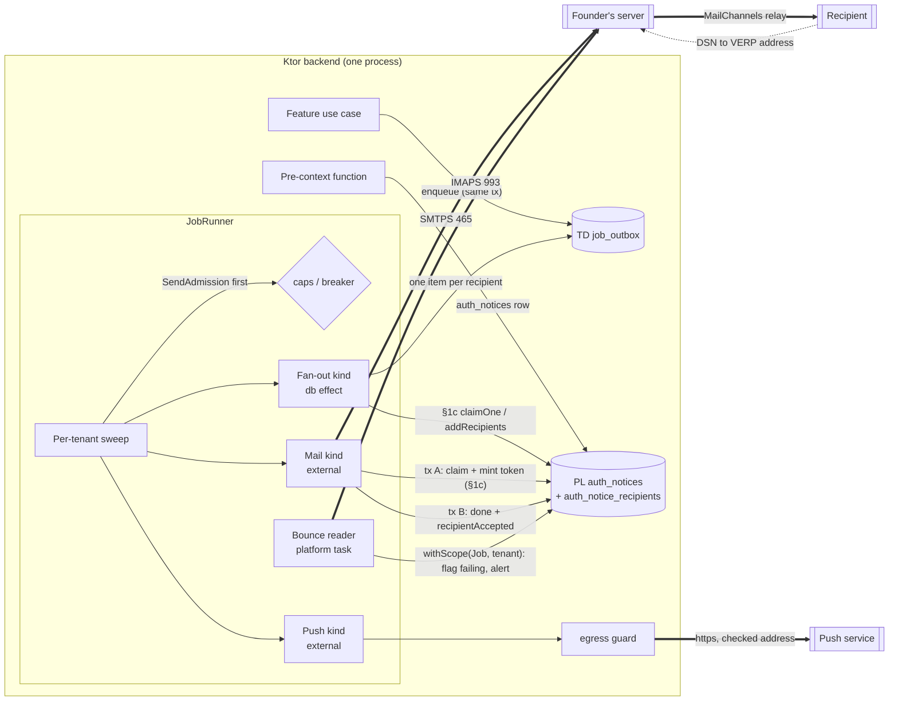

# ADR-0013: Notifications — email through the founder's SMTPS server, Web Push first, content-free approval nudges, one outbound-request guard

## Status

Proposed

> **Who may move this to `Accepted`: the user, or `cto` on the user's explicit
> confirmation. No other agent, and no skill on its own.**
> Why this is stated here: stories referencing a `Proposed` ADR are set `Blocked`,
> and epics require `Accepted`, so the field needs a named owner. `cto` is the
> role `coordination-rules.md` escalates technical conflicts to, and an ADR is
> that decision made durable.
>
> This does **not** relax the rule that `Status: Accepted` is never set without
> explicit user confirmation — it narrows *which agent* may set it once that
> confirmation exists. An agent that believes an ADR is ready says so and
> escalates; it does not edit this field.

**Acceptance blockers.**
1. **Closed 2026-10-21:** threat model `docs/architecture/threat-models/notifications.md` written (Draft, verdict COMPLETE WITH GAPS; residuals T9.1, T2.6 and the token-exposure row accepted by the founder; SL-THREAT-MODEL run on the founder's request: **CONCERNS**, security-lead 2026-10-22, 13 findings carried into the model as fixes, open rows OR-1–OR-5 and two founder-signed residual rows; S-NT-08 and the owner-contact and owner-alert parts of S-NT-12 are held until their specs exist and the gate runs again). It covers the SMTP/IMAP and push boundaries, the egress guard (SSRF), the bounce reader (forged bounces), the approval nudge, link tokens minted by the send job, and secret custody. It links staff-auth TB7 and tenant-isolation TB6 instead of repeating them. ADR-0012 already requires this model before the first `external` job kind ships.
2. **Closed 2026-10-22 (with Decision 2 and 3 corrections):** S13 ran on JDK 21 (research note F140-F156; 6 of 7 cases passed as written; the watchdog `Transport.close()` case failed and Decision 2 now closes the socket instead; the after-DATA marker needs the stage subclass of Decision 3), and the founder's live envelope test passed (F137: Domain Lockdown keys on the authenticated user, DMARC `p=reject` live, DSNs reach `bounces@`; F138: a bare message is refused as spam). The original wording follows. **S13 passes** (founder, 2026-10-21): Angus Mail 2.0.5 against a local throwaway SMTP sink on JDK 21 — the timeouts and the watchdog close abort a blocked read; an I/O failure after the end-of-data dot surfaces as the ambiguous class; a custom Message-ID and a VERP envelope sender are kept; a `552` and a refused AUTH are classified as Decision 3 says; implicit TLS with server identity check refuses a wrong certificate; and a **founder-run live test** on the real host: `no-reply@` authenticated sends with a `bounces+…@kodelix.net` envelope sender, Domain Lockdown accepts it and DMARC still passes at a Gmail inbox (Decision 2a). If that live test fails, the fallback is one mailbox and one credential for both directions, with the residual accepted by name in the threat model.
3. **CTO-ADR gate**, run as `--review full` for this gate only although `review_mode` is lean (founder, 2026-10-21: Critical, amends ADR-0001). **Run 2026-10-22: CONCERNS** (13 required, 14 minor); the founder chose Revise and this text carries the revision; a CTO re-check on the diff only is pending. CTO-STACK-RISK is **skipped**, with the reason recorded: S13 is the executed spike on exactly the unsourced library behaviour and is already an acceptance blocker.
4. **Dependencies Accepted:** ADR-0010, ADR-0011 and ADR-0012 (all Proposed today) are Accepted first.

**Order (founder, 2026-10-21):** written as Proposed → notifications threat model → S13 → CTO-ADR → founder's acceptance after ADR-0010/0011/0012.

## Date

2026-10-21

## Last Verified

2026-10-22

## Decision Makers

- Kamel Mohamed, founder (user). Decided on 2026-10-21 from `docs/research/notifications-provider.md` § 5: Angus Mail 2.0.5; done = the 250 reply to the end of DATA with a retry when the reply is lost (a duplicate email is accepted); one email per claim; the automatic IMAP bounce reader in the first email story; caps for the domain's reputation (global 300/hour, per tenant 30/hour, paced evenly, alert at 80 %, delayed never dropped); Web Push first with the maintained library's crypto and our guarded request, FCM only if OQ6 lands on Capacitor or native; the content-free approval nudge, approval in the signed-in dashboard, never on a counter path; one outbound-request guard in the core; measurable email move triggers only. In this ADR's session: held items checked before the claim; the guard as a new core module `egress`; a failing flag on each address store; push rules now and the subscription schema later; link tokens minted by the send job; fan-out to one item per recipient; the bounce reader as a periodic runner task; the gates as for ADR-0012. From the notifications threat model (2026-10-21): the mailbox split (Decision 2a); a new Message-ID per attempt and no stored body (M7); breaker semantics for `5.7.1` (M8); subscriptions deleted on every session end (M23); the failing flag cleared only by an address change or re-verification; recovery always sent (M12); a pre-apply bounce pauses a gated change (M13); reserved lanes for security mail (M9); operator alerts by id only (M32).
- Drafted by `/architecture-decision`; `researcher` (two parallel parts) supplied the evidence; the founder supplied the mail-server facts (note F129–F136).
- Stack validation: `ktor-lead`, 2026-10-21 — **NO BLOCKING ISSUES**; eight minor notes incorporated (JobHandler hooks for transactions A and B; two-argument `limitedParallelism`, the watchdog off the send dispatcher, `close()` in `finally`, `NonCancellable` restated; the deploy-stop duplicate cost; IMAP timeouts and the status gate for the bounce task; token returned when the claim finds nothing, injected clock; any I/O failure after DATA as ambiguous; earlier links valid until a later attempt is accepted; BouncyCastle registration and the library's HTTP client banned; the egress resolver facts and S24 scope).
- CTO-ADR (`--review full`, 2026-10-22): **CONCERNS** — 13 required and 14 minor findings, all revised here (founder: Revise). Decisions the gate took and the founder accepted on 2026-10-22: **(a)** M14 adopted with conditions (Decisions 4 and 7); **(b)** M37 adopted through `notify` but not through `auth_notices` (Decision 7a), with closure notices always sent to every owner contact, flagged or not (founder, b5); **(c)** the stage-tracking subclass with a fallback floor and a version-locked conformance test (Decision 3). Founder, 2026-10-22: a single content refusal does not stop all mail — the breaker opens only on N refusals in a window (Decision 3). Re-check on the diff pending. CTO-STACK-RISK: skipped — reason in blocker 3.

## Summary

The Notifications context (core module `notify`) had no way to send anything, so no auth notice could ship and ADR-0012's external-effect contract had no provider. This ADR sends email with Angus Mail through the founder's SMTPS server (250 = accepted, at-least-once, VERP bounces read back over IMAP, paced reputation caps), sends Web Push first through a new core `egress` guard, keeps push for approvals a content-free nudge, and amends ADR-0001 § 1c (auth-notice fan-out, acceptance per recipient, link tokens minted by the send job), ADR-0005 (archive-code hashes; closure notices and the archive code through `notify`), ADR-0007 (`Recovery.create` no longer takes the token hash) and ADR-0012 (admission per lane before the claim, a platform periodic task).

## Stack Compatibility

| Field | Value |
|-------|-------|
| **Stack layer(s)** | Ktor backend (primary); Web (the owner dashboard's service worker for Web Push — `stack.web` is unset, so the web side is NOT ASSESSED here and is fixed by the push story) |
| **Domain** | Messaging (with Security and Identity) |
| **Layer** | Foundation |
| **Knowledge Risk** | HIGH — Ktor 3.6.0 is past the authoring model's training data (`docs/stack-reference/ktor/VERSION.md`); Angus Mail and the Web Push library have **no stack reference** (NOT SOURCEABLE beyond the research note) |
| **References Consulted** | `docs/stack-reference/ktor/VERSION.md`, `breaking-changes.md`, `deprecated-apis.md`; `docs/stack-reference/pins.yaml`; `docs/research/notifications-provider.md` (F101–F136, F201–F220); `docs/research/jobs-and-outbox.md`; ADR-0001, ADR-0005, ADR-0007, ADR-0009, ADR-0010, ADR-0011, ADR-0012 |
| **Pinned versions relied on** | Ktor 3.6.0, Kotlin 2.4.21, kotlinx-coroutines 1.11.0, Exposed 1.5.1, HikariCP 7.1.0, JVM toolchain 21 (`pins.yaml`). **Proposed, not yet pinned** (the user edits `pins.yaml` when the first story starts; CTO finding 7), each with licence as its POM declares it and maintainer health: `org.eclipse.angus:angus-mail` **2.0.5** — EPL-2.0 with GPLv2 + Classpath Exception as a secondary licence (F118), about one release a year (F115); its runtime jars resolved by S13: `jakarta.mail:jakarta.mail-api` **2.1.5** — EPL 2.0, `jakarta.activation:jakarta.activation-api` **2.1.4** — EDL 1.0, `org.eclipse.angus:angus-activation` **2.0.3** — EDL 1.0 (declared by its parent `angus-activation-project`); each is the newest non-milestone release, dated September 2025, with newer milestones published (read 2026-10-22). `nl.martijndwars:web-push` **5.1.2** — MIT, last release 2025-02-17, 59 open issues and PRs (F211). BouncyCastle `bcprov-jdk18on` **1.86** — "Bouncy Castle Licence" as its POM names it (the licence text itself not read; not an SPDX id), released 2026-09-11; one pin shared with ADR-0007's Argon2 use. The Ktor client engine for `egress` (OkHttp or Apache5) is **not yet chosen or pinned**: S24 chooses it. The OSV scan at pin time covers both `angus-mail` and `org.eclipse.angus:smtp` (F120) |
| **Post-Cutoff APIs Used** | The Ktor 3.6.0 HTTP client: the custom DNS resolver of the OkHttp and Apache5 engines (added in 3.5.0, `ktor/breaking-changes.md`) for the `egress` check; timeouts, redirects and response caps are NOT SOURCEABLE in the stack reference and are proven by S24. kotlinx-coroutines 1.11.0 two-argument `limitedParallelism(n, name)` and `withContext(NonCancellable)` (`kotlin/deprecated-apis.md`, `kotlin/best-practices.md`) |
| **Verification Required** | S13 (blocker 2); **S14** — is a replaced or edited secret file visible inside a running container through the `file:` mount (rotation runbook); **S22** — the web-push library's encryption and VAPID signing usable without its own HTTP client, and reproducing the RFC 8291 test vector; **S23** — kill the runner between a push call and transaction B, one notification shown per notice id; **S24** — the Ktor 3.6.0 client connects to the checked address with TLS verified for the original host name, follows no redirect, and refuses a host that re-resolves to a private address |

Critical ADR: yes — it amends ADR-0001 § 1c and ADR-0012, changes an ADR-0007 interface, carries every auth and security notice (M31 gating), and adds a trust boundary (outbound to user-influenced URLs).

## ADR Dependencies

| Field | Value |
|-------|-------|
| **Depends On** | ADR-0001 (table classes, § 1c; **amended here**), ADR-0002 (scope helper, Job kind), ADR-0005 (retention rows, erasure, closure), ADR-0006 (Ktor track, dispatchers), ADR-0007 (auth notices, M31 gating, recovery; **interface amended here**), ADR-0008 (roles; owner contacts), ADR-0009 (secret files, Decision 3a) — all Accepted. ADR-0010 (core-shaped modules; this ADR adds a module, see Ordering Note), ADR-0011 (module structure and architecture tests), ADR-0012 (jobs and outbox; **amended here**) — Proposed, must be Accepted before this one |
| **Enables** | The first email story (owner alerts, domain-map row 22; recovery and security notices, ADR-0007); the remote-approval spec (row 10); the push-notifications spec (row 23); outbound webhooks (D4, row 28) and any remote image fetch through `egress`; the ADR-0012 provider boundary (its "no `external` kind before the notifications model" rule) |
| **Blocks** | Every story that sends a notice (ADR-0007: no notice kind ships before this ADR's § 1c functions); owner-alerts (row 22); push-notifications (row 23); remote-approval (row 10); outbound webhooks (row 28) |
| **Ordering Note** | (1) The new core module `egress` is a fifteenth Layer 1 module: ADR-0010 Decision 1 (row 15) and the domain map (row 12a) carry it since commit cf48e91 (map session). (2) The ADR-0012 amendments (Decision 9 below) are effective when **both** ADR-0012 and this ADR are Accepted. (3) The § 1c and ADR-0007 amendments are effective when this ADR is Accepted. |

## Context

### Problem Statement

Kodeebo must send owner alerts, recovery links and security notices by email now (MVP), and push nudges for owner alerts and remote approval later (Beta). ADR-0007 decided **what** notices exist and gated security-relevant changes on "the email provider has accepted every notice they require" (M31), but left the sending (`RecoveryMailer.send`) as a later integration and gave ADR-0001 § 1c only `AuthNotices.claim(batch)`. ADR-0012 fixed the external-effect contract and handed the provider, the `auth_notices` claim/ack functions and the provider boundary to this ADR. Until this is decided, no notice kind ships, so recovery, factor changes and enrolment notices cannot be built.

### Current State

- No mail or push client exists; `notify` is a planned core-shaped module (ADR-0010 Decision 1, row 10).
- `auth_notices` is a PL table written by pre-context functions; the only § 1c function is `AuthNotices.claim(batch)` (inside, job). Retention: 90 days after sending (ADR-0005).
- ADR-0012 (Proposed): one item per transaction, external effects leased in transaction A and guarded by a per-claim token in transaction B, at-least-once (text correction 2026-10-21, `IC-EXTERNAL-EFFECT-R3`).

### Constraints

- **Hosted only.** No customer bundle; L1–L4 do not apply (`.claude/docs/standing-decisions.md`).
- **The founder's mail server** (note F129–F136): SMTP `fr-s1.serverpanel.com:465` and IMAP `:993`, implicit TLS, certificate covers that host name, verification on; username = the full mailbox address; two dedicated mailboxes, `no-reply@kodelix.net` (sends only) and `bounces@kodelix.net` (receives bounces only; Decision 2a); outbound relayed through MailChannels with Domain Lockdown; SPF, DKIM (`d=kodelix.net`) and DMARC pass, with DMARC at `p=reject` since 2026-10-22 (F137); DMARC aggregate reports go to Cloudflare DMARC Management; **500 outbound emails per hour, shared** by every mailbox on the account. Host, ports and username are configuration.
- **No SMS** (ADR-0007). **Secrets** only as 0400 files owned by the consuming container's UID (ADR-0009 Decision 3a, FP-SECRET-IN-ENV).
- **Tenancy:** `job_rt` sees one tenant per transaction; `auth_lookup` functions never read TD tables (ADR-0001, ADR-0007).
- **Counter:** no counter action over 3 s worst case (`perf-budgets.md`); nothing here may sit on a counter path.
- **Legal:** no legal research (founder 2026-10-21); the open legal points are "For counsel" lines in the research note § 9, owner founder (lawyer).

### Requirements

- Per-recipient "accepted" facts that ADR-0007 M31 gating can read without touching tenant data.
- One recipient per email item; at-least-once delivery with the duplicate cost stated; no raw link token at rest.
- A broken job cannot flood the founder's server: caps under the shared 500/hour limit, paced, alerting, never dropping mail.
- Bounces mark an address failing and alert the owner; a sender-setup bounce never marks a recipient.
- Every request to a user-influenced URL goes through one guard (SSRF, DNS rebinding).
- Payloads, logs, spans and push bodies carry ids and enums only.

Research note: `docs/research/notifications-provider.md` (Status Draft, verdict COMPLETE WITH GAPS: S13 done 2026-10-22 (F140-F156); S14, S22, S23, S24 pending; F127/F220 items open).

## Decision

**1. Module and ports.** `notify` (`net.kodelix.core.notify`, ADR-0010) owns every mail and push client. Its app-layer ports: `MailSender`, `PushSender`, `BounceSource`, `NoticeTemplates` (Arabic and English), `SendAdmission`. A new core module **`egress`** (`net.kodelix.core.egress`) owns the one outbound-request guard (Decision 8). Features never call a mail or push library; they enqueue a notify job kind (ADR-0012) or write an `auth_notices` row (ADR-0007).

**2. Email transport.** Angus Mail 2.0.5 behind `MailSender`, protocol `smtps` (implicit TLS on 465, F129): server identity check on, no trust wildcard, fixed EHLO name, `sendpartial` false, **one recipient per message**. Typed config defaults, never code: connect timeout 5 s, read timeout 20 s, write timeout 20 s, whole-send deadline 60 s enforced by a watchdog that **closes the socket** (a blocking socket call ignores coroutine cancellation, jobs note F338). `Transport.close()` cannot abort a blocked call: `close`, `connect` and `sendMessage` are `synchronized`, so it waits for the read timeout (S13 F142: 8,063 ms against a 2,000 ms deadline). The adapter therefore passes its own `SSLSocketFactory` through `mail.smtps.ssl.socketFactory`, keeps the sockets it creates (the plain socket and the TLS layer), and the watchdog closes those; the deadline then holds (F143, F154), and the identity and trust checks still refuse with that factory installed (F155); no in-call retry. `leaseDuration` for mail kinds 120 s (exceeds the deadline, ADR-0012 Decision 5). The send runs on its own bounded dispatcher, `Dispatchers.IO.limitedParallelism(n, "notify-mail")` with the two-argument form (the one-argument form is hidden, `kotlin/deprecated-apis.md`), default n = 2 per instance (config); the IMAP reader gets its own (`"notify-imap"`, n = 1). The watchdog never runs on the send dispatcher (with both permits blocked it would never run). A deadline expiry maps to an outcome by stage (Decision 3); an outer cancellation is always rethrown, never classified (ADR-0012 Decision 5); `Transport.close()` still runs in a `finally` for cleanup (Angus holds one write-timeout thread per connection, F122), never as the abort; transaction B and the retry bookkeeping run in `withContext(NonCancellable)` (ADR-0012). **Stated cost:** a 250 that arrives after the runner has started stopping is discarded with the cancelled coroutine, so the row is re-sent after its lease expires — a send in flight at a deploy stop can produce a duplicate email. The message is **rebuilt on every attempt and never stored**: no job or notice row holds a rendered body (a stored body would hold a live link token, T7.4). A kind without a link may keep one Message-ID per item; a **link-bearing kind gets a new Message-ID per attempt**, since each attempt is a different message (its own token; RFC 5322 one version per Message-ID, F106), and bounces route by the VERP address, not the Message-ID (M7). The envelope sender is the VERP address of Decision 4. The Date header is the item's creation time on every attempt (F107; a rebuilt message keeps one Date). On a runner stop the adapter closes its tracked mail sockets; at start-up it checks that `mail.imaps.timeout` and the SMTP read timeout are below the runner stop timeout (S13.6b, `Store.close()` from a watchdog, was not run). **Every message carries Date, Message-ID and MIME headers** (founder F138: a bare message was refused as spam by the host's outbound filter; a test asserts the headers), and the Message-ID is always set by the adapter (a plain `MimeMessage` puts the container's host name into its own Message-ID, S13 F146). `mail.smtps.from` is a Session property, so the adapter sets the VERP sender per message (a Session or property copy per message, F145). The sending password (`no-reply@`) is read at start from a 0400 secret file `/run/secrets/<notify-mail-send>` owned by the backend UID; start-up fails if it is missing, empty, wrongly owned or not 0400. The username, host and ports are config.

**2a. Two mailboxes, one direction each (founder, 2026-10-21; threat model T1.10, T9.1).** `no-reply@kodelix.net` only **sends** (SMTP); it is the only notify mailbox listed in the MailChannels Domain Lockdown record. `bounces@kodelix.net` only **receives** (IMAP); it is never listed as a sender, so a stolen `bounces@` password cannot send as `kodelix.net` through MailChannels. Two 0400 secret files: `<notify-mail-send>` for the sender and `<notify-mail-bounces>` for the bounce reader. The envelope sender of every message is `bounces+<tenant>.<item>@kodelix.net`. The founder-run live test **passed on 2026-10-22** (F137): the host accepts that envelope sender from the `no-reply@` login, Domain Lockdown keys on the authenticated user, DMARC passes at `p=reject`, and DSNs reach `bounces@`. (The one-credential fallback written before the test is history only.)

**3. "Accepted" and classification** (by reply code and stage, never by the library's recipient lists, note F123):

| Stage / reply | Class | Outcome |
|---|---|---|
| 250 to the end-of-data dot | accepted | transaction B `done`; for an auth notice, `AuthNotices.recipientAccepted` in the same transaction B |
| connect, TLS handshake, greeting or EHLO failure or timeout; 421; any 4yz | transient | `Retry` with ADR-0012 backoff (attempt counted) |
| I/O failure or timeout after DATA began, known from a stage-tracking `SMTPTransport` subclass that records MAIL, RCPT, DATA, body and dot through the library's protected hooks (S13 F153, F154; the exception alone gives no marker for a timeout or a reset, F144). **CTO decision (c), 2026-10-22:** after `connect()` returns the adapter records CONNECTED; only a stage the hooks recorded (MAIL, RCPT, DATA command) narrows an I/O failure to transient, while BODY, DOT or no hook stage after CONNECTED is ambiguous — so if a library change silently stops the hooks firing, classification falls back to the unnarrowed rule and never becomes "transient after the dot". The S13 run-2 harness (S2.1–S2.21) becomes the conformance integration test, plus a test that the angus-mail version on the classpath equals the version last verified, so a bump fails the build until the harness is re-run (F156) | ambiguous | `Retry` with the same item id (and, for a kind without a link, the same Message-ID; M7); a duplicate email is accepted (F112) |
| AUTH refused, MAIL FROM refused, certificate or TLS failure | sender configuration fault | `Retry`, **open the mail breaker**, alert the operator; later items are held by admission (Decision 5) |
| 5yz to RCPT | rejected | **First 5yz on an item (CTO re-check, founder 2026-10-22):** `Retry` with error class `rcpt_rejected` and a backoff of at least the burst window; nothing is flagged and, for an auth notice, the recipient stays `pending`. **A repeat 5yz on the same item:** `Dead(recipient_rejected)` and a deferred flag (burst rule below): when no burst is recorded around either event, the address is marked failing (Decision 6) and, for an auth notice, `recipientFailed`, so the notice completes on its remaining recipients (Decision 7). So no good address is flagged by the first N−1 events of a burst. Every mail kind's `max_attempts` is **at least 2** (checked at start-up; values from `security-lead`, OR-3); an item that runs out of attempts on `rcpt_rejected` alone, with no repeat outside a burst, ends `Dead(rcpt_rejected)` **without** flagging the address (for an auth notice `recipientFailed(dead item)`, as for any dead item). Cost: a truly bad address, a recovery address included, reaches its dead outcome one window later; nothing is dropped (CTO re-check minor 4). **At or above the threshold** (N distinct recipients rejected at RCPT within the window, burst rule below): sender-side — open the mail breaker, alert the operator, flag **no** address; the items are retried after the breaker closes (CTO finding 2: the host's answer at its limit or a policy is unknown, F126) |
| 5yz to DATA or to the dot — our own relay refusing the message (founder F138: `550 This message was classified as SPAM` from the host's outbound filter) | sender-side content refusal | `Dead(content_refused)`, **no retry**; operator alert; **the recipient is never flagged failing**. A **single** refusal does not stop mail; the mail breaker opens only when N content refusals arrive within the window (burst rule below), so one false positive from the host's spam filter cannot pause every recovery email (founder, 2026-10-22) |

**Burst rule (founder and CTO finding 2, 2026-10-22).** Three counters over a sliding window, each with its own N and window as typed config defaults (never code): distinct recipients rejected 5yz at RCPT, content refusals (5yz to DATA or the dot), and permanent DSNs read by the bounce reader (Decision 4). Below N each event is handled per recipient as its row says — and the per-recipient effect (a failing flag, `recipientFailed`) is **deferred**: it happens only on a repeat event for the same item (RCPT) or on a permanent DSN (Decision 4), and then only after a full window with no burst recorded around the event (the deferred flag below), so the first N−1 events of a burst never flag a good address or complete an auth notice; at N the event is treated as sender-side: the mail breaker opens, the operator is alerted, and no address is flagged for events inside that burst. What the host answers at RCPT when its 500/hour limit or a policy applies is asked of the host by the founder (S-NT-14).

**Deferred flag (CTO re-check minor 1, founder 2026-10-22).** A deferred per-recipient effect is held as a **database-only job item** of a notify kind — ids only (tenant, item, recipient, class, event time), dedupe key (item, recipient, class), `run_at` = event time + window — so it survives a restart or deploy and runs for a tenant that receives no further bounce. When it runs, "no burst" is decided from the **recorded** breaker-open security events with a burst cause (M34) in the window around each event it covers, never from the in-memory counters (they are per instance, like the buckets of Decision 5, and are lost on a restart). With no such event it marks the address failing (Decision 6), calls `recipientFailed` for an auth notice and enqueues the owner alert; otherwise it does nothing and is counted. The first email story names the read of the security-event record and the role that runs it.

Per-kind `max_attempts` and backoff come from each notice's useful life (the 10-minute recovery link, the M31 bound): owner `security-lead`, set in the kind registry before the first mail story.

**4. Bounces (first email story).** Every message's envelope sender is the VERP address `bounces+<tenant>.<item>@kodelix.net` (Decision 2a), opaque full-entropy ids only (plus-addressing works, F133). The encoding is case-insensitive and fits the RFC 5321 local-part limit of **64 octets** (§ 4.5.3.1.1, read 2026-10-22): `bounces+` plus two hex UUIDs is 81 octets, so each id is a 26-character lower-case base32 string (8 + 26 + 1 + 26 = 61 octets); the first email story fixes the exact alphabet. A **periodic platform task of the JobRunner** (not a job row; interval in config) reads the `bounces@` mailbox over IMAP with implicit TLS on 993 using its own secret file `<notify-mail-bounces>`, outside any transaction. Its connect and read timeouts are explicit config (`mail.imaps.connectiontimeout`, `mail.imaps.timeout` and `mail.imaps.writetimeout`; the `mail.imap.` prefix has no effect on the `imaps` protocol, S13 F150) and are bounded so a blocked read ends inside the runner's stop timeout (ADR-0012 Decision 7 bounds only database statements); the store is closed in a `finally`. It applies the ADR-0012 tenant status gate per tenant (nothing for `purged`; closure states as the kind's `runsWhen` declares). For each message it:
- parses the RFC 3464 report and takes tenant and item from the VERP address the bounce was delivered to;
- opens `withScope(Job, tenant)` and acts only when that tenant holds a mail item with that id sent within a configured window; anything else (unknown tenant or item, no report, a report for an item of another tenant) is ignored and counted. The window is at least the relay retry span (4–5 days, F113) and at most `job_done_rows` (7 days, ADR-0012 Decision 4), since the reader needs the item row; start-up checks the configured value lies in that range;
- a **`5.7.1` relay refusal (MailChannels Domain Lockdown, F131)** is a sender configuration fault **only when it matches a real mail item of that tenant within the window**, and counts at most once per item (M8): alert the operator and open the mail breaker; it never marks a recipient. A `5.7.1` with no VERP, an unknown item or outside the window is ignored and counted, so an anonymous sender cannot open the breaker. The breaker closes after a configured interval through a **half-open probe** (one send); an operator may close it early only with step-up, and every open and close is a security event with its cause;
- a permanent failure (`Action: failed`, status 5.x.x) marks **the item's own recipient** failing (Decision 6; never the address named in the report) and enqueues one owner alert per (item, recipient, class), so a repeat, a second instance or a burst of forged reports is a no-op (M11); the flag, `recipientFailed` and the owner alert are **deferred** together through the deferred-flag item of Decision 3 (CTO re-check minor 2), while the link void below and, for an item of a gated notice, the **M13 pause of Decision 7 happen at once** — pausing is fail-safe, delaying it is not (CTO re-check minor 3); at or above the burst threshold (Decision 3) permanent DSNs flag nobody and open the breaker;
- **voids the item's link (CTO decision (a), M14):** for a link-bearing item, in the same transaction, it calls `Recovery.voidItemTokens(requestId, itemId)`, `SecondFactors.voidItemCancelTokens(removalId, itemId)` or `ArchiveRequests.voidItemCodes(requestId, itemId)` (Decision 7a), which void every hash that item minted, a confirmed one included — a bounce after the 250 means the only copies are in the host queue or this mailbox. Only the bounce reader calls them (an M29 call-site test), each call writes an M34 security event. Accepted cost: a forged bounce with a leaked VERP can void one valid link; the person re-requests and M12 guarantees that send. Headers-only bounces (`dsn.ret=HDRS`) are a config switch, **off** until a founder-run live send shows the host accepts MAIL FROM with RET (F126; otherwise a 5yz at MAIL FROM would be a sender fault); M10 (read only the delivery-status part, delete every message) stays the primary control;
- stores nothing from the bounce except the classification and ids (the report can hold addresses and headers); deletes **every** message it reads, ignored ones included (M10, T3.8).
Bounces are a signal, not proof (F105): a failing address is never deleted, only flagged.

**5. Admission before the claim (caps, pacing, breakers).** `SendAdmission` is asked by the sweep **before** it claims an item of a mail or push kind: is there a token in the global bucket and in this tenant's bucket, and is the destination's breaker closed? If not, the sweep claims nothing of those kinds for that tenant in this pass — no claim, so **no attempt is spent**, and the item is **delayed, never dropped**. Admission is asked **per lane** (CTO finding 5): the sweep asks `SendAdmission.tryAcquire(lane, tenant)` for each lane, then claims with a filter limited to the kinds whose lane granted a token (the claim still orders by `priority` then `run_at` within that set) and returns unused tokens. Defaults (founder, 2026-10-21; typed config defaults, never code; a provider change is a config change only): **global 300 emails/hour per backend** (the host's 500/hour is shared with the human mailboxes, F136), **30/hour per tenant**, tokens refilled **evenly** (cap / 3600 per second); bucket capacity (burst) is config, default set by `security-lead` with the founder before the first mail story. An alert fires at **80 %** of either cap over a rolling hour. A token is reserved before the claim and **returned** if the claim finds no due item, so an empty pass spends nothing; buckets use the injected `Clock` (testable, no real time). The Ktor RateLimit plugin is not used (it limits inbound requests; its storage is NOT SOURCEABLE, `ktor/best-practices.md`). Buckets are in-process per instance; during an ADR-0009 deploy overlap two instances may each spend the global rate for the overlap's minutes (accepted: well under 500/hour for an overlap of minutes). Held items stay subject to ADR-0012's pending expiry and its oldest-pending-age alert. **Reserved lanes (M9, founder 2026-10-21):** a configured share of the global bucket and of each tenant's bucket is reserved for recovery, factor-change and M31-gated notices, which other kinds cannot spend; owner alerts and invites have their own sub-caps and repeated owner alerts are coalesced, so bulk mail never delays security mail by hours. The closure notices and the archive one-time code (Decision 7a) use the reserved lane: they are the last warning before Kodelix deletes personal data (ADR-0005).

**6. Failing flag on each address store.** Each store that holds an address gets `delivery_state` (`ok` | `failing`) and `delivery_state_since`. Tenant-data owner contacts are updated under `withScope(Job, tenant)`; the login's verified address in `login_contacts` (PL) by the new § 1c function `Contacts.markFailing(contactId)`. No address, and no hash of one, is stored anywhere else. Only a change or a re-verification of the address clears the flag (a failing address is not sent to by fan-out, so no send can reset it; recovery is the exception of Decision 7). The flag is cleared **inside the verification functions themselves** — `Contacts.confirm` (ADR-0007, before, `app_rt`) for `login_contacts`, and the owner-contact and archive-contact verification use cases for the TD stores — so no job-run function can clear it (CTO re-check; `Contacts.markOk` is dropped). `archive_contact` (TD, ADR-0005) gets the same flag (Decision 7a). The owner sees failing addresses in the dashboard (spec).

**7. Auth notices: fan-out, acceptance per recipient, minted link tokens** (amends ADR-0001 § 1c and ADR-0007, effective when this ADR is Accepted).
- **Fan-out (a database-only job kind, one transaction in tenant scope):** `AuthNotices.claimOne()` locks one pending notice (`FOR UPDATE SKIP LOCKED`); the handler reads the recipients — owner contacts from tenant data, or the login's verified address reference for a recovery notice — and calls `AuthNotices.addRecipients(noticeId, recipients)`, which writes one row per recipient into the new PL table `auth_notice_recipients` and marks the notice `fanned_out`; the handler inserts one `job_outbox` mail item per recipient, key (notice id, recipient id). Commit.
- **Send (an `external` mail kind, one recipient):** transaction A claims the item (ADR-0012) and, for a link-bearing notice, **mints the link token**: it generates the token in memory and stores only its hash and expiry through `Recovery.addToken(requestId, itemId, tokenHash, expiresAt)` or `SecondFactors.addCancelToken(removalId, itemId, tokenHash, expiresAt)` — **each hash row records the item that minted it** (CTO finding 1). Both functions **refuse** when the request is expired, used, cancelled or voided, or the removal has already applied (CTO finding 4; an M28 contract test), so no path — a requeue included — can mint a working link for a dead request. The provider call follows; the raw token exists only in memory and in the email; each link's lifetime counts from its minting. **Earlier links stay valid until a later attempt is accepted** (ktor-lead review): an ambiguous attempt may have delivered its email, and if the retry then went dead the person would hold only a dead link. Transaction B of the accepted attempt calls `Recovery.confirmToken(requestId, itemId, tokenHash)` / `SecondFactors.confirmCancelToken(removalId, itemId, tokenHash)`, which voids only the **other hashes of the same (request, item)** — never another recipient's link: a factor-removal cancel link goes to several contacts (ADR-0007), and the first recipient's acceptance must not void the others' (CTO finding 1). Outstanding hashes are bounded per (request, item) by the kind's `max_attempts`; each is single-use and expires at its own time. So the newest accepted email is the one that works, and the page message below stays true. For a `login_contacts` recipient the handler reads the address with `Contacts.addressFor(contactId)` (inside, job).
- **The expired-or-replaced page (founder, 2026-10-21):** the reset and cancel pages answer an expired, used or replaced token with one message: the link has expired or was replaced, use the most recent email. An accepted later send replaces that recipient's earlier link, so the newest email is always the one that works.
- **Recipient states** (`auth_notice_recipients.state`): `pending` → `accepted` (transaction B of a sent item, `AuthNotices.recipientAccepted`, idempotent: sets `accepted_at` once) or `failed` (`AuthNotices.recipientFailed(noticeId, recipientId, reason)`: the item went dead, or the address was already flagged failing at fan-out, or a permanent bounce arrived before acceptance). At fan-out, a recipient whose address is flagged failing is written `failed(address_failing)` and **not sent**; the flag clears when the owner changes or re-verifies that address. **Exception (M12, founder 2026-10-21):** a recovery email the person asked for is always sent to their verified address, flag or not; the flag stops only the fan-out of other notices.
- **A failing recipient never blocks a notice forever (founder, 2026-10-21).** Each `failed` recipient raises an alert to the owner (dashboard) naming the **contact** (its id and display label from the contact store), and an alert to the operator carrying **ids only** (M32, founder 2026-10-21: the display label is tenant free text outside the operator grant gate); logs, spans and alerts carry the contact id, never the address.
- **What M31 reads — exactly.** `AuthNotices.isAccepted(noticeId)` (inside, `auth_lookup`, read by the gate of `IC-NOTICE-GATED-FACTOR-CHANGE`) is true **iff no recipient of the notice is `pending` and at least one is `accepted`**. So: every remaining recipient accepted and the others failed → accepted, and the gated change's delay counts from the last acceptance; **every recipient failed → not accepted**, the gated change stays paused and, at ADR-0007's configured bound, the operator is alerted (the existing M31 rule) — nobody was told, so the change never applies silently. A bounce arriving **after** a recipient was accepted flags the address and alerts, but does not reopen a notice that already counted as accepted (acceptance is the provider's, as ADR-0007 defines it). **Except for gated changes (M13, founder 2026-10-21):** a permanent bounce for a recipient of a notice that gates a change, arriving **before the change applies**, pauses that change and alerts the owner and the operator; the change applies only after the owner confirms in the signed-in dashboard or another recipient's acceptance stands with no pending bounce. This closes the path where a hostile co-owner's lost-factor reset completes while the owner's only address bounced after the 250.
- `Recovery.create(identifier, expiresAt)` no longer takes `tokenHash` (ADR-0007 interface change); the request writes the recovery request and its notice only, so the response time stays uniform (ASVS 6.3.8) and the request sends nothing. `RecoveryMailer.send` is replaced by the notify mail kind.

**7a. Closure notices and the archive code go through `notify`, not through `auth_notices` (CTO decision (b), M37; founder, 2026-10-22).**
- Every email goes through `notify`; an architecture test (ADR-0011) fails any mail-library use outside notify's adapters.
- The closure notices (ADR-0005 Decision 1: at suspension and days 30, 60, 80) and the archive one-time code (ADR-0005 Decision 2) become notify mail kinds in `job_outbox`, one item per recipient, enqueued by the closure or archive job in tenant scope. Their recipients come from tenant data under `withScope(Job, tenant)`; notify's typed recipient reference gains a third store (`login_contact | owner_contact | archive_contact`). They are **not** added to `AuthNotices.addRecipients` or `auth_notice_recipients`: M31 never reads them, and `auth_lookup` does not learn a TD store.
- The archive code follows Decision 7's mint rule through `ArchiveRequests.addCode(requestId, itemId, codeHash, expiresAt)` (refuses a closed, used or expired archive request), `ArchiveRequests.confirmCode(requestId, itemId, codeHash)` and `ArchiveRequests.voidItemCodes(requestId, itemId)` (bounce reader only), EXECUTE `job_rt`, tenant match: minted in `inClaim` (transaction A), its hash written to the tenant's CP `archive_requests` per (request, item), an earlier code valid until a later attempt is accepted, voided on a bounce (Decision 4). `archive_requests` therefore holds up to `max_attempts` hashes per item, which changes ADR-0005 Decision 2 ("only the code's hash") by a dated ADR-0005 note (`data-lead`), effective when this ADR is Accepted.
- Both kinds use the reserved lane (Decision 5). `archive_contact` gets `delivery_state` (Decision 6). A requested archive code is always sent (as M12), and **closure notices go to every owner contact, flagged or not** (founder, 2026-10-22): a failing flag never silences the final warning.
- `runsWhen`: closure notices in the suspended and closure states; the archive code after `purge_personal` and before `purged` (the ADR-0012 registry test covers both).

**8. One outbound-request guard (`egress`, P-ONCE, founder 2026-10-21).** Every adapter that calls a URL a user, tenant or client can influence — Web Push now, outbound webhooks (D4) and remote image fetch later — must use `egress`. The guard: https only; normalises the host (exact match, case-folded, trailing dot removed, IDN to A-label, port 443 only, no userinfo; M21); resolves it and refuses **every resolved address that is not global unicast per the IANA IPv4 and IPv6 special-purpose address registries** (researcher sources both for S24; CTO finding 9) — the listed ranges are kept as test cases: 100.64.0.0/10 (the tailnet), 0.0.0.0/8, IPv4-mapped IPv6, the NAT64 prefix, IPv6 loopback, ULA and link-local, Docker service names, and decimal, octal and hex address literals (threat model M20, SL F4); ignores proxy environment variables; never reuses a kept-alive connection after the host re-resolves; **connects to the address it checked**, with TLS verified for the original host name (DNS rebinding); follows no redirect; applies a connect and read timeout, a whole-response deadline for slow bodies, a response-size cap and a circuit breaker per destination host; and accepts an optional host allowlist per caller (Web Push: the push-service hosts). It has a registry entry and negative tests. **Ktor client facts:** the stack reference records only that Ktor 3.5.0 added custom DNS resolvers for the OkHttp and Apache5 engines (`ktor/breaking-changes.md`), which points to a resolver-level check with one of those engines; connecting to the checked address while verifying TLS for the original host name, timeout and redirect configuration, a response-size cap and re-resolution on connection reuse are NOT SOURCEABLE and are what S24 proves. The guard never rewrites the URL to the IP (that breaks SNI and host-name verification). Defence in depth: a VPS egress firewall for the backend container that allows only the configured mail host ports, the push-service hosts and the other named services, and refuses metadata, tailnet and private ranges at the host (threat model M41; owner `platform-lead`). The founder's SMTP and IMAP hosts are configuration, not user-influenced, and are reached directly.

**9. ADR-0012 amendments** (effective when ADR-0012 and this ADR are both Accepted). (a) The sweep consults `SendAdmission` per lane before claiming mail or push kinds, then claims with a kind filter limited to the lanes that granted a token and returns unused tokens (Decision 5; CTO finding 5); `IC-OUTBOX-SWEEP-R6` is superseded by an R7, itself revised to R8 on 2026-10-22. (b) The JobRunner hosts **platform periodic tasks** beside the sweep: a task reads an outside source and then works one tenant per `withScope(Job, tenant)` transaction; it holds no row and no lock, so it must be idempotent (the bounce reader is the first). (c) Transaction A of an `external` kind may call the § 1c functions its kind declares (the link-token mint), and transaction B may call the ones it declares (`recipientAccepted`, `confirmToken`). (d) **`JobHandler` gains two hooks** (ADR-0012 Key Interfaces has only `run(ctx, item)`): `inClaim(tx, item) -> ClaimContext` runs inside transaction A and returns in-memory context (the raw token) to the provider call, and `onAccepted(tx, item, ClaimContext)` runs inside transaction B; neither may call a provider.

**10. Push (Beta; rules now, schema later).** One `PushSender` port, two adapters chosen by the subscription's kind. The **Web Push adapter is built first**: the maintained web-push library does the RFC 8291 encryption and the RFC 8292 VAPID signature; the request goes through `egress` with the push-host allowlist. The library registers BouncyCastle as a global JCE provider: the adapter registers it once at start, explicitly, **at the lowest provider priority** so TLS and Argon2 provider resolution do not change (T4.10; S22 confirms), and the library's own HTTP client is excluded from the dependency graph and banned by the Decision 8 architecture test (S22 confirms the split; if the library cannot be split, the next step is a research pass for another maintained library — crypto written in-house needs the founder's explicit sign-off). The **FCM adapter is built only if OQ6 lands on Capacitor or native**. Accepted = Web Push `201`, FCM 2xx. Outcome map (M22, CTO finding 3): 429 and 5xx retry (honour `Retry-After`, capped); Web Push 404 or 410 and FCM `UNREGISTERED` delete the subscription and end `Dead(recipient_gone)`; a 400, 401, 403 or 413 ends **only that subscription** (dead, alert) — one subscription bound to a foreign VAPID key must not switch off push for everyone; the host breaker opens only when N distinct subscriptions fail within a window, or a canary fails. **No provider de-duplicates**: the payload carries the notice id and the client shows one notification per notice id; Web Push `Topic` is derived from the item id. TTL is the notice's remaining useful life (approval requests at most 10 minutes); urgency `high` for approvals only. The VAPID private key (and later the FCM service-account file) is a 0400 secret file; the VAPID key id is stored per subscription. Subscriptions are created only from an authenticated dashboard session, are bound to that session, and are deleted on gone, **every session end** (sign-out, expiry, revoke, `Sessions.endAllForUser`, `Sessions.endAllForTenant`), person disable, person erasure (ADR-0005) and by a prune job (M23). The `push_subscriptions` table, its data class and the encryption of the subscription's auth secret are decided by the push story's `/db-migration` after the privacy classification.

**11. Remote approval.** A push for an approval is a **content-free nudge**: a request id and a generic localised text. The owner opens the signed-in dashboard, which loads the request under RLS, and approves with step-up bound to the request (ADR-0007 § 7 pattern). Nothing is approved from a notification, and email is never an approval channel. Remote approval **never sits on a counter path**: the counter's own action completes locally under 3 s and shows a waiting state; the answer reaches it by the sync nudge or a poll of 2 s or less.

**12. Operational rules.**
- MailChannels Domain Lockdown lists every sending mailbox of `kodelix.net` (one `senderid` per mailbox, `x-authuser`, F135). **A new sending mailbox is added to `_mailchannels.kodelix.net` before it sends**; otherwise its mail bounces with `5.7.1` (a sender-setup fault, Decision 4).
- **Auto-create folders stays OFF** on the `bounces@` mailbox, or every VERP bounce creates a folder (F133).
- `bounces@kodelix.net` is **never** added to the Domain Lockdown record; only sending mailboxes are (Decision 2a).
- SMTP and IMAP host, ports and usernames are config; the two mailbox secret files are rotated by runbook (S14).
- The spam watch reads Cloudflare DMARC Management, the bounce reader's counts and a periodic mail-tester check; the backend parses no DMARC report.

**13. Move triggers for email** (when to leave the founder's server; measurable only, no "first paying customers" trigger, founder 2026-10-21). Thresholds are the founder's config, reviewed with each signal:
1. **Shared relay IP blacklisted / mail in spam:** mail-tester score below the founder's threshold, DMARC pass rate falling in Cloudflare, or hard-bounce rate above threshold. First data point: 9/10 on 2026-10-21, the only deduction the MailChannels shared relay IP listed on SpamCop (F132).
2. **Host limit pressure:** the 80 % cap alert recurring over a period, or a needed cap near the shared 500/hour.
3. **Gated-notice stalls:** M31-gated changes paused for missing acceptance more than a set number of times in a period.

### Architecture



Trust boundaries: backend → founder's server (credentialed, TLS); founder's server → backend (bounces: untrusted content); backend → push service (user-influenced endpoint, through `egress`); push service → device (content-free payload).

### Key Interfaces

```text
notify ports (app layer; adapters in parentheses)
  MailSender.send(message: OutgoingMail) -> MailOutcome              (Angus Mail 2.0.5, smtps)
      OutgoingMail: recipient address, VERP envelope sender, Message-ID, subject, body (rebuilt per attempt, never stored)
      MailOutcome: Accepted | Transient(stage, code) | Ambiguous | ConfigFault(stage, code) | Rejected(stage, code)
  BounceSource.fetch(limit) -> List<RawBounce>; delete(ref)           (Angus Mail IMAP, imaps)
  PushSender.send(subscription, payload: ids + enum, ttl, urgency) -> PushOutcome   (web-push library crypto + egress)
  SendAdmission.tryAcquire(lane, tenant) -> Granted | Held(reason)    (in-process token buckets per lane + breakers); release(lane, tenant)
  RecipientRef = LoginContact(id) | OwnerContact(id) | ArchiveContact(id)   (notify's typed recipient reference; Decision 7a)
  NoticeTemplates.render(kind, locale, ids) -> subject, body          (AR / EN)

egress port (net.kodelix.core.egress)
  GuardedHttp.send(request, policy: { allowHosts?, timeout, maxResponseBytes }) -> Response | Refused(reason)

ADR-0001 § 1c (SECURITY DEFINER, owner auth_lookup, pinned search_path; EXECUTE job_rt; inside, job; app.tenant_id must equal the row's tenant)
  AuthNotices.claimOne() -> { noticeId, kind, subjectRefs } | null    replaces AuthNotices.claim(batch)
  AuthNotices.addRecipients(noticeId, recipients[{ store: login_contact | owner_contact, id }])
  AuthNotices.recipientAccepted(noticeId, recipientId)                idempotent; pending -> accepted
  AuthNotices.recipientFailed(noticeId, recipientId, reason)          pending -> failed (dead item | address_failing | bounce | content_refused)
  AuthNotices.isAccepted(noticeId) -> Boolean                         no recipient pending AND >= 1 accepted (read by the M31 gate)
  Contacts.addressFor(contactId) -> address                           login_contacts only
  Contacts.markFailing(contactId)                                     bounce reader and send handler only; the flag is cleared inside Contacts.confirm (ADR-0007)
  ArchiveRequests.addCode / confirmCode / voidItemCodes (requestId, itemId, …)   CP archive_requests; EXECUTE job_rt; same rules as Recovery.*
  Recovery.addToken(requestId, itemId, tokenHash, expiresAt)          transaction A; refuses a dead request; earlier hashes of the item stay valid
  Recovery.confirmToken(requestId, itemId, tokenHash)                 transaction B of the accepted attempt; voids the other hashes of the same (request, item)
  Recovery.voidItemTokens(requestId, itemId)                          bounce reader only; voids every hash the item minted; idempotent
  SecondFactors.addCancelToken(removalId, itemId, tokenHash, expiresAt); SecondFactors.confirmCancelToken(removalId, itemId, tokenHash);
  SecondFactors.voidItemCancelTokens(removalId, itemId)               same rules as the Recovery functions
  (ADR-0007 change) Recovery.create(identifier, expiresAt)            tokenHash removed
```

### Implementation Guidelines

- **Must (notify, adapters):** set every Angus timeout and TLS property explicitly; never rely on a library default (F122). Classify by stage and reply code (Decision 3). Rebuild the message per attempt and never store it (Decision 2); one Date per item.
- **Must (notify, app):** one recipient per mail item; payloads hold typed ids only (ADR-0012 `JobPayload`); the recipient address is resolved at send time, never stored in a job row.
- **Must (notify, app):** ask `SendAdmission` before any claim of a mail or push kind; a held item is never claimed and never dropped.
- **Must (bounce reader):** act only on a VERP tenant and item that exist in that tenant and fall in the window; flag only the item's own recipient; never mark a recipient for a `5.7.1` relay refusal, and count a `5.7.1` only when it matches a real item; persist nothing from a bounce except the class and ids.
- **Must (link-bearing kinds):** mint the token in transaction A through the § 1c function; never write a raw token to a row, a log, a span, a payload or a dead row.
- **Must (notify):** every email goes through notify's mail kinds; an architecture test fails any mail-library use outside notify's adapters (Decision 7a).
- **Must (egress):** every request to a user-influenced URL goes through `GuardedHttp`; an architecture test (ADR-0011) fails any other HTTP client use in `notify`, webhooks or image fetch.
- **Must never:** call a provider inside a database transaction (FP-PROVIDER-CALL-IN-TX); put a secret in an environment variable (FP-SECRET-IN-ENV); log an address, subject, reply text, endpoint, token, p256dh or auth value; approve anything from a notification; put an approval or alert on a counter path; hard-code a cap, timeout, host, port or threshold.
- **Layering:** `domain` holds the notice kinds, outcome classes and admission rules; `app` the use cases and ports; `adapters` Angus Mail, the web-push library and the `egress` client. `egress` depends on nothing in `notify`.

## Alternatives Considered

### Alternative 1: A hosted email provider and FCM only

- **Description**: send through a provider API (SES, Postmark or similar) with its own bounce webhooks; push only through FCM in a Play-listed wrap.
- **Pros**: provider-side reputation management and bounce events; one push channel.
- **Cons**: a second vendor and credential; an inbound webhook endpoint to secure; FCM-only leaves the browser dashboard without push and forces a wrap before any push.
- **Cost / Risk / Performance / Operability**: monthly fees; vendor lock-in and a new inbound surface; similar latency; extra account and secret custody.
- **Estimated Effort**: similar for mail, larger for push.
- **Rejection Reason**: the founder runs a working mail server on the domain with SPF, DKIM and DMARC passing (F130); a provider adds cost and a boundary with no gain at Kodeebo's volume, and OQ6's default path is a PWA, which FCM-only does not serve.

### Alternative 2: Email and in-app only, no push

- **Description**: owner alerts by email and a dashboard badge; remote approval waits for the owner to open the dashboard.
- **Pros**: no push keys, no subscription data, no egress guard yet.
- **Cons**: misses the founder's alert-with-the-app-closed need (desktop-followups-note OQ-A); remote approval becomes slow.
- **Cost / Risk / Performance / Operability**: lowest cost; product risk; no latency gain; least to operate.
- **Estimated Effort**: smaller.
- **Rejection Reason**: push is Beta scope (row 23) and the remote-approval flow (row 10) depends on a nudge; email stays the fallback of every option, so nothing is lost by deciding push now and building it later.

### Alternative 3: Simple Java Mail over Angus

- **Description**: the wrapper library for message building.
- **Cost / Risk / Performance / Operability**: less building code; three releases in four days (F117) means churn to re-verify; its error mapping hides the per-stage detail Decision 3 needs; one more dependency to scan.
- **Rejection Reason**: Decision 3's classification needs the stage and code Angus exposes directly (F123).

### Alternative 4: Held items claimed, then released without an attempt

- **Description**: claim as usual; a new `Held` outcome in transaction B returns the row to pending without counting the attempt.
- **Cost / Risk / Performance / Operability**: no sweep change; a third branch in every guarded bookkeeping path; two transactions per held item; a held item still takes a lease.
- **Rejection Reason**: checking admission before the claim spends nothing and keeps ADR-0012's transaction B unchanged.

### Alternative 5: Our own Web Push encryption (research W2)

- **Description**: implement RFC 8291 and RFC 8292 with JDK and BouncyCastle primitives.
- **Cost / Risk / Performance / Operability**: more code; crypto we own; only test vectors as a safety net.
- **Rejection Reason**: its one strong reason was that the guard must own the connection; Decision 10's split (library crypto, our request) meets that without owning crypto (founder: crypto written in-house needs a strong reason).

### Alternative 6: The guard inside `notify`

- **Description**: `notify` owns the SSRF checks; webhooks and image fetch call notify later.
- **Rejection Reason**: webhooks and image fetch are not notifications; P-ONCE puts a shared capability in its own owning module, and a move later would change callers.

## Consequences

### Positive

- Recovery, security and owner notices can ship on the first email story; M31 gating gets a per-recipient fact inside `auth_lookup`.
- No raw link token ever rests in the database; the recovery response time stays uniform.
- A broken job cannot exceed the founder's shared hourly limit, and held mail is never lost.
- One SSRF guard for every future outbound integration.

### Negative

- Duplicates are possible after a lost reply (a second email) or a crash (a repeated push, absorbed by the client).
- ADR-0012, ADR-0001 § 1c, ADR-0005 and ADR-0007 change (dated notes); the `egress` row is in the domain map and ADR-0010 (cf48e91).
- The bounce reader is a new kind of runner work (a platform task) that must stay idempotent.
- Per-instance buckets allow a brief overshoot during a deploy overlap.

### Neutral

- The push subscription schema waits for the push story; FCM waits for OQ6.

### Cost to reverse and revisit triggers (CTO finding 8)

- **Email to a hosted provider:** new `MailSender` and `BounceSource` adapters, plus DNS and Domain Lockdown changes; no data moves, and the § 1c functions and recipient tables stay.
- **Dropping Web Push:** an adapter change only (subscriptions deleted).
- **Removing `egress`:** every caller must be re-guarded.
- **Revisit when:** S22 or S24 fails; a **second permanent backend instance** is planned (the buckets are per instance, and 2 × 300/hour exceeds the host's 500/hour); any email move trigger of Decision 13 fires.

## Risks

| Risk | Probability | Impact | Mitigation |
|------|------------|--------|-----------|
| Angus behaviour differs from its source reading (timeouts, post-dot I/O) | Medium | High (stuck sends, lost acceptance) | S13 before acceptance (blocker 2); watchdog deadline |
| The shared relay IP is listed and mail lands in spam | Medium | High (recovery and notices unseen) | Move trigger 1; bounce reader; DMARC dashboard; periodic mail-tester |
| A new mailbox sends before Domain Lockdown lists it | Low | Medium | Operational rule; `5.7.1` classified as a sender fault with an alert |
| Forged or crafted bounces flag good addresses | Low | Medium | VERP tenant and item must exist in the window; flag only, never delete |
| SSRF or DNS rebinding through a push endpoint | Medium | High | `egress` (Decision 8), allowlist, S24, negative tests, egress firewall |
| Duplicate nudge or email after a crash | Medium | Low | Notice id on the client; stated duplicate cost; S23 |
| Cap too low for a burst (many recoveries at once) | Low | Medium | Priority column (ADR-0012); 80 % alert; caps are config |
| Secret file rotation not visible to the running backend | Medium | Medium | S14; rotation runbook with a restart if needed |
| A send in flight at a deploy stop is re-sent after its lease | Medium (every deploy with mail in flight) | Low (one duplicate email) | Stated cost (Decision 2); short deadline; the client sees the newest link |
| A blocked IMAP read outlives the runner stop | Low | Medium (stop overruns the grace period) | Explicit IMAP timeouts bounded by the stop timeout; store closed in `finally`; S13 |
| The egress engine cannot pin the checked address with host-name TLS | Medium | High (no rebinding defence) | S24 before the Web Push adapter; resolver-level check on OkHttp or Apache5; egress firewall |
| The host answers its limit or a policy with a 5yz at RCPT and recipients are mass-flagged | Medium | High | Burst rule (Decision 3); the founder asks the host (S-NT-14); `ktor-lead` (S-NT-01); review before the first email story |
| Cancel links voided by the first acceptance | Certain before this revision | High | Fixed: tokens per (request, item) (Decision 7, CTO finding 1); validation line below |
| `dsn.ret=HDRS` refused at MAIL FROM opens the breaker | Low | High | Off by config until a founder live send (Decision 4) |
| An angus-mail bump breaks the stage subclass | Low | Low | The fallback floor and the version-locked conformance test (Decision 3); `ktor-lead` at every bump |
| Per-instance buckets overrun the host limit on a second permanent instance | Low | Medium | Revisit trigger (Consequences); `sre-lead` at any scaling decision |

## Cross-Cutting Impact

| Concern | Impact |
|---------|--------|
| **Security / tenancy** | New outbound boundary to user-influenced URLs (`egress`); inbound untrusted content (bounces); new PL table `auth_notice_recipients` and § 1c functions; link tokens minted in the job. ASVS 5.0.0: 12.3.1, 12.3.2, 13.2.1, 13.2.3, 13.2.6, 13.3.1, 13.3.2, 13.3.4, 2.4.1, 2.3.2, 16.2.5, 16.3.4, 6.3.8, 6.4.3, 6.5.5, 6.6.2, 6.6.4 (note F125, F216; SSRF and injection IDs NOT SOURCEABLE there, mapped in the threat model). Threat model: `docs/architecture/threat-models/notifications.md` (blocker 1). |
| **Observability** | Spans `mail.send`, `notify.push.send`, `notify.bounce.scan`, `approval.*`; metrics `mail_send_total{kind,outcome}`, `mail_ambiguous_total`, `mail_rate_limited_total{scope}`, `mail_breaker_state`, `notify_bounce_total{class}`, `notify_push_sent_total{kind,outcome}`, `egress_refused_total{reason}`; alerts at 80 % of a cap, open breaker, sender fault, dead notice, oldest pending notice age; runbooks for credential rotation, mail server unreachable, Domain Lockdown. No address, token or endpoint in telemetry; no tenant label. |
| **Caching** | No cache for sends, subscriptions or address state (unique effects; deletion and failing state must be seen at once); in-process immutable values for parsed settings, compiled templates and the VAPID key pair. |
| **Self-hosted** | None — hosted only. |
| **Cost** | No new paid service; the founder's hosting plan carries mail; push services are free. |

## Performance Implications

| Metric | Before | Expected After | Budget (`perf-budgets.md`) |
|--------|--------|---------------|--------|
| Latency p95 (affected endpoints) | n/a | request path unchanged (an insert in the business transaction) | budget not yet set for notifications |
| DB queries per request | n/a | +1 insert per notice | budget not yet set |
| Memory (service RSS) | n/a | two bounded send threads plus one write-timeout thread per connection | budget not yet set |
| Storage growth | n/a | notice, recipient and job rows within ADR-0005 / ADR-0012 retention | budget not yet set |
| Network / payload (if applicable) | n/a | one SMTP session per email; push bodies of tens of bytes | budget not yet set |

The counter's 3 s ceiling is untouched: nothing here runs on a counter path. No notification budget and no `docs/architecture/slos.md` exist yet: `sre-lead` adds a "recovery request → 250, p95" SLI before the first email story (CTO minor 12).

## Migration Plan

1. Flyway migration in `notify` and `identity` (forward-only in production, reversible in development): `auth_notices` gains `status`, `fanned_out_at`; new PL table `auth_notice_recipients` (notice id, recipient store and id, `state` pending | accepted | failed, `accepted_at`, `failed_reason`) under ADR-0001 § 1c rules; `delivery_state` and `delivery_state_since` on `login_contacts` and on the tenant-data owner-contact store; § 1c functions created; `AuthNotices.claim(batch)` dropped (no caller exists).
2. ADR-0005 retention rows (CTO finding 6): a notice's retention counts from its **terminal state** (accepted, all recipients failed, or expired at the M31 bound), not from "sending"; `auth_notice_recipients` follows its notice; the per-attempt recovery, cancel and archive-code hash rows are deleted with their request (recovery: 30 days after use or expiry, ADR-0005; cancel and archive rows: `data-lead` sets the rows in the ADR-0005 note, M38, before S-NT-04); person erasure and `Closure.purgeLogins` cover them (`auth_notices` included, M38).
3. Two secret files, `/run/secrets/<notify-mail-send>` and `/run/secrets/<notify-mail-bounces>` (Decision 2a), placed by the founder over the admin key (ADR-0009); the VAPID key file with the push story.
4. A dated ADR-0005 note (`data-lead`): `archive_requests` holds up to `max_attempts` code hashes per item, and the closure notices and archive code are notify kinds (Decision 7a).
5. The kind registry gains the fan-out kind, the mail kinds (with `max_attempts` from `security-lead`, at least 2), the database-only deferred-flag kind (Decision 3), and the bounce-reader platform task.

**Rollback plan**: disable the notify kinds and the bounce task by config (rows stay pending, nothing is dropped); the schema additions are additive and stay; revert the adapter release. **Cost of that rollback:** recovery email stops and every M31-gated change pauses for all tenants until mail is back (CTO minor 13).

## Validation Criteria

- [ ] Every message on the wire carries Date, Message-ID (set by the adapter, no host name) and MIME headers (F138, F146); a 550 at the end of DATA ends `Dead(content_refused)` with no retry, an operator alert and no recipient flag, and the breaker **stays closed** below N content refusals in the window (founder, 2026-10-22).
- [ ] A stalled server at greeting and after the dot: the socket-closing watchdog ends the send at the deadline (F143, F154), and the stage subclass labels the first transient and the second ambiguous (F153).
- [ ] S13 passes on JDK 21 (blocker 2; done 2026-10-22); S14 answers the rotation question; S22 and S24 pass before the Web Push adapter; S23 before the first push kind.
- [ ] A recovery request writes no raw or hashed token in the request; the email's link works; only an **accepted** retry voids the earlier link.
- [ ] A factor-removal notice to three contacts: all three cancel links work after all three sends are accepted (CTO finding 1).
- [ ] `addToken` / `addCancelToken` for an expired, used, cancelled or voided request, or an applied removal, is refused (CTO finding 4).
- [ ] A valid bounce on a recovery item voids that item's link ("expired or replaced"); a forged bounce for an unknown item voids nothing (M14).
- [ ] Burst rule: N distinct RCPT 5yz, N content refusals or N permanent DSNs inside the window open the breaker and flag nobody; a single content refusal leaves the breaker closed; a **first** RCPT 5yz on an item retries without flagging, and only a repeat on the same item with no burst flags the address; a permanent DSN's flag is applied only after a full window with no burst, while its link void is immediate; with N−1 RCPT rejections of different recipients no address is flagged and no auth notice completes (CTO re-check). The deferred flag is a job item: after a restart inside the window it applies only if no burst-caused breaker open is recorded, and its owner alert waits with it; a permanent DSN on a gated notice pauses the change at once; an item that exhausts `max_attempts` on `rcpt_rejected` alone ends Dead with no flag; start-up refuses a mail kind with `max_attempts` below 2.
- [ ] One push subscription answering 403 ends only that subscription; N distinct failing subscriptions open the host breaker (M22).
- [ ] A closure notice reaches an owner contact flagged failing; the archive code is minted, confirmed and voided like a recovery link; no mail library is used outside notify's adapters (architecture test).
- [ ] An owner notice to three contacts creates three items; the M31 gate sees acceptance only after the third `recipientAccepted`; a repeated `recipientAccepted` changes nothing.
- [ ] With one of three contacts flagged failing, the notice completes after the other two accept and one contact-named owner alert and one id-only operator alert fire; with all three failed, `isAccepted` stays false and the gated change stays paused until the operator alert at the M31 bound.
- [ ] An expired or replaced token on the reset or cancel page shows the "use the most recent email" message.
- [ ] An ambiguous first attempt followed by a dead retry leaves the first link working; an accepted retry voids the first link.
- [ ] With the per-tenant cap at 30/hour, 100 queued items for one tenant are sent evenly over about 3 hours, other tenants' items are not delayed, no item spends an attempt while held, and the 80 % alert fires.
- [ ] **Negative:** a bounce whose VERP names tenant A and an item of tenant B is ignored; a `5.7.1` lockdown bounce matching a real item opens the breaker once and flags no address, while a `5.7.1` with no or unknown VERP leaves the breaker closed; a forged report for a non-existent item changes nothing; a recovery request for a flagged address is sent; a permanent bounce for a gated notice's recipient before the change applies keeps the change paused.
- [ ] **Negative (egress):** a push endpoint resolving to 127.0.0.1, 10/8, 169.254.169.254 or a host that re-resolves to a private address is refused; a redirect is not followed; a host off the push allowlist is refused.
- [ ] No address, token, endpoint or reply text appears in logs, spans or dead rows (log and span scan in the test suite).

## Spec Requirements Addressed

Foundational — no spec requirement (no spec file exists yet). Enables: owner-alerts (domain-map row 22), dashboard sign-in and recovery mail (row 6, ADR-0007), remote-approval (row 10), push-notifications (row 23), outbound webhooks (row 28).

## Related

- Research note: `docs/research/notifications-provider.md` (F101–F136, F201–F220; "For counsel" lines in § 9, owner founder (lawyer)).
- Amends: ADR-0001 § 1c (auth-notice, contact and token functions); ADR-0005 (archive-code hashes, closure notices and archive code through notify; dated note); ADR-0007 (`Recovery.create` signature; `RecoveryMailer` replaced); ADR-0012 (admission per lane before the claim; platform periodic tasks; § 1c calls in transactions A and B). Each by a dated note in the amended ADR, effective as stated in the ADR Dependencies Ordering Note.
- `egress` row: ADR-0010 Decision 1 row 15 and `design/specs/domain-map.md` row 12a (commit cf48e91, map session).
- Depends on: ADR-0002, ADR-0005, ADR-0006, ADR-0008, ADR-0009, ADR-0010, ADR-0011.
- Threat models: `docs/architecture/threat-models/notifications.md` (Draft 2026-10-21, blocker 1 closed; mitigations M1–M41, stories S-NT-01…14; M14 and M37 decided at the CTO-ADR gate, 2026-10-22); `staff-auth.md` TB7 (T7.4, M31); `tenant-isolation.md` TB6.
- Registry: `IC-EXTERNAL-EFFECT-R3`, `IC-NOTICE-GATED-FACTOR-CHANGE`, `FP-SECRET-IN-ENV`, `FP-PROVIDER-CALL-IN-TX`; new entries on acceptance of this draft's write.
