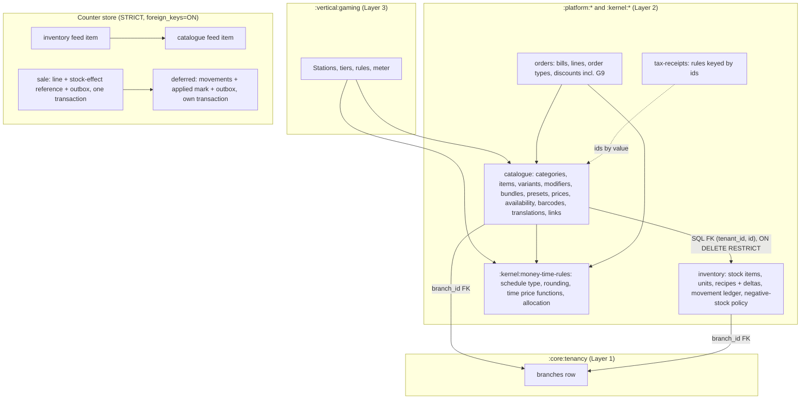

# ADR-0014: Item model — one catalogue and item core for every vertical (Catalogue sells, Inventory stocks, station time is a catalogue item, Catalogue depends on Inventory)

## Status

Proposed

> **Who may move this to `Accepted`: the user, or `cto` on the user's explicit
> confirmation. No other agent, and no skill on its own.**
> Why this is stated here: stories referencing a `Proposed` ADR are set `Blocked`,
> and epics require `Accepted`, so the field needs a named owner. `cto` is the
> role `coordination-rules.md` escalates technical conflicts to, and an ADR is
> that decision made durable.
>
> This does **not** relax the rule that `Status: Accepted` is never set without
> explicit user confirmation — it narrows *which agent* may set it once that
> confirmation exists. An agent that believes an ADR is ready says so and
> escalates; it does not edit this field.

**Acceptance blockers.**
1. **S42 passes on the store variant the counter will use** (founder, 2026-10-22). **First run 2026-10-22: FAIL** (`prototypes/catalogue-movement-spike/README.md`, S42-F1–F3): on the shared Windows VM (snapshot `clean-ssh2`, 100 IOPS + 80 MiB/s), with the sync client's default store (SQLite3MC chacha20, rollback journal `DELETE`, `synchronous=FULL`), no cell met "Start session, add item" (**p95 ≤ 200 ms, max ≤ 1 s**) — not even a sale with no movements (p95 498 ms, one 3.6 s operation); movements added about +40 ms (N = 1) to +762 ms (N = 40) at p95, with outliers to 12.6 s. The founder moved the movement write off the cashier's path (Decision 13) and set the **re-run on the store variant the sync spike adopts** (S104 or what follows). The baseline failure at N = 0 is the store's, tracked by the sync spike and the desktop runtime ADR; this blocker measures what the item model adds on that store (CTO-ADR R4):
   - **The timed sale** is what the cashier waits for under Decision 13: the bill line, the `pending_stock_effects` row, the outbox command and the negative-stock check over the line's stock items, **with a non-empty pending queue**; the void likewise.
   - **Cells:** N = 0, 1, 5, 10, 20, 40, spaced as in the first run; **a sale that starts while an N = 40 deferred write is running**; **back-to-back sales with no spacing** while deferred writes run.
   - **Pass:** every cell's sale and void meet p95 ≤ 200 ms and max ≤ 1 s; every deferred line is applied within the 3 s ceiling of its sale under the back-to-back load, and the queue drains when sales stop.
   - **Chunk size and time budget** of the deferred write (Decision 13) are set from the sync spike's busy-counter results (how long a sale may wait behind a write step) and its check of the "deferred write without waiting for the disk" hypothesis (founder, 2026-10-22), then confirmed by this re-run.
   - **When:** only on the founder's go, after the founder has reviewed those results (2026-10-23 at the earliest). The VM slot is then agreed with the sync session through the checkpoint (it was told on 2026-10-22), and `clean-ssh2` is restored after the run.
2. **CTO-ADR gate**, run as `--review full` for this gate only although `review_mode` is lean (founder: as for ADR-0010 to ADR-0013). **Run 2026-10-22: CONCERNS** (9 required, 20 minor); the founder chose Revise, and this text carries the revision; a CTO re-check on the diff only is pending.
3. **Domain map, one ownership line, before acceptance** (CTO-ADR R7): "Venue Configuration owns prep stations and kitchen and bar routing rules; Counter Shell consumes them" (Decision 18), written with `domain-architect` consulted.
4. **The one independent `/architecture-review` over ADR-0001 to ADR-0014**, started by the founder in a fresh session.
5. **Dependencies Accepted:** ADR-0010 and ADR-0011 (Proposed today) are Accepted first; the founder accepts ADR-0010 to ADR-0014 together after the review.

**Not blockers, with the reason recorded.** **Threat model** (CTO-ADR R8; founder, 2026-10-22): a `/threat-model` run over prices, open prices, waste and void dispositions, transfers and device-written stock **blocks the `product-catalogue` and `stock-core` specs**, not this ADR's acceptance (as ADR-0005 did with the tenant-isolation model); `threat-models/tenant-isolation.md` covers the RLS, composite-key and branch-scope parts now. **S51** (session close and meter timing on the VM) gates `/design-spec session-pricing` instead (founder, 2026-10-22): it times integer arithmetic over a handful of segment rows, and the model's claims about station time (the meter lives in Gaming; one line per segment) rest on S50, which passed. S10, S11, S30 and S31 gate the specs that rely on them (research § 9 row 1). The S41 query-plan leg is advisory (performance gate).

**Order (founder, 2026-10-21/22):** research and options → founder decisions D1–D12 → S20, S41, S52 run → S42 first run (FAIL) → Decision 13 revised → written as Proposed → CTO-ADR (CONCERNS, revised) → CTO re-check → domain-map line → independent review over ADR-0001–0014 → S42 re-run on the adopted store → joint acceptance of ADR-0010 to ADR-0014.

## Date

2026-10-22

## Last Verified

2026-10-22

## Decision Makers

- Kamel Mohamed, founder (user). Decided on 2026-10-21 from `docs/research/catalogue-and-item-model.md` § 5 (D1–D12): the recommended model as the basis; price precedence branch + order type, order type, branch, base; time-based price changes only as G9 through the one discount model, reported as their own category; combo pricing mode per combo; void and refund stock per line (return or waste); open price and sold by weight as attributes of ordinary items, kind 5 separate, label-scale barcodes recorded for retail; open language tag with Arabic and English in the UI; bill rounding mode plus step plus "none"; one base rate per station tier with G9 on top; combo time as prepaid time; one line per tier segment; an overnight window belongs to the day it started. On 2026-10-22: Q2 is settled by D1 and D5 (stock is deducted when the line is added; removing a line from an open bill is a void with D5's disposition); Q3 the kind-2 link carries a quantity; Q5 recipe lines may be excluded by order type (R-b); Q8 availability changes are sync commands applied in server arrival order; Q12 the negative-stock policy lives on the stock item. S42 is an acceptance blocker; S51 is not; D5 of S52 skipped in favour of the PostgreSQL 18 documentation. After S42's first run failed (2026-10-22): the movement write moves off the cashier's path (Decision 13), and S42 is re-run after the sync spike adopts its store variant. Recipes stay in Inventory, as the domain map says (2026-10-22). After decision 8k (the guide's one-time capability comparison; names and capabilities only, nothing of the previous system's design, schema or rules carried over), the founder set eight requirements on 2026-10-22, researched from primary sources (research § 11, F901–F909): branch-to-branch transfers and the fixed movement-kind list (Decision 13); description, display order and an image reference into Storage (Decision 2); the counter layout's owner and scope (Decision 6); the kitchen and bar routing owner and key (Decision 18); one time item per station type, player mode as a tier, per-person pricing Later, extras as catalogue items Later (Decision 14); three modifier rules and no stand-alone modifier (Decision 4).
- Drafted by `/architecture-decision`; `researcher` wrote parts 1–8 of the note; the main session ran S20, S41 and S52 on 2026-10-22 (`docs/research/evidence/catalogue-and-item-model/`).
- Stack validation: `principal-engineer`, 2026-10-22 (reviewed itself, not routed; stopped early on request, with unfinished checks listed) — **BLOCKING ISSUES FOUND: one (B1)**, the archive-only rule against the ADR-0005 closure purge, fixed in Decision 12 (a purge exception in reverse dependency order). Fourteen minor findings incorporated: two-key advisory lock in ADR-0008's order (M1); the pooler claim sourced to ADR-0008 F325 (M2); trigger, READ COMMITTED and an `app_rt` race test (M3); publish fails on a cycle, recipe arithmetic in the kernel (M4); sums cast to `bigint` in SQL (M5); `addExact` (M6); port shapes per ADR-0002 and ADR-0011 (M7); tenant-wide and branch rows in separate tables (M8); the kind check through a composite FK (M9); by-value references and the ADR-0005 marker (M10); movement ids and the server ledger writer (M11); the negative-stock check inside the sale transaction (M12); lock-wait timeout as a retryable problem (M13); references listed (M14). Not checked by it: the research note § 5, S20 and the SQLite stand-in files, the deferred-write recovery beyond M11/M12, and ADR-0001's class list and grants for the new tables. The S52 throwaway role `catalogue_rt` is unrelated to ADR-0009's checker role of that name (run notes).
- CTO-ADR (`--review full` for this gate), 2026-10-22: **CONCERNS** — 9 required (R1 transfers under `branch_scope`; R2 server re-pricing needs catalogue versions; R3 `job_rt` DELETE predicate; R4 S42 re-run cells and bounded deferred chunks; R5 owner and edge of the pending stock effect; R6 counts as absolute quantities; R7 declared amendments to ADR-0008 and the domain map; R8 threat-model link; R9 six negative tests) and 20 minor, **all revised here** (founder: Revise; R2 as versioned rows where every saved change is its own version, no publish step; R8 as a new `/threat-model` that blocks the `product-catalogue` and `stock-core` specs). The S42 re-run waits for the sync session's set 4b and busy-counter legs (until about 23:30 on 2026-10-22), and the deferred-write chunking reuses what those legs learn (founder). CTO-STACK-RISK: not needed with R4 applied (CTO). **Re-check 1 on the diff (2026-10-22): CONCERNS** — R1, R2, R4–R7, R9 and M1–M20 resolved; R3 and R8 partly; nine new issues N1–N9 (one movement key with the kind and compare-on-conflict; server rebuild of the expected effect; the purge predicate on every table without a new marker, evaluated once per statement, with `archive_retention` removed last; history-safe closing of versioned rows; versioned `kind` and `open_price`, immutable `selling_method`; `stock.rederive` stopped for a purge-eligible tenant; a stale threat-model sentence; counts written as records only; the reference holds ids only), **all revised here** (founder: Revise, with N5 changed: `kind` is versioned rather than immutable, never to or from kind 5 or on a station-time item). **P-TRUST (founder, 2026-10-22)** applied before the last re-check: Decision 0; the server's stock ledger built from the server's own derivation (`stock.derive`, owned by Orders) with the device's movements kept as claims (`stock_movement_claims`); physical observations accepted as facts with permission checks and anomaly flags (`stock_observations`); `device_rt` writes no server ledger or balance row. **Last re-check (2026-10-22): CONCERNS** — R3, R8 and N1–N9 resolved; P-TRUST applied coherently but Partly, with three required gaps (T5 the recipe version came from the device's claim; T2 one port both refused and served the server's derivation; T3 a void's derivation depended on job order) and six minor (T1 stale wording; T4 device balances rebased on the server's; T6 "refused" only for forged or unbound commands and payload tenants; T7 version parameters on the ports; T8 pack-unit factors fixed once used; T9 the kind trigger's scope, owner and kind-5/time rule). **All adopted exactly as the CTO prescribed, and not re-checked again** (founder, 2026-10-22); the independent `/architecture-review` over ADR-0001–0014 covers them. CTO-STACK-RISK: not needed (CTO). S42 runs only after the founder has reviewed the sync session's busy-counter results and its check of the "deferred write without waiting for the disk" hypothesis (tomorrow at the earliest); the chunk size comes from those results.

## Summary

Kodeebo needs one item model that every vertical sells from — café items, PlayStation and billiards time, restaurant combos and later retail goods — with stock deducted offline on the counter and prices, availability and tax resolved the same way on device and server. This ADR splits the one model between Catalogue (`:platform:catalogue`, the sellable side: categories, items, variants, modifiers, combos, presets, prices, availability, schedules, barcodes, translations) and Inventory (`:platform:inventory`, the stock side: stock items, units, recipes, one movement ledger), makes Catalogue depend on Inventory and own the link rows, keeps station tiers and the meter in Gaming with station time as a catalogue item, and fixes the integer, archive-only and device-store rules that S20, S41 and S52 proved.

## Stack Compatibility

| Field | Value |
|-------|-------|
| **Stack layer(s)** | Data (PostgreSQL 18.6) and Ktor backend (primary); the counter's local store (`stack.desktop` is unset: the SQLite facts here come from a stand-in, host SQLite 3.54.0 and the sync spike's `apsw-sqlite3mc` 3.54.0.0, and are re-run when the desktop runtime ADR fixes the engine) |
| **Domain** | Data (with Core) |
| **Layer** | Foundation |
| **Knowledge Risk** | HIGH for Ktor 3.6.0 and Exposed 1.5.1 (past the authoring model's training data, `docs/stack-reference/ktor/VERSION.md`); the decision relies on no new Ktor or Exposed API. The SQL behaviour it depends on was executed on the pinned PostgreSQL (S41, S52) |
| **References Consulted** | `docs/research/catalogue-and-item-model.md` (§§ 1–11, parts 1–8, F101–F888, addendum F901–F909: Square InventoryTransfer, InventoryState, CatalogModifierList, OrderLineItemModifier and item-grid help pages; Odoo 18 inter-warehouse replenishment; Toast routing with prep stations); evidence `s20_bundle_allocation`, `s41_quantities_and_cycles`, `s41_sqlite_standin`, `s52_catalogue_inventory_fk`, `s52_sqlite_standin`, `s41_s52_run-notes.md`, `s40_units_arithmetic`, `s50_station_time_arithmetic`; `docs/stack-reference/pins.yaml`; `docs/stack-reference/postgres/VERSION.md`, `best-practices.md`, `breaking-changes.md`, `deprecated-apis.md`; `docs/stack-reference/ktor/VERSION.md`, `best-practices.md`, `breaking-changes.md`, `deprecated-apis.md`; `docs/stack-reference/kotlin/` `breaking-changes.md`, `deprecated-apis.md` (nothing in them affects this decision); PostgreSQL 18 documentation, CREATE TABLE, `REFERENCES … ON DELETE` (tier 1, read 2026-10-22); `design/specs/domain-map.md` § Ownership and § Recorded Feature Rules; `docs/architecture/perf-budgets.md`; `docs/registry/architecture.yaml`; ADR-0001, ADR-0003, ADR-0006, ADR-0008, ADR-0010, ADR-0011, ADR-0012 |
| **Pinned versions relied on** | PostgreSQL `postgres:18.6`, Kotlin 2.4.21, Ktor 3.6.0, Exposed 1.5.1, HikariCP 7.1.0 (`pins.yaml`). No new dependency |
| **Post-Cutoff APIs Used** | None. SQL features used and executed on 18.6: `WITH RECURSIVE … CYCLE`, `pg_advisory_xact_lock`, composite foreign keys under FORCE RLS (S41, S52) |
| **Verification Required** | **S42 re-run** on the adopted store variant, with the cells of acceptance blocker 1 (sale with reference and negative-stock check over a pending queue; sale during an N = 40 deferred write; back-to-back sales) (first run FAIL). **S51** before `/design-spec session-pricing`. S10, S11, S30, S31 before their specs. The SQLite legs of S41 and S52 re-run on the engine the desktop runtime ADR picks. The first stock story proves the Exposed mapping of `sum(bigint)`, which PostgreSQL returns as `numeric` (S41 A3), with a range check back to `Long`. A Testcontainers test runs the recipe cycle race of S41 B6/B7 against the real migration |

Critical ADR: yes — it is the data model every vertical's selling, stock and time billing rests on; it fixes cross-module foreign keys and their direction under ADR-0010 and ADR-0011, and the money arithmetic the device and the server must agree on.

## ADR Dependencies

| Field | Value |
|-------|-------|
| **Depends On** | ADR-0001 (tenancy, composite keys, RLS; Accepted), ADR-0002 (tenant context; Accepted), ADR-0003 (branch scope; Accepted), ADR-0006 (backend track, integer money, IC-BILLING-VECTORS; Accepted), ADR-0008 (permission keys; Accepted), **ADR-0010** (Layer 2/Layer 3, cross-module foreign keys in SQL, the bare `branches` row in tenancy; Proposed), **ADR-0011** (`:platform:catalogue`, `:platform:inventory`, `:vertical:gaming`, `:kernel:money-time-rules`, the Gradle dependency wall; Proposed) |
| **Enables** | The money and time rules ADR (Still-Missing item 6): the shared schedule value type, line and bill rounding, the rule total order, the cost method, the G9 report category — it receives the references this ADR fixes. The sync ADR: one feed item per context, availability commands in arrival order, and **P-TRUST on every command** (raw facts in, claims compared, the per-command checks, tenant and branch from the credential; founder, 2026-10-22). The desktop runtime ADR: the STRICT, foreign-key and feed-order requirements on the counter's store |
| **Blocks** | `/design-spec product-catalogue`, `stock-core`, `recipes`, `combos-bundles`, `menu-scheduling`, `stations-catalogue`, `session-pricing`, `advanced-pricing`, `session-extras`, `barcode-scanning`, `purchasing-suppliers`, `cost-margin-reports`, and the item-id inputs of `tax-service-rules`. No epic or story exists yet (`production/epics/` absent) |
| **Ordering Note** | Written after ADR-0013; the independent review covers ADR-0001–0014 together; Inventory's first migration precedes Catalogue's (S52 D1) |

## Context

### Problem Statement

The founder decided that one item model serves every vertical, designed complete once, with tiers deciding only what the UI exposes (domain map, "One catalogue and item core", 2026-10-20). Without this decision none of the catalogue, stock, recipe, combo, scheduling, station or pricing specs can be written, and each would invent its own item shape — the thing P-VERTICAL forbids. The model is money-affecting (prices, tax inputs, stock value, time billing) and runs offline on the counter, so the arithmetic and the store rules must be fixed before the first migration.

### Current State

No backend or counter code exists. The domain map records the ownership (Catalogue: sellable kinds 1, 2, 3, 5 and the item-to-stock or item-to-recipe link; Inventory: stock items, recipes, assets of kind 4), the item kinds, the tax hierarchy (Tax & Receipts owns values; the caller passes branch, order type, category and item ids), waste as a stock movement with a reason, and tax-inclusive prices as a branch setting. ADR-0011 names the modules. The research note (Draft, 2026-10-21) compared Square, Toast, Shopify, Lightspeed, Odoo, ERPNext, Foodics and Loyverse and the founder decided its options.

### Constraints

- ADR-0001: every tenant table has `tenant_id`, ENABLE + FORCE RLS with the restrictive policy; every foreign key between tenant tables is composite with `tenant_id`. ADR-0003: branch-scoped tables carry a composite FK to `branches` and the `branch_scope` policy.
- ADR-0010/0011: Layer 2 (`:platform:*`, `:kernel:*`) never depends on Layer 3 (`:vertical:*`); a cross-module foreign key only in the Gradle dependency direction (FP-FK-LAYER1-TO-PRODUCT); Exposed tables `internal`; cross-module references by id value with the key in SQL.
- ADR-0006 and IC-BILLING-VECTORS: money in integer piasters and time in integer units, no floating point, one shared vector suite run by server and device CI.
- The counter is offline-first: it sells, prices and deducts stock from its local copy; money facts are never rejected by the server, only flagged (domain map; FP-TRAIL-WRITE-OUTSIDE-FUNCTIONS). End Day closes the business day, not midnight.
- The founder's 3 s ceiling and "Start session, add item" p95 ≤ 200 ms, max ≤ 1 s on the 4 GB reference PC.
- P-LOC (Arabic and RTL first, keys in code), P-VERTICAL, the clean-room rule (no Glitch material).
- Distribution is hosted only: no customer bundle and no self-hosted upgrade path apply.

### Requirements

- One model for café, gaming, restaurant and retail items, with every part present from the first migration.
- Prices per branch and per order type; availability per branch with "sold out today"; schedules by weekday, time and date range.
- Recipes with sub-recipes, yield and wastage; units with conversion; waste with a reason; stock returned or wasted on void.
- Station time sold and billed as an item line, with tiers and the meter outside Catalogue.
- Device and server compute the same prices, splits, quantities and time amounts (vector suite).
- No cross-tenant read or link is possible through any key (S52).

Research note: `docs/research/catalogue-and-item-model.md` (Status Draft; founder decisions D1–D12 in § 5).

## Decision

### 0. P-TRUST in the item model (founder, 2026-10-22)

The domain map's principle P-TRUST (registry `TR-NEVER-TRUST-CLIENT-R2`) governs every decision below. In this model:

- **From a counter the server takes raw facts only:** variant and option ids, option repeat counts, quantities, order type, every server-data version it used (catalogue and inventory today; any future versioned data), staff id, device time and sequence, amounts tendered, a weight entered for a sold-by-weight item, a price typed for an open-price item or option (a person's input, checked against that person's limit at that time), and physical observations (waste, counted quantity, quantity received, transfer quantities sent and received).
- **The server recomputes every derived value from its own versioned data:** line prices and their provenance (Decisions 7, 7a), combo splits (Decision 5), time amounts (Decision 14, through the kernel functions), stock movements (Decision 13), count differences and balances. Discounts, tax, service and minimum charge and bill totals are recomputed the same way by their owners (Orders & Bills, Tax & Receipts) under P-TRUST.
- **Whatever the counter computed is a claim:** stored, compared, and shown beside the server figure as a review flag when they differ. It never rejects a money fact and is never trusted.
- **Every command** is checked for device enrolment and lease, the staff member's permission and limits at that time (authority snapshot, ADR-0008), that the claimed catalogue and inventory versions existed then and are not older than the device's last acknowledged feed of each, clock plausibility and idempotency. Tenant and branch come only from the device credential or the dashboard session, never from the payload.
- **The dashboard, the Android app and any web client** run nothing that the server trusts: every rule, permission and validation of these decisions runs in the server's use cases.
- **Every spec** built on this ADR carries the negative test "a tampered client value is flagged or refused". **Refused** applies only to a forged or unbound command (no valid enrolment, lease or session) and to a payload that names a tenant or branch; **every money or stock fact is flagged, never refused** (CTO re-check T6).


### 1. Ownership and module direction

- **Catalogue** (`:platform:catalogue`) owns the sellable side; **Inventory** (`:platform:inventory`) owns the stock side (domain map). **Catalogue depends on Inventory** (Gradle edge `catalogue → inventory`) and owns the link rows from a variant to a stock item (kind 2) or a recipe (kind 3), with composite foreign keys into Inventory's tables in SQL (research part 5 B1; S52 D1–D7). Inventory never names a Catalogue type or table.
- **Gaming** (`:vertical:gaming`) depends on Catalogue and on `:kernel:money-time-rules`; it owns stations, tiers, rules and the meter (Decision 14). Catalogue knows no station concept.
- **Orders & Bills** depends on Catalogue (lines reference variants). Catalogue keeps an order type as an **id value without a foreign key** (order types are Orders' rows; an FK would invert the direction); Orders archives order types and never deletes them, so a stored id stays meaningful.
- **Tax & Receipts** keys its rules by branch, order type, category and item ids. Catalogue holds **no tax, service-charge or minimum-charge data** (research part 3 C1). Whether a Tax & Receipts row carries a foreign key into Catalogue is that spec's choice, in the Gradle direction only.
- Branch-scoped Catalogue and Inventory tables (price overrides by branch, availability, stock levels, movements) carry `branch_id NOT NULL`, a composite FK to the tenancy `branches` row (TR-BRANCH-ROW-IN-TENANCY) and the `branch_scope` policy (TR-BRANCH-SCOPE-R4). A tenant-wide row never shares a table with branch rows: a NULL `branch_id` would be hidden by the `branch_scope` predicate from every non-owner and every device, and a composite FK with a NULL column is not checked (stack validation M8).
- **References by value, no FK (against the Gradle direction):** Inventory's movement rows carry the Catalogue option id and the Orders line id as id values; Catalogue's price rows carry the Orders order-type id the same way. Each is validated by the writing use case, never by a key.
- **Retention (ADR-0005):** every new TD table records its personal-data marker (`personal`, `tax` or `other`) in its migration; CI fails on a missing one. Proposed: the movement ledger is `tax` (it belongs to the sale records kept until `retain_until`) and carries the acting staff id only as an id, de-identified by ADR-0005's deletion of the id-to-name mapping; catalogue and stock definition tables are `other`. The final marker per table is set with its migration.

### 2. Item structure (D1, D6; Q3)

- A **category tree** (category, optional parent); each item has **one** category.
- An **item** has a **kind** — 1 sold without stock (a service or station time), 2 sold with stock (1:1 link), 3 sold through a recipe, 5 custom item — a **selling method** `unit | weight | time`, an `open_price` flag, a brand, and translation rows. Kind 4 (asset) is Inventory's and never a catalogue item.
- **`selling_method` is immutable** after the item is created (unit, weight or time is the nature of the item; `app_rt`'s column-level `UPDATE` on items excludes it). **`kind` and `open_price` change only through a new version** (Decision 7a; founder, 2026-10-22): an owner who starts selling an item without stock and later tracks it (kind 1 → 2) or adds a recipe (→ 3) keeps one item and one sales history; old lines keep their version, and the stock or recipe link rows change in the same saved change. A kind change **to or from kind 5** (the custom item) or on a **station-time item** (selling method `time`) is refused.
- Every item has **at least one variant** (a default variant for a simple item). The **variant** is the key for SKU (unique per tenant), barcodes (a child table, each barcode unique per tenant), option values on tenant-level option axes (retail size, colour), price rows, availability rows and the stock or recipe link.
- The link matches the kind: kind 2 → exactly one stock link carrying a **whole-number quantity in the stock item's base unit, default 1** (Q3); kind 3 → one recipe link; kinds 1 and 5 → no link. Enforced in the use case and backed in the database by a **deferred constraint trigger** — firing on changes to `item_sale_rules`, `variant_stock_links` and `variant_recipe_links`, `SECURITY INVOKER` and owned by `migrator` (ADR-0001 C5) — that checks at commit, for every item a transaction touched, that its current kind row and its current link rows agree, and refuses a kind change to or from kind 5 or on an item whose `selling_method` is `time`, so the database enforces it and not only the use case (CTO re-check T9) (a CHECK cannot read another table, and `kind` is versioned, so the composite-key form of stack validation M9 no longer fits; the trigger is its stated alternative; CTO re-check N5). The variant carries the immutable `selling_method` through a composite FK `(tenant_id, item_id, selling_method) → items (tenant_id, id, selling_method)`, so every price table checks `selling_method <> 'time'` row-locally: a time item cannot get price rows (CTO-ADR M19).
- **Presentation attributes (founder, 2026-10-22):** categories, items, variants and modifier options carry a **description** (translation rows, plain text, Decision 3), a **display order** (whole number; ties broken by id) and a **nullable image reference** — an id into the Storage context (core `storage`, ADR-0010), held as an id value with no foreign key until the storage ADR defines the object table (then a key in the Gradle direction, `:platform:catalogue → :core:storage`, is allowed). Uploading is deferred: one core `storage` capability will serve logos, venue photos and menu and retail images; its provider (Cloudflare R2 or the founder's own server) is the storage ADR's research decision, behind an S3-compatible port (founder). Square catalog objects likewise reference images by id (research F904).
- **Kind 5** is one seeded item per tenant; the typed name and price live on the bill line (Orders), never as new catalogue rows.
- **Open price** (the cashier types the price, within the role's limit under ADR-0008) and **sold by weight** (price per weight unit; line amount = weight × unit price, rounded by the money and time rules ADR's rule; the cashier enters grams, and stock is deducted in the mass base unit, milligrams, Decision 10) are attributes of ordinary items (D6). Open-price items and options use ADR-0008's `bill.open_item` limit (maximum unit price, never above the owner's tenant ceiling) unless the permission work of research § 9 row 7 gives them their own key (CTO-ADR M10). Weight- or price-embedded label barcodes (EAN-13 starting with 2) are recorded in the model as a barcode kind for retail; parsing and scale hardware are later features, outside this ADR.

### 3. Text and languages (D7)

Every person-readable catalogue string (category, item, variant, option axis and value, modifier group and option, combo slot, preset label, unit name) lives in **translation rows keyed by an open BCP 47 language tag**, one primary language per tenant, mandatory on every entity. The UI offers Arabic and English only; a third language needs no migration. The receipt language is a branch setting; a name missing in it falls back to the primary language and is never blank (R1). Names are plain text: control and bidi-override characters are stripped on write.

### 4. Modifiers (research part 2 A3 with part-8 additions)

Modifier groups are tenant-level and attached per item with **min, max, defaults, `free_options`, `unique_options`, `excluded_options`**; nesting is allowed in the model (depth limited by the spec). Option price and availability may differ per branch (override rows as in Decision 7). An option's stock effect is a reference to an **Inventory-owned recipe delta** (add, replace or remove an ingredient quantity); the sale writes the base movements plus the delta movements, each tagged with the option id.

Founder additions (2026-10-22):

- **(a) Quantity rule per group.** Each modifier group has `quantity_mode`: **`per_unit`** — an option's price and its stock delta multiply with the line quantity (two burgers with extra cheese = two cheeses; Square's fixed behaviour, research F905, and Foodics's, part-8 F832) — or **`per_line`** — they apply once per line whatever its quantity (one sauce pot for the order line). Default `per_unit`. The line freezes the mode it used.
- **(b) Open-price option.** An option may be `open_price`: the cashier types its price within the role's limit and under ADR-0008's permission rules, exactly like an open-price item (Decision 2); the typed price is frozen on the line. Square's ad hoc modifier, priced at order time, is the closest precedent (F905).
- **(c) Maximum repeat per option.** An option carries `max_repeat` (a whole number ≥ 1, default 1), the most times it may be chosen on one line; repeats count toward the attachment's min and max (Square `allow_quantities`, F904). The attachment's `unique_options` switch, when on, caps every option at once and wins over `max_repeat`.
- **Not added:** a modifier sold on its own. Something sold alone is an item.
- Option prices, branch option prices and every attachment rule above are **versioned rows** (Decision 7a).

### 5. Combos and bundles (D4, D10; S20)

- A **bundle** is a sellable item with **slots** (fixed: one item, variant and quantity; choice: an eligible set with min, max and defaults), **sizes** and **upgradeable slots**. A sale writes a parent line and linked child lines; each child keeps its own kind (stock is deducted per child; a time child is prepaid time, D10).
- **Pricing mode per combo** (D4): (a) **one combo price split** across the child lines by **largest remainder in integer piasters**, weight = list price × slot quantity, leftover piasters to the largest remainders, ties by larger weight then slot order, equal weights when every component is free; or (b) **owner-set prices** per slot option, per combo size and per branch. A combo price is never a discount.
- S20 (executed, `s20_bundle_allocation`): the split adds up exactly in 10 named edge cases (a free component, a 1-piaster combo, an all-free combo, a combo dearer than its parts) and 200,000 seeded cases; no share is negative; each is within one piaster of its exact proportion; a free component gets nothing; the result does not depend on input order. **A slot of quantity q receives one line amount** (S20 case 8: 5,625 piasters for two drinks), so the split is stored as the **child line amount**, never as a unit price. `price × weight` must stay within `Long`: computed with an overflow-checked multiply, refused above it (S20 case 13).

### 6. Presets

A counter quick-button preset is a **stored selection** (item, variant, options, quantity), never a cloned item.

**Counter screen layout (founder requirement, 2026-10-22).** **Catalogue owns the quick-button layout**, beside the presets it points to. A **layout** is a tenant-level object: pages in order, each with buttons at a position (row, column), a colour from the design system's token palette (a token name, never a free hex value), an optional label override (translation rows) and one target — an item, a variant, a preset or a category. **Each branch selects one layout** (a branch-scoped assignment row; the tenant's default layout when none is set); two branches that share a layout share every edit, and a branch that needs a different screen selects a different layout. There is no per-device layout. Square keeps one grid per location and copies it to other locations once, after which the copies drift (research F906, F907); a shared tenant-level layout avoids the drift while still allowing a branch its own screen. A button whose target is archived or not available in the branch is hidden on the counter (Decision 8), never an error. A partial unique index allows one default layout per tenant. Layouts and order-type prices are tenant-wide, so a person who edits them changes every branch that uses them; who may edit tenant-wide definitions (owner only, or a key a branch manager may hold) is settled with the permission keys (research § 9 row 7; CTO-ADR M9).

### 7. Prices (D2, D3)

- The **base price** is a versioned price row of the variant (Decision 7a). **Override rows** are sparse, in two tables: tenant-wide rows by order type (not branch-scoped), and branch rows (`branch_id NOT NULL`, with an optional order type) under `branch_scope` (Decision 1).
- **Precedence** (D2): branch + order type → order type → branch → base. A bill line **freezes** the price and its provenance (matched level and row) when it is added.
- A catalogue price has **no time dimension and no percentage** (D3). Happy hour or a weekday price is a **G9 rule through the one discount model**, owned by Orders & Bills; G9 automatic pricing is **reported as its own category**, separate from cashier discounts.

### 7a. Catalogue versions (CTO-ADR R2; founder, 2026-10-22)

- Each tenant has one **catalogue version**, a whole number incremented in the same transaction as **every saved change** to a versioned row. **Every saved change is its own version automatically; the owner never sees a separate publish step** (founder).
- **Versioned rows** are the rows the server needs to re-derive a line's price and stock effect: the item's **sale rules** (`kind`, `open_price`; CTO re-check N5); base, order-type and branch prices; option and branch option prices; modifier attachment rules (min, max, defaults, `free_options`, `unique_options`, `excluded_options`, `quantity_mode`, `max_repeat`, `open_price`); bundle sizes, slots, slot choices, pricing mode and slot prices; the kind-2 stock link and its quantity, the kind-3 recipe link and an option's recipe-delta link. Each carries `valid_from_version` and a nullable `valid_to_version`. **An edit closes the current row and inserts its successor**; no other column of a versioned row is ever updated (`app_rt` has `UPDATE` on `valid_to_version` only, column-level, Decision 17). **History cannot be rewritten** (CTO re-check N4): the `UPDATE` policy's `USING` requires `valid_to_version IS NULL` (only an open row is closed) and its `WITH CHECK` requires the new value to equal the tenant's current catalogue version (only at the current version), so no row is closed retroactively, reopened or extended. The current rows are those with `valid_to_version IS NULL`, under a partial unique index per natural key.
- Recipes are versioned already (Decision 11); the link names the recipe, and the line's stock-effect reference names the recipe version.
- **Not versioned:** names, descriptions, display order, images, layouts, availability and schedules. They change presentation or gate a sale, never its amount; a line freezes its display name.
- **Lines and re-pricing.** The counter receives the version with each Catalogue feed item and stamps it on every line. The server resolves each line's prices and rules **at that version** (`valid_from_version <= v` and `v < coalesce(valid_to_version, ∞)`): an honest offline sale priced before a later change is not flagged, and a price that differs from the rows at its own version is flagged as a review item, never rejected. A version the server does not know, or a line whose version is older than the device's last acknowledged feed, is flagged as well.
- Versioned rows are never deleted except by the closure purge (Decision 12); their growth is one row per saved change.
- **Note 2026-10-23 (founder; ADR-0016, research `backend-code-conventions` part 5 F528).** The partial unique index on the open row and the range `CHECK` do not stop a closed version range from overlapping the open one; only an exclusion constraint did (S50, PostgreSQL 18.6). Every versioned table therefore also carries `EXCLUDE USING gist (tenant_id WITH =, <entity id> WITH =, int8range(valid_from_version, COALESCE(valid_to_version, <bigint max>)) WITH &&)`, with an integration test that an overlapping range is refused. It needs the `btree_gist` extension, created by a privileged migration on ADR-0009's committed privileged list (run by the founder) before the first versioned-table migration. ADR-0016 holds the rule.

### 8. Availability (research part 3 B1; Q8)

- A branch-scoped row per variant (and per modifier option) holds `not_offered` or `sold_out_today`; `sold_out_today` carries the **business-day id** and holds only while it equals the current business day, so End Day ends it with no job. No row means offered. Stock-driven sold-out is a signal from Inventory (Decision 13), not a stored Catalogue row.
- A change from a counter or the dashboard is a **sync command applied in server arrival order**; every device and the dashboard converge on the result, and the dashboard shows who changed it and when (Q8). The sync ADR owns the transport.
- **Availability is a gate; price is a cascade.**

### 9. Schedules

One **shared schedule value type** (weekdays, local time window, optional date range, optional order-type and branch sets), owned by `:kernel:money-time-rules` and defined in the money and time rules ADR, is used by menu availability and by G9. A window that crosses midnight belongs to the **day it started** (D12).

### 10. Units and quantities (research part 4 A, part 7 E1; S40, S41)

- Quantities are **whole numbers in the base unit of a unit category** (mass in milligrams, volume in millilitres, count in units), stored as `bigint` (`INTEGER` on the device).
- A unit has a positive whole-number **factor to the base unit** (database check) and a **whole-number flag** (count units sold whole). Pack units belong to the supplier link, with a default per stock item. **A pack-unit factor is fixed once used**: a different factor is a new pack unit (the old one archived), recorded at an inventory version; a receiving observation is converted with the factor in force at the observation's time (CTO re-check T8).
- S41 (executed, PostgreSQL 18.6): `bigint` overflow on insert or arithmetic raises an error and never wraps; reversing stored movements returns the totals to exactly zero; `sum(bigint)` returns `numeric`; integer division truncates toward zero. Stand-in SQLite 3.54.0: an overflowing integer expression silently becomes a REAL, which an ordinary table stores and a **STRICT** table refuses; `sum()` raises on overflow; division also truncates toward zero.

### 11. Recipes (research part 4 B4; Q5; S41)

- A recipe belongs to a variant (through the link), is **versioned** (a draft, the active version, and superseded versions: saving a version as active puts it in use at once, with no separate publish step, founder 2026-10-22), has an output quantity, lines with quantities in the base unit and **wastage in basis points**, and **sub-recipes that are phantom or stocked** per sub-recipe. Cost mode per recipe: fixed or derived (the cost method is the money and time rules ADR's).
- A recipe line may carry an optional set of **order types it is excluded from** (R-b, Q5).
- **Inventory version (CTO re-check T5).** Each tenant has one **inventory version**, a whole number incremented in the same transaction as every activation of a recipe version or a recipe-delta version (and every new pack-unit factor, Decision 10). Each version row records the inventory version from which it is active and, once superseded, the one at which it stopped. The Inventory feed carries the inventory version; the counter stamps it on each line next to the catalogue version (Decision 7a), and the server derives with the versions active at it. Inventory owns this counter because it cannot increment the catalogue version (it never depends on Catalogue).
- **An active or superseded version is immutable:** `app_rt`'s `UPDATE` policies on `recipe_versions`, `recipe_lines` and `recipe_line_exclusions` require the version's `status = 'draft'` (the line tables carry `status` through a composite key to their version, as Decision 2 does for `kind`), and the only status changes allowed are draft → active and active → superseded, checked by a trigger (CTO-ADR R9 d).
- The sub-recipe graph is **acyclic per tenant**. The check is a **`BEFORE INSERT OR UPDATE OF component_recipe_id` trigger** on the recipe line table (as executed in S41, so no write path skips it), which first takes **`pg_advisory_xact_lock(<recipe-graph class id>, <tenant key>)`** — ADR-0008's two-key, transaction-level form, with the recipe-graph class id registered beside the journal, trail and last-owner class ids — then walks the graph. The trigger function is `SECURITY INVOKER` and owned by `migrator` (ADR-0001 C5; CTO-ADR M7). **Lock order:** recipe graph, then journal, then trail, then last-owner — **this amends ADR-0008 § 3.5 and registers the recipe-graph class id beside the others in ADR-0008 § 6** (Amendments section; CTO-ADR R7); a recipe edit's trail append is its transaction's last statement. Recipe edits run at **READ COMMITTED**. S41 B6: without the lock, two concurrent edits stored a cycle under READ COMMITTED; B7: with it, the second edit waited for the first (1.47 s) and was refused, and another tenant was not blocked (S41 ran the single-key `hashtextextended` form as `postgres`; the integration test repeats it with the two-key form as `app_rt` through the ADR-0002 helper). A transaction-level lock fits a transaction pooler where a session lock does not (ADR-0008 F325; today there is no pooler, ADR-0002). A waiting edit is bounded by the helper's statement timeout; a timeout maps to a retryable RFC 9457 problem.
- **When a version is saved as active** it is **flattened** into one movement list per variant (and per excluded order type), in the same transaction. SQL only fetches the graph, with a `CYCLE` clause: **the save fails if any cycle row appears** (never silently drops a path). The quantity and wastage arithmetic (basis points) is one pure Kotlin function in `:kernel:money-time-rules`, covered by the IC-BILLING-VECTORS suite; wastage yields fractions of a base unit, so its **quantity rounding rule is the money and time rules ADR's**, with vectors for it (CTO-ADR M14). The counter receives only flattened lists and never recurses. S41 B8: the flatten of a diamond with a doubled branch gave the exact quantities.

### 12. Archive, never delete

A category, item, variant, option, stock item, unit or recipe that any link, line, price row or movement references is **archived (status), never deleted** — **except by the ADR-0005 closure purge** (stack validation B1). An unreferenced row, a draft included, is archived too: no runtime role holds `DELETE` (CTO-ADR M11).

- **When.** Catalogue and Inventory each implement an ADR-0010 Decision 11 `TenantDataParticipant` (only `:app` registers participants, IC-RETENTION-PARTICIPANT; CTO-ADR M18) that **acts only at `purged`** (after `archive_retained`, once `retain_until` has passed with no legal hold), never at `purge_personal`. Neither module has a `personal` table (Decision 1, retention), and the movement ledger is `tax`: it stays in the archive until `purged`, and late sales are still accepted into the archive after `purge_personal` (ADR-0005 Decision 1), so every catalogue and stock row the ledger and the archived lines reference must survive until then.
- **Who.** The step that reaches `purged` runs as an ADR-0012 job item, so `job_rt` deletes, in its `withScope(Job, tenant)` transaction (ADR-0005 as amended by ADR-0012); `job_rt`'s `DELETE` policies on these tables exist for this step only (Decision 17), and **the database enforces it** (CTO-ADR R3): **every** such policy's `USING` requires, for the context tenant, that CP `tenant_status` is `archive_retained`, that `archive_retention.retain_until` has passed and that the legal-hold flag on `tenant_status` is not set — the same condition on every table, so no new purge marker is needed (ADR-0005 defines none; CTO re-check N3), and the `tax` ledger meets ADR-0005's archive Must. The predicate is one `STABLE`, `SECURITY INVOKER` SQL function owned by `migrator`, `purge_allowed()`, reading CP rows `job_rt` may read in its tenant scope, and each policy calls it as `USING ((SELECT purge_allowed()))`, so it is evaluated once per statement, not once per row. `archive_retention` and the tenant's `tenant_status` purge facts are removed **after the last participant** (Amendments section). `job_rt` on an active tenant deletes nothing.
- **Order.** Reverse Gradle dependency order, children first: Orders and Gaming, then Catalogue, then Inventory. Inside each module:
  - **Catalogue:** branch layout assignments, layout buttons, pages, layouts; the catalogue version row; availability rows; branch and order-type price rows; bundle slot prices, slot choices, slots, sizes; preset options, presets; schedule branches, targets, schedules; modifier attachments, branch option prices, option prices, modifier options, modifier groups; stock and recipe links; base prices; barcodes, variant option values, option values, option axes; translation rows; variants; item sale rules; items; categories.
  - **Inventory:** pending stock effects (in the first chunk, before any movement, so nothing waits on deleted movements; CTO re-check N6); stock movement claims; stock observations; stock movements and balances; stock count records; transfer lines and sides; flattened recipe lines; recipe delta lines, recipe deltas; recipe line exclusions, recipe lines, recipe versions, recipes; supplier pack units; stock items; units; unit categories; the inventory version row.
- **Keys.** Cross-module foreign keys (Catalogue → Inventory) declare `ON DELETE RESTRICT`, so the database checks the purge's order. The category parent, the one true self-reference, uses the default `NO ACTION`, which is checked at the end of the statement, so one `DELETE` of a tenant's whole tree succeeds; `RESTRICT` there would refuse it even though the end state is valid (PostgreSQL 18 documentation, below). References between tables of one module (a sub-recipe line → its component recipe) also use `NO ACTION`, and the module deletes children first (CTO-ADR M7).
- **Size and indexes** (CTO-ADR M8). Five years of movements for one busy venue may reach tens of millions of rows (an illustrative assumption, not a measurement: a few hundred to about 1,500 lines a day × about 6 movements × 1,825 days; replaced by real figures when research Q14 is answered). PostgreSQL does not index a referencing column by itself, and every `RESTRICT` and `NO ACTION` check scans the referencing table without one, so **every column that references another table is indexed**, leading with `tenant_id`. The movement ledger is deleted **in bounded chunks, one ADR-0012 job item per chunk**, before the final `purged` transaction deletes the rest; each chunk is idempotent.
- **Source.** PostgreSQL 18 documentation, CREATE TABLE — the default referential action, `NO ACTION`, raises an error when a deletion would leave a referencing row without its referenced row, and `RESTRICT` raises it even when the end state would not violate the constraint (tier 1, read 2026-10-22; S52 D5 not executed, founder 2026-10-22).

### 13. Stock movements (research part 4 C1 + D; D1, D5; Q2, Q12)

- **One movement ledger** in Inventory. Stock is deducted when the line is added (Q2), but **the movement rows are written off the cashier's path** (founder, 2026-10-22, after S42's first run failed):
  1. **The sale transaction** commits the bill line, its outbox command and one **`pending_stock_effects` row** — Inventory's table, keyed by the Orders line id held as a value, holding the frozen **stock-effect reference** — ids and numbers only: the recipe version id (its flattened lines are immutable and already on the device, Decision 11; the device keeps the flattened lines of every recipe version a pending row still names), or the kind-2 link and its quantity; the order type; the chosen options with their repeat counts and recipe-delta ids; the catalogue version, Decision 7a, and the inventory version, Decision 11 (CTO re-check N9, T5) and an `applied` mark — and runs the negative-stock check (below). Nothing else. The row is written through Inventory's `StockEffects` port, called by Orders' add-line use case: this ADR **declares the Gradle edge `:platform:orders → :platform:inventory`** (Inventory depends on neither Orders nor Catalogue, so no cycle; CTO-ADR R5).
  2. **The deferred movement write** runs on the counter after the sale commits, **in bounded chunks**: each chunk is its own transaction of at most *k* movement rows, advancing a per-line cursor on the pending row; the last chunk sets `applied` and enqueues one outbox command carrying the line's movements. Lines are applied in commit order. A sale never waits behind more than one chunk, because SQLite has one writer and a running transaction cannot pause; *k* and a per-chunk time budget are set from the sync spike's busy-counter legs (how long a sale may wait behind a write step) and confirmed by the S42 re-run (blocker 1; CTO-ADR R4).
  3. **Crash recovery:** a pending row not marked applied is resumed from its cursor at the next start or idle moment, from the frozen reference; movement rows carry a natural unique key (below), so a repeated chunk inserts nothing twice.
  4. **Stock reads on the device** (stock figures and the negative-stock check) are the **branch balance plus the pending rows' remaining effects**. The device keeps 60 days of records (ADR-0005), so it never sums the ledger from the start; pruning old movements never changes a balance (CTO-ADR M4). The device **rebases** each balance on the server's balance at its feed cursor plus its own effects not yet acknowledged, so a difference between the server's derivation and its own does not make its negative-stock check drift (CTO re-check T4).
  5. **On the server — P-TRUST (founder, 2026-10-22).** The server's ledger is built from **the server's own derivation of each sale fact**, never from the device's movement list:
     - The sale command brings only raw facts: the line's variant, chosen options and their repeat counts, quantity, order type, every server-data version it used (catalogue and inventory today; any future versioned data), staff id, device time and sequence. The device's stock-effect reference and, later, its movement command arrive as **claims**: they are stored in `stock_movement_claims` (Inventory) to be compared, and never written to the ledger.
     - A **derivation job** (ADR-0012 kind `stock.derive`, **owned by Orders**, which already depends on Catalogue and Inventory; Inventory never depends on Catalogue) resolves the line's stock effect from the server's own versioned rows **at the line's catalogue version and inventory version** — the item's sale rules and the stock or recipe link at the catalogue version; the recipe version and recipe-delta versions **active at the inventory version** (Decision 11), with their `recipe_flat_lines`; the order-type exclusions — and writes the movements through Inventory's **`StockLedger.writeDerived`**, as `job_rt`. A recipe or delta version the device claims that differs from the one active at the stamped inventory version is flagged, and the server derives with the active one (CTO re-check T5). `writeDerived` **never refuses**: it flags a crossing below zero and a key conflict whose stored row differs (CTO re-check T2). **A void** first derives the voided line itself (idempotent by the natural key, so it does not matter whether the sale's own job item has run; ADR-0012 claims items in no guaranteed order), then copies the server's movements of that line with the sign flipped and adds `waste` for the waste disposition (CTO re-check T3).
     - It then compares the device's claimed reference and movements with its own: a difference is a **review flag** showing the claimed and the server figure side by side — never a rejection and never trusted (CTO re-check N2). A device that sends a shrunken list with matching movements is caught, because the server never used that list.
     - Because the server writes its ledger whether or not a device's movement command arrives, a device lost after its sale synced leaves no gap in the server ledger; a missing claim is only noted (CTO-ADR M5).
     - The job's status gate lets it run while late sales can still arrive after `purge_personal`, and **stops once the tenant is purge-eligible** (Decision 12's predicate; CTO re-check N6). Balances on the server are derived from the server's own movements; it never takes a balance figure from a device (CTO-ADR M4).
     - **Physical observations** — a waste quantity and reason, a counted quantity (count record), a quantity received from a supplier, a transfer's sent and received quantities — are what only a person on site can know: the server **accepts them as facts**, after checking the staff member's permission and limits at that time (authority snapshot), and raises **anomaly flags** (an unusual size, a branch or stock item the person is not assigned to, a clock implausibility). The server then writes their movements itself (`job_rt`).
     - Every device command is checked for enrolment and lease, authority at its time, that the claimed catalogue and inventory versions existed then and are not older than the device's last acknowledged feed of each, clock plausibility and idempotency; tenant and branch come only from the device credential, never from the payload (P-TRUST, `TR-NEVER-TRUST-CLIENT-R2`).
- **Void or refund (D5):** per line, back to stock or waste with a reason; default return for a line not yet made, waste once it is marked made. Removing a line from an open bill is a void with this disposition. A void **copies the voided line's stored movements with the sign flipped** as `void_return`; it never recomputes them from today's recipe. With the **waste** disposition the void also writes `waste` movements of the same quantities with the reason, so the line nets to the wasted quantity; with **return** it nets to zero (CTO-ADR M12). The void's movements go through the same deferred write, after the voided line's.
- **Waste** is a movement with a mandatory reason from the reason list and its own permission.
- **Negative stock (Q12):** the policy lives on the **stock item** — "allow and alert" (default) or "refuse the sale". **Inside the sale's write transaction**, the counter checks every movement the line would cause against its stock reads (balance plus pending), and refuses the line if a "refuse" stock item would go below zero; otherwise it sells and the owner is alerted once when stock crosses below zero. Two quick sales **on one device** cannot both pass. **Across devices** of one branch selling offline, a "refuse" item can still be oversold; the server flags the crossing and alerts the owner, and never rejects the sales (CTO-ADR M6; the brief keeps multi-device open).
- **Movement identity:** every movement, of every kind, has **one natural unique key** `(tenant_id, source_kind, source_id, kind, seq)` — the source is the bill line, the transfer side line, the count record, the observation or the dashboard document that caused it; `kind` is the movement kind, so a dispatch's `transfer_out` and a cancel's `transfer_in` on the same side line, or a waste-disposition void's `void_return` and `waste`, never collide; `seq` is its order within that source and kind — plus a UUIDv7 surrogate id (`.claude/rules/migrations.md`; CTO-ADR M2, re-check N1). The device uses the same key for its local ledger and its claims, so a claim and the server's row are matched by key. A replayed write (a re-run job, a replayed command) inserts with `ON CONFLICT` on the natural key; on a conflict the writer **reads the stored row, compares it with the incoming one, and flags any difference**, for every kind, so a different fact under an existing key is never silently dropped. The sync ADR owns the transport; this ADR owns the rule.

**Movement kinds — the full list, fixed now (founder, 2026-10-22).** A database `CHECK` holds exactly these, with a **sign check per kind**; a new kind needs an ADR amendment. On the **counter**, every kind except `opening_balance`, `adjustment`, `return_to_supplier` and `stock_count` is written to its **local** ledger (its stock reads need them). On the **server**, `device_rt` writes **no** ledger row at all: it writes facts and claims, and the server's ledger rows come from `job_rt` (derived from device facts and observations) or from `app_rt` (dashboard use cases, which run on the server; P-TRUST; CTO-ADR M1, R9 a).

| Kind | Sign | From a device, the server receives | Server ledger row written by | Notes |
|---|---|---|---|---|
| `opening_balance` | + | — | `app_rt` (dashboard) | once per stock item and branch; a later one, or one after other movements of that item there, is **flagged for review**, not refused (CTO-ADR M13) |
| `sale` | − | the sale fact (raw ids and quantities) + a claim | `job_rt` (`stock.derive`, derived) | from the server's versioned rows at the line's catalogue version |
| `void_return` | + | the void fact + a claim | `job_rt` (derived) | the server's own movements of the voided line, sign flipped |
| `waste` | − | an observation (quantity, reason) | `job_rt`, or `app_rt` from the dashboard | mandatory reason; permission and limits checked; anomaly flags; also a waste-disposition void (derived) |
| `adjustment` | ± | — | `app_rt` | mandatory reason; a correction that is not a count |
| `stock_count` | ± | a count record (observation) | `job_rt` (`stock.count_apply`) | the difference against the server's own ledger (below) |
| `transfer_out` | − | a dispatch observation (sent quantities) | `job_rt`, or `app_rt` from the dashboard | below |
| `transfer_in` | + | a receipt observation (received quantities), or a cancel | `job_rt`, or `app_rt` from the dashboard | below |
| `supplier_receiving` | + | an observation (quantity in the pack unit) | `job_rt`, or `app_rt` from the dashboard | the server converts the pack unit to the base unit |
| `return_to_supplier` | − | — | `app_rt` | |

**Stock counts (CTO-ADR R6).** A count is a **count record** — branch, stock item, the **counted absolute quantity**, the count's time and the writer's ledger cursor (the last movement it had seen) — never a delta computed on the device. The server derives the `stock_count` movement against **its own** ledger as of the count's time, so a dashboard receipt the counter had not seen is not counted twice. The counter and the dashboard write **only the count record**; neither writes a `stock_count` movement. The counter shows the difference it expects on screen, never as a ledger row; applying the record on the server enqueues an ADR-0012 job item (`stock.count_apply`) that runs as `job_rt`, derives the difference against the server's ledger as of the count's time and writes the `stock_count` movement, which reaches the device through the feed. `job_rt`'s movement `INSERT` policy allows the kinds of Decision 13's table that `job_rt` writes (CTO re-check N8, T1).

**Branch-to-branch transfers (`stock-core`, Tier 1; founder requirement, 2026-10-22).** Two-sided with an in-transit state, as Odoo does with a delivery, a transit location and a receipt (research F903), not one instantaneous record (Square's API transfer, F901), because each branch is a separate offline counter under `branch_scope`:

1. **Two sides, each in its own branch.** A transfer has one id and two **branch-scoped side rows** — the out side (`branch_id` = source) and the in side (`branch_id` = destination) — each with its own lines and the other branch's id as a value. Each branch's staff see only their own side; the owner sees both.
2. **Dispatch.** A person holding the transfer-send key in the source branch (a counter there or the dashboard) writes the out side with its sent quantities and one `transfer_out` movement per line; the transfer is `in_transit`. Stock leaves the source at once. In transit is a **state of the transfer**, not a stock location (Square also treats in-transit as a state, F902).
3. **The destination side is written by the server, not by the source** (CTO-ADR R1). `branch_scope` refuses a source-branch writer an in-side row for another branch, so when the server applies the dispatch command it enqueues an ADR-0012 job item that runs as **`job_rt`** (tenant-scoped, not bound by `branch_scope`, ADR-0003) and creates the in side **with the sent quantities copied**; the feed delivers it to the destination. `job_rt` holds `INSERT` and `UPDATE` on the transfer tables for this (Decision 17).
4. **Receipt.** A person holding the transfer-receive key in the **destination** branch confirms what arrived, line by line, against the copied sent quantities: one `transfer_in` per line for the received quantity; the transfer is `received`. A shortfall or surplus is **not** a further movement but a **discrepancy on the transfer**, raised as a review item. The owner may also confirm from the dashboard.
5. **Cancel.** Before receipt, the source (or the owner) may cancel: a `transfer_in` at the **source** for the sent quantities; the transfer is `cancelled`. A received transfer is corrected by a new transfer back.
6. **Idempotency and races — never refused** (CTO-ADR R1). Transfer movements use the one movement key above, with the transfer side line as the source, so two receipts of the same line (one confirmed on an offline counter, one on the dashboard) write one movement; the second is recorded as a duplicate confirmation and, if its quantities differ, flagged. A cancel's `transfer_in` on the out side has its own kind in the key and is always written. A receipt arriving after a cancel, or a cancel arriving after a receipt, is **recorded and flagged for review**, never refused (money and stock facts are never rejected); the owner resolves it with a correcting transfer.
7. **Offline.** Dispatch and receipt are local writes followed by sync commands. The destination can confirm only once its in side has reached it through the feed; until then the owner can confirm from the dashboard. A destination offline at receipt confirms locally and syncs later.
8. **On the server (P-TRUST).** The sent and received quantities are physical observations: accepted as facts after the permission and authority checks, with anomaly flags; the server's `transfer_out` and `transfer_in` rows are written by `job_rt` from those observations (or by `app_rt` from the dashboard), never copied from a device's movement list.
9. **Permissions.** Send and receive are separate keys; their names join research § 9 row 7 (security-lead with the founder, before the `stock-core` spec).

### 14. Station time (research part 5 A3 + R2; D9–D11)

- Station time is a **catalogue item of kind 1 with selling method `time`**, quantity in seconds and **no price rows**.
- **One time item per station type** (founder, 2026-10-22; the guide's recommendation, consistent with D9): when Gaming creates a station type (PlayStation, PC, billiards, private room), it creates that type's time item through a Catalogue port in the same use case, and archives it with the type. Tax, service charge and minimum charge (keyed by item id, Decision 1) and reports can therefore differ by station type. D9 is unchanged: the rate comes from the type's tiers in Gaming, never from the item.
- **Player mode** (a different rate for more controllers or players) **is a separate tier** of the station type, as already decided; switching it mid-session is a tier change with one line per segment (D11). **Per-person hourly pricing** is **Later**, for workspaces and rooms; it needs no kernel change now and is recorded for the `session-pricing` spec.
- **Accessory and extras charges are Later** (founder). When they come, each is a **catalogue item (kind 1, selling method `unit` or `time`) linked to the Inventory asset type** (kind 4) it charges for — never a second price list in Gaming.
- **Gaming** owns station types, units, **tiers** (one base rate each, D9), rate-replacing session rules and the **meter**. One set of **pure price functions** (rate × duration, rounding once per line) lives in `:kernel:money-time-rules` and is used by Gaming and by any other caller (R2).
- A tier change mid-session gives **one bill line per segment** (tier, start, end, seconds, amount), each rounded once (D11). Time-of-day changes are G9 on top of the base rate (D3, D9).
- Station time in a combo is **prepaid time** on the session; the meter charges only the overtime; unused prepaid time expires at End Day (D10).

### 15. The counter's store (S41, S52 stand-in)

- Every table is **STRICT** (it refuses a REAL in an INTEGER column, but still converts a numeric text such as `'18000'` to an integer, S41 C3 — so adapters bind `Long` values, never text), and every connection sets **`foreign_keys = ON`** (stand-in SQLite: foreign keys are off by default and a link to a missing stock item was stored; with the pragma on, a cross-tenant composite key was refused).
- The sync feed has **one item per context** (research part 5 F2). A Catalogue feed item that references Inventory rows is applied **in the same local transaction as the Inventory rows it needs, Inventory first**, or with `DEFERRABLE INITIALLY DEFERRED` keys inside one transaction; a Catalogue item applied alone before its Inventory rows fails (S52 E3–E5).
- The device holds flattened recipes only (Decision 11).

### 16. Arithmetic shared by server and device

- Integer only: piasters, base units, seconds. Sums and products are overflow-checked (`Math.addExact` and `Math.multiplyExact` on the JVM; the device equivalent per the runtime ADR); the vector suite carries overflow cases for both.
- **Aggregate sums are cast to `bigint` in SQL** (`sum(x)::bigint`), so an overflow raises (S41 A3) instead of reaching the code as `numeric`. Where a `numeric` sum must be read, the adapter converts it exactly to `Long` and fails on loss; `BigDecimal` never enters the domain. How Exposed 1.5.1 expresses the cast is proven in the first stock story (its mapping of a `numeric` sum is NOT SOURCEABLE in the stack reference).
- Integer division truncates toward zero on PostgreSQL and SQLite (S41 A4, C5). Every money rounding (line, bill, cost) uses **the one rule of the money and time rules ADR**, written explicitly — never an implicit `round()` (PostgreSQL's `round(numeric)` rounds half away from zero, S41 A5).
- The S20 split, the S40 unit conversions and the S50 time cases join the **IC-BILLING-VECTORS** suite that server and device CI run.

### 17. Tables: class, marker, branch scope, grants and policies (ADR-0001, ADR-0003, ADR-0004, ADR-0005)

Table names are proposals; the specs and migrations fix them, and each migration records the class and marker of the tables it creates (ADR-0001 § 1a; ADR-0005). Rules for **every** table below:

- Class **TD**; `tenant_id uuid NOT NULL`; `ENABLE` + `FORCE ROW LEVEL SECURITY`; the restrictive `tenant_isolation` policy with **no `TO`**; primary key and every unique index lead with `tenant_id`; owned by `migrator`; created with its policies in one migration.
- One permissive policy **per role and command**, written `TO` that role, for exactly the commands granted (C2). No `USING (true)` / `WITH CHECK (true)`.
- **`support_rt`:** `SELECT` only, through ADR-0004's grant-gated permissive policy, generated in the same migration (ADR-0004 Must). **`support_fn`:** none (no support verb on these tables yet; a later verb adds its own grant and policy).
- **No grant** to `platform_rt`, `auth_lookup`, `audit_writer`, `console_rt`, `backup_rt`, the licensing service roles or `catalogue_rt` (ADR-0009's checker reads system catalogues only).
- **`DELETE`:** no runtime role has it (archive only, Decision 12) except **`job_rt`** (D† below), whose `DELETE` policy on every table exists for the closure purge and whose `USING` carries Decision 12's purge-state predicate (and, on `stock_movements`, `retain_until` and no legal hold). `job_rt` on an active tenant deletes nothing (CTO-ADR R3).
- **Versioned tables** (Decision 7a): `app_rt` holds `INSERT` and a **column-level `UPDATE` on `valid_to_version` only** (U*), whose policy closes only an open row and only at the current catalogue version (Decision 7a, N4); every other column is immutable once written.
- **`job_rt` `SELECT`** on every table: export (EXP-2), the re-derivation flag job (Decision 13), the purge.
- **Branch-scoped** tables also carry `branch_id NOT NULL`, the composite FK to `branches`, and the restrictive `branch_scope` policy `TO app_rt, device_rt, support_rt, support_fn` (ADR-0003; C2 checks this exact list).
- **`device_rt`** grants are this ADR's proposal for the sync endpoint's feed reads and command applies; the sync ADR confirms or narrows them (ADR-0001 1b: "least-privilege grants").

Commands: S = `SELECT`, I = `INSERT`, U = `UPDATE` (includes archiving), U* = `UPDATE` of `valid_to_version` only, D† = `DELETE` under the purge predicate.

| Table (module) | Branch-scoped | Versioned | Marker | `app_rt` | `device_rt` | `job_rt` | `support_rt` |
|---|---|---|---|---|---|---|---|
| `catalogue_versions` (catalogue; one row per tenant, incremented with every saved change) | no | — | other | S U | S | S D† | S (gated) |
| `categories`, `variants` (catalogue) | no | no | other | S I U | S | S D† | S (gated) |
| `items` (catalogue; `selling_method` immutable) | no | no | other | S I U (column-level; not `selling_method`) | S | S D† | S (gated) |
| `item_sale_rules` (catalogue; `kind`, `open_price`) | no | **yes** | other | S I U* | S | S D† | S (gated) |
| `<entity>_translations`, one per translatable table (catalogue) | no | no | other | S I U | S | S D† | S (gated) |
| `option_axes`, `option_values`, `variant_option_values`, `variant_barcodes` (catalogue) | no | no | other | S I U | S | S D† | S (gated) |
| `variant_prices` (catalogue; base price) | no | **yes** | other | S I U* | S | S D† | S (gated) |
| `variant_order_type_prices` (catalogue; tenant-wide) | no | **yes** | other | S I U* | S | S D† | S (gated) |
| `variant_branch_prices` (catalogue; optional order type) | **yes** | **yes** | other | S I U* | S | S D† | S (gated) |
| `variant_stock_links`, `variant_recipe_links` (catalogue; FK → inventory) | no | **yes** | other | S I U* | S | S D† | S (gated) |
| `modifier_groups` (with `quantity_mode`), `item_modifier_groups` (attachment rules) (catalogue) | no | **yes** | other | S I U* | S | S D† | S (gated) |
| `modifier_options` (name, order, image; not versioned) (catalogue) | no | no | other | S I U | S | S D† | S (gated) |
| `modifier_option_prices` (with `max_repeat`, `open_price`, recipe-delta link → inventory) (catalogue) | no | **yes** | other | S I U* | S | S D† | S (gated) |
| `modifier_option_branch_prices` (catalogue) | **yes** | **yes** | other | S I U* | S | S D† | S (gated) |
| `bundle_sizes`, `bundle_slots`, `bundle_slot_choices`, `bundle_slot_prices` (with pricing mode) (catalogue) | no | **yes** | other | S I U* | S | S D† | S (gated) |
| `bundle_slot_branch_prices` (catalogue) | **yes** | **yes** | other | S I U* | S | S D† | S (gated) |
| `presets`, `preset_options` (catalogue) | no | no | other | S I U | S | S D† | S (gated) |
| `counter_layouts` (partial unique index: one default per tenant), `counter_layout_pages`, `counter_layout_buttons`, `counter_layout_button_translations` (catalogue) | no | no | other | S I U | S | S D† | S (gated) |
| `branch_counter_layouts` (catalogue; one row per branch) | **yes** | no | other | S I U | S | S D† | S (gated) |
| `variant_availability`, `modifier_option_availability` (catalogue) | **yes** | no | other | S I U | S I U (toggle commands, Q8) | S D† | S (gated) |
| `schedules`, `schedule_targets` (catalogue) | no | no | other | S I U | S | S D† | S (gated) |
| `schedule_branches` (catalogue) | **yes** | no | other | S I U | S | S D† | S (gated) |
| `inventory_versions` (inventory; one row per tenant, incremented with every recipe or recipe-delta activation and every new pack-unit factor) | no | — | other | S U | S | S D† | S (gated) |
| `unit_categories`, `units` (inventory) | no | no | other | S I U | S | S D† | S (gated) |
| `stock_items` (inventory; negative-stock policy, Q12) | no | no | other | S I U | S | S D† | S (gated) |
| `stock_item_supplier_packs` (inventory; the factor is fixed once used, T8) | no | no | other | S I U (column-level; not the factor) | S | S D† | S (gated) |
| `recipes`, `recipe_versions`, `recipe_lines`, `recipe_line_exclusions` (inventory) | no | own versions (Decision 11) | other | S I U (`UPDATE` policy requires `status = 'draft'`; status changes by trigger) | S | S D† | S (gated) |
| `recipe_deltas`, `recipe_delta_lines` (inventory) | no | own versions, as recipes | other | S I U (drafts only) | S | S D† | S (gated) |
| `recipe_flat_lines` (inventory; written when a version is saved as active) | no | per recipe version | other | S I | S | S D† | S (gated) |
| `pending_stock_effects` (inventory; keyed by the Orders line id as a value; on the device the frozen reference driving the deferred write, on the server the sale fact's stock part awaiting `stock.derive`) | **yes** | — | other | S | S I (the sale fact) | S U (derived, compared, flagged) D† | S (gated) |
| `stock_movements` (inventory; append-only ledger; natural unique key; the **server's** ledger, P-TRUST) | **yes** | — | **tax** (proposed) | S I (dashboard kinds only: `opening_balance`, `adjustment`, `waste`, `transfer_out`, `transfer_in`, `supplier_receiving`, `return_to_supplier`) | S (no `INSERT`: a device writes facts and claims, never the server ledger) | S I (derived and observed kinds, `stock_count` included) D† (`retain_until`, no legal hold) | S (gated) |
| `stock_movement_claims` (inventory; a device's claimed stock-effect reference and movements, compared with the server's) | **yes** | — | other | S | S I | S U (comparison result, flag) D† | S (gated) |
| `stock_observations` (inventory; waste and supplier-receiving observations from a device: quantity, unit, reason, staff, device time) | **yes** | — | other | S | S I | S U (accepted, flagged) D† | S (gated) |
| `stock_count_records` (inventory; counted absolute quantity, time, ledger cursor) | **yes** | — | other | S I | S I | S D† | S (gated) |
| `stock_balances` (inventory; derived on the server from the server's own movements) | **yes** | — | other | S I U (with dashboard movements) | S | S I U (with derived movements) D† | S (gated) |
| `stock_transfer_sides`, `stock_transfer_lines` (inventory; one side row per branch) | **yes** | — | other | S I U | S I U (own branch's side: dispatch, receipt, cancel commands) | S I U (creates the destination side, Decision 13) D† | S (gated) |

`app_rt` writes to tenant-wide definition tables are additionally limited by the Authorizer's permission keys (research § 9 row 7, before the specs); no database policy narrows them by branch, because they have no branch.

### 18. Kitchen and bar routing (Tier 2; founder requirement, 2026-10-22)

- **Owner: Venue Configuration** (`:platform:venue-config`), as branch configuration. It owns the branch's **prep stations** (named per branch: kitchen, bar, grill) and the **routing rules**. Counter Shell (`kitchen-bar-printers-displays`) prints and displays from them; the printers and displays a prep station uses are device settings of that branch. Proposed here; the domain map gains one ownership line for it with the next map pass.
- **Key:** a routing rule is `(tenant_id, branch_id, target kind, target id) → prep station`, where the target is a **category, an item or a modifier option**, held as **id values with no foreign key** (Venue Configuration does not depend on Catalogue). Resolution: modifier option, then item, then category (its nearest ancestor that has a rule), then the branch's default station — the most specific wins, as Toast inherits a prep station from group to item and lets items and modifiers override it (research F908). Rules are branch-scoped, so each branch routes its own way; Toast also configures printers per location (F909, lead).
- **Catalogue never gains a printer, station or routing column.** An archived catalogue id in a rule is ignored at routing time; the dashboard's routing screen (Venue Configuration) lists such rules for the owner to clean up, reading archive status through Catalogue's exported API at screen load — no job (CTO-ADR M20).
- **The branch's default prep station** is a Venue Configuration branch setting, keyed by `(tenant_id, branch_id)` like its other settings (CTO-ADR M20).

The routing tables belong to Venue Configuration and follow ADR-0001 and ADR-0003 as Decision 17 does (TD, branch-scoped); their spec fixes them.

### Architecture



### Key Interfaces

Names are proposals; the specs fix signatures and `contracts/` holds the sync feed shapes.

```kotlin
// Shape rules (ADR-0002, ADR-0011): DB-backed ports are `suspend`, take the tenant from the ADR-0002
// ScopedTransaction (never a separate tenant parameter), and exchange port-package DTOs, never
// another context's domain types. Catalogue declares the ports it needs in catalogue.app.port and
// implements them in catalogue.adapters against Inventory's exported API.

// catalogue.app.port (implemented in catalogue.adapters over inventory's exported API)
interface StockItemLookup { suspend fun find(tx: ScopedTransaction, id: StockItemRef): StockItemDto? }   // archived items readable
interface StockOutSource { suspend fun stockedOutSince(tx: ScopedTransaction, branch: BranchId, cursor: Long): StockOutPage } // pull, no Flow

// inventory.app.port (inventory's own ports)
interface RecipeFlattener { suspend fun flatten(tx: ScopedTransaction, recipe: RecipeId, version: Int): List<FlatRecipeDto> } // on saving a version as active; per excluded order type; fails on a cycle
interface StockPolicyReader { suspend fun policy(tx: ScopedTransaction, id: StockItemId): NegativeStockPolicy }  // ALLOW_AND_ALERT | REFUSE

// catalogue.app (use-case facing)
interface PriceResolver { suspend fun resolve(tx: ScopedTransaction, variant: VariantId, branch: BranchId, orderType: OrderTypeRef, at: CatalogueVersion? = null): ResolvedPrice } // amount + provenance; null = current, server re-pricing passes the line's version (T7)
interface AvailabilityGate { suspend fun available(tx: ScopedTransaction, variant: VariantId, branch: BranchId, businessDay: BusinessDayId, at: Instant, branchZone: ZoneId): Boolean }
interface SellableLinks { suspend fun stockEffect(tx: ScopedTransaction, variant: VariantId, options: List<OptionSelection>, orderType: OrderTypeRef, at: CatalogueVersion? = null): StockEffectRef } // links at the catalogue version; recipe versions resolved by Inventory at the inventory version (T7) // option + repeat count; quantity_mode applied
// inventory.app.port — called by Orders' add-line use case (Gradle edge :platform:orders -> :platform:inventory, Decision 13)
interface StockEffects { suspend fun recordPending(tx: ScopedTransaction, line: LineRef, effect: StockEffectRef, catalogueVersion: Long, inventoryVersion: Long): PendingEffectId } // the sale path; may refuse on the negative-stock policy ON THE DEVICE ONLY (T2)
interface StockLedger { suspend fun writeDerived(tx: ScopedTransaction, source: MovementSource, movements: List<MovementDto>): LedgerWriteResult } // server jobs only; never refuses; flags a negative crossing and a differing key conflict (T2)

// inventory.app.port — the device's claims, compared by stock.derive
interface StockClaims { suspend fun record(tx: ScopedTransaction, line: LineRef, claim: StockClaimDto); suspend fun compare(tx: ScopedTransaction, line: LineRef, derived: List<MovementDto>): ClaimComparison } // never writes the ledger

interface StationTimeItems { suspend fun createFor(tx: ScopedTransaction, stationType: StationTypeRef, names: TranslatedNames): ItemId; suspend fun archiveFor(tx: ScopedTransaction, stationType: StationTypeRef) } // called by Gaming

// kernel money-time-rules (pure, no I/O)
object Allocation { fun largestRemainder(pricePiasters: Long, weights: List<Long>, slotOrder: List<Int>): List<Long> }
object RecipeArithmetic { fun flatten(lines: List<GraphLine>): List<FlatLine> }   // quantities x wastage bp, overflow-checked
object TimePricing { fun segmentAmount(ratePerHourPiasters: Long, seconds: Long, rounding: RoundingRule): Long }
```

`at` is an `Instant` plus the branch zone resolved by the caller, because the business day and overnight windows (D12) depend on it. A stock-out signal is a pull (or an outbox event), not a `Flow`, because `kotlinx.coroutines` is not on ADR-0011's `app` allowlist.

### Implementation Guidelines

- **Must (catalogue, inventory — adapters):** every table has `tenant_id`, ENABLE + FORCE RLS with the restrictive policy, composite primary and foreign keys leading with `tenant_id`; cross-module keys only `catalogue → inventory`, declared `ON DELETE RESTRICT`; Inventory's migrations listed before Catalogue's in the migration job.
- **Must (catalogue, inventory — domain):** quantities, prices and amounts are `Long`; no `Double`, `Float` or `BigDecimal` in the domain; products overflow-checked.
- **Must (inventory — adapters):** the sub-recipe cycle check is a `BEFORE` trigger that takes `pg_advisory_xact_lock(<recipe-graph class id>, <tenant key>)` before it reads the graph, in ADR-0008's lock order; never a session-level advisory lock; aggregate sums are cast to `bigint` in SQL.
- **Must (counter store):** STRICT tables; `foreign_keys = ON` on every connection; Inventory feed rows before the Catalogue rows that reference them, in one transaction.
- **Must (orders):** a line freezes price, provenance, and the catalogue, recipe and rule versions it used; a void copies the stored movements.
- **Must (all contexts, P-TRUST):** the server stores and acts on its own derived figures only; a client-computed derived value is stored only as a claim to compare; tenant and branch come from the credential or session, never from a payload.
- **Must (orders):** `stock.derive` resolves each synced line's stock effect at the line's catalogue version through Catalogue's versioned links and writes it through Inventory's `StockLedger.writeDerived`, as `job_rt` (never refusing); it compares the device's claim and flags differences.
- **Must (counter, inventory):** the sale transaction writes no movement rows, only the `pending_stock_effects` row through `StockEffects.recordPending`; the deferred write runs in chunks of at most *k* rows, sets `applied` and enqueues the outbox command in its last chunk, in commit order, from the frozen reference; device stock reads are the rebased balance plus pending; movements insert with `ON CONFLICT` on their natural key and, on a conflict, compare the stored row with the incoming one and flag a difference (CTO re-check T1).
- **Must (catalogue):** every saved change to a versioned row increments the tenant's catalogue version in the same transaction, closes the current row and inserts its successor; reads at a version use `valid_from_version <= v < coalesce(valid_to_version, ∞)`.
- **Must (inventory — adapters):** every `job_rt` `DELETE` policy carries the purge predicate; `device_rt` holds no `INSERT` on the server's `stock_movements` (P-TRUST); `job_rt`'s and `app_rt`'s movement `INSERT` policies allow only the kinds of Decision 13's table; every referencing column is indexed, leading with `tenant_id`.
- **Must never:** delete a referenced catalogue or stock row outside the ADR-0005 closure purge (Decision 12); store a price with a time dimension or a percentage in Catalogue; store tax, service or minimum-charge values in Catalogue; put a station concept, a printer, a prep station or a routing column in `:platform:catalogue`; keep a per-device counter layout; keep a second price list for extras in Gaming; sell a modifier on its own; add a movement kind outside the fixed list without an ADR amendment; recurse a recipe on the counter; recompute a void's movements from the current recipe; reject a device money fact on the server.

## Alternatives Considered

### Alternative 1: Per-vertical or flat item models

- **Description**: each vertical (café, gaming, later restaurant and retail) keeps its own item table, or one flat item table without variants, axes or links (research part 1 A2/A3).
- **Cost**: lower to start (one table per need); high later — every new vertical copies prices, availability, tax inputs and stock links.
- **Risk**: P-VERTICAL breach; prices and stock drift between copies; a restaurant or retail tier forces a migration of live data.
- **Performance**: the same on the counter; more feed items and sync volume per vertical.
- **Operability**: several shapes to back up, migrate and support (hosted only).
- **Rejection Reason**: the founder decided one model designed complete once (2026-10-20); copies are what that rule forbids.

### Alternative 2: Inventory depends on Catalogue, or one module

- **Description**: Inventory owns the links and references variants (part 5 B2), or Catalogue and Inventory merge into one module (B3), or the link has no foreign key (B4).
- **Cost**: B2 and B3 about equal to the choice; B4 cheaper.
- **Risk**: B2 moves the link away from the owner the founder named (Catalogue owns the link); B3 erases the ownership line and grows one module past the ADR-0011 boundary; B4 leaves links unconstrained, which S52 D4 shows is dangerous with an id-only key (a cross-tenant link stored under FORCE RLS, and an existence oracle).
- **Performance**: no difference on the counter (flattened copies either way).
- **Operability**: B3 makes later extraction or split harder; B4 needs a repair job for dangling links.
- **Rejection Reason**: only B1 keeps the founder's ownership, the Gradle direction (FP-FK-LAYER1-TO-PRODUCT) and a composite key that S52 proved.

### Alternative 3: Time and time-of-day prices inside Catalogue

- **Description**: station tiers and the meter in Catalogue (part 5 A1), or a catalogue price layer by time of day (part 8 G2/G3).
- **Cost**: fewer modules for gaming; a second rule engine beside the discount model.
- **Risk**: a vertical-agnostic module gains a station dimension (P-VERTICAL); two engines decide the same price; reports cannot separate automatic pricing from cashier discounts (D3).
- **Performance**: one more rule pass per line on the counter.
- **Operability**: two places to explain a price.
- **Rejection Reason**: D3 and D9 put time-based changes in G9 and tiers in Gaming; R2 keeps one set of pure functions in the kernel.

### Alternative 4: Decimal or floating quantities

- **Description**: quantities as `numeric`/`REAL` in free units (part 4 A2/A3).
- **Cost**: simpler entry of 0.1 g or 1.5 kg.
- **Risk**: S40 showed floating drift (10,000 deductions of 0.1 g left −1.6e-10 g) and S41 showed SQLite silently turning an overflowing integer into a REAL; decimals differ between PostgreSQL, SQLite and the JVM; the vector suite cannot be exact.
- **Performance**: decimals are slower in both engines.
- **Operability**: rounding disputes at count time.
- **Rejection Reason**: integer base units are exact on every engine; whole-number flags cover count units.

### Alternative 5: Movements written in the sale transaction

- **Description**: the first draft of Decision 13 — bill line, N movements and the outbox command in one local transaction (research part 4 C1 as first read).
- **Cost**: simplest; no pending state.
- **Risk**: the cashier waits for every movement row of a large recipe.
- **Performance**: S42 first run (2026-10-22, VM, default store): p95 grew by +40 ms (N = 1), +213 ms (N = 5), +404 ms (N = 10), +762 ms (N = 40) over a sale with no movements, with outliers to 12.6 s — on top of a store that already misses the budget at N = 0.
- **Operability**: no recovery step needed.
- **Rejection Reason**: measured, the movement rows alone cost more than the whole "add item" budget at N ≥ 5; the founder moved them off the cashier's path (2026-10-22).
- **Revisit trigger**: if the S42 re-run on the adopted store meets the sale budget with the N = 40 movements inside the sale transaction, reconsider the deferral (it removes the pending state).

### Alternative 6: A combo as a discount on its parts

- **Description**: a combo is the parts at list price plus a discount (part 2 B2).
- **Cost**: reuses the discount model.
- **Risk**: a combo price passes the per-role discount limits and reads as staff discounting in reports; moving revenue between children changes their tax.
- **Performance**: equal.
- **Operability**: confusing reports.
- **Rejection Reason**: D4: a combo price is never a discount.

### Alternative 7: A transfer as one instantaneous record

- **Description**: one record moves the quantity from the source to the destination at once (Square's API transfer, research F901).
- **Cost**: lower — no sides, no in-transit state, no server-written destination side.
- **Risk**: under `branch_scope` one row cannot belong to two branches, so only the owner could write it; goods on the road would show as already received; a shortfall would have no place to be recorded.
- **Performance**: equal on the counter.
- **Operability**: disputes between branches about what arrived cannot be settled from the data.
- **Rejection Reason**: Kodeebo's branches are separate offline counters with branch-scoped staff; the two-sided, in-transit shape (Odoo, F903) is the one that works under `branch_scope` and records discrepancies.

### Alternative 8: A counter layout per branch (copied) or per device

- **Description**: each branch, or each counter PC, keeps its own grid; a new branch starts from a copy (Square's per-location grid and one-time sync, F906, F907).
- **Cost**: simpler assignment; no shared object.
- **Risk**: copies drift — a price list or a new item reaches one branch's screen and not another's; per-device layouts multiply that by the number of counters.
- **Performance**: equal.
- **Operability**: the owner edits the same screen several times.
- **Rejection Reason**: a tenant-level layout that each branch selects gives one edit for every branch that shares it, while a branch can still select its own.

### Alternative 9: Kitchen routing as a Catalogue column, or owned by Counter Shell

- **Description**: a printer or station field on categories and items (Catalogue), or routing rules stored by Counter Shell.
- **Cost**: a column is the cheapest.
- **Risk**: a printer column makes Catalogue (vertical-agnostic, Layer 2) carry branch hardware and one routing for every branch; Counter Shell has no backend module in ADR-0011, so it cannot own server-side rules.
- **Performance**: equal.
- **Operability**: re-routing a branch's bar would edit the shared catalogue.
- **Rejection Reason**: routing is per-branch configuration keyed by catalogue ids (Toast's prep stations, F908); Venue Configuration is its backend home (Decision 18).

### Alternative 10: One time item for every station type

- **Description**: a single "station time" item; the station type is a line attribute.
- **Cost**: fewer catalogue rows.
- **Risk**: tax, service and minimum-charge rules are keyed by item id (Decision 1), so every station type would share them; reports could not separate PlayStation time from billiards without a second key.
- **Performance**: equal.
- **Operability**: rule exceptions per station type would need a new rule dimension.
- **Rejection Reason**: one item per station type (founder, 2026-10-22) uses the existing item-level hierarchy with no new dimension.

## Consequences

### Positive

- Every vertical sells from one model; restaurant and retail need UI, not migrations.
- Device and server compute the same numbers, proved by executed spikes and enforced by the vector suite.
- No key path crosses tenants (S52); deletions cannot orphan history (Decision 12).
- Stock is exact and reversible: a void nets to zero (S41 A6).
- The cashier's wait does not grow with recipe size (Decision 13).

### Negative

- More tables at the first migration than Tier 1 uses (the cost of "designed complete once").
- Archive-only rows grow; lists must filter by status.
- The recipe cycle check serialises recipe edits per tenant (seconds at worst, dashboard only).
- The counter must apply Inventory and Catalogue feed items together, which ties the sync ADR's feed design.
- A pending state on the counter: stock reads add pending lines, and a recovery step runs at start.
- Catalogue cannot validate an order type id by key (Decision 1); Orders must never delete order types.
- Versioned rows grow by one row per saved change, and every price read filters by version (Decision 7a).
- The negative-stock "refuse" policy holds per device; two counters of one branch selling offline can oversell, which the server flags (Decision 13; the brief keeps multi-device open).
- A transfer's destination side appears only after the server applies the dispatch and the feed delivers it (Decision 13).
- A new Gradle edge, `:platform:orders → :platform:inventory` (`StockEffects`).

### Neutral

- Gaming owns more code (tiers, meter); Catalogue stays vertical-agnostic.
- Station time has no price rows; its price comes from Gaming through the kernel functions.

## Risks

Review dates are the next check; a row closes when its mitigation is in a merged story or an accepted ADR.

| Risk | Probability | Impact | Mitigation | Owner | Review |
|------|------------|--------|-----------|-------|--------|
| The counter's store misses "add item" even with no movements (S42-F1) | HIGH (measured) | HIGH | Owned by the sync spike and the desktop runtime ADR (store variant, runtime); S42 re-run on the adopted variant is acceptance blocker 1 | sync spike owner | at the S42 re-run |
| The deferred N = 40 write blocks the next sale on a single-writer store | MEDIUM | HIGH | Bounded chunks with *k* and a time budget from the busy-counter legs; S42 re-run cells "sale during a deferred write" and "back-to-back" (CTO-ADR R4) | sync spike owner | at the S42 re-run |
| The server ledger lags the sales until `stock.derive` runs, so dashboard stock figures trail by the job's delay | MEDIUM | LOW | Job items enqueued with the sync apply; dashboard shows the derivation's high-water mark; a lag metric and alert | `sre-lead` | first stock story |
| The deferred write falls behind under a burst, so pending lines pile up | MEDIUM | MEDIUM | Stock reads are balance plus pending; `stock.pending_lines` metric and alert | `sre-lead` | first stock story |
| A crash between the sale and the movement write | MEDIUM | LOW | Resume from the cursor and frozen reference; natural-key inserts are idempotent (a test kills the app mid-write) | `principal-engineer` | first stock story |
| Server re-pricing false-flags offline sales after a price change | HIGH without 7a | MEDIUM | Catalogue versions (Decision 7a); the test of an old-version line not flagged (CTO-ADR R2) | `cto` | 2026-11-05 |
| A device-computed count corrupts the server ledger | MEDIUM | MEDIUM | Count records with an absolute quantity; the server derives the movement (CTO-ADR R6) | `domain-architect` | 2026-11-05 |
| Transfer sides cannot be written across branches | HIGH without R1 | MEDIUM | The server writes the destination side as `job_rt` (Decision 13) | `principal-engineer` | 2026-11-05 |
| Exposed maps `sum(bigint)` to `BigDecimal` and code truncates silently | MEDIUM | MEDIUM | Decision 16: sums cast to `bigint` in SQL; exact conversion in adapters only; a test in the first stock story | `ktor-lead` | first stock story |
| Two per-tenant advisory locks taken in different orders deadlock | LOW | MEDIUM | One lock order (recipe graph, journal, trail, last-owner), declared as an ADR-0008 amendment | `data-lead` | at acceptance |
| A new table misses its class, grants or per-role policy | MEDIUM | HIGH | Decision 17 fixes them per table; ADR-0001 C1–C6, C8 (and C9 if a table is ever claimed) in CI on every migration | `data-lead` | first migration |
| The proposed `device_rt` grants are wider than the sync design needs | MEDIUM | MEDIUM | The sync ADR confirms or narrows them before the first sync story (Decision 17) | `principal-engineer` (sync owner) | sync ADR |
| The purge of a long-lived tenant's ledger is slow or locks | MEDIUM | MEDIUM | Indexed referencing columns; chunked deletes as job items before `purged` (Decision 12) | `data-lead` | first closure story |
| The counter's final SQLite engine behaves differently from the stand-in (STRICT, foreign keys, overflow) | LOW | MEDIUM | Re-run S41/S52 SQLite legs on the runtime ADR's engine | desktop spike owner | desktop runtime ADR |
| A late offline toggle overrides a newer dashboard change (Q8 arrival order) | MEDIUM | LOW | The dashboard shows who changed it and when; the owner changes it again | `product-manager` | `product-catalogue` spec |
| Feed apply order mistakes leave Catalogue rows rejected on the device | LOW | MEDIUM | Decision 15; a sync test with the Catalogue item first | `principal-engineer` (sync owner) | sync ADR |
| Model size slows the counter snapshot | LOW | MEDIUM | S11 before the product-catalogue spec; snapshot pages (≤ 200 KB budget) | `researcher` | before S11 |

## Cross-Cutting Impact

| Concern | Impact |
|---------|--------|
| **Security / tenancy** | Composite keys block cross-tenant links and the existence oracle (S52 D3/D4); the restrictive policy refuses a foreign `tenant_id` (D7). **P-TRUST** (domain map; `TR-NEVER-TRUST-CLIENT-R2`; Decision 0): raw facts only from devices; server re-pricing at the line's catalogue version (Decision 7a) and server derivation of every device line's stock effect, which builds the server's ledger, with the device's figures kept as claims and differences flagged, never rejected. **Threat model:** `docs/architecture/threat-models/tenant-isolation.md` covers the RLS, composite-key and branch-scope parts; a `/threat-model` run over prices, open prices, waste and void dispositions, transfers and device-written stock **blocks the `product-catalogue` and `stock-core` specs** (founder, 2026-10-22; CTO-ADR R8). Permission keys for price overrides, sold-out toggles, waste, count adjustment, void disposition, recipe and link edits, tier change: `security-lead` with the founder before the specs (research § 9 row 7). ASVS 5.0.0 mapping NOT SOURCEABLE in the note — `appsec-engineer` maps it before the specs. |
| **Observability** | Spans per resolve, gate, allocation, flatten, consumption, reversal, feed apply; metrics `price_drift_flags_total`, `session.price_mismatch_total`, `bundle_allocation_residual_piasters` (must be 0), `stock.value_residual_piasters` (must be 0), `stock.waste_total{reason}`, `stock.void_disposition_total{disposition}`, `stock.negative_crossing_total`, `stock.pending_lines` and `stock.movement_write_ms` (the deferred write, Decision 13), `catalogue.receipt_name_fallback_total`, `feed.version_skew_total`; ids in traces and logs, never metric labels (research § 8) |
| **Caching** | The device's versioned local copy is the cache; saving an active recipe version flattens it; server-side cache only after measurement (cache-aside keyed by tenant and catalogue version), decided in `/cache-design` |
| **Self-hosted** | None — distribution is hosted only |
| **Cost** | No new service or dependency; storage grows with the movement ledger (one row per ingredient per line) |

## Performance Implications

| Metric | Before | Expected After | Budget (`perf-budgets.md`) |
|--------|--------|---------------|--------|
| Counter add item (line + stock-effect reference + outbox; movements deferred) | S42 first run, default store, N = 0: p95 498 ms, max 3.6 s (FAIL, the store's) | S42 re-run on the adopted store | p95 ≤ 200 ms; max ≤ 1 s; ceiling 3 s |
| Deferred movement write (N rows + applied mark + outbox) | in-transaction cost measured: +40 ms (N = 1) to +762 ms (N = 40) at p95 | S42 re-run | within 3 s for N = 40; never delays the next sale beyond its budget |
| Counter void (line + outbox; reversal deferred) | S42 first run, N = 0: p95 549 ms (FAIL, the store's) | S42 re-run | as add item |
| Recipe sub-recipe edit (cycle check, dashboard) | not built | 1.5 ms for a 50-edge chain (S41 B4, dev host); waits for a concurrent edit of the same tenant | read/write API ≤ 150 ms server time; a waiting edit is the documented exception |
| DB queries per read (dashboard lists) | not built | set-based reads | ≤ 5 queries; ≤ 100 items per page |
| Snapshot payload to the counter | not built | S11 (pending) | ≤ 200 KB per page |
| Storage growth | — | one movement row per ingredient per sold line | budget not yet set |

## Migration Plan

1. Greenfield: the first Inventory migration (units, stock items, recipes, movements) precedes the first Catalogue migration (S52 D1: the reverse order fails and rolls back).
2. Every table is created with its class, RLS and composite keys in the same migration (ADR-0001 C1–C8 catalogue checks pass).
3. Forward-only in production; reversible in development. Hosted only — no self-hosted upgrade path.

**Rollback plan**: before the first production migration, revise this ADR at text cost. After it, a model change is an expand → migrate → contract sequence; archived and versioned rows make a contract step safe because nothing is deleted. Reversing a structural choice (the module split, versioned rows, the deferred write) after the first production migration costs an estimated 2–6 weeks of migration, backfill and dual-running per choice (an estimate, to be confirmed by `/estimate`). **Revisit triggers** (CTO-ADR M16): the Restaurant spec (Later), the first multi-device venue, the catalogue size from research Q14, and the S42 re-run (Alternative 5).

## Validation Criteria

- [ ] S42 re-run passes on the adopted store variant (acceptance blocker).
- [ ] A test kills the counter between the sale and the movement write: after restart every line's movements exist exactly once.
- [ ] Stock figures and the negative-stock check count pending lines (a "refuse" item cannot be oversold by two quick sales on one device).
- [ ] The vector suite holds the S20, S40 and S50 cases and passes on server and device CI.
- [ ] A Testcontainers test reproduces S41 B6/B7: two concurrent sub-recipe edits never store a cycle.
- [ ] **Negative:** a link from tenant A to tenant B's stock item is refused, with the same error as a missing id; a link row with another tenant's `tenant_id` is refused by the policy; a delete of a referenced stock item is refused.
- [ ] **Negative (device):** a counter table without STRICT, or a connection without `foreign_keys = ON`, fails a store test.
- [ ] A return-disposition void nets its line to zero (S41 A6 as a test); a waste-disposition void nets to the wasted quantity (CTO-ADR M12).
- [ ] A closure-purge test: at `purge_personal` no Catalogue or Inventory row is deleted and a late sale still writes its line and movements; at `purged` the participants, running as `job_rt` in reverse dependency order, delete the tenant's Orders, Gaming, Catalogue and Inventory rows (category trees and sub-recipe graphs included) with no `RESTRICT` or `NO ACTION` error; another tenant's rows are untouched.
- [ ] A recipe edit that waits past the statement timeout returns a retryable RFC 9457 problem (test).
- [ ] Prices resolve by D2's precedence in a table-driven test over all four levels.
- [ ] Transfers: dispatch writes `transfer_out` at the source only; receipt writes `transfer_in` at the destination only, records a shortfall as a discrepancy (no extra movement); a second receipt of the same line (counter and dashboard) writes nothing new and is recorded, with a flag if its quantity differs; a receipt after a cancel and a cancel after a receipt are recorded and flagged, never refused; the destination side is created by `job_rt` with the sent quantities copied; a source-branch manager can only dispatch; cancel before receipt returns stock to the source; a manager of one branch cannot read the other branch's side (`branch_scope`, as `app_rt`).
- [ ] A movement with a kind outside the fixed list is refused by the database.
- [ ] Modifier `quantity_mode`: for a line of quantity 3, a `per_unit` option charges and deducts three times and a `per_line` option once; `max_repeat` and `unique_options` are enforced; an open-price option above the role's limit is refused.
- [ ] Creating a station type creates exactly one time item; archiving the type archives it.
- [ ] A layout button whose target is archived or unavailable in the branch is hidden on the counter.
- [ ] Catalogue versions: a line priced at version v that syncs after a price change at v+1 is not flagged; a tampered device price is flagged (CTO-ADR R2, R9 e).
- [ ] A count record taken while the counter had not seen a dashboard receipt produces the right `stock_count` movement on the server (CTO-ADR R6).
- [ ] **Negative (CTO-ADR R9):** (a) `device_rt` cannot `INSERT` or `UPDATE` any tenant-wide definition table, and cannot `INSERT` any row of the server's `stock_movements` or `stock_balances` (P-TRUST); (b) a role scoped to branch A, as `app_rt` or `device_rt`, cannot write branch B's price, availability, movement, count record or transfer side; (c) `job_rt` deletes nothing for an active tenant, and nothing in `stock_movements` before `retain_until` or under a legal hold; (d) an `UPDATE` of an active or superseded recipe version is refused by the database; (e) as above; (f) control and bidi-override characters are stripped from names on write.
- [ ] A versioned row's columns other than `valid_to_version` cannot be updated by `app_rt`; a retroactive close (a value other than the current catalogue version) and a reopen or extension of a closed row are refused (CTO re-check N4).
- [ ] Movement keys (N1): a cancel after a dispatch on the same side line writes its `transfer_in`; a waste-disposition void writes both `void_return` and `waste`; a replayed command with the same key and a different quantity is flagged, not dropped.
- [ ] Server rebuild (N2, P-TRUST): a device that sends a shrunken stock-effect reference with matching movements is flagged, and the server's ledger holds the server-derived movements, not the device's.
- [ ] **P-TRUST, one test per derived value:** a tampered line price, combo split, time amount, movement list, count difference or balance sent by a device is flagged with the claimed and the server figure side by side, and the server figure is the one stored; a command naming another tenant or branch in its payload is refused (tenant and branch come from the credential); a claimed catalogue or recipe version that did not exist at the claimed time is flagged; an observation from a staff member without the permission at that time is flagged.
- [ ] A device lost after its sale synced leaves the server ledger complete (the server derives without the device's movement command).
- [ ] Inventory version (T5): a device that claims a superseded recipe version with lower quantities is flagged, and the server derives with the version active at the line's inventory version.
- [ ] Void order (T3): a void's job item that runs before its sale line's item derives the sale line first and produces the same movements as the other order.
- [ ] `StockLedger.writeDerived` (T2) never refuses: a derived sale that takes a "refuse" stock item below zero is written and flagged.
- [ ] Item rules (N5): changing an item's `kind` from 1 to 2 creates a new version with its stock link, and a line at the old version re-prices and re-derives at the old rules; a kind change to or from kind 5, or on a station-time item, is refused; an `UPDATE` of `selling_method` is refused; turning `open_price` off does not flag an earlier open-price sale.
- [ ] Counts (N8): neither `app_rt` nor `device_rt` can insert a `stock_count` movement; a count record produces one, written by `job_rt`.
- [ ] Purge (N3, N6): `stock.derive` raises no flag for a purge-eligible tenant; the purge runs with `archive_retention` still present and removes it last.

## Spec Requirements Addressed

Foundational — no feature spec exists yet (`design/specs/product-catalogue.md` and the others named in ADR Dependencies are unwritten). The ADR satisfies the founder's rules recorded in `design/specs/domain-map.md`:

| Rule (domain map) | Bounded Context | Requirement | How This ADR Satisfies It |
|-------------|--------|-------------|--------------------------|
| One catalogue and item core | Catalogue, Inventory | One model for every vertical, designed complete once | Decisions 1–11, 14 |
| Item kinds and recipes | Catalogue, Inventory | Kinds 1–5; Catalogue owns sellable kinds and links; recipes Tier 1 | Decisions 1, 2, 11, 13 |
| Tax, service and minimum-charge hierarchy | Tax & Receipts | Caller passes branch, order type, category, item ids | Decision 1 (no tax data in Catalogue; ids by value) |
| Waste | Inventory | Waste is a movement with a reason | Decision 13 |
| G9 time-based pricing; one discount model | Orders & Bills | Time-based changes through the discount model | Decision 7 (D3) |
| Stations | Gaming Lounge | Station types by data; tiers | Decision 14 (one time item per type) |
| Stock per branch, transfers (`stock-core`, feature 62) | Inventory | Transfers between branches | Decision 13 (two-sided, in transit, fixed movement kinds) |
| Kitchen and bar printers, displays (feature 37, Tier 2) | Venue Configuration / Counter Shell | Route items to stations | Decision 18 (routing outside Catalogue) |

Enables: `product-catalogue`, `stock-core`, `recipes`, `combos-bundles`, `menu-scheduling`, `stations-catalogue`, `session-pricing`, `advanced-pricing`, `session-extras`, `barcode-scanning`, `purchasing-suppliers`, `cost-margin-reports`, `tax-service-rules`.

## Amendments to other documents (effective when this ADR is Accepted)

- **ADR-0008 § 3.5 and § 6 (CTO-ADR R7).** A dated block is appended to ADR-0008: a fourth per-tenant advisory lock class, the **recipe graph** (`pg_advisory_xact_lock(<recipe-graph class id>, <tenant key>)`), registered beside the journal, trail and last-owner class ids in § 6; the lock order becomes **recipe graph, journal, trail, last-owner**. ADR-0008's decision text is not edited; the registry entry for the lock order is superseded by one that lists four classes.
- **Domain map (blocker 3).** One ownership line: Venue Configuration owns prep stations and kitchen and bar routing rules; Counter Shell consumes them (Decision 18), written with `domain-architect` consulted, before acceptance.
- **ADR-0005, the `purged` step (CTO re-check N3).** A dated ordering note: the participants of every module run first, children first; `archive_retention` and the tenant's purge facts on `tenant_status` are removed after the last participant, because every purge `DELETE` policy reads them. ADR-0005's decision text is not edited.
- **ADR-0011 module graph.** The edge `:platform:orders → :platform:inventory` (Decision 13) is declared in the Gradle build and the jraska allowlist with the first story that uses it.

## Related

- Depends on ADR-0001, ADR-0002, ADR-0003, ADR-0006, ADR-0008 (Accepted); ADR-0010, ADR-0011 (Proposed). Feeds the money and time rules ADR, the sync ADR and the desktop runtime ADR (unwritten).
- Research note `docs/research/catalogue-and-item-model.md`; evidence `docs/research/evidence/catalogue-and-item-model/`; S42 prototype `prototypes/catalogue-movement-spike/`.
- Threat model: `docs/architecture/threat-models/tenant-isolation.md` (RLS, keys, branch scope); a new `/threat-model` run blocks the `product-catalogue` and `stock-core` specs (Cross-Cutting Impact).
- **Founder decisions recorded in the research note and owned elsewhere** (stated here so nothing is lost): **D8 bill rounding** — per branch, mode none, nearest, up or down plus a step in piasters, applied once per bill, stored as its own line and shown on the receipt; owned by Tax & Receipts, arithmetic in the money and time rules ADR. **G9 report category** (D3) — owned by Orders & Bills' discount model and the reports specs. **D10's "the owner may change the expiry per combo later"** — a later `combos-bundles` option, not modelled now.
- **Open items with owners** (research § 9; none blocks this ADR): recipe per size, copy or multiplier (Q4, product-manager, before the `recipes` spec); cost method, cost rounding, batch loss, cost-mode default (Q6, `cto`, money and time rules ADR); permission keys (Q7, security-lead with the founder, before the specs); End Day reminder (Q9, founder); lounge practices and seed defaults (Q10, founder); barcode namespaces and the EAN-13 prefix-2 layout (Q11, product-manager); named tax groups, tax registration per branch, receipt language modes (Q13, Tax & Receipts owner, localization-lead); catalogue size for design (Q14, product-manager, before S11, S30, S31); ASVS 5.0.0 and API Top 10 mapping and advisories (Q16, appsec-engineer, before the specs).
- For counsel (one line, no law researched): whether tax on the parts of a bundle, prepaid and unused time, VAT-inclusive display, a tax registration per branch on the receipt and rounding of a tax invoice follow the Tax & Receipts spec's assumptions.
