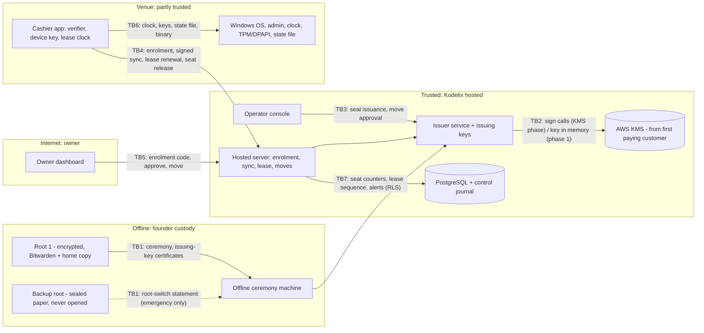

# Threat Model: Licensing — cashier-device seats, offline lease and signing keys (device mode)

> **Path**: `docs/architecture/threat-models/licensing.md`
> **Status**: Draft
> **Author**: `appsec-engineer` via `/threat-model` (STRIDE and abuse draft); requirement IDs looked up by `researcher`; custody recommendation by `security-lead`; reviewed, completed and written by the main session
> **Reviewer**: security-lead (SL-THREAT-MODEL skipped - lean mode)
> **Date**: 2026-10-17 · **Next review**: 2027-04-17, or earlier at the first hire, the first paying customer (move of issuing keys to AWS KMS), a feature spec for licensing, the desktop runtime ADR, the custody ADR, or any incident involving a licensing key
> **Feature spec**: none (`design/specs/licensing.md` absent) · **Research note**: [`docs/research/licensing.md`](../../research/licensing.md) (Parts 1-3, F101-F324) and [`docs/research/licensing.part-4-custody.md`](../../research/licensing.part-4-custody.md) (Part 4, F401-F430; not yet merged) · **ADRs**: [ADR-0001](../adr-0001-tenancy-model.md), [ADR-0002](../adr-0002-tenant-context.md), [ADR-0003](../adr-0003-branch-scope-and-session.md) (Proposed); custody ADR and credential ADR not written
> **Required because**: licensing · authentication (device enrolment and device credential) · authorization model (seat checks, owner approval, Kodelix approval) · admin (Kodelix issues seats and approves exceptional moves) · new external integration (cloud KMS, planned for the first paying customer)
> **Standards**: OWASP ASVS 5.0.0 (tag `v5.0.0_release`, "Version 5.0.0, May 2025"), Level 3 for licensing and authentication, Level 2 elsewhere · OWASP API Security Top 10 2023 · OWASP MASVS: not applicable (no mobile client in scope)
> **Mode**: design-time (nothing is built; every control is `Planned`) · device licence (hosted) · tenancy assumed shared-schema RLS (ADR-0001, Proposed; `tenancy.model` unset in `project.yaml`) · `distribution.model` unset (treated as hosted per the user)

Citation shorthand: `lic` = `docs/research/licensing.md`; `lic-P4` = `docs/research/licensing.part-4-custody.md`; `ti` = `docs/research/tenant-isolation.md`; `sync` = `docs/research/local-first-sync.md`; `desk` = `docs/research/desktop-client-technology.md`. A citation such as `lic:355` is a line in that file at the commit this model was written against; it points at the research decision that plans the control, not at code.

## 1. Scope

- **In scope**:
  - the offline root keys and the quarterly key ceremony;
  - the issuer service and its issuing keys (encrypted on the server now; AWS KMS from the first paying customer);
  - the Kodelix operator console (seat issuance, approval of moves beyond the allowance);
  - the hosted server: D1-A enrolment within seats, RFC 9421-signed sync, N5 lease renewal, seat move and seat release, the calendar-span alert;
  - the owner dashboard's licensing actions: enrolment code, approve device, move seat;
  - the cashier device: verification of the seat licence and lease, the non-exportable device key (TPM or DPAPI), the lease clock (rule R-F plus a persisted high-water mark), and the local state file.
- **Out of scope**:
  - **Desktop updater signing key and Authenticode certificate.** Their own update-trust threat model (followups Q-1P7) covers them; here they are in scope only for separation from the licence keys.
  - **ETA eSeal certificate.** It is the tenant's own RSA X.509 certificate from an Egyptian certificate authority (eta note F116, F216), outside the Kodelix hierarchy entirely (security-lead, 2026-10-17).
  - **Owner Android app.** It is not a billable device.
  - **Billing and payment.**
  - **Tenant isolation and sync data integrity in general.** They have their own threat models, `tenant-isolation` and `local-first-sync`, not yet written; this model keeps only the licensing-specific cross-tenant paths.
  - **Personal data.** Out of scope on the user's condition that activation, approval and seat-move audit events carry IDs only (tenant, device, staff ID), never names or contact details (M17).
- **Assumptions** (asserted to the user, labelled assumed):
  - tenancy is shared-schema with RLS (ADR-0001 Proposed);
  - TLS terminates at the hosted proxy;
  - a cashier is never a Windows administrator (sync OQ27 condition 1);
  - the venue owner and the Kodelix installer may be Windows administrators on the PC;
  - the issuer service is a separate deployable from the hosted server, with its own identity;
  - the issuer signs both seat licences and N5 leases (open row Q1);
  - Kodelix today is one founder who holds every Kodelix role (founder, 2026-10-17).
- **Actors and their boundaries**:

| Actor | Trust boundaries | Threats / abuse cases |
|---|---|---|
| Cashier (non-admin, physical access): clock tampering, cloning the PC | TB6; the clone is detected at TB4 | T6.1, T6.4, T6.8, T4.2, AB4, AB5 |
| Venue owner (tenant admin, may be a Windows admin): wants more devices than paid for | TB5, TB4; TB6 when cloning their own PC as admin | T5.2, T5.3, T5.4, T4.9, T6.4, T6.5, AB1, AB2, AB3, AB16 |
| Kodelix insider: issues seats without the second approver; edits seat counts in the database | TB3 (the operator console is its own boundary); TB7 | T3.2, T3.3, T7.1, T7.2, AB10, AB11 |
| Attacker who compromised the issuer service: tries to sign licences | TB2 (signing oracle, or key exfiltration while the keys live on the server); TB1 (issuing-key lifetime and revocation) | T2.1, T2.2, T2.4, T1.7, AB12, AB13 |
| Kodelix operator and the second approver (today the founder alone) | TB3 | T3.1, T3.6, T3.7 |
| Malicious tenant | TB4, TB5, TB7 | T4.8, T5.4, T5.7, T7.4, AB8 |
| External attacker (network, stolen PC, cloned disk or VM) | TB4, TB5, TB6 | T4.1, T4.7, T5.1, T6.11, AB9 |
| Compromised cloud KMS provider (from the KMS phase) | TB2 | T2.8 |
| Self-hosted operator | N/A: hosted only | — |

## 2. Assets

| ID | Asset | Classification | Owner (context) | Impact if compromised (C / I / A) |
|----|-------|----------------|-----------------|-----------------------------------|
| A1 | Root signing keys: root 1 (active) and backup root (sealed) | secret | Kodelix (founder) | C: H, I: H (forges every artefact), A: H (no new issuing keys) |
| A2 | Issuing keys, per purpose: K-seat and K-lease | secret | issuer service | C: H, I: H, A: H (renewals stop fleet-wide after G) |
| A3 | Seat licence integrity (seats, allowance per seat, sequence) | internal, integrity-critical | issuer / licensing | I: H (seat inflation) |
| A4 | N5 lease integrity (sequence, `grace_seconds`, status, iat) | internal, integrity-critical | issuer / device | I: H (offline use beyond G) |
| A5 | Device private key (ECDSA P-256; TPM or DPAPI) | secret | cashier device | C: M (impersonation inside one tenant) |
| A6 | Seat, move and approval records; allowance counters | confidential | hosted server | I: H, A: M |
| A7 | Device lease-clock state (anchor, high-water mark, state file) | internal | cashier device | I: M |
| A8 | Embedded root public keys and verifier code in the app | public, integrity-critical | cashier app | I: H (patched app sells unlicensed) |
| A9 | Audit and alert events (activation, move, `clone_suspected`, rollback, calendar-span, issuance log) | confidential, IDs only | hosted server / journal | I: M (lost evidence), C: M |
| A10 | Kodelix revenue (unlicensed selling) | business | Kodelix | business impact |
| A11 | The venue's ability to sell and to read and export its own data | availability | tenant | A: H (degrade, never destroy) |

## 3. Trust Boundaries & Data Flow

| ID | Boundary | Crosses | Authenticated by | Data crossing |
|----|----------|---------|------------------|---------------|
| TB1 | Root ceremony ↔ issuer | offline custody → hosted issuer | root signature over issuing-key certificates; founder in person | issuing public keys in, root-signed certificates and key-status lists out |
| TB2 | Issuer service ↔ signing key | issuer process → key (memory now; AWS KMS later) | phase 1: decryption secret supplied at start; KMS phase: issuer workload identity (IAM) | payload bytes to sign, signatures |
| TB3 | Operator console ↔ issuer / hosted admin | Kodelix staff → trusted issuer | staff identity with phishing-resistant MFA and step-up (Planned) | seat issuance requests and approvals, exceptional-move approvals |
| TB4 | Cashier device ↔ hosted server | venue network / internet → app | enrolment code then device key (RFC 9421 signatures, D2-B) | enrolment, sync batches, lease requests and responses, seat release, tamper journal |
| TB5 | Owner dashboard ↔ hosted server | internet → app | owner session (opaque token, ADR-0003) | enrolment codes, device approvals, seat moves |
| TB6 | Cashier app ↔ local OS and administrator | app process → PC under venue control | none (the PC is untrusted for money and N5) | clock, TPM/DPAPI key, state file, app binary |
| TB7 | Hosted server ↔ database | app → data | non-owner app role + RLS (ADR-0001/0002, Proposed) | seats, moves, approvals, lease sequence, alerts |

## 4. STRIDE Analysis per Boundary

Likelihood and impact are L / M / H with a one-line reason. "Planned" names the research decision that plans the control; nothing exists in code.

### TB1 — Root ceremony ↔ issuer

| ID | STRIDE | Threat | Asset | Likelihood | Impact | Mitigation ID(s) |
|----|--------|--------|-------|-----------|--------|------------------|
| T1.1 | **S**poofing | An attacker's issuing public key is certified at the ceremony (tampered media, wrong key version, attacker-supplied key). L: needs ceremony access. I: every device trusts the attacker's key until revocation reaches it. | A1, A2, A3, A4 | L | H | M1, M8, M42 |
| T1.2 | **T**ampering | An issuing-key certificate carries no constraints (purpose, validity window, maximum grace, algorithm), so a stolen issuing key is valid indefinitely and for any purpose. L: default if no format is specified. | A2, A3, A4 | M | H | M2, M3, M11 |
| T1.3 | **R**epudiation | No witnessed record of which issuing keys the root certified, so a revocation list cannot be shown complete. Single founder: no second witness. | A1, A9 | M | M | M1, M8, M18 |
| T1.4 | **I**nformation disclosure | Root 1 is exposed: Bitwarden vault compromise plus its passphrase; the home copy taken with its passphrase; malware on the ceremony machine reads it while decrypted; the backup root's sealed paper is read. Zero-cost custody: no isolated module (ASVS 13.3.3 exception). | A1 | M | H | M4, M5, M42 |
| T1.5 | **D**enial of service | Root 1 unusable (passphrase lost, both copies lost) or a ceremony is missed; the active certificate expires, no leases can be issued, and after G every device stops new sales. | A1, A11, A10 | L | H | M5, M41 |
| T1.6 | **E**levation of privilege | An issuing key (including a stolen one) signs further certificates (chain extension, purpose confusion) and gives itself new validity. | A2, A3, A4 | M | H | M2, M3, M11, M40 |
| T1.7 | **E**levation of privilege | An offline device cannot learn that an issuing key was revoked; the holder of a stolen issuing key answers renewals on the venue network with forged leases (any grace, any sequence, backdated iat) and poisons the sequence ratchet. | A4, A10, A11 | M | H | M2, M3, M6, M7, M8 |
| T1.8 | **S**poofing | One person performs the ceremony alone (today: by design, a single founder). | A1 | M | H | M1, M4; residual R6 |
| T1.9 | **D**enial of service | (added in review) An honest device offline near the end of an issuing key's window refuses its still-valid lease when the key's certificate expires, so the venue stops selling before G. | A11 | M | M | M3 |

### TB2 — Issuer service ↔ signing key

| ID | STRIDE | Threat | Asset | Likelihood | Impact | Mitigation ID(s) |
|----|--------|--------|-------|-----------|--------|------------------|
| T2.1 | **S**poofing | An attacker who compromised the issuer host uses the signing path as a **signing oracle**. In phase 1 the key is also in process memory, so the attacker can **exfiltrate** it and sign anywhere until revocation. | A2, A3, A4, A10 | M | H | M9, M10, M11, M8, M12 |
| T2.2 | **T**ampering | The issuer signs caller-supplied bytes; anyone able to call the issuer gets an oracle, and issuer and device may parse the payload differently. | A3, A4 | M | H | M10, M40 |
| T2.3 | **R**epudiation | Signatures cannot be traced to a request or approval, so after a compromise nobody can list what was signed. | A9 | M | H | M8, M12, M18 |
| T2.4 | **I**nformation disclosure | Key material leaks: the encrypted key file and its decryption secret are both readable on the host, the key is written to swap, a core dump or a log, or (KMS phase) an exportable key spec is chosen. | A2 | M | H | M9, M43 |
| T2.5 | **D**enial of service | The decryption secret is lost or the issuer host is down (phase 1); KMS outage, throttling or a disabled key (KMS phase). Renewals stop, and after G every device stops new sales. | A11, A10 | M | H | M9, M41, M42 |
| T2.6 | **E**levation of privilege | Too many principals can sign: the hosted server, CI or developers can read the key file or (KMS phase) hold `kms:Sign`. | A2, A3 | M | H | M9, M11 |
| T2.7 | **T**ampering | Message-mode mismatch (pre-hash vs pure Ed25519, lic F218) or a bad signature produces artefacts some verifiers reject (fleet DoS). | A4, A11 | L | M | M13, M40 |
| T2.8 | **S**/**E** | (KMS phase) An insider at the cloud provider signs with the issuing key. | A2, A3, A4 | L | H | M8, M11, M41, M42 |

### TB3 — Operator console ↔ issuer / hosted admin

| ID | STRIDE | Threat | Asset | Likelihood | Impact | Mitigation ID(s) |
|----|--------|--------|-------|-----------|--------|------------------|
| T3.1 | **S**poofing | The founder's console credentials are phished or stolen; the attacker issues seats or approves exceptional moves. | A3, A6, A10 | M | H | M15, M14, M18 |
| T3.2 | **E**levation of privilege | **A Kodelix insider issues seats without the second approver** (self-approval, two accounts of one person, a direct issuer call, an approval only in the UI). Today there is one approver by design. | A3, A10 | M | H | M14, M10, M8, M18; residual R7 |
| T3.3 | **T**ampering | An approved request is altered between approval and signing (approve 2 seats, sign 20). | A3 | M | H | M14 |
| T3.4 | **R**epudiation | An operator denies an issuance or approval; audit rows editable in the main database. | A9 | M | M | M18, M17 |
| T3.5 | **I**nformation disclosure | The console shows more than needed, and audit events store names or contact details (breaks the IDs-only condition). | A9 | M | M | M17, M27 |
| T3.6 | **D**enial of service | The exceptional-move queue is unattended; a venue with a dead PC and an exhausted allowance or a clone signal cannot sell on the replacement. | A11 | M | M | M19 |
| T3.7 | **E**levation of privilege | CSRF or XSS against a logged-in operator triggers issue or approve. | A3 | L | H | M15 |
| T3.8 | **S**poofing | The hosted server or an owner request marks a move "Kodelix-approved" through a database flag or request field. | A6, A3 | M | H | M16, M34 |

### TB4 — Cashier device ↔ hosted server

| ID | STRIDE | Threat | Asset | Likelihood | Impact | Mitigation ID(s) |
|----|--------|--------|-------|-----------|--------|------------------|
| T4.1 | **S**poofing | An enrolment code is guessed or intercepted and redeemed first; the attacker's device joins the tenant, uses a seat and receives tenant data. Planned: ti:955 D1-A, ti:902. | A3, A6 | M | H | M20, M21 |
| T4.2 | **S**poofing | **Clone detected here**: a cloned disk (DPAPI tier) presents the same device key from a second PC; two devices share one seat. | A3, A5, A10 | M | M | M26, M27, M32 |
| T4.3 | **T**ampering | Replay of an older lease, another device's lease, or a captured `seat_release`. | A4, A6 | M | M | M23, M24, M7 |
| T4.4 | **T**ampering | A patched app reports false consumed time or highest sequence to suppress the calendar-span and restore alerts. | A4, A9 | L | M | M31; residual R1 |
| T4.5 | **R**epudiation | Device or owner disputes sales made after a seat move or during overlap. | A9, A10 | M | L | M18, M33 |
| T4.6 | **I**nformation disclosure | Raw serials, the Windows computer name, IP addresses or licence and lease bodies appear in logs, traces or audit events. | A9 | M | M | M27, M43, M17 |
| T4.7 | **D**enial of service | Floods of redeem or renewal requests, or bad signatures with a victim's `key_id`: alert storms and renewal starvation. | A11, A9 | M | M | M20, M44 |
| T4.8 | **E**levation of privilege | Tenant, seat or device ids supplied by the device are honoured, so a tenant-B device renews or claims a tenant-A seat. Planned: ti:957 D3-A. | A3, A6 | L | H | M23, M35 |
| T4.9 | **T**ampering | Races: two codes redeemed for the last free seat, two concurrent moves, a redeem during a move; the seat is double-booked. | A3, A6 | M | M | M22 |
| T4.10 | **E**levation of privilege | The old device's in-flight renewal commits after the seat move (ti F329 case 1), so overlap exceeds G. | A4, A6 | M | M | M25 |
| T4.11 | **T**ampering | Selective blocking: an on-path admin lets the lease through but drops `seat_moved` or the key-status list. | A4, A6 | M | M | M24 |

### TB5 — Owner dashboard ↔ hosted server

| ID | STRIDE | Threat | Asset | Likelihood | Impact | Mitigation ID(s) |
|----|--------|--------|-------|-----------|--------|------------------|
| T5.1 | **S**poofing | The owner session is stolen; the attacker creates a code, approves their own device or moves a seat to it. | A3, A6 | M | H | M34, M21 |
| T5.2 | **E**levation of privilege | **The owner wants more devices than paid for** and uses unreleased moves to run extra devices up to allowance × G. Allowed by design; bounded. | A10 | H | L | M45; residual R5 |
| T5.3 | **T**ampering | Mass assignment of `seats`, `allowance`, `approved_by_kodelix`, `released`, `tenant_id` or `branch_id`. | A3, A6 | M | H | M34, M36 |
| T5.4 | **E**levation of privilege | IDOR: tenant B's owner approves, moves or releases tenant A's device or seat. | A6 | M | H | M34, M35 |
| T5.5 | **E**levation of privilege | A manager or cashier creates codes or moves seats (role map not decided, open row Q4). | A6 | M | M | M34 |
| T5.6 | **R**epudiation | The owner denies an activation or move. | A9 | M | M | M18, M21 |
| T5.7 | **I**nformation disclosure | A clone or hardware signal shown to an owner reveals that another tenant has a matching device. | A9 | L | H | M27 |
| T5.8 | **D**enial of service | A move started and abandoned keeps the seat locked; the current device cannot renew. | A11 | L | M | M22 |
| T5.9 | **S**poofing | The owner approves an attacker's pending device without comparing the key fingerprint. | A3 | M | H | M21 |

### TB6 — Cashier app ↔ local OS and administrator

| ID | STRIDE | Threat | Asset | Likelihood | Impact | Mitigation ID(s) |
|----|--------|--------|-------|-----------|--------|------------------|
| T6.1 | **T**ampering | **Cashier or owner tampers with the clock**: power off, set the RTC to just above the high-water mark, boot; under R-F the gap is not charged and no alert fires (lic Part 3 § 4.2). Honest backward resets also happen (sync F308). | A7, A4, A10 | M | M | M28, M30, M33; residual R3 |
| T6.2 | **T**ampering | An older copy of the state file is restored to recover consumed lease time (no TPM). | A7, A4 | M | M | M29, M26, M33 |
| T6.3 | **T**/**E** | An admin patches the binary or replaces the embedded root keys or verifier. | A8, A10 | L | H | M31, M8; residual R1 |
| T6.4 | **S**poofing | **Cloning**: a cashier boots from USB and images the disk, or the owner clones their own PC. Detected at TB4 (T4.2). | A5, A3 | M | M | M30, M32, M26 |
| T6.5 | **I**nformation disclosure | An admin extracts the DPAPI-wrapped device key and impersonates the device (forged commands, forged `seat_release`). DPAPI does not stop an admin (desk F112, F115). | A5 | M | M | M32, M24, M26 |
| T6.6 | **R**epudiation | Local tampering (clock edits, restores, TPM mode downgrade) leaves no record at the server. | A9 | M | M | M33 |
| T6.7 | **D**enial of service | A TPM clear, fTPM reset or board swap destroys the device key; re-enrolment counts against the allowance. | A5, A11 | M | M | M19, M32, M42 |
| T6.8 | **E**levation of privilege | The non-admin cashier can read or replace the state file or key blob because the app runs in the cashier's profile (sync M1 not adopted). | A7, A5 | M | M | M29 |
| T6.9 | **T**ampering | An admin installs a root CA and intercepts TLS to replay old responses or drop renewals; signatures still hold. | A4 | M | L | M24 |
| T6.10 | **T**ampering | Fingerprint values are forged to hide a clone; the fingerprint grants nothing. | A9 | M | L | M26 |
| T6.11 | **E**levation of privilege | An admin runs the app in a VM with a controlled clock and snapshots. | A7, A4 | L | M | M27, M33; residual R2 |

### TB7 — Hosted server ↔ database

| ID | STRIDE | Threat | Asset | Likelihood | Impact | Mitigation ID(s) |
|----|--------|--------|-------|-----------|--------|------------------|
| T7.1 | **E**levation of privilege | **A Kodelix insider or DBA edits seat counts or allowance counters directly in the database.** | A3, A6, A10 | M | H | M36, M8, M18 |
| T7.2 | **T**ampering | An older seat licence with more seats is written back (downgrade). | A3 | M | H | M36, M7 |
| T7.3 | **E**levation of privilege | The app connects as table owner or a BYPASSRLS role, or licensing tables lack ENABLE plus FORCE RLS (postgres best-practices § 1). | A6 | M | H | M35 |
| T7.4 | **I**nformation disclosure | Global unique keys on fingerprint hash, enrolment code or seat id leak another tenant's row through duplicate-key errors. | A9 | L | H | M35, M27 |
| T7.5 | **E**levation of privilege | A session-level or second `set_config` switches tenant behind a pooler (ADR-0002). | A6 | L | H | M35 |
| T7.6 | **T**/**R** | A restore rewinds seat-licence sequence, moves, allowance use, approvals, revocations and lease sequence (ti F330). | A6, A4, A9, A11 | M | H | M37, M18 |
| T7.7 | **D**enial of service | A seat-row lock held during an approval wait blocks renewals. | A11 | L | M | M22 |
| T7.8 | **I**nformation disclosure | Views over licensing tables lack `security_invoker`. | A6 | L | H | M35 |
| T7.9 | **E**levation of privilege | Cross-tenant jobs (calendar-span alert, allowance reset, reconciliation) write into the wrong tenant. | A6, A9 | L | H | M38 |
| T7.10 | **S**poofing | Stolen app database credentials used for writes outside the app. | A6 | L | H | M35, M36 |

## 5. Abuse Cases (business-flow abuse)

| ID | Abuse case | Actor | Goal | Detection | Mitigation ID(s) |
|----|-----------|-------|------|-----------|------------------|
| AB1 | Race several enrolment codes for the last free seat | Owner | more devices than seats | invariant job "active devices ≤ seats"; `seat.invariant_violation` | M22, M20, M10 |
| AB2 | Unreleased-move cycling to run two devices | Owner | about 14 extra device-days per seat per year at G = 7 (28 at G = 14) | `seat_moves_total{released=false}`; "old device reachable before an unreleased move" flag | M45; residual R5 |
| AB3 | Clone a PC, then move the seat to the clone while the old PC keeps selling offline | Owner (admin) | a permanent second device | `clone_suspected` forces Kodelix approval; sequence conflicts | M26, M16, M14 |
| AB4 | Free-gap clock attack (power off, RTC to just above the mark) | Cashier or owner | stretch the lease over calendar time | calendar-span alert (§ 9.2 thresholds) | M28, M30, M33; residual R3 |
| AB5 | Restore an older state file to recover lease time | Owner (admin), or a cashier if files are not ACL'd | more offline time | SC-12 sequence reuse, lease sequence, highest local sequence at contact | M29, M26, M33 |
| AB6 | Disk or VM snapshot restore, or running in a VM | Owner (admin) | unbounded offline use | after the fact only: offline-period alert (sync M2), calendar span | M27, M33; residual R2 |
| AB7 | Patched binary or replaced root keys, distributed as a crack | Owner, or a crack seller | use without a licence | device never contacts; unknown artefacts at contact; build below minimum | M31, M8; residual R1 |
| AB8 | Licence sharing across tenants | Malicious tenant | use another tenant's seats | binding mismatch → refusal plus security event | M23, M35 |
| AB9 | Enrolment-code phishing, redeemed first, approved by the owner | External attacker | join a tenant | pending device with redeem time; fingerprint mismatch | M20, M21 |
| AB10 | Insider issues seats alone or with a colluding approver | Kodelix insider (today: founder account compromise) | sell seats on the side | monthly review of the issuance log against signed contracts | M14, M8, M18; residual R7 |
| AB11 | Insider or DBA edits seat count or allowance in the database | Kodelix insider or DBA | seat inflation without the issuer | issuer-registry ↔ database reconciliation; signature re-check | M36, M8 |
| AB12 | Issuer compromise used to mint seat licences or leases for a crack service | Attacker controlling the issuer | sell licences | unknown artefacts at contact; signing counter vs issuance log | M9, M10, M11, M12, M8; residual R4 |
| AB13 | Stolen issuing key used against offline venues: forged leases with large grace or sequence | Same attacker plus a venue admin | offline use beyond G | only at contact (issuance-log reconciliation) | M2, M3, M6, M7; residual R4 |
| AB14 | Claim "key loss" to re-enrol a different PC without spending the allowance | Owner | free moves | fingerprint change on re-enrolment → Kodelix approval | M45, M26, M16 |
| AB15 | Generate many clone or hardware signals so Kodelix stops reading them | Owner, or an attacker with a device key | hide a real clone | aggregation per device and tenant; trend metric | M44 |
| AB16 | Two moves at the end of an allowance window and two at the start of the next | Owner | four moves in a short time | moves-per-rolling-window metric | M45 (open row Q7) |
| AB17 | Cross-purpose replay: seat licence presented as a lease, or an update manifest signed by a licence key | Any | bypass a check | verify failure `purpose_mismatch` | M11, M40 |
| AB18 | Downgrade to an older app build with weaker checks or only root 1 | Owner (admin) | bypass newer controls | server refuses sync below the minimum version | M31 |
| AB19 | Selective network blocking: accept the lease, drop `seat_moved` or the key-status list | Owner (admin) | keep a moved or revoked device selling | status travels inside the signed lease object | M24 |

### 5.1 The twelve licensing threats (`license-design` references § 1) in device mode

| # | Threat | Device-mode reading | Threats | Named negative test |
|---|---|---|---|---|
| 1 | Forged licence | forged seat licence or lease | T1.2, T2.2, T4.3 | `Verify_ByteFlip_PayloadSigKidHeader_Rejected` (M40) |
| 2 | Patched or replaced embedded key | root keys or verifier patched on the PC | T6.3, AB7 | `IntegrityCheck_ModifiedRootKeySet_RefusesStart` (M31); residual R1 |
| 3 | Activation replay to a second instance | enrolment code replayed; clone presents the same key | T4.1, T4.2, T6.4 | `Redeem_UsedCode_Refused` (M20); `Renewal_SameKeyTwoDevices_CloneSuspected` (M26) |
| 4 | Clock rollback | R-F + high-water mark + calendar-span alert | T6.1, AB4 | `CalendarSpan_GapAboveThreshold_Alerts` (M28); sync SC-25b and S306 cases |
| 5 | Downgrade to an older licence | older seat licence or lease | T7.2, T4.3 | `SeatLicence_LowerSeq_Refused` on server, database and device (M36, M7) |
| 6 | Licence sharing | seat shared by clones or across tenants | T4.2, AB8 | `Issuer_SecondActiveDevicePerSeat_Refused` (M10) |
| 7 | Revocation evasion by blocking the network | offline after a seat move or key revocation | T4.11, T1.7 | `Lease_StatusSeatMoved_AppliedBeforeUse` (M24); bound in § 7 R4 |
| 8 | Signing-key compromise | root 1, backup root, issuing key | T1.4, T2.1, T2.4, T2.8 | `KeyStatusList_RevokedKid_LeaseRefused` (M6); `RootSwitch_BackupRootStatement_Root1RejectedAfter` (M5); runbooks M42 |
| 9 | Licence-server outage | issuer or key unavailable longer than G | T2.5, T1.5 | `Issuer_PrimaryKeyDown_SignsWithStandbyKid` (M41) |
| 10 | Cross-tenant licence use | tenant-B device or lease used with tenant A | T4.8, T5.4, AB8 | `Renewal_ForeignTenantSeat_404` (M23, M34, M35) |
| 11 | Hostile input to the parser | oversized, duplicate-field or malformed artefact | T2.2 | fuzz target plus `Verify_Oversize_DuplicateField_Rejected` (M40) |
| 12 | Information leakage | bodies, signatures, fingerprints or PII in logs and events | T4.6, T3.5 | `AuditEvent_IdsOnly_NoPii` plus a log grep (M17, M43) |

### 5.2 Cross-tenant coverage

| Prompt | Coverage |
|---|---|
| Guessing or enumerating IDs | T4.1 (enrolment-code brute force), T5.4 (IDOR), T7.4 (unique-key oracle); an unknown `key_id` resolves to nothing (ti F325) |
| Shared caches and cache-key construction | lic § 7 proposes `licence:{tenant_id}:{seq}` and `lease:{device_id}:{seq}`; the lease key has no tenant → M39. No cache engine chosen (`stack.data` unset) |
| Queues, outbox events and consumers that lose the tenant | Kodelix notifications, the exceptional-move approval queue and the control journal: an approval applied to the wrong tenant's seat → T3.8, T7.9; M16 binds tenant, seat, device and move ids into the signed approval |
| Search indexes | N/A - the licensing design has no search index; cross-tenant search in the operator console is Kodelix-only (T3.5) |
| Exports and reports | the owner's own export in degraded mode holds one store and one tenant (ti B4-A); owner licence views → T5.4, T7.8; Kodelix reports → T3.5 |
| Background and scheduled jobs | T7.9 → M38 |
| Object-storage keys and signed URLs | N/A - no object storage; artefacts live in the database and journal. Revisit if a "download licence file" feature is added |
| Admin and impersonation paths | TB3 (T3.1-T3.8), T7.1; impersonation is not in the design |
| Webhooks that route by a client-supplied identifier | N/A - no inbound webhooks; the nearest equivalent, device-supplied ids in renewal or release, is T4.8 (D3-A) |
| Telemetry that leaks another tenant's data | T5.7, T4.6 → M27, M43; `tenant_id` as a metric label only while the tenant count is bounded (`observability-standard.md`) |

## 6. Mitigations -> Stories & Tests

No epic or story exists (`production/epics/` absent), so every story is `NEW:` for `/create-stories`, type Security, owner the stack lead named in brackets. Story groups: **S-VER** licence verifier and artefact format [`licensing-specialist`, desktop lead]; **S-ISS** issuer service [`licensing-specialist`, backend lead]; **S-KEY** keys, ceremony and runbooks [`security-lead`, founder]; **S-SEAT** seat, enrolment and move logic [backend lead]; **S-DASH** owner dashboard authorization [`web-lead`]; **S-CON** operator console [`web-lead`, `security-lead`]; **S-DB** licensing tables, RLS and jobs [`data-lead`]; **S-OBS** audit, events and alerts [`observability-engineer`]; **S-DEV** device local state and integrity [desktop lead]. ASVS IDs are from the lookup in § 8.

| ID | Mitigation | Addresses | ASVS / API ref | Story | Test (negative) | Status |
|----|-----------|-----------|----------------|-------|-----------------|--------|
| M1 | Ceremony record: the founder reads the issuing public key from the issuer out of band and compares fingerprints on the offline machine before signing; a signed, dated ceremony record (certified kids, validity, floor) goes into the issuance log. With one person there is no second witness (residual R6/R7) | T1.1, T1.3, T1.8 | 11.1.1, 11.1.2, 13.1.4 | NEW: S-KEY ceremony procedure and record | dry-run ceremony with a planted mismatching key → aborts; a certificate not in the ceremony record is flagged at reconciliation | Planned |
| M2 | Constrained issuing-key certificate: purpose (seat or lease), kid, alg, `not_before`, `not_after`, `max_grace_seconds`; chain depth fixed at root → issuing key → artefact; issuing keys cannot certify keys | T1.2, T1.6, T1.7 | 9.1.1, 9.1.2, 9.2.2, 11.6.1 | NEW: S-VER certificate format | issuing-key-signed certificate → refused; lease grace above the certificate maximum → refused; seat licence signed by a lease kid → refused | Planned |
| M3 | Device rules (security-lead, corrected F428): **(V1)** a lease is accepted only if `not_before ≤ iat` and `iat + grace ≤ not_after` of its key's certificate (signed data only, no clock) — a lease issued inside the window stays valid for its own G, which also fixes T1.9; **(V2)** the device's trusted time is the highest genuine iat plus elapsed monotonic time and never goes back; a new lease's iat must not be below it. Caps compiled into the app: maximum lease grace 14 days; maximum certificate validity 60 days. The V2 vs R-F interaction (a forward Windows clock under R-F) is resolved by `licensing-specialist` and tested in S402 (open row Q13) | T1.2, T1.6, T1.7, T1.9 | 9.2.1, 9.1.1 | NEW: S-VER lease acceptance rules | lease with `iat + grace` beyond `not_after` → refused; backdated forged iat → trusted time does not move back; lease grace 15 days → refused; certificate validity 61 days → refused; honest device whose key certificate expires during an offline lease → keeps selling until the lease's own G | Planned |
| M4 | **Root custody, zero-cost (founder, 2026-10-17):** root 1 is generated offline, stored only encrypted under its own strong passphrase in the founder's Bitwarden vault and as an encrypted offline copy at home (USB or paper); it is decrypted only on an offline ceremony machine that is not the development laptop, never kept as a plain file. **Condition recorded by this model:** the passphrase is not stored in the same vault item or place as the encrypted key. ASVS 13.3.3 (cryptographic operations in an isolated module) is **not met** for the root: recorded exception in residual R6 | T1.4, T1.8 | 13.3.1, 13.3.2, 13.3.3 (exception), 11.1.1 | NEW: S-KEY root custody runbook | procedure check: the encrypted root cannot be opened from the vault item alone (passphrase held elsewhere); a ceremony on a networked machine is refused by the checklist | Planned |
| M5 | **Backup root (founder, 2026-10-17):** a second Ed25519 root, generated in the same offline session, private half printed on paper and sealed (tamper-evident), never opened; its public key is pinned in the app from the first release. The device trusts the backup root **only** for a root-switch statement (and, after a switch, for issuing-key certificates); once a device has seen a switch it rejects root 1 forever. Switching needs no app update. **Condition recorded by this model:** the sealed backup is stored away from the root-1 copy (not both at home). Continuity: the next issuing key is certified at least G + rollout before the active certificate expires; alert when the active certificate's remaining validity falls below a threshold | T1.4, T1.5 | 11.2.2, 11.1.1 | NEW: S-VER root switch; NEW: S-KEY backup root | root-switch statement signed by root 1 → refused; issuing certificate signed by the backup root before any switch → refused; after a switch, root-1-signed certificate → refused; simulated certificate expiry → devices accept the pre-certified next kid | Planned |
| M6 | Root-signed key-status list (epoch floor, revoked kids, sequence-numbered) delivered in every renewal response and every app update; the device keeps the highest list sequence and refuses revoked kids and older epochs | T1.7, T2.1, T2.8 | 9.1.3, 8.3.2, 6.5.6 | NEW: S-VER key-status list | lease from a revoked kid after the list arrives → refused; list with a lower sequence → ignored | Planned |
| M7 | Sequence and trusted-time ratchets scoped per epoch and per issuing kid; raising the floor discards the ratchet values reached under revoked kids, so a forged huge sequence or future iat cannot lock out genuine leases (TUF fast-forward recovery, lic-P4 F414). Server and device keep the highest seat-licence sequence | T1.7, T4.3, T7.2 | 9.2.1, 2.3.2 | NEW: S-VER ratchets | forged lease with sequence 2^62 under kid X, then X revoked, then genuine lease → accepted; older seat licence → refused | Planned |
| M8 | Issuance log: every signature (purpose, kid, tenant, device, sequence, payload hash, approval ids, approver mode) appended to a hash-chained log outside the main database (control journal, ti D5-C). Devices report the hash of the lease and seat licence in use at each contact; the server reconciles; an unknown artefact raises a critical `licence.unknown_artefact` alert. **Monthly review of the log against signed contracts by the founder (founder, 2026-10-17)**, recorded | T1.1, T1.3, T2.1-T2.3, T2.8, T3.2, T6.3, T7.1 | 16.4.2, 16.4.3, 16.3.3, 2.3.5 (compensating) | NEW: S-ISS issuance log; NEW: S-OBS monthly review report | device presents a validly signed lease absent from the log → alert raised; edited log entry → chain verification fails; monthly report lists every issuance with mode | Planned |
| M9 | **Issuing-key custody, phase 1 (founder, 2026-10-17):** two per-purpose issuing keys (K-seat, K-lease) stored encrypted on the issuer host; the decryption secret is supplied at start as a Docker secret (`deploy.md`), the keys are decrypted only in process memory, never logged or written in plain form; only the **current** keys are on the server, pre-certified future keys stay offline until their window. **Phase 2, at the first paying customer:** move to AWS KMS `ECC_NIST_EDWARDS25519`, pure mode enforced by IAM, `kms:Sign` only for the issuer identity, separate key-admin role; no device change (devices trust the root, not the KMS). ASVS 13.3.3 not met in phase 1: recorded exception in residual R4 | T2.1, T2.4, T2.5, T2.6 | 13.3.1, 13.3.2, 13.3.3 (exception in phase 1), 13.3.4, 11.1.1 | NEW: S-KEY issuing-key custody phase 1; NEW: S-KEY KMS migration | issuer start without the decryption secret → refuses to sign (no fallback); grep of logs, core-dump settings and disk after start finds no key material; hosted-server identity tries to read the key file → denied; (phase 2) non-issuer principal calls Sign → denied; pre-hash algorithm → denied | Planned |
| M10 | The issuer builds payloads from typed fields and its own registry and never signs caller-supplied bytes; invariants: a seat licence only with the required approvals bound to the payload hash (M14); a lease only for the active (or retiring within the bound) holder of a seat of that tenant; at most one active plus one retiring device per seat. Each lease re-verifies the tenant's signed seat licence, never database seat counts | T2.1, T2.2, T3.2, AB1, AB12 | 2.3.2, 2.3.4, 8.2.1 | NEW: S-ISS typed payloads | lease for a third device on a seat → refused; raw bytes to sign → 400; seat licence without approval → refused | Planned |
| M11 | Separate keys per purpose: K-seat and K-lease under the licence root; the update-signing key is a separate root and pinned set, never chained to the licence root (Q-1P8); the ETA eSeal is the tenant's own certificate outside the hierarchy | T1.2, T1.6, T2.1, T2.6, T2.8, AB17 | 11.1.2, 9.2.2, 9.2.3 | NEW: S-ISS key separation | K-lease identity asks for a seat-licence signature → refused; artefact whose purpose tag does not match its kid → refused; licence key in the update-verify path → refused | Planned |
| M12 | Signing-count anomaly: phase 1, the issuer's own signing counter compared with the issuance-log count; phase 2, the KMS audit trail (CloudTrail, lic-P4 F423) compared with the log; they must be equal | T2.1, T2.3 | 16.3.3, 16.4.3 | NEW: S-OBS sign-count reconciliation | sign call outside the issuer path in staging → mismatch alert | Planned |
| M13 | Verify-after-sign: the issuer checks every signature with the pinned public key before release; pure Ed25519 over raw bytes, no pre-hash; outputs included in the shared conformance vectors (lic F219) | T2.7 | 11.2.1, 11.2.5 | NEW: S-ISS verify-after-sign | signer stub returns a corrupted or pre-hash signature → not released; error metric | Planned |
| M14 | **Approval (founder, 2026-10-17):** a `required_approvers` setting, **1 now (the founder) and 2 later**, built so the second approver is switched on without redesign. Each approval binds the hash of the exact payload; approvals expire; each issuance records the approval mode (`single_approver` / `two_person`). With the setting at 2: requester ≠ approver, checked per person. ASVS 2.3.5 not met while at 1: recorded exception in residual R7 | T3.1, T3.2, T3.3, AB10 | 2.3.5 (exception now), 2.3.1, 2.3.3 | NEW: S-ISS approval workflow | setting 2: self-approval or a second account of the same person → refused; payload changed after approval → refused; expired approval → refused; setting 1: every issuance carries `single_approver` and appears in the monthly report | Planned |
| M15 | Console hardening: separate deployable and origin, staff-only identity realm, phishing-resistant MFA (WebAuthn), step-up on every issue or approve, short sessions, CSRF and CSP per baseline; a network allowlist only as an extra layer | T3.1, T3.7 | 8.4.2, 6.1.3, 6.3.4, 7.3.1, 7.3.2 | NEW: S-CON hardening | issue without fresh step-up → 401; cross-site POST → refused | Planned |
| M16 | A Kodelix move approval is a signed object from the issuer bound to tenant, seat, device and move ids, never a database flag or request field | T3.8, AB3, AB14 | 8.3.1, 2.3.1 | NEW: S-SEAT signed move approval | owner request with `approved_by_kodelix=true` → ignored or 400; approval for move X replayed on move Y → refused | Planned |
| M17 | **IDs-only audit and event schema (the PII-scope condition, user 2026-10-17):** activation, approval, seat-move, release, signal, calendar-span and issuance events carry only typed ids (tenant, branch, device, seat, move, staff, kid, sequence, hashes), enums and server timestamps; no names, emails, phone numbers, computer names, raw serials or free text; names resolved at display time under the viewer's scope | T3.5, T4.6, T5.6; licensing threat 12 | 16.2.5, 16.2.1 | NEW: S-OBS event schema allowlist | every event type serialised with fixtures holding name, email, phone and hostname strings in every input → none appear; a non-allowlisted field fails the build; log and journal grep from a real run saved under `production/qa/evidence/<story>/` | Planned |
| M18 | Append-only audit in the control journal outside the restorable database: actor, approver, reason code, payload hash | T1.3, T2.3, T3.4, T4.5, T5.6, T7.1, T7.6 | 16.4.2, 16.3.2 | NEW: S-OBS append-only audit | UPDATE or DELETE on audit rows as the app role → permission denied; hash-chain break → detected | Planned |
| M19 | Service level for exceptional-move approvals (the founder today), owner-visible status, runbooks "dead PC replacement" and "TPM cleared"; the old device keeps selling until its lease ends | T3.6, T6.7 | 16.5.2 | NEW: S-CON approval queue | approval older than the service level → escalation alert | Planned |
| M20 | Enrolment code: CSPRNG; entropy and lifetime set by `security-lead` within ti F309; stored as an HMAC; single use; attempt cap; rate limit per IP and tenant (429 + Retry-After); seat checked at create and redeem under the seat lock | T4.1, T4.7, AB1, AB9 | 6.4.1, 6.5.1, 6.5.3, 6.5.4, 6.5.5, 6.6.2, 6.6.3, 6.3.1, API4:2023 | NEW: S-SEAT enrolment code | guess loop → 429 then the code is invalidated; used or expired code → refused; redeem with no free seat → refused | Planned |
| M21 | The owner approves a device by typing the key-fingerprint suffix shown on it; the pending row shows redeem time; the owner is notified on every activation and move | T4.1, T5.1, T5.6, T5.9, AB9 | 6.6.2, 6.1.3 | NEW: S-DASH device approval | approve with a wrong or missing fingerprint suffix → refused | Planned |
| M22 | Seat invariants in the database: seat row lock, partial unique indexes (one active, at most one retiring device per seat), allowance counted from move events under the lock, a time limit on the move lock, no approval wait inside a transaction | T4.9, T5.8, T7.7, AB1 | 2.3.4, 2.3.3 | NEW: S-SEAT seat invariants | N parallel redeems or moves → exactly one succeeds; abandoned move → lock expires and renewal continues | Planned |
| M23 | Identity only from the credential (D3-A); lease and seat licence bound to tenant, device, seat and the device-key thumbprint; the device refuses a lease that does not match its store binding (ti B4-A) | T4.3, T4.8, AB8 | 8.2.2, 8.3.1, 8.4.1, 9.2.3 | NEW: S-SEAT credential-derived identity; NEW: S-VER binding check | renewal body naming another tenant's seat → refused plus event; device-B lease on device A → refused | Planned |
| M24 | The renewal response binds the device's request nonce and is one signed object carrying status (active, retiring, suspended, `seat_moved`) and the key-status sequence; `seat_release` is signed by the old device key over a server nonce and single use | T4.3, T4.11, T6.5, T6.9, AB19 | 6.7.2, 4.1.5 | NEW: S-VER signed status; NEW: S-SEAT seat release | stale nonce → refused; lease without status → refused; replayed `seat_release` → refused | Planned |
| M25 | Revocation ordering: the renewal path reads the device row `FOR SHARE` (ti F329 case 2); retiring or revoked devices get no renewal | T4.10 | 8.3.2 | NEW: S-SEAT revocation ordering | move commits during an in-flight renewal → renewal refused or ordered before the move (two-session test) | Planned |
| M26 | Clone detection from combined signals (sequence conflict SC-12, lease reuse, two active devices with one key, fingerprint change) → `clone_suspected` to Kodelix and the owner; any move then needs Kodelix approval | T4.2, T6.2, T6.4, T6.5, T6.10, AB3 | 16.3.3, API6:2023 | NEW: S-SEAT clone detection | two clients with one key renew alternately → `clone_suspected`; move with the signal → requires M16 approval | Planned |
| M27 | Fingerprints are salted component hashes only, salted per tenant; cross-tenant matching only in a Kodelix-only job with a Kodelix pepper, never shown to owners; the fingerprint never gates selling (A3) | T4.6, T5.7, T7.4, T6.11 | 16.2.5, 8.4.1 | NEW: S-DEV fingerprint collector | owner API for tenant B asking for a match against tenant A → no data; payload with a raw serial → refused by schema | Planned |
| M28 | Calendar-span alert with the thresholds accepted in § 9.2 | T6.1, AB4 | 16.3.3, 8.3.2 | NEW: S-OBS calendar-span alert | injected report with gap above threshold and no `wall_backward` → alert; below → none | Planned |
| M29 | Local state protection: state file, key blob and database ACL'd to a service account (sync M1), DPAPI-wrapped with a MAC, several ratchet copies (lic A-4); optional TPM Clock anchor only after S301 | T6.2, T6.8, AB5 | 11.3.3 | NEW: S-DEV local state ACL | TS-08: cashier user reads, copies or replaces the files → access denied; restored older file → `restore_suspected` at next contact | Planned |
| M30 | Install checklist: cashier accounts non-admin; BIOS/UEFI password and boot-order lock; full-disk encryption where the edition allows (Home-edition availability NOT SOURCEABLE) | T6.1, T6.4 | 13.4.2 (by analogy) | NEW: S-DEV install checklist | installer audit: USB boot attempt → blocked | Planned |
| M31 | Binary integrity and versions: Authenticode plus the separate update key (Q-1P8); self-integrity check at start; server refuses sync below a minimum app version; updater refuses downgrades | T6.3, T4.4, AB7, AB18 | 11.2.1, 2.2.2 | NEW: S-DEV integrity and minimum version | sync from a build below the minimum → refused; updater offered an older release sequence → refused | Planned |
| M32 | Prefer the TPM key tier (K3); tier recorded as claimed; staged key rotation on suspicion; re-enrolment through D1-A | T4.2, T6.4, T6.5, T6.7 | 6.5.6, 6.4.4 | NEW: S-DEV device key tier | device claims a TPM tier but key properties show software → flagged (S32) | Planned |
| M33 | Device tamper journal (`wall_backward`, large `wall_forward`, `restore_suspected`, `tpm_mode_downgrade`, key-tier change) sent at the next contact with device detection time and server receipt time | T6.1, T6.2, T6.6, T6.11, T4.5 | 16.3.3, 16.2.2 | NEW: S-DEV tamper journal | clock set back while offline → event delivered at reconnect; deleted journal entry → sequence gap detected | Planned |
| M34 | Dashboard authorization: tenant from the session; function-level policy (owner only for codes, approval and moves, open row Q4); IDOR → 404; explicit request DTOs; step-up on approve and move | T3.8, T5.1, T5.3, T5.4, T5.5 | 8.2.1, 8.2.2, 8.3.1, API5:2023, 2.2.1 | NEW: S-DASH authorization | anonymous → 401; wrong role → 403; another tenant's id → 404; privileged fields → ignored or 400; oversized body → 413; flood → 429 | Planned |
| M35 | RLS hardening for licensing tables (postgres § 1, ADR-0001/0002): non-owner NOBYPASSRLS role; ENABLE + FORCE on seats, seat_licences, devices, device_credentials, seat_moves, approvals, lease_log, enrolment_codes; tenant-leading composite keys; `security_invoker` views; one transaction-local `set_config`; catalogue test | T4.8, T5.4, T7.3, T7.4, T7.5, T7.8, T7.10 | 8.4.1, 8.2.2 | NEW: S-DB licensing RLS | as the app role with tenant B context: SELECT/UPDATE/DELETE on tenant A rows → 0 rows; catalogue finds no tenant table without FORCE; pool of size 1 across two tenants → no cross-read | Planned |
| M36 | Seat counts and allowance never read from editable columns: every enforcement point re-verifies the signed seat licence (or a cached result keyed by tenant, sequence and hash) and takes the highest sequence; a trigger refuses a lower sequence; daily issuer-registry ↔ database reconciliation alerts on mismatch | T5.3, T7.1, T7.2, T7.10, AB11 | 2.3.2, 9.1.1 | NEW: S-ISS registry reconciliation | direct UPDATE of the seat count → enrolment still capped at the signed count plus reconciliation alert; insert of an older seat-licence blob → refused | Planned |
| M37 | Restore runbook for licensing facts: replay seat-licence sequence, moves, allowance use, approvals, revocations and per-device lease-sequence high-water mark from the journal; after a restore, lease sequence resumes above max(journal, database) | T7.6 | 16.5.2 | NEW: S-DB restore replay | restore drill: revoked device stays revoked; allowance not refunded; next lease sequence above the device's highest | Planned |
| M38 | Cross-tenant jobs use an explicit single-purpose role, set the tenant per iteration, and are constrained by composite foreign keys | T7.9 | 8.4.1 | NEW: S-DB job roles | job forced to write a tenant-B event while processing tenant A → FK or RLS error | Planned |
| M39 | Cache keys, if a cache is adopted, include tenant, sequence and payload hash; device ids are UUIDs; seat counts and device status not cached (lic § 7) | cache prompt (§ 5.2) | 8.4.1 | NEW: S-DB cache keys | same device id under two tenants in a test → no cross-hit | Planned |
| M40 | Parser hardening (lic F222): size cap before verification; verify exact bytes before parsing; alg, kid and purpose inside the signed bytes; 32-byte keys and 64-byte signatures checked; one "invalid" outcome, no panic escapes; duplicate-name rejection; unknown critical fields rejected; fuzz target per runtime; shared conformance vectors (lic F219) in every runtime's CI | T1.6, T2.2, T2.7, licensing threat 11, AB17 | 9.1.1, 9.1.2, 2.2.1, 11.2.4, 16.5.3 | NEW: S-VER parser and vectors | byte flip in payload, signature, kid or header → invalid; oversized, duplicate-field or 31-byte key → invalid, no crash; small-order key vector → invalid | Planned |
| M41 | Issuer resilience: a standby issuing key per purpose certified by the root; runbook "issuer or key unavailable" (issuing stops, verification continues); alert on the lowest remaining lease across the fleet; timeouts and a circuit breaker; retries are safe (deterministic Ed25519) | T1.5, T2.5, T2.8 | 16.5.2 | NEW: S-ISS standby key | primary key unavailable in a test stack → signs with the standby kid and devices accept it | Planned |
| M42 | Compromise runbooks in `docs/runbooks/` (absent today): issuing-key compromise (raise the floor within 24 h, revoke the kid, certify a replacement, reconcile the log); root-1 compromise (open the backup root, sign the root-switch statement, re-certify issuing keys); KMS-provider compromise (phase 2) | T1.1, T1.4, T2.5, T2.8, T6.7 | 11.1.1, 13.3.4 | NEW: S-KEY runbooks | tabletop with a test kid and a test root pair in staging: floor raise reaches online devices; root switch accepted, root 1 refused afterwards | Planned |
| M43 | Logging rule: never log keys, signatures, licence or lease bodies, enrolment codes, raw fingerprints or salts; verify failures use a fixed reason enum | T2.4, T4.6 | 16.2.5, 16.4.1 | NEW: S-OBS log hygiene | log grep after a negative-test run finds none of these markers | Planned |
| M44 | Clone, hardware and id-mismatch alerts aggregated and rate-limited per device and tenant; refusals with no derivable tenant go to the platform sink (ti:960) | T4.7, AB15 | 2.4.1, API4:2023 | NEW: S-OBS alert aggregation | 1,000 bad signatures with a victim's key_id → one aggregated alert | Planned |
| M45 | Allowance accounting: 2 moves per device seat per year, per seat, not pooled (founder); window per open row Q7; flag "unreleased while reachable" | T5.2, AB2, AB14, AB16 | 2.3.2, 2.1.3, API6:2023 | NEW: S-SEAT allowance | third move in the window → requires Kodelix approval; flag set when the old device contacted shortly before the move | Planned |

## 7. Residual Risk — Accepted by Name

Custody re-assessed for the zero-cost design of 2026-10-17 (founder): one encrypted root plus a sealed backup root, issuing keys encrypted on the server until the first paying customer, one approver. All rows are accepted by **Kamel Mohamed, founder**, on 2026-10-17, review by **2027-04-17, or at the first hire or the first paying customer, whichever comes first**.

| Risk (threat/abuse ID) | Residual level | Why accepted / compensating control | Accepted by (name, role) | Date | Review by |
|------------------------|----------------|-------------------------------------|--------------------------|------|-----------|
| **R1** — patched binary or replaced root keys on a PC under an admin's control (T6.3, T4.4, AB7) | Medium (L × H) | Licence enforcement is not DRM. Compensating: Authenticode plus update key, integrity check at start, minimum app version at sync, unknown-artefact reconciliation, contract terms (M31, M8) | Kamel Mohamed, founder | 2026-10-17 | 2027-04-17 or first hire / first paying customer |
| **R2** — disk or VM snapshot restore, or running in a VM: unbounded offline use until the next contact (T6.11, AB6) | Medium | Not defensible offline (sync § 5.1.4). Compensating: sequence reuse at contact (SC-12, OQ7), offline-period alert, calendar-span alert, tamper journal (M26, M28, M33) | Kamel Mohamed, founder | 2026-10-17 | 2027-04-17 or first hire / first paying customer |
| **R3** — clock set back to the mark while powered off: gap not counted under R-F (T6.1, AB4) | Medium | Bounded by 7 days of running time on the base plan (14 at most); caught after the fact by the calendar-span alert with the § 9.2 thresholds (M28, M33) | Kamel Mohamed, founder | 2026-10-17 | 2027-04-17 or first hire / first paying customer |
| **R4** — stolen issuing key on offline devices (T1.7, T2.1, T2.4, AB12, AB13). **Re-assessed:** in phase 1 the key is in the issuer's memory and its encrypted file plus decryption secret are on the host, so a host compromise can **exfiltrate** it (worse than a KMS oracle: signing continues off the host after the compromise is stopped). ASVS 13.3.3 not met in phase 1 (exception) | **High** (M × H) until KMS; Medium after | Bound with device rules V1/V2 and caps (M3): at most the remaining certificate validity of the stolen key — up to **51 days** of device-trusted time with a 14-day maximum lease (44 while all plans are 7 days) — plus one lease (≤ 14 days); only current keys are on the server, so pre-certified future keys are not exposed. Compensating: floor raise within 24 h reaches online devices at next contact (M6, M7), unknown-artefact reconciliation (M8), signing-count reconciliation (M12). Reduced to a KMS oracle (no exfiltration) at the first paying customer (M9 phase 2) | Kamel Mohamed, founder | 2026-10-17 | 2027-04-17 or first hire / first paying customer (KMS move) |
| **R5** — owner runs two devices during unreleased moves: at most allowance × G per seat per year (T5.2, AB2) | Low | By design: 2 moves × 7 days = 14 device-days per seat per year on the base plan (28 at G = 14). Compensating: release-first flow C2, `released=false` metric (M45) | Kamel Mohamed, founder | 2026-10-17 | 2027-04-17 or first hire / first paying customer |
| **R6** — root compromise (T1.4, T1.8). **Re-assessed:** root 1 is a passphrase-encrypted file in a cloud password vault and a home copy, decrypted for software signing on an offline machine; no isolated module (ASVS 13.3.3 exception) and no second ceremony person, so likelihood rises to Medium. The **backup root** changes the impact: a root-1 compromise is recovered **without an app update** by a backup-root-signed root-switch statement; online devices switch at next contact, offline devices are bounded by the compiled caps (certificate ≤ 60 days, lease ≤ 14 days of trusted time). Full compromise needs both roots, or the sealed backup alone (it can sign a switch) — **condition: store the sealed backup away from the root-1 copy** | **High** (M × H) for root 1 alone, bounded as stated; full compromise of both: residual | Compensating: passphrase stored apart from the encrypted key (M4 condition), offline ceremony machine, ceremony record (M1), unknown-artefact reconciliation (M8), backup root (M5), runbook (M42) | Kamel Mohamed, founder | 2026-10-17 | 2027-04-17 or first hire / first paying customer |
| **R7** — seats issued without independent approval (T3.2, AB10). **Re-assessed:** two-person approval replaced by one approver (the founder); ASVS 2.3.5 (L3) not met (exception). The risk is the founder's console account being compromised, or an issuance error, going unnoticed until the monthly review | Medium (L × H) | Compensating: WebAuthn and step-up on the console (M15), approval bound to the payload hash (M14), append-only issuance log with approval mode, monthly review against signed contracts (M8, M18); the issuer is built with `required_approvers` so two-person approval is switched on at the first hire without redesign | Kamel Mohamed, founder | 2026-10-17 | 2027-04-17 or first hire / first paying customer |
| **R8** — whoever deploys issuer code can remove the approval check, and the infrastructure administrator can do anything (T2.6, T3.2). **Re-assessed:** today the founder holds every role; this collapses into R4/R7 (a host or account compromise) | Medium | Compensating: phishing-resistant MFA (WebAuthn with the founder's existing authenticators, no extra hardware) on code hosting and infrastructure accounts, issuance log and monthly review (M8), signing-count reconciliation (M12); second-person review of issuer deploys switched on at the first hire | Kamel Mohamed, founder | 2026-10-17 | 2027-04-17 or first hire / first paying customer |

## 8. ASVS / MASVS Mapping

Looked up by `researcher` on 2026-10-17 in OWASP ASVS **5.0.0** ("Version 5.0.0, May 2025"; GitHub tag `v5.0.0_release`, commit `5cf9b032440be53ce345ab3c130fda46ba1ce7a2`), per-chapter files under `https://raw.githubusercontent.com/OWASP/ASVS/v5.0.0_release/5.0/en/`, and in the OWASP API Security Top 10 **2023** pages under `https://api-security.owasp.org/editions/2023/en/`. Requirement text is paraphrased; "(truncated)" marks rows whose full text the lookup did not see. The level is the lowest level at which the document applies the row; licensing and authentication are in scope at Level 3, so every row applies. MASVS is not applicable. At design time nothing is `Met`: planned controls are `Gap (story)`.

| Chapter / area | Requirement ID | Requirement (short) | Status | Evidence (test / config / doc) |
|----------------|----------------|--------------------|--------|-------------------------------|
| Business logic (V2, [file](https://raw.githubusercontent.com/OWASP/ASVS/v5.0.0_release/5.0/en/0x11-V2-Validation-and-Business-Logic.md)) | 2.1.3 (L2) | business-logic limits documented per user and globally | Gap (NEW: S-SEAT allowance) | M45 |
| Business logic | 2.2.1 (L1) | input validated against allowlists or expected structure | Gap (NEW: S-DASH, S-VER) | M34, M40 |
| Business logic | 2.2.2 (L1) | validation enforced at a trusted service layer | Gap (NEW: S-DEV integrity) | M31 |
| Business logic | 2.3.1 (L1) | flows processed in the expected step order | Gap (NEW: S-ISS approval) | M14, M16 |
| Business logic | 2.3.2 (L2) | business-logic limits implemented as documented | Gap (NEW: S-ISS, S-SEAT) | M7, M10, M36, M45 |
| Business logic | 2.3.3 (L2) | business operations transactional | Gap (NEW: S-SEAT invariants) | M14, M22 |
| Business logic | 2.3.4 (L2) | locking stops limited resources (e.g. seats) being double-booked | Gap (NEW: S-SEAT invariants) | M10, M22 |
| Business logic | 2.3.5 (L3) | high-value flows require multi-user approval | **Not met — exception accepted (R7)** until the first hire; compensating M8, M14 | § 7 R7 |
| Anti-automation | 2.4.1 (L2) | anti-automation against excessive calls | Gap (NEW: S-OBS, S-SEAT) | M44, M20 |
| Anti-automation | 2.4.2 (L3) | flows require realistic human timing | Not applicable — device renewal is machine-to-machine; enrolment redeem is covered by 6.6.3 rate limits | — |
| API (V4, [file](https://raw.githubusercontent.com/OWASP/ASVS/v5.0.0_release/5.0/en/0x13-V4-API-and-Web-Service.md)) | 4.1.3 (L2) | intermediary-set headers cannot be overridden by the user | Gap (NEW: S-SEAT) | ti X3 proxy rule; M23 |
| API | 4.1.5 (L3) | per-message signatures for highly sensitive requests | Gap (NEW: S-VER signed status) | D2-B RFC 9421 requests; M24 |
| Authentication (V6, [file](https://raw.githubusercontent.com/OWASP/ASVS/v5.0.0_release/5.0/en/0x15-V6-Authentication.md)) | 6.1.1 (L1) | documented rate limiting and anti-automation incl. malicious lockout | Gap (NEW: S-SEAT enrolment code) | M20 |
| Authentication | 6.1.3 (L2) | all authentication pathways documented with their controls | Gap (NEW: S-CON, S-SEAT) | M15, M21 (device, owner, staff pathways) |
| Authentication | 6.3.1 (L1) | brute-force controls implemented as documented | Gap (NEW: S-SEAT enrolment code) | M20 |
| Authentication | 6.3.4 (L2) | no undocumented authentication pathways | Gap (NEW: S-CON) | M15 |
| Authentication | 6.4.1 (L1) | activation codes random, expire quickly or on first use | Gap (NEW: S-SEAT enrolment code) | M20 |
| Authentication | 6.4.4 (L2) | lost factor re-enrolment at original proofing level | Gap (NEW: S-DEV device key tier) | M32 (D1-A again) |
| Authentication | 6.5.1 (L2) | out-of-band codes usable once | Gap (NEW: S-SEAT enrolment code) | M20 |
| Authentication | 6.5.3 (L2) | codes from a CSPRNG | Gap (NEW: S-SEAT enrolment code) | M20 |
| Authentication | 6.5.4 (L2) | at least 20 bits of entropy | Gap (NEW: S-SEAT enrolment code) | M20 |
| Authentication | 6.5.5 (L2) | out-of-band code lifetime, at most 10 minutes | Gap (NEW: S-SEAT enrolment code) | M20 |
| Authentication | 6.5.6 (L3) | any factor, including physical devices, revocable on theft or loss | Gap (NEW: S-VER, S-DEV) | M6, M32 |
| Authentication | 6.6.2 (L2) | codes bound to the original request | Gap (NEW: S-SEAT, S-DASH) | M20, M21 |
| Authentication | 6.6.3 (L2) | code-based mechanisms rate limited; 64 bits suggested | Gap (NEW: S-SEAT enrolment code) | M20 |
| Authentication | 6.7.2 (L3) | challenge nonce at least 64 bits, unique | Gap (NEW: S-VER signed status) | M24 |
| Authentication | 6.8.2 (L2) | signatures on assertions always validated | Gap (NEW: S-VER parser) | M40 |
| Sessions (V7, [file](https://raw.githubusercontent.com/OWASP/ASVS/v5.0.0_release/5.0/en/0x16-V7-Session-Management.md)) | 7.3.1 (L2), 7.3.2 (L2) | inactivity and absolute session timeouts | Gap (NEW: S-CON hardening) | M15 (console sessions) |
| Authorization (V8, [file](https://raw.githubusercontent.com/OWASP/ASVS/v5.0.0_release/5.0/en/0x17-V8-Authorization.md)) | 8.2.1 (L1) | function-level access only with explicit permissions | Gap (NEW: S-DASH, S-ISS) | M10, M34 |
| Authorization | 8.2.2 (L1) | data-specific access per item (IDOR/BOLA) | Gap (NEW: S-DASH, S-DB) | M23, M34, M35 |
| Authorization | 8.3.1 (L1) | enforced at a trusted service layer | Gap (NEW: S-SEAT) | M16, M23, M34 |
| Authorization | 8.3.2 (L1) | authorization changes apply immediately or alert and revert (truncated) | Gap (NEW: S-VER, S-SEAT) | M6, M25, M28 |
| Authorization | 8.4.1 (L2) | cross-tenant controls | Gap (NEW: S-DB licensing RLS) | M23, M27, M35, M38, M39 |
| Authorization | 8.4.2 (L3) | admin interfaces use multiple layers of security | Gap (NEW: S-CON hardening) | M15 |
| Tokens (V9, [file](https://raw.githubusercontent.com/OWASP/ASVS/v5.0.0_release/5.0/en/0x18-V9-Self-contained-Tokens.md)) | 9.1.1 (L1) | validate signature before accepting contents | Gap (NEW: S-VER parser) | M2, M3, M36, M40 |
| Tokens | 9.1.2 (L1) | allowlisted algorithms only, no "None" | Gap (NEW: S-VER parser) | M2, M40 |
| Tokens | 9.1.3 (L1) | verification keys from trusted pre-configured sources | Gap (NEW: S-VER) | pinned roots (M5), M6 |
| Tokens | 9.2.1 (L1) | accept only within the validity span | Gap (NEW: S-VER lease rules) | M3, M7 |
| Tokens | 9.2.2 (L2) | token type and purpose validated | Gap (NEW: S-VER, S-ISS) | M2, M11 |
| Tokens | 9.2.3 (L2) | only tokens meant for this service (audience) | Gap (NEW: S-VER binding) | M11, M23 |
| Cryptography (V11, [file](https://raw.githubusercontent.com/OWASP/ASVS/v5.0.0_release/5.0/en/0x20-V11-Cryptography.md)) | 11.1.1 (L2) | documented key-management policy and lifecycle (NIST SP 800-57) | Gap (NEW: S-KEY runbooks) | M1, M4, M5, M9, M42 |
| Cryptography | 11.1.2 (L2) | cryptographic inventory incl. where each key may be used | Gap (NEW: S-KEY) | M1, M11 |
| Cryptography | 11.2.1 (L2) | industry-validated implementations | Gap (library choice pending S204/S206) | M13, M31 |
| Cryptography | 11.2.2 (L2) | crypto agility (truncated) | Gap (NEW: S-VER root switch) | M5 |
| Cryptography | 11.2.4 (L3) | constant-time operations | Gap — exception for the public-key verify path to be recorded by `security-lead` (lic Part 2 § 9) | M40 |
| Cryptography | 11.2.5 (L3) | modules fail securely | Gap (NEW: S-ISS verify-after-sign) | M13 |
| Cryptography | 11.3.3 (L2) | encrypted data protected against modification | Gap (NEW: S-DEV local state) | M29 |
| Cryptography | 11.6.1 (L2) | approved algorithms for key generation and signatures | Gap (NEW: S-VER) | M2 (Ed25519 approval question: lic Part 2 § 9) |
| Configuration (V13, [file](https://raw.githubusercontent.com/OWASP/ASVS/v5.0.0_release/5.0/en/0x22-V13-Configuration.md)) | 13.1.4 (L3) | security-critical secrets listed with a rotation schedule | Gap (NEW: S-KEY) | M1 (30-day keys, quarterly ceremony) |
| Configuration | 13.3.1 (L2) | secrets-management solution; no secrets in code or artifacts (truncated) | Gap (NEW: S-KEY) | M4, M9 |
| Configuration | 13.3.2 (L2) | least privilege on secrets | Gap (NEW: S-KEY) | M9 |
| Configuration | 13.3.3 (L3) | cryptographic operations in an isolated module (vault or HSM) | **Not met — exception accepted (R4, R6)**: root software signing (M4) and issuing keys in memory until KMS (M9) | § 7 R4, R6 |
| Configuration | 13.3.4 (L3) | secrets expire and rotate per documentation | Gap (NEW: S-KEY) | M9, M42 |
| Configuration | 13.4.2 (L2) | debug modes disabled in production | Gap (NEW: S-DEV install checklist) | M30 (by analogy) |
| Communication (V12, [file](https://raw.githubusercontent.com/OWASP/ASVS/v5.0.0_release/5.0/en/0x21-V12-Secure-Communication.md)) | 12.1.1 (L1), 12.2.1 (L1), 12.3.2 (L2) | TLS 1.2/1.3 only, TLS for all external connections, clients validate certificates | Gap (NEW: S-SEAT) | proxy config; lease signatures hold even under TLS interception (T6.9) |
| Logging (V16, [file](https://raw.githubusercontent.com/OWASP/ASVS/v5.0.0_release/5.0/en/0x25-V16-Security-Logging-and-Error-Handling.md)) | 16.2.1 (L2) | who, what, when, where in each entry | Gap (NEW: S-OBS event schema) | M17 |
| Logging | 16.2.2 (L2) | synchronised time, UTC or explicit offset | Gap (NEW: S-DEV tamper journal) | M33 |
| Logging | 16.2.5 (L2) | sensitive data logged only per its protection level | Gap (NEW: S-OBS) | M17, M27, M43 |
| Logging | 16.3.2 (L2) | failed authorization attempts logged (all decisions at L3) | Gap (NEW: S-OBS append-only audit) | M18 |
| Logging | 16.3.3 (L2) | security events and bypass attempts logged | Gap (NEW: S-OBS) | M8, M12, M26, M28, M33 |
| Logging | 16.4.1 (L2) | log data encoded against injection | Gap (NEW: S-OBS log hygiene) | M43 |
| Logging | 16.4.2 (L2) | logs protected from unauthorized access and modification | Gap (NEW: S-OBS append-only audit) | M8, M18 |
| Logging | 16.4.3 (L2) | logs shipped to a separate system for alerting | Gap (NEW: S-OBS) | M8, M12 |
| Logging | 16.5.2 (L2) | secure operation when external resources fail | Gap (NEW: S-ISS standby key) | M19, M37, M41 |
| Logging | 16.5.3 (L2) | fail securely, no fail-open | Gap (NEW: S-VER parser) | M40 |
| API Top 10 2023 ([API2](https://api-security.owasp.org/editions/2023/en/0xa2-broken-authentication)) | API2:2023 | broken authentication | Gap (NEW: S-SEAT, S-VER) | M20, M23, M40 |
| API Top 10 2023 ([API4](https://api-security.owasp.org/editions/2023/en/0xa4-unrestricted-resource-consumption)) | API4:2023 | unrestricted resource consumption | Gap (NEW: S-SEAT, S-OBS) | M20, M44 |
| API Top 10 2023 ([API5](https://api-security.owasp.org/editions/2023/en/0xa5-broken-function-level-authorization)) | API5:2023 | broken function-level authorization | Gap (NEW: S-DASH) | M34 |
| API Top 10 2023 ([API6](https://api-security.owasp.org/editions/2023/en/0xa6-unrestricted-access-to-sensitive-business-flows)) | API6:2023 | unrestricted access to sensitive business flows | Gap (NEW: S-SEAT) | M26, M45 |
| Mobile storage / network (MASVS) | — | not applicable: no mobile client in scope | Not applicable | — |

Gaps in the standard (not `NOT SOURCEABLE` rows): ASVS 5.0.0 has no requirement that names device enrolment, licensing or seats; enrolment codes map to 6.4.1, 6.5.x and 6.6.x and seats to 2.3.4 by reading. No ASVS row names a device-side clock or anti-rollback (lic F313).

## 9. Verification Plan

- **Negative tests**: the named tests in § 5.1 and § 6. Classes covered:
  - authorization bypass: anonymous, wrong role, wrong tenant (M34, M35);
  - cross-tenant read, write and guess (M23, M27, M35, M38);
  - replay (M7, M24);
  - brute force and rate limits (M20, M44);
  - forged and expired artefacts (M2, M3, M6, M40);
  - mass assignment (M34);
  - oversized and malformed input (M40);
  - tampered signatures (M13, M40);
  - root switch and key revocation (M5, M6, M42);
  - the IDs-only schema (M17).

  RLS tests connect as the non-owner, no-bypass application role (postgres best-practices § 7); integration tests use Testcontainers.
- **Spikes feeding the tests**:
  - S32: TPM key survival;
  - S11: DPAPI scope;
  - S301-S306: clock and restore;
  - S401: AWS KMS pure-mode conformance and IAM deny of the pre-hash mode, at the KMS phase;
  - S402: device rules V1/V2, the per-epoch ratchet reset, and V2 vs R-F (proposed by `security-lead`);
  - S204 and S206: verifier libraries.
- **Scans**: this skill ran no scanner. There is no code, lockfile or image yet. Dependency, image and secrets scans run via `/security-audit` and `/dependency-audit` once code exists; the scanners and pins are in `docs/stack-reference/tooling/`.
- **`/security-audit` scope**: licensing, then `/pentest` before the first release: licence bypass, enrolment replay, clock rollback, root switch.
- **Re-review triggers**:
  - first hire (turn on two-person approval, R7);
  - first paying customer (KMS move, R4);
  - a licensing spec;
  - the desktop runtime ADR;
  - the custody ADR;
  - a new trust boundary;
  - any key incident;
  - 2027-04-17.

### 9.1 Open rows (design questions; not decided)

| # | Question | Owner | Blocks |
|---|---|---|---|
| Q1 | Which component signs N5 leases: the issuer on each renewal (assumed here), or a lease key held by the hosted server? It decides the size of the TB2 surface | `cto`, `licensing-specialist` | issuer design |
| Q2 | Separate issuing keys per purpose, K-seat and K-lease (M11; recommended by `security-lead`) — confirm | user (founder) | certificate format |
| Q3 | Does the cashier device verify the seat licence itself, and does each lease reference the seat-licence sequence? | `licensing-specialist` | S-VER |
| Q4 | Which roles may create enrolment codes, approve devices and move seats: owner only, or managers too? | user (founder), `product-manager` | M34 |
| Q5 | Does re-enrolling the same PC after key loss count against the allowance (lic § 9)? | user (founder) | M45 |
| Q6 | Calendar-span thresholds: **answered** (accepted as proposed, § 9.2) | — | closed |
| Q7 | Allowance window: contract year or rolling 12 months (AB16)? | user (founder) | M45 |
| Q8 | Service level for exceptional-move approvals by the founder, and any emergency path | user (founder) | M19 |
| Q9 | Root custody: **answered** (zero-cost encrypted root plus sealed backup root, M4, M5); revisit hardware tokens at the review trigger | — | closed for now |
| Q10 | Issuing-key validity, pre-certification and app caps: **answered** (30-day keys, certificate = 30 + max lease + 7 days = 51 days with a 14-day maximum lease, quarterly ceremony, floor raise within 24 h, root cryptoperiod ≤ 3 years, app caps: lease ≤ 14 days, certificate ≤ 60 days) | — | closed |
| Q11 | Named acceptor for each residual risk: **answered** (§ 7) | — | closed |
| Q12 | Counsel on keeping signing keys in a cloud KMS outside Egypt (no Egypt region at AWS or Google, lic-P4 F413) — needed before the KMS phase | user with counsel, `privacy-compliance-specialist` | KMS phase |
| Q13 | Reconcile device rule V2 (trusted time never goes back) with R-F's counting of a forward Windows clock across a power-off (`security-lead`, 2026-10-17); test in S402 | `licensing-specialist`, `cto` | S-VER lease rules |
| Q14 | Where the sealed backup root and the home copy of root 1 are kept, so one place never holds both (R6 condition) | user (founder) | R6 |
| Q15 | Ceremony procedure on an offline machine (which OS image, how the issuing public key crosses the air gap), and whether 44 or 51 days applies while only base-plan leases exist | `security-lead` with the founder | S-KEY |

### 9.2 Calendar-span alert thresholds (accepted by the founder, 2026-10-17)

Per device, from server records except C (device-reported):
- **S** = server time at contact minus the server iat of the device's last renewed lease;
- **C** = lease seconds consumed;
- **gap** = S − C.

Rules:
1. Alert Kodelix when **gap > 2 h** within one contact span and the span holds no `wall_backward` event.
2. When `wall_backward` was reported in the span: record it and notify the owner; alert Kodelix only when **gap > 36 h**.
3. Alert Kodelix when the **30-day sum of gaps exceeds 24 h**, whatever the events.
4. A negative gap beyond 2 h is a device-bug metric only (safe direction).

These are configuration values, to be tuned with S306 and SC-25b data before release. C is device-reported, so a patched app defeats the alert (R1).

## 10. Revision History

| Date | Author | Change |
|------|--------|--------|
| 2026-10-17 | `appsec-engineer` (draft), `researcher` (mapping), `security-lead` (custody), main session (review, write) | Initial. Design-time, device mode. Zero-cost custody per the founder's 2026-10-17 budget constraint (encrypted root 1 + sealed backup root, issuing keys encrypted on the server until the first paying customer, one approver); R1-R8 accepted by Kamel Mohamed, founder; thresholds, defaults and the 14-day maximum lease accepted. T1.9 added in review (honest lockout at certificate expiry, fixed by device rule V1) |
