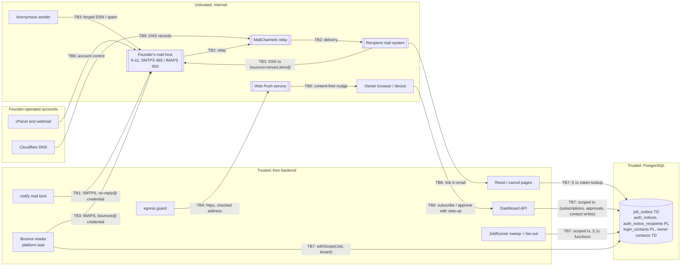

# Threat Model: Notifications (ADR-0013) — email through the founder's SMTPS server, bounce reader, egress guard, Web Push, approval nudges

> **Path**: `docs/architecture/threat-models/notifications.md`
> **Status**: Draft
> **Author**: appsec-engineer via /threat-model (STRIDE and abuse draft); researcher (ASVS 5.0.0 and API Top 10 2023 lookups, raw text); privacy-compliance-specialist (personal-data facts, no legal research); assembled and reviewed in this session · **Reviewer**: security-lead
> **Date**: 2026-10-21 · **Next review**: before the first email story; on S13, S14, S22, S23 or S24 results; when `stack.web` is set; on a provider or host change (mail host, MailChannels, push services); on the FCM adapter (OQ6); on outbound webhooks or remote image fetch joining `egress`; on any incident on the mail path; **after the remote-approval and owner-alerts specs exist** (SL-THREAT-MODEL F1: `--update`, then the gate again)
> **Feature spec**: none (`design/specs/` has only `domain-map.md`; rows 6, 8, 10, 22, 23); boundaries and stores those specs will define are labelled **assumed** (SL F1) · **Research note**: [`docs/research/notifications-provider.md`](../../research/notifications-provider.md) · **ADRs**: ADR-0013 (Proposed, this model is its acceptance blocker 1), ADR-0012 (Proposed), ADR-0007, ADR-0001, ADR-0005, ADR-0009
> **Required because**: authentication (recovery and security notices, approve-on-phone and remote-approval nudges) · authorization model (remote approval with step-up) · PII export/delete (recipient rows, delivery flags, push subscriptions, erasure) · new external integration (the founder's SMTPS/IMAPS server relayed through MailChannels; Web Push services)
> **Model of record**: for `notify` and for the `egress` core module (ADR-0010 row 15; domain-map row 12a; owners `security-lead` / `integrations-engineer`); every new `egress` caller triggers a review
> **Gate**: SL-THREAT-MODEL **CONCERNS** (security-lead, 2026-10-22, run on the founder's request in lean mode); its findings are carried below (§ 6 open rows, § 7, § 8, § 10)
> **Standards**: OWASP ASVS 5.0.0 (tag `v5.0.0`; Level 2 default, **Level 3 for authentication**) · OWASP MASVS: not in scope (no mobile layer) · OWASP API Security Top 10 2023

<!-- Method: STRIDE per trust boundary + abuse cases for business-flow abuse (security-baseline.md).
     IDs for ASVS requirements were looked up in the official documents at mapping time — never recalled from memory. -->

**Linked models (not repeated here).** Staff-auth TB7 (the notice job; SA T7.1–T7.12, M29–M33, M41, M44, M54) and tenant-isolation TB6 (the job path; TI T6.15–T6.30, M69–M87). This model holds only the deltas ADR-0013 adds. IDs from those models carry the prefixes `SA` and `TI`.

**Design-time.** Nothing is built: every control is **Planned** (with the ADR line that plans it) or **Exists** (an operational fact the founder stated). Citations: `0013:n` is a line of ADR-0013 as written on 2026-10-21; `RN F1nn` a finding of the research note.

## 1. Scope

- **In scope**: the backend's mail sender (SMTPS 465 to the founder's host); the relay path beyond it (MailChannels, recipient systems) as a dependency; the bounce reader (IMAPS 993, a JobRunner platform task); the `egress` guard and the Web Push adapter; the owner's browser or device receiving content-free nudges; the dashboard calls that register subscriptions and decide remote approvals; the job-runner deltas (auth-notice fan-out, § 1c functions, minted link tokens, admission before the claim); the reset and cancel pages reached from a link; the founder's hosting control panel (cPanel), its mailboxes and the Cloudflare DNS account (founder addition, TB9).
- **Out of scope**: the FCM adapter (built only if OQ6 lands on Capacitor or native; its own revision of this model); outbound webhooks and remote image fetch (future `egress` callers, their own models); the internals of the founder's mail server and of MailChannels; the counter app; the web side's code (`stack.web` unset: service worker, reset and cancel pages, CSP are **NOT ASSESSED** here); legal questions (founder 2026-10-21: routed to counsel, not researched).
- **Assumptions** (labelled; each is checked where a mitigation names it):
  - TLS to the mail host with certificate verification for `fr-s1.serverpanel.com` (ADR-0013 Decision 2; RN F129).
  - The founder's host is trusted for acceptance (the 250) but not for bounce content.
  - Hosted only; one backend instance, two only during an ADR-0009 deploy overlap.
  - *assumed:* the host accepts SMTP and IMAP AUTH from any internet address; a mailbox password also signs in to webmail; cPanel manages the DKIM key, forwarders and folder settings; the bounce reader reads INBOX only; the VPS's Tailscale addresses are in 100.64.0.0/10; Docker's embedded DNS answers inside the backend container; MailChannels is reached through the host, with no Kodelix contract.
- **Assumed until their specs exist (SL F1):** the remote-approval request store and its fields (domain-map row 10), the tenant-data owner-contact store and its verification (rows 6, 22), the owner-alert store (row 22), and whether tenants can sign up themselves (AB3). **S-NT-08 and the owner-contact and owner-alert parts of S-NT-12 are held** until those specs exist, `/threat-model notifications --update` has run and SL-THREAT-MODEL has run again.
- **Actors**: AC1 malicious tenant (owner or staff); AC2 hostile co-owner; AC3 anonymous internet sender (forged bounces, mail to the plus-addresses); AC4 attacker holding a stolen dashboard session; AC5 compromised or curious push service; AC6 compromised mail host or relay; AC7 Kodelix operator or support; AC8 insider with VPS access; AC9 network attacker; **AC10 holder of a stolen cPanel login or mailbox password** (founder addition). Self-hosted operator: N/A — hosted only.

## 2. Assets

| ID | Asset | Classification | Owner (context) | Impact if compromised (C / I / A) |
|----|-------|----------------|-----------------|-----------------------------------|
| A1a | Sending credential: `no-reply@kodelix.net` password (backend copy: 0400 file `<notify-mail-send>`) | secret | notify | C: H (send as kodelix.net) · I: H · A: M |
| A1b | Bounce credential: `bounces@kodelix.net` password (backend copy: 0400 file `<notify-mail-bounces>`); cannot send through MailChannels (not in Lockdown) | secret | notify | C: M (bounce content) · I: M (bounce suppression) · A: M |
| A2 | VAPID private key (0400 file, push story) | secret | notify | C: M · I: M · A: L |
| A3 | Link tokens (recovery reset, factor-removal cancel); raw only in memory and the email | secret | identity | C: H · I: H |
| A4 | Recipient addresses and owner contacts | PII | identity / tenant data | C: M · I: M |
| A5 | Notice acceptance state (`auth_notice_recipients`, `isAccepted`, M31 integrity) | internal | identity | I: H |
| A6 | Domain reputation, sender identity and send capacity (500/hour shared host limit; caps 300/hour global, 30/hour per tenant) | internal | notify / founder | I: H · A: H |
| A7 | Push subscriptions (endpoint, p256dh, auth secret, key id) | PII + secret | notify | C: M · I: M |
| A8 | Internal network and cloud metadata (SSRF targets) | internal | platform | C: H · I: H |
| A9 | Remote-approval requests and nudges | internal | roles and permissions | I: H |
| A10 | `delivery_state` flags | PII (derived) | identity / tenant data | I: M |
| A11 | Bounce content (addresses, headers, possibly the original message) | PII | notify | C: M |
| A12 | Hosting control-panel (cPanel) login; the mailbox passwords as the host holds them | secret | founder | C: H · I: H · A: H |
| A13 | `kodelix.net` DNS records on Cloudflare (MX, SPF, DKIM, DMARC, `_mailchannels`) and the Cloudflare account | internal | founder | I: H · A: H |

## 3. Trust Boundaries & Data Flow

| ID | Boundary | Crosses | Authenticated by | Data crossing |
|----|----------|---------|------------------|---------------|
| TB1 | Backend → founder's SMTPS server | App → internet host | `no-reply@` password (0400 file); TLS with certificate check | message per recipient, raw link token, VERP envelope sender |
| TB2 | Founder's host → MailChannels → recipient systems | Third party → third party | host to relay (Domain Lockdown by `x-authuser`); SPF, DKIM, DMARC to recipients | full messages, tokens |
| TB3 | Internet → `bounces@` mailbox → bounce reader | Internet → host → app | none for the sender (DSNs are forgeable); `bounces@` password for the reader | DSNs, headers, VERP tenant and item ids |
| TB4 | Backend → Web Push services through `egress` | App → internet (user-influenced URL) | VAPID JWT (ES256) | encrypted content-free payload, TTL, urgency, Topic |
| TB5 | Push service → owner browser or device | Third party → client | browser subscription keys | request or notice id, generic text |
| TB6 | Owner dashboard → backend | Client → app | dashboard session; step-up bound to the request | subscription (endpoint, keys), approval decision, contact writes (validated by M3); request and contact stores **assumed** (SL F1) |
| TB7 | Job runner ↔ PostgreSQL (deltas only) | App → data | `job_rt` in `withScope(Job, tenant)`; `auth_lookup` definer functions | recipient refs, acceptance, token hashes, flags |
| TB8 | Email link → reset or cancel page | Internet (anonymous) → app | possession of the token | token in the URL |
| TB9 | Founder ↔ hosting control panel and webmail; Cloudflare DNS account | Founder → third-party consoles | cPanel and Cloudflare logins (second factor not recorded) | mailbox passwords, forwarders, DKIM, DNS records |

## 4. STRIDE Analysis per Boundary

### TB1 — Backend → founder's SMTPS server (465)

| ID | STRIDE | Threat | Asset | Likelihood | Impact | Mitigation ID(s) |
|----|--------|--------|-------|-----------|--------|------------------|
| T1.1 | **S**poofing | An unsafe library default (`smtp` with clear-text fallback, `ssl.trust=*`, identity check off; RN F122) allows a man-in-the-middle or a spoofed server, capturing the password and live tokens. Planned: 0013 Decision 2; S13 | A1a, A3 | L — Decision 2 sets these explicitly | H — send-as-domain credential and live tokens | M1 |
| T1.2 | **S**poofing | A stolen `no-reply@` password is used from any client to send as kodelix.net; the mail passes SPF, DKIM and DMARC (fake recovery or security notices, phishing owners). Exists: Domain Lockdown per mailbox (RN F131, F135: limits *which* mailbox sends, not *who* holds its password); DMARC aggregate reports in Cloudflare (RN F134: detection only). Planned: 0400 file (backend copy only). Gaps: no alert on sends the backend did not make; rotation runbook pending (S14) | A1a, A6, A4 | M — the password is internet-usable (assumed) and also held at the host (T9.1) | H — authenticated phishing of every tenant's owners | M2, M4, M15, M16, M17 |
| T1.3 | **T**ampering | CR/LF or header injection through tenant-controlled values (contact address, venue or person name in a display name or Subject): extra recipients or headers make kodelix.net an authenticated open relay. The library had this below 2.0.4 (RN F119) | A6, A4 | L | H — authenticated open relay | M3 |
| T1.4 | **T**ampering | Tenant free text inside a genuine notice body ("account locked, call…") turns a DMARC-passing email into a phishing carrier | A6, A4 | L | M — limited to recipients the tenant reaches | M3, M4 |
| T1.5 | **R**epudiation | Acceptance is the host's 250 only; no per-recipient record of Message-ID, time and code answers an M31 "nobody told me" dispute (delta to SA T7.6) | A5 | M | M | M5, M34 |
| T1.6 | **I**nformation disclosure | The rendered message with its raw token sits in the host's queue and logs; a compromised host reads live tokens (delta to SA T7.3) | A3 | L | M — a reset still needs a factor (SA M41) | M14, M33 · residual accepted (§ 7) |
| T1.7 | **I**nformation disclosure | The SMTP reply text echoes the recipient; exceptions carry the envelope and VERP; both reach logs by default | A4 | M | M | M6 |
| T1.8 | **D**enial of service | Host unreachable, AUTH refused, or the shared 500/hour spent by human mailboxes or an attacker (T9.5): every tenant's recovery and notices are held (delta to SA T7.7) | A6, A5 | M | H — every tenant's recovery; M31 pauses (fail-safe) | M8, M9, M17 |
| T1.9 | **D**enial of service | Watchdog or timeouts misconfigured, so two blocked sends hold both `notify-mail` permits | A6 | L | M | M1 |
| T1.10 | **E**levation of privilege | One password that sends, reads and deletes bounces and signs in to webmail (assumed). **Resolved by the mailbox split (ADR-0013 Decision 2a, founder 2026-10-21):** `no-reply@` sends only, `bounces@` receives only and is not a Lockdown sender. Fallback if the founder-run live test fails: one credential, residual to be accepted by name then | A1a, A1b, A11 | L — needs the backend UID or host root | H if not split | M2 |

### TB2 — Founder's host → MailChannels → recipient systems (third-party dependency)

| ID | STRIDE | Threat | Asset | Likelihood | Impact | Mitigation ID(s) |
|----|--------|--------|-------|-----------|--------|------------------|
| T2.1 | **S**poofing | Lookalike domains and display-name spoofing; with DMARC `p=quarantine` a direct spoof lands in spam instead of being refused (delta to SA T7.1; RN F130). **Founder 2026-10-21: move to `p=reject` now (M19)** | A6 | M | M | M4, M19 |
| T2.2 | **S**poofing | Another MailChannels sender passes as kodelix.net if `_mailchannels.kodelix.net` is altered (T9.7) or a mailbox is listed carelessly. Exists: Domain Lockdown (RN F131, F135); rule 0013 Decision 12 | A6, A13 | L | H | M17, M18 |
| T2.3 | **T**ampering | Link scanners and prefetchers open reset or cancel links; if a GET consumes the token, the link dies or a legitimate removal is cancelled (delta to SA T7.12) | A3 | M | M | M33 |
| T2.4 | **R**epudiation | A notice counts as accepted at the 250; a later permanent bounce did not reopen it, so a hostile co-owner's lost-factor reset could complete although the owner's only address bounced. **Resolved by M13 (founder 2026-10-21):** a pre-apply bounce pauses the gated change | A5 | L | H | M13 |
| T2.5 | **I**nformation disclosure | MailChannels and the recipient provider see every message, raw tokens included; no Kodelix contract with MailChannels (assumed) | A3, A4 | L | M | M14, M33 · residual accepted (§ 7) |
| T2.6 | **D**enial of service | The shared relay IP is listed (already seen on SpamCop, RN F132): recovery and notices go to spam or are refused. Exists: mail-tester, DMARC dashboard; Planned: move trigger 1 (0013 Decision 13) | A6 | M | H — recovery for every tenant | M15 · residual accepted (§ 7) |
| T2.7 | **D**enial of service | MailChannels outage or a Lockdown mistake produces 5.7.1 bounces, and the breaker opens globally | A6 | L | M — fail-safe, with an alert | M8 |
| T2.8 | **E**levation of privilege | N/A — no authority crosses TB2 back to Kodeebo except bounces (TB3) and the tokens inside mail (T2.5, TB8) | — | — | — | — |

### TB3 — Internet → `bounces@` mailbox → bounce reader (IMAPS 993)

| ID | STRIDE | Threat | Asset | Likelihood | Impact | Mitigation ID(s) |
|----|--------|--------|-------|-----------|--------|------------------|
| T3.1 | **S**poofing | A forged DSN for a real VERP (visible in Return-Path at every recipient and in forwarded copies) marks the recipient failing; at the next fan-out that contact receives nothing; for a login's address, notices stop (recovery is still sent: M12) | A10, A5 | L — needs a leaked VERP inside the window | M — one contact silenced; owner and operator alerted | M11, M12, M34 |
| T3.2 | **S**poofing / **D**oS | A forged `5.7.1` DSN opens the **global** mail breaker on demand. **Resolved in ADR-0013 Decision 4 (M8, founder 2026-10-21):** a 5.7.1 counts only when it matches a real item in the window, once per item; half-open probe; operator close with step-up | A6 | M — anonymous and cheap | H — every tenant's mail held | M8, M11 |
| T3.3 | **T**ampering / **D**oS | Hostile bounce content (oversized, deep MIME nesting, huge parts, malformed delivery-status, charset tricks) parsed inside the backend process: an OOM takes API and sync down for every tenant (TI T6.17 family) | A6 | M | H — shared process | M10 |
| T3.4 | **T**ampering | Log or alert injection through Diagnostic-Code, Final-Recipient or headers | A11 | M | M | M6, M10 |
| T3.5 | **E**levation of privilege | The tenant scope comes from external mail: the VERP tenant becomes `app.tenant_id`; a malformed value or a tenant-A / item-B pair (delta to TI T6.20) | A10, A4 | L | H — a flag in another tenant | M11 |
| T3.6 | **D**enial of service | Owner-alert flood: N forged DSNs for one item create N alerts if the key is the sender-chosen Message-ID. **Resolved in ADR-0013 Decision 4 (M11):** one alert per (item, recipient, class) | A6 | M | L — noise hides a real alert | M11 |
| T3.7 | **R**epudiation | Processed bounces are deleted and only class and ids kept; a wrong flag, or a bounce deleted by an intruder (T9.2), leaves no trace | A10 | M | M | M34, M15 |
| T3.8 | **I**nformation disclosure | DSNs carry addresses and headers; with RET=FULL the whole original, including a still-valid raw token; ignored messages were not stated to be deleted | A11, A3, A4 | M | M — a reset still needs a factor | M10, M14 |
| T3.9 | **D**enial of service | A mailbox flood (`bounces@` and its plus-addresses) fills the quota so real bounces are refused, and stretches a pass beyond the stop timeout; auto-create folders ON would make a folder per VERP (RN F133) | A6, A10 | M | M | M10, M15 |
| T3.10 | **I**nformation disclosure | Human replies and auto-responders addressed to `no-reply@` (the From address) accumulate PII in a mailbox the backend never reads or cleans (privacy G1) | A4 | M | L | M39 |

### TB4 — Backend → Web Push services through `egress`

| ID | STRIDE | Threat | Asset | Likelihood | Impact | Mitigation ID(s) |
|----|--------|--------|-------|-----------|--------|------------------|
| T4.1 | **S**poofing / **E**oP | SSRF through a forged subscription endpoint: loopback, RFC 1918, link-local, metadata, Docker-network services (PostgreSQL, nginx, Docker DNS) and **100.64.0.0/10** (the tailnet, assumed), which ADR-0013 Decision 8's range list does not name | A8 | M — any signed-in user can register an endpoint | H — internal network and tailnet | M20, M21, M24, M41 |
| T4.2 | **S**poofing | DNS rebinding: a check-to-connect gap, keep-alive reuse after re-resolution, or a proxy environment variable redirecting the connection; Ktor 3.6.0 client behaviour NOT SOURCEABLE beyond the 3.5.0 resolver note (0013 Decision 8); S24 | A8 | M | H | M20 |
| T4.3 | **S**poofing | Allowlist bypass through host parsing (suffix match, userinfo, trailing dot, case, IDN, port); the push-host list itself is NOT SOURCEABLE (RN F220e) | A8 | M | H | M21 |
| T4.4 | **T**ampering | The push service drops, delays or replays a message | A9 | M | L — content-free, de-duplicated by notice id | M26 |
| T4.5 | **R**epudiation | N/A — 201 means accepted, not delivered (RN F202); nothing depends on push delivery; the decision is recorded in the dashboard (T6.5) | — | — | — | — |
| T4.6 | **I**nformation disclosure | Push-service metadata: timing, volume, TTL, `urgency=high` marks approvals; `Topic` is not encrypted (RN F201) | A9 | M | L | M26 |
| T4.7 | **I**nformation disclosure | The endpoint (a capability URL) or the keys reach logs, spans, dead rows or error text | A7 | M | M | M6 |
| T4.8 | **D**enial of service | Slow or huge responses exhaust send threads | A6 | L | M | M20 |
| T4.9 | **D**enial of service | A subscription bound to another VAPID key, or a bogus path on an allowlisted host, returns 401/403 treated as "credential fault, breaker open": one user switches off push for everyone on that service | A9 | M | M — approvals still work in the dashboard | M22 |
| T4.10 | **E**levation of privilege | The web-push library's own HTTP client bypasses `egress`; BouncyCastle global registration changes provider order for other crypto (BC also serves Argon2, ADR-0007 § 2) | A8 | L | H | M20 |
| T4.11 | **I**nformation disclosure | VAPID private key leaked (file, dump, image layer): the attacker can push to every subscription it knows; rotation re-subscribes every device (RN F204) | A2 | L | M | M35 |

### TB5 — Push service → owner browser or device

| ID | STRIDE | Threat | Asset | Likelihood | Impact | Mitigation ID(s) |
|----|--------|--------|-------|-----------|--------|------------------|
| T5.1 | **S**poofing | Fake or repeated "approval waiting" nudges (a stolen VAPID key, or a cashier raising many requests) push the owner into approving the wrong request (push fatigue). Planned: approval only in the dashboard with step-up bound to the request (0013 Decision 11) | A9 | M | H — an unauthorised override within the tenant | M27 |
| T5.2 | **T**ampering | A notification click opens a URL taken from the payload (open redirect or phishing). Web side NOT ASSESSED (`stack.web` unset) | A9 | L | M | M26 |
| T5.3 | **R**epudiation | N/A — no device-side receipt is relied on; decisions are recorded in the dashboard (T6.5) | — | — | — | — |
| T5.4 | **I**nformation disclosure | A shared device stays subscribed after session expiry or end-all-sessions; the next person, possibly of another tenant, receives the nudges. **Resolved in ADR-0013 Decision 10 (M23, founder 2026-10-21):** deleted on every session end | A7, A9 | M | M — ids only; a cross-tenant nudge | M23, M25 |
| T5.5 | **D**enial of service | A nudge is late or lost | A9 | M | L — the request stays in the dashboard; no counter path waits | M27 |
| T5.6 | **E**levation of privilege | Action buttons, or request details added to the payload later "for convenience"; the content-free rule is convention only | A9 | L | H | M26 |

### TB6 — Owner dashboard → backend (subscription registration, remote approval)

| ID | STRIDE | Threat | Asset | Likelihood | Impact | Mitigation ID(s) |
|----|--------|--------|-------|-----------|--------|------------------|
| T6.1 | **S**poofing | A stolen session registers the attacker's browser: a feed of nudges that would outlast the session (now bound to it, M23) | A7, A9 | M | L — ids only; approval needs step-up | M23 |
| T6.2 | **T**ampering | Mass assignment on registration: `tenant_id`, `person_id`, `kind`, `vapid_key_id` or `last_ok_at` from the body | A7 | M | M | M24 |
| T6.3 | **T**ampering / **I** | IDOR on subscription list or delete, or on approval-request ids, of another person or tenant | A7, A9 | M | H — cross-tenant | M24, M27 |
| T6.4 | **T**ampering | Malformed keys or endpoints accepted, becoming poison items at send (TI T6.16) | A7 | M | L | M21, M24 |
| T6.5 | **R**epudiation | Registration, deletion and remote approval not recorded with actor, request and step-up grant | A9 | M | M | M27, M34 |
| T6.6 | **I**nformation disclosure | The auth secret and p256dh are secrets (RN F203) and the endpoint a capability; class, encryption and export are undecided (0013 Decision 10, deferred) | A7 | M | M | M25 |
| T6.7 | **I**nformation disclosure | Approval requests not under `branch_scope`: a branch-limited manager sees or approves another branch's request | A9 | M | M | M27 |
| T6.8 | **D**enial of service | A registration flood multiplies every nudge | A6, A9 | M | M | M23, M24 |
| T6.9 | **E**levation of privilege | Remote-approval abuse: a step-up grant replayed on another request, self-approval, an approver who lost the permission, an expired request (> 10 min), a double approval | A9 | M | H — escalation within the tenant, money | M27 |

### TB7 — Job runner ↔ PostgreSQL (deltas only; see TI TB6 and SA TB7)

| ID | STRIDE | Threat | Asset | Likelihood | Impact | Mitigation ID(s) |
|----|--------|--------|-------|-----------|--------|------------------|
| T7.1 | **T**ampering | `addRecipients` trusts the handler's list (`auth_lookup` never reads TD): an incomplete list makes `isAccepted` true although the targeted contact was never fanned out; a login_contact of another tenant or login can be passed | A5, A4 | L | H — the M31 gate opens with the owner untold | M28, M30 |
| T7.2 | **T**ampering | `recipientAccepted` called without a 250 (on Ambiguous, on Held, from a stale claim whose guarded transaction B matched 0 rows, or from another kind); the function cannot read `job_outbox` (TD) to check | A5 | L | H — the M31 gate opens untold | M28, M29 |
| T7.3 | **I**nformation disclosure | The raw token in `ClaimContext` leaks through exception text, a dead row's error, a span or `toString` | A3 | M | H — a live token at rest | M6, M29 |
| T7.4 | **I** / **T** | Decision 2's "same bytes and Message-ID on every attempt" conflicted with a token per attempt: keeping the bytes would persist a body with a live token, and one Message-ID on two bodies breaks RFC 5322 (RN F106). **Resolved in ADR-0013 Decision 2 (M7, founder 2026-10-21):** rebuilt per attempt, never stored, new Message-ID per attempt for link-bearing kinds | A3 | M | H if persisted | M7 |
| T7.5 | **T**ampering | "Outstanding hashes bounded by max_attempts" has no database check; `confirmToken` could void another request's hashes | A3 | L | M | M28 |
| T7.6 | **R**epudiation | Recipient state changes and failure reasons write no security event | A5 | M | M | M34 |
| T7.7 | **I**nformation disclosure | `Contacts.addressFor` returns PII to `job_rt`; any job handler, or a compromised app stepping through tenants (TI T3.1, R-1), can harvest login addresses | A4 | L | M | M29 |
| T7.8 | **I**nformation disclosure | Operator alerts naming the contact's display label (tenant free text, often a name) outside the ADR-0004 grant gate (TI T5.17) and into tooling an agent may read (SA T10.3). **Resolved in ADR-0013 Decision 7 (M32, founder 2026-10-21):** operator alerts carry ids only | A4 | H | M | M32 |
| T7.9 | **D**enial of service | One tenant's 30/hour bucket shared by every mail kind: bulk owner alerts or recovery requests delay its security notices by hours; ten tenants at cap exhaust the global 300/hour (delta to TI T6.27). **Resolved in ADR-0013 Decision 5 (M9, founder 2026-10-21):** reserved lanes | A6, A5 | M | M | M9 |
| T7.10 | **E**levation of privilege | Platform periodic tasks sit outside the kind registry: no `runsWhen` test (TI M86), no idempotency declaration (TI M78), no producer allow-list for the alerts they enqueue (TI M71) | A10 | L | M | M31 |
| T7.11 | **E**levation of privilege | The hooks "may not call a provider", and `onAccepted` must not run when transaction B's guarded update matched 0 rows (TI M84); both are convention only | A5, A3 | L | H — acceptance or token confirmation from a stale claim | M29 |
| T7.12 | **S**poofing | N/A as a new path — job identity is `job_rt` (TI TB6) and payload identity TI T6.20; the only delta, identity from mail, is T3.5 | — | — | — | — |
| T7.13 | **D**enial of service / **I** | Mail outside ADR-0013's recipient stores: the closure notices (suspension, days 30, 60, 80; ADR-0005 Decision 1) and the archive one-time code to `archive_contact` (ADR-0005 Decision 2) are email, but `addRecipients` accepts only `login_contact` and `owner_contact` (privacy G13); built ad hoc, they would bypass caps, VERP and the token rules | A3, A4, A6 | M | M | M37 |
| T7.15 | **E**levation of privilege | An operator requeue of dead mail kinds (TI T5.15, M83; requeue path undecided, TI R-12) re-mints a token for an expired recovery or cancel request, or resends a stale security notice long after its event (SL F3) | A3, A5 | L — needs operator access | H — a working link for a request that should be dead | M40 |
| T7.14 | **I**nformation disclosure | `Closure.purgeLogins` covers `auth_notice_recipients` but not `auth_notices`; notice rows may persist until `purged`, long after `purge_personal` (privacy G3); the retention trigger "90 days after sending" is undefined for a notice never accepted (G2); cancel-token hashes have no retention row (G7) | A4, A5 | M | L | M38 |

### TB8 — Email link → reset or cancel page (anonymous, token-bearing)

| ID | STRIDE | Threat | Asset | Likelihood | Impact | Mitigation ID(s) |
|----|--------|--------|-------|-----------|--------|------------------|
| T8.1 | **S**poofing | Token guessing; up to max_attempts valid hashes per request multiply the odds | A3 | L — full-entropy tokens assumed (length per ADR-0007 § 2) | H | M33 |
| T8.2 | **S**poofing | An earlier link (forwarded copy, bounce original T3.8, mailbox intruder T9.4) stays valid until a later attempt is accepted (0013 Decision 7) | A3 | L | M — a reset needs a factor; a cancel only stops a removal | M14, M33 · residual accepted (§ 7) |
| T8.3 | **T**ampering | A GET consumes the token (prefetch, T2.3), or a cross-site POST acts without the token in its body | A3 | M | M | M33 |
| T8.4 | **R**epudiation | Token use not tied to the attempt that minted it | A3 | L | L | M34 |
| T8.5 | **I**nformation disclosure | The token in the URL leaks through Referer, proxy logs or third-party page resources (ASVS 14.2.1 partially met by design, § 8) | A3 | M | M | M33 |
| T8.6 | **D**enial of service | The newest email is delayed or spam-foldered while an earlier link is voided | A3 | M | M | M9, M33 |
| T8.7 | **E**levation of privilege | A token for request A accepted for request B because the request id is taken from the URL instead of the hash row | A3 | L | H | M28, M33 |

### TB9 — Founder ↔ hosting control panel and webmail; Cloudflare DNS account (founder addition)

| ID | STRIDE | Threat | Asset | Likelihood | Impact | Mitigation ID(s) |
|----|--------|--------|-------|-----------|--------|------------------|
| T9.1 | **S**poofing | The cPanel login or a mailbox password at the host is stolen (phishing, reuse, stuffing, the host's support or reset path): the attacker sends from a listed mailbox through MailChannels (passes SPF, DKIM, DMARC), resets passwords, reads or deletes bounces. **Exists:** Domain Lockdown per mailbox (RN F131, F135) — limits which mailbox sends, not who holds its password; DMARC aggregate reports (RN F134) — detection only; the 0400 files (ADR-0009 Decision 3a) — the backend copies only. **Gaps:** (a) no second factor recorded on the cPanel login; (b) no alert on sends the backend did not make; (c) rotation runbook pending (S14); (d) the host's account-recovery and support path not recorded | A12, A1a, A6 | M — a public web login, second factor not recorded | H — authenticated phishing of every tenant's owners; bounce suppression; outage | M2, M15, M16, M17 · residual accepted (§ 7) |
| T9.2 | **T**ampering | Host settings changed: a forwarder or filter diverts or copies bounces; auto-create folders switched on (bounces miss INBOX, assumed); a new mailbox created; the DKIM key replaced (assumed managed in cPanel) | A12, A11, A10 | L | H — silent loss of failing flags; address harvesting | M15, M17, M18 |
| T9.3 | **R**epudiation | cPanel and webmail actions leave no record Kodelix keeps; whether the host keeps one is NOT SOURCEABLE | A12 | M | M | M17 |
| T9.4 | **I**nformation disclosure | Mailbox contents leak: bounces (in effect a customer address list), RET=FULL originals with live tokens, human replies, and the founder's and support mailboxes on the same account | A11, A4, A3 | M | H — customer address list | M10, M14, M17, M39 |
| T9.5 | **D**enial of service | The attacker changes the password (AUTH refused, breaker opens, all mail held) or spends the shared 500/hour on spam until the host suspends the account (assumed) | A6, A1a | M | H — every tenant's recovery and notices | M2, M8, M17 |
| T9.6 | **E**levation of privilege | Pivot: the VPS provider, Tailscale admin, Cloudflare, Bitwarden, registrar or GitHub account might recover through a mailbox on this cPanel account (not recorded; assumed possible), making a mailbox takeover a path toward root on the VPS (TI T7.15). Exists: TI A15 (second factors for the VPS provider and Tailscale) | A12, A13 | L | H — every tenant | M17 |
| T9.7 | **S**poofing | Cloudflare account takeover: MX, SPF, DKIM, DMARC `rua` and `_mailchannels` changed; the attacker receives bounces and replies and adds senders | A13 | L | H | M17, M18 |

## 5. Abuse Cases (business-flow abuse)

| ID | Abuse case | Actor | Goal | Detection | Mitigation ID(s) |
|----|-----------|-------|------|-----------|------------------|
| AB1 | A tenant adds arbitrary addresses as owner contacts or invitees, so kodelix.net mails strangers (owner-contact verification for the TD store not stated) | AC1 | Spam or harassment from a trusted domain; burn the global cap | Per-tenant 80 % cap alert; hard-bounce rate per tenant | M3, M4, M9, M36 |
| AB2 | Recovery bombing drains one tenant's bucket | AC3 | Delay that tenant's security notices | `mail_rate_limited_total{scope}`; recovery volume (SA M33) | M9 (with SA M33) |
| AB3 | Many or freshly created tenants exhaust the global 300/hour (whether self-signup exists is not in the inputs, assumed) | AC1 | DoS of every tenant's recovery | Global 80 % alert | M9 |
| AB4 | A forged bounce silences one contact before a lost-factor reset | AC2, or anyone with a leaked VERP | Owner left untold | `bounce.processed` events; alert per failed recipient | M11, M12, M13, M34 |
| AB5 | Forged 5.7.1 bounces cause a mail outage on demand | AC3 | DoS | Breaker-open alert with its cause | M8, M11 |
| AB6 | Push fatigue: a flood of approval requests | Malicious cashier or device | An override gets approved | Request rate per device; `approval_requests_total{outcome}` | M27 |
| AB7 | SSRF through a subscription endpoint | AC1, AC4 | Reach internal services or the tailnet | `egress_refused_total{reason}` | M20, M21, M24 |
| AB8 | A subscription bound to a foreign VAPID key trips the host breaker | AC1 | Switch off push for everyone | Breaker open with a distinct-subscription count | M22 |
| AB9 | Shared-device nudge leak | The next user, possibly of another tenant | Read someone else's alerts | Subscription without a live session | M23 |
| AB10 | Authenticated phishing through a stolen mailbox or cPanel login | AC10 | Owner passwords; fake recovery notices | Untagged-bounce alert; reconciliation; DNS watch | M2, M4, M15, M16, M17 |
| AB11 | Customer addresses harvested from the bounce mailbox | AC10, AC8 | Customer list | Host login logs, if any (NOT SOURCEABLE) | M10, M14, M17 |
| AB12 | A surveillance subscription registered through a stolen session | AC4 | Learn approval timing | New-subscription notice to the owner | M23 |
| AB13 | An older link used while a newer attempt is pending | Holder of an older copy | Use the reset or cancel link | Token-use event with the attempt | M14, M33 |
| AB14 | Account or email enumeration — covered: the request sends nothing (0013 Decision 7), the 550 is never shown to the requester (RN § 6), one page message for every failure | AC3 | Enumerate | — | M33 |

**Business-flow prompts:** trial abuse → AB3; quota and rate-limit evasion → AB2, AB3 (the deploy-overlap overshoot is accepted in ADR-0013 Decision 5); invitation spam → AB1; enumeration → AB14; replayed or reordered webhooks → the bounce path, AB4, AB5, with de-duplication in M11; scraping and export exfiltration → AB11; coupon stacking, seat inflation, downgrade cycling, referral fraud, payment desync, **licence bypass**: N/A — no billing or licensing flow is touched.

**Cross-tenant coverage (SL-THREAT-MODEL check 4):**

| Prompt | Coverage |
|---|---|
| Guessing or enumerating IDs | T3.1, T3.5 (VERP ids, full-entropy encoding in M11), T6.3, T8.1, T8.7 |
| Shared caches and cache keys | No cache (ADR-0013 Cross-Cutting). Shared in-process state: admission buckets keyed by tenant (T7.9) and breakers shared by design (T3.2, T4.9) |
| Queues, outbox, consumers losing the tenant | T7.1 (fan-out), T3.5 (bounce routing); SA T7.4 / SA M32 and TI T6.x linked |
| Search indexes | N/A — no search index |
| Exports and reports | T6.6 (subscriptions and keys in exports), T7.8 (operator alerts), T7.14 (notice rows after closure) |
| Background and scheduled jobs | T7.10 (platform task), T7.1, T7.9, T7.13; TI TB6 |
| Object storage and signed URLs | N/A — no object storage; the analogues are the link tokens (TB8) and push endpoints as capability URLs (T4.7, T6.6) |
| Admin and impersonation | T7.8; T7.15 (requeue of dead mail kinds, M40, linked to TI R-12); T9.4 insider reads of the mailbox |
| Webhooks routed by a client-supplied id | **The bounce path:** the tenant comes from VERP — T3.5, T3.1, T3.2 |
| Telemetry leaking another tenant's data | T1.7, T4.7, T7.3, T7.8; no tenant label in metrics (ADR-0013 Cross-Cutting) |

**Stack-reference prompts:** postgres best-practices § 1 — the new PL table `auth_notice_recipients` and the new definer functions with pinned `search_path` (TI T3.10; M28); `push_subscriptions` needs ENABLE + FORCE if TD and no cross-tenant UNIQUE on the endpoint (unique-key covert channel; M25); the bounce reader sets tenant context only through the helper (T3.5). Redis / Dragonfly § 7: N/A — buckets are in process. Mongo: N/A. `.claude/rules/deploy.md`: its env-file allowance conflicts with ADR-0009 3a (ADR governs; rule file stale — `platform-lead`); egress firewall `platform-lead`. `.claude/rules/integrations.md`: the egress rule matches Decision 8; DSNs cannot be signature-checked (RN F105, forgeable), so the compensation is strict parsing with no side effect plus looking the item up in our database (M11), in the rule's "re-fetch the object" spirit; stub contract tests for success, 4xx, 5xx, timeout and duplicate for the mail sink and the push stub. `.claude/rules/security-sensitive.md`: operator breaker close and requeue need step-up and audit (M8, M34). NOT SOURCEABLE: no stack reference exists for Angus Mail or the web-push library.

## 6. Mitigations -> Stories & Tests

No epic exists (`production/epics/` absent): every story is `NEW:` for `/create-stories` (type Security unless noted). Owners: the story's stack lead (`ktor-lead` for backend, `postgres-specialist` for migrations, `web-lead` once `stack.web` is set) or the founder for account operations. All mitigations are **Planned** (design-time).

**Proposed stories:** S-NT-01 mail sender adapter (`ktor-lead`); S-NT-02 bounce reader (`ktor-lead`); S-NT-03 send admission and reserved lanes (`ktor-lead`); S-NT-04 auth-notice fan-out and § 1c functions (`postgres-specialist`, `ktor-lead`); S-NT-05 reset and cancel token pages (`ktor-lead`, `web-lead`); S-NT-06 `egress` guard (`security-lead` / `integrations-engineer`, the egress owners per ADR-0010 row 15, with `ktor-lead`); S-NT-07 Web Push adapter and subscriptions (`ktor-lead`, `postgres-specialist`); S-NT-08 remote-approval checks (`ktor-lead`, with the remote-approval spec; **held**, SL F1); S-NT-09 notify security events and telemetry hygiene (`observability-engineer`); S-NT-10 mail-path monitoring (Security; `ktor-lead`, `sre-lead`: M15, M16, M18 and M2's start-up file check); S-NT-14 mail-account operations record (founder, `infra-engineer`; an operations record, not a code story: M17, M19, M39, M2's live test and rotation) (SL F5); S-NT-11 platform-task registry (`ktor-lead`); S-NT-12 owner-contact verification and content rules (`product-manager`, `ktor-lead`; owner-contact and owner-alert parts **held**, SL F1); S-NT-13 closure and archive mail kinds, notice retention (`cto`, `data-lead`).

| ID | Mitigation | Addresses | ASVS / API ref | Story | Test (negative) | Status |
|----|-----------|-----------|----------------|-------|-----------------|--------|
| M1 | Mail TLS and timeout guard: only `smtps` / `imaps`, identity check on, no `ssl.trust`, every timeout explicit; start-up refuses anything else | T1.1, T1.9 | 12.3.1, 12.3.2, 13.2.6 | NEW: S-NT-01 | Wrong-certificate sink → no AUTH sent; config with `smtp` or `ssl.trust=*` → start-up fails; server stops reading → watchdog closes inside the deadline (S13) | Planned |
| M2 | Mailbox least privilege: `no-reply@` sends only, `bounces@` receives only and is never a Lockdown sender (ADR-0013 Decision 2a); two 0400 files with the reader check; no webmail for either if the host allows; tested rotation runbook (S14); founder-run live test of the VERP envelope sender | T1.2, T1.10, T9.1, T9.5, AB10 | 13.2.1, 13.2.2, 13.3.2, 13.3.4 | NEW: S-NT-14 (live test, rotation), S-NT-10 (start-up file check) | File at 0440 or wrong owner → start-up fails; the `bounces@` credential used to send through the host → refused by Lockdown (5.7.1); after rotation the old password → AUTH refused (manual evidence in `production/qa/evidence/`) | Planned |
| M3 | Injection-proof builder: typed `EmailAddress` with a strict ASCII pattern checked at contact write and at send; addresses only through the library parser; Subject and display name only from fixed templates; VERP from typed ids | T1.3, T1.4, AB1 | 1.3.11, 1.3.7, 1.3.3 | NEW: S-NT-01 | An address with `\r\nBcc:`, a venue name with CRLF, a 2 KB Subject input → refused, or the raw DATA at the sink shows one recipient and no injected header | Planned |
| M4 | Notice content rules: no tenant text in the Subject; tenant text in the body escaped and capped; links only to the configured host; a fixed anti-phishing line; every security notice also listed in the dashboard so recipients can cross-check | T1.4, T2.1, T9.1, AB1, AB10 | 1.3.7, 1.3.5 | NEW: S-NT-12 | Template lint fails on a tenant field in the Subject or a foreign link host; a venue name holding a URL renders as text | Planned |
| M5 | Acceptance record: on 250, store `accepted_at`, the Message-ID and the reply code (never the reply text) | T1.5 | 16.2.1, 16.3.3 | NEW: S-NT-04 | Sink 250 → the row holds code and Message-ID; the address in the reply text is absent from rows and logs | Planned |
| M6 | notify telemetry hygiene: typed log fields; reply text, envelope, endpoint, p256dh, auth and tokens never logged; `ClaimContext.toString` redacted; the ADR-0013 log-and-span scan extended to bounce parsing and push (with SA M29, SA M44, TI M87) | T1.7, T3.4, T4.7, T7.3 | 16.2.5, 16.4.1, 16.5.1 | NEW: S-NT-09 | Forced failures at every stage with marker values → no marker in logs, spans, dead rows or exception text | Planned |
| M7 | Rebuild per attempt, never persist a rendered body; new Message-ID per attempt for link-bearing kinds (ADR-0013 Decision 2, amended 2026-10-21) | T7.4, T8.6 | 11.5.1, 6.5.1 | NEW: S-NT-01 | Schema test: no job or notice column holds a body; two attempts → two Message-IDs, and the first token is void after the second 250 | Planned |
| M8 | Breaker semantics (ADR-0013 Decision 4, amended): opens on our own AUTH, TLS or MAIL FROM faults, or on a 5.7.1 that matches a real item in the window, at most once per item; half-open probe; every open and close a security event; operator close with step-up | T1.8, T2.7, T3.2, T9.5, AB5 | 16.5.2, 16.5.3, 7.5.3; API5:2023 | NEW: S-NT-02 | Forged 5.7.1 with no or unknown VERP → breaker stays closed; one valid VERP sent 50 times → one opening; after the interval a probe closes it; operator close without step-up → refused | Planned |
| M9 | Reserved lanes (ADR-0013 Decision 5, amended): a reserved share of the tenant and global buckets for recovery, factor and M31-gated kinds; sub-caps and coalescing for owner alerts and invites | T7.9, T1.8, T8.6, AB1, AB2, AB3 | 2.4.1, 2.1.3, 2.3.2; API4:2023, API6:2023 | NEW: S-NT-03 | 500 owner alerts drain a tenant's bucket → a recovery mail enqueued after them is admitted next pass; ten tenants at cap → an eleventh tenant's recovery is admitted | Planned |
| M10 | Bounce intake hardening: size check before fetch; fetch the report structure and delivery-status part only; bounded MIME depth, parts and bytes; per-pass cap; explicit IMAP timeouts (S13); typed parse result; delete every message after classification, ignored ones included; mailbox quota alert | T3.3, T3.4, T3.8, T3.9, T9.4, AB11 | 2.4.1, 16.5.3, 14.2.7 | NEW: S-NT-02 | 50 MB message, 1,000-level nesting, missing delivery-status, bad charset, a human reply → each skipped or deleted and counted; heap bounded; the pass ends inside the stop budget; nothing left in the mailbox | Planned |
| M11 | Bounce authenticity rules (ADR-0013 Decision 4, amended): full-entropy VERP encoding; strict typed parse; the item must exist in that tenant, be a mail item and fall in the window; the flagged contact is the item's own recipient, never Final-Recipient; `multipart/report` delivery-status with Action `failed` and Status 5.x.x; one effect and one alert per (item, recipient, class) | T3.1, T3.2, T3.5, T3.6, AB4, AB5 | 1.3.3, 8.4.1, 16.3.3 | NEW: S-NT-02 | Tenant-A VERP with a tenant-B item → no change; Final-Recipient naming another contact → only the item's recipient flagged; 20 forged DSNs with distinct Message-IDs → one flag, one alert; `delayed` or 4.x.x → no flag; truncated or non-UUID VERP → ignored and counted | Planned |
| M12 | A failing flag never blocks a recovery email the person requested; it stops only fan-out of other notices (ADR-0013 Decision 7, amended; founder 2026-10-21) | T3.1, AB4 | 6.4.3 | NEW: S-NT-04 | Recovery for a flagged address → mail sent; an owner notice to the same flagged address → `failed(address_failing)`, not sent | Planned |
| M13 | A permanent bounce for a gated notice's recipient, arriving before the change applies, pauses the change and alerts (ADR-0013 Decision 7, ADR-0007 note; founder 2026-10-21) | T2.4, AB4 | 6.3.7, 6.4.4 | NEW: S-NT-04 | 250, then a permanent bounce during the delay → `startReset` does not apply at the end of the delay; owner and operator alerted | Planned |
| M14 | On a bounce for a link-bearing item, void its outstanding hash (new § 1c `Recovery.voidToken` / `SecondFactors.voidCancelToken`, inside, job); set `dsn.ret` to HDRS (RN F122; remote MTAs may ignore it, assumed). **Needs an ADR-0013 change: decided at the CTO-ADR gate** | T1.6, T2.5, T3.8, T8.2, T9.4, AB11, AB13 | 6.5.1, 14.2.7 | NEW: S-NT-02, S-NT-04 | Bounce on a recovery item → its link answers "expired or replaced"; the sink sees RET=HDRS | Planned (decision pending: `cto`) |
| M15 | Bounce-path canary and silence alerts: a daily send to a non-existent mailbox on a founder-controlled domain, its VERP bounce expected within N hours; alerts on a missing canary, on N days without bounces, and on bounces with no VERP tag or for unknown items (mail the backend did not send) | T9.1, T9.2, T1.2, T2.6, T3.7, T3.9, AB10 | 16.3.3, 16.3.4 | NEW: S-NT-10 | Sink drops the canary bounce → alert within N h; 10 untagged bounces in an hour → alert; normal traffic → no alert | Planned |
| M16 | Outbound reconciliation: compare the host's outbound count for `no-reply@` (if the host exposes it; NOT SOURCEABLE, founder to check) with `mail_send_total{outcome=accepted}` | T1.2, T9.1, AB10 | 16.3.3 | NEW: S-NT-10 | One test send from another client → flagged as one extra send | Planned (depends on host feature) |
| M17 | Account hardening (founder): second factor on the cPanel login (availability to verify); unique passwords in Bitwarden; a support PIN if offered; second factor on Cloudflare; no critical account (VPS provider, Tailscale, Cloudflare, Bitwarden, registrar, GitHub) recovers through a mailbox on this cPanel account; monthly review of the host's login logs if they exist; webmail off for the notify mailboxes if possible | T9.1–T9.7, T1.8, AB10, AB11 | — (third-party account operations; no ASVS row) | NEW: S-NT-14 | Recorded check in `production/qa/evidence/`: password alone at cPanel → second factor demanded; recovery addresses of the listed accounts checked off (an automated test against a third-party panel is not possible) | Planned (founder) |
| M18 | DNS record watch: scheduled comparison of `_mailchannels`, SPF, the DKIM selector, DMARC and MX against configured expected values; alert on change | T2.2, T9.2, T9.7 | 16.3.4 | NEW: S-NT-10 | A stub resolver returns an extra `senderid` → alert | Planned |
| M19 | DMARC `p=reject` (founder 2026-10-21: **now**), then watch the Cloudflare aggregate reports for legitimate mail failing | T2.1 | — (DNS policy; no ASVS row) | NEW: S-NT-14 | A spoofed test message from an unauthorised host → rejected at a Gmail inbox (manual evidence) | Planned (founder action) |
| M20 | `egress` refusal matrix beyond ADR-0013's list: IPv6 loopback, ULA and link-local; IPv4-mapped IPv6; NAT64 prefix; 0.0.0.0/8; **100.64.0.0/10**; Docker service names; decimal, octal and hex literals; redirect to private; keep-alive reuse after re-resolution; proxy environment ignored; response cap; slow-body timeout; the library HTTP client absent (architecture test); S24. Folded into ADR-0013 Decision 8 and `IC-EGRESS-GUARD-R2` on 2026-10-22 (SL F4) | T4.1, T4.2, T4.8, T4.10, AB7 | 1.3.6, 13.2.4, 13.2.5, 13.2.6; API7:2023 | NEW: S-NT-06 | Each form → `Refused(reason)` before connect and a listener at the target sees no SYN; a 30x to the metadata address → not followed; re-resolution to 127.0.0.1 on the second connection → refused; a 10 MB body → cut at the cap | Planned |
| M21 | Exact-host allowlist: normalised exact match against a sourced push-host list (research needed, RN F220e); port 443 only; no userinfo; applied at registration and at send | T4.3, T6.4, AB7 | 1.3.6, 13.2.5; API7:2023 | NEW: S-NT-06 | `…googleapis.com.evil.example`, `https://allowed@evil.example`, a trailing-dot host, port 8443 → refused | Planned |
| M22 | Push failure attribution: a 400/401/403/404/410 from one subscription ends only that subscription; the host breaker opens only when N distinct subscriptions fail within a window, or a canary does; `Retry-After` honoured with a cap | T4.9, AB8 | 16.5.2 | NEW: S-NT-07 | One subscription answering 403 → only it goes dead; N subscriptions → breaker opens and alerts | Planned |
| M23 | Subscription bound to its session (ADR-0013 Decision 10, amended): deleted on every session end (sign-out, expiry, revoke, `endAllForUser`, `endAllForTenant`), person disable and erasure; per-person and per-tenant caps with 429 + Retry-After; the owner notified of a new subscription; the service worker drops a nudge for anyone other than the signed-in person (web NOT ASSESSED) | T5.4, T6.1, T6.8, AB9, AB12 | 7.4.1, 7.4.2, 6.5.6 | NEW: S-NT-07 | Expired session → no send to its subscription; B signs in on A's browser → A's nudges not shown; 1,000 registrations → 429 | Planned |
| M24 | Registration negative matrix: tenant and person from the session; extra fields ignored; another tenant's id → 404; p256dh 65 octets and auth 16 (RN F203); malformed or oversized body → 400/413; anonymous → 401; rate limit → 429 + Retry-After | T6.2–T6.4, T6.8, T4.1, AB7 | 8.2.2, 8.4.1, 2.4.1; API1:2023, API3:2023, API4:2023 | NEW: S-NT-07 | Each case returns its status and writes no row | Planned |
| M25 | Subscription data protection (push story `/db-migration`): ENABLE + FORCE RLS if TD; the auth secret encrypted at rest; excluded from export bodies and support reads; no cross-tenant UNIQUE on the endpoint | T6.6, T5.4 | 14.1.2, 14.2.4, 8.4.1 | NEW: S-NT-07 | As the NOBYPASSRLS app role in tenant A reading B → 0 rows; a table without FORCE fails the catalogue check; a duplicate endpoint in another tenant reveals nothing | Planned |
| M26 | Content-free nudge enforced: `PushPayload` sealed type (ids and enums only); `Topic` a keyed hash of the item id within 32 characters (RN F201); the service worker opens only `<configured origin>/approvals/<id>`; no notification actions | T4.4, T4.6, T5.2, T5.6 | 14.2.6, 14.2.3 | NEW: S-NT-07 | A payload subtype with a String → build fails; a payload URL → ignored (web NOT ASSESSED) | Planned |
| M27 | Remote-approval checks: request loaded under RLS and `branch_scope`; the approver holds the branch permission now and is not the requester; within the lifetime; one-shot; step-up bound to the request id; request rate limited per device, person and tenant; email fallback when the push item goes dead (RN § 5 item 10) | T5.1, T5.5, T6.3, T6.5, T6.7, T6.9, AB6 | 6.6.2, 6.6.4, 6.5.5, 7.5.3, 8.2.2, 8.3.1, 8.4.1; API1:2023, API5:2023, API6:2023 | NEW: S-NT-08 | Step-up for A replayed on B → refused; self-approval → refused; expired or second approval → refused; another branch's request → 404; 20 requests per minute from one device → 429 | Planned |
| M28 | § 1c contract tests for the new functions: inside, job only; tenant matches; `addRecipients` refuses a foreign or unrelated login_contact; only pending→accepted and pending→failed; `confirmToken` binds the hash to its request; `addToken` enforces the outstanding bound; `isAccepted` executable by no role; pinned `search_path`; privileged migration | T7.1, T7.2, T7.5, T8.7 | 8.4.1, 13.2.2 | NEW: S-NT-04 | As `job_rt` in A: B's contact → refused; accepting a failed recipient → no change; a foreign hash → refused; `app_rt` EXECUTE → denied | Planned |
| M29 | Call-site architecture tests (ADR-0011): `recipientAccepted` and `confirmToken` only from the mail kind's `onAccepted`; `addressFor` only from the mail handler; no provider call in the hooks; `onAccepted` only after the guarded transaction B matched; alert when `addressFor` volume exceeds sent volume | T7.2, T7.3, T7.7, T7.11 | 13.2.2, 8.3.1 | NEW: S-NT-04 | A planted call elsewhere → build fails; a stale claim → `onAccepted` not invoked and the recipient stays pending | Planned |
| M30 | Fan-out completeness: every active owner contact is read; zero recipients → not accepted, plus an alert | T7.1 | 6.3.7 | NEW: S-NT-04 | 3 contacts → 3 rows; 0 contacts → `isAccepted` false and an alert | Planned |
| M31 | Platform-task registry: a `runsWhen` subset test (never `purged`), an idempotency declaration with a run-twice test, one tenant per transaction asserted, a stop-bound test | T7.10 | 8.4.1 | NEW: S-NT-11 | The reader run twice on one mailbox snapshot → one flag, one alert; a task declaring `purged` → test fails | Planned |
| M32 | Operator alerts carry ids only; the display label appears only in the owner's dashboard (ADR-0013 Decision 7, amended; founder 2026-10-21) | T7.8 | 14.2.6, 16.2.5 | NEW: S-NT-09 | A marker label is absent from operator alerts and logs | Planned |
| M33 | Token-page hardening: tokens from a CSPRNG at the ADR-0007 § 2 length; lookup by hash with the request taken from the row; GET renders and POST acts; no-referrer; no third-party resources; throttles per IP and per request with 429 + Retry-After; one message for every failure; a security event on use | T8.1, T8.3, T8.5, T8.6, T8.7, T2.3, T1.6, AB13, AB14 | 11.5.1, 6.5.1, 6.5.3, 6.3.8, 14.2.1 (partially met, § 8) | NEW: S-NT-05 | A prefetch GET → token still valid; A's token with B's id → refused; 100 wrong tokens → 429; voided and unknown tokens → identical response | Planned (web NOT ASSESSED) |
| M34 | Security events to the append-only audit log (ids only): recipient accepted or failed, bounce processed or ignored with reason, breaker open or close with cause, subscription registered or deleted, approval decided | T1.5, T3.1, T3.7, T6.5, T7.6, T8.4, AB4 | 16.3.1, 16.3.2, 16.3.3, 16.4.2 | NEW: S-NT-09 | Each planted event writes one audit row and raises its alert | Planned |
| M35 | VAPID custody: 0400 file owned by the backend UID; key id per subscription; joins the SA M26 fingerprint check (open, RN § 9); rotation runbook | T4.11 | 11.1.1, 11.1.2, 13.3.1, 13.3.4 | NEW: S-NT-07 | A key whose fingerprint differs from the manifest → start-up refused | Planned |
| M36 | TD owner contacts verified before they become recipients; contact count capped per tenant | AB1 | 2.4.1 | NEW: S-NT-12 | An unverified contact is not a recipient; contacts above the cap → refused | Planned |
| M37 | Every email goes through notify: the closure notices and the archive one-time code become notify mail kinds, and the recipient model gains the `archive_contact` store (ADR-0013 amendment; privacy G13) | T7.13 | 2.4.1, 6.5.1 | NEW: S-NT-13 | A mail send from outside `notify` → architecture test fails; a closure notice respects caps, VERP and the token rules (sink test) | Planned (decision: `cto`) |
| M38 | Notice retention completeness: `Closure.purgeLogins` also covers `auth_notices`; ADR-0005 rows for `auth_notice_recipients` (trigger defined for never-accepted notices) and cancel-token hashes (privacy G2, G3, G7) | T7.14 | 14.2.7 | NEW: S-NT-13 | After `purge_personal`, no `auth_notices` row of the tenant remains; a never-accepted notice is deleted at its defined age | Planned (owner: `data-lead`) |
| M40 | Requeue guard (with TI R-12 / M83): a requeue of a dead mail kind needs operator step-up, writes an audit event, re-checks the notice's subject request (refused when the recovery or cancel request has expired, been used or been voided) and never resends a security notice older than its configured relevance window; owner `security-lead` (SL F3) | T7.15 | 7.5.3, 16.3.2 | NEW: S-NT-04 (with the TI R-12 story) | Requeue of a dead recovery item whose request expired → refused, no token minted; requeue without step-up → refused; a requeue writes one audit row | Planned (decision: `security-lead`, TI R-12) |
| M41 | VPS egress firewall for the backend container (defence in depth under `egress`; ADR-0013 Decision 8): outbound allowed only to the configured mail host ports, the push-service hosts and the other named services; metadata, tailnet and private ranges refused at the host; owner `platform-lead` (SL F4) | T4.1, AB7 | 13.2.5 | NEW: S-NT-06 (with `platform-lead`) | From inside the backend container, a connection to the metadata address and to a tailnet address → blocked at the firewall (evidence in `production/qa/evidence/`) | Planned |
| M39 | `no-reply@` inbox hygiene (founder): a host rule that deletes or files incoming mail to `no-reply@` after a short period, or a Reply-To pointing at a monitored support address; the backend never reads that inbox | T3.10, T9.4 | 14.2.7 | NEW: S-NT-14 | A test reply to `no-reply@` is gone after the configured period (manual evidence) | Planned (founder) |

**Open rows from SL-THREAT-MODEL (security-lead, 2026-10-22).**

| Row | Finding | Owner | Due |
|---|---|---|---|
| OR-1 | F1: remote-approval, owner-alerts and push specs absent; their boundaries are assumed; S-NT-08 and parts of S-NT-12 held | `product-manager` (specs), `appsec-engineer` (`--update`), `security-lead` (gate again) | before S-NT-08 / S-NT-12 |
| OR-2 | F4: M20's refusal list and the egress firewall in ADR-0013 Decision 8 and the registry — done 2026-10-22 (`IC-EGRESS-GUARD-R2`); CTO-ADR to confirm | `cto` | CTO-ADR gate |
| OR-3 | F7: per-kind `max_attempts` (bounds outstanding link hashes, T8.1) and the bucket burst capacity (M9) not set | `security-lead` with the founder | before the first mail story |
| OR-4 | F10: rotation for the DKIM key and the Cloudflare account, and where the cPanel and Cloudflare logins are kept, not recorded | founder (under M17, S-NT-14) | before the first mail story |
| OR-5 | F3: the requeue path itself (TI R-12) | `security-lead` | before the first job kind |

## 7. Residual Risk — Accepted by Name

| Risk (threat/abuse ID) | Residual level | Why accepted / compensating control | Accepted by (name, role) | Date | Review by |
|------------------------|----------------|-------------------------------------|--------------------------|------|-----------|
| T9.1, AB10 — mail-host account takeover | Medium | The mailbox split (M2), second factor and unique passwords with no critical account recovering through this mail account (M17), bounce canary and untagged-bounce alerts (M15), outbound reconciliation if available (M16), DNS watch (M18). cPanel second-factor support and login logs are unverified; detection is after the fact. The M17 checks are recorded in `production/qa/evidence/` before the first email story | Kamel Mohamed, founder | 2026-10-21 | the first email story or 2027-01-21, whichever comes first |
| T2.6 — shared relay IP blacklisted, mail in spam | Medium | A third party controls the relay; move trigger 1 with its first data point (RN F132), the Cloudflare DMARC dashboard, a periodic mail-tester check, the bounce reader; the email move to a provider when the trigger fires | Kamel Mohamed, founder | 2026-10-21 | 2027-01-21, or when move trigger 1 fires |
| T1.6, T2.5, T8.2 — raw link token in the host's queue, at MailChannels and the recipient's provider; an earlier link valid until a later attempt is accepted | Low | **Re-signed on corrected terms (SL F2):** recovery links last at most 10 minutes (ADR-0007 § 2); the factor-removal cancel link lasts the removal delay, which an auth spec still has to set; a reset still needs a factor (SA M41); one message for every failure. **Conditional on M14** (void the hash on a bounce, headers-only returns) passing the CTO-ADR gate; if it does not, this row returns to the founder | Kamel Mohamed, founder | 2026-10-22 (first signed 2026-10-21) | 2027-01-21, or at the CTO-ADR decision on M14 |
| T1.2 via AC8 (theft of the backend copy of the `no-reply@` password) and the plain-file custody of the `no-reply@` and `bounces@` passwords and the VAPID key — ASVS 13.3.1 deviation (SL F6; SA R4 and R7 covered only the server keys) | Medium | 0400 files owned by the backend UID (ADR-0009 Decision 3a); bounce canary and untagged-bounce alerts (M15); outbound reconciliation if the host exposes counts (M16); Domain Lockdown; rotation runbook (S14) | Kamel Mohamed, founder | 2026-10-22 | the KMS move or 2027-04-18, whichever comes first |
| T2.1 — spoofing at DMARC `p=quarantine` | None once M19 is done | Founder 2026-10-21: move to `p=reject` now (founder action). Lookalike domains remain possible at Low; compensated by M4 (dashboard cross-check, fixed anti-phishing line) | — (no residual accepted; M19 tracked) | 2026-10-21 | when M19 is done |
| T1.10 — one credential, **only if** the founder-run live test of ADR-0013 blocker 2 fails | High (conditional) | Not in force: the split (Decision 2a) stands unless the test fails; if it does, this row is accepted by name then, before the first email story | — (conditional; not yet accepted) | — | at the live test |

## 8. ASVS / MASVS Mapping

ASVS 5.0.0, tag `v5.0.0`, chapter files at `https://raw.githubusercontent.com/OWASP/ASVS/v5.0.0/5.0/en/<file>` (the chapters print no version string or date; the tag is the version evidence). IDs and levels were read from the raw text: V2, V6, V12, V13, V14 and V16 from the copies saved under `docs/research/evidence/notifications-provider/part-1/raw/` and checked in this session; V1, V7, V8 and V11 by `researcher` from the raw files with curl (2026-10-21). OWASP API Security Top 10 2023: API4, API6 and API7 IDs and titles from `https://api-security.owasp.org/editions/2023/en/0x11-t10/`; API1, API3 and API5 from their risk pages (`…/0xa1-broken-object-level-authorization/`, `…/0xa3-broken-object-property-level-authorization/`, `…/0xa5-broken-function-level-authorization/`), fetched with curl by `researcher` on 2026-10-22 (SL F9). MASVS: not applicable (no mobile layer). Design-time: nothing is `Met`; planned controls are `Gap (story)`.

| Chapter / area | Requirement ID (level) | Requirement (short) | Status | Evidence (test / config / doc) |
|----------------|------------------------|--------------------|--------|-------------------------------|
| Validation / encoding (V1, `0x10-V1-Encoding-and-Sanitization.md`) | 1.3.11 (2) | Sanitize input passed to mail systems against SMTP/IMAP injection | Gap (S-NT-01) | M3 |
| | 1.3.7 (2) | No templates built from untrusted input | Gap (S-NT-01, S-NT-12) | M3, M4 |
| | 1.3.5 (2) | Sanitize or disable user-supplied scriptable or expression content | Gap (S-NT-12) | M4 |
| | 1.3.3 (2) | Sanitize data before a potentially dangerous context | Gap (S-NT-02) | M3, M11 |
| | 1.3.6 (2) | SSRF: allowlist protocols, domains, paths, ports before calling another service | Gap (S-NT-06) | M20, M21 |
| | — | No V1 row names DNS rebinding, redirects or CRLF in mail headers (raw-text search, 2026-10-21) | Not applicable (no such requirement) | covered by 1.3.6, 1.3.11, 13.2.5 and M20 |
| Authentication (V6, `0x15-V6-Authentication.md`) | 6.4.3 (2) | Secure forgotten-password process that does not bypass MFA | Gap (S-NT-04) | M12; SA M41 |
| | 6.4.4 (2) | Lost-factor recovery with enrolment-level rigor | Gap (S-NT-04) | M13 |
| | 6.3.7 (3) | Notify users after credential resets or address changes | Gap (S-NT-04) | M13, M30 |
| | 6.3.8 (3) | Failed challenges, including forgot-password, do not reveal valid users | Gap (S-NT-05) | M33, AB14 |
| | 6.3.6 (3) | Email not used as a single- or multi-factor mechanism | Gap (S-NT-08) | ADR-0013 Decision 11 (email never an approval channel) |
| | 6.5.1 (2) | Out-of-band codes and requests single-use | Gap (S-NT-05) | M7, M14, M33 |
| | 6.5.3 (2) | Out-of-band secrets from a CSPRNG | Gap (S-NT-05) | M33 |
| | 6.5.5 (2) | Out-of-band requests live at most 10 minutes | Gap (S-NT-08) | M27; ADR-0013 Decision 10 |
| | 6.5.6 (3) | Any factor can be revoked after theft or loss | Gap (S-NT-07) | M23 |
| | 6.6.2 (2) | Out-of-band requests bound to the original request | Gap (S-NT-08) | M27 |
| | 6.6.4 (3) | Rate limit push notifications against push bombing | Gap (S-NT-08) | M27 |
| Session (V7, `0x16-V7-Session-Management.md`) | 7.5.3 (3) | Further authentication before highly sensitive operations | Gap (S-NT-08, S-NT-02) | M27 (step-up), M8 (operator close) |
| | 7.4.1 (1) | Terminated sessions cannot be used | Gap (S-NT-07) | M23 |
| | 7.4.2 (1) | All sessions end when an account is disabled or deleted | Gap (S-NT-07) | M23 |
| Authorization (V8, `0x17-V8-Authorization.md`) | 8.2.2 (1) | Data-specific access (IDOR / BOLA) | Gap (S-NT-07, S-NT-08) | M24, M27 |
| | 8.3.1 (1) | Authorization at a trusted service layer | Gap (S-NT-08) | M27, M29 |
| | 8.4.1 (2) | Cross-tenant controls in multi-tenant apps | Gap (S-NT-02, S-NT-04, S-NT-07) | M11, M24, M25, M28, M31 |
| Business logic (V2, `0x11-V2-Validation-and-Business-Logic.md`) | 2.4.1 (2) | Anti-automation against excessive calls and costly resources | Gap (S-NT-03, S-NT-02) | M9, M10, M24, M36 |
| | 2.1.3 (2) / 2.3.2 (2) | Business-logic limits documented / implemented | Gap (S-NT-03) | M9; ADR-0013 Decision 5 |
| Cryptography (V11, `0x20-V11-Cryptography.md`) | 11.1.1 (2), 11.1.2 (2) | Key management policy; key inventory | Gap (S-NT-07) | M35 |
| | 11.5.1 (2) | Random values from a CSPRNG | Gap (S-NT-05) | M7, M33 |
| | 11.6.1 (2) | Approved algorithms for signatures | Gap (S-NT-07) | ES256 (RFC 8292) via the maintained library; S22 |
| Secrets / configuration (V13, `0x22-V13-Configuration.md`) | 13.2.1 (2), 13.2.2 (2) | Individual service credentials; least privilege | Gap (S-NT-10) | M2 (two mailboxes) |
| | 13.2.4 (2), 13.2.5 (2) | Allowlists of external resources and request targets | Gap (S-NT-06) | M20, M21, M41 |
| | 13.2.6 (3) | Documented per-connection limits, timeouts, retries | Gap (S-NT-01) | M1; ADR-0013 Decision 2 |
| | 13.3.1 (2), 13.3.2 (2) | Secrets manager; least-privilege access | Partially met | 0400 files per ADR-0009 Decision 3a (a recorded deviation from 13.3.1 until the KMS move) |
| | 13.3.4 (3) | Secrets expire and rotate | Gap (S-NT-10) | M2 rotation runbook (S14), M35 |
| Secure communication (V12, `0x21-V12-Secure-Communication.md`) | 12.3.1 (2) | Encrypted protocol for all outbound connections | Gap (S-NT-01) | M1 |
| | 12.3.2 (2) | TLS clients validate certificates | Gap (S-NT-01, S-NT-06) | M1, M20 |
| Data protection (V14, `0x23-V14-Data-Protection.md`) | 14.2.1 (1) | Sensitive data never in the URL | **Partially met by design** | the link token is in the URL (ADR-0007 § 2); compensated by single use, 10-minute life, no-referrer and no third-party resources (M33) |
| | 14.2.3 (2) | No sensitive data to untrusted third parties | Gap (S-NT-07) | M26 (content-free payload); mail path residual § 7 |
| | 14.2.6 (3) | Minimum sensitive data, masked in the UI | Gap (S-NT-07, S-NT-09) | M26, M32 |
| | 14.2.7 (3) | Retention classification and scheduled deletion | Gap (S-NT-02, S-NT-13) | M10, M14, M38, M39 |
| | 14.1.2 (2), 14.2.4 (2) | Protection levels documented and applied | Gap (S-NT-07) | M25 |
| Logging / error handling (V16, `0x25-V16-Security-Logging-and-Error-Handling.md`) | 16.2.5 (2) | Sensitive data in logs restricted | Gap (S-NT-09) | M6, M32 |
| | 16.2.1 (2) | Each log entry carries when, where, who and what | Gap (S-NT-04) | M5 |
| | 16.3.1 (2), 16.3.2 (2), 16.3.3 (2) | Log authentication, authorization and security events | Gap (S-NT-09) | M34, M15, M40 |
| | 16.3.4 (2) | Log security-control failures such as backend TLS failures | Gap (S-NT-01) | M1, M18 |
| | 16.4.1 (2), 16.4.2 (2) | Log injection prevented; logs protected | Gap (S-NT-09) | M6, M34 |
| | 16.5.2 (2), 16.5.3 (2) | Secure operation when an external resource fails; fail securely | Gap (S-NT-02, S-NT-07) | M8, M10, M22 |
| | 16.5.1 (2) | Generic error messages; no stack traces, keys or tokens | Partially met (M6 covers tokens and secrets in errors; the client-facing error shape is the API contract's) | M6 |
| API (OWASP API Security Top 10 2023) | API7:2023 | Server Side Request Forgery | Gap (S-NT-06) | M20, M21 |
| | API4:2023 | Unrestricted Resource Consumption | Gap (S-NT-03, S-NT-07) | M9, M24 |
| | API6:2023 | Unrestricted Access to Sensitive Business Flows | Gap (S-NT-03, S-NT-08) | M9, M27 |
| | API1:2023 | Broken Object Level Authorization (object ids in path, query, headers or body) | Gap (S-NT-07, S-NT-08) | M24 (subscription delete and list scoped to the session's tenant and person), M27 (approval decision on a request id) |
| | API3:2023 | Broken Object Property Level Authorization (excessive exposure; mass assignment) | Gap (S-NT-07, S-NT-08) | M24 (tenant, person, kind, key id from the session; list returns no key material), M27 (body limited to the decision) |
| | API5:2023 | Broken Function Level Authorization (admin functions reachable by regular users) | Gap (S-NT-02, S-NT-08) | M8 (operator-only breaker close, not identified by URL path), M27 (approver role on every HTTP method) |
| Mobile (MASVS) | — | Not applicable — no mobile layer in scope | Not applicable | — |

**Mapping notes.** A requirement at level N applies from level N up; Level 3 rows apply to the authentication areas (security-baseline target). 6.6.1 (SMS OTP) is not applicable: no SMS (ADR-0007). 2.3.5 (multi-user approval, level 3) was read but not mapped: one owner approving one request is not a multi-user approval as printed (a security-lead decision if wanted). No mapping row is `NOT SOURCEABLE`; the only absent item is a requirement that names DNS rebinding, which ASVS 5.0.0 V1 and V13 do not have.

## 9. Verification Plan

- **Negative tests** (named in § 6): SSRF and rebinding matrix (M20, M21); cross-tenant bounce routing and forged DSNs (M11); breaker DoS (M8); header injection (M3); token replay, prefetch and cross-request use (M33); § 1c contract and call-site tests (M28, M29); subscription mass assignment, IDOR and rate limits (M23, M24); remote-approval replay, self-approval and expiry (M27); marker scans of logs, spans and dead rows (M6, M32); reserved-lane admission (M9). Integration tests use Testcontainers (PostgreSQL) and connect as the NOBYPASSRLS application role; the mail and push providers are stubs with contract tests for success, 4xx, 5xx, timeout and duplicate (`.claude/rules/integrations.md`).
- **Spikes before acceptance or the first story:** S13 (Angus Mail against a local sink, plus the founder-run live VERP test), S14 (secret-file rotation), S22 (web-push library split and RFC 8291 vector), S23 (runner kill between push call and transaction B), S24 (Ktor client pins the checked address with host-name TLS; if it fails, the Web Push adapter does not ship).
- **Scans:** this skill ran **no scanner**. gitleaks, OSV-Scanner and dependency scans are run by `/security-audit` or `/dependency-audit` at pin time for `org.eclipse.angus:angus-mail` and `org.eclipse.angus:smtp` (both names; RN F119, F120) and the web-push library and BouncyCastle (RN F214); scanner versions in `docs/stack-reference/tooling/`.
- **Manual evidence** in `production/qa/evidence/`: M17 account checks, M19 `p=reject` spoof test, M2 rotation and the Lockdown refusal of `bounces@`, M39 `no-reply@` hygiene.
- **`/security-audit` scope:** `notify`, `egress`, the identity § 1c migrations, the bounce reader, the token pages, and the web service worker once `stack.web` is set.
- **Re-review triggers:** as in the header — spike results, `stack.web` set, FCM adapter, new `egress` callers, provider or host change, incident.

## 10. Revision History

| Date | Author | Change |
|------|--------|--------|
| 2026-10-21 | appsec-engineer, researcher, privacy-compliance-specialist via /threat-model; assembled in the ADR-0013 session | Initial. Founder decisions recorded: mail-host account actor and TB9; mailbox split (M2); ADR-0013 corrections M7, M8, M23 and the flag-clearing rule; M12, M13, M9, M32 adopted; residuals T9.1, T2.6 and the token-exposure row accepted by Kamel Mohamed (founder); DMARC `p=reject` now (M19) |
| 2026-10-22 | this session, from SL-THREAT-MODEL (security-lead: **CONCERNS**, 13 findings) | Spec-less boundaries labelled assumed and S-NT-08 / parts of S-NT-12 held (F1); token residual re-signed on corrected, M14-conditional terms (F2); T7.15 and M40 requeue guard (F3); M20 list folded into ADR-0013 Decision 8 and `IC-EGRESS-GUARD-R2`, M41 egress firewall (F4); S-NT-10 split into S-NT-10 (Security) and S-NT-14 (operations record) (F5); new residual for the plain-file mailbox and VAPID secrets and the backend-copy theft path, accepted by Kamel Mohamed (F6); open rows OR-1–OR-5 (F7, F10); egress owners and model of record (F8); API1/3/5:2023 mapping (F9); diagram edges, 16.2.1 and 16.5.1 rows, G15 (F11); verdict recorded in ADR-0013 blocker 1 (F12); the stray session logs were deleted (F13) |

## Appendix A: Personal-data flows (facts only; legal basis to counsel)

Founder decision 2026-10-21: no legal research. Every legal-basis cell reads **For counsel**. Facts by `privacy-compliance-specialist` from the repository documents; flows rest on Proposed ADRs (ADR-0012, ADR-0013 and its amendment notes) and are design facts, not implemented ones.

| Flow | Data class | Stored where (class) | Retention | Erasure / export | Third parties |
|---|---|---|---|---|---|
| 1. Recipient addresses resolved at send | contact data | `login_contacts` (PL); owner-contact store (TD, table not yet named); `archive_contact` (TD); never in a job row | `login_contacts`: while the login exists (no numbered row); owner contacts: not set (`data-lead`); `archive_contact`: until `purged` | `erasePersonLogin` / `purgeLogins` cover `login_contacts`; the owner-contact store is not yet in the M55 list (G4); copies at the host, MailChannels and recipients: no handling | founder's host, MailChannels, recipient systems |
| 2. Notice content incl. the minted link | message content, security event, secret token | not stored as a body (M7); token hash only | `recovery_requests` 30 days after use or expiry; cancel-token hashes: not set (G7); job rows 7 / 90 days | hashes covered by erasure and purge; mailbox copies: none | as flow 1 |
| 3. `auth_notices`, `auth_notice_recipients` | security event, delivery record | PL | 90 days after sending (ADR-0005 for `auth_notices`; the recipients row only in ADR-0013 Migration Plan; trigger undefined if never accepted, G2) | `purgeLogins` covers recipients, not `auth_notices` (G3, M38); export not decided (G6) | none |
| 4. `delivery_state` flags | derived contact data | on `login_contacts` (PL) and owner contacts (TD) | with the address row | with the address row | none |
| 5. VERP envelope sender and bounces | identifier; contact data in DSNs | VERP derived, not stored; DSNs in `bounces@`, deleted after classification (M10); nothing kept but class and ids | processed: deleted; ignored: deleted (M10); host backups: not stated (G1) | none beyond the flag | founder's host, MailChannels, recipient systems |
| 6. Push subscriptions and payloads | device / browser identifier; payload ids and an enum | `push_subscriptions` deferred to the push story (G8) | not set (push story) | deletion rules in ADR-0013 Decision 10; ADR-0005 list does not name the table yet (G8) | browser push services; Google only if FCM is built |
| 7. Remote-approval requests and nudges | identifier | request store undefined (spec missing, G9); nudge in `job_outbox` (TD) | request at most 10 minutes; job rows 7 / 90 days | job rows by person erasure; request store open | push services |
| 8. Alerts naming a failing contact | identifier (+ display label in the owner dashboard only, M32) | alert store undefined (G10) | not set (`product-manager`) | not stated | operator channel (unnamed) |
| 9. Telemetry | ids and enums by rule | logs, traces, metrics | logs 30 days; security events 1 year; traces and metrics: not set (G11) | logs age out | telemetry backend (unnamed; sub-processor list not written, G14) |

**Gaps** (owners proposed by `privacy-compliance-specialist`): G1 bounce and `no-reply@` mailbox retention, host backups (`integrations-engineer`, founder; M10, M39) · G2 `auth_notice_recipients` retention row in ADR-0005 (`data-lead`; M38) · G3 `auth_notices` not covered by `purgeLogins` (`data-lead`; M38) · G4 owner-contact store unnamed, unmarked, not in the M55 list (`data-lead`, `product-manager`) · G5 `login_contacts` retention, old-address handling, the unverified address hash in `Contacts.startVerify` against ADR-0013 Decision 6, export decision (`data-lead`, `auth-identity-specialist`) · G6 export decision for the notice tables and flags (`data-lead`) · G7 cancel-token hash retention (`data-lead`; M38) · G8 push subscriptions class, marker, retention, erasure, export, encryption (push story) · G9 remote-approval request store (remote-approval spec) · G10 alert store and the display-label field (owner-alerts spec) · G11 trace and metric retention; sub-processor list (`observability-engineer`, `sre-lead`) · G12 `personRefs` of mail kinds for erasure (`ktor-lead`, `data-lead`) · G13 closure and archive mail outside notify (`cto`; M37) · G14 third-party register (founder, `infra-engineer`) · G15 the notifications threat model itself — resolved by this file · G16 VERP encoding (`integrations-engineer`, first email story).

**For counsel** (owner founder (lawyer); not researched): lawful basis and controller/processor roles per flow; whether sending addresses and notice content to the founder's mail host, MailChannels and recipient systems needs notice, consent or transfer treatment; whether routing push metadata through browser push services and Google FCM needs notice or transfer treatment for Egyptian tenants' staff; whether VERP ids, Message-IDs, push endpoints and pseudonymous telemetry ids are personal data; whether owner contacts and the persons notices are about need any notice; whether the owner may see which staff address is failing; whether any retention period is prescribed for bounce data, notice rows, delivery records or alerts; how copies Kodelix cannot erase are treated on an erasure request; how remote-approval decisions in an append-only record interact with erasure; whether a compromise of a mailbox holding bounce addresses is a reportable breach, and to whom; whether Cloudflare's receipt of DMARC aggregate reports needs any treatment.

## Appendix B: Secrets and keys

| Secret | Lives | Readable by | Rotation | Never in |
|---|---|---|---|---|
| `no-reply@` password, backend copy | 0400 file `<notify-mail-send>` owned by the backend UID (ADR-0009 Decision 3a; ADR-0013 Decision 2a) | backend process; founder over the admin key | runbook (S14) | logs, spans, URLs, payloads, dead rows, env, image, agent transcripts |
| `bounces@` password, backend copy | 0400 file `<notify-mail-bounces>` | backend process (bounce reader); founder | runbook (S14) | as above |
| Mailbox passwords, host copies; cPanel login | at the hosting provider; cPanel login location not recorded (assumed Bitwarden) | founder; the host; anyone holding the cPanel login | runbook (S14); M17 | as above |
| Cloudflare account | not recorded (assumed Bitwarden) — OR-4 | founder | not recorded — OR-4 | as above |
| DKIM signing key | at the host (assumed, cPanel-managed) | host; cPanel holder | not recorded — OR-4 | — |
| VAPID private key | 0400 file (push story) | backend | re-subscribe every device (RN F204); M35 | as above |
| Raw link tokens | memory and the email only; hash in PL; at most `max_attempts` outstanding | nobody at rest | per attempt | every store (FP-RAW-LINK-TOKEN-AT-REST) |
| Push auth secret and p256dh | database, encryption decided by the push story (M25) | backend | with the subscription | logs, exports, support reads |
