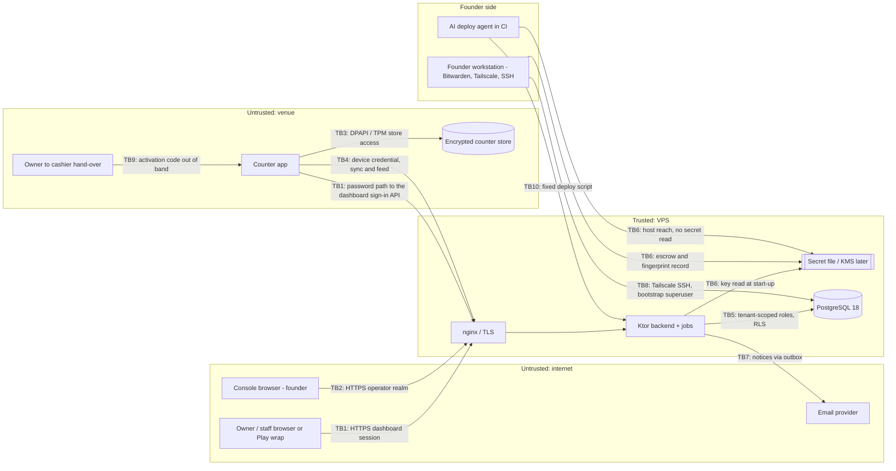

# Threat Model: Staff authentication, roles and the central counter PIN

> **Path**: `docs/architecture/threat-models/staff-auth.md`
> **Status**: Draft (verdict NOT ASSESSED: `tenancy.model` and `distribution.model` unset in `project.yaml`; no stack reference for the desktop runtime — see § 9)
> **Author**: `appsec-engineer` via `/threat-model` (STRIDE draft), `researcher` (requirement IDs), `privacy-compliance-specialist` (personal-data flows); reviewed and consolidated in the authoring session · **Reviewer**: security-lead (SL-THREAT-MODEL skipped - lean mode); independent review in a fresh session `review-2026-10-19-staff-auth.md` (CONCERNS, 0 blockers; fixes applied 2026-10-19)
> **Date**: 2026-10-19 · **Next review**: the M21/M22 research note landing (`--update`); the first auth, PIN or role spec or story; the desktop-runtime, key-custody, device-credential, sync, storage, owner-client or email-provider ADR; the KMS move; the first multi-counter venue; the first hire or first paying customer; an incident; and at the latest 2027-04-18
> **Feature spec**: none (`design/specs/` absent) · **Research note**: `docs/research/staff-auth-and-roles.md` (parts 1–4, § 5.0–5.5) · **ADRs**: ADR-0007 (Accepted 2026-10-19), ADR-0008 (Accepted 2026-10-19), ADR-0001 (as amended by both), ADR-0003, ADR-0004, ADR-0005 (as amended by ADR-0008); ADR-0001, ADR-0005, ADR-0007 and ADR-0008 also carry the dated amendments of this model's founder decisions (2026-10-19, § 7c); reviews `architecture-review-2026-10-19-adr-0007.md`, `architecture-review-2026-10-19-adr-0008.md`; registry `docs/registry/architecture.yaml`
> **Required because**: authentication · authorization model · admin/impersonation (operator console) · PII export/delete · new external integration (email provider, KMS later)
> **Standards**: OWASP ASVS 5.0.0 (May 2025; tag `v5.0.0`) — Level 3 for authentication and session, Level 2 elsewhere · OWASP API Security Top 10 2023 · OWASP MASVS 2.1.0 (tag `v2.1.0`, 2024-01-18) for the Play-wrapped dashboard only, at control level · NIST SP 800-63B-4 cited through the ADRs (not re-read, Q-reread)

<!-- Method: STRIDE per trust boundary + abuse cases (security-baseline.md). Requirement IDs looked up on 2026-10-19 in the
     official ASVS 5.0.0 CSV (sha256 98c8fe91...cdf680, origin in research F309), the API Security Top 10 2023 page and the
     MASVS v2.1.0 control files (URLs in § 8). Design-time: nothing is built, so every control is Planned and cites the
     ADR line that plans it (`000N:n` = line n of `docs/architecture/adr-000N-*.md` **at commit 7053ee2**, before the § 7c
     amendments shifted the lines; read with `git show 7053ee2:<path>`; RN = research note; TI / LIC = the tenant-isolation
     and licensing threat models). Citations added from now on use section references (for example "0007 § 3, M2"),
     not line numbers, so later amendments cannot shift them (founder 2026-10-19, re-check N1). -->

## 1. Scope

- **In scope** (agreed with the founder, 2026-10-19):
  - dashboard sign-in: passwords (Argon2id + pepper), TOTP and passkeys, recovery codes, email recovery, lost-factor reset, sessions and step-up (ADR-0007 §§ 1–5);
  - the operator console realm: interim synced passkey, recovery codes, the bootstrap-superuser lock-out script (ADR-0007 § 6);
  - the counter: device-local session, PIN sign-in and override approvals, the encrypted store (ADR-0007 § 7);
  - the central PIN (ADR-0008 § 10): enrol once, device-computed verifier, single-use upload facts and provenance, AEAD under per-tenant data keys, staff feed with tombstones, person lock at contact, PIN-not-in-password, activation code (item 11);
  - roles and permissions (ADR-0008 §§ 1–9): catalogue and limits, immutable owner role, last-owner guard, strict-subset rule, one-shot override, authority snapshot, activity trail and control journal;
  - key custody on the host (pepper, TOTP key, throttle-HMAC key, verifier master key, tenant data keys) and its later KMS move;
  - the founder workstation and the AI deploy agent in CI as actors on the server (founder addition, 2026-10-19).
- **Explicit inputs** (founder instruction 2026-10-19): ADR-0008 review findings B1, M5, M7, R1, R4 and § 10 item 11, and every residual accepted by name in ADR-0007 and ADR-0008 (linked in § 7).
- **Out of scope now — with the trigger that brings each in**:
  - **Owner-app on-device storage** (Play-wrapped PWA; MASVS beyond control level): the owner-client ADR after spike S11. T1.4 keeps the open token-storage question.
  - **Desktop runtime internals** (Compose Desktop or Electron): the desktop ADR; TB3 is modelled from F217, F218, F225 only.
  - **Device credential and key custody internals**: the device-credential and key-custody ADRs (spikes S41, S43).
  - **Tenant data isolation beyond auth**: `tenant-isolation.md` (cross-referenced as `TI <ID>`).
  - **Licence issuance and leases**: `licensing.md` (`LIC <ID>`).
  - **Sync protocol internals**: the sync ADR (OQ30).
  - **Billing**: no billing flow touches staff-auth.
- **Assumptions**:
  - Hosted multi-tenant only (brief decision log, 2026-10-16); tenancy `shared-schema-rls` per Accepted ADR-0001; `project.yaml` is set by `/setup-stack` later.
  - Backend Ktor 3.6.0 / Kotlin 2.4.21 (ADR-0006), Exposed 1.5.1, PostgreSQL 18.6.
  - Infrastructure as in TI § 1 (founder, 2026-10-18): one VPS (8 GB / 2 vCPU), nginx the only public listener, PostgreSQL unpublished, SSH over Tailscale from the founder's machine, deploys through an AI-agent CI with a fixed script that reads `deploy_rt`.
  - Email provider not chosen; assumed to have no inbound callbacks (T7.9 if it does).
  - The throttle-HMAC key lives in the secret file (assumed; 0007:158 lists it without a location).
  - Docker-group membership is root-equivalent (assumed; not sourced here).
  - Counsel questions are closed (founder, 2026-10-18); legal text is reported, never interpreted.
- **Actors**:
  - anonymous internet attacker (credential stuffing, phishing, bots);
  - authenticated dashboard user per role: owner, co-owner, manager or custom role, non-privileged staff;
  - cashier and approver at a shared counter; a dishonest insider; a venue Windows administrator;
  - malware on a counter PC;
  - a compromised counter (device credential in attacker hands);
  - Kodelix operator (one founder today) on the console;
  - **compromised founder workstation**: holds the Bitwarden vault with the interim console passkey, the Tailscale node and the SSH key, and runs the lock-out script as the bootstrap superuser (TB6, TB8);
  - **AI deploy agent in CI**: reaches the server that holds the pepper and verifier master-key files; must never see the deploy credential or any secret; can be prompt-injected through repository or log content (TB6, TB10);
  - email provider (outage or compromise); later the KMS provider;
  - a malicious tenant planting text in shared logs.

## 2. Assets

| ID | Asset | Classification | Owner (context) | Impact if compromised (C / I / A) |
|----|-------|----------------|-----------------|-----------------------------------|
| A1 | Password hashes (Argon2id PHC) and the pepper | secret | identity (PL `login_identities`) | C H / I H / A M |
| A2 | TOTP secrets (ciphertext) and the TOTP key | secret | identity (PL `second_factors`) | C H / I H / A M |
| A3 | Passkey public keys and credential ids; recovery-code hashes | confidential / PII (online identifier) | identity | C M / I H / A M |
| A4 | Reset tokens, sessions, step-up grants, WebAuthn challenges, enrolment assertions, upload receipts | secret | identity | C H / I H / A M |
| A5 | PIN verifiers: AEAD ciphertext on the server, plain PHC strings in device stores; upload facts | secret / PII | staff (TD `pin_verifiers`, `pin_upload_facts`) | C H / I H / A M |
| A6 | Verifier master key and per-tenant data keys (`tenant_data_keys`) | secret | staff / platform | C H / I H / A H |
| A7 | Activation codes (Argon2 hash; plaintext in the owner's hand-over channel) | secret | staff (`pin_activation_codes`) | C M / I H / A L |
| A8 | Roles, permissions, limits, assignments, authority snapshots, person locks | internal / PII when linked | staff (ADR-0008) | C L / I H / A M |
| A9 | Activity trail (tax, 5 years), control journal, security events | PII (pseudonymous ids) / internal | audit | C M / I H / A M |
| A10 | Owner contacts, recovery addresses, staff names and phones | PII | identity / staff | C M / I M / A L |
| A11 | Console credentials, operator sessions and step-up, console recovery codes | secret | operator realm (class OP) | C H / I H / A M |
| A12 | Founder workstation credentials: Bitwarden session, Tailscale identity, SSH key, bootstrap superuser credential | secret | founder | C H / I H / A H |
| A13 | The deploy pipeline's access to the server | secret | platform | C H / I H / A H |

## 3. Trust Boundaries & Data Flow

| ID | Boundary | Crosses | Authenticated by | Data crossing |
|----|----------|---------|------------------|---------------|
| TB1 | Browser / Play wrap ↔ backend (dashboard) | internet → app | password + TOTP or passkey; `__Host-` session cookie; per-action step-up (0007:170, 0007:177) | credentials, factors, recovery requests, role and staff edits, verifier confirmations, activation-code issue; the counter's password-path sign-in (username, password, TOTP or recovery code → enrolment assertion, 0007:210), throttled like any dashboard sign-in |
| TB2 | Console browser ↔ backend (operator realm) | internet → app | interim synced passkey with UV (0007:202); console step-up | operator sessions, control-plane and support-grant actions |
| TB3 | Counter app ↔ its encrypted store | process → Windows user profile | DPAPI user scope; TPM where present (0007:214) | plain PIN PHC strings, authority snapshot, staff records, person locks, unsynced trail |
| TB4 | Counter ↔ backend device channel | venue → app | device credential (credential ADR); lease | verifier uploads, staff feed (AEAD verifiers), lockout reports, redeems, trail batches |
| TB5 | Backend ↔ PostgreSQL | app → data | per-role credentials (`app_rt`, `device_rt`, `auth_lookup`, `job_rt`, `console_rt`), FORCE RLS, § 1c functions | every credential and authority row |
| TB6 | Backend ↔ secret file / KMS | app → key store | file permissions now; KMS credential later | pepper, TOTP key, throttle-HMAC key, master key |
| TB7 | Backend ↔ email provider and the notice job | app → internet | provider API credential | reset links, security notices, "not me" links |
| TB8 | Founder workstation ↔ database host | founder → data | Tailscale identity + SSH key; local peer login as bootstrap superuser | lock-out script runs, migrations, restores |
| TB9 | Owner ↔ cashier, out of band | person → person | none (the channel is human) | activation code |
| TB10 | CI deploy agent ↔ server | CI → app host | CI token; fixed deploy script | images, migrations, configuration; must carry no secret |

## 4. STRIDE Analysis per Boundary

Every High-impact row gives a one-line reason for both ratings; other rows give one where the rating is not self-evident. Every control is **Planned** unless stated; the cited line plans it. "New" marks a threat not in ADR-0007/0008 or their reviews. Residuals accepted by name are marked **(R#)** and listed in § 7.

### TB1 — Browser / Play wrap ↔ backend (dashboard)

| ID | STRIDE | Threat | Asset | Likelihood | Impact | Mitigation ID(s) |
|----|--------|--------|-------|-----------|--------|------------------|
| T1.1 | **S**poofing | Credential stuffing or brute force on password sign-in (planned: delays per identifier and address, NIST 100 ceiling 0007:164-165, dummy verify 0007:149, blocklist 0007:159) | A1, A4 | H — internet-facing, reused passwords | M — owner and privileged logins need a second factor | M1, M2, M22, M50 |
| T1.2 | Spoofing | Takeover of a password-only non-privileged staff login **(R5, 6.3.3 L2)** | A4, A10 | M | M — reaches only that role's branches; no step-up action | M1, M8, M22 |
| T1.3 | Spoofing | Real-time phishing of an owner's password + TOTP, step-up TOTP relayed too (Q-l3 open: owner on TOTP only, 0007:445) | A4 | M — owners on TOTP only are phishable (Q-l3 open) | H — owner closes, erases, grants support, issues codes, confirms verifiers | M5, M6, M22, M50 |
| T1.4 | Spoofing | Session token stolen and replayed (XSS, extension, shared phone); Play-wrap token storage undecided (S11) | A4 | M — no token-storage decision for the Play wrap yet (S11) | H — an owner session | M4, M42, M50 |
| T1.5 | Spoofing | Passkey assertion obtained from another origin through a parent-domain RP ID or a Related Origin Requests list (Q-domains open) | A3 | L — needs a domain-layout mistake (Q-domains) | H — phishing-resistant factor defeated | M5 |
| T1.6 | Spoofing | Cloned synced passkey accepted despite a counter regression ("accepted with an event", 0007:168) | A3 | L | M — the password is still needed | M46 |
| T1.7 | Information disclosure | Account enumeration through sign-in, forgot-password, passkey-first lookup or contact-verify responses and timing | A10 | M | M — target list | M1, M41 |
| T1.8 | Tampering | CSRF on state-changing requests; SameSite and Origin inside a WebView wrap unverified (0007:170) | A4, A8 | L — SameSite=Strict plus Origin and custom-header checks planned | H — owner actions | M4, M8 |
| T1.9 | Tampering | Mass assignment on role, staff, activation, confirm or reset endpoints (`is_owner`, `tenant_id`, limits, `confirmed`, fact kind, branch) | A8 | M — many write endpoints with owner-only fields | H — privilege escalation | M7, M8 |
| T1.10 | Tampering | Step-up grant or challenge reused for another action, target or session; TOTP replay; recovery code used as step-up (TOTP drift: recorded 6.5.5 deviation, 0007:167) | A4 | M — several step-up actions; binding is easy to get wrong | H — destructive owner actions | M6 |
| T1.11 | Tampering | A stolen session adds the attacker's factor or recovery address, or removes a factor (0007:171) | A2, A3, A10 | M — any stolen session can try it | H — persistent takeover | M42, M31, M50 |
| T1.12 | Tampering / Info | Reset link poisoned through a forged `Host`, or leaked through Referer, an nginx query log or history (0007:190) | A4 | L — base URL from configuration; ≤ 10 min link | H for accounts with no factor | M41, M29 |
| T1.13 | **R**epudiation | Owner or manager denies a role edit, temporary password, activation code, confirmation or factor reset; allowed decisions on non-privileged keys unlogged (recorded 16.3.2 L3 deviation, 0008:241) | A9 | M | M — disputes | M50, M45 |
| T1.14 | **I**nformation disclosure | An API, export or "my data" file returns verifier ciphertext, upload facts, code hashes, TOTP ciphertext or recovery-code hashes (0005:127 excludes them; `app_rt` has no SELECT, 0008:457) | A5, A7, A2 | L — `app_rt` has no SELECT on the credential tables | H — offline attack material | M8, M38, M44 |
| T1.15 | Information disclosure | Field-level leaks: staff phone without `staff.view_personal` (0008:143, 0008:234); tenant-level trail to a non-owner (0008:245); another user's session list (0007:170) | A10, A9 | M | M — PII | M8, M53 |
| T1.16 | Information disclosure | Cross-tenant IDOR: a person, role, device, pending verifier or code resolved by request id outside the session's tenant (tenant from the session, 0003:99; restrictive RLS, 0001:90-98) | A5, A7, A8 | M — every route takes person, role, device or code ids | H — another tenant's credentials | M8, M38 |
| T1.17 | **D**enial of service | Argon2id CPU and memory exhaustion: a credential-stuffing flood exhausts the 8 GB VPS without guessing anything; recovery- and activation-code checks queue the owner behind attacker work (bounded dispatcher 0007:149) | A4 | H | M — dashboard down; counters keep working offline | M22, M43, M1, M20 |
| T1.18 | Denial of service | **New.** Malicious lockout at the 100-failure ceiling; per-address delays on a CGNAT address shared by several venues slow other tenants' owners (cross-tenant DoS) | A4 | M | M — owner cannot sign in or step up | M2, M22, M50 |
| T1.19 | Denial of service | A crash or deploy restart clears the in-memory throttle state (accepted loss, 0007:165; *amendment 2026-10-20, accepted: per-known-login and per-signal failure state and blocks now persist in `login_failure_state`, so only per-address and unknown-identifier state is lost*) | A4 | L | M | M3, M43 |
| T1.20 | **E**levation of privilege | A login whose role gains a privileged key keeps working without a factor (catalogue migration flags a key privileged; no role edit ends sessions) | A8 | L | M | M42, M40 |
| T1.21 | Elevation of privilege | Strict-subset bypass: a custom role with `staff.manage` or `staff.reset_pin` acts on a peer or superset person; the database checks only "target is not an owner" (0008:192) | A8, A4 | M — custom roles make peer sets common | H — a manager resets another manager's credentials | M9, M8 |
| T1.22 | Elevation of privilege | Owner-only key stored in a custom role; owner role edited or deleted; second `is_owner` role inserted (0008:163, 0008:185) | A8 | L — owner-only writes plus a database constraint | H — anyone could gain owner powers | M38, M39, M7 |
| T1.23 | Elevation of privilege | Last-owner race: two owners disable each other (0008:194-209) | A8 | L — needs two owners acting at once | H — tenant unrecoverable | M39 |
| T1.24 | Elevation of privilege | Escape from the enrolment-only session state, or abuse of the no-step-up first-factor exception (0007:180-185) | A2, A3 | M — the exception is reachable after any full sign-in | H — attacker enrols their own factor | M42, M31 |
| T1.25 | Elevation of privilege | Lost-factor reset abused by a co-owner (or the owner against staff): after the delay the victim's factors go and the helper enrols their own (0007:193) | A2, A3 | L — needs a dishonest co-owner and a missed cancel link | H — the victim loses every factor | M31, M42, M50 |
| T1.27 | Spoofing / Repudiation | **New (review finding 5).** The `staff.manage` holder who issues a temporary dashboard password (0007:192) signs in with it first, sets the "lasting" password and acts as that person | A1, A4 | L — needs a dishonest issuer and a target who has not yet signed in | M — that person's role only; the issuer is on record | M55, M50 |
| T1.28 | Elevation of privilege | **New (review finding 16; 0008:547, 0008:651).** An edit to a role many people hold silently widens every holder's authority (a key added or a limit raised) | A8 | L — owner-only, step-up (0008:184) | M — every holder gains the authority at once | M40, M50 |
| T1.29 | Spoofing | **New (review finding 16; 0008:368).** A stolen owner session issues activation codes or remote resets | A7 | L — needs a stolen owner session and a fresh step-up | M — non-privileged people only; owner notice on issue and use | M6, M48, M49 |
| T1.26 | Information disclosure | **New (founder input M22).** The breached-password check sends the password, or a full unsalted hash of it, to a third party | A1 | L — only if a third-party API is chosen naively | H — the password leaves the server | M22 |
| T1.30 | Spoofing | **New (M21 research, amendment 2026-10-20).** Cross-device consent phishing: malware on a counter, or someone calling the owner, starts an approve-on-phone request and talks the named person into approving it from their phone (RFC 10027 BCP 247 § 4; research F110, F115) **(R25)** | A5, A4 | M — the RFC 8628 pattern is publicly documented as phishable; BCP 247 advises against it for high-value resources | H — whoever is at that counter then sets a PIN in the approver's name valid on every counter of their branches | M21, M50 |

### TB2 — Console browser ↔ backend (operator realm)

| ID | STRIDE | Threat | Asset | Likelihood | Impact | Mitigation ID(s) |
|----|--------|--------|-------|-----------|--------|------------------|
| T2.1 | **S**poofing | The interim synced passkey in the founder's Bitwarden used or exported by whoever controls the vault or browser **(R6, 6.3.3 L3 / AAL3)** | A11 | M — reachable from the founder workstation (TB8) | H — control plane, licensing logins, support-grant requests for every tenant | M34, M36, M50 |
| T2.2 | Spoofing | Bitwarden reports UV without a real user check (NOT SOURCEABLE until the spike, 0007:71), so malware in an unlocked session signs in | A11 | M — UV behaviour of the Bitwarden passkey is unverified (spike pending) | H — silent console sign-in | M34 |
| T2.3 | Spoofing | Console recovery codes (offline copy) stolen | A11 | L — kept offline and apart | H — console access | M34, M36 |
| T2.4 | Spoofing | Cross-realm use: a dashboard passkey, session or sibling-domain page satisfies the console (0007:144) | A11 | L — separate host and RP ID | H — console access from a lower realm | M5, M34 |
| T2.5 | Spoofing | A second operator uses another's id (ADR-0004 § 10 open; TI T5.2) | A11 | L — one operator today | H — actions misattributed across operators | M34 |
| T2.6 | **T**ampering | CSRF or XSS against the operator triggers suspend, end-all, seat or licence actions (LIC T3.7) | A11 | L — one operator, `__Host-` cookie, step-up | H — every venue | M4, M6, M34 |
| T2.7 | Tampering | One console step-up grant reused across actions or targets (bulk suspend) | A11 | L — grants are single use and bound | H — one grant suspends many tenants | M6, M34 |
| T2.8 | **R**epudiation | A console sign-in or action leaves no record or alert (0007:236, 0007:479) | A9 | M | M | M50, M34 |
| T2.9 | **I**nformation disclosure | The console process calls `support_rt`, the licensing logins or `platform_rt` without a live OP session (0007:200) | A8, A10 | L — the console calls are few and reviewed | H — any tenant's licensing data | M34 |
| T2.10 | Information disclosure | `console_rt` gains a grant on TD/CP/PL, or another role on OP (0001:302 C6) | A11 | L — catalogue check C6 in CI | H — tenant data from the console role | M38, M34 |
| T2.11 | **D**enial of service | Every console credential lost or UV fails, so the lock-out script becomes routine; suspensions and moves stall (LIC T3.6) | A11 | M | M | M35, M34 |
| T2.12 | **E**levation of privilege | A console session outlives the AAL3 ceilings, or a BE=1 credential stays accepted after the FIDO2 keys arrive | A11 | L — compiled ceilings | H — console access beyond AAL3 limits | M34, M51 |
| T2.13 | Elevation of privilege | A future "help the owner" feature gives Kodelix a path to an owner credential (0007:194; FP-OWNER-IMPERSONATION) | A4, A2 | L — no such feature planned (FP-OWNER-IMPERSONATION) | H — a path to every owner account | M34 |

### TB3 — Counter app ↔ its encrypted store (Windows user, DPAPI/TPM)

Desktop stack reference: **NOT SOURCEABLE — no stack reference for the desktop runtime** (Compose Desktop vs Electron undecided). Rows rest on research F217, F218, F225.

| ID | STRIDE | Threat | Asset | Likelihood | Impact | Mitigation ID(s) |
|----|--------|--------|-------|-----------|--------|------------------|
| T3.1 | **I**nformation disclosure | A stolen store or disk copy is searched offline for the weakest branch verifier, approvers and owner included **(R12, F421)** | A5 | M — counters are stolen or resold | H — an approver PIN approves on every counter of the branch | M52, M16, M50 |
| T3.2 | Information disclosure | A Windows administrator or malware in the cashier's session reads the DPAPI user-scope store (`safeStorage` does not protect against same-user apps, F225) | A5, A10 | M — the counter "is not a security boundary" (0008:105) | H — every branch verifier and personal field | M52 |
| T3.3 | **S**poofing | PIN-in-password: a cracked PIN opens the dashboard after a later password change contains it, or a sponsored PIN equals the password **(R11)** | A1, A5 | L | M — privileged logins still need a second factor | M42, M52 |
| T3.4 | Spoofing | Guessing spread across offline counters, ~10 tries per device, counted only at contact **(R9, aggregate lockout budget)** | A5 | M | M — a cashier gains a manager's approvals | M15, M50 |
| T3.5 | **T**ampering | A store restore on a PC without a TPM resets the lockout counter offline **(R1)** | A5 | M | M | M52, M50 |
| T3.6 | Spoofing | Observed PIN: a co-worker watches an approver type their PIN and later approves in their name **(R16, new)** | A5 | H | M — actions within the approver's limits | M16, M24 |
| T3.7 | Tampering | An administrator edits the authority snapshot, staff status, person locks, temporary-PIN rows or verifier rows (a planted PHC string; review finding 16, 0008:656) to act beyond authority or as another person offline (8.3.2 revert→review deviation) | A8 | M | M — money facts flagged at sync, never refused | M52, M40, M50 |
| T3.8 | Tampering | Windows clock set back to shorten delays or extend a temporary PIN or snapshot age (lease clock ignores rollback, F217) | A5 | M | L | M23 |
| T3.9 | **R**epudiation | An administrator or malware erases the unsynced tail of the trail (F323; accepted gap 0008:532) | A9 | M | M | M45 |
| T3.10 | Repudiation | Shared Windows account: actions taken in a colleague's walk-away session before the idle lock **(R20, walk-away residual; ASVS 7.3.1)** | A9 | H | M — wrong attribution | M25 |
| T3.11 | Information disclosure | A lost device that never syncs keeps every branch person's verifier and personal fields **(R14, R-7 widened)** | A5, A10 | M | M | M52, M50 |
| T3.12 | Information disclosure | **New.** On the password path, counter malware captures the dashboard password plus TOTP or recovery code and replays them first; owners can enrol only this way (nobody sponsors an owner; activation codes are non-privileged only) **(R15: closes for approvals on a second device once M21 ships and the password path is refused for privileged people, amendment 2026-10-20, accepted; same-device approval stays open, T3.21)** | A1, A2, A3 | M — venue PCs run untrusted software | H — owner dashboard takeover from a venue PC | M21, M22, M50 |
| T3.13 | **D**enial of service | An approver is locked on one counter by override-dialog failures **(R2, 6.1.1)** | A5 | M | M | M50, M24 |
| T3.14 | Denial of service | A corrupt or deleted store denies every sign-in on that counter (no control stated; desktop ADR) | A5 | L | M | M52 |
| T3.15 | **E**levation of privilege | Under Electron, renderer code reaches the store or the checks without the main-process bridge (NOT SOURCEABLE, RN:448) | A5, A8 | M | M | M52 |
| T3.16 | Elevation of privilege | The one-shot elevation persists beyond one action, or a temporary PIN is used as a lasting one (0007:221, 0008:302) | A8, A5 | L | M | M24, M23 |
| T3.17 | Spoofing / Repudiation | **New (review finding 5).** The sponsor or resetter who saw a temporary PIN (0007:211, 0007:230) enters it first, sets the "lasting" PIN and approves or sells in that person's name | A5 | M — the issuer stands at the same counter | M — the person's authority; non-privileged after M11 | M55, M16 |
| T3.18 | Denial of service | **New (review finding 6).** A `staff.suspend_local` holder suspends an approver on the counter, at once, to block approvals (0007:228) | A8 | M — offline, effective at once | M — approvals stop on that counter until lifted | M56, M50 |
| T3.19 | Elevation of privilege | **New (review finding 16; 0008:193, 0008:651).** Self-approval: the requester approves their own override (on the device, or by a forged fact) | A8 | L — refused on the device and flagged at sync | M — limits bypassed once | M24 |
| T3.20 | Information disclosure | **New (`cto`, Q-counteronly, 2026-10-20).** Same PIN on every counter: a person who has a pending slot on several counters may type the same PIN on each, and nothing can compare them because the server never sees a PIN; one store cracked offline then gives that PIN for every counter **(R23)** | A5 | M — people reuse one PIN, and counter stores are stolen or resold | M — the person's authority on every counter of their branches, until reset required | M57, M52, M16 |
| T3.21 | Spoofing | **New (M21 research).** Same-device approval: the owner opens the dashboard in a browser on the counter PC itself to approve an approve-on-phone request, which puts the password and second factor back on the venue PC (the T3.12 path; Q-samedevice open) | A1, A2 | M — the easiest thing for an owner standing at the counter | H — owner dashboard takeover from a venue PC | M21, M50 |

### TB4 — Counter ↔ backend device channel

| ID | STRIDE | Threat | Asset | Likelihood | Impact | Mitigation ID(s) |
|----|--------|--------|-------|-----------|--------|------------------|
| T4.1 | **S**poofing | **(B1)** A compromised counter uploads a sponsor, counter_reset or self_change verifier with a PIN it knows, for any branch person (kept on the minting device until confirmed, 0008:290-300) | A5 | M | M — never beyond the minting device for privileged people | M12, M11, M50, M57 |
| T4.2 | Spoofing | **(R1 of the ADR-0008 review, path ii)** The owner is socially engineered into confirming a planted pending verifier, which then goes fleet-wide (0008:293-297) | A5 | M — owners trust staff who ask in person | H for privileged people → M after M11 (no confirmation for privileged people) | M11, M10 |
| T4.3 | Spoofing | **(item 11 / L-R11)** The counter where an activation code is redeemed substitutes its own verifier, which is confirmed fleet-wide (non-privileged only, 0008:345, 0008:371) | A5, A7 | M | M | M48, M50 |
| T4.4 | Spoofing | Online guessing of activation codes from a lease-valid counter (floor 8 characters, per-code ceiling 10, 0008:349-357) | A7 | L | M | M48, M20 |
| T4.5 | Spoofing | A password-path enrolment assertion replayed or presented by another device credential (0007:210) | A4 | L | M | M12 |
| T4.6 | **D**enial of service | **(M7)** Widened malicious lockout: failures on one or more counters person-lock an approver or the owner everywhere **(R8, 6.1.1 widened)** | A5 | M | M — no approvals anywhere | M15, M50 |
| T4.7 | **T**ampering | **(M7; success-clearing case new)** Forged or suppressed lockout reports, or a "success" that clears another device's failures so the sum never trips | A5 | L | M | M15, M50 |
| T4.8 | Tampering | Upload replayed or reordered with a stale `verifier_version` (0008:299-300) | A5 | L | M | M12, M17, M57 |
| T4.9 | Tampering | The device chooses `confirmed` or a server-checked fact kind (0008:457, 0008:462) | A5 | L — the trigger takes `confirmed` from the fact kind | H — planted fleet-wide verifier | M12 |
| T4.10 | Tampering | A `password_assertion` fact checked in the application only (0008:461); a sync bug or backend compromise inserts one without a consumed assertion | A5 | L — needs a sync-endpoint bug or backend compromise | H — a planted, confirmed verifier fleet-wide | M13 |
| T4.11 | Tampering | Forged override facts naming a real, in-authority approver pass every server flag **(R19)** | A9, A8 | M | M — money within limits; the approver is blamed | M16, M50 |
| T4.12 | Tampering | Feed parameters outside the floor or ceiling, to weaken or exhaust a device (0008:320) | A5 | L | M | M18 |
| T4.13 | **R**epudiation | An approver repudiates approvals made with their PIN (0008:218 records both ids) | A9 | M | M | M16, M45 |
| T4.14 | **I**nformation disclosure | Staff feed delivers a verifier outside scope: another tenant's, an unassigned branch's, to a revoked or lease-expired device, or an unconfirmed one beyond its minting device (AAD 0008:305) | A5 | L — feed scoped by credential and AAD | H — cross-tenant credentials | M18 |
| T4.15 | Information disclosure | **(R4, founder choice)** While a new PIN is pending, the old (possibly leaked) PIN stays valid on every other counter until the owner issues "reset required" (0008:316) **(R17)** | A5 | M | M | M11, M50 |
| T4.16 | Information disclosure | Stale verifiers and records on devices with no contact after a disable, transfer or erasure (bounded by the lease) | A5, A10 | M | M | M18, M50, M53 |
| T4.17 | Information disclosure | Typed redeem refusals (`privileged`, `wrong_branch`) reveal who holds privileged keys (0008:436) | A8 | L | L | M19 |
| T4.18 | Denial of service | Floods of uploads, lockout reports, redeems or trail batches | A5 | M | M | M20 |
| T4.19 | **E**levation of privilege | **New.** A person gains a privileged key between `PinActivation.redeem` and the upload; the activation fact still confirms, so a counter-chosen verifier goes fleet-wide (checked at issue and redeem only, 0008:345) | A5, A8 | L — needs a promotion inside the code's lifetime | H — a counter-chosen approver PIN fleet-wide | M14 |
| T4.20 | Elevation of privilege | `device_rt` reaches a password or factor lookup, or a dashboard route accepts a device credential (0007:361) | A1, A2 | L — `device_rt` has no such grant | H — credential lookups from a venue device | M38, M8 |
| T4.21 | Elevation of privilege | An override runs in Restricted mode before Q-restricted is decided (0008:223) | A8 | L | M | M24 |
| T4.22 | Tampering | **New (review finding 6).** A compromised counter uploads a forged local suspend or lift fact (the lifter's PIN cannot be checked by the server) | A8 | L — needs a compromised counter | M — a suspended person acts again, or approvers are blocked | M56, M9 |
| T4.23 | Information disclosure | **New (review finding 16; 0008:660).** Verifiers, salts or PINs reach device or server logs, crash reports or traces | A5 | L — ids-only logging is planned | H — offline attack material for every logged person | M29, M44 |
| T4.24 | Tampering | **New (review finding 16; 0008:220).** A device backdates a fact's claimed time to before a demotion so `approver_authority_changed` is not set | A8 | L — claimed time is on the lease clock | M — one approval judged against old authority | M23, M40 |
| T4.25 | Denial of service | **New (`cto`, Q-counteronly, 2026-10-20).** Cross-counter eviction: with one compare-and-set per person, a sponsored or self-change upload from counter 2 is refused as `stale_version` or, retried with the current version, removes counter 1's pending PIN; a compromised counter can wipe an approver's pending PINs elsewhere | A5 | M — any multi-counter enrolment hits it, no attacker needed | M — approvals stop on the other counters until re-enrolment | M57 |
| T4.26 | Tampering | **New (`postgres-specialist`, 2026-10-20).** Code running as `device_rt` with SQL access calls `set_config('app.device_id', …)` mid-transaction, so a fact names another device's slot **(R24)** | A5 | L — needs SQL execution as `device_rt`, which already defeats `app.tenant_id` | M — writes into another device's slot of the same tenant; a slot still needs a matching fact | M57 |

### TB5 — Backend ↔ PostgreSQL

| ID | STRIDE | Threat | Asset | Likelihood | Impact | Mitigation ID(s) |
|----|--------|--------|-------|-----------|--------|------------------|
| T5.1 | **S**poofing | An application compromise mints sessions or harvests verifiers; the pepper in memory makes harvested hashes crackable (TI T4.1/T4.2; TI residuals R-2/R-3) | A1, A4 | L — needs remote code execution in the backend | H — every tenant's sessions and hashes | M50, M26 |
| T5.2 | **T**ampering | New § 1c or `audit_writer` functions with unpinned `search_path`, PUBLIC EXECUTE or a wrong grant; `auth_lookup`'s narrow TD-read exception widened (0001:295, C5) | A4, A8 | L — privileged migrations only, C5 check | H — pre-context bypass | M38 |
| T5.3 | Tampering | `Recovery.markFactorPassed(handle)` callable by `app_rt` without proof a factor was verified (RV7 R4) | A1 | L — needs an application bug skipping the factor check | H — owner reset by a mailbox holder if the app skips the check | M41 |
| T5.4 | Tampering | The deferred last-owner trigger runs as the queuing role under FORCE RLS (PG 18); a missing or wrong context at commit miscounts (0008:75) | A8 | L — tested as both roles under FORCE RLS | H — a tenant left with no owner | M39 |
| T5.5 | Tampering | The closure exception misused: `job_rt` deletes an owner on an active tenant (0008:208) | A8 | L — `job_rt` paths are few and tested | H — an active tenant loses its owner | M39 |
| T5.6 | **E**levation of privilege | **New.** `PinVerifiers.confirm` has no catalogue key and no database guard, and the `dashboard_reset` insert (held by `staff.reset_pin`, 0008:146, 0008:174) is checked in the application only; `app_rt`, which every dashboard user runs as, holds UPDATE on `confirmed` and INSERT on `dashboard_reset` (0008:463) | A5 | M — one missing check in the app is enough, since every dashboard user runs as `app_rt` | H — a bug lets a manager confirm a planted verifier fleet-wide, or reset a peer's PIN | M10, M9 |
| T5.7 | Tampering | The trail written outside its functions, updated, forked by concurrent appends, or pruned below the floor (0008:239-248) | A9 | L | M | M45, M38 |
| T5.8 | Tampering | An authority change committed without an `authority_version` increment (0008:229) | A8 | M | M — devices act on stale authority unflagged | M40 |
| T5.9 | Tampering | **New.** A restore revives PIN and activation state: the restore step (0007:173) omits codes, upload facts, verifier versions, person locks and sums; the control-journal kinds (0008:259) omit verifier changes, code issue/use and lock/unlock. A used code is redeemable again within 72 h; a retired PIN is redelivered; locks are lost | A5, A7 | M — restores happen in normal operations | H — a leaked approver PIN valid again everywhere | M17, M37 |
| T5.10 | **R**epudiation | Restore gap: trail rows and acknowledged chain heads newer than the backup are lost (0008:250; storage or sync ADR to decide) | A9 | M | M | M45 |
| T5.11 | Repudiation | The trail stays in the primary database, editable by a superuser or a host compromise **(R13, 16.4.3 partial)** | A9 | L | M | M45 |
| T5.12 | **I**nformation disclosure | A database-only leak yields peppered hashes, AEAD ciphertext, wrapped keys and salted code hashes (0007:150, 0008:305-310) | A1, A2, A5, A6 | L | L while the keys stay off the database and its backups | M26 |
| T5.13 | Information disclosure | **(M5, founder choice 0008:308)** Deleting the tenant key at `purge_personal` removes live access only; backups keep the wrapped key and ciphertext 30 days and the master key outlives the tenant **(R18)** | A5, A6 | L | M | M26 |
| T5.14 | Information disclosure | Views over the new TD tables without `security_invoker`, materialized views, or tenant-unscoped unique keys as an oracle (`postgres/best-practices.md` § 1) | A8, A5 | L — catalogue check C8 | H — cross-tenant | M38 |
| T5.15 | **D**enial of service | Advisory-lock order (journal → trail → last-owner) violated: deadlocks on disable or erase (0008:206, 0008:240) | A8, A9 | L | M | M39 |
| T5.16 | Elevation of privilege | Owner-only tenant settings (PIN floors, `override_offline_max_age`) written by a non-owner (0008:600) | A8 | L | M | M47 |
| T5.17 | Elevation of privilege | Rotation, rewrap or `markMustReset` jobs carry one tenant's key or context into the next (0001:119) | A6 | L — one tenant per transaction | H — cross-tenant keys | M27 |
| T5.18 | Repudiation | **New (privacy F5).** No record shows that the owner accepted the processing terms, which notice staff were given, or the declared basis per flow (REG Art 2 Second 3; Art 4 First 2), so neither controller nor processor can show lawful processing | A10, A9 | M | M — regulatory exposure; no data loss | M54 |

### TB6 — Backend ↔ secret file / KMS (actors include the founder workstation and the CI deploy agent)

| ID | STRIDE | Threat | Asset | Likelihood | Impact | Mitigation ID(s) |
|----|--------|--------|-------|-----------|--------|------------------|
| T6.1 | **I**nformation disclosure | Pepper, TOTP key, throttle-HMAC key and master key in an encrypted file on the same VPS as the database **(R4, 13.3.1)** | A1, A2, A6 | L — needs host access | H — with a database copy, every tenant's passwords and PINs | M26, M28, M36 |
| T6.2 | Information disclosure | Keys in process memory leak through heap or core dumps, `/proc`, crash reports or the instrumentation agent **(R3, 13.3.3)** | A1, A2, A6 | M — dumps and agents are common leak paths | H — every key in memory | M26, M29 |
| T6.3 | Information disclosure | A database-and-key or running-server compromise exposes every verifier; rotation is no remedy **(R12b, F422)** | A5, A6 | L — needs both stores | H — all tenants | M26, M50 |
| T6.4 | **T**ampering | The secret file replaced with attacker-known keys during a deploy or host compromise (no control today) | A1, A6 | L — needs host or deploy access | H — silent | M26 |
| T6.5 | Tampering | Rotation errors: rewrap under the wrong key; an early pepper deadline marks every row `must_reset` (0007:153) | A1, A6 | L | M | M27 |
| T6.6 | **R**epudiation | Key use, rotation and `must_reset` runs leave no record | A9 | M | M | M50 |
| T6.7 | Information disclosure | Keys copied into an image layer, backup, repository, CI log or the agent's transcript (0007:352) | A6, A1 | L — Docker secrets, never in images | H — keys leave the host | M26, M28 |
| T6.8 | **D**enial of service | Secret file missing, or KMS unreachable later, at start-up: no sign-in and no feed (counters continue) | A1, A6 | L | M | M26, M50 |
| T6.9 | Denial of service | Key loss with no escrow: every password reset and every PIN re-enrolled (no control today) | A1, A6 | L — needs loss of host and its backups | H — every password and PIN reset | M26 |
| T6.10 | **E**levation of privilege | Another container or user on the host reads the secret mount (TI M19, M65) | A6 | L — one backend container mounts the secret | H — every key | M26, M28 |
| T6.11 | **S**poofing | Now: N/A as a distinct path — the file has no caller authentication, so a process "posing as the backend" is T6.10. At the KMS move: a spoofed KMS endpoint or a stolen KMS credential unwraps the pepper | A1, A6 | L — not reachable until the KMS move | H — the pepper unwrapped | M26 |

### TB7 — Backend ↔ email provider and the notice job

| ID | STRIDE | Threat | Asset | Likelihood | Impact | Mitigation ID(s) |
|----|--------|--------|-------|-----------|--------|------------------|
| T7.1 | **S**poofing | Phishing that imitates reset, security or "second factor pending" mail (no SPF, DKIM or DMARC yet, F121) | A4, A10 | M | M | M30, M22 |
| T7.2 | Spoofing | Reset sent to an unverified or recently changed address (0007:171) | A4 | L — verified address and change delay | H — account takeover by reset | M41 |
| T7.3 | **I**nformation disclosure | Reset or "not me" link exposed at the provider (compromise, click-tracking redirectors, forwarding) | A4 | M | M — accounts with a factor still need it | M30 |
| T7.4 | Information disclosure | A notice sent to another tenant's owner contacts (0007:172) | A10 | L — the job runs in one tenant's scope | H — cross-tenant | M32 |
| T7.5 | Information disclosure | Notice content carries codes, extra links, names or promotional text (0008:360) | A7, A10 | L | M | M29, M30, M44 |
| T7.6 | **R**epudiation | No delivery record shows the owner was told | A9 | M | M | M31, M50 |
| T7.7 | **D**enial of service | **New.** Provider outage: no recovery possible, and the cancel link for a lost-factor reset or delayed factor removal is never seen, yet the change applies after the delay (0007:193) | A2, A3 | M — provider outages happen | H — the co-owner takeover path goes unnoticed | M31 |
| T7.8 | Denial of service | Email bombing through forgot-password or contact-verify; send limits live in memory and reset on restart | A10 | M | M | M33, M3 |
| T7.9 | **T**ampering | (Assumed; provider not chosen) forged bounce or complaint callbacks suppress notices | A10 | L | M | M30 |
| T7.10 | **E**levation of privilege | The provider credential leaks and is used to send mail as Kodeebo | A10 | L | M | M30, M26 |
| T7.12 | Denial of service | **New (review finding 7).** A mail-security scanner or link prefetch opens the "not me" link while the owner is signing in, ending the owner's own attempt and blocking their password path | A4 | M — many providers open links automatically | M — owner blocked from the password path; passkey still works | M22 |
| T7.11 | Denial of service | **New (founder input M22).** A mailbox holder, or a forwarded notice, uses the "not me" action to block an owner's password path | A4 | L | L — passkey and recovery-code sign-in stay open (M2); a reset with a factor unblocks | M22, M2 |

### TB8 — Founder workstation ↔ database host

| ID | STRIDE | Threat | Asset | Likelihood | Impact | Mitigation ID(s) |
|----|--------|--------|-------|-----------|--------|------------------|
| T8.1 | **S**poofing | A compromised workstation runs the lock-out script and registers an attacker passkey (audited, 0007:203; TI M64) | A11, A12 | L — needs the founder workstation | H — console access | M35, M36, M50 |
| T8.2 | **I**nformation disclosure | **New.** The single-use registration link lands in shell history, scrollback, clipboard or logs (delivery unspecified) | A11 | L — single short-lived link | H — console registration | M35 |
| T8.3 | **T**ampering | The superuser edits OP rows, the journal or events by hand, or touches tenant credentials; "OP only" is procedural (0001:116) | A11, A9, A1 | L — one trusted person today | H — silent changes to credentials or records | M35, M50 |
| T8.4 | Tampering | The lock-out script altered to add a backdoor credential (no control today) | A11 | L — script in the repository | H — a lasting backdoor | M35, M28 |
| T8.5 | **R**epudiation | A script run leaves no off-host trace (0007:203 plans an off-host line) | A9 | L | M | M50 |
| T8.6 | Information disclosure | The superuser reads credential rows while the same host holds the secret file (TI M49) | A1, A5, A6 | L — superuser use is rare and local | H — hashes and keys together | M36, M26 |
| T8.7 | **D**enial of service | Tailscale or workstation loss: no lock-out, migration or restore path | A11 | L | M | M36, M26 |
| T8.8 | **E**levation of privilege | Purpose creep: the superuser becomes a break-glass for tenant credentials (0007:194) | A4 | L — forbidden by ADR-0007 | H — Kodelix gains owner access | M35 |

### TB9 — Owner ↔ cashier out of band (activation-code hand-over)

| ID | STRIDE | Threat | Asset | Likelihood | Impact | Mitigation ID(s) |
|----|--------|--------|-------|-----------|--------|------------------|
| T9.1 | **S**poofing | The code is intercepted (chat, photo) and redeemed first by an insider at a lease-valid counter **(R21)** | A7 | M | M — the insider sets a non-privileged person's PIN | M48, M49, M50 |
| T9.2 | Spoofing | The owner is socially engineered into issuing a code or a remote reset of an existing person (replaces that PIN fleet-wide, 0008:347) **(R21)** | A7 | M | M | M49, M50 |
| T9.3 | **T**ampering | Code given to the wrong person or reused from chat history (0008:353) | A7 | M | L | M48 |
| T9.4 | **R**epudiation | Cashier or owner denies issue or use (0008:360) | A9 | L | L | M45 |
| T9.5 | **I**nformation disclosure | The code persists in chat backups until used or expired (24 h default, 72 h ceiling) | A7 | M | L | M49 |
| T9.6 | **D**enial of service | An insider redeems a remote-reset code first and locks the real person out | A7, A5 | M | M | M48, M50 |
| T9.7 | **E**levation of privilege | N/A - privilege is checked server-side at issue, redeem and (after M14) upload; the human channel carries no authority of its own. See T4.19 | — | — | — | — |

### TB10 — CI deploy agent ↔ server (holds the pepper and master-key files)

| ID | STRIDE | Threat | Asset | Likelihood | Impact | Mitigation ID(s) |
|----|--------|--------|-------|-----------|--------|------------------|
| T10.1 | **T**ampering | Prompt injection through repository or log content makes the agent weaken auth configuration (Argon2, UV, ceilings), skip the catalogue check or enable a forbidden path (TI M63; TI R-4) | A13, A1 | M — the agent reads untrusted repository and log text | H — every tenant | M28, M51 |
| T10.2 | **I**nformation disclosure | The agent reads the key files, the backend environment (`docker inspect`, `/proc/<pid>/environ`) or a dump, and the secret reaches its transcript at the AI provider (breaks the TI R-4 rule) | A6, A1, A13 | M — the agent runs commands on the host | H — secrets at the AI provider | M28, M26 |
| T10.3 | Information disclosure | **New.** Tenant free text (role labels, reasons, venue or staff names, typed identifiers) reaches logs the agent reads; a tenant plants instructions there (cross-tenant injection channel) | A10, A13 | M — tenant text reaches logs by default | H — tenant text steers deploys | M29, M28 |
| T10.4 | **S**poofing | A stolen CI token runs the fixed deploy script with attacker inputs | A13 | L — CI token scoped to the fixed script | H — attacker-chosen deploy | M28 |
| T10.5 | Tampering | The agent commits changes to the lock-out script, a privileged migration or an `auth_lookup` function (C5 privileged mark) | A11, A4 | L — commits reviewed | H — weakened auth code shipped | M28, M38, M35 |
| T10.6 | **R**epudiation | Agent and founder deploy actions cannot be told apart (no control today) | A9 | M | M | M28 |
| T10.7 | **D**enial of service | Repeated deploys or restarts reset the throttle state and interrupt sign-in (0007:165) | A4 | M | M | M3, M28 |
| T10.8 | **E**levation of privilege | The agent's host account is in the docker group or has wide sudo (assumed root-equivalent) | A13, A6 | M — docker-group membership is a common default | H — root on the host | M28 |

### Cross-tenant coverage (SL-THREAT-MODEL check 4)

| Prompt | Coverage |
|---|---|
| Guessing or enumerating IDs | T1.7, T1.16, T4.17, AB22 |
| Shared caches and cache keys | T1.18 — the throttle is keyed on an HMAC of identifier or address, not the tenant, so venues behind one CGNAT address share a delay (M2: the per-address delay never alone blocks a known identifier). No cache of decrypted verifiers (0008:312); unwrapped tenant keys live per feed build (T5.17) |
| Queues, outbox, consumers that lose the tenant | T7.4 (`auth_notices`); T4.14 (staff feed); T4.7 (lockout reports); T4.9/T4.10 (upload facts); trail batches keyed by the device credential (0008:239) |
| Search indexes | N/A - no search index in ADR-0007/0008 |
| Exports and reports | T1.14 (credential tables excluded, 0005:127); T1.15 |
| Background and scheduled jobs | T5.17, T6.5 (rotation, rewrap, `markMustReset`); T7.4 (notice job); T5.5 (closure) |
| Object-storage keys and signed URLs | N/A - no object storage in staff-auth; the nearest analogue, the reset link, is T1.12 and T7.3 |
| Admin and impersonation paths | T2.1–T2.13, T8.1–T8.8; no impersonation path exists (T2.13) |
| Webhooks routed by a client-supplied id | N/A - no inbound webhook; device uploads and redeems carry a person id that must resolve inside the credential's tenant (T4.14, T1.16); provider callbacks assumed absent (T7.9) |
| Telemetry leaking another tenant's data | T10.3, T7.5 (M29, M44) |

### Stack-reference prompts

- `docs/stack-reference/postgres/best-practices.md` § 1: RLS bypass roles and ENABLE+FORCE on the new TD tables (T5.14, M38); `security_invoker` views and the unique-key covert channel (T5.14); transaction-local context at commit for the deferred trigger (T5.4).
- Redis / Dragonfly § 7: N/A - throttle state is in process memory (0007:165); no cache engine in this design.
- `.claude/rules/mongo-data.md`: N/A - no Mongo.
- `.claude/rules/deploy.md` (secrets via Docker secrets or 0600 files outside the repo): T6.7, T6.10, T10.2 (M26).
- `.claude/rules/integrations.md` (adapter, timeouts, outbox, provider tests, egress): TB7. SSRF: N/A - no user-supplied URL; the reset base URL comes from configuration.
- `.claude/rules/security-sensitive.md` (admin step-up, append-only audit, constant-time compare): TB2, M6, M50.
- Desktop runtime: **NOT SOURCEABLE - no stack reference for the desktop runtime**; TB3 rests on research F217, F218, F225.

## 5. Abuse Cases (business-flow abuse)

| ID | Abuse case | Actor | Goal | Detection | Mitigation ID(s) |
|----|-----------|-------|------|-----------|------------------|
| AB1 | Credential stuffing or password spraying | Internet attacker / bot | Take over factorless staff logins; or exhaust the VPS through Argon2id | `signin_attempt_total` spike; credential-stuffing alert (0007:479); admission-queue saturation | M1, M2, M22, M43, M50 |
| AB2 | Owner password + TOTP phished in real time, step-up relayed | Internet attacker | Close, erase, export, issue codes | New-device owner alert (TI M31); "second factor pending" notice (M22); `stepup_total` anomaly | M5, M6, M22, M50 |
| AB3 | Stolen owner session adds an attacker factor or recovery address | Session thief | Persistent takeover | Change notices to every owner contact | M42, M31 |
| AB4 | Repeated resets by a mailbox holder | Social engineer | Lock the owner out | `recovery_total`; owner notice (the factor check blocks the change) | M41, M33 |
| AB5 | Co-owner abuses the lost-factor reset, then removes the other owner | Co-owner | Take the tenant | "Any owner recovery or lost-factor reset" alert (0007:479); cancel link, delay from provider acceptance (M31) | M31, M42, M50 |
| AB6 | A custom role with `staff.manage` disables or temp-passwords a peer | Dishonest manager | Hurt a rival or gain access | Privileged-key decision log (0008:241); database refusal (M9) | M9, M8 |
| AB7 | Approvers locked on one or all counters | Dishonest cashier | Block approvals; time a theft | 5th-failure event; `staff_person_lock_total`; single-source lock flag (M15) | M15, M50 |
| AB8 | Cashier plus accomplice approver | Collusion | Exceed limits | `override_total` per approver; review queue | M16 |
| AB9 | Revoked manager approves before the device syncs | Dishonest manager | Act after demotion | `approver_authority_changed` flag | M40, M24 |
| AB10 | Plant a PIN from a compromised counter, then talk the owner into confirming it | Compromised counter + social engineer | Approver PIN on every counter | `staff_verifier_unconfirmed_total`; confirm events; rejected-upload spike; confirmation refused for privileged people (M11) | M11, M10, M12 |
| AB11 | Forged lockout or "success" reports | Compromised counter | Lock the owner everywhere, or guess without limit | Per-device report anomaly | M15 |
| AB12 | Stolen PC, offline crack, approvals on other counters | Thief / staff | Approver authority | Device revoke; approvals by that approver after the theft | M52, M16 |
| AB13 | Guessing spread across offline counters | Dishonest cashier | Learn a manager's PIN | Per-person sum at contact | M15 |
| AB14 | Older store copy restored | Venue Windows administrator | Reset lockout | `store.restore.suspected` (RN:501); contact detection | M52 |
| AB15 | Activation code intercepted, or remote reset abused | Insider | Impersonate or lock out a cashier | `pin_activation_total`; owner notice on use | M48, M49 |
| AB16 | Activation-code guessing | Insider at a counter | Onboard as someone else | "Activation codes failing repeatedly" alert (0008:567) | M48, M20 |
| AB17 | Activation raced against a role promotion | Code holder | Fleet-wide approver PIN | Refusal at upload (M14) | M14 |
| AB18 | Social engineering Kodelix to recover an owner | Social engineer | Tenant takeover | No path exists (0007:194) | M34 |
| AB19 | Founder workstation used to run the lock-out script, or the Bitwarden passkey stolen | Targeted attacker | Console | Script-run alert, console sign-in alert, Bitwarden new-login alert | M35, M36, M34 |
| AB20 | Prompt-injected deploy agent exfiltrates keys | External contributor, or a tenant via logs | Every credential | Deploy log; refused-command alert; secret-file access audit (assumed) | M28, M29, M26 |
| AB21 | Restore used to revive a used code or a retired PIN | Infrastructure insider / accident | Revalidate a leaked PIN | Alert on a lower `verifier_version` (M17) | M17 |
| AB22 | Enumerate accounts and privileged people | Attacker / insider | Target list | Uniform responses | M1, M19 |
| AB23 | Email bombing or pumping | Internet attacker | Harass; cost; sender reputation | Recovery send-volume alert | M33 |
| AB24 | Unsynced trail tail deleted | Windows administrator | Hide voids | Chain or head mismatch at sync | M45 |
| AB25 | Acting in a colleague's walk-away session | Cashier | Act as someone else | Hand-over records | M25 |
| AB26 | Disabled staff keep selling until contact | Former staff | Keep selling | `staff_offline_action_flagged_total` | M50 |
| AB27 | Credentials captured on the counter password path | Counter malware | Owner dashboard | New-device sign-in owner alert; "second factor pending" notice | M21, M22, M50 |
| AB28 | "Not me" used as a lock-out weapon, by a person or a mail scanner | Mailbox holder / scanner | Block an owner's password sign-in | `not_me_total`; owner notice on every channel | M22, M2 |
| AB29 | Issuer uses the temporary credential before the person | Dishonest manager or sponsor | Act as a new cashier | First-use owner notice; "already used" report | M55 |
| AB30 | Approver suspended locally before a theft | Dishonest staff with `staff.suspend_local` | Stop approvals | Repeated-suspend alert; flag at sync | M56 |

**Business-flow prompts not applicable here:** trial abuse, coupon stacking, downgrade cycling, referral fraud, payment desync, replayed webhooks — billing is outside this scope and no inbound webhook is designed. Seat inflation, licence bypass, activation cloning, clock rollback against grace — covered in `licensing.md` (LIC AB1–AB19, T4.2). Invitation spam — no system-sent invitations; the owner hands activation codes over in person. Export exfiltration — TI AB3 (`export.tenant` owner-only). Rate-limit evasion — AB1, AB23, T1.19.

### Secrets and keys (check 8)

| Key | Where it lives | Who can read it | Rotation | Never logged |
|---|---|---|---|---|
| Pepper | Encrypted secret file on the VPS now; KMS envelope later (0007:151-152) | Backend process memory | New key id; rehash at sign-in; deadline then `must_reset` (0007:153) | Yes |
| TOTP key | Same store (0007:155) | Backend process | `reencrypt` job | Yes |
| Throttle-HMAC key | Crypto inventory (0007:158); location assumed the secret file | Backend process | Not stated — to set in the auth spec | Yes |
| Upload receipt (M13; no key) | Single-use receipt, SHA-256 in `enrolment_assertions` (PL); consumed by `Enrolment.consumeReceipt` | Nobody reads it; the trigger consumes it | n/a (no key, founder 2026-10-19) | Yes |
| Verifier master key | Secret file now, KMS later (0008:306) | Backend process | Interval in configuration | Yes |
| Tenant data keys | Wrapped in `tenant_data_keys` (TD; `app_rt` no SELECT); unwrapped per feed build | Backend during a feed build | Rewrap job | Yes |
| Offline escrow of the four host keys (new, M26) | Encrypted, offline, kept apart from the Bitwarden vault | Founder only | With each rotation | n/a |
| Key fingerprints (new, M26) | Off-host record | Backend at start-up (compare only) | With each rotation | fingerprints only |
| Session and reset-token hashes; recovery- and activation-code Argon2 | Database | — | n/a | Yes |
| WebAuthn public keys | Database | — | n/a | n/a |
| Device store key | DPAPI or TPM (key-custody ADR) | That Windows user / device | Key-custody ADR | Yes |
| Device credential key | Device-credential ADR (not written) | The device | That ADR | Yes |
| Interim console passkey | Founder's Bitwarden | Founder | Replaced by two FIDO2 keys | Yes |
| Console recovery codes | Offline, apart from the passkey (0007:202) | Founder | — | Yes |
| Bootstrap superuser credential | Founder's Bitwarden | Founder | P7-OQ8 open | Yes |
| `deploy_rt` credential | Read by the fixed deploy script only | Deploy script; never the agent | — | Yes |
| SSH key, Tailscale identity | Founder workstation | Founder | — | Yes |
| Email-provider credential | Secret store (`integrations.md`) | Backend | Not stated | Yes |

Nothing above may appear in any log, span, metric, URL, client bundle or agent transcript (0007:352, 0008:570).

### External integrations (check 9)

- **Email provider** (not chosen): outage → no recovery, notices delayed; the cancel-link gap is closed by M31 (changes wait for provider acceptance). Slow sends → timeout, outbox retry. Forged callbacks if adopted (T7.9). Compromise or click tracking exposing links (T7.3). Deliverability without DMARC (T7.1). Bombing cost (T7.8). SSRF: N/A.
- **KMS** (later): unavailable at start-up → fail closed (T6.8); spoofed endpoint or stolen credential (T6.11); an unwrapped-key cache needs a written cache decision (RN:613).
- **Breached-password source** (M22c, to research): a third-party range API (k-anonymity) versus an offline list; no password or full hash leaves the server (T1.26).
- **Bot-defence provider** (M22d, to research): third-party invisible checks only as a compared option, with their PDPL data-transfer cost (privacy S12); image or puzzle CAPTCHAs excluded (founder 2026-10-19).
- **Bitwarden and Tailscale**: third-party custody for the console and the superuser (T2.1, T8.7).
- **AI-agent CI provider**: may retain transcripts (T10.2).

### Personal data (check 10) — from the privacy review (engineering evidence, not legal advice)

Sources read 2026-10-19 (unofficial English translations; the Arabic Gazette is authoritative and was not fetched): **LAW** `https://eg.andersen.com/wp-content/uploads/2025/06/Law-No.-151-OF-2020.pdf`; **REG** `https://www.thesedonaconference.org/sites/default/files/meeting_paper/7.4%20Egypt%20Personal%20Data%20Protection%20Law%20-%20Executive%20Regulations.pdf` (text from the repo's saved extractions `docs/research/evidence/tenant-isolation/part-5/sources/law151-andersen.txt` and `exec-reg-sedona.txt`, spot-checked against the fetched copies). GDPR as comparison only, from gdpr-info.eu (Arts. 5, 6, 17, 20, 28; paraphrase).

Roles: the venue owner is controller; Kodelix is processor for tenant data (ADR-0004, ADR-0005); Kodelix is controller of its own operator data.

| # | Flow | Data class | Egypt basis candidates (LAW PDPL Art 6) | Retention (ADR value; the law sets no number for these, S13) | Export / erase |
|---|---|---|---|---|---|
| P1 | Login identity | username/email, hash, status | contract; legitimate rights | while the login exists; ended sessions 90 days; disabled login: none (F2) | identifier and status exported; hash excluded (ADR-0005 D4); `Erasure.erasePersonLogin` |
| P2 | Second factors | TOTP ciphertext, passkey public key and credential id, recovery-code hashes; no biometric template | contract; legitimate rights | while enrolled; removal delay then delete | excluded; `erasePersonLogin` |
| P3 | Recovery | verified recovery email, reset-token hash, `recovery_requests`, `auth_notices` | legitimate rights; contract | address while the login lives; link ≤ 10 min; row purge unstated (F1) | address in the extract; `auth_notices` not named in erasure (F4) |
| P4 | Counter PIN verifier | AEAD ciphertext, upload facts, tenant key; copies on branch devices | contract; legitimate rights | until disable, transfer, reset or erasure; upload facts unstated (F1); backups ≤ 30 days | excluded (D4); `PinVerifiers.erasePerson` + device command; lost device keeps ciphertext (R14) |
| P5 | Activation code | code hash, person, issuer, device | contract; legitimate rights | 24 h default, 72 h ceiling; used row unstated (F1) | excluded; deleted by `erasePerson` |
| P6 | Roles, branches, snapshots | personal when linked to a staff id | contract; legitimate rights | while assigned; snapshots: longest lease + retry window | not in the extract (F3); markers unset (F4) |
| P7 | Activity trail | pseudonymous staff id, action, device, branch, amounts | legitimate rights; legal obligation for the tax record (ADR-0005 cites F405) | 5 years | not in the extract (F3); id-to-name link deleted at erasure; re-identification by linking untested (F11) |
| P8 | Security events | staff id, masked identifier, partial IP or device data | legitimate rights; security duties (LAW PDPL Art 4, 5) | 1 year | not in the extract (F3); not in the erasure list (F4) |
| P9 | Control and deletion journals | ids and enums; tombstones keep person ids 5 years | legitimate rights; erasure record required (REG Art 3 Second 5, Art 4 Second 3) | control 1 year; deletion 5 years | not exported |
| P10 | Operator identity | Kodelix personnel data (class OP) | legitimate rights; contract | no row in ADR-0005 D6 (F10) | no leaver flow (F10) |
| P11 | Erasure and closure | deletion and de-identification | n/a (LAW PDPL Art 4, 5) | cooling-off 15 d, export 30 d, backups 30 d | export to the owner, then delete (matches LAW PDPL Art 5) |

Consent: providing data for a lawful service counts as consent for that purpose only (REG Art 2 First 2); the register must record consent, date and form (REG Art 2 Second 3). The design has no consent or notice record (F5). Cross-border: transfer or storage abroad needs an equal protection level and a Center licence (LAW PDPL Arts 14–16; REG Art 16) — the hosting region and sub-processor locations are not recorded (F8). Breach: 72 hours to the Center, 3 working days to the subject (LAW PDPL Art 7). Regularisation: the regulation took effect the day after Gazette publication on 2025-11-01, and entities regularise within one year of its issuance (LAW Prom. Art 6) — on the plain reading **2026-11-01**. Labour Law 14/2025 staff-record duty: NOT SOURCEABLE (primary text not fetched). GDPR Arts 3, 4, 7, 12, 15, 25, 30, 32, 33, 88 and Recital 26: NOT SOURCEABLE (EUR-Lex returned empty); no EU population is named in the ADRs.

Privacy findings carried as mitigations: F1–F4, F6, F8, F9 → M53; F5 → M54; F7 → M26 note and M53; F10 → M53; F11 → M45 test; F12 → M53 (open reading, no age field); F13 → M30.

### Detection for High threats

- **Account takeover** (T1.3, T1.4, T1.11, T1.24, T1.25, T3.12, AB2, AB27): new-device sign-in owner alert (TI M31); "N failed passwords" and "second factor pending" notices (M22); factor and contact change notices; "any owner recovery or lost-factor reset" page (0007:479); `stepup_total{outcome}` anomaly.
- **Authorization and IDOR** (T1.9, T1.16, T1.21, T5.6): `authz_denied_total{layer,permission}`; privileged-key decision logs (0008:241); RLS 42501 telemetry (TI M29).
- **Owner protection** (T1.22, T1.23, T5.4, T5.5): `last_owner_guard_refused_total`; role-change diffs in the trail and control journal.
- **PIN custody** (T3.1, T3.2, T4.2, T4.9, T4.10, T4.14, T4.19, T5.9): `staff_verifier_upload_rejected_total{reason}`, `staff_verifier_unconfirmed_total`, confirm events, `staff_verifier_decrypt_failures_total`, unexpected decrypt volume (0008:567); a feed or device that sees a `verifier_version` lower than acknowledged raises an alert (M17).
- **Keys** (T6.1–T6.4, T6.7, T6.9–T6.11, T8.6, T10.2, T10.8): `key_custody_unavailable_total`; rewrap behind its deadline; start-up fingerprint mismatch refuses start and alerts (M26); secret-file access audit on the host (assumed auditd or similar, not sourced).
- **Console** (T2.1–T2.7, T2.9, T2.10, T2.12, T2.13, T8.1–T8.4, T8.8): console sign-in outside the founder's pattern; any lock-out script run (0007:479); off-host log line; the C6 catalogue drift check (TI M50).
- **Deploy agent** (T10.1–T10.5, T10.8): deploy log against reviewed commits; post-deploy catalogue check (TI M50); refused-command alert (M28).
- **Notices and email** (T7.2, T7.4, T7.7): notice-backlog and not-accepted alert (M31); `recovery_total`.
- **Database leak** (T5.1, T5.2, T5.14, T5.17): `LoginLookup` volume (TI M32); session-creation volume per tenant (TI M31).

## 6. Mitigations -> Stories & Tests

No epic exists (`production/epics/` absent), so every story is `NEW:` (type Security unless stated) for `/create-stories`; the owner named is the stack lead or person who takes it. Backend tests use the Kotlin backtick convention (`testing-standards.md`), integration tests run on Testcontainers PostgreSQL 18.6 connecting as the non-owner, no-bypass role named in the test. Status `Planned` = designed, named owner and named negative test, no code yet. **ID note:** in this new model the draft's device-store mitigation moved from M22 to **M52** so that M21 and M22 keep the founder's names (2026-10-19).

| ID | Mitigation | Addresses | ASVS / API / MASVS ref | Story | Test (negative) | Status |
|----|-----------|-----------|------------------------|-------|-----------------|--------|
| M1 | Throttle and enumeration suite: per-identifier and per-address delays applied before any hash, dummy verify, uniform response shape and timing (0007:149, 0007:164) | T1.1, T1.2, T1.7, T1.17, AB1, AB22 | V6.1.1, V6.3.1, V6.3.8, API2:2023 | NEW: Sign-in throttle and enumeration resistance (ktor-lead) | `` `burst of failed sign-ins is delayed with 429 and Retry-After` ``; `` `known and unknown identifiers get identical status body and timing` `` | Planned |
| M2 | **Decided (founder 2026-10-19; narrowed after review finding 8).** At the 100-failure ceiling the password path is blocked for that identifier until a reset; passkey and recovery-code sign-in stay open; the owner is notified. Anonymous attempts count toward the identifier's ceiling; attempts carrying a known-device signal count toward a separate ceiling (≤ 100) per login and signal, which blocks only that signal (re-check N2). The signal is a `__Host-` HttpOnly cookie, random ≥ 128 bits, stored hashed, bound to the login, revoked by a reset and `endOthers`, in the crypto inventory (0007 § 3 and § 2, amendment 2026-10-19). The per-address delay never alone blocks a known identifier (CGNAT-safe); no IP address is ever banned on its own (FP-IP-ONLY-BLOCK). The rest is residual R22. ADR-0007 amendment 2026-10-19 | T1.18, T1.1, T7.11, AB28, AB1 | V6.1.1, V6.3.1, API2:2023 | NEW: Failure ceiling and CGNAT-safe address keying (ktor-lead) | `` `100 failures from rotating addresses block the password path but passkey sign-in succeeds` ``; `` `failures from a shared address against tenant B do not delay tenant C's owner beyond the bound` ``; `` `anonymous failures after a reset re-block the password path but not the person's known browser` ``; `` `100 failures from a known browser block that browser's password path` ``; `` `a device cookie survives neither a password reset nor endOthers` `` | Planned |
| M3 | Alert on backend restarts and crash loops; per-known-login and per-signal failure state persists in `login_failure_state` (M22(e), decided 2026-10-20), so no rebuild from security events is needed | T1.19, T7.8, T10.7 | V6.3.1, V16.3.4 | NEW: Throttle state across restarts (ktor-lead) | `` `crash loop raises the restart alert` ``; if adopted: `` `restart after N failures keeps the next attempt delayed` `` | Planned |
| M4 | Cookie `__Host-`, Secure, HttpOnly, SameSite=Strict; Origin check plus custom header; no token in web storage; Play-wrap transport decided before the wrap ships (0007:170) | T1.4, T1.8, T2.6 | V7.2.1, V14.3.3, API2:2023, MASVS-STORAGE-1 | NEW: Session cookie and CSRF defence (web-lead + ktor-lead) | `` `POST without the custom header or with a foreign Origin is refused 403` ``; Playwright `it('keeps no token in document.cookie or web storage')` | Planned |
| M5 | WebAuthn conformance: exact-host RP ID, origin check, UV required, challenge ≥ 16 bytes single use, counter rule, no Related Origin Requests for the console, realm separation; Q-domains fixed before the first registration | T1.3, T1.5, T2.4, AB2 | V6.3.3 (L3 clause), V6.7.2, V6.5.1 | NEW: WebAuthn ceremony conformance (auth-identity-specialist) | `` `dashboard assertion presented to the console is refused` ``; `` `UV=0 assertion is refused` ``; `` `replayed challenge is refused` `` | Planned |
| M6 | Step-up binding: rotated token, action, target, session, single use, short expiry, consumed in the action's transaction; a TOTP accepted once; no recovery code as step-up (0007:177) | T1.10, T2.6, T2.7, AB2, T1.3, T1.29 | V7.5.3, V6.5.1, V6.6.2 | NEW: Step-up grant binding (ktor-lead) | `` `grant for action A used for action B is refused` ``; `` `same TOTP code twice is refused` ``; `` `grant from another session is refused` `` | Planned |
| M7 | Explicit request DTOs; owner-role and owner-key database guards (F421 guard tests) | T1.9, T1.22 | V8.2.3, API3:2023 | NEW: Request DTOs and owner-role guards (ktor-lead + postgres-specialist) | `` `body carrying is_owner tenant_id confirmed or limits is rejected 422` ``; `` `manager INSERT into roles with an owner-only key fails RLS as app_rt` `` | Planned |
| M8 | Per-endpoint authorization matrix for every staff-auth route: anonymous, wrong role, wrong tenant, IDOR, mass assignment, oversized and malformed bodies, rate limit | T1.2, T1.8, T1.9, T1.14–T1.16, T1.21, T4.20, AB6 | V8.2.1, V8.2.2, V8.4.1, API1:2023, API4:2023, API5:2023 | NEW: Staff-auth endpoint authorization matrix (ktor-lead + qa-lead) | `` `another tenant's person or code id returns 404 identical to missing` ``; anonymous → 401, wrong role → 403, oversized → 413, flood → 429 | Planned |
| M9 | **Decided (founder 2026-10-19).** Strict-subset rule enforced in the database too: a non-owner acting on a peer with an equal or larger permission set fails in PostgreSQL (trigger/policy on staff writes and the § 1c functions), plus Authorizer tests. A local suspend or lift fact is always recorded; the database refuses only applying its effect beyond the device (re-check N3). ADR-0008 amendment | T1.21, AB6, T4.22, T5.6 | V8.2.1, V8.3.1, API5:2023 | NEW: Strict-subset guard in the database (postgres-specialist) | `` `custom staff.manage role cannot disable or temp-password a peer with an equal set` `` (app and database, as `app_rt`) | Planned |
| M10 | **Decided (founder 2026-10-19; scope settled after review finding 1).** Owner-only catalogue key `staff.confirm_verifier` with step-up and a database guard (`app.branch_all = 'on'`) on `PinVerifiers.confirm`. `dashboard_reset` stays with `staff.reset_pin` (manager template), with step-up, and its insert is checked in the database for that key and the strict-subset rule (M9). ADR-0008 amendment 2026-10-19 | T5.6, T4.2, AB10 | V8.2.1, V7.5.3, API5:2023 | NEW: Owner-only verifier confirmation and reset guard (postgres-specialist + ktor-lead) | `` `manager-scoped app_rt UPDATE of confirmed fails RLS` ``; `` `dashboard_reset insert by a manager for a peer with an equal set fails in the database` ``; `` `owner confirm without step-up is refused` `` | Planned |
| M11 | **Decided (founder 2026-10-19).** Owner confirmation only for people with no privileged key — a privileged person's pending PIN is replaced only by their own password-path PIN; the person is notified; confirmation rate cap and alert; dashboard view of pending verifiers to push "reset required". ADR-0008 amendment | T4.1, T4.2, T4.15, AB10 | V2.3.5, V6.3.5 | NEW: Pending-verifier confirmation rules (ktor-lead + web-lead) | `` `owner confirming a pending verifier of a privileged person is refused` ``; `` `burst of confirmations raises the alert` `` | Planned |
| M12 | Upload-provenance database tests: fact kinds per role; `confirmed` derived from the kind; compare-and-set on version; minting-device-only delivery; enrolment assertion single use (0008:290-300) | T4.1, T4.5, T4.8, T4.9, AB10 | V2.3.1, V8.3.1 | NEW: Verifier upload provenance (postgres-specialist) | `` `device_rt cannot insert an activation_code fact, or a password_assertion fact without a valid unconsumed receipt` ``; `` `stale verifier_version is refused` ``; `` `assertion reused or from another device key is refused` `` | Planned |
| M13 | **Decided (founder 2026-10-19; keyless form chosen after drafting showed a trigger cannot check a MAC without the key in the database).** `Enrolment.consumeAssertion` also returns a single-use receipt (≥ 128 bits, SHA-256 on `enrolment_assertions`) bound to tenant, the login `user`, device key and expiry (the trigger resolves the uploading person to their login on the TD side, re-check N6); the `pin_upload_facts` trigger accepts a `password_assertion` fact only by consuming it through the § 1c function `Enrolment.consumeReceipt`. No key in the database. ADR-0008 and ADR-0001 amendments 2026-10-19 | T4.10 | V2.3.1, V2.3.3 | NEW: Assertion receipt bound in the database (postgres-specialist + ktor-lead) | `` `fact with a fabricated replayed or other-device receipt is refused by the trigger` `` | Planned |
| M14 | **Decided (founder 2026-10-19).** "No privileged key" re-checked at the verifier upload against an `activation_code` fact, in the same transaction. ADR-0008 amendment | T4.19, AB17 | V8.3.2, V2.3.3 | NEW: Privilege re-check at activation upload (postgres-specialist) | `` `role gains approve key between redeem and upload so the upload is refused` `` | Planned |
| M15 | **Decided (founder 2026-10-19).** A success clears only failures that the same device reported; locks raised by a single device are flagged for owner review; per-device report rate limit; owner alert when an owner or approver is locked. ADR-0008 amendment | T3.4, T4.6, T4.7, AB7, AB11, AB13 | V6.1.1, V6.3.1 | NEW: Person-lock aggregation hardening (offline-sync-specialist + ktor-lead) | `` `success from device B does not clear 9 failures reported by device A` ``; `` `one device reporting failures for many people raises the alert` `` | Planned |
| M16 | Approver digest (approvals made in their name) and per-approver anomaly detection | T3.1, T3.6, T4.11, T4.13, AB8, AB12, T3.17, T3.20 | V16.3.3, V6.3.5 | NEW: Approver digest and anomaly alert (product-analytics-engineer + ktor-lead) | Detective: `` `planted approval burst appears in the digest and raises the alert` `` | Planned |
| M17 | **Decided (founder 2026-10-19).** Restore coverage: void unconsumed activation codes and upload facts; verifier changes, code issue/use and person lock/unlock join the control-journal kinds and are replayed; devices refuse a lower `verifier_version`. ADR-0008 amendment | T5.9, T4.8, AB21 | V8.3.2, V2.3.1 | NEW: PIN state through a restore (data-lead + offline-sync-specialist) | Restore drill: `` `retired verifier is not redelivered after restore and devices refuse it` ``; `` `code used before the backup is refused after restore` `` | Planned |
| M18 | Staff-feed scope tests: assigned branches only, lease-valid only, revoked device nothing, AAD swap fails, parameters out of range refused | T4.12, T4.14, T4.16 | V8.2.2, V8.4.1, V11.3.3, API1:2023 | NEW: Staff-feed scoping (offline-sync-specialist) | `` `tenant A device asking for tenant B person gets nothing` ``; `` `ciphertext moved to another person fails to decrypt` `` | Planned |
| M19 | Uniform redeem and upload refusals to the device; reasons go to the security event only | T4.17, AB22 | V6.3.8 | NEW: Uniform device refusals (ktor-lead) | `` `privileged expired and wrong-branch redeems get an identical response` `` | Planned |
| M20 | Device-channel rate limits per device and per tenant | T1.17, T4.4, T4.18, AB16 | V2.4.1, API4:2023, API6:2023 | NEW: Device-channel rate limits (ktor-lead) | `` `upload flood is answered 429 with Retry-After and the outbox is kept` `` | Planned |
| M21 | **Decided (founder 2026-10-20, research `staff-auth-takeover-and-enrolment`; ADR-0007 amendment 2026-10-20, accepted).** Approve-on-phone enrolment, an adapted RFC 8628 flow with no OAuth server. The person picks their own name on the counter; the counter shows a 10-character base-20 code (≥ 40 bits; device code ≥ 128 bits; HMAC-stored; ≤ 10 min; single use; one live request per device; a new request never resets the failure count), bound to device credential, tenant and branch. Only the named person approves, in their own dashboard session on a second device, by typing the code (compare-and-tap refused), with step-up `counter.enrol.approve`. The consent screen names counter, branch, time, code and consequence. The counter shows the approver's name with "Not me" before the PIN screen; owner and person are notified. For people holding a privileged key, number matching is on by default (the post-PIN "that was me" step was dropped by the founder after the re-check, 2026-10-20); framing protection on the pages. Requests live in the TD table `enrolment_requests` with `pin_writer` functions issue, approve and poll; the per-device failure count in `enrolment_device_failures` is never reset by a new request. Upload fact `phone_assertion`. Once shipped, the password path is refused for privileged people. Until then the interim controls stay: no session, password zeroised, owner notice, new-device alert. QR deferred; Q-samedevice open | T3.12, T1.30, T3.21, AB27 | V6.3.3, V6.5.1, V6.5.4, V6.5.5, V6.6.2, V6.6.3, V6.6.4, V7.5.3, V6.3.5, V6.3.7 | NEW: Approve-on-phone counter enrolment (auth-identity-specialist) | `` `device code approved by another person's session is refused` ``; `` `approval without the code typed on the phone is refused` ``; `` `approval from another tenant or an unassigned branch is refused` ``; `` `a second approval of the same request is refused` ``; `` `a new request does not reset the failure count` ``; `` `the password path is refused for a privileged person once approve-on-phone ships` `` (API and database backstop); `` `a poll from another device is refused` ``; `` `a code from another tenant is not found` ``; `` `a request approved before a restore can no longer be polled` ``; `` `memory log and network capture of the password path contain no password` ``; `` `enrolment assertion used as a dashboard session is refused 401` `` | Planned |
| M22 | **Decided (founder 2026-10-20, research `staff-auth-takeover-and-enrolment`; ADR-0007 amendment 2026-10-20, accepted).** (a) Owner notice after N = 10 consecutive wrong passwords on a known login, at most one per 24 h, no action link, plus a notice on a correct password after N or more failures. (b) "Second factor pending" notice with "not me" behind a confirming POST, sent only after the factor step stalls; it ends the attempt, blocks the password path until a reset, ends all sessions and writes a security event; it locks the account's password path, never an address. (c) Breached-password check at every set: HIBP range API sending only a 5-hex SHA-1 prefix with padding, plus a bundled list; fails open on the list with a recheck at next sign-in. (d) Server protection: admission control before any hash, a bounded Argon2 queue with a known-device lane, no challenge; ALTCHA PoW designed and built only on the S13/M43 or credential-stuffing trigger; no CAPTCHA, no IP ban alone. (e) Per-known-login failure state persists in the PL table `login_failure_state` (M3 for the rest) | T1.1–T1.3, T1.17, T1.18, T1.19, T1.26, T3.12, T7.1, T7.11, AB1, AB2, AB27, AB28, T7.12 | V6.3.5, V6.2.4, V6.2.12, V7.4.3, V2.4.1, API4:2023, API6:2023 | NEW: Account-takeover protections (auth-identity-specialist) | `` `not me ends the pending attempt blocks the password path and ends all sessions` ``; `` `second not me click is refused` ``; `` `a GET on the not-me link changes nothing` ``; `` `breached password is refused at set and no outbound request carries more than a 5-hex prefix` ``; `` `with HIBP unreachable the set succeeds on the bundled list and the next sign-in rechecks` ``; `` `flood beyond the admission cap is refused before any Argon2 call` ``; `` `a ceiling or not-me block survives a backend restart` ``; `` `the tenth failure in 24 h sends one notice and the eleventh none` `` | Planned |
| M23 | Lease-clock tests (S25) | T3.8, T3.16, T4.24 | V2.3.2 | NEW: Lease clock against clock rollback (offline-sync-specialist) | `` `clock set back does not shorten the delay` ``; `` `temporary PIN still expires after reboot` `` | Planned |
| M24 | Override protocol tests | T3.6, T3.13, T3.16, T4.21, AB9, T3.19 | V2.3.1, V2.3.5, V7.5.3 | NEW: One-shot override protocol (offline-sync-specialist) | `` `self-approval is refused` ``; `` `second action on one elevation is refused` ``; `` `override in Restricted mode is refused` `` | Planned |
| M25 | Idle lock and hand-over tests | T3.10, AB25 | V7.3.1 | NEW: Counter idle lock and hand-over (desktop owner per the desktop ADR) | `` `idle beyond the timeout requires a PIN for the next action` `` | Planned |
| M26 | **Escrow + fingerprint decided (founder 2026-10-19).** Key custody on the host: files root-owned 0400 through Docker secrets, backend container only; never in images, backups or the repository; core and heap dumps off; offline encrypted escrow of the pepper, TOTP, throttle-HMAC and master keys, kept apart from the Bitwarden vault; the backend refuses to start when a key's fingerprint differs from an off-host record; KMS move plan. Volume and backup encryption decision recorded (privacy F7). Runbook + deploy story, no ADR change | T5.1, T5.12, T5.13, T6.1–T6.4, T6.7–T6.11, T8.6, T8.7, T10.2, AB20, T7.10 | V13.3.1, V13.3.2, V13.1.4, V11.1.1 | NEW: Host key custody, escrow and start-up fingerprint (infra-engineer) | `` `agent and nginx accounts are denied the secret mount` ``; `` `image layers contain no key` ``; `` `swapped key file makes start-up refuse` ``; `` `OOM leaves no dump file` `` | Planned |
| M27 | Rotation, rewrap and `must_reset` job tests, one tenant per transaction | T5.17, T6.5 | V11.1.1, V8.4.1 | NEW: Key-rotation jobs per tenant (kotlin-persistence-specialist) | `` `job carrying tenant A's key into tenant B fails AEAD or RLS and writes nothing` `` | Planned |
| M28 | Extend TI M63: agent account non-root, not in the docker group, no read on secrets, no `docker exec`/`inspect`; the fixed script takes no arguments; the agent never reads logs carrying tenant text; security configuration changes only through reviewed commits; actions attributed to agent or founder | T6.1, T6.7, T6.10, T8.4, T10.1–T10.8, AB20 | V13.3.1, V13.3.2 (CI access: no ASVS row, § 8) | NEW: Deploy-agent containment (platform-lead) | `` `injected cat-the-secret or print-env command is denied and alerted` ``; `` `deploy script invoked with arguments refuses` ``; `` `agent account is not in the docker group` ``; `` `deploy record names agent or founder` `` | Planned |
| M29 | Log and telemetry hygiene: no tenant free text, identifiers masked, no keys or codes | T1.12, T6.2, T7.5, T10.3, AB20, T4.23 | V16.2.5, V16.4.1, V14.2.6 | NEW: Auth log hygiene (observability-engineer) | `` `sign-in with an injection-string identifier and a role label carrying instructions logs ids and enums only` `` | Planned |
| M30 | Email channel: provider research note, SPF/DKIM/DMARC, click tracking off for auth mail, outbox with timeouts, callbacks verified if adopted, sub-processor entry; marketing guard (no promotional text in auth notices, privacy F13) | T7.1, T7.3, T7.5, T7.9, T7.10 | V6.5.5, V14.2.1 | NEW: Auth email channel (integrations-engineer) | `` `raw reset mail has no tracking redirect and the configured base host` ``; `` `unsigned callback is refused` ``; `` `auth notice template with promotional text fails the lint` `` | Planned |
| M31 | **Decided (founder 2026-10-19).** Notice gating: a lost-factor reset or delayed factor removal applies only after the provider has accepted every notice; the delay counts from that moment; if not accepted within a bound the change pauses and the founder is alerted. ADR-0007 amendment | T1.11, T1.24, T1.25, T7.6, T7.7, AB3, AB5 | V6.3.7, V6.4.4 | NEW: Notice-gated factor changes (ktor-lead) | `` `provider down during the delay leaves the reset unapplied` ``; `` `delay counts from provider acceptance` `` | Planned |
| M32 | Notice-job tenant binding test | T7.4 | V8.4.1 | NEW: Notice job tenant binding (ktor-lead) | `` `two tenants' notices in one batch go only to their own contacts` `` (as `job_rt`) | Planned |
| M33 | Recovery and contact-verify send limits (account, destination, address) | T7.8, AB4, AB23 | V2.4.1, API4:2023, API6:2023 | NEW: Recovery send limits (ktor-lead) | `` `recovery burst is refused 429 and raises the volume alert` `` | Planned |
| M34 | Console hardening: UV spike before the console story; FIDO2 trigger; sign-in alert; AAL3 ceilings; step-up per action; architecture test that the support, licensing and platform logins need a live OP session; no owner-credential path | T2.1–T2.13, AB18, AB19 | V8.4.2, V6.3.3 (L3 clause), V7.5.3 | NEW: Operator console hardening (auth-identity-specialist) | `` `platform call without a live OP session is refused` ``; `` `BE=1 credential is refused after the FIDO2 keys are registered` ``; `` `console route that sets an owner credential fails the architecture test` `` | Planned |
| M35 | Lock-out script hardening: in the repository, hash-pinned on the host; writes under `SET ROLE console_rt` so the database enforces OP-only; journal written before the action; registration link short-lived, single use, origin-bound, never echoed into history | T2.11, T8.1–T8.4, T8.8, T10.5, AB19 | V8.4.2, V13.3.2 | NEW: Lock-out script hardening (infra-engineer + postgres-specialist) | `` `script edited to touch login_identities gets permission denied` ``; `` `second use of the registration link is refused` `` | Planned |
| M36 | Founder workstation and Bitwarden baseline (TI M64) | T2.1, T2.3, T6.1, T8.6, T8.7, AB19, T8.1 | V8.4.2 (no ASVS row for the workstation itself) | NEW: Founder workstation baseline (Kamel Mohamed, founder) | `` `new tailnet device is held for approval` ``; Bitwarden login without its second factor refused (checklist evidence) | Planned |
| M37 | Restore runbook drill for 0007:173's list | T5.9 | V7.4.1 | NEW: Auth restore drill (sre-lead) | `` `post-restore session operator session or enrolment assertion is refused` `` | Planned |
| M38 | Catalogue checks for the new tables and functions (C1–C8, C6, column-level read for the `auth_lookup` exception) | T1.14, T1.16, T1.22, T2.10, T4.20, T5.2, T5.7, T5.14, T10.5 | V8.4.1, V8.3.1 | NEW: Staff-auth catalogue CI checks (postgres-specialist) | `` `planted grant view or function fails the catalogue check` `` | Planned |
| M39 | Last-owner and owner-role trigger tests as `app_rt` and `job_rt` under FORCE RLS: missing context, S31 concurrency, closure exception, lock order | T1.22, T1.23, T5.4, T5.5, T5.15 | V8.3.1, V2.3.3 | NEW: Last-owner guard tests (postgres-specialist) | `` `two concurrent disables leave one owner` ``; `` `job_rt delete of an owner on an active tenant is refused` `` | Planned |
| M40 | `authority_version` and snapshot-judgement tests | T1.20, T3.7, T5.8, AB9, T1.28, T4.24 | V8.3.2 | NEW: Authority version discipline (postgres-specialist) | `` `authority change without a version increment fails the test` `` | Planned |
| M41 | Recovery tests: factor checked before the password, `resetVerifier` refusal, ≤ 10 min link, no-referrer, configured base URL, verified address with delay, uniform responses, `markFactorPassed` reachable only after a factor verify (architecture test) | T1.7, T1.12, T5.3, T7.2, AB4 | V6.4.3, V6.4.4, V6.5.5, V14.2.1 | NEW: Account recovery flow (ktor-lead) | `` `redeemed link without a factor leaves the password unchanged` ``; `` `forged Host header yields the configured base URL` `` | Planned |
| M42 | Factor and contact change tests (full re-auth, notices); enrolment-only state; privileged login without a factor; password-page PIN warning | T1.4, T1.11, T1.20, T1.24, T1.25, T3.3, AB3, AB5 | V7.5.1, V6.3.7, V7.4.3 | NEW: Factor change and enrolment-only state (ktor-lead + web-lead) | `` `any route other than enrolment is refused 403 in the enrolment-only state` ``; `` `factor or contact add without password and factor re-entry is refused` ``; `` `role gaining a privileged key sends the login to enrolment` `` | Planned |
| M43 | Argon2 bulkhead load test (S13) | T1.17, T1.19, AB1 | V2.4.1, API4:2023 | NEW: Argon2 bulkhead load test (performance-engineer) | `` `load at the cap is queued or refused 429 with no OOM` `` (k6, evidence in `production/qa/evidence/`) | Planned |
| M44 | Real-run grep of logs, traces and error bodies for secrets and PII, saved under `production/qa/evidence/` | T1.14, T7.5, T4.23 | V16.2.5, V14.2.6 | NEW: Secret and PII log sweep (qa-lead) | Any hit fails the run | Planned |
| M45 | Trail integrity (chain, acknowledged heads, off-host anchor), the restore-gap decision, and a field-by-field re-identification review of the de-identified trail (privacy F11) | T1.13, T3.9, T4.13, T5.7, T5.10, T5.11, T9.4, AB24 | V16.4.2, V16.4.3 | NEW: Activity-trail integrity (postgres-specialist) | `` `edited trail row fails chain verification` ``; `` `de-identified trail sample cannot be linked back to a person` `` | Planned |
| M46 | Passkey counter regression → security event and owner alert | T1.6 | V6.3.5 | NEW: Passkey counter regression alert (auth-identity-specialist) | `` `regressed sign counter records the event and alerts the owner` `` | Planned |
| M47 | Owner-only settings guard test | T5.16 | V8.2.1 | NEW: Owner-only tenant settings guard (postgres-specialist) | `` `manager write of a PIN floor fails RLS` `` | Planned |
| M48 | Activation-code tests (0008:630) | T4.3, T4.4, T9.1, T9.3, T9.6, AB15, AB16, T1.29 | V6.4.1, V6.6.3, V6.5.1 | NEW: Activation code lifecycle (ktor-lead) | `` `offline reused expired superseded or over-limit code is refused` ``; `` `code redeemed on a wrong-branch counter or for a privileged person is refused` `` | Planned |
| M49 | Hand-over practice: code shown once, delivery in person or by voice advised, owner can void, lifetime configurable shorter | T9.1, T9.2, T9.5, AB15, T1.29 | V6.4.1 | NEW: Activation code hand-over UX (ux-designer + web-lead) | `` `voided code is refused` `` | Planned |
| M50 | Detection alert set (§ 5 Detection) | AB1, T1.1, T1.3, T1.4, T1.11, T1.13, T1.18, T1.25, T1.27, T1.28, AB2, T2.1, T2.8, T3.1, T3.4, T3.5, T3.7, T3.11, T3.12, T3.13, T3.18, T4.1, T4.3, T4.6, T4.7, T4.11, T4.15, T4.16, AB5, T5.1, T6.3, T6.6, T6.8, AB7, T7.6, T8.1, T8.3, T8.5, T9.1, T9.2, T9.6, AB26, AB27, T1.30, T3.21 | V16.3.1, V16.3.2, V16.3.3, V6.3.5 | NEW: Staff-auth security alerts (observability-engineer) | `` `each planted security event fires its alert` `` | Planned |
| M51 | Compiled ceilings and floors enforced at start-up | T2.12, T10.1 | V2.3.2 | NEW: Compiled security ceilings (ktor-lead) | `` `configuration above a ceiling or below a floor refuses start-up` `` | Planned |
| M52 | Device store and process protection (key-custody and desktop ADRs): DPAPI scope, TPM where present, store integrity, start-up check that the cashier is not an administrator, Electron main-process bridge, revoke runbook (moved from draft M22) | T3.1–T3.3, T3.5, T3.7, T3.11, T3.14, T3.15, AB12, AB14, T3.20 | V14.2.4 (desktop stack reference NOT SOURCEABLE) | NEW: Counter store protection (desktop owner per the desktop ADR) | `` `store copied to another user or PC fails to open` ``; `` `renderer call to PIN verify outside the bridge has no path` `` | Planned |
| M53 | **Decided (founder 2026-10-19, defaults approved).** Retention and erasure completeness (privacy F1–F4, F6, F8–F10, F12): retention rows for short-lived and consumed rows; owner prompt for idle disabled logins; a defined person extract (trail rows by actor id, security events, assignments, factor kinds and dates, devices, verifier metadata — no ciphertext); per-table personal/tax/other markers; backup-window statement in the terms and register; hosting region and sub-processor table; breach-register row and notice steps in the key-compromise runbook; operator data retention and leaver flow; record the open "financial data" reading. Defaults: short-lived auth rows 30 days after use or expiry; `auth_notices` 90 days; lockout reports 1 year; operator sessions 90 days, step-up 30 days; departed operator 1 year; breach register 5 years; idle disabled login prompt at 12 months. ADR-0005 amendment 2026-10-19 | T1.15, T4.16; P1–P10 | V14.1.1, V14.1.2, V14.2.7 | NEW: Staff-auth retention and erasure completeness (privacy-compliance-specialist + data-lead) | `` `consumed upload fact older than its retention is purged and logged` ``; `` `person extract contains trail rows and no ciphertext` ``; `` `erased person's upload facts and codes are absent from the extract and the database` `` | Planned |
| M54 | Consent and notice record (privacy F5): tenant-level record of the owner's acceptance of the processing terms (version, date, who), the staff notice text version, and the declared basis per flow in the processing register | T5.18; P1–P11 | V14.1.2 | NEW: Processing terms and notice record (privacy-compliance-specialist + ktor-lead) | `` `tenant without an accepted terms version cannot enrol staff` `` | Planned |

| M55 | First use of a temporary credential (review finding 5; ADR-0007 amendment 2026-10-19): the first use of a temporary password or temporary PIN writes an owner notice and a security event; a person whose temporary credential was already used is told so at the attempt and can report it, which alerts the owner | T1.27, T3.17, AB29 | V6.4.1, V6.4.6, V6.3.5 | NEW: Temporary-credential first-use notice (ktor-lead + offline-sync-specialist) | `` `temporary PIN already consumed by another sign-in is reported to the person and the owner` ``; `` `first use of a temporary password notifies the owner` `` | Planned |
| M56 | Local suspend and lift judged at sync (review finding 6; ADR-0007 amendment 2026-10-19): the server judges each suspend and lift fact by the strict-subset rule at its claimed time; a failing one is flagged for owner review and a failing lift is not applied beyond its device; repeated suspends from one device alert the owner | T3.18, T4.22, AB30 | V8.2.1, V8.3.1 | NEW: Local suspend and lift at sync (offline-sync-specialist) | `` `lift fact from a person not a strict superset is flagged and not applied fleet-wide` ``; `` `repeated suspends from one device raise the owner alert` `` | Planned |
| M57 | **Decided (founder 2026-10-20 on `cto` advice; ADR-0008 and ADR-0001 amendments 2026-10-20, accepted).** Per-device pending slots for every device-minted PIN: `pin_verifiers.minting_device_id`, with one confirmed row and one pending row per device per person; the slot's device comes from `pin_upload_facts.device_id`, which a trigger overwrites from `app.device_id` and which must be set; compare-and-set per slot; feed = confirmed verifier plus own slot; tombstones per slot; a confirmed upload deletes every slot; a counter reset clears a person lock only on its own counter; `Enrolment.consumeReceipt` checks the receipt's device key against `app.device_id` | T4.25, T4.26, T3.20, T4.1, T4.8 | V8.3.1, V2.3.3 | NEW: Per-device pending PIN slots (postgres-specialist + offline-sync-specialist) | Testcontainers postgres:18.6 as `device_rt`: `` `device B cannot write replace or clear device A's slot` ``; `` `a forged device id in the payload is ignored` ``; `` `with app.device_id unset the upload raises and no slot appears` ``; `` `a device of another tenant or branch or a revoked device is refused` ``; `` `set_config of app.device_id mid-transaction is recorded as accepted residual and still needs a matching fact` ``; `` `a receipt whose device key is not app.device_id is refused` ``; `` `a confirmed upload deletes every slot` ``; `` `a counter reset clears a person lock only on its own counter` ``; `` `after a reset on A device B stays locked and new failures on A lock A again` ``; `` `a self_change minted before reset required is refused as stale_epoch` ``; `` `an app_rt dashboard_reset insert succeeds with device_id NULL and a device kind as app_rt is refused` ``; `` `a direct UPDATE of confirmed as app_rt is refused and PinVerifiers.confirm leaves exactly one row` ``; `` `a phone_assertion fact whose receipt says password is refused` ``; `` `a direct activation_code insert as device_rt is refused` ``; `` `wrong user codes beyond the per-session limit are refused` ``; `` `as pin_writer with tenant B set no row of tenant A is visible` ``; `` `after a device revoke none of its slots remain` `` | Planned |

Counts: 57 mitigations — Done 0 / Planned 57 / Gap 0 (M21 and M22 research done 2026-10-20; their ADR amendment was accepted on 2026-10-20). Stories: 0 existing, 57 NEW.

## 7. Residual Risk — Accepted by Name

### 7a. Carried from ADR-0007 and ADR-0008 (founder confirmed "carry unchanged", 2026-10-19)

| # | Risk (threat ID) | Residual level | Why accepted / compensating control | Accepted by (name, role) | Date | Review by |
|---|---|---|---|---|---|---|
| R1 | T3.5 — TPM-less store restore resets the PIN lockout offline (0007:219) | Medium | Detected at next contact; cashier never a Windows administrator; M52 | Kamel Mohamed, founder | 2026-10-19 | 2027-04-18, or the first hire or first paying customer, whichever comes first |
| R2 | T3.13 — approver locked on one offline counter by override-dialog failures; ASVS 6.1.1 deviation (0007:218) | Medium | Security event at the 5th failure; runbook "owner or manager locked out offline" | Kamel Mohamed, founder | 2026-10-19 | The KMS move or the first multi-counter venue, whichever comes first, and 2027-04-18 at the latest (founder 2026-10-19); written into ADR-0007/0008 2026-10-19 |
| R3 | T6.2 — the pepper, the TOTP key and the throttle-HMAC key (ADR-0007) and the verifier master key (ADR-0008) in process memory; ASVS 13.3.3 (L3) deviation (0007:442, 0008:333; scope widened to the throttle-HMAC key and re-accepted after review finding 3) | High | One decrypt at start-up; dumps off (M26) | Kamel Mohamed, founder | 2026-10-19 | The KMS move (first paying customer) and 2027-04-18 at the latest (founder 2026-10-19) |
| R4 | T6.1 — the pepper, the TOTP key, the throttle-HMAC key and the verifier master key in the encrypted secret file on the database host; ASVS 13.3.1 (L3) deviation (0008:333; scope widened from the pepper and master key and re-accepted after review finding 3) | High | Root-owned 0400 Docker secret, escrow and fingerprint (M26); deploy agent contained (M28) | Kamel Mohamed, founder | 2026-10-19 | The KMS move and 2027-04-18 at the latest (founder 2026-10-19) |
| R5 | T1.2 — non-privileged dashboard staff without a second factor; ASVS 6.3.3 (L2) deviation (0007:440) | Medium | No step-up action possible; 15-character floor without a factor; M22 notices | Kamel Mohamed, founder | 2026-10-19 | The KMS move or the first multi-counter venue, whichever comes first, and 2027-04-18 at the latest (founder 2026-10-19); written into ADR-0007/0008 2026-10-19 |
| R6 | T2.1 — interim synced console passkey in Bitwarden; ASVS 6.3.3 (L3) / NIST AAL3 deviation (0007:202, 0007:441) | High | Bitwarden 2FA, UV required, recovery codes offline and apart; UV spike before the console story (M34, M36) | Kamel Mohamed, founder | 2026-10-19 | The first paying customer (two FIDO2 keys bought) and 2027-04-18 at the latest (founder 2026-10-19) |
| R7 | (deviation set) the ADR-0008 § 10 item 10 statement of the 13.3.1/13.3.3 rows — now folded into R3/R4, kept as a pointer (0008:333) | High | as R3/R4 | Kamel Mohamed, founder | 2026-10-19 | The KMS move and 2027-04-18 at the latest (founder 2026-10-19) |
| R8 | T4.6 — widened malicious lockout across counters; ASVS 6.1.1 deviation (0008:325) | Medium | Runbook extended; M15 single-source flag and owner alert | Kamel Mohamed, founder | 2026-10-19 | The KMS move or the first multi-counter venue, whichever comes first, and 2027-04-18 at the latest (founder 2026-10-19); written into ADR-0007/0008 2026-10-19 |
| R9 | T3.4 — aggregate lockout budget across offline devices; deviation from NIST 800-63B-4 § 3.2.10 and ASVS 6.1.1/6.3.1 (0008:327) | Medium | Person lock at contact; M15 | Kamel Mohamed, founder | 2026-10-19 | As R8 |
| R10 | (deviation set) recorded, not residual-accepted: TOTP drift 6.5.5 (T1.10); device-local session 7.2.1 (0007:222, 0007:437); 8.3.2 revert→review (T3.7, T4.11); 16.3.2 L3 allowed decisions on non-privileged keys (T1.13) — ADR-0007/0008 record them as deviations | Medium | Review queue; privileged-key decisions logged | Recorded by Kamel Mohamed, founder, in the Accepted ADRs | 2026-10-19 | With this model's next review, and 2027-04-18 at the latest |
| R11 | T3.3 — PIN-in-password after a later password change, or a sponsored PIN never compared (0008:288) | Medium | Privileged logins need a second factor; password-page warning (M42) | Kamel Mohamed, founder | 2026-10-19 | The KMS move or the first multi-counter venue, whichever comes first and 2027-04-18 at the latest (founder 2026-10-19) |
| R12 | T3.1 — F421: a stolen counter store holds the branch's verifiers, approvers and the owner included (0008:336) | High | DPAPI/TPM, approver floor 8, lockout, person lock, device revoke (M52, M16) | Kamel Mohamed, founder | 2026-10-19 | As R11 |
| R12b | T6.3 — F422: a database-and-key compromise exposes every verifier; remedy is a PIN reset for all (0008:337) | High | Keys off the database (M26); runbook | Kamel Mohamed, founder | 2026-10-19 | As R11 |
| R13 | T5.11 — ASVS 16.4.3 partial: the trail stays in the primary database; authority changes and chain heads go off-host (0008:339) | Medium | Chain and off-host heads (M45) | Kamel Mohamed, founder | 2026-10-19 | As R11 |
| R14 | T3.11 — ADR-0005 R-7 widened: a lost device keeps every branch person's verifier (0008:338) | Medium | Device revoke; lease bound; erasure tombstones | Kamel Mohamed, founder | 2026-10-19 | As R11 |

Open, not a residual: **Q-l3** (0007:445) — if ASVS L3 covers dashboard sign-in, an owner on TOTP only is a 6.3.3 L3 deviation; owned by security-lead (T1.3).

### 7b. New residuals accepted in this model

All accepted by **Kamel Mohamed, founder**, on **2026-10-19**, after the mitigations above; review at **the KMS move or the first multi-counter venue, whichever comes first, and 2027-04-18 at the latest** (the option the founder chose, labelled "Accept all, review at KMS", named both events; backstop added after review finding 13); R15 also at the landing of the M21 research. *(2026-10-20: R22 is also from 2026-10-19; R24, R23, R25 and the R15 remainder were accepted by Kamel Mohamed, founder, on 2026-10-20 with the amendment.)*

| # | Risk (threat ID) | Residual level | Why accepted / compensating control | Accepted by (name, role) | Date | Review by |
|---|---|---|---|---|---|---|
| R15 | T3.12 / AB27 — password-path capture on a counter. **Closing (amendment 2026-10-20, accepted):** once approve-on-phone (M21) ships and the password path is refused for privileged people (sign-in API refusal plus a database backstop), R15 closes for approvals made on a second device. **The remainder** — same-device approval from a browser on the counter PC (T3.21: M likelihood, H impact, the same path as T3.12) and non-privileged dashboard users who keep the password path, owner-switchable — **is rated High**. Its review trigger "M21 research landing" fired on 2026-10-20 and the founder re-reviewed it that day (ratings and remainder decided after the independent re-check, finding M9) | High (remainder after M21 ships, same as T3.12) | Interim controls until shipped: no session (0007:210), no capture holds the password (0008:631), password zeroised, owner enrolment notice, new-device alert, "second factor pending" notice (M22); after shipping: approve-on-phone for privileged people, Q-samedevice detection (security-lead, cto, before the build) | Kamel Mohamed, founder (interim, 2026-10-19); remainder accepted by Kamel Mohamed, founder, with the 2026-10-20 amendment | 2026-10-19 / 2026-10-20 | M21 shipping, the KMS move or the first multi-counter venue, whichever comes first, and 2027-04-18 at the latest |
| R16 | T3.6 — a PIN observed at the shared counter | Medium | Detective only: approver digest and anomaly alert (M16) | Kamel Mohamed, founder | 2026-10-19 | KMS move / first multi-counter venue / 2027-04-18 at the latest |
| R17 | T4.15 — old PIN valid on other counters while a new one is pending (founder's R4 choice) | Medium | Pending-verifier view and "reset required" (M11) | Kamel Mohamed, founder | 2026-10-19 | KMS move / first multi-counter venue / 2027-04-18 at the latest |
| R18 | T5.13 — backups keep the wrapped tenant key and ciphertext up to 30 days after closure (founder's M5 choice) | Medium | Backup window 30 days (ADR-0005 D6); tombstone replay | Kamel Mohamed, founder | 2026-10-19 | KMS move / first multi-counter venue / 2027-04-18 at the latest |
| R19 | T4.11 — forged override facts within a real approver's authority (the counter is not a security boundary) | Medium | Approver digest (M16); review queue | Kamel Mohamed, founder | 2026-10-19 | KMS move / first multi-counter venue / 2027-04-18 at the latest |
| R20 | T3.10 — walk-away sessions on the shared counter before the idle lock (ASVS 7.3.1; the 7.2.1 device-session deviation is in R10) | Medium | Idle lock and hand-over (M25) | Kamel Mohamed, founder | 2026-10-19 | KMS move / first multi-counter venue / 2027-04-18 at the latest |
| R21 | T9.1 / T9.2 — activation code intercepted, or the owner socially engineered into issuing one | Medium | Single use, short life, owner notice on use, void (M48, M49) | Kamel Mohamed, founder | 2026-10-19 | KMS move / first multi-counter venue / 2027-04-18 at the latest |
| R22 | T1.18 / AB28 — after M2, someone who knows a username can still block that login's password path for browsers without a known-device signal, again after each reset; a factorless staff login has no passkey to fall back on (ASVS 6.1.1, dashboard) | Medium | Known-device attempts count only toward their own per-browser ceiling; passkey and recovery-code sign-in stay open; owner notified; no IP block (M2) | Kamel Mohamed, founder | 2026-10-19 | KMS move / first multi-counter venue / 2027-04-18 at the latest |
| R23 | T3.20 — the same PIN on every counter: one store cracked offline gives a person's PIN for every counter where they hold a slot (`cto`, Q-counteronly) | Medium | Store encryption, lockout, person lock (M52, M15); approver digest (M16); the owner nudge toward a dashboard login and one confirmed PIN; reset required as the remedy | Kamel Mohamed, founder (accepted with the 2026-10-20 amendment) | 2026-10-20 | KMS move / first multi-counter venue / 2027-04-18 at the latest |
| R24 | T4.26 — code running as `device_rt` with SQL access can change `app.device_id` within its own transaction (same trust root and class as `app.tenant_id`; `postgres-specialist`) | Low | The helper refuses a second set; a slot still needs a matching fact; a Testcontainers test records the behaviour (M57) | Kamel Mohamed, founder | 2026-10-20 | KMS move / first multi-counter venue / 2027-04-18 at the latest |
| R25 | T1.30 — approve-on-phone is not phishing-resistant: a person deceived into approving (consent phishing) enrols the caller's counter in their name (NIST SP 800-63B-4: out-of-band is not phishing-resistant; RFC 10027) | Medium | Name first, code typed not tapped, binding to device, tenant and branch, consent-screen consequence, approver name on the counter, owner and person notices with "not me", number matching for privileged people (M21). Medium because the approver must type a code from the counter they were told about and every enrolment reaches the owner and the person; the post-PIN step was dropped (re-check 2, N4) | Kamel Mohamed, founder (accepted with the 2026-10-20 amendment) | 2026-10-20 | KMS move / first multi-counter venue / 2027-04-18 at the latest |

### 7c. Founder decisions written into the ADRs (2026-10-19; 2026-10-20 accepted)

Written after this model's independent review, in one batch with the review fixes (founder: each ADR changes once), then re-checked: ADR-0008 — M9, M10, M11, M13, M14, M15, M17, the item-10 review trigger and backstop, the 13.3.1/13.3.3 key scope; ADR-0007 — M2 (narrowed), M31, the counter password-path notice and alert (R15 controls), M55, M56, the R2/R5 trigger and backstop, the 13.3.3 key scope, the dashboard 6.1.1 deviation (R22); ADR-0005 — M53; ADR-0001 — the § 1c row `Enrolment.consumeReceipt` (M13). Registry: 7 entries superseded, 10 added (header line of 2026-10-19). M21 and M22 go to their ADRs after their research.

**2026-10-20 (accepted by the founder, Kamel Mohamed, 2026-10-20; in effect):** after research `docs/research/staff-auth-takeover-and-enrolment.md`. ADR-0007 — M21 approve-on-phone (fourth enrolment path, step-up `counter.enrol.approve`, password path refused for privileged people), M22 (notices, server protection, breached-password check, persisted per-login failure state); ADR-0008 — `phone_assertion`, per-device pending slots (M57, Q-counteronly), per-counter lock clear, the counter-only privileged case, the `app.device_id` residual (R24), the M13 receipt binding; ADR-0001 — `Enrolment.consumeReceipt(receiptHash, userId)` and the PL table `login_failure_state` with its § 1c functions. Registry (first draft): 6 superseded, 10 added; after the re-checks 7 superseded, 11 added. R15 closes for second-device approvals; R23, R25 and the R15 remainder were accepted by the founder on 2026-10-20. **Independent re-check (`review-2026-10-20-m21-m22-amendment.md`, FAIL: 3 blockers, 9 major, 7 minor; text fixes) — fixed the same day:** the post-PIN step dropped (founder); a per-kind device rule for upload facts; `PinVerifiers.confirm`, triggers and functions owned by the new NOLOGIN role `pin_writer` (ADR-0001 § 1b, C2/C4/C5); a credential epoch against stale device-minted uploads; a per-device lock-clear record; `enrolment_requests` and `enrolment_device_failures` (TD); the assertion's issuing path setting the fact kind; per-signal failure state persisted, blocks never expiring, `last_notice_at`; restore kinds `login.block`/`login.unblock`, `pin.epoch.bump`, `pin.lock.clear_device`; the HIBP sub-processor line removed. Registry: 7 superseded, 11 added, adr_status Accepted. Re-check 2 (CONCERNS, 1 major, 7 minor) and re-check 3 (PASS, 1 minor: the `release_flags` table, named) were fixed the same day.

## 8. ASVS / MASVS Mapping

Sources read 2026-10-19: ASVS 5.0.0 CSV `docs/research/evidence/staff-auth-and-roles-part-3/asvs-download/asvs-5.0.0.csv`, origin `https://raw.githubusercontent.com/OWASP/ASVS/v5.0.0/5.0/docs_en/OWASP_Application_Security_Verification_Standard_5.0.0_en.csv` (sha256 `98c8fe91...cdf680`, research F309; 345 requirement rows; 6.4.6 and 8.3.2 spot-checked against the V6/V8 chapter files); API Top 10 2023 `https://api-security.owasp.org/editions/2023/en/0x11-t10` (fetched 2026-10-19); MASVS 2.1.0 `https://raw.githubusercontent.com/OWASP/masvs/v2.1.0/controls/<ID>.md` (tag 2024-01-18). Design-time: nothing is Met; planned controls are `Gap (M#)`.

| Chapter / area | Requirement ID | Requirement (short) | Level | Status | Evidence |
|---|---|---|---|---|---|
| Authentication | V6.1.1 | Documented anti-automation; malicious lockout prevented | 1 | Deviation accepted (R2, R8, R9 counter; R22 dashboard); Gap (M1, M2, M15) | 0007:164, 0008:325 |
| Authentication | V6.1.3 | All pathways documented with their strength | 2 | Gap (M8, M21) | ADR-0007 §§ 1–7 |
| Authentication | V6.3.4 | No undocumented pathway; consistent strength | 2 | Gap (M8, M34) | ADR-0007 |
| Authentication | V6.2.1 | ≥ 8 characters (15 recommended) | 1 | Gap (M1) | 0007:159 |
| Authentication | V6.2.2 | User can change password | 1 | Gap (M42) | ADR-0007 |
| Authentication | V6.2.3 | Change needs current and new password | 1 | Gap (M42) | ADR-0007 |
| Authentication | V6.2.4 | Checked against top-3000 common passwords | 1 | Gap (M22) | 0007:159 |
| Authentication | V6.2.5 | No composition rules | 1 | Gap (M1) | 0007:159 |
| Authentication | V6.2.7 | Paste and password managers allowed | 1 | Gap (M4) | — |
| Authentication | V6.2.8 | Verified exactly as received | 1 | Gap (M1); Q-norm open | 0007:159 |
| Authentication | V6.2.9 | ≥ 64 characters accepted | 2 | Gap (M1) | 0007:159 |
| Authentication | V6.2.10 | No periodic rotation | 2 | Gap (M1) | 0007:159 |
| Authentication | V6.2.12 | Checked against breached passwords | 2 | Gap (M22) | 0007:159; founder M22 |
| Authentication | V6.3.1 | Stuffing and brute-force controls as documented | 1 | Gap (M1, M2, M22) | 0007:164 |
| Authentication | V6.3.2 | No default accounts | 1 | Gap (M8) — the guided install creates the owner | 0007:478 |
| Authentication | V6.3.3 | MFA; L3 clause hardware phishing-resistant factor | 2 (+L3 clause) | Deviation accepted (R5 L2, R6 L3); Q-l3 open; Gap (M5, M34) | 0007:440-441 |
| Authentication | V6.3.5 | Notify suspicious authentication attempts | 3 | Gap (M22, M46, M11) | founder M22 |
| Authentication | V6.3.7 | Notify after credential or identifier changes | 3 | Gap (M42, M31) | 0007:171 |
| Authentication | V6.3.8 | No valid-user inference | 3 | Gap (M1, M19, M41) | 0007:149 |
| Authentication | V6.4.1 | Initial passwords / activation codes random, expiring, not long-term | 1 | Gap (M48, M49) | 0007:192, 0008:349-357 |
| Authentication | V6.4.2 | No hints or security questions | 1 | Gap (M41) — none designed | ADR-0007 § 5 |
| Authentication | V6.4.3 | Reset does not bypass MFA | 2 | Gap (M41) | 0007:190 |
| Authentication | V6.4.4 | Lost factor: proofing at enrolment level | 2 | Gap (M41, M31) | 0007:193 |
| Authentication | V6.4.6 | Admin starts a reset but cannot set the password | 3 | Gap (M48, M41) | 0007:192, 0007:230, 0008:302, 0008:347 |
| Authentication | V6.5.1 | Codes and TOTP usable once | 2 | Gap (M6, M48) | 0007:167 |
| Authentication | V6.5.2 | Low-entropy lookup secrets hashed and salted | 2 | Gap (M48) | ADR-0007 recovery codes; 0008 codes |
| Authentication | V6.5.3 | CSPRNG for codes and seeds | 2 | Gap (M48, M5) | ADR-0007 |
| Authentication | V6.5.4 | ≥ 20 bits entropy | 2 | Gap (M48) | 0008:350 |
| Authentication | V6.5.5 | Defined lifetimes: OOB ≤ 10 min, TOTP 30 s | 2 | Deviation recorded (TOTP drift, R10); Gap (M41, M30) | 0007:167, 0007:190 |
| Authentication | V6.5.6 | Any factor revocable after loss | 3 | Gap (M42, M52 device revoke) | 0007:171, 0007:229 |
| Authentication | V6.5.8 | TOTP checked against server time | 3 | Gap (M6) | ADR-0007 |
| Authentication | V6.6.2 | OOB codes bound to their request | 2 | Gap (M6, M21, M22) | — |
| Authentication | V6.6.3 | Code-based OOB rate-limited | 2 | Gap (M48, M20) | 0008:357 |
| Authentication | V6.7.1 | Assertion-verifying certificates unmodifiable | 3 | Not applicable — no attestation certificates are trusted (assumed: attestation `none`; confirm in the WebAuthn spec) | — |
| Authentication | V6.7.2 | Challenge nonce ≥ 64 bits, unique | 3 | Gap (M5) | ADR-0007 |
| Authentication | (passkey-specific) | — | — | No dedicated requirement in ASVS 5.0.0: all 345 CSV requirement rows searched for "webauthn", "fido", "passkey"; only V6.3.3's L3 example matches. Covered through V6.3.3, V6.7.x and M5. This is a read finding, not an unread source | researcher, 2026-10-19 |
| Session | V7.1.1 | Documented inactivity and absolute timeouts | 2 | Gap (M42) | ADR-0007 § 4 |
| Session | V7.1.2 | Concurrent-session limit documented | 2 | Gap (M42) | ADR-0007 § 4 |
| Session | V7.2.1 | Token verification in a trusted backend | 1 | Deviation recorded (device-local session, R10); Gap (M4) | 0007:222 |
| Session | V7.2.2 | Dynamic tokens | 1 | Gap (M4) | — |
| Session | V7.2.3 | Reference tokens ≥ 128 bits CSPRNG | 1 | Gap (M4) | — |
| Session | V7.2.4 | New token on every (re-)authentication | 1 | Gap (M4, M6) | — |
| Session | V7.3.1 | Inactivity timeout | 2 | Residual accepted (R20, walk-away on the shared counter); Gap (M25, M42) | 0007:220 |
| Session | V7.3.2 | Absolute lifetime | 2 | Gap (M42, M34) | — |
| Session | V7.4.1 | Logout and expiry invalidate the session | 1 | Gap (M37) | — |
| Session | V7.4.2 | Sessions end on account disable or delete | 1 | Gap (M42) | — |
| Session | V7.4.3 | End other sessions after a factor change | 2 | Gap (M42, M22) | 0007:170 |
| Session | V7.4.4 | Visible logout | 2 | Gap (M42) | — |
| Session | V7.4.5 | Admins can end sessions | 2 | Gap (M34, M8) | — |
| Session | V7.5.1 | Full re-auth before sensitive attribute changes | 2 | Gap (M42) | 0007:171 |
| Session | V7.5.2 | View and end own sessions | 2 | Gap (M42) | — |
| Session | V7.5.3 | Step-up before highly sensitive transactions | 3 | Gap (M6, M10, M24, M34) | 0007:177 |
| Session | (role change ends sessions) | — | — | No ASVS row found (closest V7.4.2, V8.3.2) — matches tenant-isolation F410 | researcher |
| Authorization | V8.1.1 | Function- and data-level rules documented | 1 | Gap (M8) | ADR-0008 § 1 |
| Authorization | V8.1.2 | Field-level rules documented | 2 | Gap (M8, M7) | 0008:143 |
| Authorization | V8.1.3 | Contextual attributes documented | 3 | Gap (M2, M22) | — |
| Authorization | V8.1.4 | Contextual factor use documented | 3 | Gap (M22) | — |
| Authorization | V8.2.1 | Function-level access by explicit permission | 1 | Gap (M8, M9, M10, M47) | ADR-0008 |
| Authorization | V8.2.2 | Data-specific access (BOLA) | 1 | Gap (M8, M18) | 0003:99 |
| Authorization | V8.2.3 | Field-level access (BOPLA) | 2 | Gap (M7, M8) | — |
| Authorization | V8.2.4 | Adaptive controls as documented | 3 | Gap (M22) | — |
| Authorization | V8.3.1 | Enforced in a trusted service layer | 1 | Gap (M9, M12, M38, M39) | ADR-0001, ADR-0008 |
| Authorization | V8.3.2 | Authority changes apply immediately, or alert and revert | 3 | Deviation recorded (revert→review, R10); Gap (M14, M17, M40) | 0008:224 |
| Authorization | V8.3.3 | Originating subject's permissions decide | 3 | Gap (M24) — approver id on the record | 0008:218 |
| Authorization | V8.4.1 | Cross-tenant controls | 2 | Gap (M8, M18, M27, M32, M38) | ADR-0001 |
| Authorization | V8.4.2 | Admin interfaces with multiple layers, not network alone | 3 | Gap (M34, M35, M36) | ADR-0007 § 6 |
| Business logic | V2.1.3 | Limits documented | 2 | Gap (M20, M33) | ADR-0008 limits |
| Business logic | V2.3.1 | Steps in order | 1 | Gap (M12, M13, M17, M24) | — |
| Business logic | V2.3.2 | Limits implemented as documented | 2 | Gap (M23, M51) | — |
| Business logic | V2.3.3 | Transactional | 2 | Gap (M13, M14, M39) | — |
| Business logic | V2.3.5 | Multi-user approval for high-value flows | 3 | Gap (M11, M24) | 0008 override |
| Business logic | V2.4.1 | Anti-automation | 2 | Gap (M20, M22, M33, M43) | — |
| Business logic | V2.4.2 | Realistic human timing | 3 | Gap (M22 research) | — |
| Cryptography | V11.1.1 | Key-management policy and lifecycle | 2 | Gap (M26, M27) | 0007:153, 0008:306 |
| Cryptography | V11.1.2 | Crypto inventory | 2 | Gap (M26) — the M13 receipt needs no key | 0007:158 |
| Cryptography | V11.1.4 | Migration plan (e.g. post-quantum) | 3 | Gap (M26 KMS plan; PQ not addressed) | — |
| Cryptography | V11.2.1 | Validated implementations | 2 | Gap — Bouncy Castle 1.86; AEAD library open (Q-crypto-ref, S41) | 0007:148 |
| Cryptography | V11.2.2 | Crypto agility | 2 | Gap (M27) — key id per row | 0007:153 |
| Cryptography | V11.3.2 | Approved ciphers and modes | 1 | Gap (M18) | 0008:305 |
| Cryptography | V11.3.3 | Authenticated encryption | 2 | Gap (M18) | 0008:305 |
| Cryptography | V11.3.4 | No nonce reuse | 3 | Gap (M18, M27) | — |
| Cryptography | V11.4.2 | Approved password hash | 2 | Gap (M43) | 0007:148 |
| Cryptography | V11.5.1 | CSPRNG ≥ 128 bits | 2 | Gap (M4, M48) | — |
| Secrets | V13.1.4 | Critical secrets and rotation schedule documented | 3 | Gap (M26) | § 5 Secrets table |
| Secrets | V13.2.3 | No default service credentials | 2 | Gap (M35) | P7-OQ8 |
| Secrets | V13.3.1 | Secrets management; L3 clause HSM | 2 (+L3 clause) | Deviation accepted (R4, R7); Gap (M26, M28) | 0008:333 |
| Secrets | V13.3.2 | Least privilege on secrets | 2 | Gap (M26, M28, M35) | — |
| Secrets | V13.3.3 | Crypto in an isolated module | 3 | Deviation accepted (R3, R7) | 0007:442 |
| Secrets | V13.3.4 | Secrets expire and rotate | 3 | Gap (M27) | 0007:153 |
| Data protection | V14.1.1 | Sensitive data classified | 2 | Gap (M53) | § 2 Assets |
| Data protection | V14.1.2 | Protection levels documented | 2 | Gap (M53, M54) | — |
| Data protection | V14.2.1 | No sensitive data in URLs | 1 | Gap (M41, M30) | 0007:190 |
| Data protection | V14.2.4 | Documented controls implemented | 2 | Gap (M52) | — |
| Data protection | V14.2.6 | Minimum data, masked | 3 | Gap (M29, M44) | 0007:236 |
| Data protection | V14.2.7 | Retention with automatic deletion | 3 | Gap (M53) | ADR-0005 D6 |
| Cryptography | V11.7.2 | Data minimisation in processing (V11.7 in-use data) | 3 | Gap (M18) — no decrypted-verifier cache | 0008:312 |
| Data protection | V14.3.1 | Client storage cleared at session end (SPA) | 1 | Gap (M4) | — |
| Data protection | V14.3.3 | No sensitive data in browser storage | 2 | Gap (M4) | — |
| Logging | V16.1.1 | Logging inventory | 2 | Gap (M50) | — |
| Logging | V16.2.1 | When/where/who/what | 2 | Gap (M50) | — |
| Logging | V16.2.2 | Synchronised UTC time | 2 | Gap (M50) | — |
| Logging | V16.2.5 | No credentials; tokens masked | 2 | Gap (M29, M44) | 0007:352 |
| Logging | V16.3.1 | All authentication operations logged | 2 | Gap (M50) | 0007:236 |
| Logging | V16.3.2 | Failed authorization logged; L3 all decisions | 2 (+L3 extension) | Deviation recorded (R10); Gap (M50) | 0008:241 |
| Logging | V16.3.3 | Security events and bypass attempts logged | 2 | Gap (M50, M16) | — |
| Logging | V16.3.4 | Errors and control failures logged | 2 | Gap (M3, M50) | — |
| Logging | V16.4.1 | Log injection prevented | 2 | Gap (M29) | — |
| Logging | V16.4.2 | Logs protected from modification | 2 | Gap (M45) | — |
| Logging | V16.4.3 | Logs sent to a separate system | 2 | Residual accepted (R13, partial); Gap (M45) | 0008:339 |
| Pipeline | (CI access control) | — | — | No ASVS 5.0.0 row governs CI access (CSV searched for build, pipeline, CI/CD, deploy, supply); V13.3.1 covers secrets in artifacts. Covered by M28 and TI M63 | researcher |
| API | API1:2023 | Broken Object Level Authorization | — | Gap (M8, M18) | — |
| API | API2:2023 | Broken Authentication | — | Gap (M1, M2, M4) | — |
| API | API3:2023 | Broken Object Property Level Authorization | — | Gap (M7) | — |
| API | API4:2023 | Unrestricted Resource Consumption | — | Gap (M20, M22, M33, M43) | — |
| API | API5:2023 | Broken Function Level Authorization | — | Gap (M8, M9, M10) | — |
| API | API6:2023 | Unrestricted Access to Sensitive Business Flows | — | Gap (M20, M22, M33) | — |
| API | API8:2023 | Security Misconfiguration | — | Gap (M51, M38) | — |
| Mobile (Play wrap) | MASVS-AUTH-1 | Secure authentication protocols | no levels in 2.1.0 | Gap (M4, M5) — owner-client ADR pending | — |
| Mobile (Play wrap) | MASVS-AUTH-2 | Local authentication per platform practice | no levels | Not applicable now — no local authentication in the wrap is designed (owner-client ADR) | — |
| Mobile (Play wrap) | MASVS-AUTH-3 | Additional auth for sensitive operations | no levels | Gap (M6) | — |
| Mobile (Play wrap) | MASVS-STORAGE-1 | Secure storage of sensitive data | no levels | Gap (M4) — token storage open (S11) | — |
| Mobile (Play wrap) | MASVS-STORAGE-2 | Prevent leakage | no levels | Gap (M4, M29) | — |

Counts: ASVS 5.0.0 — 107 rows (V6 35, V7 16, V8 13, V2 7, V11 11 including V11.7.2, V13 6, V14 8, V16 11) plus 3 rows recording that no requirement exists; API Top 10 2023 — 7 rows; MASVS 2.1.0 — 5 rows (control level; the 2.1.0 release assigns no levels). **NOT SOURCEABLE mapping rows: 0.** NOT SOURCEABLE outside the mapping: the desktop-runtime stack reference (TB3); MASVS test-level detail (MASTG, out of scope); GDPR articles listed in § 5; Labour Law 14/2025.

## 9. Verification Plan

- **Negative-test classes for this feature:** authorization bypass (anonymous, wrong role, peer with an equal set, wrong tenant); cross-tenant read, write and guess (person, code, verifier, notice); mass assignment (`is_owner`, `confirmed`, fact kind); replay (step-up grants, TOTP, challenges, assertions, receipts, activation codes, "not me" links, uploads with a stale version); brute force and rate limit (sign-in, codes, device channel, recovery sends) with the admission cap before Argon2; forged or expired tokens; oversized and malformed bodies; tampered AEAD (AAD swap); restore revival; prompt injection into logs. Integration tests on Testcontainers PostgreSQL 18.6 connecting as `app_rt`, `device_rt`, `job_rt`, `auth_lookup` and `console_rt` — never the owner role (`postgres/best-practices.md` § 7).
- **Scans:** this skill ran **no scanner**. gitleaks on the changed paths, OSV-Scanner and the container scan on the backend image and the desktop build, via `/security-audit` or `/dependency-audit` once code exists (pinned versions in `docs/stack-reference/tooling/`). Nothing exists to scan today, so scans are **not run**, not clean.
- **`/security-audit` scope:** authentication, session, authorization and secrets categories over `backend/` and `web/`; the desktop category once the desktop ADR exists; deploy and CI for TB10.
- **Spikes still owed:** S11 (Play wrap), S13 (Argon2 cap on the VPS), S22/S23 (PIN hash cost on the Windows VM), S25 (lockout across kill, restore, clock), S27 (counter timings), S31 re-run, S41–S43 (key custody), interim-passkey UV check (before the console story).
- **Re-review triggers:** listed in the header. Plus: any change to the permission catalogue's privileged set; a new pre-context function; a new notice kind; the email or bot-defence provider choice.
- **Open items with owners:**
  - M9's database mechanism is chosen in the migration plan by postgres-specialist before the first staff-management story; if it needs `auth_lookup` to read `role_permissions`, that is an ADR-0001 amendment;
  - Q-l3 — security-lead;
  - the 2026-11-01 PDPL regularisation date (LAW Prom. Art 6) — recorded as a fact for the founder's planning;
  - V6.7.1 "not applicable" rests on an attestation-`none` assumption — confirm in the WebAuthn spec (auth-identity-specialist).

**Verdict: NOT ASSESSED** (no BLOCKED finding). Causes and what closes each:
1. `tenancy.model` and `distribution.model` are unset in `project.yaml` (ADR-0001 chose shared-schema RLS; the brief says hosted) — closes with `/setup-stack`.
2. No stack reference for the desktop runtime, so TB3's stack-reference prompts are NOT SOURCEABLE — closes with the desktop ADR and its `docs/stack-reference/` layer.

Below those, the model would be COMPLETE: all 57 mitigations have a NEW story with a named owner and a named negative test; every mapped ID was read from the official document; every residual is accepted by name with a date (every residual carries an event trigger and the 2027-04-18 backstop); SL-THREAT-MODEL skipped - lean mode.

## 10. Revision History

| Date | Author | Change |
|------|--------|--------|
| 2026-10-20 | founder acceptance (Kamel Mohamed) | Amendment accepted after re-check 3 PASS; R23, R25 and the R15 remainder accepted by name; markers set to accepted |
| 2026-10-20 | authoring session, after the independent re-check (FAIL, text fixes) | R15 remainder rated High and proposed for acceptance; M3 and T1.19 updated for persisted failure state; M21 (post-PIN step dropped, request store) and M57 tests extended; T1.30 names R25; § 7b and § 7c dated honestly; counts 57 |
| 2026-10-20 | authoring session (`/architecture-decision` amendment batch) | M21 and M22 decided after research; T1.30, T3.20, T3.21, T4.25, T4.26 added; M57 per-device slots; M21 and M22 rows rewritten; R15 closing for second-device approvals; R23, R25 proposed for acceptance; R24 accepted (Kamel Mohamed, 2026-10-20); § 7c |
| 2026-10-19 | authoring session, after the re-check (CONCERNS: 0 blockers, 2 major, 5 minor) | N1 citations pinned to commit 7053ee2, section references from now on; N2 separate per-browser ceiling and the known-device cookie defined (founder); N3 suspend and lift recorded, only their effect refused; N4 M12 test; N5 four untouched ADR lines noted; N6 receipt binds the login user; N7 registry notice and breach-register wording |
| 2026-10-19 | authoring session, after the independent review (CONCERNS: 0 blockers, 9 major, 9 minor) | Review fixes: 10 threats added (T1.27–T1.29, T3.17–T3.19, T4.22–T4.24, T7.12), 2 abuse cases (AB29, AB30), 2 mitigations (M55, M56), residual R22; reasons on every High-impact rating; 7 citations corrected; M10 scope, M2 narrowed, M13 keyless receipt, M53 defaults, R3/R4 key scope and R15 controls re-accepted, 2027-04-18 backstop on every residual (founder 2026-10-19); traceability made two-way; ADR amendments § 7c. Totals now: 149 threat rows (one N/A, 69 High impact), 30 abuse cases, 56 mitigations, 23 residual or deviation rows |
| 2026-10-19 | appsec-engineer, researcher, privacy-compliance-specialist via `/threat-model`; consolidated in the authoring session | Initial: 10 boundaries, 139 threat rows (one N/A), 28 abuse cases, 54 mitigations, 22 residual or deviation rows; founder decisions of 2026-10-19 on M2, M9, M10, M11, M13, M14, M15, M17, M21, M22, M26, M31 and the residuals |
