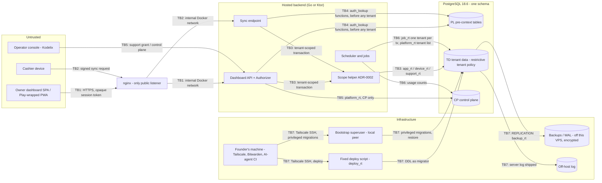

# Threat Model: Tenant isolation (hosted backend)

> **Path**: `docs/architecture/threat-models/tenant-isolation.md`
> **Status**: Draft (verdict NOT ASSESSED: no feature spec yet; `tenancy.model` and `distribution.model` unset in `project.yaml` — see § 9)
> **Author**: `appsec-engineer` via `/threat-model` (STRIDE draft), `researcher` (requirement IDs), `privacy-compliance-specialist` (personal-data flows); reviewed and consolidated in the authoring session · **Reviewer**: security-lead (SL-THREAT-MODEL skipped - lean mode)
> **Date**: 2026-10-18 · **Next review**: the first feature spec that stores tenant data (`--update`); a new trust boundary or role; account recovery added to ADR-0001 § 1c; the licensing ADR amending ADR-0001/0002 (M27/M38 roles, licensing scope kind); the key-custody ADR; an incident; and at the latest 2027-04-18, the first hire or the first paying customer (residual-risk review)
> **Feature spec**: none (`design/specs/` absent) · **Research note**: `docs/research/tenant-isolation.md` (parts 1–7) · **ADRs**: ADR-0001, ADR-0002, ADR-0003, ADR-0004 (Accepted 2026-10-18), ADR-0005 (Proposed; M54 and R-6); registry `docs/registry/architecture.yaml`
> **Required because**: authentication · authorization model · PII export/delete · admin/impersonation
> **Standards**: OWASP ASVS 5.0.0 (May 2025; tag `v5.0.0`) — Level 3 for authentication and session, Level 2 elsewhere · OWASP API Security Top 10 2023 · OWASP MASVS 2.1.0: not applicable (no mobile surface in scope)

<!-- Method: STRIDE per trust boundary + abuse cases (security-baseline.md). Requirement IDs looked up in the official
     ASVS 5.0.0 chapter files and the API Security Top 10 2023 edition files on 2026-10-18 (URLs in § 8). Design-time:
     nothing is built, so every control is Planned and cites the ADR line that plans it. -->

## 1. Scope

- **In scope** (agreed with the founder, 2026-10-18): the hosted server side of tenant isolation —
  - the PostgreSQL 18.6 database: restrictive tenant policy, table classes TD/CP/G/PL, role inventory, pre-context functions (ADR-0001);
  - the scope helper and its kinds Job/Staff/Device/Support (ADR-0002);
  - dashboard sessions, branch scope, the principal read and person-started exports (ADR-0003);
  - sync-endpoint request scoping, identity taken from the device credential (research part 3, D3-A/D4-A);
  - Kodelix operator access, support grants, the control plane and grant-free usage counts (ADR-0004);
  - tenant export and deletion (research part 5, EXP-2/DEL-2) and the suspension contract (ADR-0001 Decision 4);
  - noisy-neighbour limits on sync (research part 5, RL-C).
- **Out of scope now — with the trigger that brings each in**:
  - **Cashier device local store and re-registration** (B3/B4): brought in when the key-custody ADR is drafted, after spikes S41 and S43 report.
  - **Owner-app on-device storage** (the dashboard as a Play-wrapped PWA; MASVS 2.1.0): brought in after spikes S32 and S33 settle the owner-app form (`docs/research/desktop-client-adr-followups.md` § 5, OQ6).
  - **Licensing internals** (seats, leases, licence signing): covered by `docs/architecture/threat-models/licensing.md`; cross-referenced here as `LIC <ID>`, not duplicated.
  - **Desktop client internals; ETA integration** (backlog, 2026-10-17).
- **Assumptions**:
  - Hosted multi-tenant only (brief decision log, 2026-10-16); no self-hosted bundle.
  - Tenancy `shared-schema-rls` per Accepted ADR-0001; `project.yaml` is set by `/setup-stack` later.
  - Backend track (Go or Ktor) undecided: threats and tests are written for both.
  - No feature spec exists: boundaries are drawn from the Accepted ADRs.
  - Counsel questions are closed by founder statement (2026-10-18); legal text is reported, not interpreted.
  - **Infrastructure (founder, 2026-10-18)**:
    - One VPS runs everything in Docker: nginx (the only public listener), the backend containers and PostgreSQL. PostgreSQL publishes no port; only the backend containers reach it on the internal Docker network.
    - Server administration (SSH) is reachable only over Tailscale, from the founder's own machine.
    - Deploys run from the founder's machine over Tailscale through an AI-agent CI. A fixed deploy script reads the `deploy_rt` credential; the agent never sees it.
    - Database credentials are stored encrypted with restricted file permissions.
    - The deploy ADR is not written; these facts are the founder's statement.
- **Actors**:
  - an attacker from another tenant (owner, manager or cashier of tenant B);
  - a manager reaching a sibling branch of their own tenant;
  - a **disabled or former staff member** holding an old session or with a background export still running;
  - the **users of a suspended (unpaid) tenant** trying to keep access;
  - the Kodelix operator (one founder today);
  - a compromised application server (`app_rt` credential or code);
  - a stolen or cloned cashier PC;
  - an unauthenticated internet attacker;
  - an insider with infrastructure access (backup credential, deploy pipeline).
  - Self-hosted operator: N/A (hosted only).

## 2. Assets

| ID | Asset | Classification | Owner (context) | Impact if compromised (C / I / A) |
|----|-------|----------------|-----------------|-----------------------------------|
| A1 | Tenant business data (class TD: sales, stock, inbox, review queue) | confidential | each tenant | H / H / H |
| A2 | Staff personal data (names, roles, attendance, login identifiers, password verifiers) | PII | each tenant (owner = controller) | H / H / M |
| A3 | Pre-context rows (class PL: sessions, login identities, device credentials, enrolment codes, support grants) | secret / PII | platform | H / H / M |
| A4 | Tenant and branch scope settings (`app.*`) | internal | platform | H / H / M |
| A5 | Control-plane rows (class CP: tenant status, plan limits, restore watermark, usage counts) | internal | platform | M / H / H |
| A6 | Support access journal, hash chain, off-host log | internal | platform | M / H / M |
| A7 | Database credentials (runtime, deploy, backup, bootstrap superuser) | secret | platform | H / H / H |
| A8 | Backups and WAL | confidential | platform | H / M / H |
| A9 | Tenant export files | confidential / PII | each tenant | H / M / L |
| A10 | Sync availability and "money facts are never lost" | internal | platform | L / H / H |
| A11 | Roles and branch assignments (`staff_roles`, `staff_branches`) | internal | each tenant | M / H / M |
| A12 | Tax archive kept after closure (DEL-2, 5 years after the tax period) | confidential | each tenant | M / H / M |
| A13 | **The founder's machine** — the most critical asset: it holds deploy access (AI-agent CI and the fixed deploy script), Bitwarden (bootstrap superuser credential) and the only route to the server (Tailscale SSH) | secret | founder | H / H / H |

## 3. Trust Boundaries & Data Flow

| ID | Boundary | Crosses | Authenticated by | Data crossing |
|----|----------|---------|------------------|---------------|
| TB1 | Dashboard client ↔ backend API | Internet → app | opaque session token, hashed at rest, scope resolved per request (ADR-0003) | tenant data, staff data, exports, grant approvals |
| TB2 | Cashier device ↔ sync endpoint | Internet → app | device credential, signed requests (credential ADR not written; D2-B flagged on S31/S32) | commands (money facts), feed, enrolment |
| TB3 | Backend ↔ PostgreSQL | App → data | per-role LOGIN credential + scope helper + restrictive tenant policy + `branch_scope` (ADR-0001/0002/0003) | all tenant rows |
| TB4 | Application ↔ pre-context functions | App → data (before any tenant) | `EXECUTE` grants per ADR-0001 § 1c; `auth_lookup` owner | identity for one key (session, login, credential, code, grant) |
| TB5 | Operator console ↔ backend | Kodelix → app | console identity (WebAuthn + step-up, LIC M15) + owner grant gate (ADR-0004) | support reads, verbs, control-plane actions |
| TB6 | Scheduler and jobs ↔ database | App → data | `job_rt` via Job kind; `platform_rt` for the tenant list | exports, purges, backfills, usage counts |
| TB7 | Infrastructure ↔ database | Founder's machine → VPS → data | Tailscale (device-approved) for SSH and deploy; `deploy_rt` read by a fixed deploy script (the AI agent never sees it); bootstrap superuser (local `peer` inside the PostgreSQL container, founder's Bitwarden); `backup_rt` (`REPLICATION` only); PostgreSQL publishes no port | DDL, privileged migrations, physical backups (stored off the VPS), logs |

## 4. STRIDE Analysis per Boundary

L = likelihood, I = impact (L/M/H) with the reason in the threat text. Controls are **Planned** (design-time). `A0n:line` = `docs/architecture/adr-000n-*.md`; `TI` = the research note; `PGBP` = `docs/stack-reference/postgres/best-practices.md`; `LIC` = the licensing threat model.

### TB1 — Dashboard client ↔ backend API

| ID | STRIDE | Threat | Asset | Likelihood | Impact | Mitigation ID(s) |
|----|--------|--------|-------|-----------|--------|------------------|
| T1.1 | **S**poofing | Dashboard token stolen (XSS, log, shared phone) and replayed as the owner; token transport and storage still undecided (A03) | A1,A2,A9 | M | H — owner sees all branches, exports, grants, closes | M20, M21, M24 |
| T1.2 | **S**poofing | Credential stuffing or brute force on sign-in; account enumeration from responses | A2,A3 | H | H — tenant takeover | M22, M34 |
| T1.3 | **S**poofing | Disabled or former staff reuse an old token when `Logins.disable` runs without `Sessions.endAllForUser` (two separate § 1c calls) | A1,A2 | M | H | M4, M23 |
| T1.4 | **S**poofing | Suspended-tenant users sign in again after `Sessions.endAllForTenant` | A5,A1 | M | M — use while unpaid | M5 |
| T1.5 | **T**ampering | Tenant or branch taken from path, body or a forged `X-Tenant-*`/forwarding header | A4 | M | H — cross-tenant | M6 |
| T1.6 | **T**ampering | Mass assignment of `role`, `tenant_id`, `branch_id`, `approved_at`, `expires_at` | A11,A3 | M | H — privilege escalation | M7 |
| T1.7 | **R**epudiation | Owner or manager denies a closure, export, role change or grant approval | A6 | M | M | M23 |
| T1.8 | **I**nformation disclosure | IDOR/BOLA: tenant B uses A's ids; a manager of A1 reads A2 through lists, reports, search or export | A1,A2 | M | H | M1, M2, M8 |
| T1.9 | **I**nformation disclosure | Existence oracle: different errors for foreign vs missing ids; unique-key or FK collisions (TI F105, F106) | A1 | M | M | M9 |
| T1.10 | **I**nformation disclosure | Tenant data left in the browser/PWA after logout; shared HTTP cache serves one tenant's response to another | A1 | M | M | M24 |
| T1.11 | **D**enial of service | Sign-in, report or export floods; each request costs a pre-context lookup and a principal-read transaction | A10 | M | M | M25 |
| T1.12 | **E**levation of privilege | Manager or cashier reaches owner functions (grant, enrolment code, role change, closure, all-branch export) via a route without `Authorizer` or `branch_all` set for a non-owner | A11,A3 | M | H | M2, M10 |
| T1.13 | **E**levation of privilege | A stolen owner session requests closure (deletion) or a full export | A1,A2,A9,A12 | M | H — irreversible or exfiltration | M11, M45 |
| T1.14 | **R**epudiation | A data-subject request (an owner's or manager's own data; a staff member's access request forwarded to the owner) goes unanswered, or its answer cannot be shown within the six working days (privacy M1, M4) | A2 | M | M | M56, M59 |

### TB2 — Cashier device ↔ sync endpoint

| ID | STRIDE | Threat | Asset | Likelihood | Impact | Mitigation ID(s) |
|----|--------|--------|-------|-----------|--------|------------------|
| T2.1 | **S**poofing | Unknown key, bad signature, or a victim's key id used to raise owner alerts (credential internals: LIC T4.7) | A10,A6 | H | M | M12 |
| T2.2 | **S**poofing | Stolen or cloned device key pushes facts (clone detection: LIC T4.2, T6.5); damage bounded to that device's branch | A1 | M | M | M13 |
| T2.3 | **T**ampering | Payload names another tenant, branch or device (research SY-01..03) | A1,A4 | M | H — cross-tenant write | M3 |
| T2.4 | **T**ampering | Replay of a captured signed request against non-idempotent endpoints (redeem, key staging, feed) | A3,A1 | M | M | M14 |
| T2.5 | **R**epudiation | Refusal and forged-id events lost on a restore, so a dispute cannot be settled (TI F330) | A6 | M | M | M23, M48 |
| T2.6 | **I**nformation disclosure | Feed cursor or ids from another tenant/branch return rows (SY-09, SY-11); command-id oracle (SY-05/06) | A1 | M | H | M3, M9 |
| T2.7 | **I**nformation disclosure | `EnrolmentCodeLookup.find` returns tenant, branch and branch label to whoever holds a code; codes brute-forced (LIC T4.1/M20) | A3 | M | M | M15 |
| T2.8 | **D**enial of service | Noisy neighbour: catch-up bursts or batch stuffing exhaust pool, inbox worker or database | A10 | M | H — other venues' sync stalls | M16 |
| T2.9 | **D**enial of service | Limiter keyed on an unverified header drains a victim's bucket; limiter store down blocks sync; a 429 read as failure drops an outbox row | A10 | M | H — a money fact is lost | M16, M17 |
| T2.10 | **E**levation of privilege | Suspended tenant's devices: if uploads are refused, already-sold money facts are stuck; if nothing is enforced, devices sell and enrol indefinitely | A10,A5 | M | H | M5 |
| T2.11 | **E**levation of privilege | Credential confusion between device and dashboard (the credential ADR may merge `device_rt` into `app_rt`) | A4 | L | H | M18 |
| T2.12 | **E**levation of privilege | A revoked device's in-flight command commits after the revoke (TI F329); `FOR SHARE` needs SELECT and UPDATE policies (PGBP § 1) | A1 | M | M | M13 |

### TB3 — Backend ↔ PostgreSQL

| ID | STRIDE | Threat | Asset | Likelihood | Impact | Mitigation ID(s) |
|----|--------|--------|-------|-----------|--------|------------------|
| T3.1 | **S**poofing | A compromised backend container sits next to the database on the internal Docker network: it holds a runtime credential, and the tenant context is a setting, so it can set any tenant (RLS stops bugs, not credential holders) | A1,A2,A7 | M | H — every tenant | M19, M65 · residual R-1 |
| T3.2 | **T**ampering | Missing context; second `set_config` switches tenant or widens branches (TI F110, F420); session-level set leaks through the pool (TI F115) | A4 | M | H | M26 |
| T3.3 | **T**ampering | New table without ENABLE+FORCE or a policy; permissive policy without `TO`; `USING (true)` on TD; view without `security_invoker`; materialized view (TI F108, F423, F621) | A1 | M | H — blast radius is every tenant | M27 |
| T3.4 | **T**ampering | `TRUNCATE` and `REFERENCES` are not subject to RLS (PGBP § 1); a TRUNCATE grant to a runtime role wipes every tenant; REFERENCES enables an FK oracle; C1–C8 do not check these grants | A1,A10 | L | H | M28 |
| T3.5 | **R**epudiation | RLS denials (SQLSTATE 42501) and malformed tenant ids (22P02) unlogged, so probing is invisible | A6 | M | M | M29 |
| T3.6 | **I**nformation disclosure | Unique/PK/FK covert channel (TI F105, F106); per-branch keys leak sibling branches (S45) | A1 | M | M | M9 |
| T3.7 | **I**nformation disclosure | Database errors expose constraint names or values; cast-error oracles (PGBP § 1) | A1 | M | M | M9 |
| T3.8 | **I**nformation disclosure | Race between the support gate's sub-select and a concurrent revoke (PGBP § 1) | A1 | L | L — `clock_timestamp()`, next statement | M30 |
| T3.9 | **D**enial of service | One tenant's long queries hold the pool; `statement_timeout` off by default (TI F518) | A10 | M | H | M16 |
| T3.10 | **E**levation of privilege | A `SECURITY DEFINER` function (`auth_lookup`, `support_fn`, `audit_writer`) with an unpinned `search_path`, `PUBLIC` `EXECUTE` or the wrong owner (TI F710, F716) | A1,A3 | L | H | M27 |
| T3.11 | **E**levation of privilege | Runtime role tries `SET ROLE` to the owner or `row_security = off`, or gains `pg_read_all_data` or a server-file role | A1 | L | H | M27 |
| T3.12 | **E**levation of privilege | Track-specific leaks: ThreadLocal tenant after coroutine suspension, nested Exposed transaction (TI F239/F240), repository used outside the scoped transaction | A4 | M | H | M26 |

### TB4 — Application ↔ pre-context functions (`auth_lookup`, ADR-0001 § 1c)

| ID | STRIDE | Threat | Asset | Likelihood | Impact | Mitigation ID(s) |
|----|--------|--------|-------|-----------|--------|------------------|
| T4.1 | **S**poofing | A compromised app mints a session for any tenant through `Sessions.create`, which trusts the app's sign-in check (recorded in ADR-0001 § 1c) | A3,A1 | L | H | M31 · residual R-2 |
| T4.2 | **I**nformation disclosure | `LoginLookup.find` returns the password verifier to `app_rt`, so a compromised app can harvest verifiers across tenants for offline cracking | A2 | L | H | M32 · residual R-3 |
| T4.3 | **T**ampering | A stolen session changes the password through `Logins.changeOwnVerifier` if the app skips re-checking the current password | A3 | L | H | M33 |
| T4.4 | **R**epudiation | Pre-context calls (session created or ended, end-all) leave no record | A6 | M | M | M31, M23 |
| T4.5 | **I**nformation disclosure | A lookup returns more than identity; timing or response shape enumerates identifiers, tokens, codes or key ids | A3 | M | M | M34, M22 |
| T4.6 | **D**enial of service | Unauthenticated endpoints (sign-in, redeem) hit the database before any tenant is known, so per-tenant limits cannot apply | A10 | H | M | M25 |
| T4.7 | **E**levation of privilege | An "inside, owner" function runs for a manager or on another tenant's row | A11,A3 | L | H | M10 |
| T4.8 | **E**levation of privilege | Account recovery is not yet in § 1c; a later pre-context write could break the pattern | A3 | M | H | M35 |

### TB5 — Operator console ↔ backend

| ID | STRIDE | Threat | Asset | Likelihood | Impact | Mitigation ID(s) |
|----|--------|--------|-------|-----------|--------|------------------|
| T5.1 | **S**poofing | Console credentials stolen (LIC T3.1/M15); tenant reads bounded by live grants, the control plane is not | A5,A1 | M | H | M36 |
| T5.2 | **S**poofing | A second operator uses another operator's id (research F715a; AC2) | A1 | L (one operator today) | H | M37 |
| T5.3 | **S**poofing | Attacker poses as the owner to approve a grant (AC7) | A1,A2 | M | H | M38 |
| T5.4 | **T**ampering | Grant tampering: extend, re-target another tenant, reopen after revoke (AC3) | A3 | L | H | M38 |
| T5.5 | **T**ampering | Wrong control-plane write: plan limits zeroed, or the restore watermark lowered so devices prune records the server cannot recover | A5,A10 | L | H | M39 |
| T5.6 | **R**epudiation | Read then roll back to erase the trace (AC5); superuser edits the journal or deletes its newest row (AC4, F718) | A6 | L | H | M40 |
| T5.7 | **I**nformation disclosure | Support read without a grant (AC1) | A1 | M | L — returns 0 rows | M30 |
| T5.8 | **I**nformation disclosure | Support read past expiry inside a long transaction (AC6) | A1 | L | M | M30 |
| T5.9 | **I**nformation disclosure | Usage counts show per-tenant activity; a later column adds money or text | A5,A1 | L | M | M41 |
| T5.10 | **I**nformation disclosure | Diagnostic bundle puts tenant data on an operator laptop or ticket, outside RLS and the audit chain | A1,A2 | M | M | M42 |
| T5.11 | **E**levation of privilege | Suspended tenant: existing grants stay live after suspension; new grants approved | A1 | M | M | M5 |
| T5.12 | **D**enial of service | Console thief (or a mistake) suspends tenants in bulk or ends all their sessions (`endAllForTenant`) | A10 | L | H — every venue | M36 |
| T5.13 | **E**levation of privilege | Support verb with the wrong owner, `USING (true)` or `PUBLIC` `EXECUTE` (AC9); branch-subset bypass | A1 | L | H | M27 |
| T5.14 | **E**levation of privilege | "Log in as owner" added later for convenience (FP-OWNER-IMPERSONATION) | A1,A6 | L | H | M43 |

### TB6 — Scheduler and jobs ↔ database

| ID | STRIDE | Threat | Asset | Likelihood | Impact | Mitigation ID(s) |
|----|--------|--------|-------|-----------|--------|------------------|
| T6.1 | **S**poofing | A person's export runs as `job_rt`, so a manager's export contains every branch (FP-PERSON-EXPORT-AS-JOB) | A1,A9 | M | H | M44 |
| T6.2 | **E**levation of privilege | Disabled or former staff export: status is re-checked only when the export starts; an export running at disable completes; retrieval of the file is not yet specified | A9,A2 | M | H | M45 |
| T6.3 | **T**ampering | A job loop carries the previous tenant into the next tenant's write (LIC T7.9) | A1 | L | H | M46 |
| T6.4 | **T**ampering | A backfill run as `migrator`, or one that silently changes 0 rows | A1 | L | M | M46 |
| T6.5 | **R**epudiation | Closure or purge steps not logged with date and time | A6,A12 | M | M | M23, M58 |
| T6.6 | **I**nformation disclosure | Export misses a table, or includes a table without RLS in full (TI F117); COPY under RLS not yet run (S52) | A9 | M | H | M47 |
| T6.7 | **I**nformation disclosure | Export file at a guessable key or an unauthenticated URL (DA-06d); storage ADR absent | A9 | M | H | M45 |
| T6.8 | **T**ampering | A restore brings back a deleted tenant, an erased person or a revoked device (TI F330) | A2,A3 | M | H | M48 |
| T6.9 | **D**enial of service | A job with no context, or for a deleted tenant (DA-18) — fails closed | A1 | L | M | M26 |
| T6.10 | **D**enial of service | Export or usage jobs load the primary and starve sync | A10 | M | M | M16 |
| T6.11 | **E**levation of privilege | One scheduler process holds both `platform_rt` and `job_rt`; tenant ids from the CP list used outside one-tenant-per-transaction | A5 | L | M | M19, M46 |
| T6.12 | **D**enial of service | Suspended or closed tenant jobs: a retention purge runs before the export window; exports and usage counts run with no rule | A12,A9 | M | H — data loss | M5, M11 |
| T6.13 | **I**nformation disclosure | An erased staff member's data survives in a store the purge missed (sync tombstones, export files, a mapping from the archive's opaque id to a name) (privacy H2, M8) | A2,A12 | M | M | M55, M62 |
| T6.14 | **R**epudiation | An export is delivered with no record, so delivery to the controller cannot be shown (privacy M2) | A9 | M | L | M57 |

### TB7 — Infrastructure ↔ database

| ID | STRIDE | Threat | Asset | Likelihood | Impact | Mitigation ID(s) |
|----|--------|--------|-------|-----------|--------|------------------|
| T7.1 | **S**poofing | Bootstrap superuser used remotely, or its credential phished from Bitwarden (AC10) | all | L | H | M49, M64 |
| T7.2 | **E**levation of privilege | Stolen `deploy_rt` credential: `SET ROLE migrator` (table owner) can drop the restrictive policy or turn off FORCE, then read and write every tenant; the catalogue checks run in CI, which this attacker skips | A1,A2 | M | H | M50, M63 · residual R-4 |
| T7.3 | **T**ampering | Privileged migration not marked, or a migration that replaces an `auth_lookup` function | A3 | L | H | M50 |
| T7.4 | **R**epudiation | Superuser edits the journal; the server log sits on the same host | A6 | L | H | M40 |
| T7.5 | **I**nformation disclosure | Backup, WAL or replication credential stolen: every tenant in clear (TI F721, AC8) | A8 | L | H | M51 |
| T7.6 | **I**nformation disclosure | Logs leak PII, tokens or claimed ids; proxy logs keep path, query and IP (TI F271, F272); `X-Forwarded-Server` reveals an internal hostname (TI F268) | A2,A3 | M | M | M52, M60 |
| T7.7 | **I**nformation disclosure | Deleted tenant kept in backups past the window; side-restore instance left running | A8 | M | M | M48, M54 |
| T7.8 | **D**enial of service | Superuser credential lost, so no privileged migration and no restore | A10 | L | H | M49 |
| T7.9 | **E**levation of privilege | Version floors: PgBouncer below 1.26.1 if adopted (TI F114); PostgreSQL or tools below 18.6 (TI F124) | A1 | L | H | M53 |
| T7.10 | **E**levation of privilege | Predefined role granted for monitoring (AC11); a table without RLS holding tenant data readable by it (AC13) | A1 | L | H | M27 |
| T7.11 | **T**ampering | **Prompt injection against the AI-agent CI**: text in a commit, issue, dependency or migration file steers the agent to run free-form SQL, alter a migration, exfiltrate a credential or skip the post-deploy check | A1,A7 | M | H — every tenant | M63, M50 |
| T7.12 | **S**poofing | **The founder's machine is compromised** (malware, theft): it reaches deploy, Bitwarden and server SSH at once | A13, all | L | H — full platform | M64 |
| T7.13 | **D**enial of service | **Single host**: nginx, the backend and PostgreSQL share one VPS, so one host failure, provider incident or compromise takes everything, including any backup kept there | A8, A10 | M | H | M51, M65 |
| T7.14 | **I**nformation disclosure | Logs shipped to a destination whose provider, location and data categories are not recorded (privacy M7) | A2,A6 | M | M | M61, M52 |

## 5. Abuse Cases (business-flow abuse)

| ID | Abuse case | Actor | Goal | Detection | Mitigation ID(s) |
|----|-----------|-------|------|-----------|------------------|
| AB1 | Enumerate other tenants' object, export or command ids | Tenant B user or device | read A's data / existence oracle | `authz_denied_total`, 42501 spike | M1, M2, M9 |
| AB2 | Manager edits own role or assignment, or names branch A2 | Manager | sibling-branch access | `branch_scope.refused`; F421 guard error | M7, M8, M10 |
| AB3 | Export exfiltration with a stolen owner session | External | staff data and sales | `export.requested/downloaded` audit; unusual-size alert | M11, M45 |
| AB4 | Closure request to destroy a venue's data | External with owner session | sabotage | closure steps notified to every owner contact | M11 |
| AB5 | Batch stuffing or many devices to evade per-request limits | Noisy tenant | free capacity / degrade others | `sync_batch_*`; throttling per tenant | M16 |
| AB6 | Bad signatures with a victim's key id (alert storm) | External | hide a real event, harass the owner | platform-sink counters | M12 |
| AB7 | Account and identifier enumeration through sign-in | External | target list | sign-in failure metrics per IP | M22, M34 |
| AB8 | Disabled staff reuse an old token when only role removal or `Logins.disable` ran | Former staff | keep reading data | `session.resolve` for a disabled login (must be 0) | M4 |
| AB9 | Start an export just before being disabled; fetch the file later through a link | Departing manager | take staff data and sales | export audit (requester, status at download) | M45 |
| AB10 | Demoted manager's queued export runs with the old branches | Demoted manager | sibling data | re-check refusal event | M44, M45 |
| AB11 | Suspended tenant's managers sign in again after `endAllForTenant` | Users of a suspended tenant | use without paying | sign-ins for suspended tenants | M5 |
| AB12 | Suspended tenant enrols a new device or keeps selling past the lease | Owner or cashier of a suspended tenant | extend use | `tenant_suspended` refusals; enrolment attempts; lease not renewed (LIC M24) | M5 |
| AB13 | Suspended owner approves a support grant, or an existing grant keeps working | Owner, operator | support for an unpaid tenant (or forgotten access) | `support_access_total` for suspended tenants | M5 |
| AB14 | Suspension timed against in-flight exports or purges, so the tax archive or export is lost | Owner, or a job bug | dispute or data loss | closure-step stuck alert | M5, M11 |
| AB15 | Operator reads without a grant, past expiry, or reads then rolls back (AC1, AC5, AC6) | Operator / console thief | covert read | denied-access page; pre-read journal record | M30, M40 |
| AB16 | Second operator uses another's id (AC2) | Future operator | borrow a grant | none today | M37 |
| AB17 | Social engineering of a grant approval (AC7) | External / operator | staff data | owner notification on approval | M38 |
| AB18 | Superuser or DBA reads or edits data (AC4, AC10) | Insider | covert read or tamper | superuser-login page; chain verify | M40, M49 |
| AB19 | `deploy_rt` stolen to change policies | Insider / CI compromise | read all tenants | production catalogue drift alert | M50 |
| AB20 | Backup or replication credential theft (AC8) | Infra insider | bulk data | unexpected replication connection alert | M51 |
| AB21 | Convenience grants: predefined roles, `USING (true)`, `PUBLIC`-executable definer, TRUNCATE (AC9, AC11–13) | Developer | shortcut | catalogue CI | M27, M28 |
| AB22 | Compromised app mints sessions or harvests verifiers | App-server attacker | mass takeover | session-created audit volume; new-device owner alert | M31, M32 |
| AB23 | Poisoned commit or issue text makes the AI-agent CI run an unreviewed migration or reveal a credential | External contributor / dependency author | read or alter every tenant | deploy log shows a non-committed migration; post-deploy catalogue check alert | M63, M50 |
| AB24 | Steal or infect the founder's machine to reach deploy, Bitwarden and SSH | Targeted attacker | full platform control | Tailscale new-device approval request; Bitwarden new-login alert | M64 |

**Prompts not applicable here**: trial abuse, coupon stacking, downgrade cycling, referral fraud, payment desync, replayed webhooks — billing and webhooks are outside this scope. Seat inflation and licence bypass — `LIC AB1–AB19`, not duplicated. Invitation spam — no invitation flow; staff logins are created by the owner (ADR-0001 § 1c).

**Cross-tenant coverage** (SL-THREAT-MODEL check 4):

| Prompt | Threat / N/A |
|---|---|
| Guessing or enumerating IDs | T1.8, T1.9, T2.6, T3.6, AB1 |
| Shared caches and cache keys | T1.10 (HTTP cache); no cache of authorization state at Tier 1 (ADR-0002, ADR-0003); limiter and plan-limit keys from the credential (T2.9) |
| Queues, outbox, consumers losing the tenant | T2.3, T2.6 (inbox keyed by tenant); T6.8 (control journal); T6.1, T6.2 (export queue); T6.3 (job loops) |
| Search indexes | N/A — no search index in any ADR; research DA-07 applies if one is added |
| Exports and reports | T1.8, T1.13, T6.1, T6.2, T6.6, T6.7 |
| Background and scheduled jobs | T6.1–T6.12 |
| Object-storage keys and signed URLs | T6.7 (storage ADR absent) |
| Admin and impersonation paths | T5.1–T5.14, T7.1, T7.2 |
| Webhooks routed by a client-supplied id | N/A — no inbound webhooks in scope; nearest analogue T2.3 (sync routed by credential identity) |
| Telemetry leaking another tenant's data | T7.6, T5.9 |

## 6. Mitigations -> Stories & Tests

Every story is `NEW:` (no epic exists yet; `/create-stories` takes this list). Owner = the stack lead for the layer once `/setup-stack` picks the backend track (`go-lead` or `ktor-lead`), otherwise as named. Tests are named plans (design-time); suite IDs SY/DA/AN/DB are the research note's part-6 catalogue.

| ID | Mitigation | Addresses | ASVS / API ref | Story (owner) | Test (negative) | Status |
|----|-----------|-----------|----------------|---------------|-----------------|--------|
| M1 | Restrictive tenant policy plus one permissive policy per role exactly as ADR-0001; run DB-07/DB-08 on this shape before any tenant data | T1.8, AB1 | 8.4.1, 8.3.1; API1 | NEW: S-TI-01 RLS baseline migration (data-lead) | As `app_rt` in A's context select/update/delete B's rows and `ON CONFLICT` into B → 0 rows or 42501 | Planned |
| M2 | One deny-by-default `Authorizer` on every route; isolation matrix generated from `contracts/` | T1.8, T1.12, AB1 | 8.2.1, 8.1.1; API5 | NEW: S-TI-02 Authorizer and isolation matrix (backend lead) | Route without a permission case fails the build; manager on an owner route → 403 (DA-01..12) | Planned |
| M3 | Sync ids from the credential only; request schema has no id fields; composite FKs | T2.3, T2.6 | 8.2.2, 8.4.1; API1 | NEW: S-TI-03 credential-derived sync scope (backend lead) | SY-01..03, SY-09..11, SY-13: claimed foreign tenant/branch/device → `refused:id_mismatch`, no write | Planned |
| M4 | Disable is atomic: `Logins.disable` ends sessions in the same transaction; `SessionLookup.find` returns login status and the resolver refuses a disabled login | T1.3, AB8 | 7.4.2, 7.4.1 | NEW: S-TI-04 atomic disable (backend lead) | Call only `Logins.disable`, reuse the old token → 401; DA-12 | Planned |
| M5 | **Suspension contract** (ADR-0001 Decision 4, founder 2026-10-18): status read per request with no cache; already-sold uploads accepted with `tenant_suspended`; leases not renewed (devices stop new sales at lease end, backlog accepted); no enrolment; dashboard owner-only for export and payment; grants revoked at suspension, none approved; no purge before a closure state; usage counts continue | T1.4, T2.10, T5.11, T6.12, AB11–AB14 | 8.3.2, 8.4.1, 2.3.1 | NEW: S-TI-05 suspension contract (backend lead; licensing lease rule with `licensing-specialist`) | Suspend A: upload of an already-sold command accepted with `tenant_suspended`; manager sign-in, `Enrolment.createCode`/`redeem`, new grant, purge → refused; old grant reads 0 rows; owner signs in and exports; after lease end the device sells nothing new | Planned |
| M6 | nginx (the only public listener) strips `X-Tenant*` and client-sent forwarding headers and sets its own; the backend trusts only nginx on the internal network and ignores tenant headers. The research tested Caddy and Traefik (TI F263, F269), not nginx: nginx header handling is NOT SOURCEABLE until the edge story researches it | T1.5 | 4.1.3 | NEW: S-TI-06 edge header hygiene (platform-lead; nginx research first) | DA-03: forged `X-Tenant-Id` / `X-Forwarded-For` → ignored, scope unchanged | Planned |
| M7 | Explicit request DTOs; privileged fields cannot be bound; database guards (F421 guard, grant CHECK) | T1.6, AB2 | 8.2.3; API3 | NEW: S-TI-07 request DTOs (backend lead) | DA-11: body with `role`/`tenant_id`/`expires_at` → ignored or 422; manager insert into `staff_roles` → policy error | Planned |
| M8 | Branch-isolation suite | T1.8, AB2 | 8.2.2; API1 | NEW: S-TI-08 branch isolation tests (backend lead) | DA-08, DA-09, DA-17; `support_rt` with an A1 grant reads 0 rows of A2 | Planned |
| M9 | Uniform not-found; tenant-leading keys; RFC 9457 bodies without constraint names | T1.9, T2.6, T3.6, T3.7, AB1 | 16.5.1; API1 | NEW: S-TI-09 uniform errors (backend lead) | SY-05/06, DA-14, DB-06: foreign id vs missing id → identical response; duplicate key across tenants → no leak | Planned |
| M10 | "Inside, owner" § 1c functions require tenant match plus `app.branch_all = 'on'` | T1.12, T4.7, AB2 | 8.2.1, 8.3.1; API5 | NEW: S-TI-10 owner-only functions (data-lead) | Manager calls each owner function → denied; owner on B's row → denied | Planned |
| M11 | Closure and export: owner only, step-up, cooling-off, notify every owner contact, export rate cap | T1.13, T6.12, AB3, AB4, AB14 | 7.5.3, 2.3.1 | NEW: S-TI-11 closure safeguards (backend lead) | Closure without fresh step-up → refused; purge before cooling-off ends → refused | Planned |
| M12 | Unknown-credential refusals to the platform sink; owner alerts aggregated | T2.1, AB6 | 16.3.3, 2.4.1 | NEW: S-TI-12 refusal sink (backend lead) | 1,000 bad signatures with a victim's key id → 0 tenant events, alerts capped | Planned |
| M13 | Device status read `FOR SHARE` on every command; `device_rt` SELECT plus UPDATE (`last_seen_at` only) policy | T2.2, T2.12 | 8.3.2 | NEW: S-TI-13 revoke ordering (backend lead) | SY-07, SY-15: command racing a revoke → refused after the revoke commits | Planned |
| M14 | Server nonce or freshness rule on non-idempotent device endpoints | T2.4 | 2.3.1 | NEW: S-TI-14 device replay guard (backend lead; credential ADR) | Replayed redeem or key staging → refused | Planned |
| M15 | Enrolment-code controls per LIC M20 (entropy, TTL, attempt cap) | T2.7 | 6.4.1, 6.5.4 | LIC M20 story (licensing-specialist) | per LIC M20: guessed code → refused after cap | Planned |
| M16 | Layered limits: edge per-IP and body cap; per-device and per-tenant limits from the credential; per-plan `statement_timeout`; role ceilings for lock and idle timeouts; per-tenant bulkhead; exports in a low-priority class | T2.8, T3.9, T6.10, AB5 | 2.4.1, 2.3.2; API4 | NEW: S-TI-15 layered sync limits (backend lead; limits ADR) | Over-limit batch → 429 + `Retry-After`, prefix acked, outbox kept; saturating tenant does not starve another tenant's sync | Planned |
| M17 | Limiter fails open; outbox row deleted only on a parsed ack | T2.9 | 16.5.2 | NEW: S-TI-16 throttled-never-dropped (backend lead) | Limiter down → sync continues; 429 → no outbox row deleted | Planned |
| M18 | Disjoint grants for `device_rt` and `app_rt`; each route accepts one credential type | T2.11 | 13.2.2, 8.2.1 | NEW: S-TI-17 credential separation (backend lead) | Device signature on a dashboard route → 401, and the reverse | Planned |
| M19 | Per-role credentials, stored encrypted with restricted file permissions (founder, 2026-10-18); each container gets only its own role's credential; PostgreSQL publishes no port and accepts connections only on the internal Docker network; `pg_hba` per role per container network where possible; rotation; scheduler credentials separated | T3.1, T6.11 | 13.2.1, 13.2.2, 13.3.1, 13.3.2 | NEW: S-TI-18 database credential custody (platform-lead) | Connection to PostgreSQL from the host or the internet → refused (no published port); the `app_rt` credential file is unreadable by other containers and non-root users | Planned |
| M20 | Decide token transport (HttpOnly cookie + CSRF defence, or in-memory bearer); never `localStorage`; CSP | T1.1 | 14.3.3, 7.2.1 | NEW: S-TI-19 session token transport (web-lead; auth spec) | DA-13; browser storage after login holds no token | Planned |
| M21 | Idle and absolute session lifetimes from config; owner can end sessions | T1.1 | 7.1.1, 7.3.1, 7.3.2, 7.4.5 | NEW: S-TI-20 session lifetimes (backend lead) | Expired or idle session → 401 | Planned |
| M22 | Sign-in rate limits per identifier and per IP; identical response and timing for unknown identifiers | T1.2, T4.5, AB7 | 6.1.1, 6.3.1, 6.3.8; API2 | NEW: S-TI-21 sign-in throttling (backend lead) | N failures → 429; known vs unknown identifier → identical response | Planned |
| M23 | Security events (session created/ended, disable, role or assignment change, export, closure step, suspension, forged id) appended to the control journal, IDs only | T1.3, T1.7, T2.5, T4.4, T6.5 | 16.3.1, 16.3.3, 16.4.2 | NEW: S-TI-22 security event journal (backend lead) | Each action → one record; runtime role UPDATE/DELETE on the journal → denied | Planned |
| M24 | `Cache-Control: no-store` on authenticated responses; client clearing on logout | T1.1, T1.10 | 14.3.1, 14.3.2 | NEW: S-TI-23 no-store and client clearing (web-lead) | DA-15, DA-16: cached response or stored data after logout → none | Planned |
| M25 | Per-tenant and per-user quotas on reports and exports; per-IP limit before authentication | T1.11, T4.6 | 2.4.1; API4 | NEW: S-TI-24 pre-auth and report quotas (backend lead) | Quota exceeded → 429 | Planned |
| M26 | Scope-helper conformance tests for the chosen track; architecture test that tenant repositories accept only the scoped transaction | T3.2, T3.12, T6.9 | 8.3.1, 1.2.4 | NEW: S-TI-25 scope helper (backend lead) | Forgotten context → 0 rows / 42501; second set refused; session-level leak caught by the negative control; DB-09; DA-18 | Planned |
| M27 | Catalogue checks C1–C8 plus `USING (true)` list, `PUBLIC` `EXECUTE`, `search_path`, role inventory, predefined roles, `branch_scope` role list, materialized views, grant-gated support policy on every TD table | T3.3, T3.10, T3.11, T5.13, T7.10, AB21 | 13.2.2, 8.4.1; API8 | NEW: S-TI-26 catalogue checks (data-lead) | Each planted defect fails CI | Planned |
| M28 | **New check**: no runtime, job or support role holds TRUNCATE, REFERENCES or TRIGGER on TD, CP or PL tables | T3.4, AB21 | 13.2.2; API8 | NEW: S-TI-27 TRUNCATE/REFERENCES check (data-lead) | Planted `GRANT TRUNCATE` to `app_rt` fails CI; `TRUNCATE` as `app_rt` → permission denied | Planned |
| M29 | Log and count 42501, 22P02, missing context and scope-switch refusals; page in production | T3.5 | 16.3.2, 16.3.4 | NEW: S-TI-28 RLS denial telemetry (observability-engineer) | Forced 42501 → log line plus metric | Planned |
| M30 | Support gate tests (AC1, AC6); revoke racing a read | T3.8, T5.7, T5.8, AB15 | 8.3.2 | NEW: S-TI-29 support gate tests (data-lead) | No grant → 0 rows; revoke during a read → next statement 0 rows; past expiry in one transaction → 0 rows | Planned |
| M31 | Session-created record plus owner alert on sign-in from a new device; alert on session-creation volume per tenant | T4.1, T4.4, AB22 | 6.3.5, 16.3.1 | NEW: S-TI-30 session-created audit and alert (backend lead) | Create a session → record and notification; burst → alert | Planned |
| M32 | Cap and alert on `LoginLookup` call volume (verifying inside the database is an option for the auth ADR, not sourced) | T4.2, AB22 | 16.3.3 | NEW: S-TI-31 login-lookup volume alert (backend lead) | Volume above threshold → alert | Planned |
| M33 | `changeOwnVerifier` requires the current password; offers to end the user's other sessions | T4.3 | 6.2.3, 7.4.3 | NEW: S-TI-32 password change (backend lead) | Call without the current password → refused | Planned |
| M34 | Lookups return identity only, uniform timing and shape | T4.5, AB7 | 6.3.8 | NEW: S-TI-33 lookup shape (data-lead) | Unknown key → NotFound with the same shape and timing | Planned |
| M35 | Any new § 1c function (account recovery) updates this model; C5 rejects unlisted functions | T4.8 | 6.3.4 | NEW: S-TI-34 § 1c change control (data-lead) | Unlisted `auth_lookup` function → CI fails | Planned |
| M36 | Console: WebAuthn, step-up on suspend, end-all and plan change; rate cap; owner notified of suspension | T5.1, T5.12 | 8.4.2, 7.5.3, 6.3.3 | LIC M15 story + NEW: S-TI-35 console control-plane step-up (security-lead) | Suspend without step-up → refused; bulk suspend → alert | Planned |
| M37 | Per-operator database identity before a second operator (ADR-0004 § 10) | T5.2, AB16 | 8.4.2, 16.2.1 | NEW: S-TI-36 per-operator identity, triggered by the first hire (security-lead) | Operator B's id used from A's session → 0 rows | Planned |
| M38 | Owner step-up on grant approval; notify all owner contacts; grant shape tests (ADR-0004 validation) | T5.3, T5.4, AB17 | 7.5.3, 2.3.5 | NEW: S-TI-37 grant approval (backend lead) | Approve without step-up → refused; extend, re-target or reopen → refused | Planned |
| M39 | Restore watermark written only by the backup-verification job, running as `platform_rt`; monotonic trigger | T5.5 | 8.2.1 | NEW: S-TI-38 watermark writer (data-lead, sre-lead) | Lower the watermark → refused; console write path → none exists | Planned |
| M40 | Audit record committed before the read (S73); off-host log; anchored hash; scheduled chain verification | T5.6, T7.4, AB15, AB18 | 16.4.2, 16.4.3, 16.3.2 | NEW: S-TI-39 support audit layers (backend lead, sre-lead) | Client rollback after a read → record survives; edited row → chain verify fails | Planned |
| M41 | Usage table: integers and dates only (schema test); stated purpose and retention before the customer terms ship | T5.9 | 14.1.1, 14.2.6 | NEW: S-TI-40 usage counts (data-lead) | Planted text or money column → CI fails | Planned |
| M42 | Diagnostic-bundle allow-list test; retention rule for bundles | T5.10 | 14.2.6, 14.1.2 | NEW: S-TI-41 diagnostic bundle (backend lead) | Bundle contains no staff names or amounts | Planned |
| M43 | Architecture test: no code path mints an owner session for an operator | T5.14 | 8.3.3, 8.4.2 | NEW: S-TI-42 no impersonation (backend lead) | Operator path calling `Sessions.create` → test fails | Planned |
| M44 | A person's export runs as `app_rt` in their Staff scope | T6.1, AB10 | 8.3.3 | NEW: S-TI-43 person-scoped export (backend lead) | Manager's background export contains no A2 rows (DA-06c, DA-08) | Planned |
| M45 | Export file: random key per tenant; download needs a live session of the requester or owner, with status and permission re-checked at publish and download; short expiry | T1.13, T6.2, T6.7, AB3, AB9, AB10 | 8.3.3, 14.2.1, 7.4.2 | NEW: S-TI-44 export file access (backend lead; storage ADR) | User disabled after the export starts → download 401/403; B's user with A's export id → 404; unauthenticated URL → refused | Planned |
| M46 | Composite FKs plus one tenant per transaction in jobs (LIC M38); backfill 0-row guard | T6.3, T6.4, T6.11 | 8.4.1, 2.3.3 | NEW: S-TI-45 job tenant hygiene (backend lead) | Job writes a B row inside A's transaction → RLS or FK error; backfill changing 0 rows on a non-empty tenant → migration fails | Planned |
| M47 | Export coverage test (every TD table exported or explicitly excluded); COPY under context (S52); credentials and verifiers excluded | T6.6 | 14.2.6, 8.4.1 | NEW: S-TI-46 export coverage (data-lead) | Planted new TD table missing from the export → test fails; export contains no B rows | Planned |
| M48 | Restore runbook: replay tombstones and revocations from the control journal, expire pending codes, destroy the side instance; drill | T2.5, T6.8, T7.7 | 14.2.7, 16.5.3 | NEW: S-TI-47 restore replay (sre-lead, data-lead) | Restore drill: deleted tenant stays deleted; revoked device stays revoked; erased person stays erased | Planned |
| M49 | Superuser custody: local `peer` inside the PostgreSQL container plus `reject` for everything else, reached only over Tailscale SSH from the founder's machine; every login pages; rotation; drill | T7.1, T7.8, AB18 | 13.3.1, 13.3.4, 6.3.2 | NEW: S-TI-48 superuser custody runbook (sre-lead) | Superuser login over the network → rejected; SSH to the VPS from outside Tailscale → refused | Planned |
| M50 | Catalogue checks also run in production after every deploy and on a schedule, with an alert; `deploy_rt` used only by the fixed deploy script; DDL logged off-host | T7.2, T7.3, T7.11, AB19, AB23 | 13.2.2, 16.3.3; API8 | NEW: S-TI-49 production drift check (platform-lead) | Planted policy drop in staging → alert within the check interval; a deploy that skips the check → deploy marked failed | Planned |
| M51 | Backups **stored off this VPS** (everything else runs on one host), encrypted, key held apart from the VPS; replication limited to the backup container; alert on unexpected replication | T7.5, T7.13, AB20 | 13.3.1, 14.1.2 | NEW: S-TI-50 backup protection (sre-lead; storage ADR) | Backup copy exists on a second location and fails to open without the key; replication from any other container → rejected and alerted | Planned |
| M52 | Log hygiene: proxy drops path, query, IP and spoofed headers; no tokens, verifiers or codes; claimed ids escaped | T7.6 | 16.2.5, 16.4.1, 14.2.1 | NEW: S-TI-51 log hygiene (platform-lead) | SY-16; grep of the logs after the negative suite finds no secret or PII | Planned |
| M53 | Version floors: PostgreSQL and tools 18.6+, PgBouncer 1.26.1+ if adopted; startup role self-check | T7.9 | API8, API9 | NEW: S-TI-52 version and role self-check (platform-lead) | Self-check fails on a lower version or role-attribute drift | Planned |
| M54 | **Retention table and purge jobs** (privacy H1; ADR-0005 Decision 6): one table, values as configuration with **founder defaults (2026-10-18; the spec may refine them)**: closure cooling-off 15 days (longer than the longest lease of any plan, 14 days today); export window 30 days; generated export files 7 days, then deleted; backup window 30 days (below the 60-day device retention); ended sessions 90 days; support access journal 2 years; technical logs 30 days, no personal data; security events 1 year; usage counts 3 years; deletion journal 5 years; Kodelix-started closure after 90 days of suspension. Fixed by other rules: tax archive 5 years after the tax period; device keeps 60 days; staff access requests answered within 6 working days. Routine retention runs while suspended; each purge job logs per run | T7.7 (and privacy H1) | 14.2.7, 14.1.2, 16.1.1 | NEW: S-TI-53 retention table (data-lead; founder defaults, spec may refine) | Row past its configured period → gone after the job; job log shows the run; CI fails when cooling-off ≤ the longest lease of any plan or deletion-journal retention ≤ backup window | Planned |
| M55 | **Erase-one-person job** (privacy H2; ADR-0005 Decision 5) across every store: server rows, id-to-name mapping, passcode hash, sync tombstones, exports, logs by expiry, backups by expiry plus replay. **Sales are de-identified by deleting the link, never deleted.** **Device copies** are erased by an "erase person" sync command, otherwise aged out within the 60-day device retention; the erasure record lists confirmed devices | T6.13 (privacy H2) | 14.2.7 | NEW: S-TI-54 staff erasure (backend lead) | After erasure no table maps the staff id to a name and the person's sales remain with the opaque id; a confirming device holds no personal field of the person; replay after a restore re-erases | Planned |
| M56 | "My data" export for owners and managers (login, session timestamps, their support-journal view; no credentials or token hashes) | T1.14 (privacy M1) | 14.2.6 | NEW: S-TI-55 my-data export (backend lead) | Export contains no verifier or token hash; another user's data → absent | Planned |
| M57 | Export delivery record (dated entry when an export reaches the owner) | T6.14 (privacy M2) | 16.3.3 | NEW: S-TI-56 export delivery record (backend lead) | Completed export → one dated delivery entry | Planned |
| M58 | Dated deletion record for the owner after a purge, to pass on to staff | T6.5, privacy M3 | 14.2.7 | NEW: S-TI-57 deletion record (backend lead) | Purge → owner can retrieve a dated record listing what was erased | Planned |
| M59 | Staff access-request intake forwarded to the owner, with an internal six-working-day timer and a per-person extract | T1.14 (privacy M4) | — (PDPL Law Arts. 10, 32, saved copy) | NEW: S-TI-58 access-request intake (product-manager, backend lead) | Request older than six working days → alert; extract contains one person only | Planned |
| M60 | `support_grants.reason` and the access-opened purpose as an enum or ticket id; failed-login lines mask the typed identifier | T7.6, privacy M5 | 16.2.5, 2.2.1 | NEW: S-TI-59 no free-text PII in audit (backend lead) | Free-text reason → rejected; failed-login log line holds no typed identifier | Planned |
| M61 | Off-host log provider, location and data categories recorded in the sub-processor list | T7.14 (privacy M7) | 13.1.1, 16.2.3 | NEW: S-TI-60 sub-processor entry (sre-lead) | Sub-processor list has an entry for the log destination (review check) | Planned |
| M62 | Test that the opaque staff id kept in the tax archive maps to no name after purge | T6.13 (privacy M8) | 14.2.7 | NEW: S-TI-61 archive de-identification test (data-lead) | After `purge_personal`, no table joins the archive's staff id to a name | Planned |
| M63 | **AI-agent CI guardrails** (founder, 2026-10-18): the agent never sees the `deploy_rt` credential (a fixed deploy script reads it); only reviewed, committed migrations run, never free-form SQL; privileged migrations stay with the founder; the post-deploy production catalogue check stays (M50) | T7.2, T7.11, AB23 | 13.3.2, 13.2.2 | NEW: S-TI-62 deploy-agent guardrails (platform-lead) | Agent asked (by injected text) to run ad-hoc SQL or print the credential → refused, nothing runs; a migration not in a reviewed commit → deploy script refuses it | Planned |
| M64 | **Founder's machine controls**: full-disk encryption; Tailscale device approval (no new device joins without approval); Bitwarden two-factor authentication | T7.1, T7.12, AB24 | 6.3.3, 13.3.1 | NEW: S-TI-63 founder workstation baseline (founder; security-lead checklist) | A new device tries to join the tailnet → held for approval; Bitwarden login without the second factor → refused | Planned |
| M65 | **Container isolation on the single VPS**: one container per service; the backend runs as non-root; PostgreSQL only on the internal Docker network; per-role credentials per container | T3.1, T7.13 | 13.2.2 | NEW: S-TI-64 container hardening (platform-lead) | Backend container process is not root; PostgreSQL unreachable from the host network and from nginx's container | Planned |

## 7. Residual Risk — Accepted by Name

| Risk (threat/abuse ID) | Residual level | Why accepted / compensating control | Accepted by (name, role) | Date | Review by |
|------------------------|----------------|-------------------------------------|--------------------------|------|-----------|
| R-1 (T3.1) A compromised backend container sits next to the database and can set any tenant context (restated by the founder, 2026-10-18, for the single-VPS Docker setup) | M (H impact, L after controls) | RLS stops application bugs, not credential holders; compensated by one container per service, a non-root backend, PostgreSQL on the internal network only, per-role credentials stored encrypted (M19, M65) and the catalogue drift check (M50) | Kamel Mohamed, founder | 2026-10-18 | 2027-04-18, or the first hire or first paying customer, whichever comes first |
| R-2 (T4.1, AB22) `Sessions.create` trusts the application's sign-in check | M | Password verification is an application control; compensated by a session-created audit record, an owner alert on a new device and sign-in rate limits (M31, M22) | Kamel Mohamed, founder | 2026-10-18 | 2027-04-18, or the first hire or first paying customer, whichever comes first |
| R-3 (T4.2) `LoginLookup.find` returns password verifiers to `app_rt` | M | Argon2id verifiers; compensated by a volume cap and alert (M32); verifying inside the database is an option for the auth ADR | Kamel Mohamed, founder | 2026-10-18 | 2027-04-18, or the first hire or first paying customer, whichever comes first |
| R-4 (T7.2, T7.11, AB19, AB23) A stolen `deploy_rt` credential, or a prompt-injected deploy agent, could change policies (restated by the founder, 2026-10-18: deploys run from the founder's machine over Tailscale through an AI-agent CI) | M | Compensated by the agent never seeing the credential (fixed deploy script), reviewed committed migrations only, privileged migrations with the founder (M63), the post-deploy and scheduled production catalogue check, DDL logged off-host (M50), and the founder's machine controls (M64) | Kamel Mohamed, founder | 2026-10-18 | 2027-04-18, or the first hire or first paying customer, whichever comes first |
| R-5 (privacy L2) The "no staff consent screen" decision differs on its face from Regulation Art. 16 on transfer consent | L | Rests on the founder's decision (no consent screen in the current release) and counsel's clearance as stated by the founder | Kamel Mohamed, founder | 2026-10-18 | 2027-04-18, or the first hire or first paying customer, whichever comes first |
| R-6 (ADR-0005 Decision 2) Tax-required buyer identifiers stay inside the signed ETA payloads in the archive | L | Required byte-exact for tax (eta-note F404, F419); rare for cafés (above EGP 150,000); de-identification is claimed for staff only; the archive is reached only by the Kodelix-run export on a verified request, and legal hold only blocks the purge | Kamel Mohamed, founder | 2026-10-18 | 2027-04-18, or the first hire or first paying customer, whichever comes first |

No High residual is unaccepted.

## 8. ASVS / MASVS Mapping

Sources fetched on 2026-10-18: ASVS 5.0.0 chapter files at `https://raw.githubusercontent.com/OWASP/ASVS/v5.0.0/5.0/en/` (`0x10-V1`, `0x11-V2`, `0x13-V4`, `0x15-V6`, `0x16-V7`, `0x17-V8`, `0x22-V13`, `0x23-V14`, `0x25-V16`); API Security Top 10 2023 at `https://raw.githubusercontent.com/OWASP/API-Security/master/editions/2023/en/` (title lines of `0xa1`–`0xa5`, `0xa8`, `0xa9`). IDs as printed in the tables; levels as printed. Design-time: nothing is `Met`; planned controls are `Gap (<story>)`. MASVS 2.1.0: not applicable (no mobile surface in scope; owner-app storage comes in after S32/S33).

| Chapter / area | Requirement ID | Requirement (short) | Status | Evidence (test / config / doc) |
|----------------|----------------|--------------------|--------|-------------------------------|
| Encoding | 1.2.4 | Parameterised queries, including stored procedures | Gap (S-TI-25) | scope set with bound `set_config` (ADR-0002) |
| Business logic | 2.1.3 | Document business-logic limits | Gap (S-TI-15) | limits ADR not written |
| Business logic | 2.2.1 | Validate input against allowlists / expected structure | Gap (S-TI-59) | enum reason |
| Business logic | 2.3.1 | Flows processed only in the expected step order | Gap (S-TI-05, S-TI-11, S-TI-14) | suspension and closure state machine |
| Business logic | 2.3.2 | Implement business-logic limits | Gap (S-TI-15) | |
| Business logic | 2.3.3 | Business operations are transactional | Gap (S-TI-45) | |
| Business logic | 2.3.5 | High-value flows require multi-user approval (L3) | Partially met (S-TI-37) | owner is the second party for grants; Kodelix second approver only at the first hire (ADR-0004 § 10) |
| Business logic | 2.4.1 | Anti-automation against excessive calls | Gap (S-TI-15, S-TI-24, S-TI-12) | |
| API | 4.1.3 | Intermediary-set headers cannot be overridden by the user | Gap (S-TI-06) | |
| Authentication | 6.1.1 | Document anti-automation for credential attacks | Gap (S-TI-21) | |
| Authentication | 6.2.3 | Password change needs current and new password | Gap (S-TI-32) | ADR-0001 § 1c `changeOwnVerifier` |
| Authentication | 6.3.1 | Implement credential-stuffing / brute-force controls | Gap (S-TI-21) | |
| Authentication | 6.3.2 | No default accounts | Gap (S-TI-48) | bootstrap superuser local only, no app login |
| Authentication | 6.3.3 | MFA; L3 hardware phishing-resistant factor | Gap (LIC M15, S-TI-35) | operator console WebAuthn; owner MFA in the auth spec |
| Authentication | 6.3.4 | No undocumented authentication pathways | Gap (S-TI-34) | § 1c list is the inventory |
| Authentication | 6.3.5 | Notify users of suspicious authentication attempts (L3) | Gap (S-TI-30) | new-device owner alert |
| Authentication | 6.3.8 | Valid users not deducible from failures (L3) | Gap (S-TI-21, S-TI-33) | |
| Authentication | 6.4.1 | Activation codes random, short-lived, not long-term | Gap (LIC M20) | enrolment codes |
| Authentication | 6.5.4 | Out-of-band codes / lookup secrets ≥ 20 bits entropy | Gap (LIC M20) | |
| Session | 7.1.1 | Document inactivity and absolute timeouts | Gap (S-TI-20) | |
| Session | 7.2.1 | Verify session tokens in a trusted backend | Gap (S-TI-19) | ADR-0003 |
| Session | 7.2.3 | Reference tokens ≥ 128 bits from a CSPRNG | Gap (S-TI-19) | ADR-0003 rule 2 |
| Session | 7.2.4 | New token on (re-)authentication | Gap (S-TI-19) | ADR-0001 § 1c `Sessions.create` |
| Session | 7.3.1 / 7.3.2 | Inactivity and absolute lifetimes enforce re-authentication | Gap (S-TI-20) | |
| Session | 7.4.1 | Terminated sessions cannot be reused | Gap (S-TI-04) | `Sessions.end` |
| Session | 7.4.2 | Terminate all sessions when an account is disabled | Gap (S-TI-04) | atomic disable |
| Session | 7.4.3 | Offer to end other sessions after a factor change | Gap (S-TI-32) | |
| Session | 7.4.5 | Administrators can terminate sessions | Gap (S-TI-20) | `endAllForUser`, `endAllForTenant` |
| Session | 7.5.3 | Step-up before highly sensitive transactions (L3) | Gap (S-TI-11, S-TI-35, S-TI-37) | closure, grant approval, console actions |
| Authorization | 8.1.1 | Document function-level and data-specific rules | Gap (S-TI-02) | ADR-0001/0003; role matrix per surface pending (research § 9.1 item 5) |
| Authorization | 8.2.1 | Function-level access by explicit permission | Gap (S-TI-02, S-TI-10) | |
| Authorization | 8.2.2 | Data-specific access per item (BOLA) | Gap (S-TI-03, S-TI-08) | |
| Authorization | 8.2.3 | Field-level access (BOPLA) | Gap (S-TI-07) | |
| Authorization | 8.3.1 | Enforce at a trusted service layer | Gap (S-TI-01, S-TI-25) | RLS + Authorizer |
| Authorization | 8.3.2 | Permission changes apply immediately (L3) | Gap (S-TI-05, S-TI-13, S-TI-29) | no authorization cache; `clock_timestamp()` |
| Authorization | 8.3.3 | Access on the originating subject's permissions (L3) | Gap (S-TI-43, S-TI-44) | person-scoped exports |
| Authorization | 8.4.1 | Cross-tenant controls in multi-tenant apps | Gap (S-TI-01, S-TI-26, S-TI-45) | |
| Authorization | 8.4.2 | Layered security for administrative interfaces (L3) | Gap (S-TI-35, S-TI-36, S-TI-42) | grant gate + console identity |
| Configuration | 13.1.1 | Document communication needs incl. external services | Gap (S-TI-60) | |
| Configuration | 13.2.1 | Backend-to-backend calls authenticated by individual accounts | Gap (S-TI-18) | per-role credentials |
| Configuration | 13.2.2 | Least-privilege backend accounts | Gap (S-TI-17, S-TI-26, S-TI-27) | role inventory |
| Configuration | 13.3.1 | Secrets management; L3 hardware-backed | Partially met (S-TI-18, S-TI-48) | superuser in Bitwarden (founder); runtime secrets store per deploy ADR |
| Configuration | 13.3.2 | Least-privilege access to secrets | Gap (S-TI-18) | |
| Configuration | 13.3.4 | Secrets expire and rotate (L3) | Gap (S-TI-48) | rotation cadence open (ADR-0004 P7-OQ8) |
| Data protection | 14.1.1 | Classify sensitive data | Gap (S-TI-40) | § 2 assets |
| Data protection | 14.1.2 | Document protection per level (incl. retention) | Gap (S-TI-53) | |
| Data protection | 14.2.1 | No sensitive data in URLs | Gap (S-TI-44, S-TI-51) | |
| Data protection | 14.2.6 | Return minimum sensitive data (L3) | Gap (S-TI-41, S-TI-46, S-TI-55) | |
| Data protection | 14.2.7 | Retention classification with automatic deletion (L3) | Gap (S-TI-53, S-TI-54, S-TI-57, S-TI-61) | |
| Data protection | 14.3.1 / 14.3.2 / 14.3.3 | Clear client data at session end; no-store; no sensitive data in browser storage | Gap (S-TI-19, S-TI-23) | |
| Logging | 16.1.1 | Logging inventory | Gap (S-TI-53) | |
| Logging | 16.2.1 | Who/what/when/where metadata | Gap (S-TI-22, S-TI-36) | |
| Logging | 16.2.3 | Logs to documented destinations only | Gap (S-TI-60) | |
| Logging | 16.2.5 | Sensitive data logged per protection level | Gap (S-TI-51, S-TI-59) | |
| Logging | 16.3.1 | Log all authentication operations | Gap (S-TI-22, S-TI-30) | |
| Logging | 16.3.2 | Log failed authorization; L3 all decisions and sensitive-data access | Gap (S-TI-28, S-TI-39) | |
| Logging | 16.3.3 | Log documented security events | Gap (S-TI-22, S-TI-31, S-TI-49, S-TI-56) | |
| Logging | 16.3.4 | Log unexpected errors and control failures | Gap (S-TI-28) | |
| Logging | 16.4.1 | Encode log data against injection | Gap (S-TI-51) | |
| Logging | 16.4.2 | Logs protected from modification | Gap (S-TI-22, S-TI-39) | append-only journal + hash chain |
| Logging | 16.4.3 | Logs shipped to a logically separate system | Gap (S-TI-39) | off-host log |
| Errors | 16.5.1 | Generic error messages | Gap (S-TI-09) | RFC 9457 |
| Errors | 16.5.2 | Operate securely when dependencies fail | Gap (S-TI-16) | limiter fails open, never drops |
| Errors | 16.5.3 | Fail securely, no fail-open on exceptions | Gap (S-TI-47) | missing context fails closed |
| API Top 10 | API1:2023 | Broken Object Level Authorization | Gap (S-TI-01, S-TI-03, S-TI-08) | |
| API Top 10 | API2:2023 | Broken Authentication | Gap (S-TI-21) | |
| API Top 10 | API3:2023 | Broken Object Property Level Authorization | Gap (S-TI-07) | |
| API Top 10 | API4:2023 | Unrestricted Resource Consumption | Gap (S-TI-15, S-TI-24) | |
| API Top 10 | API5:2023 | Broken Function Level Authorization | Gap (S-TI-02, S-TI-10) | |
| API Top 10 | API8:2023 | Security Misconfiguration | Gap (S-TI-26, S-TI-27, S-TI-49, S-TI-52) | |
| API Top 10 | API9:2023 | Improper Inventory Management | Gap (S-TI-52) | |

Pairings of API Top 10 items to ASVS rows other than 8.2.2 (BOLA) and 8.2.3 (BOPLA) are this model's judgement, not stated by the documents. NOT SOURCEABLE (not requirement IDs): the API Top 10 2023 publication date; the ASVS level-definition text; the API Top 10 body text (titles only were fetched).

**Personal-data flows** (privacy review, 2026-10-18; legal text read in English translations of Law 151/2020 and Decree 816/2025, saved copies under `docs/research/evidence/tenant-isolation/part-5/`; GDPR not applicable — Egypt venues only):

| Flow | Role | Basis (plain reading) | Retention | Mitigations |
|---|---|---|---|---|
| Sign-in identities (`login_identities`) | Kodelix controller for owner/manager accounts (brief working assumption) | contract performance | while the account is active; ends at `purge_personal` (ADR-0005) | M54, M56, M60 |
| Sessions | Kodelix controller | contract performance | ended sessions 90 days (M54) | M4, M21, M54 |
| Staff records (names, roles, assignments, passcodes, attendance) | owner controller, Kodelix processor (founder decision) | owner holds the basis | employee file: at least five years after employment ends (Labour Law 14/2025 Art. 92, community transcription); attendance per venue, not set | M55, M58, M59 |
| Sales / activity linking staff to cash | owner controller, Kodelix processor | legal obligation (tax records) | five years after the tax period (ETA-hosted guide, 2021); archive keeps an opaque staff id; tax-required buyer IDs stay in signed payloads (R-6) | M62 |
| Support access journal | Kodelix controller (operator data, security log) | security / legitimate rights | 2 years, pruned oldest-first with a chain anchor (M54; ADR-0004 § 5) | M40, M54, M60 |
| Tenant export (EXP-2) | delivery to the controller (Law Art. 5) | Law Art. 5; Art. 2 access right | export file: 7 days, then deleted (M54) | M45, M47, M57 |
| Tenant deletion / staff erasure (DEL-2) | processor deletes or delivers (Law Art. 5) | Law Arts. 4, 5 | tax archive 5 years after the tax period; backups 30 days; deletion journal 5 years (M54) | M48, M55, M58 |
| Usage counts | Kodelix own purpose, disclosed in the customer terms (founder rule) | disclosure; purpose to be written | 3 years (M54) | M41 |
| Server and audit logs (IDs only) | Kodelix controller | security / legitimate rights | technical logs 30 days, no personal data; security events 1 year (M54) | M52, M54 |

## 9. Verification Plan

- **Negative tests** (named per mitigation in § 6): authorization bypass (anonymous, wrong role, wrong tenant, wrong branch); cross-tenant read/write/guess (SY, DA, DB suites); injection through scope settings (bound parameters only); replay of device requests; brute force and rate limits on sign-in and enrolment codes; expired or forged tokens and grants; mass assignment; suspension contract; person-scoped exports; restore replay drill. RLS tests connect as the real non-owner, no-bypass role; integration tests use Testcontainers, never mocks.
- **Scans**: none run by this skill. Dependency and image scans and the secrets scan run through `/security-audit` or `/dependency-audit` once code exists (scanners pinned in `docs/stack-reference/tooling/`).
- **`/security-audit` scope**: the database catalogue (C1–C8 plus M27/M28), the scope helper, § 1c functions, the sync endpoint, the operator console, exports and purges.
- **Pending evidence the model rests on**: the restrictive-tenant + permissive-per-role shape has not been executed (ADR-0001 Verification Required); spikes S31–S35, S41–S45, S50–S52, S61–S63, S72–S74 are pending.
- **Verdict causes (NOT ASSESSED) and what closes them**: (1) no feature spec — boundaries drawn from the Accepted ADRs; closes with the first spec that stores tenant data and `/threat-model tenant-isolation --update`; (2) `tenancy.model` and `distribution.model` unset in `project.yaml` — closes with `/setup-stack`.
- **Re-review triggers**: as in the header (`Next review`).

## 10. Revision History

| Date | Author | Change |
|------|--------|--------|
| 2026-10-18 | `appsec-engineer`, `researcher`, `privacy-compliance-specialist` via `/threat-model`; consolidated in the authoring session | Initial. Founder decisions recorded: scope (hosted server side; device store and owner-app storage out with triggers); two added actors (disabled/former staff, suspended-tenant users); suspension contract (money facts flow, rest stops; leases not renewed; ADR-0001 Decision 4); residual risks R-1–R-5 accepted by Kamel Mohamed, founder. Watermark writer resolved as the backup-verification job running as `platform_rt` (M39). Infrastructure facts (founder, 2026-10-18): single VPS in Docker (nginx only public listener, PostgreSQL unpublished), SSH over Tailscale only, deploys through an AI-agent CI with a fixed deploy script, credentials stored encrypted; added A13 (founder's machine), T7.11–T7.13, AB23–AB24, M63–M65; M6, M19, M49–M51 and R-1/R-4 restated. |
| 2026-10-18 | authoring session, at the user's instruction (ADR-0005 review) | M54 restated with the founder's retention defaults (2026-10-18; the spec may refine them); R-6 added (tax-required buyer identifiers in signed ETA payloads), accepted by Kamel Mohamed, founder; privacy-flow retention column filled from M54. |
| 2026-10-18 | authoring session, at the user's instruction (second ADR-0005 review) | M54: cooling-off 15 days, longer than the longest lease of any plan; M55: sales de-identified not deleted, device copies covered; R-6 wording: legal hold only blocks the purge. |
